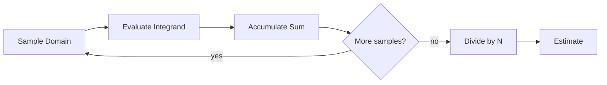
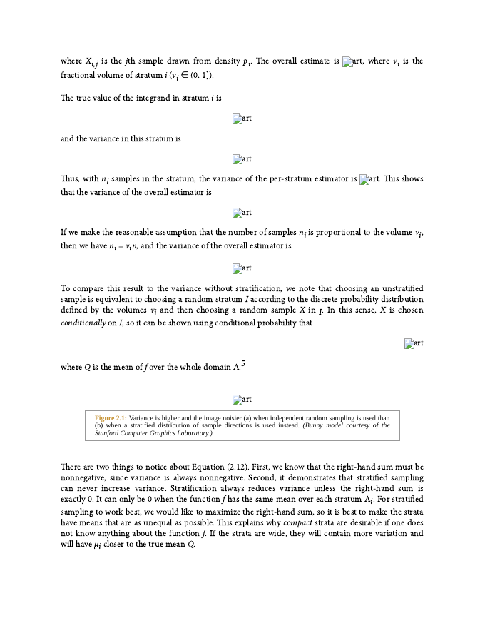
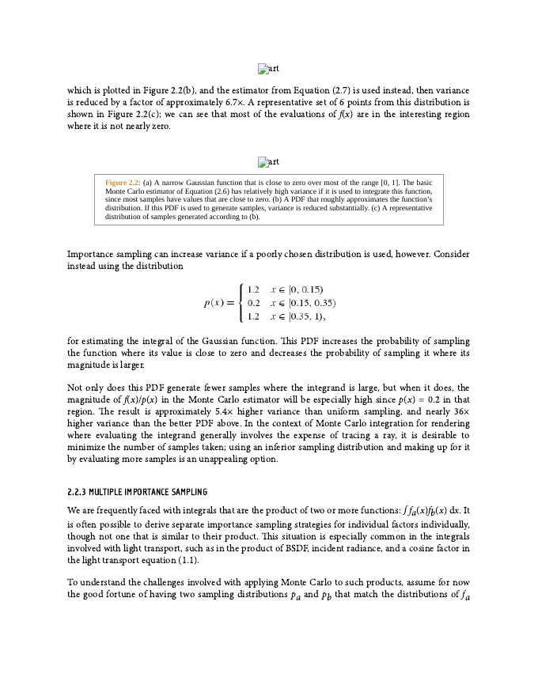
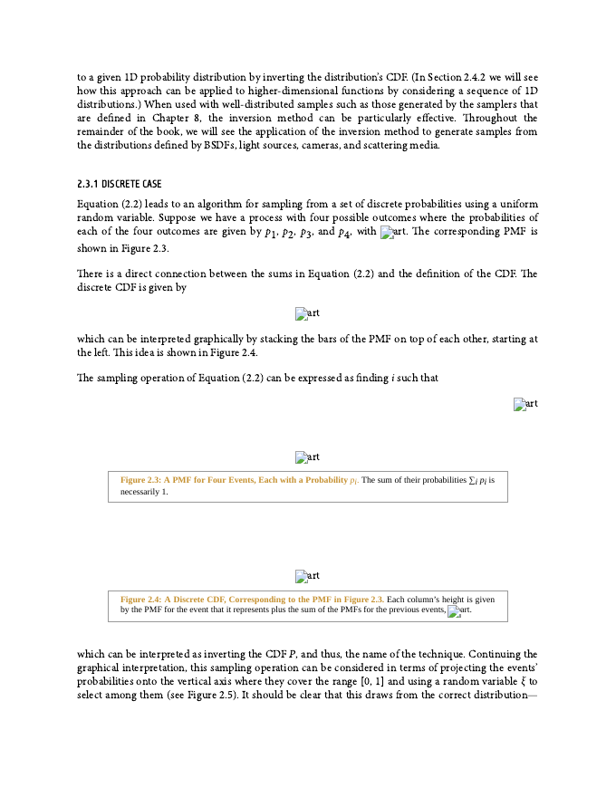
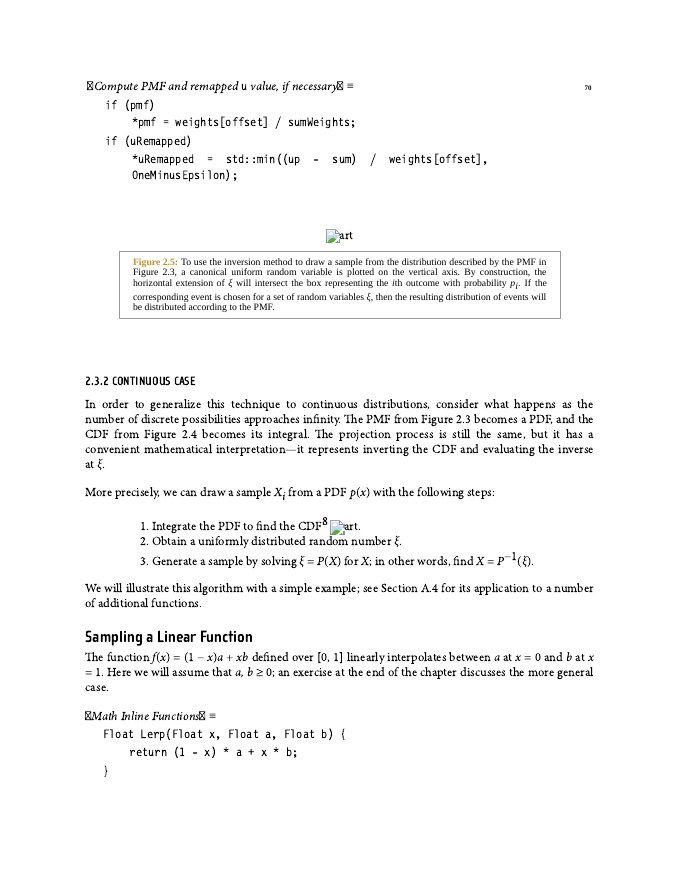

# Chapter 2: Monte Carlo Integration

## Monte Carlo Integration (wgpu)




Rendering is full of integration problems. In addition to the light transport equation (1.1), in the following chapters we will see that integral equations also describe a variety of additional quantities related to light, including the sensor response in a camera, the attenuation and scattering of light in participating media, and scattering from materials like skin. These integral equations generally do not have analytic solutions, so we must turn to numerical methods. Although standard numerical integration techniques like trapezoidal integration or Gaussian quadrature are effective at solving low-dimensional smooth integrals, their rate of convergence is poor for the higher dimensional and discontinuous integrals that are common in rendering. Monte Carlo integration techniques provide one solution to this problem. They use random sampling to evaluate integrals with a convergence rate that is independent of the dimensionality of the integrand.

Monte Carlo integration1 has the useful property that it only requires the ability to evaluate an integrand f(x) at arbitrary points in the domain in order to estimate the value of its integral ∫ f(x) dx. This property not only makes Monte Carlo easy to implement but also makes the technique applicable to a broad variety of integrands. It has a natural extension to multidimensional functions; in Chapter 13, we will see that the light transport algorithm implemented in the `RandomWalkIntegrator` can be shown to be estimating the value of an infinite-dimensional integral.

Judicious use of randomness has revolutionized the field of algorithm design. Randomized algorithms fall broadly into two classes: Las Vegas and Monte Carlo. Las Vegas algorithms are those that use randomness but always give the same result in the end (e.g., choosing a random array entry as the pivot element in Quicksort). Monte Carlo algorithms, on the other hand, give different results depending on the particular random numbers used along the way but give the right answer on average. So, by averaging the results of several runs of a Monte Carlo algorithm (on the same input), it is possible to find a result that is statistically very likely to be close to the true answer.

`RandomWalkIntegrator` 33

The following sections discuss the basic principles of Monte Carlo integration, focusing on those that are widely used in pbrt. See also Appendix A, which has the implementations of additional Monte Carlo sampling functions that are more rarely used in the system.

## 2.1 MONTE CARLO: BASICS

Because Monte Carlo integration is based on randomization, we will start this chapter with a brief review of ideas from probability and statistics that provide the foundations of the approach. Doing so

will allow us to introduce the basic Monte Carlo algorithm as well as mathematical tools for evaluating its error.

### 2.1.1 BACKGROUND AND PROBABILITY REVIEW

We will start by defining some terms and reviewing basic ideas from probability. We assume that the reader is already familiar with basic probability concepts; readers needing a more complete introduction to this topic should consult a textbook such as Sheldon Ross’s Introduction to Probability Models (2002).

A random variable X is a value chosen by some random process. We will generally use capital letters to denote random variables, with exceptions made for a few Greek symbols that represent special random variables. Random variables are always drawn from some domain, which can be either discrete (e.g., a fixed, finite set of possibilities) or continuous (e.g., the real numbers ℝ). Applying a function f to a random variable X results in a new random variable Y = f(X).

For example, the result of a roll of a die is a discrete random variable sampled from the set of events Xi ∈ {1, 2, 3, 4, 5, 6}. Each event has a probability art, and the sum of probability ∑ pi is necessarily one. A random variable like this one that has the same probability for all potential values of it is said to be uniform. A function p(X) that gives a discrete random variable’s probability is termed a probability mass function (PMF), and so we could equivalently write in this case.

Two random variables are independent if the probability of one does not affect the probability of the other. In this case, the joint probability p(X, Y) of two random variables is given by the product of their probabilities:

```text
                                           p(X, Y) = p(X) p(Y).
```

For example, two random variables representing random samples of the six sides of a die are independent.

For dependent random variables, one’s probability affects the other’s. Consider a bag filled with some number of black balls and some number of white balls. If we randomly choose two balls from the bag, the probability of the second ball being white is affected by the color of the first ball since its choice changes the number of balls of one type left in the bag. We will say that the second ball’s probability is conditioned on the choice of the first one. In this case, the joint probability for choosing two balls X and Y is given by

where p(Y|X) is the conditional probability of Y given a value of X.

`BVHLightSampler` 796

In the following, it will often be the case that a random variable’s probability is conditioned on many values; for example, when choosing a light source from which to sample illumination, the

`BVHLightSampler` in Section 12.6.3 considers the 3D position of the receiving point and its surface normal, and so the choice of light is conditioned on them. However, we will often omit the variables that a random variable is conditioned on in cases where there are many of them and where enumerating them would obscure notation.

A particularly important random variable is the canonical uniform random variable, which we will write as ξ. This variable takes on all values in its domain [0, 1) independently and with uniform probability. This particular variable is important for two reasons. First, it is easy to generate a variable with this distribution in software—most runtime libraries have a pseudo-random number generator that does just that.2 Second, we can take the canonical uniform random variable ξ and map it to a discrete random variable, choosing Xi if

For lighting applications, we might want to define the probability of sampling illumination from each light in the scene based on its power Φi relative to the total power from all sources:

Notice that these pi values also sum to 1. Given such per-light probabilities, ξ could be used to select a light source from which to sample illumination.

The cumulative distribution function (CDF) P(x) of a random variable is the probability that a value from the variable’s distribution is less than or equal to some value x:

For the die example, art, since two of the six possibilities are less than or equal to 2.

Continuous random variables take on values over ranges of continuous domains (e.g., the real numbers, directions on the unit sphere, or the surfaces of shapes in the scene). Beyond ξ, another example of a continuous random variable is the random variable that ranges over the real numbers between 0 and 2, where the probability of its taking on any particular value x is proportional to the value 2 − x: it is twice as likely for this random variable to take on a value around 0 as it is to take one around 1, and so forth.

The probability density function (PDF) formalizes this idea: it describes the relative probability of a random variable taking on a particular value and is the continuous analog of the PMF. The PDF p(x) is the derivative of the random variable’s CDF,

For uniform random variables, p(x) is a constant; this is a direct consequence of uniformity. For ξ we have

PDFs are necessarily nonnegative and always integrate to 1 over their domains. Note that their value at a point x is not necessarily less than 1, however.

Given an interval [a, b] in the domain, integrating the PDF gives the probability that a random variable lies inside the interval:

This follows directly from the first fundamental theorem of calculus and the definition of the PDF.

### 2.1.2 EXPECTED VALUES

The expected value Ep[f(x)] of a function f is defined as the average value of the function over some distribution of values p(x) over its domain D. It is defined as

As an example, consider finding the expected value of the cosine function between 0 and π, where p is uniform. Because the PDF p(x) must integrate to 1 over the domain, p(x) =1/π, so3

which is precisely the expected result. (Consider the graph of cos x over [0, π] to see why this is so.)

The expected value has a few useful properties that follow from its definition:

We will repeatedly use these properties in derivations in the following sections.

### 2.1.3 THE MONTE CARLO ESTIMATOR

We can now define the Monte Carlo estimator, which approximates the value of an arbitrary integral. Suppose that we want to evaluate a 1D integral art. Given a supply of independent uniform random variables Xi ∈ [a, b], the Monte Carlo estimator says that the expected value of the estimator

E[Fn], is equal to the integral. This fact can be demonstrated with just a few steps. First, note that the PDF p(x) corresponding to the random variable Xi must be equal to 1/(b − a), since p must not only be a constant but also integrate to 1 over the domain [a, b]. Algebraic manipulation using the properties from Equations (2.4) and (2.5) then shows that

Extending this estimator to multiple dimensions or complex integration domains is straightforward: n independent samples Xi are taken from a uniform multidimensional PDF, and the estimator is applied in the same way. For example, consider the 3D integral

If samples Xi = (xi, yi, zi) are chosen uniformly from the cube from [x0, x1] × [y0, y1] × [z0, z1], then the PDF p(X) is the constant value

and the estimator is

The restriction to uniform random variables can be relaxed with a small generalization. This is an important step, since carefully choosing the PDF from which samples are drawn leads to a key technique for reducing error in Monte Carlo that will be introduced in Section 2.2.2. If the random variables Xi are drawn from a PDF p(x), then the estimator

can be used to estimate the integral instead. The only limitation on p(x) is that it must be nonzero for all x where |f(x)| > 0.

It is similarly not too hard to see that the expected value of this estimator is the desired integral of f:

We can now understand the factor of 1/(4π) in the implementation of the `RandomWalkIntegrator`: directions are uniformly sampled over the unit sphere, which has area 4π. Because the PDF is normalized over the sampling domain, it must have the constant value 1/(4π). When the estimator of Equation (2.7) is applied, that value appears in the divisor.

With Monte Carlo, the number of samples n can be chosen arbitrarily, regardless of the dimensionality of the integrand. This is another important advantage of Monte Carlo over traditional deterministic quadrature techniques, which typically require a number of samples that is exponential in the dimension.

### 2.1.4 ERROR IN MONTE CARLO ESTIMATORS

Showing that the Monte Carlo estimator converges to the right answer is not enough to justify its use; its rate of convergence is important too. Variance, the expected squared deviation of a function from its expected value, is a useful way to characterize Monte Carlo estimators’ convergence. The variance of an estimator F is defined as

from which it follows that

This property and Equation (2.5) yield an alternative expression for the variance:

Thus, the variance is the expected value of the square minus the square of the expected value.

If the estimator is a sum of independent random variables (like the Monte Carlo estimator Fn), then the variance of the sum is the sum of the individual random variables’ variances:

From Equation (2.10) it is easy to show that variance decreases linearly with the number of samples n. Because variance is squared error, the error in a Monte Carlo estimate therefore only goes down at a rate of O(n−1/2) in the number of samples. Although standard quadrature techniques converge at a faster rate in one dimension, their performance becomes exponentially worse as the dimensionality of the integrand increases, while Monte Carlo’s convergence rate is independent of the dimension, making Monte Carlo the only practical numerical integration algorithm for high-dimensional integrals.

The O(n−1/2) characteristic of Monte Carlo’s rate of error reduction is apparent when watching a progressive rendering of a scene where additional samples are incrementally taken in all pixels. The image improves rapidly for the first few samples when doubling the number of samples is relatively little additional work. Later on, once tens or hundreds of samples have been taken, each additional sample doubling takes much longer and remaining error in the image takes a long time to disappear.

The linear decrease in variance with increasing numbers of samples makes it easy to compare different Monte Carlo estimators. Consider two estimators, where the second has half the variance of the first but takes three times as long to compute an estimate; which of the two is better? In that case, the first is preferable: it could take three times as many samples in the time consumed by the second, in which case it would achieve a 3× variance reduction. This concept can be encapsulated in the efficiency of an estimator F, which is defined as

where V[F] is its variance and T[F] is the running time to compute its value.

Not all estimators of integrals have expected values that are equal to the value of the integral. Such estimators are said to be biased, where the difference

is the amount of bias. Biased estimators may still be desirable if they are able to get close to the correct result more quickly than unbiased estimators. Kalos and Whitlock (1986, pp. 36–37) gave the

following example: consider the problem of computing an estimate of the mean value of a uniform distribution Xi ∼ p over the interval from 0 to 1. One could use the estimator

or one could use the biased estimator

The first estimator is unbiased but has variance with order O(n−1). The second estimator’s expected value is

so it is biased, although its variance is O(n−2), which is much better. This estimator has the useful property that its error goes to 0 in the limit as the number of samples n goes to infinity; such estimators are consistent.4 Most of the Monte Carlo estimators used in pbrt are unbiased, with the notable exception of the `SPPMIntegrator`, which implements a photon mapping algorithm.

Closely related to the variance is the mean squared error (MSE), which is defined as the expectation of the squared difference of an estimator and the true value,

For an unbiased estimator, MSE is equal to the variance; otherwise it is the sum of variance and the squared bias of the estimator.

It is possible to work out the variance and MSE of some simple estimators in closed form, but for most of the ones of interest in rendering, this is not possible. Yet it is still useful to be able to quantify these values. For this purpose, the sample variance can be computed using a set of independent random variables Xi. Equation (2.8) points at one way to compute the sample variance for a set of n random variables Xi. If the sample mean is computed as their average, art, then the sample variance is

The division by n − 1 rather than n is Bessel’s correction, and ensures that the sample variance is an unbiased estimate of the variance. (See also Section B.2.11, where a numerically stable approach for computing the sample variance is introduced.)

The sample variance is itself an estimate of the variance, so it has variance itself. Consider, for example, a random variable that has a value of 1 99.99% of the time, and a value of one million 0.01% of the time. If we took ten random samples of it that all had the value 1, the sample variance would suggest that the random variable had zero variance even though its variance is actually much higher.

If an accurate estimate of the integral art can be computed (for example, using a large number of samples), then the mean squared error can be estimated by

The `imgtool` utility program that is provided in pbrt’s distribution can compute an image’s MSE with respect to a reference image via its `diff` option.

## 2.2 IMPROVING EFFICIENCY

Given an unbiased Monte Carlo estimator, we are in the fortunate position of having a reliable relationship between the number of samples taken and variance (and thus, error). If we have an unacceptably noisy rendered image, increasing the number of samples will reduce error in a predictable way, and—given enough computation—an image of sufficient quality can be generated.

However, computation takes time, and often there is not enough of it. The deadline for a movie may be at hand, or the sixtieth-of-a-second time slice in a real-time renderer may be coming to an end. Given the consequentially limited number of samples, the only option for variance reduction is to find ways to make more of the samples that can be taken. Fortunately, a variety of techniques have been developed to improve the basic Monte Carlo estimator by making the most of the samples that are taken; here we will discuss the most important ones that are used in pbrt.

### 2.2.1 STRATIFIED SAMPLING

A classic and effective family of techniques for variance reduction is based on the careful placement of samples in order to better capture the features of the integrand (or, more accurately, to be less likely to miss important features). These techniques are used extensively in pbrt. Stratified sampling decomposes the integration domain into regions and places samples in each one; here we will analyze that approach in terms of its variance reduction properties. Later, in Section 8.2.1, we will return with machinery based on Fourier analysis that provides further insights about it.

Stratified sampling subdivides the integration domain Λ into n nonoverlapping regions Λ1, Λ2, …, Λn. Each region is called a stratum, and they must completely cover the original domain:

To draw samples from Λ, we will draw ni samples from each Λi, according to densities pi inside each stratum. A simple example is supersampling a pixel. With stratified sampling, the area around a pixel is divided into a k × k grid, and a sample is drawn uniformly within each grid cell. This is better than taking k2 random samples, since the sample locations are less likely to clump together. Here we will show why this technique reduces variance.

Within a single stratum Λi, the Monte Carlo estimate is

where Xi,j is the jth sample drawn from density pi. The overall estimate is art, where vi is the fractional volume of stratum i (vi ∈ (0, 1]).

The true value of the integrand in stratum i is

and the variance in this stratum is

Thus, with ni samples in the stratum, the variance of the per-stratum estimator is art. This shows that the variance of the overall estimator is

If we make the reasonable assumption that the number of samples ni is proportional to the volume vi, then we have ni = vin, and the variance of the overall estimator is

To compare this result to the variance without stratification, we note that choosing an unstratified sample is equivalent to choosing a random stratum I according to the discrete probability distribution defined by the volumes vi and then choosing a random sample X in I. In this sense, X is chosen conditionally on I, so it can be shown using conditional probability that

where Q is the mean of f over the whole domain Λ.5


*Figure 2.1: Variance is higher and the image noisier (a) when independent random sampling is used than (b) when a stratified distribution of sample directions is used instead. (Bunny model courtesy of the Stanford Computer Graphics Laboratory.)*

There are two things to notice about Equation (2.12). First, we know that the right-hand sum must be nonnegative, since variance is always nonnegative. Second, it demonstrates that stratified sampling can never increase variance. Stratification always reduces variance unless the right-hand sum is exactly 0. It can only be 0 when the function f has the same mean over each stratum Λi. For stratified sampling to work best, we would like to maximize the right-hand sum, so it is best to make the strata have means that are as unequal as possible. This explains why compact strata are desirable if one does not know anything about the function f. If the strata are wide, they will contain more variation and will have μi closer to the true mean Q.

*Figure 2.1 shows the effect of using stratified sampling versus an independent random distribution for sampling when rendering an image that includes glossy reflection. There is a reasonable reduction in variance at essentially no cost in running time.*

The main downside of stratified sampling is that it suffers from the same “curse of dimensionality” as standard numerical quadrature. Full stratification in D dimensions with S strata per dimension requires SD samples, which quickly becomes prohibitive. Fortunately, it is often possible to stratify some of the dimensions independently and then randomly associate samples from different dimensions; this approach will be used in Section 8.5. Choosing which dimensions are stratified should be done in a way that stratifies dimensions that tend to be most highly correlated in their effect on the value of the integrand (Owen 1998).

### 2.2.2 IMPORTANCE SAMPLING

Importance sampling is a powerful variance reduction technique that exploits the fact that the Monte Carlo estimator

converges more quickly if the samples are taken from a distribution p(x) that is similar to the function f(x) in the integrand. In this case, samples are more likely to be taken when the magnitude of the integrand is relatively large. Importance sampling is one of the most frequently used variance reduction techniques in rendering, since it is easy to apply and is very effective when good sampling distributions are used.

To see why such sampling distributions reduce error, first consider the effect of using a distribution p(x) ∝ f(x), or p(x) = cf(x).6 It is trivial to show that normalization of the PDF requires that

Finding such a PDF requires that we know the value of the integral, which is what we were trying to estimate in the first place. Nonetheless, if we could sample from this distribution, each term of the sum in the estimator would have the value

The variance of the estimator is zero! Of course, this is ludicrous since we would not bother using Monte Carlo if we could integrate f directly. However, if a density p(x) can be found that is similar in shape to f(x), variance is reduced.

As a more realistic example, consider the Gaussian function art, which is plotted in Figure 2.2(a) over [0, 1]. Its value is close to zero over most of the domain. Samples X with X < 0.2 or X > 0.3 are of little help in estimating the value of the integral since they give no information about the magnitude of the bump in the function’s value around 1/4. With uniform sampling and the basic Monte Carlo estimator, variance is approximately 0.0365.

If samples are instead drawn from the piecewise-constant distribution

which is plotted in Figure 2.2(b), and the estimator from Equation (2.7) is used instead, then variance is reduced by a factor of approximately 6.7×. A representative set of 6 points from this distribution is shown in Figure 2.2(c); we can see that most of the evaluations of f(x) are in the interesting region where it is not nearly zero.


*Figure 2.2: (a) A narrow Gaussian function that is close to zero over most of the range [0, 1]. The basic Monte Carlo estimator of Equation (2.6) has relatively high variance if it is used to integrate this function, since most samples have values that are close to zero. (b) A PDF that roughly approximates the function’s distribution. If this PDF is used to generate samples, variance is reduced substantially. (c) A representative distribution of samples generated according to (b).*

Importance sampling can increase variance if a poorly chosen distribution is used, however. Consider instead using the distribution

for estimating the integral of the Gaussian function. This PDF increases the probability of sampling the function where its value is close to zero and decreases the probability of sampling it where its magnitude is larger.

Not only does this PDF generate fewer samples where the integrand is large, but when it does, the magnitude of f(x)/p(x) in the Monte Carlo estimator will be especially high since p(x) = 0.2 in that region. The result is approximately 5.4× higher variance than uniform sampling, and nearly 36× higher variance than the better PDF above. In the context of Monte Carlo integration for rendering where evaluating the integrand generally involves the expense of tracing a ray, it is desirable to minimize the number of samples taken; using an inferior sampling distribution and making up for it by evaluating more samples is an unappealing option.

### 2.2.3 MULTIPLE IMPORTANCE SAMPLING

We are frequently faced with integrals that are the product of two or more functions: ∫ fa(x)fb(x) dx. It is often possible to derive separate importance sampling strategies for individual factors individually, though not one that is similar to their product. This situation is especially common in the integrals involved with light transport, such as in the product of BSDF, incident radiance, and a cosine factor in the light transport equation (1.1).

To understand the challenges involved with applying Monte Carlo to such products, assume for now the good fortune of having two sampling distributions pa and pb that match the distributions of fa

and fb exactly. (In practice, this will not normally be the case.) With the Monte Carlo estimator of Equation (2.7), we have two options: we might draw samples using pa, which gives the estimator

where c is a constant equal to the integral of fa, since pa(x) ∝ fa(x). The variance of this estimator is proportional to the variance of fb, which may itself be high.7 Conversely, we might sample from pb, though doing so gives us an estimator with variance proportional to the variance of fa, which may similarly be high. In the more common case where the sampling distributions only approximately match one of the factors, the situation is usually even worse.

Unfortunately, the obvious solution of taking some samples from each distribution and averaging the two estimators is not much better. Because variance is additive, once variance has crept into an estimator, we cannot eliminate it by adding it to another low-variance estimator.

Multiple importance sampling (MIS) addresses exactly this issue, with an easy-to-implement variance reduction technique. The basic idea is that, when estimating an integral, we should draw samples from multiple sampling distributions, chosen in the hope that at least one of them will match the shape of the integrand reasonably well, even if we do not know which one this will be. MIS then provides a method to weight the samples from each technique that can eliminate large variance spikes due to mismatches between the integrand’s value and the sampling density. Specialized sampling routines that only account for unusual special cases are even encouraged, as they reduce variance when those cases occur, with relatively little cost in general.

With two sampling distributions pa and pb and a single sample taken from each one, X ∼ pa and Y ∼ pb, the MIS Monte Carlo estimator is wa(X)

where wa and wb are weighting functions chosen such that the expected value of this estimator is the value of the integral of f(x).

More generally, given n sampling distributions pi with ni samples Xi,j taken from the ith distribution, the MIS Monte Carlo estimator is

(The full set of conditions on the weighting functions for the estimator to be unbiased are that they sum to 1 when f(x) ≠ 0, art, and that wi(x) = 0 if pi(x) = 0.)

Setting xi(X) = 1/n corresponds to the case of summing the various estimators, which we have already seen is an ineffective way to reduce variance. It would be better if the weighting functions were relatively large when the corresponding sampling technique was a good match to the integrand and relatively small when it was not, thus reducing the contribution of high-variance samples.

In practice, a good choice for the weighting functions is given by the balance heuristic, which attempts to fulfill this goal by taking into account all the different ways that a sample could have been generated, rather than just the particular one that was used to do so. The balance heuristic’s weighting function for the ith sampling technique is

With the balance heuristic and our example of taking a single sample from each of two sampling techniques, the estimator of Equation (2.13) works out to be

Each evaluation of f is divided by the sum of all PDFs for the corresponding sample rather than just the one that generated the sample. Thus, if pa generates a sample with low probability at a point where the pb has a higher probability, then dividing by pa(X) + pb(X) reduces the sample’s contribution. Effectively, such samples are downweighted when sampled from pa, recognizing that the sampling technique associated with pb is more effective at the corresponding point in the integration domain. As long as just one of the sampling techniques has a reasonable probability of sampling a point where the function’s value is large, the MIS weights can lead to a significant reduction in variance.

`BalanceHeuristic()` computes Equation (2.14) for the specific case of two distributions pa and pb. We will not need a more general multidistribution case in pbrt.

〈Sampling Inline Functions〉 ≡

```text
Float BalanceHeuristic(int nf, Float fPdf, int ng, Float gPdf) { return (nf * fPdf) / (nf * fPdf + ng * gPdf); }
```

In practice, the power heuristic often reduces variance even further. For an exponent β, the power heuristic is

Note that the power heuristic has a similar form to the balance heuristic, though it further reduces the contribution of relatively low probabilities. Our implementation has β = 2 hard-coded in its implementation; that parameter value usually works well in practice.

`Float` 23
`Sqr()` 1034

〈Sampling Inline Functions〉 +≡

```text
Float PowerHeuristic(int nf, Float fPdf, int ng, Float gPdf) { Float f = nf * fPdf, g = ng * gPdf; return Sqr(f) / (Sqr(f) + Sqr(g)); }
```

Multiple importance sampling can be applied even without sampling from all the distributions. This approach is known as the single sample model. We will not include the derivation here, but it can be shown that given an integrand f(x), if a sampling technique pi is chosen from a set of techniques with probability qi and a sample X is drawn from pi, then the single sample estimator

gives an unbiased estimate of the integral. For the single sample model, the balance heuristic is provably optimal.

One shortcoming of multiple importance sampling is that if one of the sampling techniques is a very good match to the integrand, MIS can slightly increase variance. For rendering applications, MIS is almost always worthwhile for the variance reduction it provides in cases that can otherwise have high variance.

MIS Compensation Multiple importance sampling is generally applied using probability distributions that are all individually valid for importance sampling the integrand, with nonzero probability of generating a sample anywhere that the integrand is nonzero. However, when MIS is being used, it is not a requirement that all PDFs are nonzero where the function’s value is nonzero; only one of them must be.

This observation led to the development of a technique called MIS compensation, which can further reduce variance. It is motivated by the fact that if all the sampling distributions allocate some probability to sampling regions where the integrand’s value is small, it is often the case that that region of the integrand ends up being oversampled, leaving the region where the integrand is high undersampled.

MIS compensation is based on the idea of sharpening one or more (but not all) the probability distributions—for example, by adjusting them to have zero probability in areas where they earlier had low probability. A new sampling distribution p′ can, for example, be defined by

for some fixed value δ.

This technique is especially easy to apply in the case of tabularized sampling distributions. In Section 12.5, it is used to good effect for sampling environment map light sources.

### 2.2.4 RUSSIAN ROULETTE

Russian roulette is a technique that can improve the efficiency of Monte Carlo estimates by skipping the evaluation of samples that would make a small contribution to the final result. In rendering, we often have estimators of the form

where the integrand consists of some factors f(X) that are easily evaluated (e.g., those that relate to how the surface scatters light) and others that are more expensive to evaluate, such as a binary visibility factor v(X) that requires tracing a ray. In these cases, most of the computational expense of evaluating the estimator lies in v.

If f(X) is zero, it is obviously worth skipping the work of evaluating v(X), since its value will not affect the value of the estimator. However, if we also skipped evaluating estimators where f(X) was small but nonzero, then we would introduce bias into the estimator and would systemically underestimate the value of the integrand. Russian roulette solves this problem, making it possible to also skip tracing rays when f(X)’s value is small but not necessarily 0, while still computing the correct value on average.

To apply Russian roulette, we select some termination probability q. This value can be chosen in almost any manner; for example, it could be based on an estimate of the value of the integrand for the particular sample chosen, increasing as the integrand’s value becomes smaller. With probability q, the estimator is not evaluated for the particular sample, and some constant value c is used in its place (c = 0 is often used). With probability 1 − q, the estimator is still evaluated but is weighted by the factor 1/(1 − q), which effectively compensates for the samples that were skipped.

We have the new estimator

It is easy to see that its expected value is the same as the expected value of the original estimator:

Russian roulette never reduces variance. In fact, unless somehow c = F, it will always increase variance. However, it does improve Monte Carlo efficiency if the probabilities are chosen so that samples that are likely to make a small contribution to the final result are skipped.

### 2.2.5 SPLITTING

While Russian roulette reduces the number of samples, splitting increases the number of samples in some dimensions of multidimensional integrals in order to improve efficiency. As an example, consider an integral of the general form

With the standard importance sampling estimator, we might draw n samples from independent distributions, Xi ∼ px and Yi ∼ py, and compute

Splitting allows us to formalize the idea of taking more than one sample for the integral over B for each sample taken in A. With splitting, we might take m samples Yi,j for each sample Xi, giving the estimator

If it is possible to partially evaluate f(Xi, ·) for each Xi, then we can compute a total of nm samples more efficiently than we had taken nm independent Xi values using Equation (2.18).

For an example from rendering, an integral of the form of Equation (2.17) is evaluated to compute the color of pixels in an image: an integral is taken over the area of the pixel A where at each point in the pixel x, a ray is traced into the scene and the reflected radiance at the intersection point is computed using an integral over the hemisphere (denoted here by B) for which one or more rays are traced. With splitting, we can take multiple samples for each lighting integral, improving efficiency by amortizing the cost of tracing the initial ray from the camera over them.

## 2.3 SAMPLING USING THE INVERSION METHOD

To evaluate the Monte Carlo estimator in Equation (2.7), it is necessary to be able to draw random samples from a chosen probability distribution. There are a variety of techniques for doing so, but one of the most important for rendering is the inversion method, which maps uniform samples from [0, 1)

to a given 1D probability distribution by inverting the distribution’s CDF. (In Section 2.4.2 we will see how this approach can be applied to higher-dimensional functions by considering a sequence of 1D distributions.) When used with well-distributed samples such as those generated by the samplers that are defined in Chapter 8, the inversion method can be particularly effective. Throughout the remainder of the book, we will see the application of the inversion method to generate samples from the distributions defined by BSDFs, light sources, cameras, and scattering media.

### 2.3.1 DISCRETE CASE

Equation (2.2) leads to an algorithm for sampling from a set of discrete probabilities using a uniform random variable. Suppose we have a process with four possible outcomes where the probabilities of each of the four outcomes are given by p1, p2, p3, and p4, with art. The corresponding PMF is shown in Figure 2.3.

There is a direct connection between the sums in Equation (2.2) and the definition of the CDF. The discrete CDF is given by

which can be interpreted graphically by stacking the bars of the PMF on top of each other, starting at the left. This idea is shown in Figure 2.4.

The sampling operation of Equation (2.2) can be expressed as finding i such that


*Figure 2.3: A PMF for Four Events, Each with a Probability pi. The sum of their probabilities ∑i pi is necessarily 1.*


*Figure 2.4: A Discrete CDF, Corresponding to the PMF in Figure 2.3. Each column’s height is given by the PMF for the event that it represents plus the sum of the PMFs for the previous events, art.*

which can be interpreted as inverting the CDF P, and thus, the name of the technique. Continuing the graphical interpretation, this sampling operation can be considered in terms of projecting the events’ probabilities onto the vertical axis where they cover the range [0, 1] and using a random variable ξ to select among them (see Figure 2.5). It should be clear that this draws from the correct distribution—

the probability of the uniform sample hitting any particular bar is exactly equal to the height of that bar.

The `SampleDiscrete()` function implements this algorithm. It takes a not-necessarily normalized set of nonnegative weights, a uniform random sample u, and returns the index of one of the weights with probability proportional to its weight. The sampling operation it performs corresponds to finding i such that

which corresponds to multiplying Equation (2.19) by ∑ wi. (Not requiring a normalized PMF is a convenience for calling code and not much more work in the function’s implementation.) Two optional parameters are provided to return the value of the PMF for the sample as well as a new uniform random sample that is derived from u.

This function is designed for the case where only a single sample needs to be generated from the weights’ distribution; if multiple samples are required, the `AliasTable`, which will be introduced in Section A.1, should generally be used instead: it generates samples in O(1) time after an O(n) preprocessing step, whereas `SampleDiscrete()` requires O(n) time for each sample generated.

〈Sampling Inline Functions〉 +≡

```text
int SampleDiscrete(pstd::span<const Float> weights, Float u, Float *pmf, Float *uRemapped) { 〈Handle empty weights for discrete sampling 71〉 〈Compute sum of weights 71〉 〈Compute rescaled u sample 71〉 〈Find offset in weights corresponding to u′ 71〉 〈Compute PMF and remapped u value, if necessary 71〉 return offset; }
```

`AliasTable` 994
`Float` 23

The case of weights being empty is handled first so that subsequent code can assume that there is at least one weight.

〈Handle empty weights for discrete sampling〉 ≡ 70

```text
if (weights.empty()) { if (pmf) *pmf = 0; return -1; }
```

The discrete probability of sampling the ith element is given by weights[i] divided by the sum of all weight values. Therefore, the function computes that sum next.

〈Compute sum of weights〉 ≡ 70

```rust
   let mut sum_weights: Float = 0.0;
   for &w in weights {
       sum_weights += w;
   }
```

Following Equation (2.20), the uniform sample u is scaled by the sum of the weights to get a value u′ that will be used to sample from them. Even though the provided u value should be in the range [0, 1), it is possible that u * sumWeights will be equal to sumWeights due to floating-point round-off. In that rare case, up is bumped down to the next lower floating-point value so that subsequent code can assume that up < sumWeights.

〈Compute rescaled u′ sample〉 ≡ 70

```rust
   let mut up = u * sum_weights;
   if up == sum_weights {
       up = next_float_down(up);
   }
```

We would now like to find the last offset in the weights array i where the random sample up is greater than the sum of weights up to i. Sampling is performed using a linear search from the start of the array, accumulating a sum of weights until the sum would be greater than u′.

〈Find offset in weights corresponding to u′〉 ≡ 70

```rust
   let mut offset = 0usize;
   let mut sum: Float = 0.0;
   while sum + weights[offset] <= up {
       sum += weights[offset];
       offset += 1;
   }
```

After the while loop terminates, the randomness in the provided sample u has only been used to select an element of the array—a discrete choice. The offset of a sample between the CDF values that bracket it is itself a uniform random value that can easily be remapped to [0, 1). This value is returned to the caller in uRemapped, if requested.

One might ask: why bother? It is not too difficult to generate uniform random variables, so the benefit of providing this option may seem marginal. However, for some of the high-quality sample generation algorithms in Chapter 8, it can be beneficial to reuse samples in this way rather than generating new ones—thus, this option is provided.

`Float` 23
`NextFloatDown()` 366
`OneMinusEpsilon` 470

〈Compute PMF and remapped u value, if necessary〉 ≡ 70

```rust
   if let Some(pmf) = pmf.as_mut() {
       *pmf = weights[offset] / sum_weights;
   }
   if let Some(u_remapped) = u_remapped.as_mut() {
       *u_remapped = ((up - sum) / weights[offset]).min(ONE_MINUS_EPSILON);
   }
```


*Figure 2.5: To use the inversion method to draw a sample from the distribution described by the PMF in Figure 2.3, a canonical uniform random variable is plotted on the vertical axis. By construction, the horizontal extension of ξ will intersect the box representing the ith outcome with probability pi. If the corresponding event is chosen for a set of random variables ξ, then the resulting distribution of events will be distributed according to the PMF.*

### 2.3.2 CONTINUOUS CASE

In order to generalize this technique to continuous distributions, consider what happens as the number of discrete possibilities approaches infinity. The PMF from Figure 2.3 becomes a PDF, and the CDF from Figure 2.4 becomes its integral. The projection process is still the same, but it has a convenient mathematical interpretation—it represents inverting the CDF and evaluating the inverse at ξ.

More precisely, we can draw a sample Xi from a PDF p(x) with the following steps:

1. Integrate the PDF to find the CDF8 art.
2. Obtain a uniformly distributed random number ξ.
3. Generate a sample by solving ξ = P(X) for X; in other words, find X = P−1(ξ).

We will illustrate this algorithm with a simple example; see Section A.4 for its application to a number of additional functions.

Sampling a Linear Function The function f(x) = (1 − x)a + xb defined over [0, 1] linearly interpolates between a at x = 0 and b at x = 1. Here we will assume that a, b ≥ 0; an exercise at the end of the chapter discusses the more general case.

〈Math Inline Functions〉 ≡

```text
Float Lerp(Float x, Float a, Float b) { return (1 - x) * a + x * b; }
```

The function’s integral is art, which gives the normalization constant 2/(a + b) to define its PDF,

`Float` 23

〈Sampling Inline Functions〉 +≡

```text
Float LinearPDF(Float x, Float a, Float b) { if (x < 0 || x > 1) return 0; return 2 * Lerp(x, a, b) / (a + b); }
```

Integrating the PDF gives the CDF, which is the quadratic function

Inverting ξ = P(X) gives a sampling recipe

though note that in this form, the case a = b gives an indeterminate result. The more stable formulation

computes the same result and is implemented here.

〈Sampling Inline Functions〉 +≡

```text
Float SampleLinear(Float u, Float a, Float b) { if (u == 0 && a == 0) return 0; Float x = u * (a + b) / (a + std::sqrt(Lerp(u, Sqr(a), Sqr(b)))); return std::min(x, OneMinusEpsilon); }
```

One detail to note is the `std::min` call in the return statement, which ensures that the returned value is within the range [0, 1). Although the sampling algorithm generates values in that range given ξ ∈ [0, 1), round-off error may cause the result to be equal to 1. Because some of the code that calls the sampling routines depends on the returned values being in the specified range, the sampling routines must ensure this is so.

In addition to providing functions that sample from a distribution and compute the PDF of a sample, pbrt usually also provides functions that invert sampling operations, returning the random sample ξ that corresponds to a value x. In the 1D case, this is equivalent to evaluating the CDF.

〈Sampling Inline Functions〉 +≡

```rust
   fn invert_linear_sample(x: Float, a: Float, b: Float) -> Float {
       x * (a * (2.0 - x) + b * x) / (a + b)
   }
```

`Float` 23
`Lerp()` 72
`OneMinusEpsilon` 470
`Sqr()` 1034

## 2.4 TRANSFORMING BETWEEN DISTRIBUTIONS

In describing the inversion method, we introduced a technique that generates samples according to some distribution by transforming canonical uniform random variables in a particular manner. Here, we will investigate the more general question of which distribution results when we transform samples from an arbitrary distribution to some other distribution with a function f. Understanding the effect of such transformations is useful for a few reasons, though here we will focus on how they allow us to derive multidimensional sampling algorithms.

Suppose we are given a random variable X drawn from some PDF p(x) with CDF P(x). Given a function f(x) with y = f(x), if we compute Y = f(X), we would like to find the distribution of the new random variable Y. In this case, the function f(x) must be a one-to-one transformation; if multiple values of x mapped to the same y value, then it would be impossible to unambiguously describe the probability density of a particular y value. A direct consequence of f being one-to-one is that its derivative must either be strictly greater than 0 or strictly less than 0, which implies that for a given x,

```text
                                         Pr{Y ≤ f(x)} = Pr{X ≤ x}.
```

From the definition of the CDF, Equation (2.3), we can see that

```text
                                          Pf(y) = Pf(f(x)) = P(x).
```

This relationship between CDFs leads directly to the relationship between their PDFs. If we assume that f’s derivative is greater than 0, differentiating gives

and so

In general, f’s derivative is either strictly positive or strictly negative, and the relationship between the densities is

How can we use this formula? Suppose that p(x) = 2x over the domain [0, 1], and let f(x) = sin x. What is the PDF of the random variable Y = f(X)? Because we know that df/dx = cos x,

This procedure may seem backward—usually we have some PDF that we want to sample from, not a given transformation. For example, we might have X drawn from some p(x) and would like to compute Y from some distribution pf(y). What transformation should we use? All we need is for the CDFs to be equal, or Pf(y) = P(x), which immediately gives the transformation

This is a generalization of the inversion method, since if X were uniformly distributed over [0, 1) then P(x) = x, and we have the same procedure as was introduced previously.

### 2.4.1 TRANSFORMATION IN MULTIPLE DIMENSIONS

In the general d-dimensional case, a similar derivation gives the analogous relationship between different densities. We will not show the derivation here; it follows the same form as the 1D case. Suppose we have a d-dimensional random variable X with density function p(x). Now let Y = T(X), where T is a bijection. In this case, the densities are related by

where |JT | is the absolute value of the determinant of T’s Jacobian matrix, which is

where subscripts index dimensions of T(x) and x.

For a 2D example of the use of Equation (2.21), the polar transformation relates Cartesian (x, y) coordinates to a polar radius and angle,

```text
                                                 x = r cos θ
                                                y = r sin θ.
```

Suppose we draw samples from some density p(r, θ). What is the corresponding density p(x, y)? The Jacobian of this transformation is

and the determinant is r (cos2 θ + sin2 θ) = r. So, p(x, y) = p(r, θ)/r. Of course, this is backward from what we usually want—typically we start with a sampling strategy in Cartesian coordinates and want to transform it to one in polar coordinates. In that case, we would have

In 3D, given the spherical coordinate representation of directions, Equation (3.7), the Jacobian of this transformation has determinant |JT| = r2 sin θ, so the corresponding density function is

This transformation is important since it helps us represent directions as points (x, y, z) on the unit sphere.

### 2.4.2 SAMPLING WITH MULTIDIMENSIONAL TRANSFORMATIONS

Suppose we have a 2D joint density function p(x, y) that we wish to draw samples (X, Y) from. If the densities are independent, they can be expressed as the product of 1D densities

```text
                                         p(x, y) = px(x) py(y),
```

and random variables (X, Y) can be found by independently sampling X from px and Y from py. Many useful densities are not separable, however, so we will introduce the theory of how to sample from multidimensional distributions in the general case.

Given a 2D density function, the marginal density function p(x) is obtained by “integrating out” one of the dimensions:

This can be thought of as the density function for X alone. More precisely, it is the average density for a particular x over all possible y values.

If we can draw a sample X ∼ p(x), then—using Equation (2.1)—we can see that in order to sample Y, we need to sample from the conditional probability density, Y ∼ p(y|x), which is given by:

Sampling from higher-dimensional distributions can be performed in a similar fashion, integrating out all but one of the dimensions, sampling that one, and then applying the same technique to the remaining conditional distribution, which has one fewer dimension.

Sampling the Bilinear Function

The bilinear function

interpolates between four values wi at the four corners of [0, 1]2. (w0 is at (0, 0), w1 is at (1, 0), w2 at (0, 1), and w3 at (1, 1).) After integration and normalization, we can find that its PDF is

〈Sampling Inline Functions〉 +≡

```text
Float BilinearPDF(Point2f p, pstd::span<const Float> w) { if (p.x < 0 || p.x > 1 || p.y < 0 || p.y > 1) return 0; if (w[0] + w[1] + w[2] + w[3] == 0) return 1; return 4 * ((1 - p[0]) * (1 - p[1]) * w[0] + p[0] * (1 - p[1]) * w[1] + (1 - p[0]) * p[1] * w[2] + p[0] * p[1] * w[3]) / (w[0] + w[1] + w[2] + w[3]); }
```

The two dimensions of this function are not independent, so the sampling method samples a marginal distribution before sampling the resulting conditional distribution.

〈Sampling Inline Functions〉 +≡

```text
Point2f SampleBilinear(Point2f u, pstd::span<const Float> w) { Point2f p; 〈Sample y for bilinear marginal distribution 77〉 〈Sample x for bilinear conditional distribution 77〉 return p; }
```

We can choose either x or y to be the marginal distribution. If we choose y and integrate out x, we find that

`Float` 23
`Point2f` 92
`SampleLinear()` 73

p(y) performs linear interpolation between two constant values, and so we can use `SampleLinear()` to sample from the simplified proportional function since it normalizes the associated PDF.

〈Sample y for bilinear marginal distribution〉 ≡ 76

```rust
   p.y = sample_linear(u[1], w[0] + w[1], w[2] + w[3]);
```

Applying Equation (2.1) and again canceling out common factors, we have

which can also be sampled in x using `SampleLinear()`.

〈Sample x for bilinear conditional distribution〉 ≡ 76

```rust
   p.x = sample_linear(u[0], lerp(p.y, w[0], w[2]), lerp(p.y, w[1], w[3]));
```

Because the bilinear sampling routine is based on the composition of two 1D linear sampling operations, it can be inverted by applying the inverses of those two operations in reverse order.

〈Sampling Inline Functions〉 +≡

```text
Point2f InvertBilinearSample(Point2f p, pstd::span<const Float> w) { return {InvertLinearSample(p.x, Lerp(p.y, w[0], w[2]), Lerp(p.y, w[1], w[3])), InvertLinearSample(p.y, w[0] + w[1], w[2] + w[3])}; }
```

See Section A.5 for further examples of multidimensional sampling algorithms, including techniques for sampling directions on the unit sphere and hemisphere, sampling unit disks, and other useful distributions for rendering.

FURTHER READING The Monte Carlo method was introduced soon after the development of the digital computer by Stanislaw Ulam and John von Neumann (Ulam et al. 1947), though it also seems to have been independently invented by Enrico Fermi (Metropolis 1987). An early paper on Monte Carlo was written by Metropolis and Ulam (1949).

Many books have been written on Monte Carlo integration. Hammersley and Handscomb (1964), Spanier and Gelbard (1969), and Kalos and Whitlock (1986) are classic references. More recent books on the topic include those by Sobol′ (1994), Fishman (1996), and Liu (2001). We have also found Owen’s in-progress book (2019) to be an invaluable resource. Motwani and Raghavan (1995) have written an excellent introduction to the broader topic of randomized algorithms.

Most of the functions of interest in rendering are nonnegative; applying importance sampling to negative functions requires special care. A straightforward option is to define a sampling distribution that is proportional to the absolute value of the function. See also Owen and Zhou (2000) for a more effective sampling approach for such functions.

Multiple importance sampling was developed by Veach and Guibas (Veach and Guibas 1995; Veach 1997). Normally, a predetermined number of samples are taken using each sampling technique; see Pajot et al. (2011) and Lu et al. (2013) for approaches to adaptively distributing the samples over strategies in an effort to reduce variance by choosing those that are the best match to the integrand. Grittmann et al. (2019) tracked the variance of each sampling technique and then dynamically adjusted the MIS weights accordingly. The MIS compensation approach was developed by Karlík et al. (2019).

`Float` 23
`InvertLinearSample()` 73
`Lerp()` 72
`Point2f` 92
`SampleLinear()` 73

Sbert and collaborators (2016, 2017, 2018) have performed further variance analysis on MIS estimators and have developed improved methods based on allocating samples according to the variance and cost of each technique. Kondapaneni et al. (2019) considered the generalization of MIS to include negative weights and derived optimal estimators in that setting. West et al. (2020) considered the case where a continuum of sampling techniques are available and derived an optimal MIS estimator for that case, and Grittmann et al. (2021) have developed improved MIS estimators when correlation is present among samples (as is the case, for example, with bidirectional light transport algorithms).

Heitz (2020) described an inversion-based sampling method that can be applied when CDF inversion of a 1D function is not possible. It is based on sampling from a second function that approximates the first and then using a second random variable to adjust the sample to match the original function’s distribution. An interesting alternative to manually deriving sampling techniques was described by Anderson et al. (2017), who developed a domain-specific language for sampling where probabilities are automatically computed, given the implementation of a sampling algorithm. They showed the effectiveness of their approach with succinct implementations of a number of tricky sampling techniques.

The numerically stable sampling technique used in `SampleLinear()` is an application of Muller’s method (1956) due to Heitz (2020).

In applications of Monte Carlo in graphics, the integrand is often a product of factors, where no sampling distribution is available that fits the full product. While multiple importance sampling can give reasonable results in this case, at least minimizing variance from ineffective sampling techniques, sampling the full product is still preferable. Talbot et al. (2005) applied importance resampling to this problem, taking multiple samples from some distribution and then choosing among them with probability proportional to the full integrand. More recently, Hart et al. (2020) presented a simple technique based on warping uniform samples that can be used to approximate product sampling. For more information on this topic, see also the “Further Reading” sections of Chapters 13 and 14, which discuss product sampling approaches in the context of specific light transport algorithms.

Debugging Monte Carlo algorithms can be challenging, since it is their behavior in expectation that determines their correctness: it may be difficult to tell if the program execution for a particular sample

is correct. Statistical tests can be an effective approach for checking their correctness. See the papers by Subr and Arvo (2007a) and by Jung et al. (2020) for applicable techniques.

See also the “Further Reading” section in Appendix A, which has information about the sampling algorithms implemented there as well as related approaches.

## EXERCISES

 `SampleLinear()` 73

➋ 2.1 Write a program that compares Monte Carlo and one or more alternative numerical integration techniques. Structure this program so that it is easy to replace the particular function being integrated. Verify that the different techniques compute the same result (given a sufficient number of samples for each of them). Modify your program so that it draws samples from distributions other than the uniform distribution for the Monte Carlo estimate, and verify that it still computes the correct result when the correct estimator, Equation (2.7), is used. (Make sure that any alternative distributions you use have nonzero probability of choosing any value of x where f (x) > 0.) ➊ 2.2 Write a program that computes unbiased Monte Carlo estimates of the integral of a given function. Compute an estimate of the variance of the estimates by performing a series of trials with successively more samples and computing the mean squared error for each one. Demonstrate numerically that variance decreases at a rate of O(n). ➋ 2.3 The algorithm for sampling the linear interpolation function in Section 2.3.2 implicitly assumes that a, b ≥ 0 and that thus f(x) ≥ 0. If f is negative, then the importance sampling PDF should be proportional to |f(x)|. Generalize `SampleLinear()` and the associated PDF and inversion functions to handle the case where f is always negative as well as the case where it crosses zero due to a and b having different signs.

 `SampleLinear()` 73

_________________ 1 For brevity, we will refer to Monte Carlo integration simply as “Monte Carlo.” 2 Although the theory of Monte Carlo is based on using truly random numbers, in practice a well-written pseudo-random number generator (PRNG) is sufficient. pbrt uses a particularly high-quality PRNG that returns a sequence of pseudo-random values that is effectively as “random” as true random numbers. True random numbers, found by measuring random phenomena like atomic decay or atmospheric noise, are available from sources like www.random.org for those for whom PRNGs are not acceptable. 3 When computing expected values with a uniform distribution, we will drop the subscript p from Ep. 4 As a technical note, it is possible for an estimator with infinite variance to be unbiased but not consistent. Such estimators do not generally come up in rendering, however. 5 See Veach (1997) for a derivation of this result. 6 We will generally assume that f(x) ≥ 0; if it is negative, we might set p(x) ∝ |f(x)|. See the “Further Reading” section for more discussion of this topic. 7 Note that the definition of variance in Equation (2.8) does not preclude computing the variance of a function itself. 8 In general, the lower limit of integration should be −∞, although if p(x) = 0 for x < 0, this equation is equivalent.
