# Chapter 3: Geometry and Transformations

## Geometry and Transforms (wgpu)

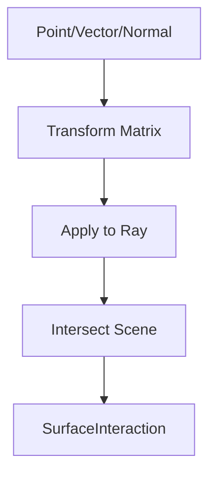


Almost all nontrivial graphics programs are built on a foundation of geometric classes that represent mathematical constructs like points, vectors, and rays. Because these classes are ubiquitous throughout the system, good abstractions and efficient implementations are critical. This chapter presents the interface to and implementation of pbrt’s geometric foundation. Note that these are not the classes that represent the actual scene geometry (triangles, spheres, etc.); those classes are the topic of Chapter 6.

## 3.1 COORDINATE SYSTEMS

As is typical in computer graphics, pbrt represents three-dimensional points, vectors, and normal vectors with three coordinate values: x, y, and z. These values are meaningless without a coordinate system that defines the origin of the space and gives three linearly independent vectors that define the x, y, and z axes of the space. Together, the origin and three vectors are called the frame that defines the coordinate system. Given an arbitrary point or direction in 3D, its (x, y, z) coordinate values depend on its relationship to the frame. Figure 3.1 shows an example that illustrates this idea in 2D.

In the general n-dimensional case, a frame’s origin po and its n linearly independent basis vectors define an n-dimensional affine space. All vectors v in the space can be expressed as a linear combination of the basis vectors. Given a vector v and the basis vectors vi, there is a unique set of scalar values si such that v = s1v1 + … + snvn. The scalars si are the representation of v with respect to the basis {v1, v2, … , vn} and are the coordinate values that we store with the vector. Similarly, for all points p, there are unique scalars si such that the point can be expressed in terms of the origin po and the basis vectors p = po + s1v1 + … + snvn. Thus, although points and vectors are both represented by x, y, and z coordinates in 3D, they are distinct mathematical entities and are not freely interchangeable.

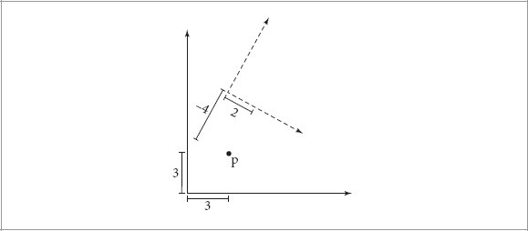


*Figure 3.1: In 2D, the (x, y) coordinates of a point p are defined by the relationship of the point to a particular 2D coordinate system. Here, two coordinate systems are shown; the point might have coordinates (3, 3) with respect to the coordinate system with its coordinate axes drawn in solid lines but have coordinates (2, −4) with respect to the coordinate system with dashed axes. In either case, the 2D point p is at the same absolute position in space.*

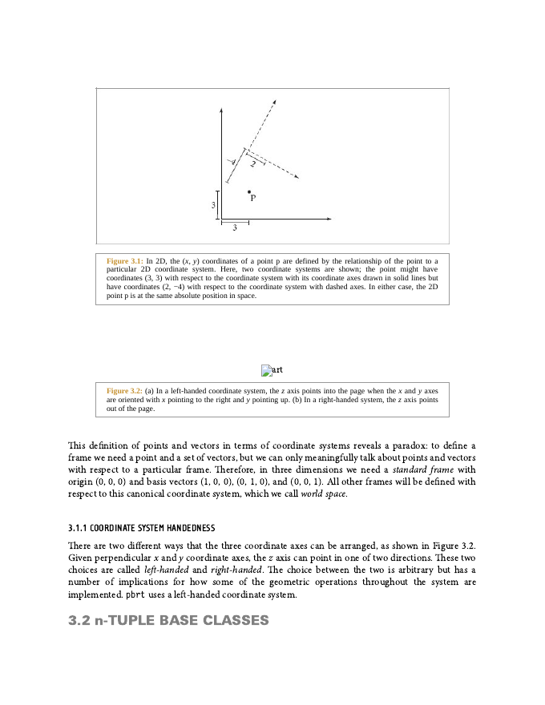
*Figure 3.2: (a) In a left-handed coordinate system, the z axis points into the page when the x and y axes are oriented with x pointing to the right and y pointing up. (b) In a right-handed system, the z axis points out of the page.*

This definition of points and vectors in terms of coordinate systems reveals a paradox: to define a frame we need a point and a set of vectors, but we can only meaningfully talk about points and vectors with respect to a particular frame. Therefore, in three dimensions we need a standard frame with origin (0, 0, 0) and basis vectors (1, 0, 0), (0, 1, 0), and (0, 0, 1). All other frames will be defined with respect to this canonical coordinate system, which we call world space.

### 3.1.1 COORDINATE SYSTEM HANDEDNESS

There are two different ways that the three coordinate axes can be arranged, as shown in Figure 3.2. Given perpendicular x and y coordinate axes, the z axis can point in one of two directions. These two choices are called left-handed and right-handed. The choice between the two is arbitrary but has a number of implications for how some of the geometric operations throughout the system are implemented. pbrt uses a left-handed coordinate system.

## 3.2 n-TUPLE BASE CLASSES

pbrt’s classes that represent two- and three-dimensional points, vectors, and surface normals are all based on general n-tuple classes, whose definitions we will start with. The definitions of these classes as well as the types that inherit from them are defined in the files `util/vecmath.h` and `util/vecmath.cpp` under the main pbrt source directory.

Although this and the following few sections define classes that have simple logic in most of their method implementations, they make more use of advanced C++ programming techniques than we generally use in pbrt. Doing so reduces the amount of redundant code needed to implement the point, vector, and normal classes and makes them extensible in ways that will be useful later. If you are not a C++ expert, it is fine to gloss over these details and to focus on understanding the functionality that these classes provide. Alternatively, you could use this as an opportunity to learn more corners of the language.

Both `Tuple2` and `Tuple3` are template classes. They are templated not just on a type used for storing each coordinate’s value but also on the type of the class that inherits from it to define a specific two- or three-dimensional type. If one has not seen it before, this is a strange construction: normally, inheritance is sufficient, and the base class has no need to know the type of the subclass.1 In this case, having the base class know the child class’s type makes it possible to write generic methods that operate on and return values of the child type, as we will see shortly.

〈Tuple2 Definition〉 ≡ template <template <typename> class Child, typename T> class Tuple2 { public: 〈Tuple2 Public Methods〉 〈Tuple2 Public Members 83〉 };

The two-dimensional tuple stores its values as x and y and makes them available as public member variables. The pair of curly braces after each one ensures that the member variables are default initialized; for numeric types, this initializes them to 0.

〈Tuple2 Public Members〉 ≡ 83

```rust
   T x{}, y{};
```

We will focus on the `Tuple3` implementation for the remainder of this section. `Tuple2` is almost entirely the same but with one fewer coordinate.

〈Tuple3 Definition〉 ≡ template <template <typename> class Child, typename T> class Tuple3 { public: 〈Tuple3 Public Methods 84〉 〈Tuple3 Public Members 84〉 };

```text
    Tuple3 83
```

By default, the (x, y, z) values are set to zero, although the user of the class can optionally supply values for each of the components. If the user does supply values, the constructor checks that none of them has the floating-point “not a number” (NaN) value using the `DCHECK()` macro. When compiled in optimized mode, this macro disappears from the compiled code, saving the expense of verifying this case. NaNs almost certainly indicate a bug in the system; if a NaN is generated by some computation, we would like to catch it as soon as possible in order to make isolating its source easier. (See Section 6.8.1 for more discussion of NaN values.)

〈Tuple3 Public Methods〉 ≡ 83

```rust
   Tuple3(T x, T y, T z) : x(x), y(y), z(z) { debug_assert(!HasNaN());
   }
```

Readers who have been exposed to object-oriented design may question our decision to make the tuple component values publicly accessible. Typically, member variables are only accessible inside their class, and external code that wishes to access or modify the contents of a class must do so through a well-defined API that may include selector and mutator functions. Although we are sympathetic to the principle of encapsulation, it is not appropriate here. The purpose of selector and mutator functions is to hide the class’s internal implementation details. In the case of three-dimensional tuples, hiding this basic part of their design gains nothing and adds bulk to code that uses them.

〈Tuple3 Public Members〉 ≡ 83

```rust
   T x{}, y{}, z{};
```

The `HasNaN()` test checks each component individually.

〈Tuple3 Public Methods〉 +≡ 83

```rust
    bool HasNaN() const { return IsNaN(x) || IsNaN(y) || IsNaN(z);
    }
```

An alternate implementation of these two tuple classes would be to have a single template class that is also parameterized with an integer number of dimensions and to represent the coordinates with an array of that many T values. While this approach would reduce the total amount of code by eliminating the need for separate two- and three-dimensional tuple types, individual components of the vector could not be accessed as v.x and so forth. We believe that, in this case, a bit more code in the vector implementations is worthwhile in return for more transparent access to components. However, some routines do find it useful to be able to easily loop over the components of vectors; the tuple classes also provide a C++ operator to index into the components so that, given an instance v, v[0] == v.x and so forth.

〈Tuple3 Public Methods〉 +≡ 83

```rust
   T operator[](int i) const {
        if (i == 0) return x;
         if (i == 1) return y;
         return z;
    }
```

If the tuple type is non-const, then indexing returns a reference, allowing components of the tuple to be set.

〈Tuple3 Public Methods〉 +≡ 83

```rust
   T &operator[](int i) {
        if (i == 0) return x;
        if (i == 1) return y;
        return z;
   }
```

```text
    DCHECK() 1066
    IsNaN() 363
    Tuple3 83
```

We can now turn to the implementation of arithmetic operations that operate on the values stored in a tuple. Their code is fairly dense. For example, here is the method that adds together two three-tuples of some type (for example, Child might be `Vector3`, the forthcoming three-dimensional vector type).

〈Tuple3 Public Methods〉 +≡ 83

```rust
   // generic
   auto operator+(Child<U> c) const -> Child<decltype(T{} +
   U{})> {
        return {x + c.x, y + c.y, z + c.z};
   }
```

There are a few things to note in the implementation of operator+. By virtue of being a template method based on another type U, it supports adding two elements of the same Child template type, though they may use different types for storing their components (T and U in the code here). However, because the base type of the method’s parameter is Child, it is only possible to add two values of the same child type using this method. If this method instead took a `Tuple3` for the parameter, then it would silently allow addition with any type that inherited from `Tuple3`, which might not be intended.

There are two interesting things in the declaration of the return type, to the right of the -> operator after the method’s parameter list. First, the base return type is Child; thus, if one adds two `Vector3` values, the returned value will be of `Vector3` type. This, too, eliminates a class of potential errors: if a `Tuple3` was returned, then it would for example be possible to add two `Vector3s` and assign the result to a `Point3`, which is nonsensical. Finally, the component type of the returned type is determined based on the type of an expression adding values of types T and U. Thus, this method follows C++’s

standard type promotion rules: if a `Vector3` that stored integer values is added to one that stores `Floats`, the result is a `Vector3` storing `Floats`.

In the interests of space, we will not include the other `Tuple3` arithmetic operators here, nor will we include the various other utility functions that perform component-wise operations on them. The full list of capabilities provided by `Tuple2` and `Tuple3` is:

The basic arithmetic operators of per-component addition, subtraction, and negation,
including the “in place” (e.g., operator+=) forms of them.
Component-wise multiplication and division by a scalar value, including “in place”
variants.
`Abs(a)`, which returns a value where the absolute value of each component of the tuple
type has been taken.
`Ceil(a)` and `Floor(a)`, which return a value where the components have been rounded
up or down to the nearest integer value, respectively.
`Lerp(t, a, b)`, which returns the result of the linear interpolation (1-t)*a + t*b.
`FMA(a, b, c)`, which takes three tuples and returns the result of a component-wise
fused multiply-add a*b + c.
`Min(a, b)` and `Max(a, b)`, which respectively return the component-wise minimum
and maximum of the two given tuples.
`MinComponentValue(a)` and `MaxComponentValue(a)`, which respectively return the
minimum and maximum value of the tuple’s components.
`MinComponentIndex(a)` and `MaxComponentIndex(a)`, which respectively return the
zero-based index of the tuple element with minimum or maximum value.
`Permute(a, perm)`, which returns the permutation of the tuple according to an array of
indices.
`HProd(a)`, which returns the horizontal product—the component values multiplied
together.

```text
    Tuple2 83
    Tuple3 83
```

## 3.3 VECTORS

pbrt provides both 2D and 3D vector classes that are based on the corresponding two- and three-dimensional tuple classes. Both vector types are themselves parameterized by the type of the underlying vector element, thus making it easy to instantiate vectors of both integer and floating-point types.

〈Vector2 Definition〉 ≡ template <typename T> class Vector2 : public Tuple2<Vector2, T> { public: 〈Vector2 Public Methods〉 };

Two-dimensional vectors of `Floats` and integers are widely used, so we will define aliases for those two types.

〈Vector2* Definitions〉 ≡ using Vector2f = Vector2<Float>; using Vector2i = Vector2<int>;

As with `Tuple2`, we will not include any further details of `Vector2` since it is very similar to `Vector3`, which we will discuss in more detail.

A `Vector3`’s tuple of component values gives its representation in terms of the x, y, and z (in 3D) axes of the space it is defined in. The individual components of a 3D vector v will be written vx, vy, and vz.

〈Vector3 Definition〉 ≡ template <typename T> class Vector3 : public Tuple3<Vector3, T> { public: 〈Vector3 Public Methods 86〉 };

We also define type aliases for two commonly used three-dimensional vector types.

〈Vector3* Definitions〉 ≡ using Vector3f = Vector3<Float>; using Vector3i = Vector3<int>;

Vector3 provides a few constructors, including a default constructor (not shown here) and one that allows specifying each component value directly.

〈Vector3 Public Methods〉 ≡ 86

```rust
   Vector3(T x, T y, T z) : Tuple3<pbrt::Vector3, T>(x, y, z) {}
```

There is also a constructor that takes a `Vector3` with a different element type. It is qualified with explicit so that it is not unintentionally used in automatic type conversions; a cast must be used to signify the intent of the type conversion.

```text
    Float 23
    Tuple2 83
    Tuple3 83
    Vector2 86
    Vector3 86
```

〈Vector3 Public Methods〉 +≡ template <typename U>

```rust
   explicit Vector3(Vector3<U> v)
       : Tuple3<pbrt::Vector3, T>(T(v.x), T(v.y), T(v.z)) {}
```

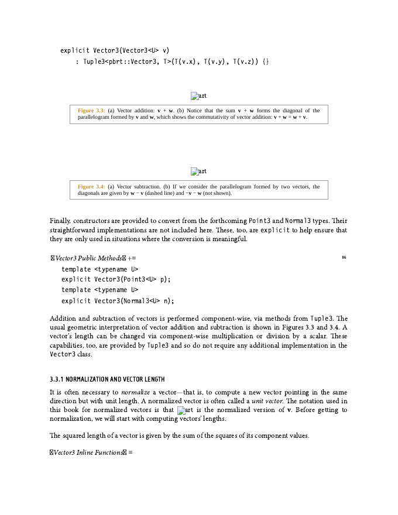
*Figure 3.3: (a) Vector addition: v + w. (b) Notice that the sum v + w forms the diagonal of the parallelogram formed by v and w, which shows the commutativity of vector addition: v + w = w + v.*


*Figure 3.4: (a) Vector subtraction. (b) If we consider the parallelogram formed by two vectors, the diagonals are given by w − v (dashed line) and −v − w (not shown).*

Finally, constructors are provided to convert from the forthcoming `Point3` and `Normal3` types. Their straightforward implementations are not included here. These, too, are explicit to help ensure that they are only used in situations where the conversion is meaningful.

〈Vector3 Public Methods〉 +≡ 86

```rust
   // generic
   explicit Vector3(Point3<U> p);
   // generic
   explicit Vector3(Normal3<U> n);
```

Addition and subtraction of vectors is performed component-wise, via methods from `Tuple3`. The usual geometric interpretation of vector addition and subtraction is shown in Figures 3.3 and 3.4. A vector’s length can be changed via component-wise multiplication or division by a scalar. These capabilities, too, are provided by `Tuple3` and so do not require any additional implementation in the `Vector3` class.

### 3.3.1 NORMALIZATION AND VECTOR LENGTH

It is often necessary to normalize a vector—that is, to compute a new vector pointing in the same direction but with unit length. A normalized vector is often called a unit vector. The notation used in this book for normalized vectors is that art is the normalized version of v. Before getting to normalization, we will start with computing vectors’ lengths.

The squared length of a vector is given by the sum of the squares of its component values.

〈Vector3 Inline Functions〉 ≡

```rust
   // generic
   T LengthSquared(Vector3<T> v) { return Sqr(v.x) + Sqr(v.y) + Sqr(v.z); }
```

```text
    Normal3 94
    Point3 92
    Sqr() 1034
    Tuple3 83
    Vector3 86
```

Moving on to computing the length of a vector leads us to a quandary: what type should the `Length()` function return? For example, if the `Vector3` stores an integer type, that type is probably not an appropriate return type since the vector’s length will not necessarily be integer-valued. In that case, `Float` would be a better choice, though we should not standardize on `Float` for everything, because given a `Vector3` of double-precision values, we should return the length as a double as well. Continuing our journey through advanced C++, we turn to a technique known as type traits to solve this dilemma.

First, we define a general TupleLength template class that holds a type definition, type. The default is set here to be `Float`.

〈TupleLength Definition〉 ≡ template <typename T> struct TupleLength { using type = Float; };

For `Vector3s` of doubles, we also provide a template specialization that defines double as the type for length given double for the element type.

〈TupleLength Definition〉 +≡ template <> struct TupleLength<double> { using type = double; };

Now we can implement `Length()`, using TupleLength to determine which type to return. Note that the return type cannot be specified before the function declaration is complete since the type T is not known until the function parameters have been parsed. Therefore, the function is declared as auto with the return type specified after its parameter list.

〈Vector3 Inline Functions〉 +≡ template <typename T> auto Length(Vector3<T> v) -> typename TupleLength<T>::type { using std::sqrt; return sqrt(LengthSquared(v)); }

There is one more C++ subtlety in these few lines of code: the reader may wonder, why have a using std::sqrt declaration in the implementation of `Length()` and then call sqrt(), rather than just calling std::sqrt() directly? That construction is used because we would like to be able to use component types T that do not have overloaded versions of std::sqrt() available to them. For example, we will later make use of `Vector3s` that store intervals of values for each component using a forthcoming `Interval` class. With the way the code is written here, if std::sqrt() supports the type T, the std variant of the function is called. If not, then so long as we have defined a function named sqrt() that takes our custom type, that version will be used.

With all of this in hand, the implementation of `Normalize()` is thankfully now trivial. The use of auto for the return type ensures that if for example `Normalize()` is called with a vector with integer components, then the returned vector type has `Float` components according to type conversion from the division operator.

〈Vector3 Inline Functions〉 +≡ template <typename T> auto Normalize(Vector3<T> v) { return v / Length(v); }

```text
    Float 23
    Interval 1057
    Length() 88
    LengthSquared() 87
    TupleLength 88
    Vector3 86
```

### 3.3.2 DOT AND CROSS PRODUCT

Two useful operations on vectors are the dot product (also known as the scalar or inner product) and the cross product. For two 3D vectors v and w, their dot product (v · w) is defined as vxwx + vywy + vzwz, and the implementation follows directly.

〈Vector3 Inline Functions〉 +≡ template <typename T> T Dot(Vector3<T> v, Vector3<T> w) { return v.x * w.x + v.y * w.y + v.z * w.z; }

A few basic properties directly follow from the definition of the dot product. For example, if u, v, and w are vectors and s is a scalar value, then: (u · v) = (v · u) (su · v) = s(u · v) (u · (v + w)) = (u · v) + (u · w).

The dot product has a simple relationship to the angle between the two vectors:

where θ is the angle between v and w, and ‖v‖ denotes the length of the vector v. It follows from this that (v · w) is zero if and only if v and w are perpendicular, provided that neither v nor w is degenerate —equal to (0, 0, 0). A set of two or more mutually perpendicular vectors is said to be orthogonal. An orthogonal set of unit vectors is called orthonormal.

It follows from Equation (3.1) that if v and w are unit vectors, their dot product is the cosine of the angle between them. As the cosine of the angle between two vectors often needs to be computed for rendering, we will frequently make use of this property.

If we would like to find the angle between two normalized vectors, we could use the standard library’s inverse cosine function, passing it the value of the dot product between the two vectors. However, that approach can suffer from a loss of accuracy when the two vectors are nearly parallel or facing in nearly opposite directions. The following reformulation does more of its computation with values close to the origin where there is more floating-point precision, giving a more accurate result.

〈Vector3 Inline Functions〉 +≡ template <typename T> Float AngleBetween(Vector3<T> v1, Vector3<T> v2) {
```rust
    if (Dot(v1, v2) < 0)
        return Pi - 2 * SafeASin(Length(v1 + v2) / 2);
    else
        return 2 * SafeASin(Length(v2 - v1) / 2);
}
```

```text
    AbsDot() 90
    Dot() 89
    Float 23
    Length() 88
    Pi 1033
    SafeASin() 1035
    Vector3 86
```

We will frequently need to compute the absolute value of the dot product as well. The `AbsDot()` function does this for us so that a separate call to std::abs() is not necessary in that case.

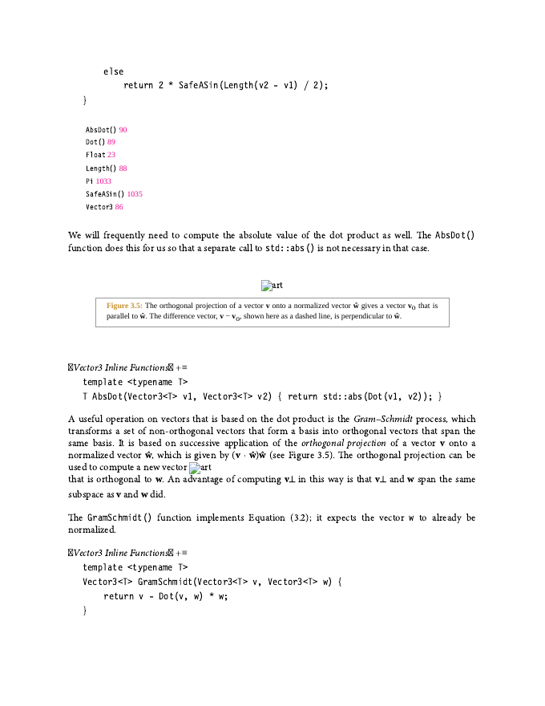
*Figure 3.5: The orthogonal projection of a vector v onto a normalized vector ŵ gives a vector vo that is parallel to ŵ. The difference vector, v − vo, shown here as a dashed line, is perpendicular to ŵ.*

〈Vector3 Inline Functions〉 +≡ template <typename T> T AbsDot(Vector3<T> v1, Vector3<T> v2) { return std::abs(Dot(v1, v2)); }

A useful operation on vectors that is based on the dot product is the Gram–Schmidt process, which transforms a set of non-orthogonal vectors that form a basis into orthogonal vectors that span the same basis. It is based on successive application of the orthogonal projection of a vector v onto a normalized vector ŵ, which is given by (v · ŵ)ŵ (see Figure 3.5). The orthogonal projection can be used to compute a new vector art that is orthogonal to w. An advantage of computing v┴ in this way is that v┴ and w span the same subspace as v and w did.

The `GramSchmidt()` function implements Equation (3.2); it expects the vector w to already be normalized.

〈Vector3 Inline Functions〉 +≡ template <typename T> Vector3<T> GramSchmidt(Vector3<T> v, Vector3<T> w) { return v - Dot(v, w) * w; }

The cross product is another useful operation for 3D vectors. Given two vectors in 3D, the cross product v×w is a vector that is perpendicular to both of them. Given orthogonal vectors v and w, then v×w is defined to be a vector such that (v, w, v×w) form an orthogonal coordinate system.

The cross product is defined as:

(v×w)x = vywz − vzwy
(v×w)y = vzwx − vxwz
(v×w)z = vxwy − vywx.

A way to remember this is to compute the determinant of the matrix:

```text
    Dot() 89
    Vector3 86
```

where i, j, and k represent the axes (1, 0, 0), (0, 1, 0), and (0, 0, 1), respectively. Note that this equation is merely a memory aid and not a rigorous mathematical construction, since the matrix entries are a mix of scalars and vectors.

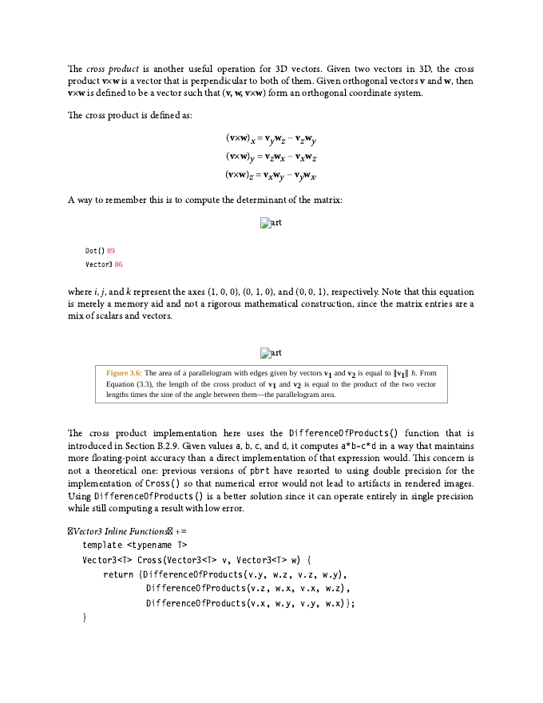
*Figure 3.6: The area of a parallelogram with edges given by vectors v1 and v2 is equal to ‖v1‖ h. From Equation (3.3), the length of the cross product of v1 and v2 is equal to the product of the two vector lengths times the sine of the angle between them—the parallelogram area.*

The cross product implementation here uses the `DifferenceOfProducts()` function that is introduced in Section B.2.9. Given values a, b, c, and d, it computes a*b-c*d in a way that maintains more floating-point accuracy than a direct implementation of that expression would. This concern is not a theoretical one: previous versions of pbrt have resorted to using double precision for the implementation of `Cross()` so that numerical error would not lead to artifacts in rendered images. Using `DifferenceOfProducts()` is a better solution since it can operate entirely in single precision while still computing a result with low error.

〈Vector3 Inline Functions〉 +≡ template <typename T> Vector3<T> Cross(Vector3<T> v, Vector3<T> w) { return {DifferenceOfProducts(v.y, w.z, v.z, w.y), DifferenceOfProducts(v.z, w.x, v.x, w.z), DifferenceOfProducts(v.x, w.y, v.y, w.x)}; }

From the definition of the cross product, we can derive

where θ is the angle between v and w. An important implication of this is that the cross product of two perpendicular unit vectors is itself a unit vector. Note also that the result of the cross product is a degenerate vector if v and w are parallel.

This definition also shows a convenient way to compute the area of a parallelogram (Figure 3.6). If the two edges of the parallelogram are given by vectors v1 and v2, and it has height h, the area is given by ‖v1‖ h. Since h = sin θ‖v2‖, we can use Equation (3.3) to see that the area is ‖v1×v2‖.

### 3.3.3 COORDINATE SYSTEM FROM A VECTOR

We will sometimes find it useful to construct a local coordinate system given only a single normalized 3D vector. To do so, we must find two additional normalized vectors such that all three vectors are mutually perpendicular.

```text
    DifferenceOfProducts() 1044
    Vector3 86
```

Given a vector v, it can be shown that the two vectors

fulfill these conditions. However, computing those properties directly has high error when vz ≈ −1 due to a loss of accuracy when 1/(1 + vz) is calculated. A reformulation of that computation, used in the following implementation, addresses that issue.

〈Vector3 Inline Functions〉 +≡ template <typename T> void CoordinateSystem(Vector3<T> v1, Vector3<T> *v2, Vector3<T> *v3) { Float sign = pstd::copysign(Float(1), v1.z); Float a = -1 / (sign + v1.z); Float b = v1.x * v1.y * a; *v2 = Vector3<T>(1 + sign * Sqr(v1.x) * a, sign * b, -sign * v1.x); *v3 = Vector3<T>(b, sign + Sqr(v1.y) * a, -v1.y); }

## 3.4 POINTS

A point is a zero-dimensional location in 2D or 3D space. The `Point2` and `Point3` classes in pbrt represent points in the obvious way: using x, y, z (in 3D) coordinates with respect to a coordinate system. Although the same representation is used for vectors, the fact that a point represents a

position whereas a vector represents a direction leads to a number of important differences in how they are treated. Points are denoted in text by p.

In this section, we will continue the approach of only including implementations of the 3D point methods for the `Point3` class here.

〈Point3 Definition〉 ≡ template <typename T> class Point3 : public Tuple3<Point3, T> { public: 〈Point3 Public Methods 92〉 };

As with vectors, it is helpful to have shorter type names for commonly used point types.

〈Point3* Definitions〉 ≡ using Point3f = Point3<Float>; using Point3i = Point3<int>;

It is also useful to be able to convert a point with one element type (e.g., a `Point3f`) to a point of another one (e.g., `Point3i`) as well as to be able to convert a point to a vector with a different underlying element type. The following constructor and conversion operator provide these conversions. Both also require an explicit cast, to make it clear in source code when they are being used.

〈Point3 Public Methods〉 ≡ template <typename U> 92 explicit Point3(Point3<U> p) : Tuple3<pbrt::Point3, T>(T(p.x), T(p.y), T(p.z)) {} template <typename U> explicit Point3(Vector3<U> v) : Tuple3<pbrt::Point3, T>(T(v.x), T(v.y), T(v.z)) {}

There are certain `Point3` methods that either return or take a `Vector3`. For instance, one can add a vector to a point, offsetting it in the given direction to obtain a new point. Analogous methods, not included in the text, also allow subtracting a vector from a point.

```text
    Float 23
    Point3 92
    Sqr() 1034
    Tuple3 83
    Vector3 86
```

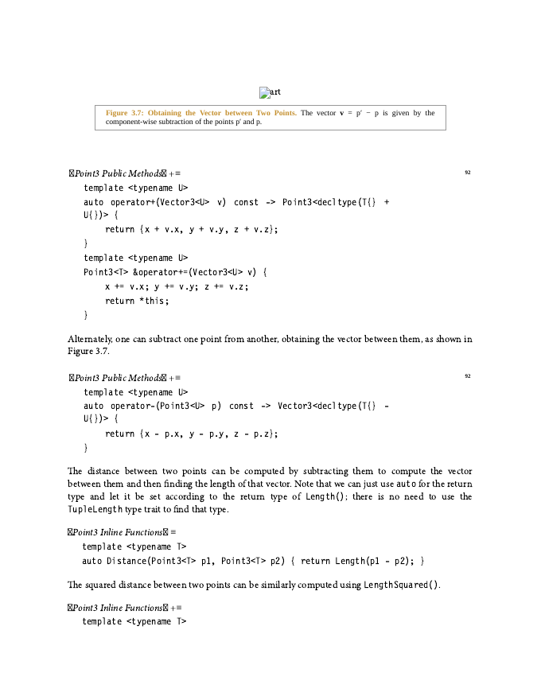
*Figure 3.7: Obtaining the Vector between Two Points. The vector v = p′ − p is given by the component-wise subtraction of the points p′ and p.*

〈Point3 Public Methods〉 +≡ 92

```rust
   // generic
   auto operator+(Vector3<U> v) const -> Point3<decltype(T{} +
   U{})> {
         return {x + v.x, y + v.y, z + v.z};
   }
   // generic
   Point3<T> &operator+=(Vector3<U> v) {
         x += v.x; y += v.y; z += v.z;
         return *this;
   }
```

Alternately, one can subtract one point from another, obtaining the vector between them, as shown in Figure 3.7.

〈Point3 Public Methods〉 +≡ 92

```rust
   // generic
   auto operator-(Point3<U> p) const -> Vector3<decltype(T{} -
   U{})> {
         return {x - p.x, y - p.y, z - p.z};
   }
```

The distance between two points can be computed by subtracting them to compute the vector between them and then finding the length of that vector. Note that we can just use auto for the return type and let it be set according to the return type of `Length()`; there is no need to use the TupleLength type trait to find that type.

〈Point3 Inline Functions〉 ≡ template <typename T> auto Distance(Point3<T> p1, Point3<T> p2) { return Length(p1 - p2); }

The squared distance between two points can be similarly computed using `LengthSquared()`.

〈Point3 Inline Functions〉 +≡ template <typename T>

```rust
   auto DistanceSquared(Point3<T> p1, Point3<T> p2) {
       return LengthSquared(p1 - p2);
   }
```

## 3.5 NORMALS

```text
    Length() 88
    LengthSquared() 87
    Point3 92
    TupleLength 88
    Vector3 86
```

A surface normal (or just normal) is a vector that is perpendicular to a surface at a particular position. It can be defined as the cross product of any two nonparallel vectors that are tangent to the surface at a point. Although normals are superficially similar to vectors, it is important to distinguish between the two of them: because normals are defined in terms of their relationship to a particular surface, they behave differently than vectors in some situations, particularly when applying transformations. (That difference is discussed in Section 3.10.)

〈Normal3 Definition〉 ≡ template <typename T> class Normal3 : public Tuple3<Normal3, T> { public: 〈Normal3 Public Methods 94〉 };

〈Normal3 Definition〉 +≡ using Normal3f = Normal3<Float>;

The implementations of `Normal3s` and `Vector3s` are very similar. Like vectors, normals are represented by three components x, y, and z; they can be added and subtracted to compute new normals; and they can be scaled and normalized. However, a normal cannot be added to a point, and one cannot take the cross product of two normals. Note that, in an unfortunate turn of terminology, normals are not necessarily normalized.

In addition to the usual constructors (not included here), `Normal3` allows conversion from `Vector3` values given an explicit typecast, similarly to the other `Tuple2`- and `Tuple3`-based classes.

〈Normal3 Public Methods〉 ≡ 94

```rust
   // generic
   explicit Normal3(Vector3<U> v)
       : Tuple3<pbrt::Normal3, T>(T(v.x), T(v.y), T(v.z)) {}
```

The `Dot()` and `AbsDot()` functions are also overloaded to compute dot products between the various possible combinations of normals and vectors. This code will not be included in the text here. We also will not include implementations of all the various other `Normal3` methods here, since they are similar to those for vectors.

One new operation to implement comes from the fact that it is often necessary to flip a surface normal so it lies in the same hemisphere as a given vector—for example, the surface normal that lies in the same hemisphere as a ray leaving a surface is frequently needed. The `FaceForward()` utility function encapsulates this small computation. (pbrt also provides variants of this function for the other three combinations of `Vector3s` and `Normal3s` as parameters.) Be careful when using the other instances, though: when using the version that takes two `Vector3s`, for example, ensure that the first parameter is the one that should be returned (possibly flipped) and the second is the one to test against. Reversing the two parameters will give unexpected results.

〈Normal3 Inline Functions〉 ≡ template <typename T> Normal3<T> FaceForward(Normal3<T> n, Vector3<T> v) { return (Dot(n, v) < 0.f) ? -n : n; }

```text
    AbsDot() 90
    Dot() 89
    Float 23
    Normal3 94
    Point3f 92
    Ray 95
    Tuple2 83
    Tuple3 83
    Vector3 86
    Vector3f 86
```

## 3.6 RAYS

A ray r is a semi-infinite line specified by its origin o and direction d; see Figure 3.8. pbrt represents `Rays` using a `Point3f` for the origin and a `Vector3f` for the direction; there is no need for non-`Float`-based rays in pbrt. See the files `ray.h` and `ray.cpp` in the pbrt source code distribution for the implementation of the `Ray` class implementation.

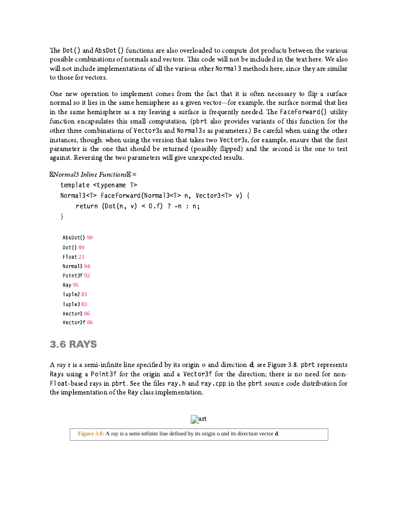
*Figure 3.8: A ray is a semi-infinite line defined by its origin o and its direction vector d.*

〈Ray Definition〉 ≡ class Ray { public: 〈Ray Public Methods 95〉 〈Ray Public Members 95〉 };

Because we will be referring to these variables often throughout the code, the origin and direction members of a `Ray` are succinctly named o and d. Note that we again make the data publicly available for convenience.

〈Ray Public Members〉 ≡ 95

```rust
   Point3f o;
   Vector3f d;
```

The parametric form of a ray expresses it as a function of a scalar value t, giving the set of points that the ray passes through: art The `Ray` class overloads the function application operator for rays in order to match the r(t) notation in Equation (3.4).

〈Ray Public Methods〉 ≡ 95

```rust
   Point3f operator()(Float t) const { return o + d * t; }
```

Given this method, when we need to find the point at a particular position along a ray, we can write code like:

```rust
         Ray r(Point3f(0, 0, 0), Vector3f(1, 2, 3));
         Point3f p = r(1.7);
```

Each ray also has a time value associated with it. In scenes with animated objects, the rendering system constructs a representation of the scene at the appropriate time for each ray.

〈Ray Public Members〉 +≡ 95

```rust
   Float time = 0;
```

```text
    Float 23
    Medium 714
    Point3f 92
    Ray 95
    Ray::d 95
    Ray::o 95
    Vector3f 86
```

Each ray also records the medium at its origin. The `Medium` class, which will be introduced in Section 11.4, encapsulates the (potentially spatially varying) properties of participating media such as a foggy atmosphere, smoke, or scattering liquids like milk. Associating this information with rays makes it possible for other parts of the system to account correctly for the effect of rays passing from one medium to another.

〈Ray Public Members〉 +≡ 95

```rust
   Medium medium = None;
```

Constructing `Rays` is straightforward. The default constructor relies on the `Point3f` and `Vector3f` constructors to set the origin and direction to (0, 0, 0). Alternately, a particular point and direction can be provided. If an origin and direction are provided, the constructor allows values to be given for the ray’s time and medium.

〈Ray Public Methods〉 +≡ 95

```rust
   Ray(Point3f o, Vector3f d, Float time = 0.f, Medium medium = None)
        : o(o), d(d), time(time), medium(medium) {}
```

### 3.6.1 RAY DIFFERENTIALS

To be able to perform better antialiasing with the texture functions defined in Chapter 10, pbrt makes use of the `RayDifferential` class, which is a subclass of `Ray` that contains additional information about two auxiliary rays. These extra rays represent camera rays offset by one sample in the x and y direction from the main ray on the film plane. By determining the area that these three rays project to on an object being shaded, a `Texture` can estimate an area to average over for proper antialiasing (Section 10.1).

Because `RayDifferential` inherits from `Ray`, geometric interfaces in the system can be written to take const `Ray` & parameters, so that either a `Ray` or `RayDifferential` can be passed to them. Only the routines that need to account for antialiasing and texturing require `RayDifferential` parameters.

〈RayDifferential Definition〉 ≡ class RayDifferential : public Ray { public: 〈RayDifferential Public Methods 96〉 〈RayDifferential Public Members 96〉 };

The `RayDifferential` constructor mirrors the `Ray`’s.

〈RayDifferential Public Methods〉 ≡ 96

```rust
   RayDifferential(Point3f o, Vector3f d, Float time = 0.f,
                         Medium medium = None)
         : Ray(o, d, time, medium) {}
```

In some cases, differential rays may not be available. Routines that take `RayDifferential` parameters should check the `hasDifferentials` member variable before accessing the differential rays’ origins or directions.

〈RayDifferential Public Members〉 ≡ 96

```rust
   bool hasDifferentials = false;
   Point3f rxOrigin, ryOrigin;
   Vector3f rxDirection, ryDirection;
```

There is also a constructor to create a `RayDifferential` from a `Ray`. As with the previous constructor, the default false value of the `hasDifferentials` member variable is left as is.

〈RayDifferential Public Methods〉 +≡ 96

```rust
   explicit RayDifferential(const Ray &ray) : Ray(ray) {}
```

```text
    Camera 206
    Float 23
    Medium 714
    Point3f 92
    Ray 95
    RayDifferential 96
    Texture 655
    Vector3f 86
```

`Camera` implementations in pbrt compute differentials for rays leaving the camera under the assumption that camera rays are spaced one pixel apart. Integrators usually generate multiple camera rays per pixel, in which case the actual distance between samples is lower and the differentials should be updated accordingly; if this factor is not accounted for, then textures in images will generally be too blurry. The `ScaleDifferentials()` method below takes care of this, given an estimated sample spacing of s. It is called, for example, by the fragment Generate camera ray for current sample in Chapter 1.

〈RayDifferential Public Methods〉 +≡ 96

```rust
   void ScaleDifferentials(Float s) {
        rxOrigin = o + (rxOrigin - o) * s;
        ryOrigin = o + (ryOrigin - o) * s;
        rxDirection = d + (rxDirection - d) * s;
        ryDirection = d + (ryDirection - d) * s;
   }
```

## 3.7 BOUNDING BOXES

Many parts of the system operate on axis-aligned regions of space. For example, multi-threading in pbrt is implemented by subdividing the image into 2D rectangular tiles that can be processed independently, and the bounding volume hierarchy in Section 7.3 uses 3D boxes to bound geometric primitives in the scene. The `Bounds2` and `Bounds3` template classes are used to represent the extent of these sorts of regions. Both are parameterized by a type T that is used to represent the coordinates of their extents. As with the earlier vector math types, we will focus here on the 3D variant, `Bounds3`, since `Bounds2` is effectively a subset of it.

〈Bounds2 Definition〉 ≡ template <typename T> class Bounds2 { public: 〈Bounds2 Public Methods〉 〈Bounds2 Public Members〉 };

〈Bounds3 Definition〉 ≡ template <typename T> class Bounds3 { public: 〈Bounds3 Public Methods 98〉 〈Bounds3 Public Members 98〉 };

We use the same shorthand as before to define names for commonly used bounding types.

〈Bounds[23][fi] Definitions〉 ≡ using Bounds2f = Bounds2<Float>; using Bounds2i = Bounds2<int>; using Bounds3f = Bounds3<Float>; using Bounds3i = Bounds3<int>;

```text
    Bounds2 97
    Bounds3 97
    Float 23
    Ray::d 95
    Ray::o 95
    RayDifferential::rxDirection 96
    RayDifferential::rxOrigin 96
    RayDifferential::ryDirection 96
    RayDifferential::ryOrigin 96
```

There are a few possible representations for these sorts of bounding boxes; pbrt uses axis-aligned bounding boxes (AABBs), where the box edges are mutually perpendicular and aligned with the coordinate system axes. Another possible choice is oriented bounding boxes (OBBs), where the box edges on different sides are still perpendicular to each other but not necessarily coordinate-system aligned. A 3D AABB can be described by one of its vertices and three lengths, each representing the distance spanned along the x, y, and z coordinate axes. Alternatively, two opposite vertices of the box can describe it. We chose the two-point representation for pbrt’s `Bounds2` and `Bounds3` classes; they store the positions of the vertex with minimum coordinate values and of the one with maximum coordinate values. A 2D illustration of a bounding box and its representation is shown in Figure 3.9.

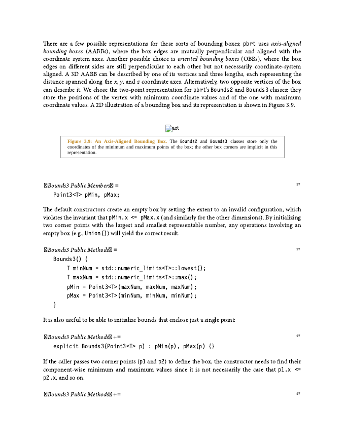
*Figure 3.9: An Axis-Aligned Bounding Box. The `Bounds2` and `Bounds3` classes store only the coordinates of the minimum and maximum points of the box; the other box corners are implicit in this representation.*

〈Bounds3 Public Members〉 ≡ 97

```rust
   Point3<T> pMin, pMax;
```

The default constructors create an empty box by setting the extent to an invalid configuration, which violates the invariant that `pMin.x` <= `pMax.x` (and similarly for the other dimensions). By initializing two corner points with the largest and smallest representable number, any operations involving an empty box (e.g., `Union()`) will yield the correct result.

〈Bounds3 Public Methods〉 ≡ 97

```rust
   Bounds3() {
       T minNum = std::numeric_limits<T>::lowest();
       T maxNum = std::numeric_limits<T>::max();
       pMin = Point3<T>(maxNum, maxNum, maxNum);
       pMax = Point3<T>(minNum, minNum, minNum);
   }
```

It is also useful to be able to initialize bounds that enclose just a single point:

〈Bounds3 Public Methods〉 +≡ 97

```rust
   explicit Bounds3(Point3<T> p) : pMin(p), pMax(p) {}
```

If the caller passes two corner points (p1 and p2) to define the box, the constructor needs to find their component-wise minimum and maximum values since it is not necessarily the case that p1.x <= p2.x, and so on.

〈Bounds3 Public Methods〉 +≡ 97

```rust
   Bounds3(Point3<T> p1, Point3<T> p2)
       : pMin(Min(p1, p2)), pMax(Max(p1, p2)) {}
```

It can be useful to use array indexing to select between the two points at the corners of the box. Assertions in the debug build, not shown here, check that the provided index is either 0 or 1.

〈Bounds3 Public Methods〉 +≡ 97

```rust
   Point3<T> operator[](int i) const { return (i == 0) ? pMin :
   pMax; }
   Point3<T> &operator[](int i) { return (i == 0) ? pMin : pMax;
   }
```

```text
    Bounds2 97
    Bounds3 97
    Bounds3::pMax 98
    Bounds3::pMin 98
    Point3 92
    Tuple3::Max() 85
    Tuple3::Min() 85
```

The Corner() method returns the coordinates of one of the eight corners of the bounding box. Its logic calls the operator[] method with a zero or one value for each dimension that is based on one of the low three bits of corner and then extracts the corresponding component.

It is worthwhile to verify that this method returns the positions of all eight corners when passed values from 0 to 7 if that is not immediately evident.

〈Bounds3 Public Methods〉 +≡ 97

```rust
   Point3<T> Corner(int corner) const {
       return Point3<T>((*this)[(corner & 1)].x,
                            (*this)[(corner & 2) ? 1 : 0].y,
                            (*this)[(corner & 4) ? 1 : 0].z);
   }
```

Given a bounding box and a point, the `Union()` function returns a new bounding box that encompasses that point as well as the original bounds.

〈Bounds3 Inline Functions〉 ≡ template <typename T> Bounds3<T> Union(const Bounds3<T> &b, Point3<T> p) {
```rust
    Bounds3<T> ret;
    ret.pMin = Min(b.pMin, p);
    ret.pMax = Max(b.pMax, p);
    return ret;
}
```

One subtlety that applies to this and some of the following functions is that it is important that the pMin and pMax members of ret be set directly here, rather than passing the values returned by `Min()` and `Max()` to the `Bounds3` constructor. The detail stems from the fact that if the provided bounds are both degenerate, the returned bounds should be degenerate as well. If a degenerate extent is passed to the constructor, then it will sort the coordinate values, which in turn leads to what is essentially an infinite bound.

It is similarly possible to construct a new box that bounds the space encompassed by two other bounding boxes. The definition of this function is similar to the earlier `Union()` method that takes a `Point3f`; the difference is that the pMin and pMax of the second box are used for the `Min()` and `Max()` tests, respectively.

〈Bounds3 Inline Functions〉 +≡ template <typename T> Bounds3<T> Union(const Bounds3<T> &b1, const Bounds3<T> &b2) { Bounds3<T> ret; ret.pMin = Min(b1.pMin, b2.pMin); ret.pMax = Max(b1.pMax, b2.pMax); return ret; }

The intersection of two bounding boxes can be found by computing the maximum of their two respective minimum coordinates and the minimum of their maximum coordinates. (See Figure 3.10.) 〈Bounds3 Inline Functions〉 +≡ template <typename T> Bounds3<T> Intersect(const Bounds3<T> &b1, const Bounds3<T> &b2) { Bounds3<T> b; b.pMin = Max(b1.pMin, b2.pMin); b.pMax = Min(b1.pMax, b2.pMax); return b; }

```text
    Bounds3 97
    Bounds3::pMax 98
    Bounds3::pMin 98
    Point3 92
    Point3f 92
    Tuple3::Max() 85
    Tuple3::Min() 85
```

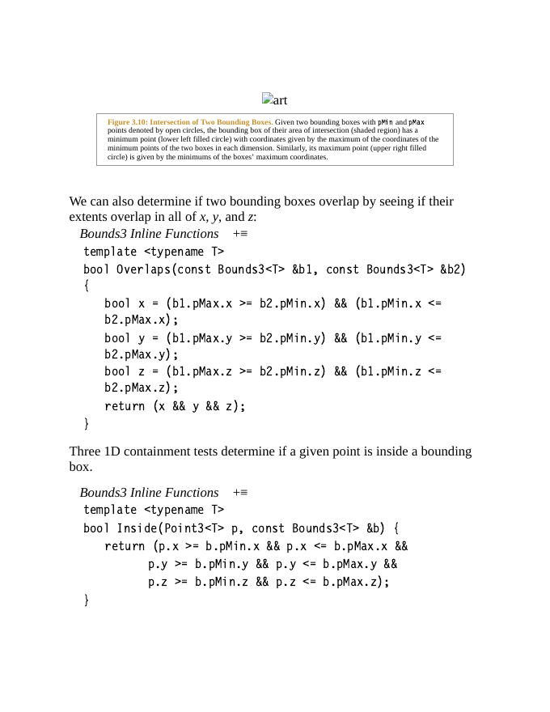
*Figure 3.10: Intersection of Two Bounding Boxes. Given two bounding boxes with pMin and pMax points denoted by open circles, the bounding box of their area of intersection (shaded region) has a minimum point (lower left filled circle) with coordinates given by the maximum of the coordinates of the minimum points of the two boxes in each dimension. Similarly, its maximum point (upper right filled circle) is given by the minimums of the boxes’ maximum coordinates.*

We can also determine if two bounding boxes overlap by seeing if their extents overlap in all of x, y, and z: 〈Bounds3 Inline Functions〉 +≡ template <typename T> bool Overlaps(const Bounds3<T> &b1, const Bounds3<T> &b2) { bool x = (b1.pMax.x >= b2.pMin.x) && (b1.pMin.x <= b2.pMax.x); bool y = (b1.pMax.y >= b2.pMin.y) && (b1.pMin.y <= b2.pMax.y); bool z = (b1.pMax.z >= b2.pMin.z) && (b1.pMin.z <= b2.pMax.z); return (x && y && z); }

Three 1D containment tests determine if a given point is inside a bounding box. 〈Bounds3 Inline Functions〉 +≡ template <typename T> bool Inside(Point3<T> p, const Bounds3<T> &b) { return (p.x >= b.pMin.x && p.x <= b.pMax.x && p.y >= b.pMin.y && p.y <= b.pMax.y && p.z >= b.pMin.z && p.z <= b.pMax.z); }

The InsideExclusive() variant of Inside() does not consider points on the upper boundary to be inside the bounds. It is mostly useful with integer-typed bounds. 〈Bounds3 Inline Functions〉 +≡ template <typename T> bool InsideExclusive(Point3<T> p, const Bounds3<T> &b) { return (p.x >= b.pMin.x && p.x < b.pMax.x && p.y >= b.pMin.y && p.y < b.pMax.y && p.z >= b.pMin.z && p.z < b.pMax.z); }

```text
   Bounds3 97
   Bounds3::pMax 98
   Bounds3::pMin 98
   Point3 92
```

`DistanceSquared()` returns the squared distance from a point to a bounding box or zero if the point is inside it. The geometric setting of the computation is shown in Figure 3.11. After the distance from the point to the box is computed in each dimension, the squared distance is found by summing the squares of each of the 1D distances.

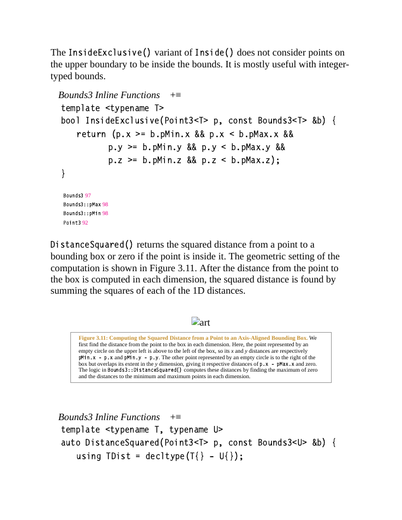
*Figure 3.11: Computing the Squared Distance from a Point to an Axis-Aligned Bounding Box. We first find the distance from the point to the box in each dimension. Here, the point represented by an empty circle on the upper left is above to the left of the box, so its x and y distances are respectively `pMin.x` - p.x and `pMin.y` - p.y. The other point represented by an empty circle is to the right of the box but overlaps its extent in the y dimension, giving it respective distances of p.x - `pMax.x` and zero. The logic in `Bounds3::DistanceSquared()` computes these distances by finding the maximum of zero and the distances to the minimum and maximum points in each dimension.*

〈Bounds3 Inline Functions〉 +≡ template <typename T, typename U> auto DistanceSquared(Point3<T> p, const Bounds3<U> &b) {
```rust
    using TDist = decltype(T{} - U{});
    TDist dx = std::max<TDist>({0, b.pMin.x - p.x, p.x - b.pMax.x});
    TDist dy = std::max<TDist>({0, b.pMin.y - p.y, p.y - b.pMax.y});
    TDist dz = std::max<TDist>({0, b.pMin.z - p.z, p.z - b.pMax.z});
    return Sqr(dx) + Sqr(dy) + Sqr(dz);
}
```

It is easy to compute the distance from a point to a bounding box, though some indirection is needed to be able to determine the correct return type using TupleLength. 〈Bounds3 Inline Functions〉 +≡ template <typename T, typename U> auto Distance(Point3<T> p, const Bounds3<U> &b) { auto dist2 = DistanceSquared(p, b); using TDist = typename TupleLength<decltype(dist2)>::type; return std::sqrt(TDist(dist2)); }

The Expand() function pads the bounding box by a constant factor in all dimensions. 〈Bounds3 Inline Functions〉 +≡ template <typename T, typename U> Bounds3<T> Expand(const Bounds3<T> &b, U delta) { Bounds3<T> ret; ret.pMin = b.pMin - Vector3<T>(delta, delta, delta); ret.pMax = b.pMax + Vector3<T>(delta, delta, delta); return ret; }

```text
   Bounds3 97
   Bounds3::DistanceSquared() 101
```

```text
   Bounds3::pMax 98
   Bounds3::pMin 98
   Point3 92
   Sqr() 1034
   TupleLength 88
   Vector3 86
```

Diagonal() returns the vector along the box diagonal from the minimum point to the maximum point. 〈Bounds3 Public Methods〉 +≡ 97

Vector3<T> Diagonal() const { return pMax - pMin; }

Methods for computing the surface area of the six faces of the box and the volume inside of it are also useful. (This is a place where `Bounds2` and `Bounds3` diverge: these methods are not available in `Bounds2`, though it does have an Area() method.)

〈Bounds3 Public Methods〉 +≡ 97

T SurfaceArea() const { Vector3<T> d = Diagonal(); return 2 * (d.x * d.y + d.x * d.z + d.y * d.z); }

〈Bounds3 Public Methods〉 +≡ 97

T Volume() const { Vector3<T> d = Diagonal(); return d.x * d.y * d.z; }

The Bounds3::MaxDimension() method returns the index of which of the three axes is longest. This is useful, for example, when deciding which axis to subdivide when building some of the ray-intersection acceleration structures. 〈Bounds3 Public Methods〉 +≡ 97

int MaxDimension() const { Vector3<T> d = Diagonal(); if (d.x > d.y && d.x > d.z) return 0; else if (d.y > d.z) return 1; else return 2; }

Lerp() linearly interpolates between the corners of the box by the given amount in each dimension. 〈Bounds3 Public Methods〉 +≡ 97

Point3f Lerp(Point3f t) const { return Point3f(pbrt::Lerp(t.x, pMin.x, pMax.x), pbrt::Lerp(t.y, pMin.y, pMax.y), pbrt::Lerp(t.z, pMin.z, pMax.z)); }

Offset() is effectively the inverse of Lerp(). It returns the continuous position of a point relative to the corners of the box, where a point at the minimum corner has offset (0, 0, 0), a point at the maximum corner has offset (1, 1, 1), and so forth. 〈Bounds3 Public Methods〉 +≡ 97

Vector3f Offset(Point3f p) const { Vector3f o = p - pMin; if (pMax.x > pMin.x) o.x /= pMax.x - pMin.x; if (pMax.y > pMin.y) o.y /= pMax.y - pMin.y; if (pMax.z > pMin.z) o.z /= pMax.z - pMin.z; return o; }

```text
   Bounds3 97
   Bounds3::Diagonal() 101
   Bounds3::MaxDimension() 102
   Bounds3::pMax 98
   Bounds3::pMin 98
   Lerp() 72
   Point3f 92
   Vector3 86
   Vector3f 86
```

Bounds3 also provides a method that returns the center and radius of a sphere that bounds the bounding box. In general, this may give a far looser fit than a sphere that bounded the original contents of the Bounds3 directly, although for some geometric operations it is easier to work with a sphere than a box, in which case the worse fit may be an acceptable trade-off. 〈Bounds3 Public Methods〉 +≡ 97

void BoundingSphere(Point3<T> *center, Float *radius) const {
```rust
    *center = (pMin + pMax) / 2;
    *radius = Inside(*center, *this) ? Distance(*center, pMax) : 0;
}
```

Straightforward methods test for empty and degenerate bounding boxes. Note that “empty” means that a bounding box has zero volume but does not necessarily imply that it has zero surface area. 〈Bounds3 Public Methods〉 +≡ bool IsEmpty() const { return pMin.x >= pMax.x ‖ pMin.y >= pMax.y ‖ pMin.z >= pMax.z; } bool IsDegenerate() const { return pMin.x > pMax.x ‖ pMin.y > pMax.y ‖ pMin.z > pMax.z; }

Finally, for integer bounds, there is an iterator class that fulfills the requirements of a C++ forward iterator (i.e., it can only be advanced). The details are slightly tedious and not particularly interesting, so the code is not included in the book. Having this definition makes it possible to write code using range-based for loops to iterate over integer coordinates in a bounding box: Bounds2i b = …; for (Point2i p : b) { ⋮ }

As implemented, the iteration goes up to but does not visit points equal to the maximum extent in each dimension. 3.8 SPHERICAL GEOMETRY

Geometry on the unit sphere is also frequently useful in rendering. 3D unit direction vectors can equivalently be represented as points on the unit sphere, and sets of directions can be represented as areas on the unit sphere. Useful operations such as bounding a set of directions can often be cleanly expressed as bounds on the unit sphere. We will therefore introduce some

useful principles of spherical geometry and related classes and functions in this section.

### 3.8.1 SOLID ANGLES

In 2D, the planar angle is the total angle subtended by some object with respect to some position (Figure 3.12). Consider the unit circle around the point p; if we project the shaded object onto that circle, some length of the circle s will be covered by its projection. The arc length of s (which is the same as the angle θ) is the angle subtended by the object. Planar angles are measured in radians and the entire unit circle covers 2π radians. The solid angle extends the 2D unit circle to a 3D unit sphere (Figure 3.13). The total area s is the solid angle subtended by the object. Solid angles are measured in steradians (sr). The entire sphere subtends a solid angle of 4π sr, and a hemisphere subtends 2π sr.

```text
    Bounds3::Inside() 100
    Bounds3::pMax 98
    Bounds3::pMin 98
    Distance() 93
    Float 23
    Point3 92
```

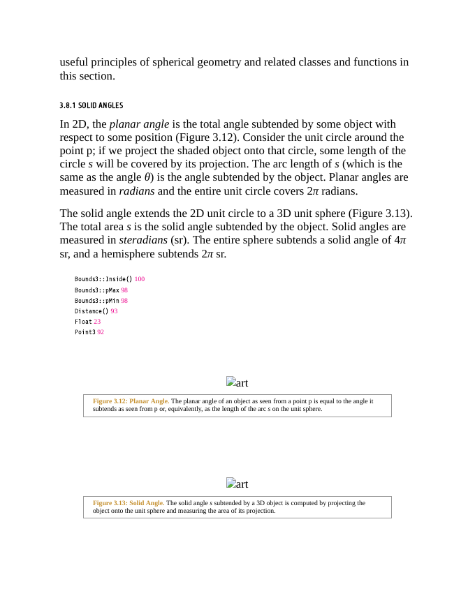
*Figure 3.12: Planar Angle. The planar angle of an object as seen from a point p is equal to the angle it subtends as seen from p or, equivalently, as the length of the arc s on the unit sphere.*


*Figure 3.13: Solid Angle. The solid angle s subtended by a 3D object is computed by projecting the object onto the unit sphere and measuring the area of its projection.*

By providing a way to measure area on the unit sphere (and thus over the unit directions), the solid angle also provides the foundation for a measure for integrating spherical functions; the differential solid angle dω corresponds to the differential area measure on the unit sphere.

### 3.8.2 SPHERICAL POLYGONS

We will sometimes find it useful to consider the set of directions from a point to the surface of a polygon. (Doing so can be useful, for example, when computing the illumination arriving at a point from an emissive polygon.) If a regular planar polygon is projected onto the unit sphere, it forms a spherical polygon. A vertex of a spherical polygon can be found by normalizing the vector from the center of the sphere to the corresponding vertex of the original polygon. Each edge of a spherical polygon is given by the intersection of the unit sphere with the plane that goes through the sphere’s center and the corresponding two vertices of the polygon. The result is a great circle on the sphere that is the shortest distance between the two vertices on the surface of the sphere (Figure 3.14).

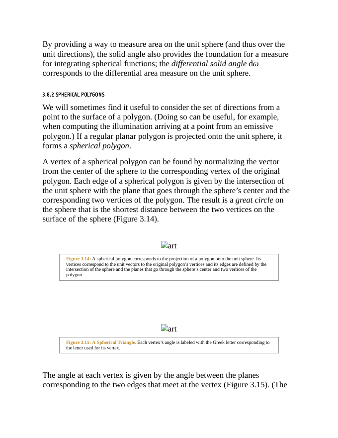
*Figure 3.14: A spherical polygon corresponds to the projection of a polygon onto the unit sphere. Its vertices correspond to the unit vectors to the original polygon’s vertices and its edges are defined by the intersection of the sphere and the planes that go through the sphere’s center and two vertices of the polygon.*


*Figure 3.15: A Spherical Triangle. Each vertex’s angle is labeled with the Greek letter corresponding to the letter used for its vertex.*

The angle at each vertex is given by the angle between the planes corresponding to the two edges that meet at the vertex (Figure 3.15). (The

angle between two planes is termed their dihedral angle.) We will label the angle at each vertex with the Greek letter that corresponds to its label (α for the vertex a and so forth). Unlike planar triangles, the three angles of a spherical triangle do not sum to π radians; rather, their sum is π + A, where A is the spherical triangle’s area. Given the angles α, β, and γ, it follows that the area of a spherical triangle can be computed using Girard’s theorem, which says that a triangle’s surface area A on the unit sphere is given by the “excess angle” art Direct implementation of Equation (3.5) requires multiple calls to expensive inverse trigonometric functions, and its computation can be prone to error due to floating-point cancellation. A more efficient and accurate approach is to apply the relationship art which can be derived from Equation (3.5) using spherical trigonometric identities. That approach is used in SphericalTriangleArea(), which takes three vectors on the unit sphere corresponding to the spherical triangle’s vertices. 〈Spherical Geometry Inline Functions〉 ≡ Float SphericalTriangleArea(Vector3f a, Vector3f b, Vector3f c) { return std::abs(2 * std::atan2(Dot(a, Cross(b, c)), 1 + Dot(a, b) + Dot(a, c) + Dot(b, c))); }

The area of a quadrilateral projected onto the unit sphere is given by α + β + γ + δ − 2π, where α, β, γ, and δ are its interior angles. This value is computed by `SphericalQuadArea()`, which takes the vertex positions on the unit sphere. Its implementation is very similar to `SphericalTriangleArea()`, so it is not included here.

〈Spherical Geometry Inline Functions〉 +≡ Float SphericalQuadArea(Vector3f a, Vector3f b, Vector3f c, Vector3f d);

### 3.8.3 SPHERICAL PARAMETERIZATIONS

The 3D Cartesian coordinates of a point on the unit sphere are not always the most convenient representation of a direction. For example, if we are tabulating a function over the unit sphere, a 2D parameterization that takes advantage of the fact that the sphere’s surface is two-dimensional is preferable. There are a variety of mappings between 2D and the sphere. Developing such mappings that fulfill various goals has been an important part of map making since its beginnings. It can be shown that any mapping from the plane to the sphere introduces some form of distortion; the task then is to choose a mapping that best fulfills the requirements for a particular application. pbrt thus uses three different spherical parameterizations, each with different advantages and disadvantages.

Spherical Coordinates Spherical coordinates (θ, ϕ) are a well-known parameterization of the sphere. For a general sphere of radius r, they are related to Cartesian coordinates by art (See Figure 3.16.) For convenience, we will define a SphericalDirection() function that converts a θ and ϕ pair into a unit (x, y, z) vector, applying these equations directly. Notice that the function is given the sine and cosine of θ, rather than θ itself. This is because the sine and cosine of θ are often already available to the caller. This is not normally the case for ϕ, however, so ϕ is passed in as is. 〈Spherical Geometry Inline Functions〉 +≡ Vector3f SphericalDirection(Float sinTheta, Float cosTheta, Float phi) { return Vector3f(Clamp(sinTheta, -1, 1) * std::cos(phi), Clamp(sinTheta, -1, 1) * std::sin(phi), Clamp(cosTheta, -1, 1)); }

```text
    Cross() 91
```

```text
   Dot() 89
   Float 23
   SphericalTriangleArea() 106
   Vector3f 86
```

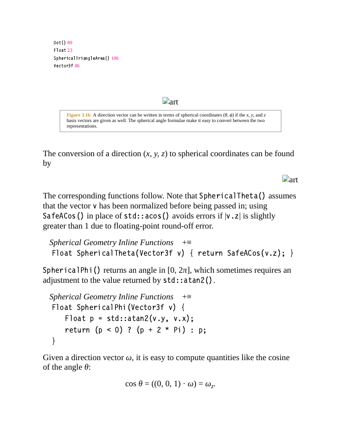
*Figure 3.16: A direction vector can be written in terms of spherical coordinates (θ, ϕ) if the x, y, and z basis vectors are given as well. The spherical angle formulae make it easy to convert between the two representations.*

The conversion of a direction (x, y, z) to spherical coordinates can be found by art The corresponding functions follow. Note that SphericalTheta() assumes that the vector v has been normalized before being passed in; using SafeACos() in place of std::acos() avoids errors if |v.z| is slightly greater than 1 due to floating-point round-off error. 〈Spherical Geometry Inline Functions〉 +≡ Float SphericalTheta(Vector3f v) { return SafeACos(v.z); }

`SphericalPhi()` returns an angle in [0, 2π], which sometimes requires an adjustment to the value returned by std::atan2().

〈Spherical Geometry Inline Functions〉 +≡ Float SphericalPhi(Vector3f v) { Float p = std::atan2(v.y, v.x); return (p < 0) ? (p + 2 * Pi) : p; }

Given a direction vector ω, it is easy to compute quantities like the cosine of the angle θ: cos θ = ((0, 0, 1) · ω) = ωz.

This is a much more efficient computation than it would have been to compute ω’s θ value using first an expensive inverse trigonometric function to compute θ and then another expensive function to compute its cosine. The following functions compute this cosine and a few useful variations.

```text
   Float 23
   Pi 1033
   SafeACos() 1035
   SphericalTheta() 107
   Sqr() 1034
   Vector3f 86
```

〈Spherical Geometry Inline Functions〉 +≡ Float CosTheta(Vector3f w) { return w.z; } Float Cos2Theta(Vector3f w) { return Sqr(w.z); } Float AbsCosTheta(Vector3f w) { return std::abs(w.z); }

The value of sin2 θ can be efficiently computed using the trigonometric identity sin2 θ + cos2 θ = 1, though we need to be careful to avoid returning a negative value in the rare case that 1 - `Cos2Theta(w)` is less than zero due to floating-point round-off error.

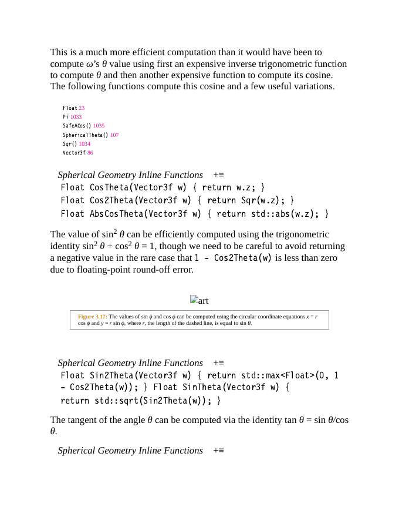
*Figure 3.17: The values of sin ϕ and cos ϕ can be computed using the circular coordinate equations x = r cos ϕ and y = r sin ϕ, where r, the length of the dashed line, is equal to sin θ.*

〈Spherical Geometry Inline Functions〉 +≡ Float Sin2Theta(Vector3f w) { return std::max<Float>(0, 1 - Cos2Theta(w)); } Float SinTheta(Vector3f w) { return std::sqrt(Sin2Theta(w)); }

The tangent of the angle θ can be computed via the identity tan θ = sin θ/cos θ. 〈Spherical Geometry Inline Functions〉 +≡

Float TanTheta(Vector3f w) { return SinTheta(w) / CosTheta(w); } Float Tan2Theta(Vector3f w) { return Sin2Theta(w) / Cos2Theta(w); }

The sine and cosine of the ϕ angle can also be easily found from (x, y, z) coordinates without using inverse trigonometric functions (Figure 3.17). In the z = 0 plane, the vector ω has coordinates (x, y), which are given by r cos ϕ and r sin ϕ, respectively. The radius r is sin θ, so art 〈Spherical Geometry Inline Functions〉 +≡ Float CosPhi(Vector3f w) { Float sinTheta = SinTheta(w); return (sinTheta == 0) ? 1 : Clamp(w.x / sinTheta, -1, 1); } Float SinPhi(Vector3f w) { Float sinTheta = SinTheta(w); return (sinTheta == 0) ? 0 : Clamp(w.y / sinTheta, -1, 1); }

Finally, the cosine of the angle Δϕ between two vectors’ ϕ values can be found by zeroing their z coordinates to get 2D vectors in the z = 0 plane and then normalizing them. The dot product of these two vectors gives the cosine of the angle between them. The implementation below rearranges the terms a bit for efficiency so that only a single square root operation needs to be performed.

```text
   Clamp() 1033
   Cos2Theta() 107
   CosTheta() 107
   Float 23
   Sin2Theta() 108
   SinTheta() 108
   Vector3f 86
```

〈Spherical Geometry Inline Functions〉 +≡

Float CosDPhi(Vector3f wa, Vector3f wb) { Float waxy = Sqr(wa.x) + Sqr(wa.y), wbxy = Sqr(wb.x) + Sqr(wb.y); if (waxy == 0 ‖ wbxy == 0) return 1; return Clamp((wa.x * wb.x + wa.y * wb.y) / std::sqrt(waxy * wbxy), -1, 1); }

Parameterizing the sphere with spherical coordinates corresponds to the equirectangular mapping of the sphere. It is not a particularly good parameterization for representing regularly sampled data on the sphere due to substantial distortion at the sphere’s poles.

Octahedral Encoding While `Vector3f` is a convenient representation for computation using unit vectors, it does not use storage efficiently: not only does it use 12 bytes of memory (assuming 4-byte `Floats`), but it is capable of representing 3D direction vectors of arbitrary length. Normalized vectors are a small subset of all the possible `Vector3fs`, however, which means that the storage represented by those 12 bytes is not well allocated for them. When many normalized vectors need to be stored in memory, a more space-efficient representation can be worthwhile. Spherical coordinates could be used for this task. Doing so would reduce the storage required to two `Floats`, though with the disadvantage that relatively expensive trigonometric and inverse trigonometric functions would be required to convert to and from `Vector3s`. Further, spherical coordinates provide more precision near the poles and less near the equator; a more equal distribution of precision across all unit vectors is preferable. (Due to the way that floating-point numbers are represented, `Vector3f` suffers from providing different precision in different parts of the unit sphere as well.) `OctahedralVector` provides a compact representation for unit vectors with an even distribution of precision and efficient encoding and decoding routines. Our implementation uses just 4 bytes of memory for each unit vector; all the possible values of those 4 bytes correspond to a

valid unit vector. Its representation is not suitable for computation, but it is easy to convert between it and Vector3f, which makes it an appealing option for in-memory storage of normalized vectors. 〈OctahedralVector Definition〉 ≡ class OctahedralVector { public: 〈OctahedralVector Public Methods 110〉 private: 〈OctahedralVector Private Methods 110〉 〈OctahedralVector Private Members 110〉 };

As indicated by its name, this unit vector is based on an octahedral mapping of the unit sphere that is illustrated in Figure 3.18. The algorithm to convert a unit vector to this representation is surprisingly simple. The first step is to project the vector onto the faces of the 3D octahedron; this can be done by dividing the vector components by the vector’s L1 norm, |vx| + |vy| + |vz|. For points in the upper hemisphere (i.e., with vz ≥ 0), projection down to the z = 0 plane then just requires taking the x and y components directly.

```text
   Clamp() 1033
   Float 23
   OctahedralVector 109
   Sqr() 1034
   Vector3 86
   Vector3f 86
```

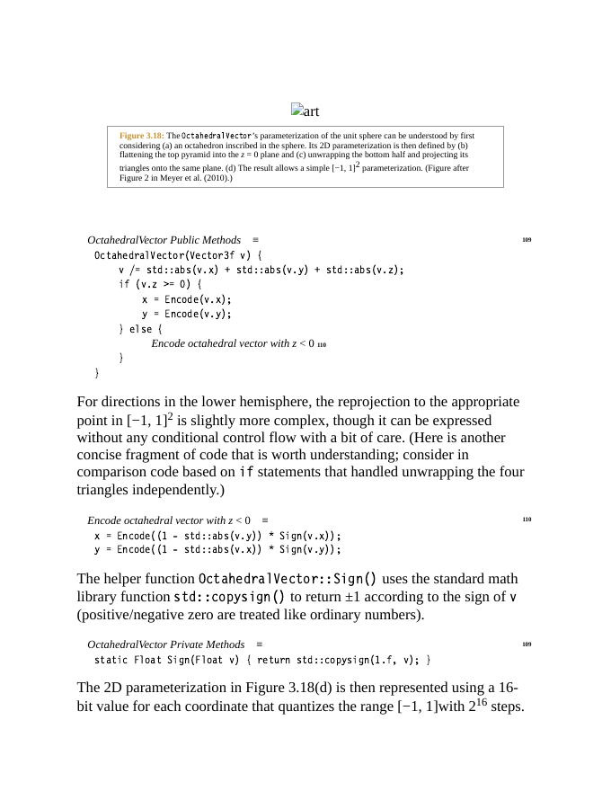
*Figure 3.18: The `OctahedralVector`’s parameterization of the unit sphere can be understood by first considering (a) an octahedron inscribed in the sphere. Its 2D parameterization is then defined by (b) flattening the top pyramid into the z = 0 plane and (c) unwrapping the bottom half and projecting its triangles onto the same plane. (d) The result allows a simple [−1, 1]2 parameterization. (Figure after Figure 2 in Meyer et al. (2010).)*

〈OctahedralVector Public Methods〉 ≡ 109

OctahedralVector(Vector3f v) { v /= std::abs(v.x) + std::abs(v.y) + std::abs(v.z); if (v.z >= 0) { x = Encode(v.x); y = Encode(v.y); } else { 〈Encode octahedral vector with z < 0 110〉 } }

For directions in the lower hemisphere, the reprojection to the appropriate point in [−1, 1]2 is slightly more complex, though it can be expressed without any conditional control flow with a bit of care. (Here is another concise fragment of code that is worth understanding; consider in comparison code based on if statements that handled unwrapping the four triangles independently.) 〈Encode octahedral vector with z < 0〉 ≡ 110

x = Encode((1 - std::abs(v.y)) * Sign(v.x)); y = Encode((1 - std::abs(v.x)) * Sign(v.y));

The helper function OctahedralVector::Sign() uses the standard math library function std::copysign() to return ±1 according to the sign of v (positive/negative zero are treated like ordinary numbers). 〈OctahedralVector Private Methods〉 ≡ 109

static Float Sign(Float v) { return std::copysign(1.f, v); }

The 2D parameterization in Figure 3.18(d) is then represented using a 16-bit value for each coordinate that quantizes the range [−1, 1]with 216 steps.

〈OctahedralVector Private Members〉 ≡ 109

uint16_t x, y;

Encode() performs the encoding from a value in [−1, 1]to the integer encoding. 〈OctahedralVector Private Methods〉 +≡ static uint16_t Encode(Float f) { return pstd::round(Clamp((f + 1) / 2, 0, 1) * 65535.f); }

```text
   Clamp() 1033
   Float 23
   OctahedralVector 109
   OctahedralVector::Encode() 110
   OctahedralVector::Sign() 110
   Vector3f 86
```

The mapping back to a Vector3f follows the same steps in reverse. For directions in the upper hemisphere, the z value on the octahedron face is easily found. Normalizing that vector then gives the corresponding unit vector. 〈OctahedralVector Public Methods〉 +≡ 109

explicit operator Vector3f() const { Vector3f v; v.x = -1 + 2 * (x / 65535.f); v.y = -1 + 2 * (y / 65535.f); v.z = 1 - (std::abs(v.x) + std::abs(v.y)); 〈Reparameterize directions in the z < 0 portion of the octahedron 111〉 return Normalize(v); }

For directions in the lower hemisphere, the inverse of the mapping implemented in the 〈Encode octahedral vector with z < 0〉 fragment must be performed before the direction is normalized. 〈Reparameterize directions in the z < 0 portion of the octahedron〉 ≡ 111

```rust
if (v.z < 0) { Float xo = v.x; v.x = (1 - std::abs(v.y)) * Sign(xo);
       v.y = (1 - std::abs(xo)) * Sign(v.y);
   }
```

Equal-Area Mapping The third spherical parameterization used in pbrt is carefully designed to preserve area: any area on the surface of the sphere maps to a proportional area in the parametric domain. This representation is a good choice for tabulating functions on the sphere, as it is continuous, has reasonably low distortion, and all values stored represent the same solid angle. It combines the octahedral mapping used in the `OctahedralVector` class with a variant of the square-to-disk mapping from Section A.5.1, which maps the unit square to the hemisphere in a way that preserves area. The mapping splits the unit square into four sectors, each of which is mapped to a sector of the hemisphere (see Figure 3.19).

Given (u, v) ∈ [−1, 1]2; then in the first sector where u ≥ 0 and u − |v| ≥ 0, defining the polar coordinates of a point on the unit disk by art gives an area-preserving mapping with ϕ ∈ [−π/4, π/4]. Similar mappings can be found for the other three sectors. Given (r, ϕ), the corresponding point on the positive hemisphere is then given by art This mapping is also area-preserving. This mapping can be extended to the entire sphere using the same octahedral mapping that was used for the `OctahedralVector`. There are then three steps: `Float` 23 `Normalize()` 88 `OctahedralVector` 109 `OctahedralVector::Sign()` 110 `Vector3f` 86 1. First, the octahedral mapping is applied to the direction, giving a point (u, v) ∈ [−1, 1]2.

2. For directions in the upper hemisphere, the concentric hemisphere
mapping, Equation (3.9), is applied to the inner square of the
octahedral mapping. Doing so requires accounting for the fact
that it is rotated by 45° from the square expected by the
hemispherical mapping.
3. Directions in the lower hemisphere are mirrored over across their
quadrant’s diagonal before the hemispherical mapping is applied.
The resulting direction vector’s z component is then negated.

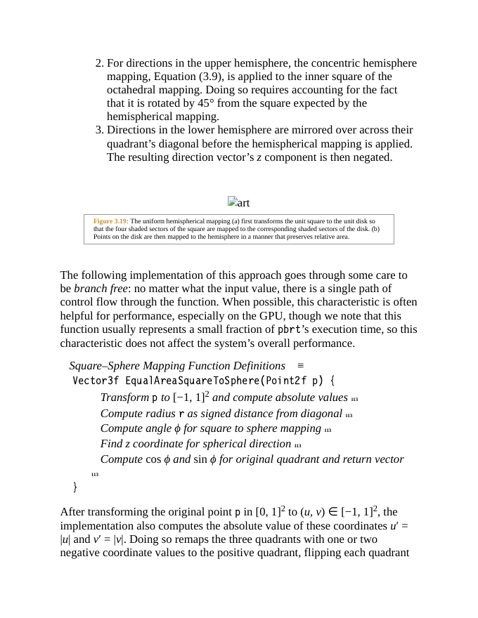
*Figure 3.19: The uniform hemispherical mapping (a) first transforms the unit square to the unit disk so that the four shaded sectors of the square are mapped to the corresponding shaded sectors of the disk. (b) Points on the disk are then mapped to the hemisphere in a manner that preserves relative area.*

The following implementation of this approach goes through some care to be branch free: no matter what the input value, there is a single path of control flow through the function. When possible, this characteristic is often helpful for performance, especially on the GPU, though we note that this function usually represents a small fraction of pbrt’s execution time, so this characteristic does not affect the system’s overall performance. 〈Square–Sphere Mapping Function Definitions〉 ≡ Vector3f EqualAreaSquareToSphere(Point2f p) { 〈Transform p to [−1, 1]2 and compute absolute values 113〉 〈Compute radius r as signed distance from diagonal 113〉 〈Compute angle ϕ for square to sphere mapping 113〉 〈Find z coordinate for spherical direction 113〉 〈Compute cos ϕ and sin ϕ for original quadrant and return vector 113〉

}

After transforming the original point p in [0, 1]2 to (u, v) ∈ [−1, 1]2, the implementation also computes the absolute value of these coordinates u′ = |u| and v′ = |v|. Doing so remaps the three quadrants with one or two negative coordinate values to the positive quadrant, flipping each quadrant

so that its upper hemisphere is mapped to u′ + v′ < 1, which corresponds to the upper hemisphere in the original positive quadrant. (Each lower hemisphere is also mapped to the u′ + v′ > 1 region, corresponding to the original negative quadrant.) `Point2f` 92 `Vector3f` 86

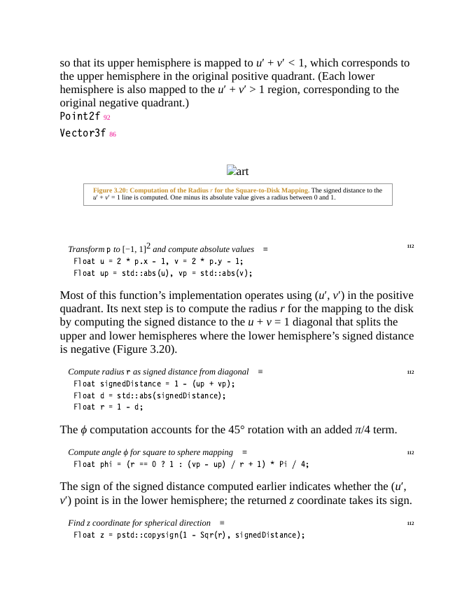
*Figure 3.20: Computation of the Radius r for the Square-to-Disk Mapping. The signed distance to the u′ + v′ = 1 line is computed. One minus its absolute value gives a radius between 0 and 1.*

〈Transform p to [−1, 1]2 and compute absolute values〉 ≡

Float u = 2 * p.x - 1, v = 2 * p.y - 1; Float up = std::abs(u), vp = std::abs(v);

Most of this function’s implementation operates using (u′, v′) in the positive quadrant. Its next step is to compute the radius r for the mapping to the disk by computing the signed distance to the u + v = 1 diagonal that splits the upper and lower hemispheres where the lower hemisphere’s signed distance is negative (Figure 3.20). 〈Compute radius r as signed distance from diagonal〉 ≡ 112

Float signedDistance = 1 - (up + vp); Float d = std::abs(signedDistance); Float r = 1 - d;

The ϕ computation accounts for the 45° rotation with an added π/4 term. 〈Compute angle ϕ for square to sphere mapping〉 ≡ 112

Float phi = (r == 0 ? 1 : (vp - up) / r + 1) * Pi / 4;

The sign of the signed distance computed earlier indicates whether the (u′, v′) point is in the lower hemisphere; the returned z coordinate takes its sign. 〈Find z coordinate for spherical direction〉 ≡ 112

Float z = pstd::copysign(1 - Sqr(r), signedDistance);

After computing cos ϕ and sin ϕ in the positive quadrant, it is necessary to remap those values to the correct ones for the actual quadrant of the original point (u, v). Associating the sign of u with the computed cos ϕ value and the sign of v with sin ϕ suffices to do so and this operation can be done with another use of copysign().

〈Compute cos ϕ and sin ϕ for original quadrant and return vector〉 ≡ 112

Float cosPhi = pstd::copysign(std::cos(phi), u); Float sinPhi = pstd::copysign(std::sin(phi), v); return Vector3f(cosPhi * r * SafeSqrt(2 - Sqr(r)), sinPhi * r * SafeSqrt(2 - Sqr(r)), z);

```text
    EqualAreaSquareToSphere() 112
    Float 23
    Pi 1033
    SafeSqrt() 1034
    Sqr() 1034
    Vector3f 86
```

The inverse mapping is performed by the `EqualAreaSphereToSquare()` function, which effectively performs the same operations in reverse and is therefore not included here. Also useful and also not included, `WrapEqualAreaSquare()` handles the boundary cases of points p that are just outside of [0, 1]2 (as may happen during bilinear interpolation with image texture lookups) and wraps them around to the appropriate valid coordinates that can be passed to `EqualAreaSquareToSphere()`.

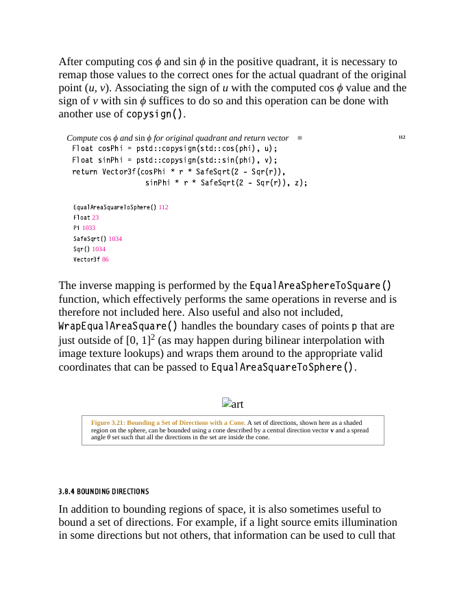
*Figure 3.21: Bounding a Set of Directions with a Cone. A set of directions, shown here as a shaded region on the sphere, can be bounded using a cone described by a central direction vector v and a spread angle θ set such that all the directions in the set are inside the cone.*

### 3.8.4 BOUNDING DIRECTIONS

In addition to bounding regions of space, it is also sometimes useful to bound a set of directions. For example, if a light source emits illumination in some directions but not others, that information can be used to cull that

light source from being included in lighting calculations for points it certainly does not illuminate. pbrt provides the DirectionCone class for such uses; it represents a cone that is parameterized by a central direction and an angular spread (see Figure 3.21). 〈DirectionCone Definition〉 ≡ class DirectionCone { public: 〈DirectionCone Public Methods 114〉 〈DirectionCone Public Members 114〉 };

The DirectionCone provides a variety of constructors, including one that takes the central axis of the cone and the cosine of its spread angle and one that bounds a single direction. For both the constructor parameters and the cone representation stored in the class, the cosine of the spread angle is used rather than the angle itself. Doing so makes it possible to perform some of the following operations with DirectionCones using efficient dot products in place of more expensive trigonometric functions. 〈DirectionCone Public Methods〉 ≡ 114

DirectionCone() = default; DirectionCone(Vector3f w, Float cosTheta) : w(Normalize(w)), cosTheta(cosTheta) {} explicit DirectionCone(Vector3f w) : DirectionCone(w, 1) {}

The default `DirectionCone` is empty; an invalid value of infinity for cosTheta encodes that case.

〈DirectionCone Public Members〉 ≡ 114

Vector3f w; Float cosTheta = Infinity;

A convenience method reports whether the cone is empty. 〈DirectionCone Public Methods〉 +≡ 114

bool IsEmpty() const { return cosTheta == Infinity; }

```text
   DirectionCone 114
   DirectionCone::cosTheta 114
```

```text
   Float 23
   Infinity 361
   Normalize() 88
   Vector3f 86
```

Another convenience method provides the bound for all directions. 〈DirectionCone Public Methods〉 +≡ 114

static DirectionCone EntireSphere() { return DirectionCone(Vector3f(0, 0, 1), -1); }

Given a DirectionCone, it is easy to check if a given direction vector is inside its bounds: the cosine of the angle between the direction and the cone’s central direction must be greater than the cosine of the cone’s spread angle. (Note that for the angle to be smaller, the cosine must be larger.) 〈DirectionCone Inline Functions〉 ≡ bool Inside(const DirectionCone &d, Vector3f w) { return !d.IsEmpty() && Dot(d.w, Normalize(w)) >= d.cosTheta; }

BoundSubtendedDirections() returns a DirectionCone that bounds the directions subtended by a given bounding box with respect to a point p. 〈DirectionCone Inline Functions〉 +≡ DirectionCone BoundSubtendedDirections(const Bounds3f &b, Point3f p) { 〈Compute bounding sphere for b and check if p is inside 115〉 〈Compute and return DirectionCone for bounding sphere 115〉 }

First, a bounding sphere is found for the bounds b. If the given point p is inside the sphere, then a direction bound of all directions is returned. Note that the point p may be inside the sphere but outside b, in which case the returned bounds will be overly conservative. This issue is discussed further in an exercise at the end of the chapter. 〈Compute bounding sphere for b and check if p is inside〉 ≡ 115

```rust
   Float radius;
   Point3f pCenter;
   b.BoundingSphere(&pCenter, &radius);
   if (DistanceSquared(p, pCenter) < Sqr(radius))
       return DirectionCone::EntireSphere();
```

```text
   Bounds3::BoundingSphere() 103
   Bounds3f 97
   DirectionCone 114
   DirectionCone::cosTheta 114
   DirectionCone::EntireSphere() 115
   DirectionCone::IsEmpty() 114
   DirectionCone::w 114
   DistanceSquared() 93
   Dot() 89
   Float 23
   Normalize() 88
   Point3f 92
   SafeSqrt() 1034
   Sqr() 1034
   Vector3f 86
```

Otherwise the central axis of the bounds is given by the vector from p to the center of the sphere and the cosine of the spread angle is easily found using basic trigonometry (see Figure 3.22). 〈Compute and return DirectionCone for bounding sphere〉 ≡ 115

Vector3f w = Normalize(pCenter - p); Float sin2ThetaMax = Sqr(radius) / DistanceSquared(pCenter, p); Float cosThetaMax = SafeSqrt(1 - sin2ThetaMax); return DirectionCone(w, cosThetaMax);

Finally, we will find it useful to be able to take the union of two `DirectionCones`, finding a `DirectionCone` that bounds both of them.

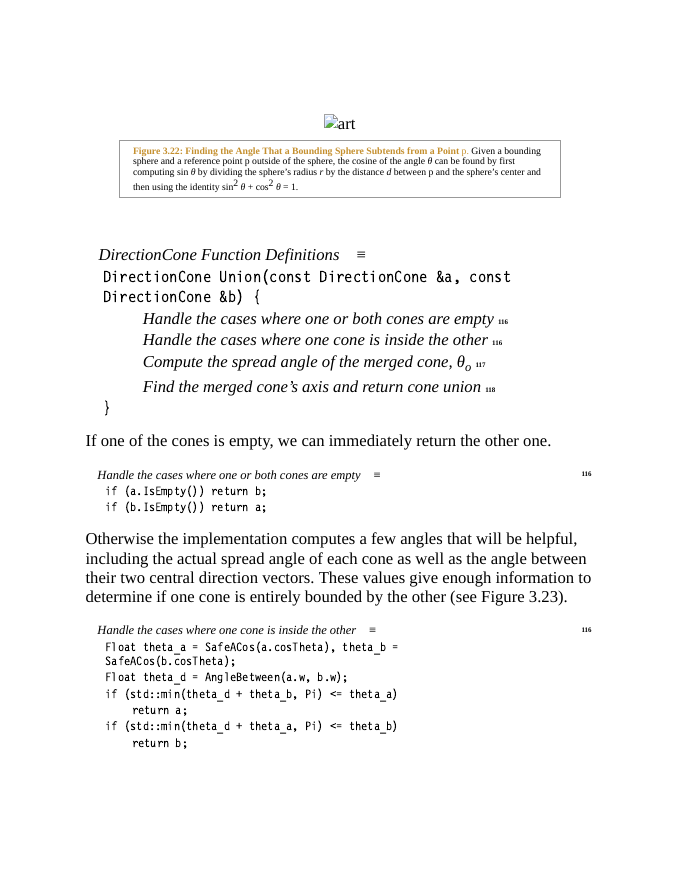
*Figure 3.22: Finding the Angle That a Bounding Sphere Subtends from a Point p. Given a bounding sphere and a reference point p outside of the sphere, the cosine of the angle θ can be found by first computing sin θ by dividing the sphere’s radius r by the distance d between p and the sphere’s center and then using the identity sin2 θ + cos2 θ = 1.*

〈DirectionCone Function Definitions〉 ≡ DirectionCone Union(const DirectionCone &a, const DirectionCone &b) { 〈Handle the cases where one or both cones are empty 116〉 〈Handle the cases where one cone is inside the other 116〉 〈Compute the spread angle of the merged cone, θo 117〉 〈Find the merged cone’s axis and return cone union 118〉 }

If one of the cones is empty, we can immediately return the other one. 〈Handle the cases where one or both cones are empty〉 ≡ 116

if (a.IsEmpty()) return b; if (b.IsEmpty()) return a;

Otherwise the implementation computes a few angles that will be helpful, including the actual spread angle of each cone as well as the angle between their two central direction vectors. These values give enough information to determine if one cone is entirely bounded by the other (see Figure 3.23). 〈Handle the cases where one cone is inside the other〉 ≡ 116

Float theta_a = SafeACos(a.cosTheta), theta_b = SafeACos(b.cosTheta); Float theta_d = AngleBetween(a.w, b.w); if (std::min(theta_d + theta_b, Pi) <= theta_a) return a; if (std::min(theta_d + theta_a, Pi) <= theta_b) return b;

Otherwise it is necessary to compute a new cone that bounds both of them. As illustrated in Figure 3.24, the sum of θa, θd, and θb gives the full angle that the new cone must cover; half of that is its spread angle.

```text
   AngleBetween() 89
   DirectionCone 114
   DirectionCone::cosTheta 114
   DirectionCone::IsEmpty() 114
   DirectionCone::w 114
   Float 23
   Pi 1033
   SafeACos() 1035
```

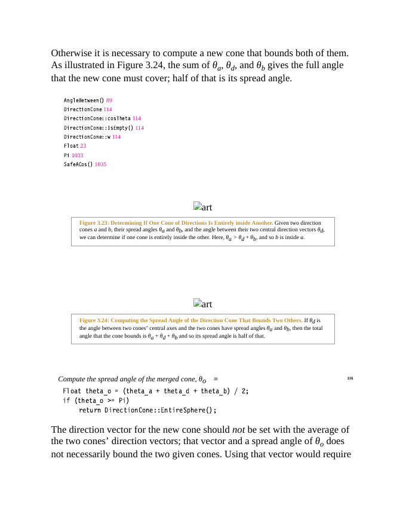
*Figure 3.23: Determining If One Cone of Directions Is Entirely inside Another. Given two direction cones a and b, their spread angles θa and θb, and the angle between their two central direction vectors θd, we can determine if one cone is entirely inside the other. Here, θa > θd + θb, and so b is inside a.*


*Figure 3.24: Computing the Spread Angle of the Direction Cone That Bounds Two Others. If θd is the angle between two cones’ central axes and the two cones have spread angles θa and θb, then the total angle that the cone bounds is θa + θd + θb and so its spread angle is half of that.*

〈Compute the spread angle of the merged cone, θo〉 ≡ 116

```rust
   Float theta_o = (theta_a + theta_d + theta_b) / 2;
   if (theta_o >= Pi)
       return DirectionCone::EntireSphere();
```

The direction vector for the new cone should not be set with the average of the two cones’ direction vectors; that vector and a spread angle of θo does not necessarily bound the two given cones. Using that vector would require

a spread angle of θd/2 + max(2θa, 2θb), which is never less than θo. (It is worthwhile to sketch out a few cases on paper to convince yourself of this.) `DirectionCone::EntireSphere()` 115 `Float` 23 `Pi` 1033 `Rotate()` 126

Instead, we find the vector perpendicular to the cones’ direction vectors using the cross product and rotate a.w by the angle around that axis that causes it to bound both cones’ angles. (The Rotate() function used for this will be introduced shortly, in Section 3.9.7.) In the case that LengthSquared(wr) == 0, the vectors face in opposite directions and a bound of the entire sphere is returned.2 〈Find the merged cone’s axis and return cone union〉 ≡ 116

Float theta_r = theta_o - theta_a; Vector3f wr = Cross(a.w, b.w); if (LengthSquared(wr) == 0) return DirectionCone::EntireSphere(); Vector3f w = Rotate(Degrees(theta_r), wr)(a.w); return DirectionCone(w, std::cos(theta_o));

## 3.9 TRANSFORMATIONS

In general, a transformation T is a mapping from points to points and from vectors to vectors: p′ = T(p) v′ = T(v). The transformation T may be an arbitrary procedure. However, we will consider a subset of all possible transformations in this chapter. In particular, they will be

Linear: If T is an arbitrary linear transformation and s is an arbitrary scalar, then T(sv) =
sT(v) and T(v1 + v2) = T(v1) + T(v2). These two properties can greatly simplify
reasoning about transformations.
Continuous: Roughly speaking, T maps the neighborhoods around p and v to
neighborhoods around p′ and v′.
One-to-one and invertible: For each p, T maps p′ to a single unique p′. Furthermore, there
exists an inverse transform T−1 that maps p′ back to p.

We will often want to take a point, vector, or normal defined with respect to one coordinate frame and find its coordinate values with respect to another frame. Using basic properties of linear algebra, a 4 × 4 matrix can be shown to express the linear transformation of a point or vector from one frame to another. Furthermore, such a 4 × 4 matrix suffices to express all linear transformations of points and vectors within a fixed frame, such as translation in space or rotation around a point. Therefore, there are two different (and incompatible!) ways that a matrix can be interpreted:

Transformation within the frame: Given a point, the matrix could express how to compute
a new point in the same frame that represents the transformation of the original point
(e.g., by translating it in some direction).
Transformation from one frame to another: A matrix can express the coordinates of a
point or vector in a new frame in terms of the coordinates in the original frame.

Most uses of transformations in pbrt are for transforming points from one frame to another.

In general, transformations make it possible to work in the most convenient coordinate space. For example, we can write routines that define a virtual camera, assuming that the camera is located at the origin, looks down the z axis, and has the y axis pointing up and the x axis pointing right. These assumptions greatly simplify the camera implementation. To place the camera at any point in the scene looking in any direction, we construct a transformation that maps points in the scene’s coordinate system to the camera’s coordinate system. (See Section 5.1.1 for more information about camera coordinate spaces in pbrt.) `Cross()` 91 Degrees() 1033 `DirectionCone` 114 `DirectionCone::EntireSphere()` 115 `DirectionCone::w` 114 `Float` 23 `LengthSquared()` 87

`Rotate()` 126 `Vector3f` 86

### 3.9.1 HOMOGENEOUS COORDINATES

Given a frame defined by (po, v1, v2, v3), there is ambiguity between the representation of a point (px, py, pz) and a vector (vx, vy, vz) with the same (x, y, z) coordinates. Using the representations of points and vectors introduced at the start of the chapter, we can write the point as the inner product [s1 s2 s3 1][v1 v2 v3 po]T and the vector as the inner product art. These four-vectors of three si values and a zero or one are called the homogeneous representations of the point and the vector. The fourth coordinate of the homogeneous representation is sometimes called the weight. For a point, its value can be any scalar other than zero: the homogeneous points [1, 3, −2, 1] and [−2, −6, 4, −2] describe the same Cartesian point (1, 3, −2). Converting homogeneous points into ordinary points entails dividing the first three components by the weight: art We will use these facts to see how a transformation matrix can describe how points and vectors in one frame can be mapped to another frame. Consider a matrix M that describes the transformation from one coordinate system to another: art (In this book, we define matrix element indices starting from zero, so that equations and source code correspond more directly.) Then if the transformation represented by M is applied to the x axis vector (1, 0, 0), we have Mx = M[1 0 0 0]T = [m0, 0 m1, 0 m2, 0 m3, 0]T. Thus, directly reading the columns of the matrix shows how the basis vectors and the origin of the current coordinate system are transformed by the matrix: My = [m0, 1 m1, 1 m2, 1 m3, 1]T Mz = [m0, 2 m1, 2 m2, 2 m3, 2]T Mp = [m0, 3 m1, 3 m2, 3 m3, 3]T.

In general, by characterizing how the basis is transformed, we know how any point or vector specified in terms of that basis is transformed. Because points and vectors in a coordinate system are expressed in terms of the coordinate system’s frame, applying the transformation to them directly is

equivalent to applying the transformation to the coordinate system’s basis and finding their coordinates in terms of the transformed basis. We will not use homogeneous coordinates explicitly in our code; there is no Homogeneous Point class in pbrt. However, the various transformation routines in the next section will implicitly convert points, vectors, and normals to homogeneous form, transform the homogeneous points, and then convert them back before returning the result. This isolates the details of homogeneous coordinates in one place (namely, the implementation of transformations).

### 3.9.2 Transform CLASS DEFINITION

The `Transform` class represents a 4 × 4 transformation. Its implementation is in the files `util/transform.h` and `util/transform.cpp`.

〈Transform Definition〉 ≡ class Transform { public: 〈Transform Public Methods 120〉 private: 〈Transform Private Members 120〉 };

The transformation matrix is represented by the elements of the matrix m, which is represented by a SquareMatrix<4> object. (The SquareMatrix class is defined in Section B.2.12.) The matrix m is stored in row-major form, so element m[i][j] corresponds to mi,j, where i is the row number and j is the column number. For convenience, the Transform also stores the inverse of m in its Transform::mInv member variable; for pbrt’s needs, it is better to have the inverse easily available than to repeatedly compute it as needed. 〈Transform Private Members〉 ≡ 120

SquareMatrix<4> m, mInv;

This representation of transformations is relatively memory hungry: assuming 4 bytes of storage for a `Float` value, a `Transform` requires 128

bytes of storage. Used naïvely, this approach can be wasteful; if a scene has millions of shapes but only a few thousand unique transformations, there is no reason to redundantly store the same matrices many times. Therefore, `Shapes` in pbrt store a pointer to a `Transform` and the scene specification code defined in Section C.2.3 uses an `InternCache` of `Transforms` to ensure that all shapes that share the same transformation point to a single instance of that transformation in memory.

### 3.9.3 BASIC OPERATIONS

When a new Transform is created, it defaults to the identity transformation —the transformation that maps each point and each vector to itself. This transformation is represented by the identity matrix: art The implementation here relies on the default SquareMatrix constructor to fill in the identity matrix for m and mInv. 〈Transform Public Methods〉 ≡ 120

Transform() = default;

A Transform can also be created from a given matrix. In this case, the matrix must be explicitly inverted. 〈Transform Public Methods〉 +≡ 120

Transform(const SquareMatrix<4> &m) : m(m) { pstd::optional<SquareMatrix<4>> inv = Inverse(m); if (inv) mInv = *inv; else { 〈Initialize mInv with not-a-number values 121〉 } }

```text
    InternCache 1070
    Shape 261
    SquareMatrix 1049
    SquareMatrix::Inverse() 1051
    Transform 120
    Transform::mInv 120
```

If the matrix provided by the caller is degenerate and cannot be inverted, mInv is initialized with floating-point not-a-number values, which poison computations that involve them: arithmetic performed using a not-a-number value always gives a not-a-number value. In this way, a caller who provides a degenerate matrix m can still use the Transform as long as no methods that access mInv are called. 〈Initialize mInv with not-a-number values〉 ≡ 120

```rust
   Float NaN = std::numeric_limits<Float>::has_signaling_NaN
                                   ?
                                   std::numeric_limits<Float>::signaling_NaN()
                                   : std::numeric_limits<Float>::quiet_NaN();
   for (int i = 0; i < 4; ++i)
         for (int j = 0; j < 4; ++j)
              mInv[i][j] = NaN;
```

Another constructor allows specifying the elements of the matrix using a regular 2D array. 〈Transform Public Methods〉 +≡ 120

Transform(const Float mat[4][4]) : Transform(SquareMatrix<4> (mat)) {}

The most commonly used constructor takes a reference to the transformation matrix along with an explicitly provided inverse. This is a superior approach to computing the inverse in the constructor because many geometric transformations have simple inverses and we can avoid the expense and potential loss of numeric accuracy from computing a general 4 × 4 matrix inverse. Of course, this places the burden on the caller to make sure that the supplied inverse is correct. 〈Transform Public Methods〉 +≡ 120

Transform(const SquareMatrix<4> &m, const SquareMatrix<4> &mInv) : m(m), mInv(mInv) {}

Both the matrix and its inverse are made available for callers that need to access them directly. 〈Transform Public Methods〉 +≡ 120

const SquareMatrix<4> &GetMatrix() const { return m; } const SquareMatrix<4> &GetInverseMatrix() const { return mInv; }

The `Transform` representing the inverse of a `Transform` can be returned by just swapping the roles of mInv and m.

〈Transform Inline Functions〉 ≡ Transform Inverse(const Transform &t) { return Transform(t.GetInverseMatrix(), t.GetMatrix()); }

Transposing the two matrices in the transform to compute a new transform can also be useful. 〈Transform Inline Functions〉 +≡ Transform Transpose(const Transform &t) { return Transform(Transpose(t.GetMatrix()), Transpose(t.GetInverseMatrix())); }

The `Transform` class also provides equality and inequality testing methods as well as an `IsIdentity()` method that checks to see if the transformation is the identity.

```text
    Float 23
    SquareMatrix 1049
    SquareMatrix::Transpose() 1051
    Transform 120
    Transform::GetInverseMatrix() 121
    Transform::GetMatrix() 121
    Transform::m 120
    Transform::mInv 120
```

〈Transform Public Methods〉 +≡ 120

bool operator==(const Transform &t) const { return t.m == m; } bool operator!=(const Transform &t) const { return t.m != m; } bool IsIdentity() const { return m.IsIdentity(); }

### 3.9.4 TRANSLATIONS

One of the simplest transformations is the translation transformation, T(Δx, Δy, Δz). When applied to a point p, it translates p’s coordinates by Δx, Δy, and Δz, as shown in Figure 3.25. As an example, T(2, 2, 1)(x, y, z) = (x + 2, y + 2, z + 1). Translation has some basic properties: art Translation only affects points, leaving vectors unchanged. In matrix form, the translation transformation is art When we consider the operation of a translation matrix on a point, we see the value of homogeneous coordinates. Consider the product of the matrix for T(Δx, Δy, Δz) with a point p in homogeneous coordinates [x y z 1]T: art As expected, we have computed a new point with its coordinates offset by (Δx, Δy, Δz). However, if we apply T to a vector v, we have art

```text
   SquareMatrix::IsIdentity() 1050
   Transform 120
   Transform::m 120
```

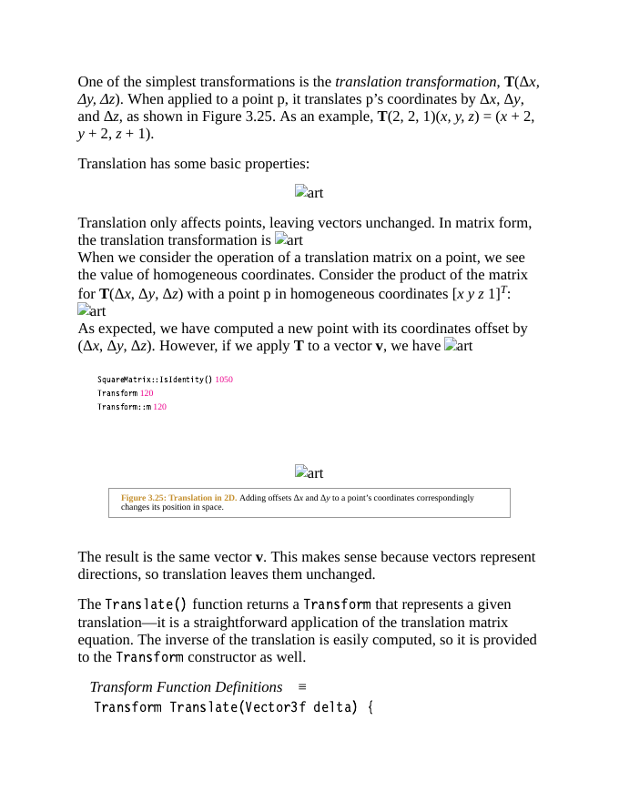
*Figure 3.25: Translation in 2D. Adding offsets Δx and Δy to a point’s coordinates correspondingly changes its position in space.*

The result is the same vector v. This makes sense because vectors represent directions, so translation leaves them unchanged. The Translate() function returns a Transform that represents a given translation—it is a straightforward application of the translation matrix equation. The inverse of the translation is easily computed, so it is provided to the Transform constructor as well. 〈Transform Function Definitions〉 ≡ Transform Translate(Vector3f delta) {
```rust
    SquareMatrix<4> m(1, 0, 0, delta.x,
                      0, 1, 0, delta.y,
                      0, 0, 1, delta.z,
                      0, 0, 0, 1);
    SquareMatrix<4> minv(1, 0, 0, -delta.x,
                         0, 1, 0, -delta.y,
                         0, 0, 1, -delta.z,
                         0, 0, 0, 1);
    return Transform(m, minv);
}
```

### 3.9.5 SCALING

Another basic transformation is the scale transformation, S(sx, sy, sz). It has the effect of taking a point or vector and multiplying its components by scale factors in x, y, and z: S(2, 2, 1)(x, y, z) = (2x, 2y, z). It has the following basic properties: art We can differentiate between uniform scaling, where all three scale factors have the same value, and nonuniform scaling, where they may have different values. The general scale matrix is art 〈Transform Function Definitions〉 +≡ Transform Scale(Float x, Float y, Float z) {
```rust
    SquareMatrix<4> m(x, 0, 0, 0,
                      0, y, 0, 0,
                      0, 0, z, 0,
                      0, 0, 0, 1);
    SquareMatrix<4> minv(1 / x, 0, 0, 0,
                         0, 1 / y, 0, 0,
                         0, 0, 1 / z, 0,
                         0, 0, 0, 1);
    return Transform(m, minv);
}
```

```text
    Float 23
    SquareMatrix 1049
    Transform 120
    Vector3f 86
```

It is useful to be able to test if a transformation has a scaling term in it; an easy way to do this is to transform the three coordinate axes and see if any of their lengths are appreciably different from one. 〈Transform Public Methods〉 +≡ 120

bool HasScale(Float tolerance = 1e-3f) const { Float la2 = LengthSquared((*this)(Vector3f(1, 0, 0))); Float lb2 = LengthSquared((*this)(Vector3f(0, 1, 0))); Float lc2 = LengthSquared((*this)(Vector3f(0, 0, 1))); return (std::abs(la2 - 1) > tolerance ‖ std::abs(lb2 - 1) > tolerance ‖ std::abs(lc2 - 1) > tolerance); }

### 3.9.6 x, y, AND z AXIS ROTATIONS

Another useful type of transformation is the rotation transformation, R. In general, we can define an arbitrary axis from the origin in any direction and then rotate around that axis by a given angle. The most common rotations of this type are around the x, y, and z coordinate axes. We will write these rotations as Rx(θ), Ry(θ), and so on. The rotation around an arbitrary axis (x, y, z) is denoted by R(x,y,z)(θ).

Rotations also have some basic properties: art

where RT is the matrix transpose of R. This last property, that the inverse of R is equal to its transpose, stems from the fact that R is an orthogonal matrix; its first three columns (or rows) are all normalized and orthogonal to each other. Fortunately, the transpose is much easier to compute than a full matrix inverse.

For a left-handed coordinate system, the matrix for clockwise rotation around the x axis is art Figure 3.26 gives an intuition for how this matrix works. It is easy to see that the matrix leaves the x axis unchanged:

Rx(θ)[1 0 0 0]T = [1 0 0 0]T.

It maps the y axis (0, 1, 0) to (0, cos θ, sin θ) and the z axis to (0, − sin θ, cos θ). The y and z axes remain in the same plane, perpendicular to the x axis, but are rotated by the given angle. An arbitrary point in space is similarly rotated about the x axis by this transformation while staying in the same yz plane as it was originally. The implementation of the `RotateX()` function is straightforward.

```text
   Float 23
   LengthSquared() 87
   RotateX() 125
   Vector3f 86
```

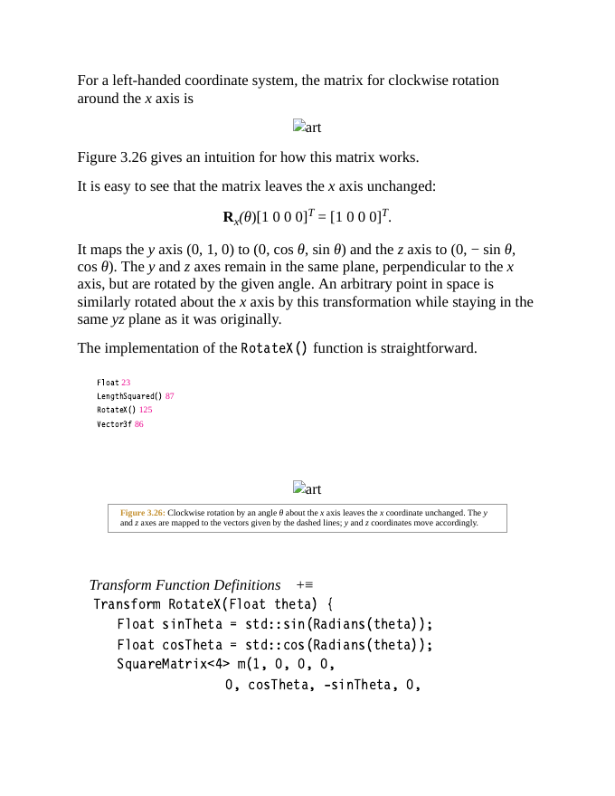
*Figure 3.26: Clockwise rotation by an angle θ about the x axis leaves the x coordinate unchanged. The y and z axes are mapped to the vectors given by the dashed lines; y and z coordinates move accordingly.*

〈Transform Function Definitions〉 +≡ Transform RotateX(Float theta) {
```rust
    Float sinTheta = std::sin(Radians(theta));
    Float cosTheta = std::cos(Radians(theta));
    SquareMatrix<4> m(1, 0, 0, 0,
                      0, cosTheta, -sinTheta, 0,
                      0, sinTheta, cosTheta, 0,
                      0, 0, 0, 1);
    return Transform(m, Transpose(m));
}
```

Similarly, for clockwise rotation around y and z, we have art The implementations of `RotateY()` and `RotateZ()` follow directly and are not included here.

### 3.9.7 ROTATION AROUND AN ARBITRARY AXIS

We also provide a routine to compute the transformation that represents rotation around an arbitrary axis. A common derivation of this matrix is based on computing rotations that map the given axis to a fixed axis (e.g., z), performing the rotation there, and then rotating the fixed axis back to the original axis. A more elegant derivation can be constructed with vector algebra. Consider a normalized direction vector a that gives the axis to rotate around by angle θ, and a vector v to be rotated (Figure 3.27). First, we can compute the vector vc along the axis a that is in the plane through the end point of v and is parallel to a. Assuming v and a form an angle α, we have vc = a ‖v‖ cos α = a(v · a).

```text
    Float 23
    Radians() 1033
    SquareMatrix 1049
    Transform 120
```

We now compute a pair of basis vectors v1 and v2 in this plane. Trivially, one of them is v1 = v − vc,

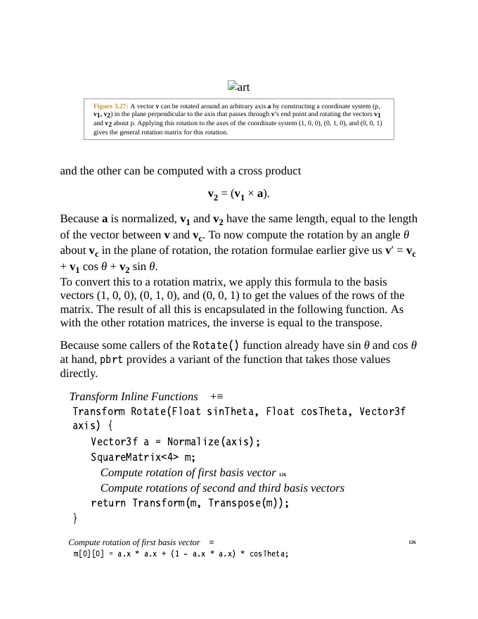
*Figure 3.27: A vector v can be rotated around an arbitrary axis a by constructing a coordinate system (p, v1, v2) in the plane perpendicular to the axis that passes through v’s end point and rotating the vectors v1 and v2 about p. Applying this rotation to the axes of the coordinate system (1, 0, 0), (0, 1, 0), and (0, 0, 1) gives the general rotation matrix for this rotation.*

and the other can be computed with a cross product v2 = (v1 × a).

Because a is normalized, v1 and v2 have the same length, equal to the length of the vector between v and vc. To now compute the rotation by an angle θ about vc in the plane of rotation, the rotation formulae earlier give us v′ = vc + v1 cos θ + v2 sin θ. To convert this to a rotation matrix, we apply this formula to the basis vectors (1, 0, 0), (0, 1, 0), and (0, 0, 1) to get the values of the rows of the matrix. The result of all this is encapsulated in the following function. As with the other rotation matrices, the inverse is equal to the transpose. Because some callers of the Rotate() function already have sin θ and cos θ at hand, pbrt provides a variant of the function that takes those values directly. 〈Transform Inline Functions〉 +≡ Transform Rotate(Float sinTheta, Float cosTheta, Vector3f axis) { Vector3f a = Normalize(axis); SquareMatrix<4> m; 〈Compute rotation of first basis vector 126〉 〈Compute rotations of second and third basis vectors〉 return Transform(m, Transpose(m)); }

〈Compute rotation of first basis vector〉 ≡ 126

m[0][0] = a.x * a.x + (1 - a.x * a.x) * cosTheta;

```rust
   m[0][1] = a.x * a.y * (1 - cosTheta) - a.z * sinTheta;
   m[0][2] = a.x * a.z * (1 - cosTheta) + a.y * sinTheta;
   m[0][3] = 0;
```

```text
    Float 23
    Normalize() 88
    SquareMatrix 1049
    SquareMatrix::Transpose() 1051
    Transform 120
    Vector3f 86
```

The code for the other two basis vectors follows similarly and is not included here. A second variant of Rotate() takes the angle θ in degrees, computes its sine and cosine, and calls the first. 〈Transform Inline Functions〉 +≡ Transform Rotate(Float theta, Vector3f axis) { Float sinTheta = std::sin(Radians(theta)); Float cosTheta = std::cos(Radians(theta)); return Rotate(sinTheta, cosTheta, axis); }

### 3.9.8 ROTATING ONE VECTOR TO ANOTHER

It is sometimes useful to find the transformation that performs a rotation that aligns one unit vector f with another t (where f denotes “from” and t denotes “to”). One way to do so is to define a rotation axis by the cross product of the two vectors, compute the rotation angle as the arccosine of their dot product, and then use the `Rotate()` function. However, this approach not only becomes unstable when the two vectors are nearly parallel but also requires a number of expensive trigonometric function calls. A different approach to deriving this rotation matrix is based on finding a pair of reflection transformations that reflect f to an intermediate vector r and then reflect r to t. The product of such a pair of reflections gives the desired rotation. The Householder matrix H(v) provides a way to find these

reflections: it reflects the given vector v to its negation −v while leaving all vectors orthogonal to v unchanged and is defined as where I is the identity matrix. With the product of the two reflections art the second matrix reflects f to r and the first then reflects r to t, which together give the desired rotation. 〈Transform Inline Functions〉 +≡ Transform RotateFromTo(Vector3f from, Vector3f to) { 〈Compute intermediate vector for vector reflection 127〉 〈Initialize matrix r for rotation 128〉 return Transform(r, Transpose(r)); }

The intermediate reflection direction refl is determined by choosing a basis vector that is not too closely aligned to either of the from and to vectors. In the computation here, because 0.72 is just slightly greater than , the absolute value of at least one pair of matching coordinates must then both be less than 0.72, assuming the vectors are normalized. In this way, a loss of accuracy is avoided when the reflection direction is nearly parallel to either from or to. 〈Compute intermediate vector for vector reflection〉 ≡ 127

Vector3f refl; if (std::abs(from.x) < 0.72f && std::abs(to.x) < 0.72f) refl = Vector3f(1, 0, 0); else if (std::abs(from.y) < 0.72f && std::abs(to.y) < 0.72f) refl = Vector3f(0, 1, 0); else refl = Vector3f(0, 0, 1);

```text
   Float 23
   Radians() 1033
   Rotate() 126
   SquareMatrix::Transpose() 1051
```

```text
    Transform 120
    Vector3f 86
```

Given the reflection axis, the matrix elements can be initialized directly. 〈Initialize matrix r for rotation〉 ≡ 127

```rust
   Vector3f u = refl - from, v = refl - to;
   SquareMatrix<4> r;
   for (int i = 0; i < 3; ++i)
         for (int j = 0; j < 3; ++j)
              〈Initialize matrix element r[i][j] 128〉
```

Expanding the product of the Householder matrices in Equation (3.10), we can find that the matrix element ri,j is given by art where δi,j is the Kronecker delta function that is 1 if i and j are equal and 0 otherwise. The implementation follows directly. 〈Initialize matrix element r[i][j]〉 ≡ 128

```rust
   r[i][j] = ((i == j) ? 1 : 0) -
                 2 / Dot(u, u) * u[i] * u[j] -
                 2 / Dot(v, v) * v[i] * v[j] +
                 4 * Dot(u, v) / (Dot(u, u) * Dot(v, v)) * v[i] *
                 u[j];
```

### 3.9.9 THE LOOK-AT TRANSFORMATION

The look-at transformation is particularly useful for placing a camera in the scene. The caller specifies the desired position of the camera, a point the camera is looking at, and an “up” vector that orients the camera along the viewing direction implied by the first two parameters. All of these values are typically given in world-space coordinates; this gives a transformation from world space to camera space (Figure 3.28). We will assume that use in the discussion below, though note that this way of specifying transformations can also be useful for placing light sources in the scene. In order to find the entries of the look-at transformation matrix, we use principles described earlier in this section: the columns of a transformation matrix give the effect of the transformation on the basis of a coordinate system.

```text
    Dot() 89
```

```text
   SquareMatrix 1049
   Vector3f 86
```

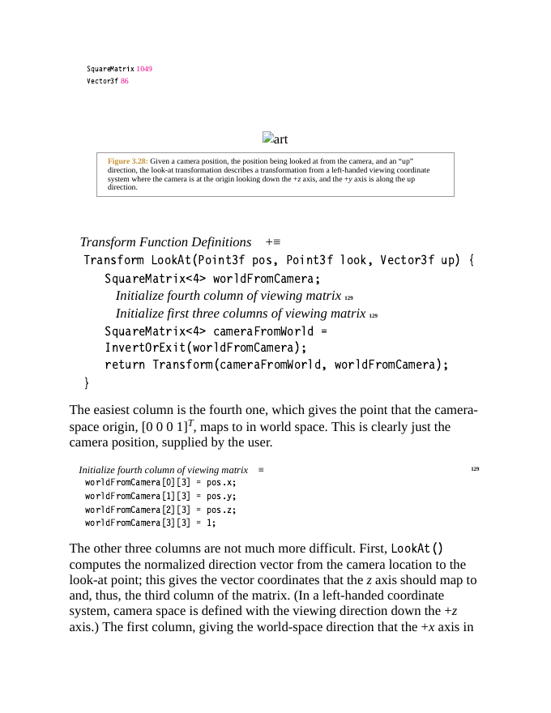
*Figure 3.28: Given a camera position, the position being looked at from the camera, and an “up” direction, the look-at transformation describes a transformation from a left-handed viewing coordinate system where the camera is at the origin looking down the +z axis, and the +y axis is along the up direction.*

〈Transform Function Definitions〉 +≡ Transform LookAt(Point3f pos, Point3f look, Vector3f up) { SquareMatrix<4> worldFromCamera; 〈Initialize fourth column of viewing matrix 129〉 〈Initialize first three columns of viewing matrix 129〉 SquareMatrix<4> cameraFromWorld = InvertOrExit(worldFromCamera); return Transform(cameraFromWorld, worldFromCamera); }

The easiest column is the fourth one, which gives the point that the camera-space origin, [0 0 0 1]T, maps to in world space. This is clearly just the camera position, supplied by the user. 〈Initialize fourth column of viewing matrix〉 ≡ 129

```rust
   worldFromCamera[0][3] = pos.x;
   worldFromCamera[1][3] = pos.y;
   worldFromCamera[2][3] = pos.z;
   worldFromCamera[3][3] = 1;
```

The other three columns are not much more difficult. First, `LookAt()` computes the normalized direction vector from the camera location to the look-at point; this gives the vector coordinates that the z axis should map to and, thus, the third column of the matrix. (In a left-handed coordinate system, camera space is defined with the viewing direction down the +z axis.) The first column, giving the world-space direction that the +x axis in

camera space maps to, is found by taking the cross product of the user-supplied “up” vector with the recently computed viewing direction vector. Finally, the “up” vector is recomputed by taking the cross product of the viewing direction vector with the transformed x axis vector, thus ensuring that the y and z axes are perpendicular and we have an orthonormal viewing coordinate system. 〈Initialize first three columns of viewing matrix〉 ≡ 129

```rust
   Vector3f dir = Normalize(look - pos);
   Vector3f right = Normalize(Cross(Normalize(up), dir));
   Vector3f newUp = Cross(dir, right);
   worldFromCamera[0][0] = right.x;
   worldFromCamera[1][0] = right.y;
   worldFromCamera[2][0] = right.z;
   worldFromCamera[3][0] = 0.;
   worldFromCamera[0][1] = newUp.x;
   worldFromCamera[1][1] = newUp.y;
   worldFromCamera[2][1] = newUp.z;
   worldFromCamera[3][1] = 0.;
   worldFromCamera[0][2] = dir.x;
   worldFromCamera[1][2] = dir.y;
   worldFromCamera[2][2] = dir.z;
   worldFromCamera[3][2] = 0.;
```

```text
   Cross() 91
   LookAt() 129
   Normalize() 88
   Point3f 92
   SquareMatrix 1049
   SquareMatrix::InvertOrExit() 1051
   Transform 120
   Vector3f 86
```

## 3.10 APPLYING TRANSFORMATIONS

We can now define routines that perform the appropriate matrix multiplications to transform points and vectors. We will overload the function application operator to describe these transformations; this lets us write code like: Point3f p = ...;

```rust
        Transform T = ...;
        Point3f pNew = T(p);
```

### 3.10.1 POINTS

The point transformation routine takes a point (x, y, z) and implicitly represents it as the homogeneous column vector [x y z 1]T. It then transforms the point by premultiplying this vector with the transformation matrix. Finally, it divides by w to convert back to a non-homogeneous point representation. For efficiency, this method skips the division by the homogeneous weight, w, when w = 1, which is common for most of the transformations that will be used in pbrt—only the projective transformations defined in Chapter 5 will require this division. 〈Transform Inline Methods〉 ≡ template <typename T> Point3<T> Transform::operator()(Point3<T> p) const { T xp = m[0][0] * p.x + m[0][1] * p.y + m[0][2] * p.z + m[0][3]; T yp = m[1][0] * p.x + m[1][1] * p.y + m[1][2] * p.z + m[1][3]; T zp = m[2][0] * p.x + m[2][1] * p.y + m[2][2] * p.z + m[2][3]; T wp = m[3][0] * p.x + m[3][1] * p.y + m[3][2] * p.z + m[3][3]; if (wp == 1) return Point3<T>(xp, yp, zp); else return Point3<T>(xp, yp, zp) / wp; }

The `Transform` class also provides a corresponding `ApplyInverse()` method for each type it transforms. The one for `Point3` applies its inverse transformation to the given point. Calling this method is more succinct and generally more efficient than calling `Transform::Inverse()` and then calling its operator().

〈Transform Public Methods〉 +≡ 120

template <typename T> Point3<T> ApplyInverse(Point3<T> p) const;

All subsequent types that can be transformed also have an `ApplyInverse()` method, though we will not include them in the book text.

### 3.10.2 VECTORS

The transformations of vectors can be computed in a similar fashion. However, the multiplication of the matrix and the column vector is simplified since the implicit homogeneous w coordinate is zero. 〈Transform Inline Methods〉 +≡ template <typename T> Vector3<T> Transform::operator()(Vector3<T> v) const { return Vector3<T>(m[0][0] * v.x + m[0][1] * v.y + m[0] [2] * v.z, m[1][0] * v.x + m[1][1] * v.y + m[1][2] * v.z, m[2][0] * v.x + m[2][1] * v.y + m[2][2] * v.z); }

```text
    Point3 92
    Transform 120
    Transform::Inverse() 121
    Transform::m 120
    Vector3 86
```

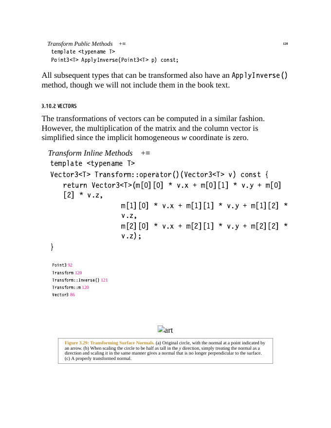
*Figure 3.29: Transforming Surface Normals. (a) Original circle, with the normal at a point indicated by an arrow. (b) When scaling the circle to be half as tall in the y direction, simply treating the normal as a direction and scaling it in the same manner gives a normal that is no longer perpendicular to the surface. (c) A properly transformed normal.*

### 3.10.3 NORMALS

Normals do not transform in the same way that vectors do, as shown in Figure 3.29. Although tangent vectors at a surface transform in the straightforward way, normals require special treatment. Because the normal vector n and any tangent vector t on the surface are orthogonal by construction, we know that n · t = nT t = 0. When we transform a point on the surface by some matrix M, the new tangent vector t′ at the transformed point is Mt. The transformed normal n′ should be equal to Sn for some 4×4 matrix S. To maintain the orthogonality requirement, we must have art This condition holds if ST M = I, the identity matrix. Therefore, ST = M−1, and so S = (M−1)T, and we see that normals must be transformed by the inverse transpose of the transformation matrix. This detail is one of the reasons why `Transforms` maintain their inverses. Note that this method does not explicitly compute the transpose of the inverse when transforming normals. It just indexes into the inverse matrix in a different order (compare to the code for transforming `Vector3fs`).

〈Transform Inline Methods〉 +≡ template <typename T> Normal3<T> Transform::operator()(Normal3<T> n) const { T x = n.x, y = n.y, z = n.z; return Normal3<T>(mInv[0][0] * x + mInv[1][0] * y + mInv[2][0] * z, mInv[0][1] * x + mInv[1][1] * y + mInv[2] [1] * z, mInv[0][2] * x + mInv[1][2] * y + mInv[2] [2] * z); }

```text
    Normal3 94
    RayDifferential 96
    Transform 120
    Transform::mInv 120
    Vector3f 86
```

### 3.10.4 RAYS

Transforming rays is conceptually straightforward: it is a matter of transforming the constituent origin and direction and copying the other data members. (pbrt also provides a similar method for transforming RayDifferentials.) The approach used in pbrt to manage floating-point round-off error introduces some subtleties that require a small adjustment to the transformed ray origin. The 〈Offset ray origin to edge of error bounds and compute tMax〉 fragment handles these details; it is defined in Section 6.8.6, where round-off error and pbrt’s mechanisms for dealing with it are discussed. 〈Transform Inline Methods〉 +≡ Ray Transform::operator()(const Ray &r, Float *tMax) const { Point3fi o = (*this)(Point3fi(r.o)); Vector3f d = (*this)(r.d); 〈Offset ray origin to edge of error bounds and compute tMax 383〉 return Ray(Point3f(o), d, r.time, r.medium); }

### 3.10.5 BOUNDING BOXES

The easiest way to transform an axis-aligned bounding box is to transform all eight of its corner vertices and then compute a new bounding box that encompasses those points. The implementation of this approach is shown below; one of the exercises for this chapter is to implement a technique to do this computation more efficiently. 〈Transform Method Definitions〉 ≡ Bounds3f Transform::operator()(const Bounds3f &b) const { Bounds3f bt; for (int i = 0; i < 8; ++i) bt = Union(bt, (*this)(b.Corner(i))); return bt; }

### 3.10.6 COMPOSITION OF TRANSFORMATIONS

Having defined how the matrices representing individual types of transformations are constructed, we can now consider an aggregate transformation resulting from a series of individual transformations. We will finally see the real value of representing transformations with matrices. Consider a series of transformations ABC. We would like to compute a new transformation T such that applying T gives the same result as applying each of A, B, and C in reverse order; that is, A(B(C(p))) = T(p). Such a transformation T can be computed by multiplying the matrices of the transformations A, B, and C together. In pbrt, we can write: `Transform` T = A * B * C; Then we can apply T to `Point3fs` p as usual, `Point3f` pp = T(p), instead of applying each transformation in turn: `Point3f` pp = A(B(C(p))).

We overload the C++ * operator in the `Transform` class to compute the new transformation that results from postmultiplying a transformation with another transformation t2. In matrix multiplication, the (i, j)th element of the resulting matrix is the inner product of the ith row of the first matrix with the jth column of the second.

```text
    Bounds3::Corner() 99
    Bounds3::Union() 99
    Bounds3f 97
    Float 23
    Point3f 92
    Point3fi 1061
    Ray 95
    Transform 120
    Vector3f 86
```

The inverse of the resulting transformation is equal to the product of t2.mInv * mInv. This is a result of the matrix identity (AB)−1 = B−1A−1.

〈Transform Method Definitions〉 +≡ Transform Transform::operator*(const Transform &t2) const {
```rust
    return Transform(m * t2.m, t2.mInv * mInv);
}
```

### 3.10.7 TRANSFORMATIONS AND COORDINATE SYSTEM HANDEDNESS

Certain types of transformations change a left-handed coordinate system into a right-handed one, or vice versa. Some routines will need to know if the handedness of the source coordinate system is different from that of the destination. In particular, routines that want to ensure that a surface normal always points “outside” of a surface might need to flip the normal’s direction after transformation if the handedness changes. Fortunately, it is easy to tell if handedness is changed by a transformation: it happens only when the determinant of the transformation’s upper-left 3×3 submatrix is negative. 〈Transform Method Definitions〉 +≡ bool Transform::SwapsHandedness() const { SquareMatrix<3> s(m[0][0], m[0][1], m[0][2], m[1][0], m[1][1], m[1][2], m[2][0], m[2][1], m[2][2]); return Determinant(s) < 0; }

### 3.10.8 VECTOR FRAMES

It is sometimes useful to define a rotation that aligns three orthonormal vectors in a coordinate system with the x, y, and z axes. Applying such a transformation to direction vectors in that coordinate system can simplify subsequent computations. For example, in pbrt, BSDF evaluation is performed in a coordinate system where the surface normal is aligned with the z axis. Among other things, this makes it possible to efficiently evaluate trigonometric functions using functions like the `CosTheta()` function that was introduced in Section 3.8.3. The `Frame` class efficiently represents and performs such transformations, avoiding the full generality (and hence, complexity) of the `Transform` class. It only needs to store a 3 × 3 matrix, and storing the inverse is

unnecessary since it is just the matrix’s transpose, given orthonormal basis vectors. 〈Frame Definition〉 ≡ class Frame { public: 〈Frame Public Methods 133〉 〈Frame Public Members 133〉 };

Given three orthonormal vectors x, y, and z, the matrix F that transforms vectors into their space is art The `Frame` stores this matrix using three `Vector3fs`.

〈Frame Public Members〉 ≡ 133

Vector3f x, y, z;

```text
   CosTheta() 107
   DCHECK() 1066
   Frame 133
   SquareMatrix 1049
   SquareMatrix::Determinant() 1051
   Vector3f 86
```

The three basis vectors can be specified explicitly; in debug builds, DCHECK()s in the constructor ensure that the provided vectors are orthonormal. 〈Frame Public Methods〉 ≡ 133

Frame() : x(1, 0, 0), y(0, 1, 0), z(0, 0, 1) {} Frame(Vector3f x, Vector3f y, Vector3f z);

Frame also provides convenience methods that construct a frame from just two of the basis vectors, using the cross product to compute the third. 〈Frame Public Methods〉 +≡ 133

static Frame FromXZ(Vector3f x, Vector3f z) { return Frame(x, Cross(z, x), z); } static Frame FromXY(Vector3f x, Vector3f y) {
```rust
    return Frame(x, y, Cross(x, y));
}
```

Only the z axis vector can be provided as well, in which case the others are set arbitrarily. 〈Frame Public Methods〉 +≡ 133

static Frame FromZ(Vector3f z) { Vector3f x, y; CoordinateSystem(z, &x, &y); return Frame(x, y, z); }

A variety of other functions, not included here, allow specifying a frame using a normal vector and specifying it via just the x or y basis vector. Transforming a vector into the frame’s coordinate space is done using the F matrix. Because Vector3fs were used to store its rows, the matrix-vector product can be expressed as three dot products. 〈Frame Public Methods〉 +≡ 133

Vector3f ToLocal(Vector3f v) const { return Vector3f(Dot(v, x), Dot(v, y), Dot(v, z)); }

A ToLocal() method is also provided for normal vectors. In this case, we do not need to compute the inverse transpose of F for the transformation normals (recall the discussion of transforming normals in Section 3.10.3). Because F is an orthonormal matrix (its rows and columns are mutually orthogonal and unit length), its inverse is equal to its transpose, so it is its own inverse transpose already. 〈Frame Public Methods〉 +≡ 133

Normal3f ToLocal(Normal3f n) const { return Normal3f(Dot(n, x), Dot(n, y), Dot(n, z)); }

The method that transforms vectors out of the frame’s local space transposes F to find its inverse before multiplying by the vector. In this case, the resulting computation can be expressed as the sum of three scaled

versions of the matrix columns. As before, surface normals transform as regular vectors. (That method is not included here.) `CoordinateSystem()` 92 `Cross()` 91 `Dot()` 89 `Frame` 133 `Frame::x` 133 `Frame::y` 133 `Frame::z` 133 `Normal3f` 94 `Transform` 120 `Vector3f` 86

〈Frame Public Methods〉 +≡ 133

Vector3f FromLocal(Vector3f v) const { return v.x * x + v.y * y + v.z * z; }

For convenience, there is a Transform constructor that takes a Frame. Its simple implementation is not included here. 〈Transform Public Methods〉 +≡ 120

explicit Transform(const Frame &frame);

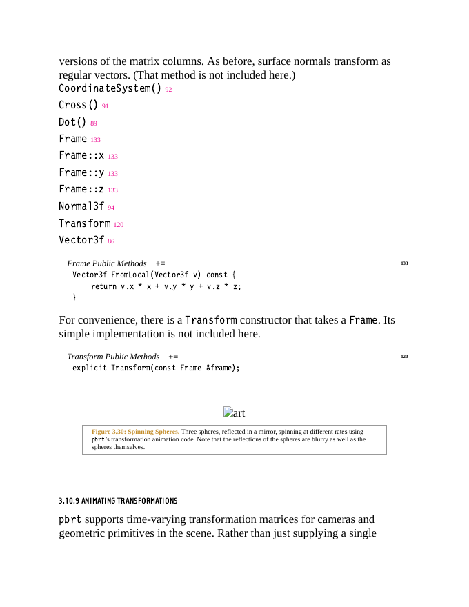
*Figure 3.30: Spinning Spheres. Three spheres, reflected in a mirror, spinning at different rates using pbrt’s transformation animation code. Note that the reflections of the spheres are blurry as well as the spheres themselves.*

### 3.10.9 ANIMATING TRANSFORMATIONS

pbrt supports time-varying transformation matrices for cameras and geometric primitives in the scene. Rather than just supplying a single

transformation to place an object in the scene, the user may supply a number of keyframe transformations, each one associated with a particular time. This makes it possible for the camera to move and for objects in the scene to be in motion during the time the simulated camera’s shutter is open. Figure 3.30 shows three spheres animated using keyframe matrix animation in pbrt.

Directly interpolating the matrix elements of transformation matrices at different times usually does not work well, especially if a rotation is included in the associated change of transformation. pbrt therefore implements algorithms that decompose transformations into translations, rotations, and scales, each of which can be independently interpolated before they are reassembled to form an interpolated transformation. The AnimatedTransform class that implements those algorithms is not included here in the printed book, though the online edition of the book (recall Section 1.4.3) includes thorough documentation of its implementation. Here we will summarize its interface so that its use in forthcoming text can be understood. Its constructor takes two transformations and associated times. Due to the computational cost of decomposing and recomposing transformations as well as the storage requirements of AnimatedTransform, which total roughly 400 bytes, it is worthwhile to avoid using AnimatedTransform if the two matrices are equal. AnimatedTransform(Transform startTransform, Float startTime, Transform endTransform, Float endTime);

The Interpolate() method returns the interpolated transformation for the given time. If the time is outside of the range specified to the constructor, whichever of startTransform or endTransform is closest in time is returned. Transform Interpolate(Float time) const;

```text
   Point3f 92
```

Methods are also available to apply transformations and inverse transformations to pbrt’s basic geometric classes. For example, the following two methods transform points. (Because Point3f does not store an associated time, the time must be provided separately. However, classes like Ray and Interaction that do store a time are passed to their transformation methods unaccompanied.) Point3f operator()(Point3f p, Float time) const; Point3f ApplyInverse(Point3f p, Float time) const; It is usually more efficient to transform a geometric object using those methods than to retrieve the interpolated Transform using the Interpolate() method and then use its transformation methods since the specialized transformation methods can apply optimizations like not computing unneeded inverse transformations. The other key method provided by AnimatedTransform is MotionBounds(), which computes a bounding box that bounds the motion of a bounding box over the AnimatedTransform’s time range. Taking the union of the bounds of the transformed bounding box at startTime and endTime is not sufficient to bound the box’s motion over intermediate times; this method therefore takes care of the tricky details of accurately bounding the motion. Bounds3f MotionBounds(const Bounds3f &b) const;

## 3.11 INTERACTIONS

The last abstractions in this chapter, `SurfaceInteraction` and `MediumInteraction`, respectively represent local information at points on surfaces and in participating media. For example, the ray–shape intersection routines in Chapter 6 return information about the local differential geometry at intersection points in a `SurfaceInteraction`. Later, the texturing code in Chapter 10 computes material properties using values from the `SurfaceInteraction`. The closely related `MediumInteraction` class is used to represent points where light interacts with participating media like smoke or clouds. The implementations of all of these classes are in the files `interaction.h` and `interaction.cpp`.

Both `SurfaceInteraction` and `MediumInteraction` inherit from a generic `Interaction` class that provides common member variables and methods, which allows parts of the system for which the differences between surface and medium interactions do not matter to be implemented purely in terms of `Interactions`.

〈Interaction Definition〉 ≡ class Interaction { public: 〈Interaction Public Methods 136〉 〈Interaction Public Members 137〉 };

A variety of Interaction constructors are available; depending on what sort of interaction is being constructed and what sort of information about it is relevant, corresponding sets of parameters are accepted. This one is the most general of them. 〈Interaction Public Methods〉 ≡ 136

```rust
   Interaction(Point3fi pi, Normal3f n, Point2f uv, Vector3f wo, Float time)
        : pi(pi), n(n), uv(uv), wo(Normalize(wo)), time(time) {}
```

```text
   Float 23
   Interaction 136
   Interval 1057
   MediumInteraction 141
   Normal3f 94
   Point2f 92
   Point3fi 1061
   Ray 95
   Vector3f 86
```

All interactions have a point p associated with them. This point is stored using the `Point3fi` class, which uses an `Interval` to represent each coordinate value. Storing a small interval of floating-point values rather than a single `Float` makes it possible to represent bounds on the numeric error in the intersection point, as occurs when the point p was computed by a ray intersection calculation. This information will be useful for avoiding

incorrect self-intersections for rays leaving surfaces, as will be discussed in Section 6.8.6. 〈Interaction Public Members〉 ≡ 136

```rust
   Point3fi pi;
```

Interaction provides a convenience method that returns a regular Point3f for the interaction point for the parts of the system that do not need to account for any error in it (e.g., the texture evaluation routines). 〈Interaction Public Methods〉 +≡ 136

```rust
   Point3f p() const { return Point3f(pi); }
```

All interactions also have a time associated with them. Among other uses, this value is necessary for setting the time of a spawned ray leaving the interaction. 〈Interaction Public Members〉 +≡ 136

```rust
   Float time = 0;
```

For interactions that lie along a ray (either from a ray–shape intersection or from a ray passing through participating media), the negative ray direction is stored in the wo member variable, which corresponds to ωo, the notation we use for the outgoing direction when computing lighting at points. For other types of interaction points where the notion of an outgoing direction does not apply (e.g., those found by randomly sampling points on the surface of shapes), wo has the value (0, 0, 0). 〈Interaction Public Members〉 +≡ 136

```rust
   Vector3f wo;
```

For interactions on surfaces, n stores the surface normal at the point and uv stores its (u, v) parametric coordinates. It is fair to ask, why are these values stored in the base `Interaction` class rather than in `SurfaceInteraction`? The reason is that there are some parts of the system that mostly do not care about the distinction between surface and medium interactions—for example, some of the routines that sample points on light sources given a point to be illuminated. Those make use of these values if they are available and ignore them if they are set to zero. By accepting the small dissonance of

having them in the wrong place here, the implementations of those methods and the code that calls them is made that much simpler. 〈Interaction Public Members〉 +≡ 136

```rust
   Normal3f n;
   Point2f uv;
```

It is possible to check if a pointer or reference to an Interaction is one of the two subclasses. A nonzero surface normal is used as a distinguisher for a surface. 〈Interaction Public Methods〉 +≡ 136

```rust
   bool IsSurfaceInteraction() const { return n != Normal3f(0, 0, 0); }
   bool IsMediumInteraction() const { return !IsSurfaceInteraction(); }
```

Methods are provided to cast to the subclass types as well. This is a good place for a run-time check to ensure that the requested conversion is valid. The non-const variant of this method as well as corresponding `AsMedium()` methods follow similarly and are not included in the text.

```text
   Float 23
   Interaction:: IsSurfaceInteraction() 137
   Interaction::n 137
   Normal3f 94
   Point2f 92
   Point3f 92
   Point3fi 1061
   Vector3f 86
```

〈Interaction Public Methods〉 +≡ 136

```rust
   const SurfaceInteraction &AsSurface() const {
        CHECK(IsSurfaceInteraction());
        return (const SurfaceInteraction &)*this;
   }
```

`Interactions` can also represent either an interface between two types of participating media using an instance of the `MediumInterface` class, which is defined in Section 11.4, or the properties of the scattering medium at their point using a `Medium`. Here as well, the `Interaction` abstraction leaks: surfaces can represent interfaces between media, and at a point inside a

medium, there is no interface but there is the current medium. Both of these values are stored in Interaction for the same reasons of expediency that n and uv were. 〈Interaction Public Members〉 +≡ 136

```rust
   const MediumInterface *mediumInterface = None;
   Medium medium = None;
```

### 3.11.1 SURFACE INTERACTION

As described earlier, the geometry of a particular point on a surface (often a position found by intersecting a ray against the surface) is represented by a SurfaceInteraction. Having this abstraction lets most of the system work with points on surfaces without needing to consider the particular type of geometric shape the points lie on. 〈SurfaceInteraction Definition〉 ≡ class SurfaceInteraction : public Interaction { public: 〈SurfaceInteraction Public Methods 139〉 〈SurfaceInteraction Public Members 138〉 };

In addition to the point p, the surface normal n, and (u, v) coordinates from the parameterization of the surface from the Interaction base class, the SurfaceInteraction also stores the parametric partial derivatives of the point ∂p/∂u and ∂p/∂v and the partial derivatives of the surface normal ∂n/ ∂u and ∂n/∂v. See Figure 3.31 for a depiction of these values. 〈SurfaceInteraction Public Members〉 ≡ 138

Vector3f dpdu, dpdv; Normal3f dndu, dndv;

This representation implicitly assumes that shapes have a parametric description—that for some range of (u, v) values, points on the surface are given by some function f such that p = f(u, v). Although this is not true for all shapes, all of the shapes that pbrt supports do have at least a local parametric description, so we will stick with the parametric representation

since this assumption is helpful elsewhere (e.g., for antialiasing of textures in Chapter 10).

```text
   CHECK() 1066
   Interaction 136
   Interaction:: IsSurfaceInteraction() 137
   Medium 714
   MediumInterface 715
   Normal3f 94
   SurfaceInteraction 138
   Vector3f 86
```

The `SurfaceInteraction` constructor takes parameters that set all of these values. It computes the normal as the cross product of the partial derivatives.

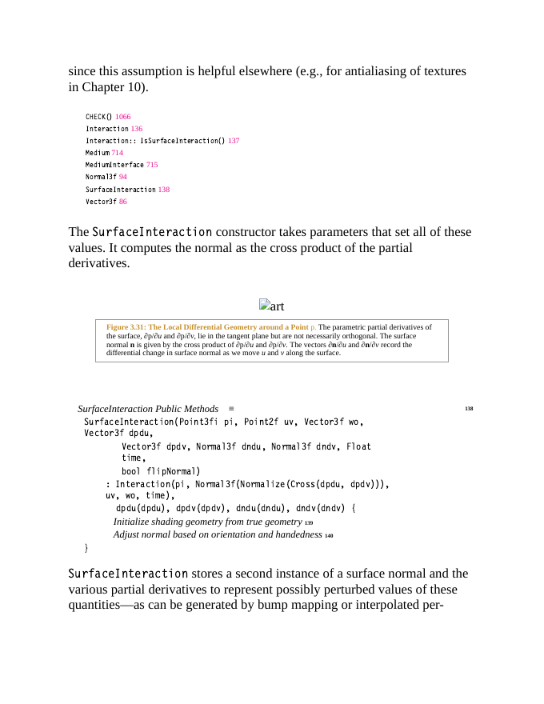
*Figure 3.31: The Local Differential Geometry around a Point p. The parametric partial derivatives of the surface, ∂p/∂u and ∂p/∂v, lie in the tangent plane but are not necessarily orthogonal. The surface normal n is given by the cross product of ∂p/∂u and ∂p/∂v. The vectors ∂n/∂u and ∂n/∂v record the differential change in surface normal as we move u and v along the surface.*

〈SurfaceInteraction Public Methods〉 ≡ 138

SurfaceInteraction(Point3fi pi, Point2f uv, Vector3f wo, Vector3f dpdu, Vector3f dpdv, Normal3f dndu, Normal3f dndv, Float time, bool flipNormal) : Interaction(pi, Normal3f(Normalize(Cross(dpdu, dpdv))), uv, wo, time), dpdu(dpdu), dpdv(dpdv), dndu(dndu), dndv(dndv) { 〈Initialize shading geometry from true geometry 139〉 〈Adjust normal based on orientation and handedness 140〉 }

SurfaceInteraction stores a second instance of a surface normal and the various partial derivatives to represent possibly perturbed values of these quantities—as can be generated by bump mapping or interpolated per-

vertex normals with meshes. Some parts of the system use this shading geometry, while others need to work with the original quantities. 〈SurfaceInteraction Public Members〉 +≡ 138

struct { Normal3f n; Vector3f dpdu, dpdv; Normal3f dndu, dndv; } shading;

The shading geometry values are initialized in the constructor to match the original surface geometry. If shading geometry is present, it generally is not computed until some time after the SurfaceInteraction constructor runs. The SetShadingGeometry() method, to be defined shortly, updates the shading geometry. 〈Initialize shading geometry from true geometry〉 ≡ 139

```rust
   shading.n = n;
   shading.dpdu = dpdu;
   shading.dpdv = dpdv;
   shading.dndu = dndu;
   shading.dndv = dndv;
```

```text
   Cross() 91
   Float 23
   Interaction 136
   Normal3f 94
   Normalize() 88
   Point2f 92
   Point3fi 1061
   SurfaceInteraction 138
   SurfaceInteraction:: shading::dndu 139
   SurfaceInteraction:: shading::dndv 139
   SurfaceInteraction:: shading::dpdu 139
   SurfaceInteraction:: shading::dpdv 139
   SurfaceInteraction:: shading::n 139
   Vector3f 86
```

The surface normal has special meaning to pbrt, which assumes that, for closed shapes, the normal is oriented such that it points to the outside of the shape. For geometry used as an area light source, light is by default emitted from only the side of the surface that the normal points toward; the other

side is black. Because normals have this special meaning, pbrt provides a mechanism for the user to reverse the orientation of the normal, flipping it to point in the opposite direction. A ReverseOrientation directive in a pbrt input file flips the normal to point in the opposite, non-default direction. Therefore, it is necessary to check if the given Shape has the corresponding flag set and, if so, switch the normal’s direction here. However, one other factor plays into the orientation of the normal and must be accounted for here as well. If a shape’s transformation matrix has switched the handedness of the object coordinate system from pbrt’s default left-handed coordinate system to a right-handed one, we need to switch the orientation of the normal as well. To see why this is so, consider a scale matrix S(1, 1, −1). We would naturally expect this scale to switch the direction of the normal, although because we have computed the normal by n = ∂p/∂u × ∂p/∂v, art Therefore, it is also necessary to flip the normal’s direction if the transformation switches the handedness of the coordinate system, since the flip will not be accounted for by the computation of the normal’s direction using the cross product. A flag passed by the caller indicates whether this flip is necessary. 〈Adjust normal based on orientation and handedness〉 ≡ 139

if (flipNormal) { n *= -1; shading.n *= -1; }

pbrt also provides the capability to associate an integer index with each face of a polygon mesh. This information is used for certain texture mapping operations. A separate SurfaceInteraction constructor allows its specification. 〈SurfaceInteraction Public Members〉 +≡ 138

int faceIndex = 0;

When a shading coordinate frame is computed, the SurfaceInteraction is updated via its SetShadingGeometry() method. 〈SurfaceInteraction Public Methods〉 +≡ 138

```rust
   void SetShadingGeometry(Normal3f ns, Vector3f dpdus, Vector3f dpdvs,
                           Normal3f dndus, Normal3f dndvs,
                           bool orientationIsAuthoritative) {
       〈Compute shading.n for SurfaceInteraction 141〉
       〈Initialize shading partial derivative values 141〉
   }
```

```text
   Interaction::n 137
   Normal3f 94
   SurfaceInteraction:: shading::n 139
   Vector3f 86
```

After performing the same cross product (and possibly flipping the orientation of the normal) as before to compute an initial shading normal, the implementation then flips either the shading normal or the true geometric normal if needed so that the two normals lie in the same hemisphere. Since the shading normal generally represents a relatively small perturbation of the geometric normal, the two of them should always be in the same hemisphere. Depending on the context, either the geometric normal or the shading normal may more authoritatively point toward the correct “outside” of the surface, so the caller passes a Boolean value that determines which should be flipped if needed. 〈Compute shading.n for SurfaceInteraction〉 ≡ 140

shading.n = ns; if (orientationIsAuthoritative) n = FaceForward(n, shading.n); else shading.n = FaceForward(shading.n, n);

With the normal set, the various partial derivatives can be copied. 〈Initialize shading partial derivative values〉 ≡ 140

```rust
   shading.dpdu = dpdus;
   shading.dpdv = dpdvs;
   shading.dndu = dndus;
   shading.dndv = dndvs;
```

### 3.11.2 MEDIUM INTERACTION

As described earlier, the MediumInteraction class is used to represent an interaction at a point in a scattering medium like smoke or clouds. 〈MediumInteraction Definition〉 ≡ class MediumInteraction : public Interaction { public: 〈MediumInteraction Public Methods 141〉 〈MediumInteraction Public Members 141〉 };

In contrast to `SurfaceInteraction`, it adds little to the base `Interaction` class. The only addition is a `PhaseFunction`, which describes how the particles in the medium scatter light. Phase functions and the `PhaseFunction` class are introduced in Section 11.3.

〈MediumInteraction Public Methods〉 ≡ 141

MediumInteraction(Point3f p, Vector3f wo, Float time, Medium medium, PhaseFunction phase) : Interaction(p, wo, time, medium), phase(phase) {}

〈MediumInteraction Public Members〉 ≡ 141

PhaseFunction phase;

```text
    FaceForward() 94
    Float 23
    Interaction 136
    Interaction::n 137
    Medium 714
    MediumInteraction 141
    PhaseFunction 710
    Point3f 92
    SurfaceInteraction:: shading::dndu 139
    SurfaceInteraction:: shading::dndv 139
    SurfaceInteraction:: shading::dpdu 139
    SurfaceInteraction:: shading::dpdv 139
    SurfaceInteraction:: shading::n 139
    Vector3f 86
```

## FURTHER READING

DeRose, Goldman, and their collaborators have argued for an elegant “coordinate-free” approach to describing vector geometry for graphics, where the fact that positions and directions happen to be represented by (x, y, z) coordinates with respect to a particular coordinate system is deemphasized and where points and vectors themselves record which coordinate system they are expressed in terms of (Goldman 1985; DeRose 1989; Mann, Litke, and DeRose 1997). This makes it possible for a software layer to ensure that common errors like adding a vector in one coordinate system to a point in another coordinate system are transparently handled by transforming them to a common coordinate system first. A related approach was described by Geisler et al. (2020), who encoded coordinate systems using the programming language’s type system. We have not followed either of these approaches in pbrt, although the principles behind them are well worth understanding and keeping in mind when working with coordinate systems in computer graphics. Schneider and Eberly’s Geometric Tools for Computer Graphics is influenced by the coordinate-free approach and covers the topics of this chapter in much greater depth (Schneider and Eberly 2003). It is also full of useful geometric algorithms for graphics. A classic and more traditional introduction to the topics of this chapter is Mathematical Elements for Computer Graphics by Rogers and Adams (1990). Note that their book uses a row-vector representation of points and vectors, however, which means that our matrices would be transposed when expressed in their framework, and that they multiply points and vectors by matrices to transform them (pM), rather than multiplying matrices by points as we do (Mp). Homogeneous coordinates were only briefly mentioned in this chapter, although they are the basis of projective geometry, where they are the foundation of many elegant algorithms. Stolfi’s book is an excellent introduction to this topic (Stolfi 1991). There are many good books on linear algebra and vector geometry. We have found Lang (1986) and Buck (1978) to be good references on these respective topics. See also Akenine-Möller et al.’s Real-Time Rendering book (2018) for a solid graphics-based introduction to linear algebra. Ström et al. have written an excellent online linear algebra book, immersivemath.com, that features interactive figures that illustrate the key concepts (2020).

Donnay’s book (1945) gives a concise but complete introduction to spherical trigonometry. The expression for the solid angle of a triangle in Equation (3.6) is due to Van Oosterom and Strackee (1983). An alternative approach for designing a vector math library is exemplified by the widely used eigen system by Guennebaud, Jacob, and others (2010). In addition to including support for CPU SIMD vector instruction sets, it makes extensive use of expression templates, a C++ programming technique that makes it possible to simplify and optimize the evaluation of vector and matrix expressions at compile time. The subtleties of how normal vectors are transformed were first widely understood in the graphics community after articles by Wallis (1990) and Turkowski (1990b). Cigolle et al. (2014) compared a wide range of approaches for compactly encoding unit vectors. The approach implemented in `OctahedralVector` is due to Meyer et al. (2010), who also showed that if 52 bits are used with this representation, the precision is equal to that of normalized `Vector3fs`. (Our implementation also includes an improvement suggested by Cigolle et al. (2014).) The octahedral encoding it is based on was introduced by Praun and Hoppe (2003). The equal-area sphere mapping algorithm in Section 3.8.3 is due to Clarberg (2008); our implementation of the mapping functions is derived from the high-performance CPU SIMD implementation that accompanies that paper. The square-to-hemisphere mapping that it is based on was developed by Shirley and Chiu (1997). The algorithm used in `CoordinateSystem()` is based on an approach first derived by Frisvad (2012). The reformulation to improve numerical accuracy that we have used in our implementation was derived concurrently by Duff et al. (2017) and by Max (2017). The algorithm implemented in `RotateFromTo()` was introduced by Möller and Hughes (1999), with an adjustment to the computation of the reflection vector due to Hughes (2021). The numerically robust `AngleBetween()` function defined in this chapter is due to Hatch (2003).

```text
     AngleBetween() 89
     CoordinateSystem() 92
     OctahedralVector 109
     RotateFromTo() 127
     Vector3f 86
```

An algorithm to compute a tight bounding cone for multiple direction vectors was given by Barequet and Elber (2005). The algorithms used in the `AnimatedTransform` implementation are based on the polar matrix decomposition approach that was described by Shoemake and Duff (1992); see the online edition of this book for further references to methods for animating transformations.

## EXERCISES

➊ 3.1 Find a more efficient way to transform axis-aligned bounding boxes by taking advantage of the symmetries of the problem: because the eight corner points are linear combinations of three axis-aligned basis vectors and a single corner point, their transformed bounding box can be found more efficiently than by the method we have presented (Arvo 1990). ➋ 3.2 Instead of boxes, tighter bounds around objects could be computed by using the intersections of many nonorthogonal slabs. Extend the bounding box representation in pbrt to allow the user to specify a bound comprised of arbitrary slabs. ➋ 3.3 The `DirectionCone::BoundSubtendedDirections()` method bounds the directions that a `Bounds3f` subtends from a given reference point by first finding a sphere that bounds the `Bounds3f` and then bounding the directions it subtends. While this gives a valid bound, it is not necessarily the smallest one possible. Derive an improved algorithm that acts directly on the bounding box, update the implementation of `BoundSubtendedDirections()`, and render scenes where that method is used (e.g., those that use a `BVHLightSampler` to sample light sources). How are running time and image quality affected? Can you find a scene where this change gives a significant benefit? ➊ 3.4 Change pbrt so that it transforms `Normal3fs` just like `Vector3fs`, and create a scene that gives a clearly incorrect image due to this bug. (Do not forget to revert this change from your copy of the source code when you are done!)

```text
     AnimatedTransform 135
     Bounds3f 97
     BVHLightSampler 796
     DirectionCone:: BoundSubtendedDirections() 115
     Normal3f 94
     Vector3f 86
```

_________________ 1 This form of inheritance is often referred to as the curiously recurring template pattern (CRTP) in C++. 2 A tighter bound is possible in this case, but it occurs very rarely and so we have not bothered with handling it more effectively.
