# Chapter 3: Geometry and Transformations

<!-- interactive-nav -->
## Contents

- [Geometry and Transforms (wgpu)](#geometry-and-transforms-wgpu)
- [3.1 Coordinate Systems](#31-coordinate-systems)
- [3.2 n-Tuple Base Classes](#32-n-tuple-base-classes)
- [3.3 Vectors](#33-vectors)
- [3.4 Points](#34-points)
- [3.5 Normals](#35-normals)
- [3.6 Rays](#36-rays)
- [3.7 Bounding Boxes](#37-bounding-boxes)
- [3.8 Spherical Geometry](#38-spherical-geometry)
- [3.9 Transformations](#39-transformations)
- [3.10 Applying Transformations](#310-applying-transformations)
- [3.11 Interactions](#311-interactions)
- [Further Reading](#further-reading)
- [Exercises](#exercises)
- [Footnotes](#footnotes)

---

## Geometry and Transforms (wgpu)

Almost all nontrivial graphics programs are built on a foundation of geometric classes that represent mathematical constructs such as points, vectors, and rays. Because these classes are ubiquitous throughout the system, good abstractions and efficient implementations are critical. This chapter presents the interface to and implementation of pbrt's geometric foundation. These are **not** the classes that represent the actual scene geometry (triangles, spheres, and so on); those are the topic of Chapter 6.

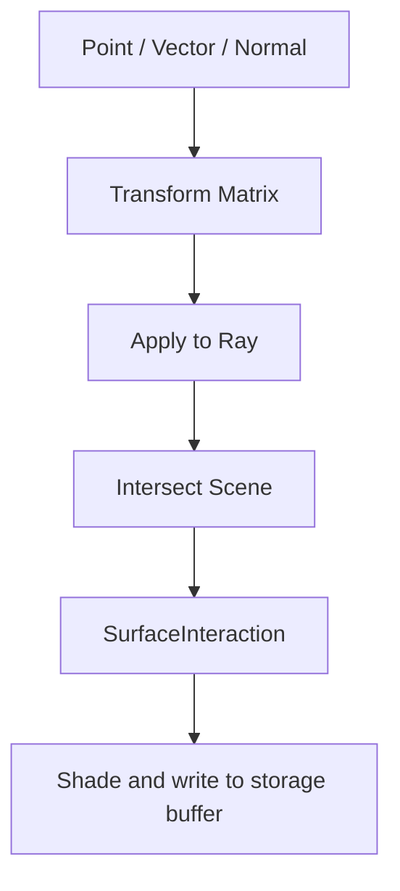

> **wgpu orientation.** In this edition the C++ templates are expressed as idiomatic Rust types in the spirit of `glam`/`nalgebra`: `Vec2`, `Vec3`, `Point3`, `Normal3`, `Mat3`, `Mat4`, and `Quat`. On the GPU the same objects become WGSL `vec3<f32>`, `vec4<f32>`, `mat4x4<f32>`, and `mat3x3<f32>`. Remember that a WGSL `vec3<f32>` occupies 16 bytes in a uniform/storage buffer, so geometric data is usually padded to `vec4` when laid out for a shader.

## 3.1 Coordinate Systems

As is typical in computer graphics, pbrt represents three-dimensional points, vectors, and normal vectors with three coordinate values: $x$, $y$, and $z$. These values are meaningless without a **coordinate system** that defines the origin of the space and gives three linearly independent vectors that define the $x$, $y$, and $z$ axes. Together, the origin and the three vectors are called the **frame** that defines the coordinate system. Given an arbitrary point or direction in 3D, its $(x, y, z)$ coordinate values depend on its relationship to the frame. Figure 3.1 illustrates this idea in 2D: the same point $p$ has coordinates $(3, 3)$ with respect to the frame drawn with solid axes and coordinates $(2, -4)$ with respect to the frame drawn with dashed axes, yet its absolute position is unchanged.

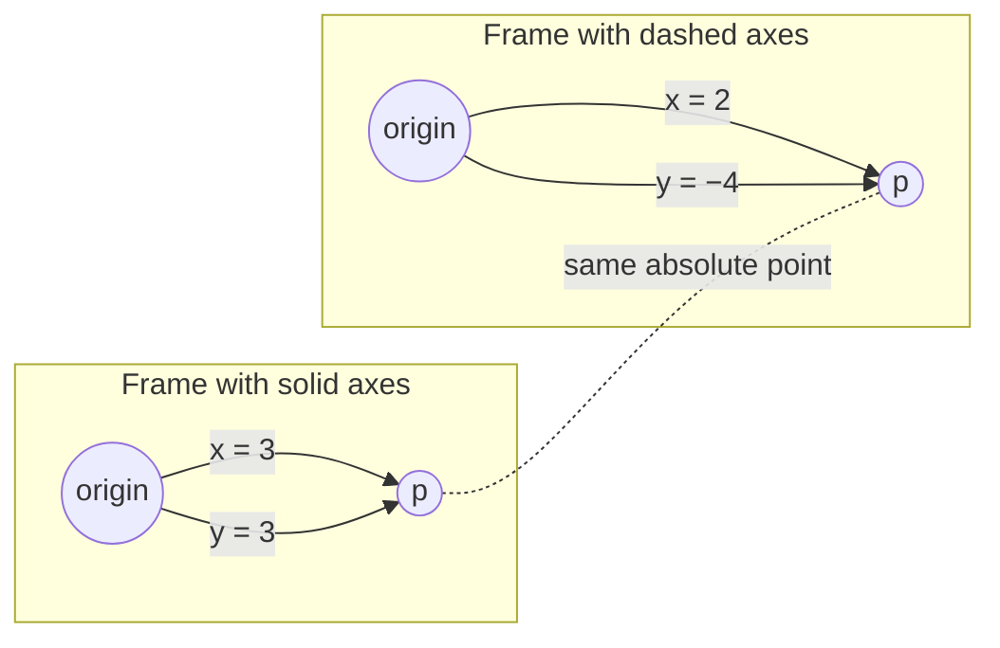

<details>
<summary>Original Figure 3.1 (drawn figure)</summary>


</details>

In the general $n$-dimensional case, a frame's origin $p_o$ and its $n$ linearly independent basis vectors define an $n$-dimensional **affine space**. Every vector $\mathbf v$ in the space can be expressed as a linear combination of the basis vectors: given a vector $\mathbf v$ and the basis vectors $\mathbf v_i$, there is a unique set of scalars $s_i$ such that

$$
\mathbf v = s_1 \mathbf v_1 + \cdots + s_n \mathbf v_n.
$$

The scalars $s_i$ are the *representation* of $\mathbf v$ with respect to the basis $\{\mathbf v_1, \mathbf v_2, \ldots, \mathbf v_n\}$ and are the coordinate values stored with the vector. Similarly, for every point $p$ there are unique scalars $s_i$ such that

$$
p = p_o + s_1 \mathbf v_1 + \cdots + s_n \mathbf v_n.
$$

Thus, although points and vectors are both represented by $(x, y, z)$ coordinates in 3D, they are distinct mathematical entities and are **not** freely interchangeable.

This definition reveals a paradox: to define a frame we need a point and a set of vectors, but we can only meaningfully talk about points and vectors with respect to a particular frame. We therefore establish a **standard frame** with origin $(0, 0, 0)$ and basis vectors $(1, 0, 0)$, $(0, 1, 0)$, and $(0, 0, 1)$. All other frames are defined with respect to this canonical coordinate system, which we call **world space**.

### 3.1.1 Coordinate System Handedness

There are two ways to arrange the three coordinate axes (Figure 3.2). Given perpendicular $x$ and $y$ axes, the $z$ axis can point in one of two directions, called **left-handed** and **right-handed**. The choice is arbitrary, but it has a number of implications for how some geometric operations are implemented. pbrt uses a left-handed coordinate system.

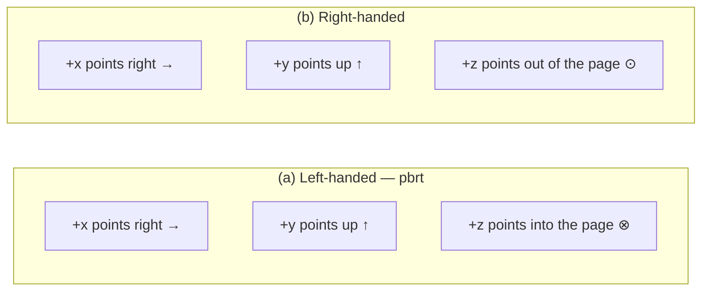

> When a transform changes handedness, surface normals must be flipped; see Section 3.10.7. Many wgpu applications use a right-handed world and a $[0,1]$ depth range, so be deliberate about which convention your camera matrices assume.

## 3.2 n-Tuple Base Classes

pbrt's classes for two- and three-dimensional points, vectors, and surface normals are all based on general **n-tuple** classes, defined in `util/vecmath.h` and `util/vecmath.cpp`. Although these classes have simple method logic, their definitions use more advanced C++ techniques than pbrt generally does: doing so reduces redundant code and makes the classes extensible in ways that will be useful later. In Rust we get the same economy with generics and traits: a single `Tuple3<T>` plus newtypes or aliases for the semantic distinctions. If these details are not of immediate interest, it is fine to skim them and focus on the *functionality* the classes provide — or to treat this as an opportunity to learn more corners of the language.

Both `Tuple2` and `Tuple3` are parameterized by the scalar storage type **and** by the type of the class that inherits from them. This is the *curiously recurring template pattern* (CRTP)<sup>[1](#fn1)</sup>: the base knows the child's type, which lets it write generic methods that return values of the child type. A Rust translation uses a generic struct `Tuple3<T>` and trait implementations on the semantic wrapper types, which gives the same type safety without CRTP.

```rust
#[derive(Clone, Copy, Debug, Default, PartialEq)]
pub struct Tuple3<T> {
    pub x: T,
    pub y: T,
    pub z: T,
}
```

The components are public: selector and mutator functions would hide nothing of value here and would only add bulk at every use site. Numeric components default to zero. A constructor checks for NaN with a debug assertion; in optimized builds the check disappears. NaNs almost certainly indicate a bug, and catching one early makes its source easier to isolate (see Section 6.8.1 for more on NaN values).

```rust
use num_traits::Float;

impl<T: Float> Tuple3<T> {
    pub fn new(x: T, y: T, z: T) -> Self {
        debug_assert!(!x.is_nan() && !y.is_nan() && !z.is_nan());
        Self { x, y, z }
    }

    pub fn has_nan(&self) -> bool {
        self.x.is_nan() || self.y.is_nan() || self.z.is_nan()
    }
}
```

`Tuple2` is almost identical but with one fewer coordinate. An alternative design would use a single class parameterized by an integer dimension and store the coordinates in an array. That would reduce code but would lose the ability to write `v.x`, `v.y`, and `v.z`; the book chooses transparent component access. For routines that want to loop over components, indexing is provided with `v[0] == v.x`, and so forth. In Rust this is the `Index`/`IndexMut` trait; the immutable version returns a reference, and the mutable version allows a component to be set.

```rust
impl<T: Copy> std::ops::Index<usize> for Tuple3<T> {
    type Output = T;
    fn index(&self, i: usize) -> &Self::Output {
        match i {
            0 => &self.x,
            1 => &self.y,
            2 => &self.z,
            _ => panic!("tuple index out of range"),
        }
    }
}

impl<T: Copy> std::ops::IndexMut<usize> for Tuple3<T> {
    fn index_mut(&mut self, i: usize) -> &mut Self::Output {
        match i {
            0 => &mut self.x,
            1 => &mut self.y,
            2 => &mut self.z,
            _ => panic!("tuple index out of range"),
        }
    }
}
```

Arithmetic operates component-wise. Because the C++ method is templated on a second type `U`, it supports adding two values of the same `Child` template type even if their component types differ (`T` and `U`). The parameter's base type is `Child`, not `Tuple3`, so addition with an arbitrary tuple-derived type is not silently allowed. The return type is `Child<decltype(T{} + U{})>`: adding two `Vector3`s returns a `Vector3` (never a `Tuple3`, which would permit nonsensical assignments such as adding two vectors and storing the result in a `Point3`), and the component type follows normal promotion rules (an integer vector plus a float vector yields a float vector). Rust has no `decltype`; the idiom is to require matching scalar types (`Vec3<f32> + Vec3<f32>`) and convert explicitly when promotion is wanted, e.g. `Vec3i → Vec3f` via `as_vec3()`. The semantic point is unchanged: the result of vector arithmetic is a vector.

```rust
impl<T: Float> std::ops::Add for Tuple3<T> {
    type Output = Self;
    fn add(self, rhs: Self) -> Self::Output {
        Self::new(self.x + rhs.x, self.y + rhs.y, self.z + rhs.z)
    }
}
```

The full set of `Tuple2`/`Tuple3` capabilities is summarized here.

| Operation | Meaning |
| --- | --- |
| `+`, `-`, unary `-`, `+=`, `-=` | Per-component addition, subtraction, negation (and in-place forms) |
| `* s`, `/ s`, `*= s`, `/= s` | Component-wise multiplication and division by a scalar, including in-place forms |
| `abs(a)` | Absolute value of every component |
| `ceil(a)`, `floor(a)` | Round components up/down to the nearest integer |
| `lerp(t, a, b)` | Linear interpolation $(1-t)a + tb$ |
| `fma(a, b, c)` | Component-wise fused multiply-add $ab + c$ |
| `min(a, b)`, `max(a, b)` | Component-wise minimum/maximum of two tuples |
| `min_component_value(a)`, `max_component_value(a)` | Smallest/largest component value |
| `min_component_index(a)`, `max_component_index(a)` | Zero-based index of the smallest/largest component |
| `permute(a, perm)` | Reorder components according to an index array |
| `hprod(a)` | Horizontal product: all component values multiplied together |

<details>
<summary>Book cross-references (original edition)</summary>

`Tuple2` p. 83 · `Tuple3` p. 83

</details>

## 3.3 Vectors

pbrt provides 2D and 3D vector classes based on the corresponding tuple classes. Both are parameterized by the element type, so integer and floating-point vectors are equally easy to instantiate.

```rust
pub type Vector2<T> = Tuple2<T>;
pub type Vector3<T> = Tuple3<T>;
pub type Vector2f = Vector2<f32>;
pub type Vector2i = Vector2<i32>;
pub type Vector3f = Vector3<f32>;
pub type Vector3i = Vector3<i32>;
```

(Use `glam::Vec2`/`Vec3` in production code; the aliases above keep the book's naming visible.) A `Vector3`'s components give its representation with respect to the $x$, $y$, and $z$ axes of the space it is defined in; we write them $\mathbf v_x$, $\mathbf v_y$, and $\mathbf v_z$. Constructors include a default constructor, one that sets each component, and an *explicit* constructor from a vector with a different element type so that it is never used for an unintended automatic conversion. Explicit constructors also convert from `Point3` and `Normal3`, again to ensure they are used only where the conversion is meaningful.

```rust
impl<T: Float> Vector3<T> {
    pub fn new(x: T, y: T, z: T) -> Self { Tuple3::new(x, y, z) }

    /// Explicit conversion from a vector of another element type.
    pub fn from_vector3<U: Float>(v: Vector3<U>) -> Self
    where T: From<U> {
        Self::new(v.x.into(), v.y.into(), v.z.into())
    }
}
// impl From<Point3<f32>> for Vector3<f32> and From<Normal3<f32>> for Vector3<f32>
// follow the same pattern.
```

Addition and subtraction are component-wise via the tuple operations. Geometrically, the sum $\mathbf v + \mathbf w$ is the diagonal of the parallelogram formed by $\mathbf v$ and $\mathbf w$, which also shows commutativity, $\mathbf v + \mathbf w = \mathbf w + \mathbf v$ (Figure 3.3). Figure 3.4 shows subtraction: the two diagonals of the parallelogram are $\mathbf w - \mathbf v$ and $-\mathbf v - \mathbf w$. A vector's length can be changed by component-wise multiplication or division by a scalar, again supplied by the tuple class.

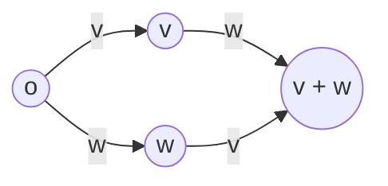

*Figure 3.3: Vector addition. The sum $\mathbf v + \mathbf w$ forms the diagonal of the parallelogram spanned by $\mathbf v$ and $\mathbf w$, showing that addition is commutative.*

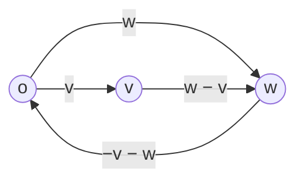

*Figure 3.4: Vector subtraction. Considering the parallelogram formed by two vectors, its diagonals are $\mathbf w - \mathbf v$ (dashed in the book) and $-\mathbf v - \mathbf w$ (not shown).*

### 3.3.1 Normalization and Vector Length

It is often necessary to **normalize** a vector: compute a new vector pointing in the same direction but with unit length, written $\hat{\mathbf v} = \mathbf v / \|\mathbf v\|$ and called a *unit vector*. First we need the vector's length. The squared length is the sum of the squares of the components:

$$
\|\mathbf v\|^2 = v_x^2 + v_y^2 + v_z^2.
$$

```rust
pub fn length_squared<T: Float>(v: Vector3<T>) -> T {
    v.x * v.x + v.y * v.y + v.z * v.z
}
```

The length itself raises a type question: for an integer vector, `i32` is not an appropriate return type because the length need not be integral; `f32` would be better, but a `Vector3<f64>` should return `f64`. C++ solves this with the `TupleLength<T>` type trait, defaulting to `Float` and specialized so `TupleLength<double>::type` is `double`. The `Length()` function uses a trailing return type because `T` is only known once the parameter list is parsed. A second subtlety is the `using std::sqrt;` declaration followed by an unqualified `sqrt()` call: this allows custom scalar types (such as the later `Interval` class) to supply their own `sqrt()`; the standard version is used when it supports `T`, otherwise an overload for the custom type is found. In Rust, the analogous mechanism is the `num_traits::Float` (or `FloatCore`) trait bound: `length` returns the associated scalar type, and `Float::sqrt()` is dispatched statically.

```rust
pub fn length<T: Float>(v: Vector3<T>) -> T {
    length_squared(v).sqrt()
}

pub fn normalize<T: Float>(v: Vector3<T>) -> Vector3<T> {
    v / length(v) // integer components therefore yield a float vector
}
```

<details>
<summary>Book cross-references (original edition)</summary>

`Normal3` p. 94 · `Point3` p. 92 · `Sqr()` p. 1034 · `Tuple3` p. 83 · `Vector3` p. 86 · `Float` p. 23 · `Interval` p. 1057 · `Length()` p. 88 · `LengthSquared()` p. 87 · `TupleLength` p. 88

</details>

### 3.3.2 Dot and Cross Product

The **dot product** (scalar or inner product) of two 3D vectors is

$$
\mathbf v \cdot \mathbf w = v_x w_x + v_y w_y + v_z w_z,
$$

implemented directly:

```rust
pub fn dot<T: Float>(v: Vector3<T>, w: Vector3<T>) -> T {
    v.x * w.x + v.y * w.y + v.z * w.z
}
```

Basic properties follow immediately. For vectors $\mathbf u, \mathbf v, \mathbf w$ and scalar $s$:

$$
\begin{aligned}
\mathbf u \cdot \mathbf v &= \mathbf v \cdot \mathbf u, \\
(s\mathbf u)\cdot \mathbf v &= s(\mathbf u \cdot \mathbf v), \\
\mathbf u \cdot (\mathbf v + \mathbf w) &= (\mathbf u\cdot\mathbf v) + (\mathbf u\cdot\mathbf w).
\end{aligned}
$$

The dot product relates to the angle $\theta$ between the vectors:

$$
\mathbf v\cdot\mathbf w = \|\mathbf v\|\,\|\mathbf w\|\cos\theta. \tag{3.1}
$$

Hence $\mathbf v\cdot\mathbf w = 0$ if and only if $\mathbf v$ and $\mathbf w$ are perpendicular, provided neither is the degenerate vector $(0,0,0)$. A set of mutually perpendicular vectors is **orthogonal**; an orthogonal set of unit vectors is **orthonormal**. For unit vectors, the dot product is the cosine of the angle between them — a property used constantly in rendering.

Computing the angle of two normalized vectors with `acos(dot)` loses accuracy when the vectors are nearly parallel or nearly opposite. The following reformulation does more of its work near the origin, where floating-point precision is greater:

```rust
pub fn angle_between<T: Float>(v1: Vector3<T>, v2: Vector3<T>) -> T {
    let two = T::from(2).unwrap();
    let pi = T::from(std::f64::consts::PI).unwrap();
    if dot(v1, v2) < T::zero() {
        pi - two * safe_asin(length(v1 + v2) / two)
    } else {
        two * safe_asin(length(v2 - v1) / two)
    }
}
```

We also frequently need the absolute value of a dot product, so `abs_dot()` avoids a separate `abs()` call:

```rust
pub fn abs_dot<T: Float>(v1: Vector3<T>, v2: Vector3<T>) -> T {
    dot(v1, v2).abs()
}
```

Based on the dot product, the **Gram–Schmidt process** turns a non-orthogonal basis into an orthogonal one spanning the same space. It repeatedly applies the orthogonal projection of a vector $\mathbf v$ onto a normalized vector $\hat{\mathbf w}$, $(\mathbf v\cdot\hat{\mathbf w})\hat{\mathbf w}$ (Figure 3.5). The resulting vector $\mathbf v_\perp$ is orthogonal to $\mathbf w$, and the two span the same subspace as $\mathbf v$ and $\mathbf w$ did:

$$
\mathbf v_\perp = \mathbf v - (\mathbf v\cdot\hat{\mathbf w})\hat{\mathbf w}. \tag{3.2}
$$

`gram_schmidt()` implements Equation (3.2) and expects $\mathbf w$ already to be normalized.

```rust
pub fn gram_schmidt<T: Float>(v: Vector3<T>, w: Vector3<T>) -> Vector3<T> {
    v - dot(v, w) * w
}
```

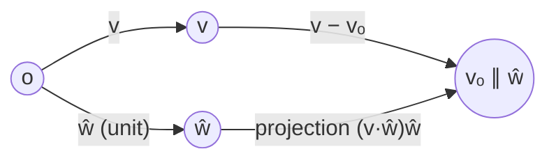

*Figure 3.5: The orthogonal projection of $\mathbf v$ onto the normalized vector $\hat{\mathbf w}$ gives a vector $\mathbf v_o$ parallel to $\hat{\mathbf w}$. The difference $\mathbf v - \mathbf v_o$ (dashed in the book) is perpendicular to $\hat{\mathbf w}$.*

The **cross product** of two 3D vectors is perpendicular to both; for orthogonal $\mathbf v$ and $\mathbf w$, the triple $(\mathbf v, \mathbf w, \mathbf v\times\mathbf w)$ forms an orthogonal coordinate system:

$$
\begin{aligned}
(\mathbf v\times\mathbf w)_x &= v_y w_z - v_z w_y, \\
(\mathbf v\times\mathbf w)_y &= v_z w_x - v_x w_z, \\
(\mathbf v\times\mathbf w)_z &= v_x w_y - v_y w_x.
\end{aligned}
$$

A mnemonic is the determinant of a matrix whose first row holds the axis vectors $\mathbf i=(1,0,0)$, $\mathbf j=(0,1,0)$, $\mathbf k=(0,0,1)$:

$$
\mathbf v\times\mathbf w =
\begin{vmatrix}
\mathbf i & \mathbf j & \mathbf k \\
v_x & v_y & v_z \\
w_x & w_y & w_z
\end{vmatrix}.
$$

This is only a memory aid, not a rigorous construction: the matrix mixes scalars and vectors.

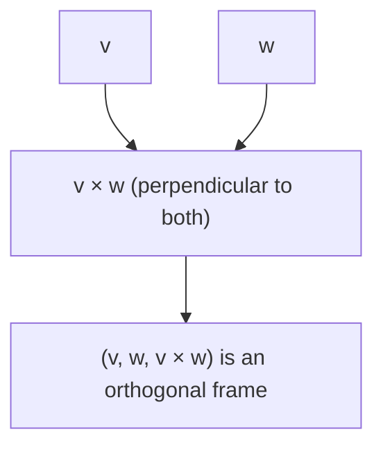

*Figure 3.6: The area of a parallelogram with edges $\mathbf v_1$ and $\mathbf v_2$ is $\|\mathbf v_1\|h$. Since $h = \sin\theta\,\|\mathbf v_2\|$, Equation (3.3) shows that the area equals $\|\mathbf v_1\times\mathbf v_2\|$.*

The implementation uses `difference_of_products(a, b, c, d)`, which computes $ab - cd$ with more floating-point accuracy than the direct expression. This is not merely theoretical: earlier pbrt versions resorted to double precision in `Cross()` to avoid numerical artifacts in rendered images. The fused-difference approach works entirely in single precision with low error.

```rust
pub fn cross<T: Float>(v: Vector3<T>, w: Vector3<T>) -> Vector3<T> {
    Vector3::new(
        difference_of_products(v.y, w.z, v.z, w.y),
        difference_of_products(v.z, w.x, v.x, w.z),
        difference_of_products(v.x, w.y, v.y, w.x),
    )
}
```

From the definition,

$$
\|\mathbf v\times\mathbf w\| = \|\mathbf v\|\,\|\mathbf w\|\,|\sin\theta|, \tag{3.3}
$$

where $\theta$ is the angle between the vectors. Therefore the cross product of two perpendicular unit vectors is itself a unit vector, and the result degenerates to zero if $\mathbf v$ and $\mathbf w$ are parallel. Equation (3.3) also gives a convenient parallelogram area: with edges $\mathbf v_1$, $\mathbf v_2$ and height $h$, the area is $\|\mathbf v_1\|h = \|\mathbf v_1\times\mathbf v_2\|$.

### 3.3.3 Coordinate System From a Vector

We sometimes need a local coordinate system given only a single normalized 3D vector: two more normalized vectors must be found so that all three are mutually perpendicular. Given a vector $\mathbf v$, the two vectors

$$
\mathbf v_2 = \left(1 - \frac{v_x^2}{1+v_z},\; -\frac{v_x v_y}{1+v_z},\; -v_x\right), \qquad
\mathbf v_3 = \left(-\frac{v_x v_y}{1+v_z},\; 1 - \frac{v_y^2}{1+v_z},\; -v_y\right)
$$

fulfill these conditions. Computing them directly has high error when $v_z \approx -1$, because $1/(1+v_z)$ loses accuracy there; the implementation reformulates the computation with `copysign` to address that issue.

```rust
pub fn coordinate_system(v1: Vector3f, v2: &mut Vector3f, v3: &mut Vector3f) {
    let sign = v1.z.signum();                 // copysign(1, v1.z)
    let a = -1.0 / (sign + v1.z);
    let b = v1.x * v1.y * a;
    *v2 = Vector3f::new(1.0 + sign * v1.x * v1.x * a, sign * b, -sign * v1.x);
    *v3 = Vector3f::new(b, sign + v1.y * v1.y * a, -v1.y);
}
```

<details>
<summary>Book cross-references (original edition)</summary>

`DifferenceOfProducts()` p. 1044 · `Vector3` p. 86

</details>

## 3.4 Points

A **point** is a zero-dimensional location in 2D or 3D space. The `Point2` and `Point3` classes represent points in the obvious way: $(x, y)$ or $(x, y, z)$ coordinates with respect to a coordinate system. Points are denoted in text by $p$. Although the representation matches that of a vector, the fact that a point represents a *position* whereas a vector represents a *direction* leads to important differences in how they are treated. As before, only the 3D implementations are shown here.

```rust
pub type Point2<T> = Tuple2<T>;
pub type Point3<T> = Tuple3<T>;
pub type Point3f = Point3<f32>;
pub type Point3i = Point3<i32>;
```

It is useful to convert a point with one element type (e.g. `Point3f`) to another (e.g. `Point3i`), and to convert a point to a vector with a different element type. Both conversions are explicit so that their use is clear at the call site.

```rust
impl<T: Float> Point3<T> {
    pub fn from_point<U: Float>(p: Point3<U>) -> Self where T: From<U> {
        Self::new(p.x.into(), p.y.into(), p.z.into())
    }
    pub fn from_vector<U: Float>(v: Vector3<U>) -> Self where T: From<U> {
        Self::new(v.x.into(), v.y.into(), v.z.into())
    }
}
```

Some `Point3` methods take or return a `Vector3`. Adding a vector to a point offsets it in that direction and gives a new point; the analogous subtraction of a vector from a point also exists.

```rust
impl<T: Float> std::ops::Add<Vector3<T>> for Point3<T> {
    type Output = Point3<T>;
    fn add(self, v: Vector3<T>) -> Self::Output {
        Self::new(self.x + v.x, self.y + v.y, self.z + v.z)
    }
}
```

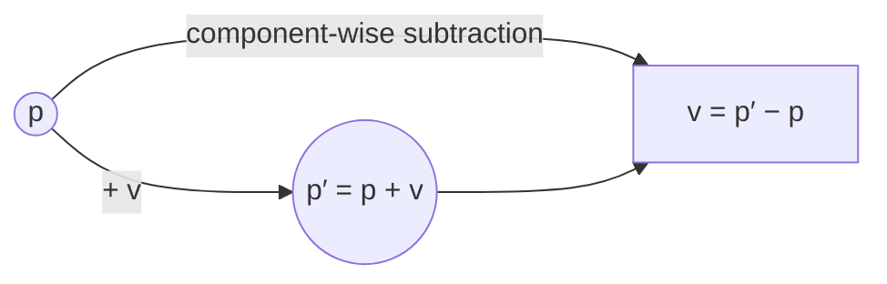

*Figure 3.7: Obtaining the vector between two points. The vector $\mathbf v = p' - p$ is the component-wise subtraction of the points $p'$ and $p$.*

Subtracting one point from another yields the vector between them — note that the result really is a `Vector3`, not a `Point3`.

```rust
impl<T: Float> std::ops::Sub for Point3<T> {
    type Output = Vector3<T>;
    fn sub(self, p: Point3<T>) -> Self::Output {
        Vector3::new(self.x - p.x, self.y - p.y, self.z - p.z)
    }
}
```

The distance between two points is the length of the vector between them. Because `length()` already picks the right return type, no extra type trait is needed here.

```rust
pub fn distance<T: Float>(p1: Point3<T>, p2: Point3<T>) -> T {
    length(p1 - p2)
}

pub fn distance_squared<T: Float>(p1: Point3<T>, p2: Point3<T>) -> T {
    length_squared(p1 - p2)
}
```

<details>
<summary>Book cross-references (original edition)</summary>

`Float` p. 23 · `Point3` p. 92 · `Sqr()` p. 1034 · `Tuple3` p. 83 · `Vector3` p. 86

</details>

## 3.5 Normals

A **surface normal** (or just *normal*) is a vector perpendicular to a surface at a particular position. It can be defined as the cross product of any two nonparallel vectors tangent to the surface at that point. Although normals look superficially like vectors, they are a distinct entity: because a normal is defined by its relationship to a particular surface, it behaves differently in some situations, especially when transformations are applied (Section 3.10).

```rust
pub type Normal3<T> = Tuple3<T>;
pub type Normal3f = Normal3<f32>;
```

`Normal3` and `Vector3` implementations are very similar: three components $x, y, z$; addition and subtraction; scaling and normalization. But a normal cannot be added to a point, and the cross product of two normals is not defined. Note the unfortunate terminology: a normal is **not necessarily normalized**. As with the other tuple-based classes, conversion from a `Vector3` is explicit.

```rust
impl<T: Float> Normal3<T> {
    pub fn from_vector<U: Float>(v: Vector3<U>) -> Self where T: From<U> {
        Self::new(v.x.into(), v.y.into(), v.z.into())
    }
    /// Flip n so that it lies in the same hemisphere as v.
    pub fn face_forward(n: Normal3<T>, v: Vector3<T>) -> Normal3<T> {
        if dot(n, v) < T::zero() { -n } else { n }
    }
}
```

The `dot()` and `abs_dot()` functions are overloaded for all combinations of normals and vectors (code omitted here), and the remaining `Normal3` methods mirror those of vectors.

One new operation flips a surface normal so that it lies in the same hemisphere as a given vector — for example, the normal on the same side as a ray leaving the surface. `FaceForward()` encapsulates this small computation; pbrt also provides variants for the other three `Vector3`/`Normal3` parameter combinations. **Caution:** in the two-`Vector3` version, the first argument is the one returned (possibly flipped) and the second is the one tested against; reversing them gives unexpected results.

<details>
<summary>Book cross-references (original edition)</summary>

`AbsDot()` p. 90 · `Dot()` p. 89 · `Float` p. 23 · `Normal3` p. 94 · `Point3f` p. 92 · `Ray` p. 95 · `Tuple2` p. 83 · `Tuple3` p. 83 · `Vector3` p. 86 · `Vector3f` p. 86

</details>

## 3.6 Rays

A ray $\mathbf r$ is a **semi-infinite line** specified by its origin $\mathbf o$ and direction $\mathbf d$ (Figure 3.8). pbrt represents a `Ray` with a `Point3f` origin and a `Vector3f` direction; there is no need for non-`Float` rays. The implementation lives in `ray.h` and `ray.cpp`.

```mermaid
flowchart LR
    O((o)) -- "d" --> A((r(t) = o + t·d))
    A -- "t ≥ 0" --> B["semi-infinite line"]
```

*Figure 3.8: A ray is a semi-infinite line defined by its origin $\mathbf o$ and its direction vector $\mathbf d$.*

```rust
#[derive(Clone, Copy, Debug)]
pub struct Ray {
    pub o: Point3f,
    pub d: Vec3,
    pub time: f32,
    pub medium: Option<Medium>,
}
```

The origin and direction are named `o` and `d` because they are referenced constantly; the data is public for convenience. The parametric form expresses the ray as a function of $t$, giving the set of points it passes through:

$$
\mathbf r(t) = \mathbf o + t\,\mathbf d, \qquad 0 \le t < \infty. \tag{3.4}
$$

The function application operator is overloaded to match this notation:

```rust
impl Ray {
    pub fn at(&self, t: f32) -> Point3f { self.o + self.d * t }

    pub fn new(o: Point3f, d: Vec3, time: f32, medium: Option<Medium>) -> Self {
        Self { o, d, time, medium }
    }
}

let r = Ray::new(Point3f::new(0.0, 0.0, 0.0), Vec3::new(1.0, 2.0, 3.0), 0.0, None);
let p = r.at(1.7);
```

Each ray carries a **time** value: in animated scenes the renderer constructs a representation of the scene at the appropriate time for each ray. Each ray also records the **medium** at its origin. The `Medium` class (Section 11.4) encapsulates the possibly spatially varying properties of participating media such as fog, smoke, or scattering liquids like milk; associating it with rays lets other parts of the system handle rays crossing from one medium to another. The default constructor leaves the origin and direction at $(0,0,0)$, with time $0$ and no medium.

<details>
<summary>Book cross-references (original edition)</summary>

`Float` p. 23 · `Medium` p. 714 · `Point3f` p. 92 · `Ray` p. 95 · `Ray::d` p. 95 · `Ray::o` p. 95 · `Vector3f` p. 86

</details>

### 3.6.1 Ray Differentials

For better antialiasing of the texture functions in Chapter 10, pbrt uses `RayDifferential`, a subclass of `Ray` holding information about two auxiliary rays. These represent camera rays offset by one sample in the $x$ and $y$ directions from the main ray on the film plane. From the area that the three rays project onto a shaded object, a `Texture` can estimate an area to average over (Section 10.1).

Because `RayDifferential` inherits from `Ray`, geometric interfaces can take a `const Ray&`, so either type can be passed; only routines concerned with antialiasing and texturing need the derived type. In Rust the equivalent is an enum or a wrapper struct with a `Deref<Target = Ray>` implementation.

```rust
#[derive(Clone, Copy, Debug)]
pub struct RayDifferential {
    pub ray: Ray,
    pub has_differentials: bool,
    pub rx_origin: Point3f,
    pub ry_origin: Point3f,
    pub rx_direction: Vec3,
    pub ry_direction: Vec3,
}

impl RayDifferential {
    pub fn new(o: Point3f, d: Vec3, time: f32, medium: Option<Medium>) -> Self {
        Self {
            ray: Ray::new(o, d, time, medium),
            has_differentials: false,
            rx_origin: o, ry_origin: o,
            rx_direction: d, ry_direction: d,
        }
    }
}
```

In some cases differential rays are unavailable; routines taking a `RayDifferential` must check `has_differentials` before reading its origins or directions. A constructor from a plain `Ray` leaves the flag at `false`.

`Camera` implementations compute differentials assuming camera rays are one pixel apart. Integrators usually generate several rays per pixel, so the actual sample spacing is smaller and the differentials must be scaled accordingly — otherwise textures become too blurry. `ScaleDifferentials()` does this given an estimated spacing $s$; it is called, for example, by the "Generate camera ray for current sample" fragment in Chapter 1.

```rust
impl RayDifferential {
    pub fn scale_differentials(&mut self, s: f32) {
        self.rx_origin = self.ray.o + (self.rx_origin - self.ray.o) * s;
        self.ry_origin = self.ray.o + (self.ry_origin - self.ray.o) * s;
        self.rx_direction = self.ray.d + (self.rx_direction - self.ray.d) * s;
        self.ry_direction = self.ray.d + (self.ry_direction - self.ray.d) * s;
    }
}
```

<details>
<summary>Book cross-references (original edition)</summary>

`Camera` p. 206 · `Float` p. 23 · `Medium` p. 714 · `Point3f` p. 92 · `Ray` p. 95 · `RayDifferential` p. 96 · `Texture` p. 655 · `Vector3f` p. 86

</details>

## 3.7 Bounding Boxes

Many parts of the system operate on axis-aligned regions of space: pbrt's multithreading subdivides the image into 2D rectangular tiles, and the bounding volume hierarchy of Section 7.3 uses 3D boxes to bound geometric primitives. `Bounds2` and `Bounds3` represent such regions, parameterized by a coordinate type `T`. We focus on `Bounds3`; `Bounds2` is effectively a subset of it.

```rust
pub struct Bounds2<T> { pub p_min: Point2<T>, pub p_max: Point2<T> }
pub struct Bounds3<T> { pub p_min: Point3<T>, pub p_max: Point3<T> }

pub type Bounds2f = Bounds2<f32>;
pub type Bounds2i = Bounds2<i32>;
pub type Bounds3f = Bounds3<f32>;
pub type Bounds3i = Bounds3<i32>;
```

Several representations are possible. pbrt uses **axis-aligned bounding boxes** (AABBs), whose edges are mutually perpendicular and aligned with the axes. **Oriented bounding boxes** (OBBs) also have mutually perpendicular edges but need not be axis-aligned. A 3D AABB can be described by one vertex plus three axis-aligned lengths, or by two opposite vertices. pbrt chooses the **two-point representation**, storing the vertex with minimum coordinates and the one with maximum coordinates.

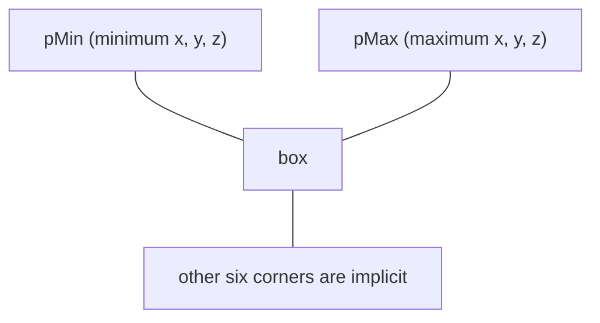

*Figure 3.9: An axis-aligned bounding box. Only the minimum and maximum points are stored; the other corners are implicit in the representation.*

The default constructor creates an **empty** box by setting the extent to an invalid configuration that violates the invariant `pMin.x <= pMax.x`: the minimum corner starts at the largest representable value and the maximum corner at the smallest. Consequently operations such as `Union()` on an empty box produce the correct result.

```rust
impl<T: Bounded + Float> Default for Bounds3<T> {
    fn default() -> Self {
        Self {
            p_min: Point3::new(T::max_value(), T::max_value(), T::max_value()),
            p_max: Point3::new(T::min_value(), T::min_value(), T::min_value()),
        }
    }
}
```

It is also useful to construct bounds around a single point, or from two corner points — in the latter case taking component-wise `min`/`max` because the caller need not supply them in sorted order. Array indexing selects one of the two corner points (debug assertions check that the index is 0 or 1).

```rust
impl<T: Float> Bounds3<T> {
    pub fn from_point(p: Point3<T>) -> Self { Self { p_min: p, p_max: p } }
    pub fn new(p1: Point3<T>, p2: Point3<T>) -> Self {
        Self { p_min: p1.min(p2), p_max: p1.max(p2) }
    }
    pub fn at(&self, i: usize) -> Point3<T> {
        debug_assert!(i <= 1);
        if i == 0 { self.p_min } else { self.p_max }
    }
}
```

`Corner()` returns one of the eight corners. Its logic uses the low three bits of `corner` to select between minimum and maximum in each dimension; passing 0 through 7 visits all eight corners.

```rust
impl<T: Float> Bounds3<T> {
    pub fn corner(&self, corner: usize) -> Point3<T> {
        Point3::new(
            self.at(corner & 1).x,
            self.at(if corner & 2 != 0 { 1 } else { 0 }).y,
            self.at(if corner & 4 != 0 { 1 } else { 0 }).z,
        )
    }
}
```

`Union()` with a point returns a new box encompassing that point as well as the original bounds. A subtlety shared with the following functions: `p_min` and `p_max` must be assigned **directly**, not passed through the two-point constructor. If the input bounds are degenerate, the constructor would sort the coordinate values and produce what is essentially an infinite bound. The two-box version uses the second box's extrema in the `min`/`max` tests.

```rust
pub fn union_point<T: Float>(b: Bounds3<T>, p: Point3<T>) -> Bounds3<T> {
    Bounds3 { p_min: b.p_min.min(p), p_max: b.p_max.max(p) }
}

pub fn union_bounds<T: Float>(b1: Bounds3<T>, b2: Bounds3<T>) -> Bounds3<T> {
    Bounds3 { p_min: b1.p_min.min(b2.p_min), p_max: b1.p_max.max(b2.p_max) }
}
```

The intersection of two boxes is found by taking the maximum of their minimum coordinates and the minimum of their maximum coordinates (Figure 3.10).

```rust
pub fn intersect<T: Float>(b1: Bounds3<T>, b2: Bounds3<T>) -> Bounds3<T> {
    Bounds3 { p_min: b1.p_min.max(b2.p_min), p_max: b1.p_max.min(b2.p_max) }
}
```

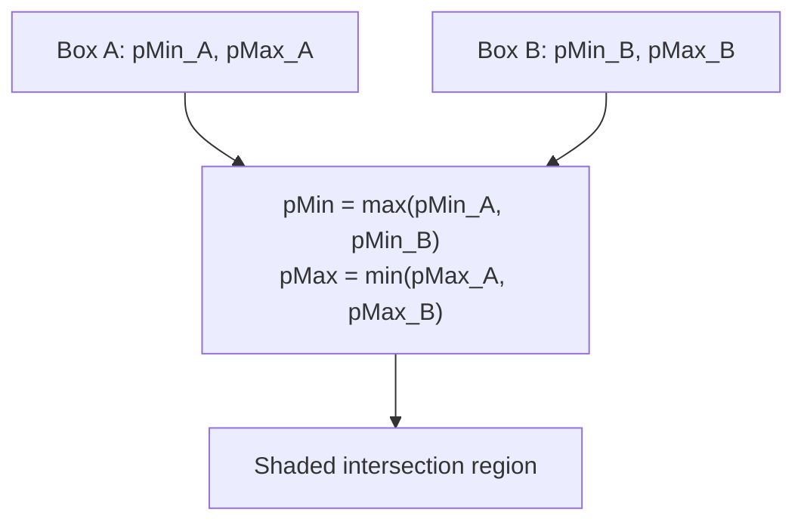

*Figure 3.10: Intersection of two bounding boxes. The minimum point of the intersection uses the per-axis maximum of the boxes' minima; the maximum point uses the per-axis minimum of their maxima.*

Two boxes overlap when their extents overlap in all of $x$, $y$, and $z$. Three 1D containment tests determine whether a point lies inside a box; `InsideExclusive()` does not count points on the upper boundary, which is mostly useful for integer-typed bounds.

```rust
pub fn overlaps<T: Float>(b1: Bounds3<T>, b2: Bounds3<T>) -> bool {
    b1.p_max.x >= b2.p_min.x && b1.p_min.x <= b2.p_max.x
        && b1.p_max.y >= b2.p_min.y && b1.p_min.y <= b2.p_max.y
        && b1.p_max.z >= b2.p_min.z && b1.p_min.z <= b2.p_max.z
}

impl<T: Float> Bounds3<T> {
    pub fn inside(&self, p: Point3<T>) -> bool {
        p.x >= self.p_min.x && p.x <= self.p_max.x
            && p.y >= self.p_min.y && p.y <= self.p_max.y
            && p.z >= self.p_min.z && p.z <= self.p_max.z
    }
    pub fn inside_exclusive(&self, p: Point3<T>) -> bool {
        p.x >= self.p_min.x && p.x < self.p_max.x
            && p.y >= self.p_min.y && p.y < self.p_max.y
            && p.z >= self.p_min.z && p.z < self.p_max.z
    }
}
```

`DistanceSquared()` returns the squared distance from a point to the box (zero if the point is inside). In each dimension the distance is the maximum of zero, the distance to the minimum face, and the distance to the maximum face; the 1D distances are then squared and summed.

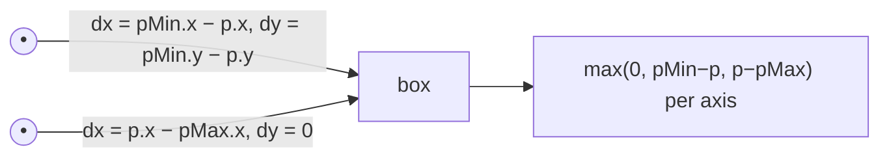

*Figure 3.11: Computing the squared distance from a point to an AABB. A point above-left of the box has distances `pMin.x − p.x` and `pMin.y − p.y`; a point to the right but overlapping in $y$ has distances `p.x − pMax.x` and zero. Each is clamped at zero by taking a maximum with zero.*

```rust
pub fn distance_squared<T: Float, U: Float>(p: Point3<T>, b: Bounds3<U>) -> T {
    let dx = T::zero().max(b.p_min.x.into() - p.x).max(p.x - b.p_max.x.into());
    let dy = T::zero().max(b.p_min.y.into() - p.y).max(p.y - b.p_max.y.into());
    let dz = T::zero().max(b.p_min.z.into() - p.z).max(p.z - b.p_max.z.into());
    dx * dx + dy * dy + dz * dz
}
```

`Distance()` takes the square root, again using the length-type machinery to determine the correct return type; `Expand()` pads the box by a constant amount in every dimension.

```rust
pub fn distance<T: Float>(p: Point3<T>, b: Bounds3<T>) -> T {
    distance_squared(p, b).sqrt()
}

pub fn expand<T: Float>(b: Bounds3<T>, delta: T) -> Bounds3<T> {
    let d = Vec3::splat(delta);
    Bounds3 { p_min: b.p_min - d, p_max: b.p_max + d }
}
```

Remaining `Bounds3` methods:

- `Diagonal()` — the vector from the minimum corner to the maximum corner, `p_max - p_min`.
- `SurfaceArea()` — $2(xy + xz + yz)$ for the diagonal $(x,y,z)$; `Volume()` — $xyz$. (`Bounds2` diverges here: it has `Area()` but no surface-area/volume methods.)
- `MaxDimension()` — the index of the longest axis, useful when deciding which axis to split for an acceleration structure.
- `Lerp(t)` — interpolate between corners, one scalar per dimension.
- `Offset(p)` — the inverse of `Lerp()`: the continuous position of a point relative to the box, with $(0,0,0)$ at the minimum corner and $(1,1,1)$ at the maximum.
- `BoundingSphere()` — center and radius of a sphere bounding the box. This can be much looser than a sphere bounding the original contents directly, but a sphere is sometimes easier to work with.
- `IsEmpty()` / `IsDegenerate()` — "empty" means zero volume but does not necessarily imply zero surface area.

```rust
impl<T: Float> Bounds3<T> {
    pub fn diagonal(&self) -> Vec3 { self.p_max - self.p_min }
    pub fn surface_area(&self) -> T {
        let d = self.diagonal();
        T::from(2).unwrap() * (d.x * d.y + d.x * d.z + d.y * d.z)
    }
    pub fn volume(&self) -> T {
        let d = self.diagonal();
        d.x * d.y * d.z
    }
    pub fn max_dimension(&self) -> usize {
        let d = self.diagonal();
        if d.x > d.y && d.x > d.z { 0 } else if d.y > d.z { 1 } else { 2 }
    }
    pub fn lerp(&self, t: Vec3) -> Point3<T> {
        Point3::new(
            lerp(t.x, self.p_min.x, self.p_max.x),
            lerp(t.y, self.p_min.y, self.p_max.y),
            lerp(t.z, self.p_min.z, self.p_max.z),
        )
    }
    pub fn offset(&self, p: Point3<T>) -> Vec3 {
        let mut o = p - self.p_min;
        if self.p_max.x > self.p_min.x { o.x /= self.p_max.x - self.p_min.x; }
        if self.p_max.y > self.p_min.y { o.y /= self.p_max.y - self.p_min.y; }
        if self.p_max.z > self.p_min.z { o.z /= self.p_max.z - self.p_min.z; }
        o
    }
    pub fn bounding_sphere(&self) -> (Point3<T>, T) {
        let center = (self.p_min + self.p_max) / T::from(2).unwrap();
        let radius = if self.inside(center) { distance(center, self.p_max) } else { T::zero() };
        (center, radius)
    }
    pub fn is_empty(&self) -> bool {
        self.p_min.x >= self.p_max.x || self.p_min.y >= self.p_max.y || self.p_min.z >= self.p_max.z
    }
    pub fn is_degenerate(&self) -> bool {
        self.p_min.x > self.p_max.x || self.p_min.y > self.p_max.y || self.p_min.z > self.p_max.z
    }
}
```

Finally, integer bounds support a forward iterator (only advanceable; code omitted). It allows range-based iteration over integer coordinates in a box:

```rust
let b: Bounds2i = /* ... */;
for p in b { /* p: Point2i */ }
```

As implemented, iteration goes up to but does **not** visit points equal to the maximum extent in each dimension.

<details>
<summary>Book cross-references (original edition)</summary>

`Bounds2` p. 97 · `Bounds3` p. 97 · `Float` p. 23 · `Ray::d` p. 95 · `Ray::o` p. 95 · `RayDifferential::rxDirection` p. 96 · `RayDifferential::rxOrigin` p. 96 · `RayDifferential::ryDirection` p. 96 · `RayDifferential::ryOrigin` p. 96 · `Bounds3::pMax` p. 98 · `Bounds3::pMin` p. 98 · `Point3` p. 92 · `Tuple3::Max()` p. 85 · `Tuple3::Min()` p. 85 · `Bounds3::DistanceSquared()` p. 101 · `Sqr()` p. 1034 · `TupleLength` p. 88 · `Vector3` p. 86 · `Bounds3::Diagonal()` p. 101 · `Bounds3::MaxDimension()` p. 102 · `Lerp()` p. 72 · `Vector3f` p. 86 · `Bounds3::Inside()` p. 100 · `Distance()` p. 93 · `Bounds3::BoundingSphere()` p. 103 · `Bounds3::Corner()` p. 99 · `Bounds3::Union()` p. 99

</details>

## 3.8 Spherical Geometry

Geometry on the unit sphere is also frequently useful in rendering. A 3D unit direction vector can equivalently be represented as a point on the unit sphere, and sets of directions as areas on the sphere. Operations such as bounding a set of directions can often be expressed cleanly as bounds on the unit sphere, so we introduce some principles of spherical geometry and related classes and functions here.

### 3.8.1 Solid Angles

In 2D, the **planar angle** is the total angle subtended by an object with respect to a position (Figure 3.12). Consider the unit circle around the point $p$: projecting the shaded object onto that circle covers some arc length $s$. The arc length $s$ (equivalently the angle $\theta$) is the angle subtended by the object. Planar angles are measured in **radians**, and the entire unit circle covers $2\pi$ radians.

The **solid angle** extends the 2D unit circle to a 3D unit sphere (Figure 3.13). The total projected area $s$ is the solid angle subtended by the object, measured in **steradians** (sr). The entire sphere subtends $4\pi$ sr and a hemisphere $2\pi$ sr.

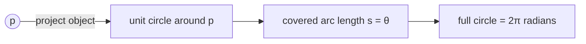

*Figure 3.12: Planar angle. The planar angle of an object seen from $p$ equals the angle it subtends, or equivalently the length of the arc $s$ on the unit circle.*

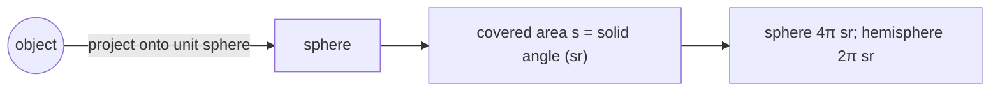

*Figure 3.13: Solid angle. The solid angle $s$ subtended by a 3D object is the area of its projection onto the unit sphere.*

By measuring area on the unit sphere — and thus over unit directions — the solid angle provides the foundation for integrating spherical functions: the differential solid angle $d\omega$ corresponds to the differential area measure on the unit sphere.

<details>
<summary>Book cross-references (original edition)</summary>

`Bounds3::Inside()` p. 100 · `Bounds3::pMax` p. 98 · `Bounds3::pMin` p. 98 · `Distance()` p. 93 · `Float` p. 23 · `Point3` p. 92

</details>

### 3.8.2 Spherical Polygons

It is sometimes useful to consider the set of directions from a point to the surface of a polygon — for example, when computing the illumination arriving at a point from an emissive polygon. Projecting a planar polygon onto the unit sphere gives a **spherical polygon**. A vertex is the normalized vector from the sphere's center to the corresponding original vertex. Each edge lies at the intersection of the sphere with the plane through the center and the two corresponding vertices; the result is a **great circle**, the shortest path between those vertices on the sphere (Figure 3.14).

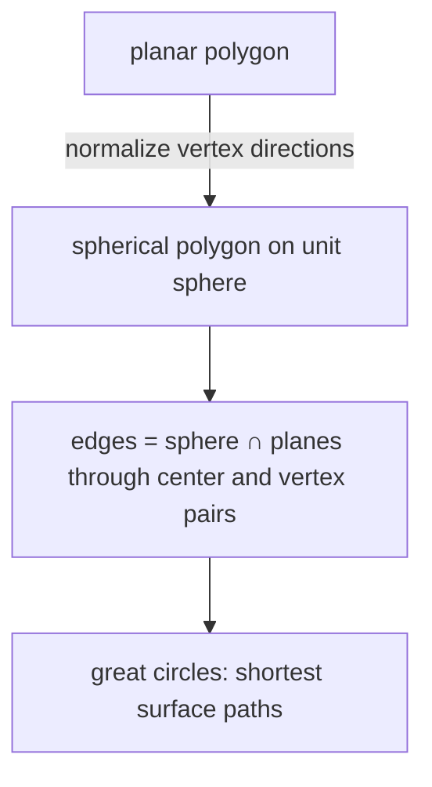

*Figure 3.14: A spherical polygon corresponds to the projection of a polygon onto the unit sphere. Its vertices are the unit vectors to the original vertices, and its edges lie at the intersections of the sphere with planes through the center and vertex pairs.*

The angle at each vertex is the angle between the two planes of the edges meeting there, i.e. their **dihedral angle** (Figure 3.15); we label the angles $\alpha$, $\beta$, $\gamma$ after their vertices. Unlike planar triangles, the angles of a spherical triangle sum to $\pi + A$, where $A$ is its area. Given $\alpha,\beta,\gamma$, **Girard's theorem** gives the area on the unit sphere as

$$
A = \alpha + \beta + \gamma - \pi. \tag{3.5}
$$

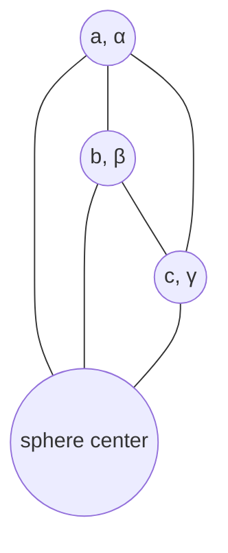

*Figure 3.15: A spherical triangle. Each vertex angle is labeled with the Greek letter corresponding to its vertex.*

Direct evaluation of Equation (3.5) needs several expensive inverse trigonometric functions and can suffer from floating-point cancellation. A better approach uses the identity (derived from (3.5) by spherical trigonometry)

$$
\tan\frac{A}{2} = \frac{\mathbf a\cdot(\mathbf b\times\mathbf c)}
{1 + (\mathbf a\cdot\mathbf b) + (\mathbf a\cdot\mathbf c) + (\mathbf b\cdot\mathbf c)}, \tag{3.6}
$$

which is what `SphericalTriangleArea()` implements; its arguments are the three unit-sphere vertex vectors.

```rust
pub fn spherical_triangle_area(a: Vec3, b: Vec3, c: Vec3) -> f32 {
    (2.0 * a.dot(b.cross(c))
        .atan2(1.0 + a.dot(b) + a.dot(c) + b.dot(c))).abs()
}
```

A quadrilateral projected onto the unit sphere has area $\alpha+\beta+\gamma+\delta-2\pi$, computed by `SphericalQuadArea()` from its vertex positions; its implementation is very similar and is not included here.

```rust
pub fn spherical_quad_area(a: Vec3, b: Vec3, c: Vec3, d: Vec3) -> f32;
```

<details>
<summary>Book cross-references (original edition)</summary>

`Cross()` p. 91 · `Dot()` p. 89 · `Float` p. 23 · `SphericalTriangleArea()` p. 106 · `Vector3f` p. 86

</details>

### 3.8.3 Spherical Parameterizations

Cartesian coordinates on the unit sphere are not always the most convenient representation of a direction. For tabulating a function over the sphere, a 2D parameterization that exploits the sphere's two-dimensional surface is preferable. Many mappings between the plane and the sphere exist; any such mapping introduces some distortion, so the task is to choose one that best fits the application. pbrt uses three different parameterizations, each with different advantages and disadvantages.

#### Spherical Coordinates

For a sphere of radius $r$, spherical coordinates $(\theta,\phi)$ relate to Cartesian coordinates by

$$
x = r\sin\theta\cos\phi,\qquad
y = r\sin\theta\sin\phi,\qquad
z = r\cos\theta. \tag{3.7}
$$

Figure 3.16 shows the geometry. `SphericalDirection()` applies these equations directly, but takes $\sin\theta$ and $\cos\theta$ rather than $\theta$ itself because those are often already available to the caller; $\phi$ is not, so it is passed as an angle. Components are clamped to $[-1,1]$ to protect against round-off.

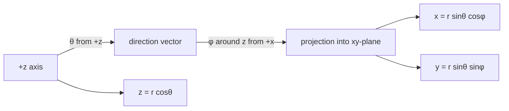

*Figure 3.16: A direction vector written in spherical coordinates $(\theta,\phi)$ given the $x$, $y$, $z$ basis vectors. The spherical angle formulae make conversion between the representations easy.*

```rust
pub fn spherical_direction(sin_theta: f32, cos_theta: f32, phi: f32) -> Vec3 {
    let st = sin_theta.clamp(-1.0, 1.0);
    Vec3::new(st * phi.cos(), st * phi.sin(), cos_theta.clamp(-1.0, 1.0))
}
```

The inverse conversion of $(x,y,z)$ is

$$
\theta = \arccos z,\qquad \phi = \arctan\frac{y}{x}.
$$

`SphericalTheta()` assumes a normalized vector and uses `SafeACos()` instead of `acos()` in case $|v_z|$ is slightly greater than 1 from round-off. `SphericalPhi()` returns $[0,2\pi]$, adjusting a negative `atan2` result.

```rust
pub fn spherical_theta(v: Vec3) -> f32 { safe_acos(v.z) }

pub fn spherical_phi(v: Vec3) -> f32 {
    let p = v.y.atan2(v.x);
    if p < 0.0 { p + 2.0 * PI } else { p }
}
```

For a direction $\omega$, the cosine of $\theta$ needs no inverse trigonometric function at all:

$$
\cos\theta = ((0,0,1)\cdot\omega) = \omega_z.
$$

This is far more efficient than computing $\theta$ and then its cosine. The following variants follow directly.

```rust
pub fn cos_theta(w: Vec3) -> f32 { w.z }
pub fn cos2_theta(w: Vec3) -> f32 { w.z * w.z }
pub fn abs_cos_theta(w: Vec3) -> f32 { w.z.abs() }
```

$\sin^2\theta$ uses $\sin^2\theta+\cos^2\theta = 1$, clamped at zero in the rare case that $1-\cos^2\theta$ is slightly negative from round-off; $\tan\theta=\sin\theta/\cos\theta$ follows.

```rust
pub fn sin2_theta(w: Vec3) -> f32 { 0.0f32.max(1.0 - cos2_theta(w)) }
pub fn sin_theta(w: Vec3) -> f32 { sin2_theta(w).sqrt() }
pub fn tan_theta(w: Vec3) -> f32 { sin_theta(w) / cos_theta(w) }
pub fn tan2_theta(w: Vec3) -> f32 { sin2_theta(w) / cos2_theta(w) }
```

In the $z=0$ plane the vector $\omega$ has coordinates $(x,y) = (r\cos\phi, r\sin\phi)$ with $r=\sin\theta$ (Figure 3.17), so

$$
\cos\phi = \frac{x}{r} = \frac{x}{\sin\theta},\qquad
\sin\phi = \frac{y}{r} = \frac{y}{\sin\theta}.
$$

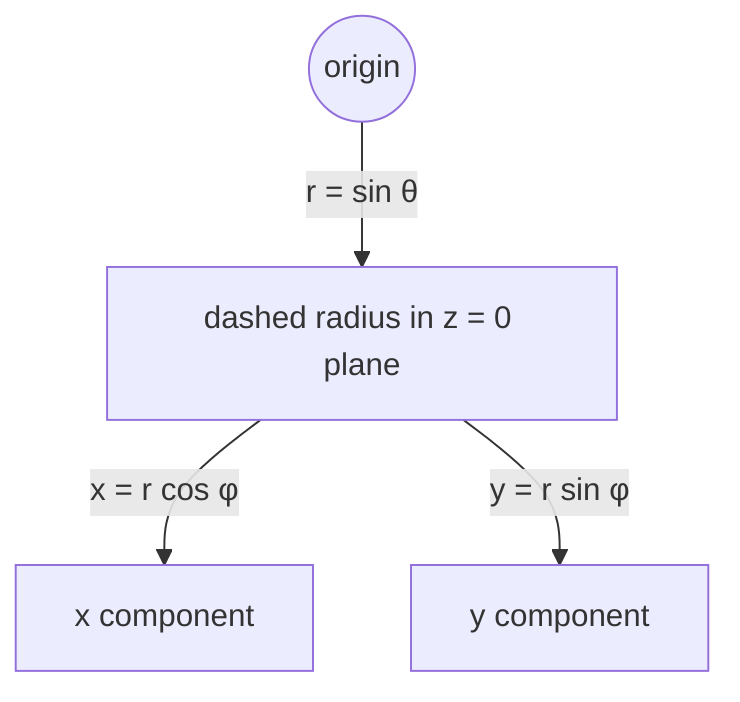

*Figure 3.17: The values of $\sin\phi$ and $\cos\phi$ come from $x = r\cos\phi$ and $y = r\sin\phi$, where $r$, the length of the dashed line, equals $\sin\theta$.*

```rust
pub fn cos_phi(w: Vec3) -> f32 {
    let st = sin_theta(w);
    if st == 0.0 { 1.0 } else { (w.x / st).clamp(-1.0, 1.0) }
}
pub fn sin_phi(w: Vec3) -> f32 {
    let st = sin_theta(w);
    if st == 0.0 { 0.0 } else { (w.y / st).clamp(-1.0, 1.0) }
}
```

Finally, $\cos\Delta\phi$ between two vectors' $\phi$ values can be found by zeroing their $z$ coordinates and normalizing the resulting 2D vectors, then taking the dot product. The implementation rearranges the terms so only one square root is needed.

```rust
pub fn cos_dphi(wa: Vec3, wb: Vec3) -> f32 {
    let waxy = wa.x * wa.x + wa.y * wa.y;
    let wbxy = wb.x * wb.x + wb.y * wb.y;
    if waxy == 0.0 || wbxy == 0.0 { return 1.0; }
    ((wa.x * wb.x + wa.y * wb.y) / (waxy * wbxy).sqrt()).clamp(-1.0, 1.0)
}
```

Spherical coordinates correspond to the **equirectangular mapping** of the sphere; substantial distortion at the poles makes it a poor choice for regularly sampled data.

#### Octahedral Encoding

`Vector3f` is convenient for computation but storage-inefficient: 12 bytes (with 4-byte floats), and it can represent directions of arbitrary length even though normalized vectors are a small subset. Spherical coordinates would use two floats but require relatively expensive trigonometric conversions and give more precision near the poles than the equator. `OctahedralVector` packs a unit vector into **4 bytes**, with every bit pattern mapping to a valid unit vector, even precision distribution, and efficient encode/decode. It is a storage format, not a format for computation.

The mapping projects the vector onto the faces of an octahedron by dividing by its $L_1$ norm $|v_x|+|v_y|+|v_z|$. For the upper hemisphere ($v_z\ge0$), projection to $z=0$ just takes the $x$ and $y$ components; the lower hemisphere uses a branch-free reprojection into $[-1,1]^2$ (Figure 3.18).

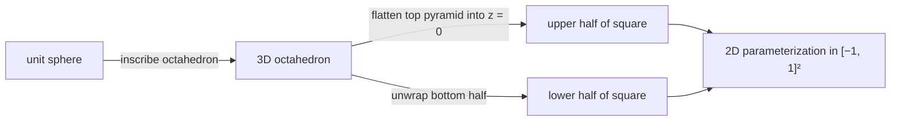

*Figure 3.18: The octahedral parameterization: (a) an octahedron inscribed in the sphere; (b) flatten the top pyramid into $z=0$; (c) unwrap the bottom half and project its triangles into the same plane; (d) the result is a simple $[-1,1]^2$ parameterization (after Figure 2 in Meyer et al. 2010).*

For the lower hemisphere the reprojection uses `Sign()`, built from `copysign` so that positive/negative zero behave like ordinary numbers. Each coordinate is quantized to a 16-bit value covering $[-1,1]$ in $2^{16}$ steps.

```rust
struct OctahedralVector { x: u16, y: u16 }

impl OctahedralVector {
    fn sign(v: f32) -> f32 { if v.is_sign_negative() { -1.0 } else { 1.0 } }
    fn encode(f: f32) -> u16 { ((f + 1.0) / 2.0).clamp(0.0, 1.0) * 65535.0 + 0.5 }

    fn from_vec3(mut v: Vec3) -> Self {
        v /= v.x.abs() + v.y.abs() + v.z.abs();
        if v.z >= 0.0 {
            Self { x: Self::encode(v.x), y: Self::encode(v.y) }
        } else {
            Self {
                x: Self::encode((1.0 - v.y.abs()) * Self::sign(v.x)),
                y: Self::encode((1.0 - v.x.abs()) * Self::sign(v.y)),
            }
        }
    }
}

impl From<OctahedralVector> for Vec3 {
    fn from(ov: OctahedralVector) -> Self {
        let mut v = Vec3::new(
            -1.0 + 2.0 * (ov.x as f32 / 65535.0),
            -1.0 + 2.0 * (ov.y as f32 / 65535.0),
            0.0,
        );
        v.z = 1.0 - (v.x.abs() + v.y.abs());
        if v.z < 0.0 {
            let xo = v.x;
            v.x = (1.0 - v.y.abs()) * OctahedralVector::sign(xo);
            v.y = (1.0 - xo.abs()) * OctahedralVector::sign(v.y);
        }
        v.normalize()
    }
}
```

> **On the GPU:** octahedral-encoded normals are a natural fit for compact G-buffer formats (e.g. two `unorm16` channels). Decoding in WGSL mirrors the Rust code:
>
> ```wgsl
> fn octahedral_decode(e: vec2<f32>) -> vec3<f32> {
>     var v = vec3<f32>(2.0 * e - 1.0, 0.0);
>     v.z = 1.0 - (abs(v.x) + abs(v.y));
>     if (v.z < 0.0) {
>         let x = v.x;
>         v.x = (1.0 - abs(v.y)) * sign(x);
>         v.y = (1.0 - abs(x)) * sign(v.y);
>     }
>     return normalize(v);
> }
> ```

#### Equal-Area Mapping

The third parameterization deliberately preserves area: any area on the sphere maps to a proportional area in the parameter domain. It is continuous, has reasonably low distortion, and every stored value represents the same solid angle — ideal for tabulating functions on the sphere. It combines the octahedral mapping with a variant of the square-to-disk mapping from Section A.5.1, splitting the unit square into four sectors, each mapped to a hemisphere sector (Figure 3.19).

Given $(u,v)\in[-1,1]^2$, in the first sector ($u\ge0$ and $u-|v|\ge0$), the polar coordinates of a point on the unit disk are

$$
r = u,\qquad \phi = \frac{\pi}{4}\frac{v}{u},\qquad \phi\in\left[-\frac{\pi}{4},\frac{\pi}{4}\right].
$$

Mapping the disk point to the positive hemisphere with

$$
x = \cos\phi\, r\sqrt{2-r^2},\qquad
y = \sin\phi\, r\sqrt{2-r^2},\qquad
z = 1-r^2
$$

is also area-preserving. To extend this to the whole sphere:

1. Apply the octahedral mapping to the direction, giving $(u,v)\in[-1,1]^2$.
2. For the upper hemisphere, apply the concentric hemisphere mapping to the inner square, accounting for its $45^\circ$ rotation relative to the square the mapping expects.
3. For the lower hemisphere, mirror across the quadrant's diagonal before mapping, then negate the resulting $z$ component.


*Figure 3.19: The uniform hemispherical mapping first transforms the unit square to the unit disk, mapping the four shaded sectors of the square to the corresponding sectors of the disk; points on the disk then map to the hemisphere preserving relative area.*

The implementation is carefully **branch-free** — one control-flow path for every input — which is often useful for performance, especially on the GPU. (The book notes that this function is normally a small fraction of pbrt's execution time, so the property does not affect overall system performance.) After mapping $p\in[0,1]^2$ to $(u,v)\in[-1,1]^2$ and taking $u'=|u|$, $v'=|v|$, three quadrants are remapped into the positive one; each lower hemisphere lies in $u'+v'>1$, each upper hemisphere in $u'+v'<1$.

The disk radius is the signed distance to the diagonal $u+v=1$: $r = 1 - \big|\,1-(u'+v')\,\big|$ (Figure 3.20), and the angle adds a $\pi/4$ term for the $45^\circ$ rotation.

```mermaid
flowchart LR
    Q["point (u′, v′) in positive quadrant"] --> D["signedDistance = 1 − (u′ + v′)"]
    D --> A["d = |signedDistance|"]
    A --> R["r = 1 − d ∈ [0, 1]"]
    R --> DI["disk radius"]
```

*Figure 3.20: Computation of the radius $r$ for the square-to-disk mapping. One minus the absolute signed distance to the $u'+v'=1$ line gives a radius between 0 and 1.*

```rust
pub fn equal_area_square_to_sphere(p: Vec2) -> Vec3 {
    // Transform to [−1, 1]² and take absolute values.
    let u = 2.0 * p.x - 1.0;
    let v = 2.0 * p.y - 1.0;
    let (up, vp) = (u.abs(), v.abs());

    // Radius as signed distance from the diagonal.
    let signed_distance = 1.0 - (up + vp);
    let r = 1.0 - signed_distance.abs();

    // Angle, including the 45° rotation.
    let phi = if r == 0.0 { 1.0 } else { (vp - up) / r + 1.0 } * PI / 4.0;

    // z takes the sign of the signed distance.
    let z = signed_distance.signum() * (1.0 - r * r);

    // Remap cos φ and sin φ to the original quadrant.
    let cos_phi = phi.cos().copysign(u);
    let sin_phi = phi.sin().copysign(v);
    let s = r * safe_sqrt(2.0 - r * r);
    Vec3::new(cos_phi * s, sin_phi * s, z)
}
```

The inverse mapping, `EqualAreaSphereToSquare()`, performs the same operations in reverse and is not included here. `WrapEqualAreaSquare()` handles points just outside $[0,1]^2$ (as can happen during bilinear interpolation in image texture lookups) by wrapping them to valid coordinates.

<details>
<summary>Book cross-references (original edition)</summary>

`EqualAreaSquareToSphere()` p. 112 · `Float` p. 23 · `Pi` p. 1033 · `SafeSqrt()` p. 1034 · `Sqr()` p. 1034 · `Vector3f` p. 86 · `Clamp()` p. 1033 · `Cos2Theta()` p. 107 · `CosTheta()` p. 107 · `Sin2Theta()` p. 108 · `SinTheta()` p. 108 · `SafeACos()` p. 1035 · `SphericalTheta()` p. 107 · `Normalize()` p. 88 · `OctahedralVector` p. 109 · `OctahedralVector::Encode()` p. 110 · `OctahedralVector::Sign()` p. 110

</details>

### 3.8.4 Bounding Directions

Besides bounding regions of space, it is useful to bound a *set of directions*. For example, if a light emits in only some directions, that information can cull it from lighting calculations at points it certainly does not illuminate. `DirectionCone` represents a cone parameterized by a central direction and an angular spread (Figure 3.21).

```mermaid
flowchart TD
    V["central direction v"] --> C["cone"]
    T["spread angle θ"] --> C
    S["set of directions on sphere"] --> C
    C --> I["all directions inside the cone"]
```

*Figure 3.21: Bounding a set of directions with a cone described by a central direction $\mathbf v$ and a spread angle $\theta$ chosen so all directions in the set lie inside.*

`DirectionCone` offers several constructors: one taking the axis and the **cosine** of the spread angle, one bounding a single direction, and a default empty cone. Storing the cosine rather than the angle lets later operations use efficient dot products instead of trigonometry. The empty state is encoded with `cosTheta = Infinity`; `EntireSphere()` uses $(0,0,1)$ with cosine $-1$.

```rust
#[derive(Clone, Copy, Debug)]
pub struct DirectionCone {
    pub w: Vec3,
    pub cos_theta: f32,
}

impl DirectionCone {
    pub fn new(w: Vec3, cos_theta: f32) -> Self {
        Self { w: w.normalize(), cos_theta }
    }
    pub fn from_direction(w: Vec3) -> Self { Self::new(w, 1.0) }
    pub fn is_empty(&self) -> bool { self.cos_theta == f32::INFINITY }
    pub fn entire_sphere() -> Self { Self::new(Vec3::new(0.0, 0.0, 1.0), -1.0) }
}

pub fn inside(d: DirectionCone, w: Vec3) -> bool {
    !d.is_empty() && d.w.dot(w.normalize()) >= d.cos_theta
}
```

A direction lies inside the cone when the cosine of the angle to the axis is *greater* than the cosine of the spread (a smaller angle means a larger cosine).

`BoundSubtendedDirections()` returns a cone bounding the directions subtended by a box from a point $p$. It first finds a bounding sphere for the box; if $p$ is inside that sphere, the bound is all directions. (The point may be inside the sphere but outside the box, in which case the bound is merely conservative — see Exercise 3.3.) Otherwise the axis is the vector from $p$ to the sphere center and the spread's cosine follows from basic trigonometry (Figure 3.22):

$$
\sin^2\theta_{\max} = \frac{r^2}{d^2},\qquad
\cos\theta_{\max} = \sqrt{1-\sin^2\theta_{\max}}.
$$

```mermaid
flowchart LR
    P((p)) -->|"distance d"| C((sphere center))
    C -->|"radius r"| S["bounding sphere"]
    P -->|"sin θ = r / d"| T["θ subtended"]
    T --> CS["cos θ = √(1 − sin² θ)"]
```

*Figure 3.22: Finding the angle a bounding sphere subtends from $p$: compute $\sin\theta = r/d$ and use $\sin^2\theta+\cos^2\theta=1$.*

```rust
pub fn bound_subtended_directions(b: Bounds3f, p: Point3f) -> DirectionCone {
    let (center, radius) = b.bounding_sphere();
    if distance_squared(p, center) < radius * radius {
        return DirectionCone::entire_sphere();
    }
    let w = (center - p).normalize();
    let sin2_theta_max = radius * radius / distance_squared(center, p);
    let cos_theta_max = safe_sqrt(1.0 - sin2_theta_max);
    DirectionCone::new(w, cos_theta_max)
}
```

The **union** of two direction cones bounds both. The algorithm is:

1. If either cone is empty, return the other.
2. Compute each spread angle $\theta_a,\theta_b$ and the angle $\theta_d$ between the axes (Figure 3.23). If $\theta_d+\theta_b \le \theta_a$ (clamped to $\pi$), $a$ already bounds $b$; and symmetrically.
3. Otherwise the new spread is $\theta_o = (\theta_a+\theta_d+\theta_b)/2$ (Figure 3.24); if $\theta_o\ge\pi$, return the entire sphere.
4. Do **not** use the average of the two axes: with spread $\theta_o$ it would not necessarily bound both cones (it would need $\theta_d/2 + \max(2\theta_a,2\theta_b) \ge \theta_o$). Instead take the cross product of the axes, rotate $a.\mathbf w$ about that perpendicular by $\theta_r=\theta_o-\theta_a$, and use the result. If the cross product has zero length the cones face opposite directions, so return the entire sphere.<sup>[2](#fn2)</sup>

```mermaid
flowchart TD
    A["cone a: axis a.w, spread θa"] --> C["θd = angle between axes"]
    B["cone b: axis b.w, spread θb"] --> C
    C --> Q{"θa ≥ θd + θb ?"}
    Q -- yes --> RA["a bounds b → return a"]
    Q -- no --> TH["θo = (θa + θd + θb)/2"]
```

*Figure 3.23: Determining whether one cone lies entirely inside another. Here $\theta_a > \theta_d+\theta_b$, so $b$ is inside $a$.*

```mermaid
flowchart LR
    A["θa"] --> S["total = θa + θd + θb"]
    D["θd"] --> S
    B["θb"] --> S
    S --> O["spread θo = total / 2"]
```

*Figure 3.24: Computing the spread of a cone bounding two others: the total angle covered is $\theta_a+\theta_d+\theta_b$, so the spread is half that.*

```rust
pub fn union(a: DirectionCone, b: DirectionCone) -> DirectionCone {
    if a.is_empty() { return b; }
    if b.is_empty() { return a; }

    let theta_a = safe_acos(a.cos_theta);
    let theta_b = safe_acos(b.cos_theta);
    let theta_d = angle_between(a.w, b.w);
    if theta_d + theta_b <= PI { /* clamped to π in the book */
        if theta_a >= theta_d + theta_b { return a; }
    }
    if theta_d + theta_a <= PI && theta_b >= theta_d + theta_a { return b; }

    let theta_o = (theta_a + theta_d + theta_b) / 2.0;
    if theta_o >= PI { return DirectionCone::entire_sphere(); }

    let theta_r = theta_o - theta_a;
    let wr = a.w.cross(b.w);
    if wr.length_squared() == 0.0 {
        return DirectionCone::entire_sphere();
    }
    let w = rotate(Degrees(theta_r), wr) * a.w; // Rotate() from Section 3.9.7
    DirectionCone::new(w, theta_o.cos())
}
```

<details>
<summary>Book cross-references (original edition)</summary>

`DirectionCone` p. 114 · `DirectionCone::cosTheta` p. 114 · `Float` p. 23 · `Infinity` p. 361 · `Normalize()` p. 88 · `Vector3f` p. 86 · `Bounds3::BoundingSphere()` p. 103 · `Bounds3f` p. 97 · `DirectionCone::EntireSphere()` p. 115 · `DirectionCone::IsEmpty()` p. 114 · `DirectionCone::w` p. 114 · `DistanceSquared()` p. 93 · `SafeSqrt()` p. 1034 · `Sqr()` p. 1034 · `AngleBetween()` p. 89 · `Pi` p. 1033 · `SafeACos()` p. 1035 · `Rotate()` p. 126

</details>

## 3.9 Transformations

In general, a transformation $\mathbf T$ is a mapping from points to points and from vectors to vectors:

$$
p' = \mathbf T(p),\qquad \mathbf v' = \mathbf T(\mathbf v).
$$

$\mathbf T$ could be an arbitrary procedure, but we restrict ourselves to transformations that are:

- **Linear** — for a scalar $s$, $\mathbf T(s\mathbf v) = s\,\mathbf T(\mathbf v)$ and $\mathbf T(\mathbf v_1+\mathbf v_2) = \mathbf T(\mathbf v_1)+\mathbf T(\mathbf v_2)$; these properties greatly simplify reasoning.
- **Continuous** — roughly, neighborhoods around $p$ and $\mathbf v$ map to neighborhoods around $p'$ and $\mathbf v'$.
- **One-to-one and invertible** — each $p$ maps to a single unique $p'$, and an inverse $\mathbf T^{-1}$ maps $p'$ back to $p$.

We often want to take a point, vector, or normal defined in one frame and find its coordinates in another. Basic linear algebra shows that a $4\times4$ matrix can express the linear transformation from one frame to another; the same matrix also expresses all linear transformations *within* a fixed frame, such as translation or rotation about a point. Hence a matrix has two different — and incompatible — interpretations:

1. **Transformation within the frame** — compute a new point in the same frame (e.g. translated in some direction).
2. **Transformation from one frame to another** — express a point's or vector's coordinates in a new frame in terms of the old.

Most uses in pbrt are of the second kind. Transformations let us work in the most convenient coordinate space: for example, a virtual camera can be written assuming it sits at the origin looking down the $z$ axis with $+y$ up and $+x$ right. To place that camera anywhere, we build a transformation from scene coordinates to camera coordinates (Section 5.1.1).

```mermaid
flowchart LR
    subgraph WORLD["world space"]
        P["point p in world frame"]
    end
    subgraph CAM["camera space"]
        Q["same point in camera frame"]
    end
    P -->|"worldFromCamera matrix"| Q
    Q -->|"cameraFromWorld = inverse"| P
```

### 3.9.1 Homogeneous Coordinates

Given a frame $(p_o,\mathbf v_1,\mathbf v_2,\mathbf v_3)$, the triples $(p_x,p_y,p_z)$ and $(v_x,v_y,v_z)$ are ambiguous. Using the representations from the start of the chapter, the point is

$$
\begin{bmatrix}s_1 & s_2 & s_3 & 1\end{bmatrix}
\begin{bmatrix}\mathbf v_1 & \mathbf v_2 & \mathbf v_3 & p_o\end{bmatrix}^T,
$$

and the vector is the same expression with the last weight $0$ and different coefficients $s'_i$:

$$
\begin{bmatrix}s'_1 & s'_2 & s'_3 & 0\end{bmatrix}
\begin{bmatrix}\mathbf v_1 & \mathbf v_2 & \mathbf v_3 & p_o\end{bmatrix}^T.
$$

These four-vectors are the **homogeneous representations** of the point and the vector; the fourth coordinate is the **weight**. For a point it can be any nonzero scalar: $[1,3,-2,1]$ and $[-2,-6,4,-2]$ describe the same Cartesian point $(1,3,-2)$. Converting back divides the first three components by the weight:

$$
(x, y, z, w) \longrightarrow \left(\frac{x}{w}, \frac{y}{w}, \frac{z}{w}\right).
$$

Now consider a matrix $M$ describing a transformation from one coordinate system to another (indices start at zero so equations and code correspond):

$$
M = \begin{pmatrix}
m_{0,0} & m_{0,1} & m_{0,2} & m_{0,3} \\
m_{1,0} & m_{1,1} & m_{1,2} & m_{1,3} \\
m_{2,0} & m_{2,1} & m_{2,2} & m_{2,3} \\
m_{3,0} & m_{3,1} & m_{3,2} & m_{3,3}
\end{pmatrix}.
$$

Applying $M$ to the $x$-axis vector gives

$$
M\mathbf x = M\begin{bmatrix}1&0&0&0\end{bmatrix}^T
= \begin{bmatrix}m_{0,0}&m_{1,0}&m_{2,0}&m_{3,0}\end{bmatrix}^T,
$$

and reading the other columns shows how the whole basis is transformed:

$$
\begin{aligned}
M\mathbf y &= \begin{bmatrix}m_{0,1}&m_{1,1}&m_{2,1}&m_{3,1}\end{bmatrix}^T, \\
M\mathbf z &= \begin{bmatrix}m_{0,2}&m_{1,2}&m_{2,2}&m_{3,2}\end{bmatrix}^T, \\
Mp &= \begin{bmatrix}m_{0,3}&m_{1,3}&m_{2,3}&m_{3,3}\end{bmatrix}^T.
\end{aligned}
$$

Characterizing the basis's transformation tells us how *any* point or vector expressed in that basis is transformed: applying the matrix directly is equivalent to transforming the basis and re-expressing coordinates in the new basis. pbrt has no `HomogeneousPoint` class and never uses homogeneous coordinates explicitly in its code; the transformation routines implicitly promote to homogeneous form, transform, and convert back. This isolates the details in one place.

### 3.9.2 `Transform` Class Definition

`Transform` represents a $4\times4$ transformation; its implementation is in `util/transform.h` and `util/transform.cpp`. The matrix `m` is a `SquareMatrix<4>` (Section B.2.12), stored row-major so `m[i][j]` is $m_{i,j}$. For convenience the inverse is stored too — it is better to have it readily available than to recompute it. In Rust we use `glam::Mat4`, which is column-major internally; `Mat4::from_rows()` mirrors the book's notation while the shader-side WGSL `mat4x4<f32>` is also column-major.

```rust
#[derive(Clone, Copy, Debug)]
pub struct Transform {
    m: Mat4,
    m_inv: Mat4,
}
```

This representation is memory-hungry: 128 bytes assuming 4-byte floats. Used naïvely it is wasteful — if a scene has millions of shapes but only a few thousand unique transforms, there is no reason to duplicate the matrices. pbrt therefore stores a *pointer* to a `Transform` in each `Shape`, and the scene specification code (Section C.2.3) uses an `InternCache` of transforms so that shapes sharing a transform point to a single instance.

> On the GPU, the same 64 bytes per matrix are usually passed in a uniform or storage buffer. Instancing is the direct analogue of pbrt's intern cache: store one matrix per instance in a storage buffer and index it with `instance_index`.

### 3.9.3 Basic Operations

A new `Transform` defaults to the **identity**, mapping every point and vector to itself:

$$
I = \begin{pmatrix}
1&0&0&0\\0&1&0&0\\0&0&1&0\\0&0&0&1
\end{pmatrix}.
$$

A transform can also be created from a matrix, in which case the matrix must be inverted. If the caller's matrix is degenerate, `m_inv` is filled with NaN values, which poison any computation that uses them — arithmetic with a NaN yields a NaN. A caller can still use such a transform as long as no method touching `m_inv` is called.

The most useful constructor takes the matrix **and an explicitly supplied inverse**: many geometric transforms have simple inverses, so this avoids the cost and potential accuracy loss of a general $4\times4$ inversion. The burden of supplying the correct inverse is on the caller.

```rust
impl Transform {
    pub fn identity() -> Self { Self { m: Mat4::IDENTITY, m_inv: Mat4::IDENTITY } }

    pub fn new(m: Mat4) -> Self {
        let m_inv = m.inverse(); // NaN-filled if singular in the book's implementation
        Self { m, m_inv }
    }

    /// Preferred: the caller supplies the (cheap, exact) inverse.
    pub fn with_inverse(m: Mat4, m_inv: Mat4) -> Self { Self { m, m_inv } }

    pub fn matrix(&self) -> &Mat4 { &self.m }
    pub fn inverse_matrix(&self) -> &Mat4 { &self.m_inv }
}

pub fn inverse(t: Transform) -> Transform {
    Transform::with_inverse(t.m_inv, t.m) // swap roles
}

pub fn transpose(t: Transform) -> Transform {
    Transform::with_inverse(t.m.transpose(), t.m_inv.transpose())
}
```

Equality, inequality, and `IsIdentity()` tests are also provided (a Rust `PartialEq` implementation plus `is_identity()`).

<details>
<summary>Book cross-references (original edition)</summary>

`InternCache` p. 1070 · `Shape` p. 261 · `SquareMatrix` p. 1049 · `SquareMatrix::Inverse()` p. 1051 · `Transform` p. 120 · `Transform::mInv` p. 120 · `SquareMatrix::IsIdentity()` p. 1050 · `Transform::m` p. 120 · `SquareMatrix::Transpose()` p. 1051 · `Transform::GetInverseMatrix()` p. 121 · `Transform::GetMatrix()` p. 121

</details>

### 3.9.4 Translations

The translation $T(\Delta x,\Delta y,\Delta z)$ offsets a point's coordinates: $T(2,2,1)(x,y,z) = (x+2,y+2,z+1)$ (Figure 3.25). Its basic properties are

$$
\begin{aligned}
T(0,0,0) &= I, \\
T(x_1,y_1,z_1)\,T(x_2,y_2,z_2) &= T(x_1+x_2,\;y_1+y_2,\;z_1+z_2), \\
T(x_1,y_1,z_1)\,T(x_2,y_2,z_2) &= T(x_2,y_2,z_2)\,T(x_1,y_1,z_1), \\
T^{-1}(x,y,z) &= T(-x,-y,-z).
\end{aligned}
$$

In matrix form,

$$
T(\Delta x,\Delta y,\Delta z) =
\begin{pmatrix}
1&0&0&\Delta x\\0&1&0&\Delta y\\0&0&1&\Delta z\\0&0&0&1
\end{pmatrix}.
$$

The value of homogeneous coordinates becomes clear when the matrix multiplies a point $[x\;y\;z\;1]^T$:

$$
\begin{pmatrix}
1&0&0&\Delta x\\0&1&0&\Delta y\\0&0&1&\Delta z\\0&0&0&1
\end{pmatrix}
\begin{pmatrix}x\\y\\z\\1\end{pmatrix}
= \begin{pmatrix}x+\Delta x\\y+\Delta y\\z+\Delta z\\1\end{pmatrix},
$$

whereas applying $T$ to a vector gives back the same vector (its homogeneous $w$ is zero):

$$
\begin{pmatrix}
1&0&0&\Delta x\\0&1&0&\Delta y\\0&0&1&\Delta z\\0&0&0&1
\end{pmatrix}
\begin{pmatrix}x\\y\\z\\0\end{pmatrix}
= \begin{pmatrix}x\\y\\z\\0\end{pmatrix}.
$$

This makes sense: vectors are directions, so translation leaves them unchanged. `Translate()` is a direct application of the matrix, and the inverse is trivial to provide.

```rust
pub fn translate(delta: Vec3) -> Transform {
    let m = Mat4::from_rows([
        [1.0, 0.0, 0.0, delta.x],
        [0.0, 1.0, 0.0, delta.y],
        [0.0, 0.0, 1.0, delta.z],
        [0.0, 0.0, 0.0, 1.0],
    ]);
    let m_inv = Mat4::from_rows([
        [1.0, 0.0, 0.0, -delta.x],
        [0.0, 1.0, 0.0, -delta.y],
        [0.0, 0.0, 1.0, -delta.z],
        [0.0, 0.0, 0.0, 1.0],
    ]);
    Transform::with_inverse(m, m_inv)
    // equivalently: glam's Mat4::from_translation(delta)
}
```

```mermaid
flowchart LR
    P((p = (x, y))) -->|"+ (Δx, Δy)"| PP(("p′ = (x+Δx, y+Δy)"))
    V["vector v"] -->|"unchanged"| V2["vector v"]
```

*Figure 3.25: Translation in 2D. Adding offsets $\Delta x$ and $\Delta y$ to a point's coordinates changes its position in space.*

### 3.9.5 Scaling

The scale transformation $S(s_x,s_y,s_z)$ multiplies components by the scale factors: $S(2,2,1)(x,y,z) = (2x,2y,z)$. Its properties are

$$
\begin{aligned}
S(1,1,1) &= I, \\
S(x_1,y_1,z_1)\,S(x_2,y_2,z_2) &= S(x_1x_2,\;y_1y_2,\;z_1z_2), \\
S(x_1,y_1,z_1)\,S(x_2,y_2,z_2) &= S(x_2,y_2,z_2)\,S(x_1,y_1,z_1), \\
S^{-1}(x,y,z) &= S(1/x,\;1/y,\;1/z).
\end{aligned}
$$

We distinguish **uniform** scaling (all factors equal) from **nonuniform** scaling. The general scale matrix is

$$
S(x,y,z) = \begin{pmatrix}
x&0&0&0\\0&y&0&0\\0&0&z&0\\0&0&0&1
\end{pmatrix}.
$$

```rust
pub fn scale(x: f32, y: f32, z: f32) -> Transform {
    let m = Mat4::from_rows([
        [x, 0.0, 0.0, 0.0], [0.0, y, 0.0, 0.0],
        [0.0, 0.0, z, 0.0], [0.0, 0.0, 0.0, 1.0],
    ]);
    let m_inv = Mat4::from_rows([
        [1.0/x, 0.0, 0.0, 0.0], [0.0, 1.0/y, 0.0, 0.0],
        [0.0, 0.0, 1.0/z, 0.0], [0.0, 0.0, 0.0, 1.0],
    ]);
    Transform::with_inverse(m, m_inv)
}

impl Transform {
    pub fn has_scale(&self, tolerance: f32) -> bool {
        let axes = [Vec3::X, Vec3::Y, Vec3::Z];
        axes.iter().any(|&a| ((self.m * a.extend(0.0)).truncate().length_squared() - 1.0).abs() > tolerance)
    }
}
```

`HasScale()` transforms the three coordinate axes and tests whether any length differs appreciably from one (default tolerance $10^{-3}$).

### 3.9.6 $x$, $y$, and $z$ Axis Rotations

The rotation transformation $R$ can be about any axis from the origin; the common cases are the coordinate axes, written $R_x(\theta)$, $R_y(\theta)$, $R_z(\theta)$, and the general $R_{(x,y,z)}(\theta)$. Rotations satisfy

$$
\begin{aligned}
R_a(0) &= I, \\
R_a(\theta_1)\,R_a(\theta_2) &= R_a(\theta_1+\theta_2), \\
R_a(\theta_1)\,R_a(\theta_2) &= R_a(\theta_2)\,R_a(\theta_1), \\
R_a^{-1}(\theta) &= R_a(-\theta) = R_a^T(\theta).
\end{aligned}
$$

The inverse equals the transpose because $R$ is an **orthogonal** matrix: its first three columns (or rows) are normalized and mutually orthogonal. Computing a transpose is much cheaper than a full matrix inverse.

In pbrt's left-handed system the matrix for clockwise rotation about $x$ is

$$
R_x(\theta) =
\begin{pmatrix}
1&0&0&0\\
0&\cos\theta&-\sin\theta&0\\
0&\sin\theta&\cos\theta&0\\
0&0&0&1
\end{pmatrix}.
$$

Figure 3.26 gives the intuition: the $x$ axis is unchanged, $R_x(\theta)[1\;0\;0\;0]^T = [1\;0\;0\;0]^T$; $y$ maps to $(0,\cos\theta,\sin\theta)$ and $z$ to $(0,-\sin\theta,\cos\theta)$. The $y$ and $z$ axes stay in their plane, perpendicular to $x$, rotated by $\theta$; an arbitrary point rotates in its original $yz$ plane.

```rust
pub fn rotate_x(theta_deg: f32) -> Transform {
    let theta = theta_deg.to_radians();
    let (s, c) = theta.sin_cos();
    let m = Mat4::from_rows([
        [1.0, 0.0, 0.0, 0.0],
        [0.0, c, -s, 0.0],
        [0.0, s, c, 0.0],
        [0.0, 0.0, 0.0, 1.0],
    ]);
    Transform::with_inverse(m, m.transpose())
    // glam's Mat4::from_rotation_x(theta) is equivalent
}
```

```mermaid
flowchart TD
    X["x axis unchanged"] --- P["rotation about x"]
    Y["+y → (0, cos θ, sin θ)"] --- P
    Z["+z → (0, −sin θ, cos θ)"] --- P
```

*Figure 3.26: Clockwise rotation by $\theta$ about $x$ leaves the $x$ coordinate unchanged; the $y$ and $z$ axes are mapped as shown, and their coordinates rotate accordingly.*

Similarly, for clockwise rotations about $y$ and $z$:

$$
R_y(\theta) =
\begin{pmatrix}
\cos\theta&0&\sin\theta&0\\
0&1&0&0\\
-\sin\theta&0&\cos\theta&0\\
0&0&0&1
\end{pmatrix},\qquad
R_z(\theta) =
\begin{pmatrix}
\cos\theta&-\sin\theta&0&0\\
\sin\theta&\cos\theta&0&0\\
0&0&1&0\\
0&0&0&1
\end{pmatrix}.
$$

`RotateY()` and `RotateZ()` follow directly and are not included here.

### 3.9.7 Rotation Around an Arbitrary Axis

A common derivation maps the given axis to a fixed one (e.g. $z$), rotates there, and rotates back; a more elegant derivation uses vector algebra. Let $\mathbf a$ be the normalized axis, $\mathbf v$ the vector to rotate, and $\alpha$ the angle between them. First compute the component of $\mathbf v$ along $\mathbf a$ (Figure 3.27):

$$
\mathbf v_c = \mathbf a\,\|\mathbf v\|\cos\alpha = \mathbf a\,(\mathbf v\cdot\mathbf a).
$$

Then find two basis vectors in the plane of rotation (the plane through $\mathbf v$'s endpoint perpendicular to $\mathbf a$):

$$
\mathbf v_1 = \mathbf v - \mathbf v_c,\qquad
\mathbf v_2 = (\mathbf v_1\times\mathbf a).
$$

Because $\mathbf a$ is normalized, $\mathbf v_1$ and $\mathbf v_2$ have equal length. Rotating by $\theta$ about $\mathbf v_c$ in that plane gives

$$
\mathbf v' = \mathbf v_c + \mathbf v_1\cos\theta + \mathbf v_2\sin\theta.
$$

Applying this formula to the basis vectors $(1,0,0)$, $(0,1,0)$, $(0,0,1)$ yields the rows of the rotation matrix. The inverse is again the transpose, and because some callers already have $\sin\theta$ and $\cos\theta$, a variant takes them directly.

```mermaid
flowchart LR
    V((v)) -->|"project onto axis a"| VC((vc))
    VC -->|"v₁ = v − vc"| V1((v₁))
    V1 -->|"v₂ = v₁ × a"| V2((v₂))
    V1 --> R["v′ = vc + v₁ cosθ + v₂ sinθ"]
    V2 --> R
```

*Figure 3.27: Rotation about an arbitrary axis $\mathbf a$ constructs a coordinate system $(\mathbf p,\mathbf v_1,\mathbf v_2)$ in the perpendicular plane through $\mathbf v$'s endpoint and rotates $\mathbf v_1,\mathbf v_2$ about $\mathbf p$. Applying it to the axes $(1,0,0)$, $(0,1,0)$, $(0,0,1)$ gives the general rotation matrix.*

```rust
pub fn rotate_sincos(sin_theta: f32, cos_theta: f32, axis: Vec3) -> Transform {
    let a = axis.normalize();
    let mut m = Mat4::from_rows([
        [
            a.x * a.x + (1.0 - a.x * a.x) * cos_theta,
            a.x * a.y * (1.0 - cos_theta) - a.z * sin_theta,
            a.x * a.z * (1.0 - cos_theta) + a.y * sin_theta,
            0.0,
        ],
        [0.0; 4], [0.0; 4], [0.0, 0.0, 0.0, 1.0],
    ]);
    // "Compute rotations of second and third basis vectors" — analogous entries:
    let (ax, ay, az) = (a.x, a.y, a.z);
    m = Mat4::from_rows([
        [ax * ax + (1.0 - ax * ax) * cos_theta,
         ax * ay * (1.0 - cos_theta) - az * sin_theta,
         ax * az * (1.0 - cos_theta) + ay * sin_theta, 0.0],
        [ay * ax * (1.0 - cos_theta) + az * sin_theta,
         ay * ay + (1.0 - ay * ay) * cos_theta,
         ay * az * (1.0 - cos_theta) - ax * sin_theta, 0.0],
        [az * ax * (1.0 - cos_theta) - ay * sin_theta,
         az * ay * (1.0 - cos_theta) + ax * sin_theta,
         az * az + (1.0 - az * az) * cos_theta, 0.0],
        [0.0, 0.0, 0.0, 1.0],
    ]);
    Transform::with_inverse(m, m.transpose())
}

pub fn rotate(theta_deg: f32, axis: Vec3) -> Transform {
    let (s, c) = theta_deg.to_radians().sin_cos();
    rotate_sincos(s, c, axis)
}
```

### 3.9.8 Rotating One Vector to Another

It is sometimes useful to find the rotation that aligns a unit vector $\mathbf f$ ("from") with $\mathbf t$ ("to"). Using the cross product as the axis and `acos(dot)` as the angle is unstable for nearly parallel vectors and needs expensive trigonometry. Instead, use a pair of **reflections**: reflect $\mathbf f$ to an intermediate $\mathbf r$, then $\mathbf r$ to $\mathbf t$; their product is the desired rotation. The Householder matrix reflects $\mathbf v$ to $-\mathbf v$ while leaving vectors orthogonal to $\mathbf v$ unchanged:

$$
H(\mathbf v) = I - \frac{2}{\mathbf v\cdot\mathbf v}\,\mathbf v\mathbf v^T.
$$

With $\mathbf u = \mathbf r - \mathbf f$ and $\mathbf v = \mathbf r - \mathbf t$,

$$
\mathbf R = H(\mathbf v)\,H(\mathbf r-\mathbf t)\;H(\mathbf u)\;=\;H(\mathbf r-\mathbf t)\,H(\mathbf r-\mathbf f),
$$

the second matrix reflects $\mathbf f$ to $\mathbf r$ and the first reflects $\mathbf r$ to $\mathbf t$.

The intermediate direction $\mathbf r$ is chosen as a basis vector not too closely aligned with either input. Because $0.72$ is slightly greater than $\sqrt{2}/2$, at least one matching coordinate pair of two normalized vectors must both have absolute value below $0.72$ — choosing that axis avoids a loss of accuracy when the reflection direction is nearly parallel to $\mathbf f$ or $\mathbf t$.

```rust
pub fn rotate_from_to(from: Vec3, to: Vec3) -> Transform {
    let refl = if from.x.abs() < 0.72 && to.x.abs() < 0.72 { Vec3::X }
        else if from.y.abs() < 0.72 && to.y.abs() < 0.72 { Vec3::Y }
        else { Vec3::Z };

    let u = refl - from;
    let v = refl - to;
    let mut r = Mat4::IDENTITY;
    // Initialize r[i][j] for i, j in 0..3:
    for i in 0..3 {
        for j in 0..3 {
            r.row_mut(i)[j] = if i == j { 1.0 } else { 0.0 }
                - 2.0 / u.dot(u) * u[i] * u[j]
                - 2.0 / v.dot(v) * v[i] * v[j]
                + 4.0 * u.dot(v) / (u.dot(u) * v.dot(v)) * v[i] * u[j];
        }
    }
    Transform::with_inverse(r, r.transpose())
}
```

Expanding the Householder product gives the matrix element

$$
r_{i,j} = \delta_{i,j}
- \frac{2u_i u_j}{\mathbf u\cdot\mathbf u}
- \frac{2v_i v_j}{\mathbf v\cdot\mathbf v}
+ \frac{4(\mathbf u\cdot\mathbf v)\,v_i u_j}{(\mathbf u\cdot\mathbf u)(\mathbf v\cdot\mathbf v)},
$$

where $\delta_{i,j}$ is the Kronecker delta ($1$ if $i=j$, otherwise $0$); the implementation follows directly.

<details>
<summary>Book cross-references (original edition)</summary>

`Float` p. 23 · `Radians()` p. 1033 · `Rotate()` p. 126 · `SquareMatrix::Transpose()` p. 1051 · `Transform` p. 120 · `Vector3f` p. 86

</details>

### 3.9.9 The Look-At Transformation

The **look-at** transformation is especially useful for placing a camera: the caller supplies a camera position, a point to look at, and an "up" vector that orients the camera along the viewing direction. These are typically world-space coordinates, so the result maps world space to camera space (Figure 3.28). The same construction is also useful for placing light sources. The key principle: the *columns* of a transformation matrix give the effect of the transform on a coordinate system's basis.

```mermaid
flowchart LR
    subgraph W["world space"]
        POS["camera position pos"]
        LOOK["look-at point"]
        UP["up vector"]
    end
    subgraph C["camera space (left-handed)"]
        O["camera at origin"]
        Z["+z = viewing direction"]
        Y["+y = up"]
        X["+x = right"]
    end
    POS --> O
    LOOK --> Z
    UP --> Y
    X --- Y
    Y --- Z
```

*Figure 3.28: Given a camera position, the point being looked at, and an "up" direction, the look-at transformation maps from a left-handed viewing system in which the camera sits at the origin looking down $+z$ and $+y$ is the up direction.*

The easiest column is the fourth: it is the world-space point to which the camera-space origin $[0\;0\;0\;1]^T$ maps, namely `pos`. For the other three, compute the normalized direction `dir = Normalize(look - pos)` (the $+z$ column, since camera space looks down $+z$ in this left-handed system); `right = Normalize(Cross(Normalize(up), dir))` gives the $+x$ column; and recomputing `newUp = Cross(dir, right)` makes the $y$ and $z$ axes perpendicular, giving an orthonormal viewing frame. The inverse is obtained by matrix inversion and stored as the transform's inverse.

```rust
pub fn look_at(pos: Point3f, look: Point3f, up: Vec3) -> Transform {
    let mut world_from_camera = Mat4::IDENTITY;

    // Book notation m[i][j] maps to glam's m.row(i)[j] (glam is column-major).
    // Fourth column: camera-space origin maps to the camera position.
    world_from_camera[3][0] = pos.x;
    world_from_camera[3][1] = pos.y;
    world_from_camera[3][2] = pos.z;
    world_from_camera[3][3] = 1.0;

    // First three columns: right, up, viewing direction.
    let dir = (look - pos).normalize();
    let right = up.normalize().cross(dir).normalize();
    let new_up = dir.cross(right);
    for (c, v) in [right, new_up, dir].iter().enumerate() {
        world_from_camera[c][0] = v.x;
        world_from_camera[c][1] = v.y;
        world_from_camera[c][2] = v.z;
        world_from_camera[c][3] = 0.0;
    }

    let camera_from_world = world_from_camera.inverse();
    Transform::with_inverse(camera_from_world, world_from_camera)
}
```

<details>
<summary>Book cross-references (original edition)</summary>

`Cross()` p. 91 · `LookAt()` p. 129 · `Normalize()` p. 88 · `Point3f` p. 92 · `SquareMatrix` p. 1049 · `SquareMatrix::InvertOrExit()` p. 1051 · `Transform` p. 120 · `Vector3f` p. 86

</details>

## 3.10 Applying Transformations

We can now define the routines that perform the matrix multiplications that transform points and vectors. The function application operator is overloaded for these transformations, so one can write:

```rust
let t: Transform = /* ... */;
let p: Point3f = /* ... */;
let p_new = t * p; // the book writes T(p)
```

### 3.10.1 Points

The point transformation promotes $(x,y,z)$ to the homogeneous column vector $[x\;y\;z\;1]^T$, premultiplies by the matrix, and divides by $w$ to return to non-homogeneous form. For efficiency the division is skipped when $w=1$, which is the common case — only the projective transformations of Chapter 5 require it.

```rust
impl Transform {
    pub fn transform_point<T: Float>(&self, p: Point3<T>) -> Point3<T> {
        let (x, y, z) = (p.x, p.y, p.z);
        let m = self.m;
        // Book's m[i][j] == glam's m.row(i)[j].
        let xp = m.row(0)[0]*x + m.row(0)[1]*y + m.row(0)[2]*z + m.row(0)[3];
        let yp = m.row(1)[0]*x + m.row(1)[1]*y + m.row(1)[2]*z + m.row(1)[3];
        let zp = m.row(2)[0]*x + m.row(2)[1]*y + m.row(2)[2]*z + m.row(2)[3];
        let wp = m.row(3)[0]*x + m.row(3)[1]*y + m.row(3)[2]*z + m.row(3)[3];
        let p = Point3::new(xp, yp, zp);
        if wp == T::one() { p } else { p / wp }
    }
}
```

Every transformable type also has an `ApplyInverse()` method that applies the inverse transformation. It is more succinct and generally more efficient than calling `Inverse()` and then applying the result; the variants for the other types follow the same pattern and are not shown.

```rust
impl Transform {
    pub fn apply_inverse_point<T: Float>(&self, p: Point3<T>) -> Point3<T> {
        /* same computation with m_inv in place of m */
        let _ = p;
        unimplemented!()
    }
}
```

### 3.10.2 Vectors

Vector transformation is similar, but the implicit homogeneous $w$ is zero, so the last column and the division disappear:

```rust
impl Transform {
    pub fn transform_vector<T: Float>(&self, v: Vector3<T>) -> Vector3<T> {
        let m = self.m;
        Vector3::new(
            m.row(0)[0]*v.x + m.row(0)[1]*v.y + m.row(0)[2]*v.z,
            m.row(1)[0]*v.x + m.row(1)[1]*v.y + m.row(1)[2]*v.z,
            m.row(2)[0]*v.x + m.row(2)[1]*v.y + m.row(2)[2]*v.z,
        )
    }
}
```

### 3.10.3 Normals

Normals do **not** transform like vectors (Figure 3.29). Tangent vectors at a surface transform in the straightforward way, but a normal is defined by orthogonality to those tangents. If $\mathbf n\cdot\mathbf t = \mathbf n^T\mathbf t = 0$, a point transformed by $M$ has tangent $\mathbf t' = M\mathbf t$, and we want a normal $\mathbf n' = S\mathbf n$ that is still orthogonal to it:

$$
\begin{aligned}
0 &= (\mathbf n')^T\mathbf t' \\
  &= (S\mathbf n)^T M\mathbf t \\
  &= \mathbf n^T S^T M\,\mathbf t.
\end{aligned}
$$

This holds for all tangents when $S^T M = I$, so $S^T = M^{-1}$ and

$$
S = (M^{-1})^T.
$$

Normals must therefore be transformed by the **inverse transpose** of the transformation matrix — one of the reasons `Transform` stores its inverse. The implementation does not explicitly form the transpose; it indexes the inverse matrix in a different order.

```rust
impl Transform {
    pub fn transform_normal<T: Float>(&self, n: Normal3<T>) -> Normal3<T> {
        let (x, y, z) = (n.x, n.y, n.z);
        let i = self.m_inv;
        // Indexing the inverse "transposed" gives (M⁻¹)ᵀ without forming it.
        Normal3::new(
            i.row(0)[0]*x + i.row(1)[0]*y + i.row(2)[0]*z,
            i.row(0)[1]*x + i.row(1)[1]*y + i.row(2)[1]*z,
            i.row(0)[2]*x + i.row(1)[2]*y + i.row(2)[2]*z,
        )
    }
}
```

```mermaid
flowchart LR
    C1["(a) circle with normal n"] -->|"scale y by ½"| C2["(b) treating n as a vector: no longer perpendicular"]
    C2 -->|"inverse transpose"| C3["(c) correctly transformed normal"]
```

*Figure 3.29: Transforming surface normals. (a) A circle with a normal at a point. (b) Scaling the circle to half height and scaling the normal as if it were a direction gives a normal no longer perpendicular to the surface. (c) A properly transformed normal.*

> In WGSL the same rule applies: pass the inverse-transpose (or, for a rigid transform, reuse the model matrix) as a separate `mat3x3<f32>` uniform and transform normals with it.

<details>
<summary>Book cross-references (original edition)</summary>

`Normal3` p. 94 · `RayDifferential` p. 96 · `Transform` p. 120 · `Transform::mInv` p. 120 · `Vector3f` p. 86

</details>

### 3.10.4 Rays

Transforming a ray is conceptually straightforward: transform the origin and direction, copy the remaining data members. pbrt also provides the same for `RayDifferential`. Floating-point round-off introduces subtleties requiring a small adjustment to the transformed origin; that is handled by the `Offset ray origin to edge of error bounds and compute tMax` fragment of Section 6.8.6. The origin is first promoted to `Point3fi` (an interval-valued point) so the error bounds are available.

```rust
impl Transform {
    pub fn transform_ray(&self, r: &Ray) -> Ray {
        let o = self.transform_point_interval(Point3fi::from(r.o));
        let d = self.transform_vector(r.d);
        let (o, t_max) = offset_ray_origin(o, d); // Section 6.8.6
        Ray::new(Point3f::from(o), d, r.time, r.medium)
    }
}
```

### 3.10.5 Bounding Boxes

The easiest way to transform an AABB is to transform all eight corners and build a new box enclosing them. A more efficient technique is left as Exercise 3.1.

```rust
impl Transform {
    pub fn transform_bounds(&self, b: Bounds3f) -> Bounds3f {
        let mut bt = Bounds3f::default();
        for i in 0..8 { bt = union_bounds(bt, self.transform_point(b.corner(i))); }
        bt
    }
}
```

### 3.10.6 Composition of Transformations

Now the real value of matrices becomes apparent. Given a series of transformations $ABC$, we want a single $T$ such that $A(B(C(p))) = T(p)$. It is obtained by multiplying the matrices: in Rust `let t = a * b * c;`, then `t * p` gives the same result as applying each transform in turn. Multiplying postmultiplies one transform by another; element $(i,j)$ of the product is the inner product of row $i$ of the first matrix with column $j$ of the second.

The inverse of the product is `t2.m_inv * m_inv`, from the identity

$$
(AB)^{-1} = B^{-1}A^{-1}.
$$

```rust
impl std::ops::Mul for Transform {
    type Output = Transform;
    fn mul(self, t2: Transform) -> Transform::Output {
        Transform::with_inverse(self.m * t2.m, t2.m_inv * self.m_inv)
    }
}
```

### 3.10.7 Transformations and Coordinate System Handedness

Some transformations change a left-handed system into a right-handed one or vice versa. Routines that want a normal always to point "outside" a surface may need to flip it after the transform. Handedness changes **only** when the determinant of the transformation's upper-left $3\times3$ submatrix is negative:

```rust
impl Transform {
    pub fn swaps_handedness(&self) -> bool {
        let m = self.m;
        let s = Mat3::from_cols(
            Vec3::new(m.row(0)[0], m.row(1)[0], m.row(2)[0]),
            Vec3::new(m.row(0)[1], m.row(1)[1], m.row(2)[1]),
            Vec3::new(m.row(0)[2], m.row(1)[2], m.row(2)[2]),
        );
        s.determinant() < 0.0
    }
}
```

### 3.10.8 Vector Frames

It is often useful to define a rotation aligning three orthonormal vectors with the $x$, $y$, and $z$ axes; transforming directions into that space simplifies later computations. In pbrt, BSDF evaluation happens with the surface normal along $z$, enabling efficient functions like `CosTheta()` from Section 3.8.3. The `Frame` class represents such transforms efficiently: only a $3\times3$ matrix is needed, and no inverse is stored because for an orthonormal basis it is just the transpose.

Given orthonormal $\mathbf x,\mathbf y,\mathbf z$, the transform into their space is

$$
F = \begin{pmatrix}
x_x & x_y & x_z\\
y_x & y_y & y_z\\
z_x & z_y & z_z
\end{pmatrix}
= \begin{pmatrix}\mathbf x\\ \mathbf y\\ \mathbf z\end{pmatrix},
$$

stored as three `Vec3`s.

```rust
#[derive(Clone, Copy, Debug)]
pub struct Frame { pub x: Vec3, pub y: Vec3, pub z: Vec3 }

impl Frame {
    pub const IDENTITY: Self = Self { x: Vec3::X, y: Vec3::Y, z: Vec3::Z };

    pub fn from_xz(x: Vec3, z: Vec3) -> Self { Self { x, y: z.cross(x), z } }
    pub fn from_xy(x: Vec3, y: Vec3) -> Self { Self { x, y, z: x.cross(y) } }
    pub fn from_z(z: Vec3) -> Self {
        let (mut x, mut y) = (Vec3::ZERO, Vec3::ZERO);
        coordinate_system(z, &mut x, &mut y);
        Self { x, y, z }
    }

    pub fn to_local(&self, v: Vec3) -> Vec3 {
        Vec3::new(v.dot(self.x), v.dot(self.y), v.dot(self.z))
    }
    pub fn to_local_normal(&self, n: Normal3f) -> Normal3f {
        // No inverse transpose needed: F is orthonormal, so it is its own inverse transpose.
        Normal3f::new(n.dot(self.x), n.dot(self.y), n.dot(self.z))
    }
    pub fn from_local(&self, v: Vec3) -> Vec3 {
        v.x * self.x + v.y * self.y + v.z * self.z
    }
}
```

Construction from a normal and from just the $x$ or $y$ vector is also available (not included here). `FromLocal()` transposes $F$ to find its inverse and expresses the result as a sum of three scaled columns. Surface normals transform as regular vectors here, for the reason noted above. A `Transform` constructor taking a `Frame` is provided for convenience (implementation omitted).

```rust
impl From<Frame> for Transform {
    fn from(frame: Frame) -> Self { /* build the 4×4 matrix from frame.x/y/z */ Transform::identity() }
}
```

*Figure 3.30: Spinning Spheres. Three spheres reflected in a mirror, spinning at different rates using pbrt's transformation animation code; the reflections are blurry as well as the spheres themselves. (The extracted page scan contained only an `art` placeholder for this rendered image, so no screenshot is retained here.)*

### 3.10.9 Animating Transformations

pbrt supports time-varying transformation matrices for cameras and geometric primitives. Instead of one transform, the user supplies keyframes with associated times, so the camera can move and objects can be in motion while the simulated shutter is open (Figure 3.30).

Interpolating matrix elements directly usually works poorly, especially when a rotation is involved. pbrt therefore decomposes transforms into translations, rotations, and scales, interpolates each independently, and reassembles them. `AnimatedTransform` implements these algorithms; it is not in the printed book but the online edition documents it thoroughly. Its constructor takes two transforms and their times; because decomposition and recomposition are costly and an `AnimatedTransform` occupies roughly 400 bytes, it is worth avoiding when the two matrices are equal.

```rust
pub struct AnimatedTransform {
    start_transform: Transform,
    start_time: f32,
    end_transform: Transform,
    end_time: f32,
}

impl AnimatedTransform {
    pub fn new(start_transform: Transform, start_time: f32,
               end_transform: Transform, end_time: f32) -> Self { /* ... */ }

    /// Returns the interpolated transform; outside the range, returns the closest keyframe.
    pub fn interpolate(&self, time: f32) -> Transform { /* decompose → lerp → recompose */ }

    pub fn transform_point(&self, p: Point3f, time: f32) -> Point3f { /* ... */ }
    pub fn apply_inverse_point(&self, p: Point3f, time: f32) -> Point3f { /* ... */ }

    /// Bounds the motion of a bounding box over the whole time range.
    pub fn motion_bounds(&self, b: Bounds3f) -> Bounds3f { /* ... */ }
}
```

`Interpolate()` clamps to the nearer keyframe outside the specified range. Types that store their own time, such as `Ray` and `Interaction`, pass it implicitly rather than as a separate argument. Applying transforms through `AnimatedTransform`'s methods is usually more efficient than calling `Interpolate()` and then a transform method, because the specialized methods can skip unneeded inverse computations. `MotionBounds()` is the other key method: taking the union of the box transformed at `startTime` and `endTime` is **not** sufficient to bound intermediate times, so it handles the tricky details of accurately bounding the motion.

<details>
<summary>Book cross-references (original edition)</summary>

`Point3f` p. 92

</details>

## 3.11 Interactions

The last abstractions in this chapter, `SurfaceInteraction` and `MediumInteraction`, represent local information at points on surfaces and in participating media. Ray–shape intersection routines in Chapter 6 return local differential geometry in a `SurfaceInteraction`; the texturing code in Chapter 10 computes material properties from it. `MediumInteraction` represents points where light interacts with media such as smoke or clouds. All of these are implemented in `interaction.h` and `interaction.cpp`.

Both classes inherit from a generic `Interaction` that provides common members and methods, so parts of the system where the distinction does not matter can be written purely in terms of `Interaction`. A variety of constructors accept the information relevant to each kind of interaction; the most general is shown.

```rust
#[derive(Clone, Copy, Debug)]
pub struct Interaction {
    pub pi: Point3fi,
    pub n: Normal3f,
    pub uv: Point2f,
    pub wo: Vec3,
    pub time: f32,
    pub medium_interface: Option<MediumInterface>,
    pub medium: Option<Medium>,
}

impl Interaction {
    pub fn new(pi: Point3fi, n: Normal3f, uv: Point2f, wo: Vec3, time: f32) -> Self {
        Self { pi, n, uv, wo: wo.normalize(), time, medium_interface: None, medium: None }
    }
    pub fn p(&self) -> Point3f { Point3f::from(self.pi) }
    pub fn is_surface_interaction(&self) -> bool { self.n != Normal3f::ZERO }
    pub fn is_medium_interaction(&self) -> bool { !self.is_surface_interaction() }
}
```

Every interaction has a point, stored as `Point3fi`: each coordinate is an `Interval` of floats rather than a single value, capturing bounds on numeric error when the point came from a ray intersection. This is useful for avoiding incorrect self-intersections of rays leaving surfaces (Section 6.8.6). `p()` returns an ordinary `Point3f` for code that does not need the error bounds, such as texture evaluation.

Every interaction also has a **time**, needed among other things to set the time of a spawned ray. For interactions lying along a ray, `wo` stores the negative ray direction — $\omega_o$, the outgoing direction used in lighting calculations. For interactions without an outgoing direction (e.g. points sampled randomly on a surface), `wo` is $(0,0,0)$. For surface interactions, `n` is the surface normal and `uv` the parametric coordinates. These live in the base class even though they are surface-specific: some routines (e.g. sampling points on lights given a point to illuminate) mostly ignore the distinction and use these values when available, treating zero as "unavailable". The small dissonance of placing them here greatly simplifies that code.

`IsSurfaceInteraction()` tests for a nonzero normal; cast methods such as `AsSurface()` perform a run-time `CHECK()` before the conversion. (Non-const variants and `AsMedium()` are analogous.) An interaction can also represent an interface between two participating media via `MediumInterface` (Section 11.4), or the medium at the point via `Medium`; both values are stored in `Interaction` for the same reasons of expediency.

<details>
<summary>Book cross-references (original edition)</summary>

`Float` p. 23 · `Interaction` p. 136 · `Interaction::IsSurfaceInteraction()` p. 137 · `Interaction::n` p. 137 · `Normal3f` p. 94 · `Point2f` p. 92 · `Point3f` p. 92 · `Point3fi` p. 1061 · `Vector3f` p. 86 · `CHECK()` p. 1066 · `Medium` p. 714 · `MediumInterface` p. 715

</details>

### 3.11.1 Surface Interaction

`SurfaceInteraction` represents the geometry at a point on a surface, usually found by intersecting a ray with it. Having this abstraction lets most of the system work with surface points without knowing the particular shape they lie on. In addition to $p$, $n$, and $(u,v)$ from `Interaction`, it stores the parametric partial derivatives $\partial p/\partial u$, $\partial p/\partial v$ and the normal derivatives $\partial n/\partial u$, $\partial n/\partial v$ (Figure 3.31).

```rust
pub struct SurfaceInteraction {
    pub interaction: Interaction,
    pub dpdu: Vec3,
    pub dpdv: Vec3,
    pub dndu: Normal3f,
    pub dndv: Normal3f,
    pub shading: Shading,
    pub face_index: i32,
}

pub struct Shading {
    pub n: Normal3f,
    pub dpdu: Vec3,
    pub dpdv: Vec3,
    pub dndu: Normal3f,
    pub dndv: Normal3f,
}
```

```mermaid
flowchart TD
    N["normal n = (∂p/∂u) × (∂p/∂v)"] --- T["tangent plane"]
    DU["∂p/∂u"] --- T
    DV["∂p/∂v"] --- T
    DNU["∂n/∂u"] -->|"differential change of n"| N
    DNV["∂n/∂v"] -->|"differential change of n"| N
```

*Figure 3.31: Local differential geometry around $p$. The parametric partial derivatives lie in the tangent plane but need not be orthogonal. The normal is their cross product; $\partial n/\partial u$ and $\partial n/\partial v$ record how the normal changes as $u$ and $v$ vary.*

This representation assumes shapes have a parametric description, $p = f(u,v)$ over some $(u,v)$ range. Not all mathematical shapes do, but all shapes pbrt supports have at least a local parametric description, and the assumption is useful elsewhere (e.g. texture antialiasing in Chapter 10). The constructor sets all values and computes the normal as $\mathbf n = \operatorname{Normalize}(\partial p/\partial u\times\partial p/\partial v)$.

`SurfaceInteraction` also stores a second copy of the normal and derivatives in `shading`, representing perturbed values from bump mapping or interpolated per-vertex normals. Some parts of the system use the shading geometry, others the true geometry. The values are initialized to match the original geometry; `SetShadingGeometry()` updates them later.

```rust
impl SurfaceInteraction {
    pub fn set_shading_geometry(
        &mut self, ns: Normal3f, dpdus: Vec3, dpdvs: Vec3,
        dndus: Normal3f, dndvs: Normal3f, orientation_is_authoritative: bool,
    ) {
        // Compute shading.n from the partials and FaceForward, then copy derivatives.
        self.shading.n = ns;
        if orientation_is_authoritative {
            self.interaction.n = face_forward(self.interaction.n, self.shading.n);
        } else {
            self.shading.n = face_forward(self.shading.n, self.interaction.n);
        }
        self.shading.dpdu = dpdus;
        self.shading.dpdv = dpdvs;
        self.shading.dndu = dndus;
        self.shading.dndv = dndvs;
    }
}
```

After computing an initial shading normal (with the same cross product and possible orientation flip), the implementation flips either the shading normal or the true geometric normal so the two lie in the same hemisphere — the shading normal is generally a small perturbation of the geometric one. `orientationIsAuthoritative` decides which one may be flipped, depending on which more reliably points "outside".

The surface normal has special meaning in pbrt: for closed shapes it should point outward, and area lights emit only from the side the normal points toward (the other side is black). A `ReverseOrientation` directive flips it. In addition, if a shape's transform changes handedness from pbrt's default left-handed system to right-handed, the normal's orientation must be switched. To see why, consider $S(1,1,-1)$: one expects it to reverse the normal, but the cross product gives

$$
\begin{aligned}
S(1,1,-1)\frac{\partial p}{\partial u}\times S(1,1,-1)\frac{\partial p}{\partial v}
&= S(-1,-1,1)\left(\frac{\partial p}{\partial u}\times\frac{\partial p}{\partial v}\right) \\
&= S(-1,-1,1)\,\mathbf n \\
&\ne S(1,1,-1)\,\mathbf n.
\end{aligned}
$$

The cross product therefore does not account for the flip, so the caller passes a `flipNormal` flag; when set, both the true and shading normals are negated. pbrt can also associate an integer index with each face of a polygon mesh for texture mapping, stored in `faceIndex` (a separate constructor accepts it).

<details>
<summary>Book cross-references (original edition)</summary>

`Cross()` p. 91 · `Float` p. 23 · `Interaction` p. 136 · `Normal3f` p. 94 · `Normalize()` p. 88 · `Point2f` p. 92 · `Point3fi` p. 1061 · `SurfaceInteraction` p. 138 · `SurfaceInteraction::shading::*` p. 139 · `Vector3f` p. 86

</details>

### 3.11.2 Medium Interaction

`MediumInteraction` represents an interaction at a point in a scattering medium such as smoke or clouds. It adds little to `Interaction`: only a `PhaseFunction`, which describes how the medium's particles scatter light (introduced in Section 11.3).

```rust
pub struct MediumInteraction {
    pub interaction: Interaction,
    pub phase: PhaseFunction,
}

impl MediumInteraction {
    pub fn new(p: Point3f, wo: Vec3, time: f32, medium: Medium, phase: PhaseFunction) -> Self {
        Self { interaction: Interaction { medium: Some(medium), ..Interaction::new(/* ... */) }, phase }
    }
}
```

<details>
<summary>Book cross-references (original edition)</summary>

`FaceForward()` p. 94 · `Float` p. 23 · `Interaction` p. 136 · `Interaction::n` p. 137 · `Medium` p. 714 · `MediumInteraction` p. 141 · `PhaseFunction` p. 710 · `Point3f` p. 92 · `SurfaceInteraction::shading::*` p. 139 · `Vector3f` p. 86

</details>

## Further Reading

DeRose, Goldman, and their collaborators argued for an elegant "coordinate-free" approach to vector geometry for graphics, in which the fact that positions and directions happen to be represented by coordinates relative to a particular system is deemphasized and points and vectors themselves record which system they are expressed in (Goldman 1985; DeRose 1989; Mann, Litke, and DeRose 1997). A software layer can then transparently handle errors such as adding a vector in one coordinate system to a point in another by first transforming to a common system. Geisler et al. (2020) encoded coordinate systems using the programming language's type system. pbrt follows neither approach, but the principles are well worth keeping in mind. Schneider and Eberly's *Geometric Tools for Computer Graphics* (2003) is influenced by the coordinate-free approach, covers this chapter's topics in much greater depth, and is full of useful geometric algorithms. A classic, more traditional introduction is Rogers and Adams's *Mathematical Elements for Computer Graphics* (1990); note that it uses row vectors, so its matrices are transposed relative to ours and it writes $pM$ where we write $Mp$. Homogeneous coordinates were only briefly mentioned here, but they underlie projective geometry and many elegant algorithms; Stolfi (1991) is an excellent introduction.

There are many good books on linear algebra and vector geometry: Lang (1986) and Buck (1978) are good references on these respective topics; Akenine-Möller et al. (2018) give a solid graphics-based introduction; and Ström et al.'s *Immersive Linear Algebra* (2020) is an excellent online book with interactive figures. Donnay (1945) is a concise but complete introduction to spherical trigonometry. The expression for the solid angle of a triangle in Equation (3.6) is due to Van Oosterom and Strackee (1983). An alternative vector-math-library design is the widely used Eigen system (Guennebaud, Jacob, and others 2010), which supports CPU SIMD instruction sets and makes extensive use of expression templates — a C++ technique for simplifying and optimizing vector and matrix expressions at compile time. (Rust's `nalgebra`/`glam` and shader languages take different approaches to the same trade-off.) The subtleties of normal-vector transformation became widely understood after Wallis (1990) and Turkowski (1990b). Cigolle et al. (2014) compared compact unit-vector encodings; `OctahedralVector` is due to Meyer et al. (2010), who also showed that 52 bits give precision equal to normalized `Vector3f`s (our implementation includes an improvement suggested by Cigolle et al.); the octahedral encoding itself was introduced by Praun and Hoppe (2003). The equal-area sphere mapping of Section 3.8.3 is due to Clarberg (2008), derived from the high-performance CPU SIMD implementation accompanying that paper; its square-to-hemisphere mapping comes from Shirley and Chiu (1997). `CoordinateSystem()` is based on Frisvad (2012), with the numerical reformulation derived concurrently by Duff et al. (2017) and Max (2017). `RotateFromTo()` was introduced by Möller and Hughes (1999), with a reflection-vector adjustment due to Hughes (2021). The numerically robust `AngleBetween()` is due to Hatch (2003). A tight bounding cone for multiple directions was given by Barequet and Elber (2005). The `AnimatedTransform` algorithms use the polar matrix decomposition of Shoemake and Duff (1992); see the online edition for further animation references.

<details>
<summary>Full reference list</summary>

- Akenine-Möller, T., E. Haines, N. Hoffman, A. Peesce, M. Iwanicki, and S. Hillaire. 2018. *Real-Time Rendering* (4th ed.). CRC Press.
- Arvo, J. 1990. Transforming axis-aligned bounding boxes. In *Graphics Gems I*, 548–50. Academic Press.
- Barequet, G., and G. Elber. 2005. Optimal bounding cones of vectors in three dimensions. *Information Processing Letters* 93(2), 83–89.
- Buck, R. C. 1978. *Advanced Calculus*. McGraw-Hill.
- Cigolle, Z. H., et al. 2014. Survey of efficient representations for independent unit vectors. *JCGT* 3(2), 1–30.
- Clarberg, P. 2008. Fast equal-area mapping of the (hemi)sphere using SIMD. *Journal of Graphics Tools* 13(3), 53–68.
- DeRose, T. D. 1989. *A Coordinate-Free Approach to Geometric Programming*. SIGGRAPH course notes.
- Donnay, J. D. H. 1945. *Spherical Trigonometry after the Cesàro Method*. Interscience.
- Duff, T., et al. 2017. Building an orthonormal basis, revisited. *JCGT* 6(1), 1–8.
- Frisvad, J. R. 2012. Building an orthonormal basis from a 3D unit vector without normalization. *Journal of Graphics Tools* 16(3), 151–159.
- Geisler, D., et al. 2020. Geometry types for graphics programming. *PACMPL (OOPSLA 2020)* 4, 173:1–25.
- Goldman, R. 1985. Illicit expressions in vector algebra. *ACM TOG* 4(3), 223–43.
- Guennebaud, G., B. Jacob, and others. 2010. Eigen v3. http://eigen.tuxfamily.org.
- Hatch, D. 2003. The right way to calculate stuff. http://www.plunk.org/~hatch/rightway.html.
- Hughes, J. F. 2021. Personal communication.
- Lang, S. 1986. *An Introduction to Linear Algebra*. Springer-Verlag.
- Möller, T., and J. Hughes. 1999. Efficiently building a matrix to rotate one vector to another. *Journal of Graphics Tools* 4(4), 1–4.
- Mann, S., N. Litke, and T. DeRose. 1997. A coordinate free geometry ADT. Research Report CS-97-15, University of Waterloo.
- Max, N. 2017. Improved accuracy when building an orthonormal basis. *JCGT* 6(1), 9–16.
- Meyer, Q., et al. 2010. On floating-point normal vectors. *EGSR 2010*, 1405–9.
- Praun, E., and H. Hoppe. 2003. Spherical parameterization and remeshing. *ACM TOG* 22(3), 340–49.
- Rogers, D. F., and J. A. Adams. 1990. *Mathematical Elements for Computer Graphics*. McGraw-Hill.
- Schneider, P. J., and D. H. Eberly. 2003. *Geometric Tools for Computer Graphics*. Morgan Kaufmann.
- Shirley, P., and K. Chiu. 1997. A low distortion map between disk and square. *Journal of Graphics Tools* 2(3), 45–52.
- Shoemake, K., and T. Duff. 1992. Matrix animation and polar decomposition. *Graphics Interface 1992*.
- Stolfi, J. 1991. *Oriented Projective Geometry*. Academic Press.
- Ström, J., K. Åström, and T. Akenine-Möller. 2020. Immersive linear algebra. immersivemath.com.
- Turkowski, K. 1990b. Properties of surface-normal transformations. In *Graphics Gems I*, 539–47. Academic Press.
- Van Oosterom, A., and J. Strackee. 1983. The solid angle of a plane triangle. *IEEE TBME* BME-30(2), 125–26.
- Wallis, B. 1990. Forms, vectors, and transforms. In *Graphics Gems I*, 533–38. Academic Press.

</details>

## Exercises

**➊ 3.1** Find a more efficient way to transform axis-aligned bounding boxes by exploiting the problem's symmetries: the eight corners are linear combinations of three axis-aligned basis vectors and a single corner point, so their transformed bounding box can be computed more efficiently than by the method presented here (Arvo 1990).

**➋ 3.2** Instead of boxes, tighter bounds around objects could be computed from the intersections of many nonorthogonal slabs. Extend pbrt's bounding-box representation so the user can specify a bound comprised of arbitrary slabs.

**➋ 3.3** `DirectionCone::BoundSubtendedDirections()` bounds the directions a `Bounds3f` subtends from a reference point by first finding a bounding sphere and then bounding the directions it subtends. This is valid but not necessarily the smallest possible bound. Derive an improved algorithm acting directly on the box, update the implementation, and render scenes that use it (e.g. those using a `BVHLightSampler` to sample lights). How are running time and image quality affected? Can you find a scene where the change gives a significant benefit?

**➊ 3.4** Change pbrt so that it transforms `Normal3f`s just like `Vector3f`s, and create a scene that gives a clearly incorrect image due to this bug. (Remember to revert the change when you are done!)

<details>
<summary>Book cross-references (original edition)</summary>

`AnimatedTransform` p. 135 · `Bounds3f` p. 97 · `BVHLightSampler` p. 796 · `DirectionCone::BoundSubtendedDirections()` p. 115 · `Normal3f` p. 94 · `Vector3f` p. 86

</details>

## Footnotes

<a id="fn1"></a> <sup>[1]</sup> This form of inheritance — the base class knowing its child's type — is often called the *curiously recurring template pattern* (CRTP) in C++.

<a id="fn2"></a> <sup>[2]</sup> A tighter bound is possible in this case, but it occurs very rarely and so we have not bothered with handling it more effectively.

---

[↑ Back to top](#contents)

