# Chapter 4: Radiometry, Spectra, and Color

## Radiometry and Spectra (wgpu)

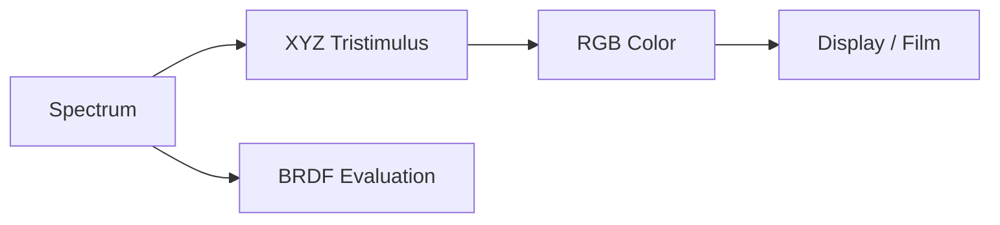


To precisely describe how light is represented and sampled to compute images, we must first establish some background in radiometry—the study of the propagation of electromagnetic radiation in an environment. In this chapter, we will first introduce four key quantities that describe electromagnetic radiation: flux, intensity, irradiance, and radiance.

These radiometric quantities generally vary as a function of wavelength. The variation of each is described by its spectral distribution—a distribution function that gives the amount of light at each wavelength. (We will interchangeably use spectrum to describe spectral distributions, and spectra for a plurality of them.) Of particular interest in rendering are the wavelengths (λ) of electromagnetic radiation between approximately 380 nm and 780 nm, which account for light visible to humans.1 A variety of classes that are used to represent spectral distributions in pbrt are defined in Section 4.5.

While spectral distributions are a purely physical concept, color is related to how humans perceive spectra. The lower wavelengths of light (λ ≈ 400 nm) are said to be bluish colors, the middle wavelengths (λ ≈ 550 nm) greens, and the upper wavelengths (λ ≈ 650 nm) reds. It is important to have accurate models of color for two reasons: first, display devices like monitors expect colors rather than spectra to describe pixel values, so accurately converting spectra to appropriate colors is important for displaying rendered images. Second, emission and reflection properties of objects in scenes are often specified using colors; these colors must be converted into spectra for use in rendering. Section 4.6, at the end of this chapter, describes the properties of color in more detail and includes implementations of pbrt’s colorrelated functionality.

## 4.1 RADIOMETRY

Radiometry provides a set of ideas and mathematical tools to describe light propagation and reflection. It forms the basis of the derivation of the rendering algorithms that will be used throughout the rest of this book. Interestingly enough, radiometry was not originally derived from first principles using the physics of light but was built on an abstraction of light based on particles flowing through space. As such, effects like polarization of light do not naturally fit into this framework, although connections have since been made between radiometry and Maxwell’s equations, giving radiometry a solid basis in physics.

Radiative transfer is the phenomenological study of the transfer of radiant energy. It is based on radiometric principles and operates at the geometric optics level, where macroscopic properties of light suffice to describe how light interacts with objects much larger than the light’s wavelength. It is not

uncommon to incorporate phenomena from wave optics models of light, but these results need to be expressed in the language of radiative transfer’s basic abstractions.

In this manner, it is possible to describe interactions of light with objects of approximately the same size as the wavelength of the light, and thereby model effects like dispersion and interference. At an even finer level of detail, quantum mechanics is needed to describe light’s interaction with atoms. Fortunately, direct simulation of quantum mechanical principles is unnecessary for solving rendering problems in computer graphics, so the intractability of such an approach is avoided.

In pbrt, we will assume that geometric optics is an adequate model for the description of light and light scattering. This leads to a few basic assumptions about the behavior of light that will be used implicitly throughout the system:

- **Linearity:** The combined effect of two inputs to an optical system is always equal to the sum of the effects of each of the inputs individually. Nonlinear scattering behavior is only observed in physical experiments involving extremely high energies, so this is generally a reasonable assumption.
- **Energy conservation:** When light scatters from a surface or from participating media, the scattering events can never produce more energy than they started with.
- **No polarization:** Electromagnetic radiation including visible light is polarized. A good mental analogy of polarization is a vibration propagating along a taut string. Shaking one end of the string will produce perpendicular waves that travel toward the other end. However, besides a simple linear motion, the taut string can also conduct other kinds of oscillations: the motion could, for example, be clockwise or counter-clockwise and in a circular or elliptical shape. All of these possibilities exist analogously in the case of light. Curiously, this additional polarization state of light is essentially imperceptible to humans without additional aids like specialized cameras or polarizing sunglasses. In pbrt, we will therefore make the common assumption that light is unpolarized—that is, a superposition of waves with many different polarizations so that only their average behavior is perceived. Therefore, the only relevant property of light is its distribution by wavelength (or, equivalently, frequency).
- **No fluorescence or phosphorescence:** The behavior of light at one wavelength is completely independent of light’s behavior at other wavelengths or times. As with polarization, it is not too difficult to include these effects if they are required.
- **Steady state:** Light in the environment is assumed to have reached equilibrium, so its radiance distribution is not changing over time. This happens nearly instantaneously with light in realistic scenes, so it is not a limitation in practice. Note that phosphorescence also violates the steady-state assumption.

The most significant loss from adopting a geometric optics model is the incompatibility with diffraction and interference effects. Even though this incompatibility can be circumvented—for example, by replacing radiance with the concept of a Wigner distribution function (Oh et al. 2010, Cuypers et al. 2012)—such extensions are beyond the scope of this book.

### 4.1.1 BASIC QUANTITIES

There are four radiometric quantities that are central to rendering: flux, irradiance/radiant exitance, intensity, and radiance. They can each be derived from energy by successively taking limits over time,

area, and directions. All of these radiometric quantities are in general wavelength dependent, though we will defer that topic until Section 4.1.3.

Energy Our starting point is energy, which is measured in joules (J). Sources of illumination emit photons, each of which is at a particular wavelength and carries a particular amount of energy. All the basic radiometric quantities are effectively different ways of measuring photons. A photon at wavelength λ

carries energy where c is the speed of light, 299,472,458 m/s, and h is Planck’s constant, h ≈ 6.626 × 10−34 m2 kg/s.

Flux Energy measures work over some period of time, though under the steady-state assumption generally used in rendering, we are mostly interested in measuring light at an instant. Radiant flux, also known as power, is the total amount of energy passing through a surface or region of space per unit time. Radiant flux can be found by taking the limit of differential energy per differential time:

Its units are joules/second (J/s), or more commonly, watts (W).

For example, given a light that emitted Q = 200,000 J over the course of an hour, if the same amount of energy was emitted at all times over the hour, we can find that the light source’s flux was Φ = 200,000 J/3600 s ≈ 55.6 W. Conversely, given flux as a function of time, we can integrate over a range of times to compute the total energy:

Note that our notation here is slightly informal: among other issues, because photons are discrete quanta, it is not meaningful to take limits that go to zero for differential time. For the purposes of rendering, where the number of photons is enormous with respect to the measurements we are interested in, this detail is not problematic.

Total emission from light sources is generally described in terms of flux. Figure 4.1 shows flux from a point light source measured by the total amount of energy passing through imaginary spheres around the light. Note that the total amount of flux measured on either of the two spheres in Figure 4.1 is the same—although less energy is passing through any local part of the large sphere than the small sphere, the greater area of the large sphere means that the total flux is the same.

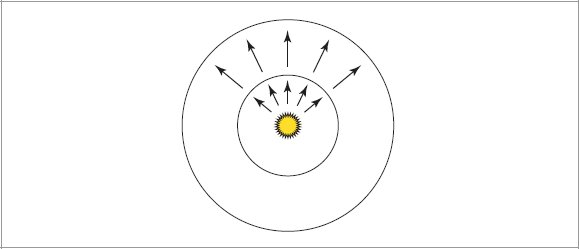


*Figure 4.1: Radiant flux, Φ, measures energy passing through a surface or region of space. Here, flux from a point light source is measured at spheres that surround the light.*

Irradiance and Radiant Exitance Any measurement of flux requires an area over which photons per time is being measured. Given a finite area A, we can define the average density of power over the area by E = Φ/A. This quantity is either irradiance (E), the area density of flux arriving at a surface, or radiant exitance (M), the area density of flux leaving a surface. These measurements have units of W/m2. (The term irradiance is sometimes also used to refer to flux leaving a surface, but for clarity we will use different terms for the two cases.) For the point light source example in Figure 4.1, irradiance at a point on the outer sphere is less than the irradiance at a point on the inner sphere, since the surface area of the outer sphere is larger. In particular, if the point source is emitting the same amount of illumination in all directions,

then for a sphere in this configuration that has radius r, This fact explains why the amount of energy received from a light at a point falls off with the squared distance from the light.

More generally, we can define irradiance and radiant exitance by taking the limit of differential power

per differential area at a point p: We can also integrate irradiance over an area to find power:

The irradiance equation can also help us understand the origin of Lambert’s law, which says that the amount of light energy arriving at a surface is proportional to the cosine of the angle between the light direction and the surface normal (Figure 4.2). Consider a light source with area A and flux Φ that is illuminating a surface. If the light is shining directly down on the surface (as on the left side of the

figure), then the area on the surface receiving light A1 is equal to A. Irradiance at any point inside A1

is then

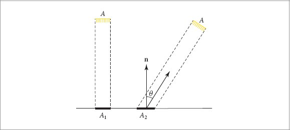


*Figure 4.2: Lambert’s Law. Irradiance arriving at a surface varies according to the cosine of the angle of incidence of illumination, since illumination is over a larger area at larger incident angles.*

However, if the light is at an angle to the surface, the area on the surface receiving light is larger. If A is small, then the area receiving flux, A2, is roughly A/cos θ. For points inside A2, the irradiance is

therefore

Intensity Consider now an infinitesimal light source emitting photons. If we center this light source within the unit sphere, we can compute the angular density of emitted power. Intensity, denoted by I, is this

quantity; it has units W/sr. Over the entire sphere of directions, we have but more generally we are interested in taking the limit of a differential cone of directions:

As usual, we can go back to power by integrating intensity: given intensity as a function of direction I(ω), we can integrate over a finite set of directions Ω to recover the power:

Intensity describes the directional distribution of light, but it is only meaningful for point light sources.

Radiance The final, and most important, radiometric quantity is radiance, L. Irradiance and radiant exitance give us differential power per differential area at a point p, but they do not distinguish the directional distribution of power. Radiance takes this last step and measures irradiance or radiant exitance with

respect to solid angles. It is defined by where we have used Eω to denote irradiance at the surface that is perpendicular to the direction ω. In other words, radiance is not measured with respect to the irradiance incident at the surface p lies on. In effect, this change of measurement area serves to eliminate the cos θ factor from Lambert’s law in the definition of radiance.


*Figure 4.3: Radiance L is defined as flux per unit solid angle dω per unit projected area dA⊥.*

Radiance is the flux density per unit area, per unit solid angle. In terms of flux, it is defined by

where dA⊥ is the projected area of dA on a hypothetical surface perpendicular to ω (Figure 4.3). Thus, it is the limit of the measurement of incident light at the surface as a cone of incident directions of interest dω becomes very small and as the local area of interest on the surface dA also becomes very small.

Of all of these radiometric quantities, radiance will be the one used most frequently throughout the rest of the book. An intuitive reason for this is that in some sense it is the most fundamental of all the radiometric quantities; if radiance is given, then all the other values can be computed in terms of integrals of radiance over areas and directions. Another nice property of radiance is that it remains constant along rays through empty space. It is thus a natural quantity to compute with ray tracing.

### 4.1.2 INCIDENT AND EXITANT RADIANCE FUNCTIONS

When light interacts with surfaces in the scene, the radiance function L is generally not continuous across the surface boundaries. In the most extreme case of a fully opaque surface (e.g., a mirror), the radiance function slightly above and slightly below a surface could be completely unrelated.

It therefore makes sense to take one-sided limits at the discontinuity to distinguish between the radiance function just above and below

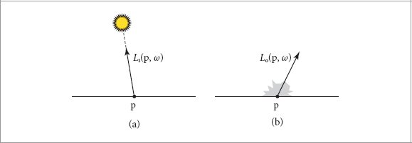


*Figure 4.4: (a) The incident radiance function Li(p, ω) describes the distribution of radiance arriving at a point as a function of position and direction. (b) The exitant radiance function Lo(p, ω) gives the distribution of radiance leaving the point. Note that for both functions, ω is oriented to point away from the surface, and thus, for example, Li(p, −ω) gives the radiance arriving on the other side of the surface than the one where ω lies.*

where np is the surface normal at p. However, keeping track of one-sided limits throughout the text is unnecessarily cumbersome.

We prefer to solve this ambiguity by making a distinction between radiance arriving at the point (e.g., due to illumination from a light source) and radiance leaving that point (e.g., due to reflection from a surface).

Consider a point p on the surface of an object. There is some distribution of radiance arriving at the point that can be described mathematically by a function of position and direction. This function is denoted by Li(p, ω) (Figure 4.4). The function that describes the outgoing reflected radiance from the surface at that point is denoted by Lo(p, ω). Note that in both cases the direction vector ω is oriented to point away from p, but be aware that some authors use a notation where ω is reversed for Li terms so that it points toward p.

There is a simple relation between these more intuitive incident and exitant radiance functions and

the one-sided limits from Equation (4.4): Throughout the book, we will use the idea of incident and exitant radiance functions to resolve ambiguity in the radiance function at boundaries.

Another property to keep in mind is that at a point in space where there is no surface (i.e., in free space), L is continuous, so L+ = L−, which means Lo(p, ω) = Li(p, −ω) = L(p, ω). In other words, Li and Lo only differ by a direction reversal.

### 4.1.3 RADIOMETRIC SPECTRAL DISTRIBUTIONS

Thus far, all the radiometric quantities have been defined without considering variation in their distribution over wavelengths. They have therefore effectively been the integrals of wavelength-dependent quantities over an (unspecified) range of wavelengths of interest. Just as we were able to define the various radiometric quantities in terms of limits of other quantities, we can also define their spectral variants by taking their limits over small wavelength ranges.

For example, we can define spectral radiance Lλ as the limit of radiance over an infinitesimal interval

of wavelengths Δλ, In turn, radiance can be found by integrating spectral radiance over a range of wavelengths:

Definitions for the other radiometric quantities follow similarly. All of these spectral variants have an additional factor of 1/m in their units.

### 4.1.4 LUMINANCE AND PHOTOMETRY

All the radiometric measurements like flux, radiance, and so forth have corresponding photometric measurements. Photometry is the study of visible electromagnetic radiation in terms of its perception by the human visual system. Each spectral radiometric quantity can be converted to its corresponding photometric quantity by integrating against the spectral response curve V (λ), which describes the relative sensitivity of the human eye to various wavelengths.2

Luminance measures how bright a spectral power distribution appears to a human observer. For example, luminance accounts for the fact that a spectral distribution with a particular amount of energy in the green wavelengths will appear brighter to a human than a spectral distribution with the same amount of energy in blue.

We will denote luminance by Y; it is related to spectral radiance by

Luminance and the spectral response curve V (λ) are closely related to the `XYZ` representation of color, which will be introduced in Section 4.6.1.

The units of luminance are candelas per meter squared (cd/m2), where the candela is the photometric equivalent of radiant intensity. Some representative luminance values are given in Table 4.1.

All the other radiometric quantities that we have introduced in this chapter have photometric equivalents; they are summarized in Table 4.2.3

*Table 4.1: Representative Luminance Values for a Number of Lighting Conditions.*

```text
   Condition                                              Luminance (cd/m2, or nits)
   Sun at horizon                                         600,000
   60-watt lightbulb                                      120,000
   Clear sky                                              8,000
   Typical office                                         100–1,000
   Typical computer display                               1–100
   Street lighting                                        1–10
   Cloudy moonlight                                       0.25
```

*Table 4.2: Radiometric Measurements and Their Photometric Analogs.*

```text
   Radiometric              Unit               Photometric                     Unit
   Radiant energy           joule (J)          Luminous energy                 talbot (T)
   Radiant flux             watt (W)           Luminous flux                   lumen (lm)
   Intensity                W/sr               Luminous intensity              lm/sr = candela (cd)
   Irradiance               W/m2               Illuminance                     lm/m2 = lux (lx)
   Radiance                 W/(m2sr)           Luminance                       lm/(m2sr) = cd/m2 = nit
```

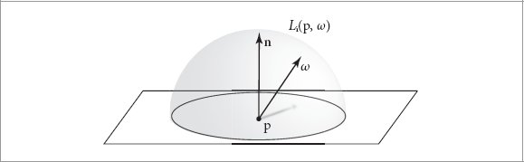


*Figure 4.5: Irradiance at a point p is given by the integral of radiance times the cosine of the incident direction over the entire upper hemisphere above the point.*

## 4.2 WORKING WITH RADIOMETRIC INTEGRALS

A frequent task in rendering is the evaluation of integrals of radiometric quantities. In this section, we will present some tricks that can make it easier to do this. To illustrate the use of these techniques, we will take the computation of irradiance at a point as an example. Irradiance at a point p with surface normal n due to radiance over a set of directions Ω is

where Li(p, ω) is the incident radiance function (Figure 4.5) and the cos θ factor in the integrand is

due to the dA⊥ factor in the definition of radiance. θ is measured as the angle between ω and the surface normal n. Irradiance is usually computed over the hemisphere ℌ2(n) of directions about a given surface normal n.

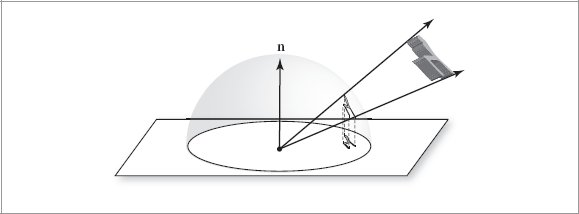


*Figure 4.6: The projected solid angle subtended by an object is the cosine-weighted solid angle that it subtends. It can be computed by finding the object’s solid angle, projecting it down to the plane perpendicular to the surface normal, and measuring its area there. Thus, the projected solid angle depends on the surface normal where it is being measured, since the normal orients the plane of projection.*

The integral in Equation (4.7) is with respect to solid angle on the hemisphere and the measure dω corresponds to surface area on the unit hemisphere. (Recall the definition of solid angle in Section 3.8.1.)

### 4.2.1 INTEGRALS OVER PROJECTED SOLID ANGLE

The various cosine factors in the integrals for radiometric quantities can often distract from what is being expressed in the integral. This problem can be avoided using projected solid angle rather than solid angle to measure areas subtended by objects being integrated over. The projected solid angle subtended by an object is determined by projecting the object onto the unit sphere, as was done for the solid angle, but then projecting the resulting shape down onto the unit disk that is perpendicular to the surface normal (Figure 4.6). Integrals over hemispheres of directions with respect to cosine-weighted solid angle can be rewritten as integrals over projected solid angle.

The projected solid angle measure is related to the solid angle measure by

```text
                                                  dω⊥ = |cos θ| dω,
```

so the irradiance-from-radiance integral over the hemisphere can be written more simply as

For the rest of this book, we will write integrals over directions in terms of solid angle, rather than projected solid angle. In other sources, however, projected solid angle may be used, so it is always important to be aware of the integrand’s actual measure.

### 4.2.2 INTEGRALS OVER SPHERICAL COORDINATES

It is often convenient to transform integrals over solid angle into integrals over spherical coordinates (θ, ϕ) using Equation (3.7). In order to convert an integral over a solid angle to an integral over (θ, ϕ), we need to be able to express the relationship between the differential area of a set of directions dω and the differential area of a (θ, ϕ) pair (Figure 4.7). The differential area on the unit sphere dω is the product of the differential lengths of its sides, sin θ dϕ and dθ. Therefore,

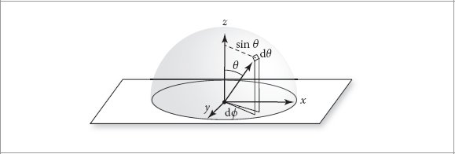


*Figure 4.7: The differential area dω subtended by a differential solid angle is the product of the differential lengths of the two edges sin θdϕ and dθ. The resulting relationship, dω = sin θdθdϕ, is the key to converting between integrals over solid angles and integrals over spherical angles.*

(This result can also be derived using the multidimensional transformation approach from Section 2.4.1.) We can thus see that the irradiance integral over the hemisphere, Equation (4.7) with Ω =

ℌ2(n), can equivalently be written as If the radiance is the same from all directions, the equation simplifies to E = πLi.

### 4.2.3 INTEGRALS OVER AREA

One last useful transformation is to turn integrals over directions into integrals over area. Consider the irradiance integral in Equation (4.7) again, and imagine there is a quadrilateral with constant outgoing radiance and that we could like to compute the resulting irradiance at a point p. Computing this value as an integral over directions ω or spherical coordinates (θ, ϕ) is in general not straightforward, since given a particular direction it is nontrivial to determine if the quadrilateral is visible in that direction or (θ, ϕ). It is much easier to compute the irradiance as an integral over the area of the quadrilateral.

Differential area dA on a surface is related to differential solid angle as viewed from a point p by

where θ is the angle between the surface normal of dA and the vector to p, and r is the distance from p to dA (Figure 4.8). We will not derive this result here, but it can be understood intuitively: if dA is at distance 1 from p and is aligned exactly so that it is perpendicular to dω, then dω = dA, θ = 0, and Equation (4.9) holds. As dA moves farther away from p, or as it rotates so that it is not aligned with the direction of dω, the r2 and cos θ factors compensate accordingly to reduce dω.

Therefore, we can write the irradiance integral for the quadrilateral source as

where L is the emitted radiance from the surface of the quadrilateral, θi is the angle between the surface normal at p and the direction from p to the point p′ on the light, and θo is the angle between the surface normal at p′ on the light and the direction from p′ to p (Figure 4.9).

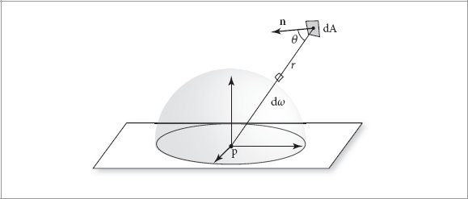


*Figure 4.8: The differential solid angle dω subtended by a differential area dA is equal to dA cos θ/r2, where θ is the angle between dA’s surface normal and the vector to the point p and r is the distance from p to dA.*

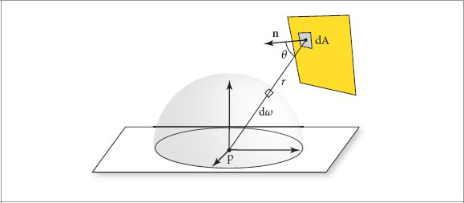


*Figure 4.9: To compute irradiance at a point p from a quadrilateral source, it is easier to integrate over the surface area of the source than to integrate over the irregular set of directions that it subtends. The relationship between solid angles and areas given by Equation (4.9) lets us go back and forth between the two approaches.*

## 4.3 SURFACE REFLECTION

When light is incident on a surface, the surface scatters the light, reflecting some of it back into the environment. There are two main effects that need to be described to model this reflection: the spectral distribution of the reflected light and its directional distribution. For example, the skin of a lemon mostly absorbs light in the blue wavelengths but reflects most of the light in the red and green wavelengths. Therefore, when it is illuminated with white light, its color is yellow. It has much the same color no matter what direction it is being observed from, although for some directions a highlight—a brighter area that is more white than yellow—is visible. In contrast, the light reflected from a point in a mirror depends almost entirely on the viewing direction. At a fixed point on the mirror, as the viewing angle changes, the object that is reflected in the mirror changes accordingly.

Reflection from translucent surfaces is more complex; a variety of materials ranging from skin and leaves to wax and liquids exhibit subsurface light transport, where light that enters the surface at one point exits it some distance away. (Consider, for example, how shining a flashlight in one’s mouth makes one’s cheeks light up, as light that enters the inside of the cheeks passes through the skin and exits the face.) There are two abstractions for describing these mechanisms for light reflection: the BRDF and the BSSRDF, described in Sections 4.3.1 and 4.3.2, respectively. The BRDF describes surface reflection at a point neglecting the effect of subsurface light transport. For materials where this transport mechanism does not have a significant effect, this simplification introduces little error and makes the implementation of rendering algorithms much more efficient. The BSSRDF generalizes the BRDF and describes the more general setting of light reflection from translucent materials.

### 4.3.1 THE BRDF AND THE BTDF

The bidirectional reflectance distribution function (BRDF) gives a formalism for describing reflection from a surface. Consider the setting in Figure 4.10: we would like to know how much radiance is leaving the surface in the direction ωo toward the viewer, Lo(p, ωo), as a result of incident radiance along the direction ωi, Li(p, ωi). (When considering light scattering at a surface location, pbrt uses the convention that ωi refers to the direction from which the quantity of interest (radiance in this case) arrives, rather than the direction from which the Integrator reached the surface.) If the direction ωi is considered as a differential cone of directions, the differential irradiance at p is

A differential amount of radiance will be reflected in the direction ωo due to this irradiance. Because of the linearity assumption from geometric optics, the reflected differential radiance is proportional to the irradiance dLo(p, ωo) ∝ dE(p, ωi). The constant of proportionality defines the surface’s BRDF fr for the particular pair of directions ωi

and ωo: The spectral BRDF is defined by using spectral radiance in place of radiance.

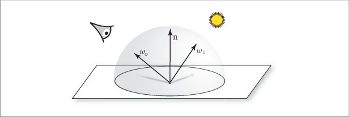


*Figure 4.10: The BRDF. The bidirectional reflectance distribution function is a 4D function over pairs of directions ωi and ωo that describes how much incident light along ωi is scattered from the surface in the direction ωo.*

Physically based BRDFs have two important qualities:

1. **Reciprocity:** For all pairs of directions ωi and ωo, fr(p, ωi, ωo) = fr(p, ωo, ωi).
2. **Energy conservation:** The total energy of light reflected is less than or equal to the energy of incident light. For all directions ωo,

Note that the value of the BRDF for a pair of directions ωi and ωo is not necessarily less than 1; it is only its integral that has this normalization constraint.

Two quantities that are based on the BRDF will occasionally be useful. First, the hemispherical-directional reflectance is a 2D function that gives the total reflection in a given direction due to constant illumination over the hemisphere, or, equivalently, the total reflection over the hemisphere due to light from a given direction.4 It is defined as

The hemispherical-hemispherical reflectance of a BRDF, denoted by ρhh, gives the fraction of incident light reflected by a surface when the incident light is the same from all directions. It is

A surface’s bidirectional transmittance distribution function (BTDF), which describes the distribution of transmitted light, can be defined in a manner similar to that for the BRDF. The BTDF is generally denoted by ft(p, ωo, ωi), where ωi and ωo are in opposite hemispheres around p. Remarkably, the BTDF does not obey reciprocity as defined above; we will discuss this issue in detail in Section 9.5.2.

For convenience in equations, we will denote the BRDF and BTDF when considered together as f (p, ωo, ωi); we will call this the bidirectional scattering distribution function (BSDF). Chapter 9 is entirely devoted to describing a variety of BSDFs that are useful for rendering.

Using the definition of the BSDF, we have

```text
                             dLo(p, ωo) = f (p, ωo, ωi) Li(p, ωi) |cos θi| dωi.
```

Here an absolute value has been added to the cos θi factor. This is done because surface normals in pbrt are not reoriented to lie on the same side of the surface as ωi (many other rendering systems do this, although we find it more useful to leave them in their natural orientation as given by the Shape). Doing so makes it easier to consistently apply conventions like “the surface normal is assumed to point outside the surface” elsewhere in the system. Thus, applying the absolute value to cos θ factors like these ensures that the desired quantity is calculated.

We can integrate this equation over the sphere of incident directions around p to compute the outgoing radiance in direction ωo due to the incident illumination at p from all directions:

```text
    Shape 261
```

This is a fundamental equation in rendering; it describes how an incident distribution of light at a point is transformed into an outgoing distribution, based on the scattering properties of the surface. It is often called the scattering equation when the sphere S2 is the domain (as it is here), or the reflection

equation when just the upper hemisphere ℌ2(n) is being integrated over. One of the key tasks of the integration routines in Chapters 13 through 15 is to evaluate this integral at points on surfaces in the scene.

### 4.3.2 THE BSSRDF

The bidirectional scattering surface reflectance distribution function (BSSRDF) is the formalism that describes scattering from materials that exhibit subsurface light transport. It is a distribution function S(po, ωo, pi, ωi) that describes the ratio of exitant differential radiance at point po in direction ωo to the incident differential flux at pi from direction ωi (Figure 4.11):

The generalization of the scattering equation for the BSSRDF requires integration over surface area and incoming direction, turning the 2D scattering Equation (4.14) into a 4D integral.

With two more dimensions to integrate over, it is more complex to account for in rendering algorithms than Equation (4.14) is. However, as the distance between points pi and po increases, the value of S generally diminishes. This fact can be a substantial help in implementations of subsurface scattering algorithms.

Light transport beneath a surface is described by the same principles as volume light transport in participating media and is described by the equation of transfer, which is introduced in Section 14.1. Subsurface scattering is thus based on the same effects as light scattering in clouds and smoke—just at a smaller scale.

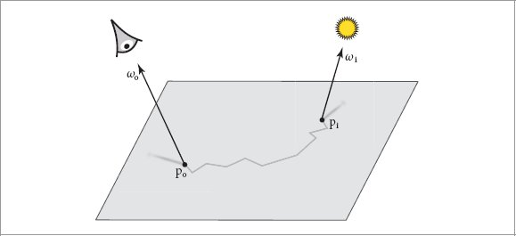


*Figure 4.11: The bidirectional scattering surface reflectance distribution function generalizes the BSDF to account for light that exits the surface at a point other than where it enters. It is often more difficult to evaluate than the BSDF, although subsurface light transport makes a substantial contribution to the appearance of many real-world objects.*

## 4.4 LIGHT EMISSION

The atoms of an object with temperature above absolute zero are moving. In turn, as described by Maxwell’s equations, the motion of atomic particles that hold electrical charges causes objects to emit electromagnetic radiation over a range of wavelengths. As we will see shortly, at room temperature most of the emission is at infrared frequencies; objects need to be much warmer to emit meaningful amounts of electromagnetic radiation at visible frequencies.

Many different types of light sources have been invented to convert energy into emitted electromagnetic radiation. An object that emits light is called a lamp or an illuminant, though we avoid the latter terminology since we generally use “illuminant” to refer to a spectral distribution of emission (Section 4.4.2). A lamp is housed in a luminaire, which consists of all the objects that hold and protect the light as well as any objects like reflectors or diffusers that shape the distribution of light.

Understanding some of the physical processes involved in emission is helpful for accurately modeling light sources for rendering. A number of corresponding types of lamps are in wide use today:

Incandescent (tungsten) lamps have a small tungsten filament. The flow of electricity through the filament heats it, which in turn causes it to emit electromagnetic radiation with a distribution of wavelengths that depends on the filament’s temperature. A frosted glass enclosure is often present to diffuse the emission over a larger area than just the filament and to absorb some of the wavelengths generated in order to achieve a desired distribution of emission by wavelength. With an incandescent light, much of the emitted power is in the infrared bands, which in turn means that much of the energy consumed by the light is turned into heat rather than light.

Halogen lamps also have a tungsten filament, but the enclosure around them is filled with halogen gas. Over time, part of the filament in an incandescent light evaporates when it is heated; the halogen gas causes this evaporated tungsten to return to the filament, which lengthens the life of the light. Because it returns to the filament, the evaporated tungsten does not adhere to the bulb surface (as it does with regular incandescent bulbs), which also prevents the bulb from darkening.

Gas-discharge lamps pass electrical current through hydrogen, neon, argon, or vaporized metal gas, which causes light to be emitted at specific wavelengths that depend on the particular atom in the gas. (Atoms that emit relatively little of their electromagnetic radiation in the not-useful infrared frequencies are selected for the gas.) Because a broader spectrum of wavelengths is generally more visually desirable than wavelengths that the chosen atoms generate directly, a fluorescent coating on the bulb’s interior is often used to transform the emitted wavelengths to a broader range. (The fluorescent coating also improves efficiency by converting ultraviolet wavelengths to visible wavelengths.)

LED lights are based on electroluminescence: they use materials that emit photons due to electrical current passing through them.

For all of these sources, the underlying physical process is electrons colliding with atoms, which pushes their outer electrons to a higher energy level. When such an electron returns to a lower energy level, a photon is emitted. There are many other interesting processes that create light, including chemoluminescence (as seen in light sticks) and bioluminescence—a form of chemoluminescence seen in fireflies. Though interesting in their own right, we will not consider their mechanisms further here.

Luminous efficacy measures how effectively a light source converts power to visible illumination, accounting for the fact that for human observers, emission in non-visible wavelengths is of little value. Interestingly enough, it is the ratio of a photometric quantity (the emitted luminous flux) to a radiometric quantity (either the total power it uses or the total power that it emits over all

wavelengths, measured in flux): where V (λ) is the spectral response curve that was introduced in Section 4.1.4.

Luminous efficacy has units of lumens per watt. If Φi is the power consumed by the light source (rather than the emitted power), then luminous efficacy also incorporates a measure of how effectively the light source converts power to electromagnetic radiation. Luminous efficacy can also be defined as a ratio of luminous exitance (the photometric equivalent of radiant exitance) to irradiance at a point on a surface, or as the ratio of exitant luminance to radiance at a point on a surface in a particular direction.

A typical value of luminous efficacy for an incandescent tungsten lightbulb is around 15 lm/W. The highest value it can possibly have is 683, for a perfectly efficient light source that emits all of its light at λ = 555 nm, the peak of the V (λ) function. (While such a light would have high efficacy, it would not necessarily be a pleasant one as far as human observers are concerned.)

### 4.4.1 BLACKBODY EMITTERS

A blackbody is a perfect emitter: it converts power to electromagnetic radiation as efficiently as physically possible. While true blackbodies are not physically realizable, some emitters exhibit near-blackbody behavior. Blackbodies also have a useful closed-form expression for their emission by wavelength as a function of temperature that is useful for modeling non-blackbody emitters.

Blackbodies are so-named because they absorb absolutely all incident power, reflecting none of it. Intuitively, the reasons that perfect absorbers are also perfect emitters stem from the fact that absorption is the reverse operation of emission. Thus, if time was reversed, all the perfectly absorbed power would be perfectly efficiently re-emitted.

Planck’s law gives the radiance emitted by a blackbody as a function of wavelength λ and temperature

T measured in kelvins: where c is the speed of light in the medium (299,792,458 m/s in a vacuum), h is Planck’s constant, 6.62606957 × 10−34 J s, and kb is the Boltzmann constant, 1.3806488 × 10−23 J/K, where kelvin (K) is the unit of temperature. Blackbody emitters are perfectly diffuse; they emit radiance equally in all directions.

*Figure 4.12 plots the emitted radiance distributions of a blackbody for a number of temperatures.*

The `Blackbody()` function computes emitted radiance at the given temperature T in Kelvin for the given wavelength lambda.

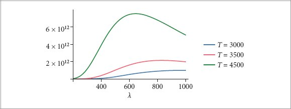


*Figure 4.12: Plots of emitted radiance as a function of wavelength for blackbody emitters at a few temperatures, as given by Equation (4.17). Note that as temperature increases, more of the emitted light is in the visible frequencies (roughly 380 nm–780 nm) and that the spectral distribution shifts from reddish colors to bluish colors. The total amount of emitted energy grows quickly as temperature increases, as described by the Stefan–Boltzmann law in Equation (4.19).*

〈Spectrum Function Declarations〉 ≡ Float Blackbody(Float lambda, Float T) {

```rust
        if T <= 0.0 {
            return 0.0;
        }
        let c = 299_792_458.0;
        let h = 6.62606957e-34;
        let kb = 1.3806488e-23;
        // 〈Return emitted radiance for blackbody at wavelength lambda〉
```

The wavelength passed to `Blackbody()` is in nm, but the constants for Equation (4.17) are in terms of meters. Therefore, it is necessary to first convert the wavelength to meters by scaling it by 10−9.

〈Return emitted radiance for blackbody at wavelength lambda〉 ≡ 162

```rust
    let l = lambda * 1e-9;
    let le = (2.0 * h * c * c)
        / (l.powi(5) * (FastExp((h * c) / (l * kb * T)) - 1.0));
    le
```

The emission of non-blackbodies is described by Kirchhoff ’s law, which says that the emitted radiance distribution at any frequency is equal to the emission of a perfect blackbody at that frequency times the fraction of incident radiance at that frequency that is absorbed by the object. (This relationship follows from the object being assumed to be in thermal equilibrium.) The fraction of radiance absorbed is equal to 1 minus the amount reflected, and so the emitted radiance is

where Le(T, λ) is the emitted radiance given by Planck’s law, Equation (4.17), and ρhd(ω) is the hemispherical-directional reflectance from Equation (4.12).

```text
    FastExp() 1036
    Float 23
    Pow() 1034
```

The Stefan–Boltzmann law gives the radiant exitance (recall that this is the outgoing irradiance) at a point p for a blackbody emitter: where σ is the Stefan–Boltzmann constant, 5.67032 × 10−8 W m−2 K−4. Note that the total emission over all frequencies grows very rapidly—at the rate T4. Thus, doubling the temperature of a blackbody emitter increases the total energy emitted by a factor of 16.

The blackbody emission distribution provides a useful metric for describing the emission characteristics of non-blackbody emitters through the notion of color temperature. If the shape of the emitted spectral distribution of an emitter is similar to the blackbody distribution at some temperature, then we can say that the emitter has the corresponding color temperature. One approach to find color temperature is to take the wavelength where the light’s emission is highest and find the corresponding temperature using Wien’s displacement law, which gives the wavelength where emission of a blackbody is maximum given its temperature:

where b is Wien’s displacement constant, 2.8977721 × 10−3 m K.

Incandescent tungsten lamps are generally around 2700 K color temperature, and tungsten halogen lamps are around 3000 K. Fluorescent lights may range all the way from 2700 K to 6500 K. Generally speaking, color temperatures over 5000 K are described as “cool,” while 2700–3000 K is described as “warm.”

### 4.4.2 STANDARD ILLUMINANTS

Another useful way of categorizing light emission distributions is a number of “standard illuminants” that have been defined by Commission Internationale de l’Éclairage (CIE).

The Standard Illuminant A was introduced in 1931 and was intended to represent average incandescent light. It corresponds to a blackbody radiator of about 2856 K. (It was originally defined as a blackbody at 2850 K, but the accuracy of the constants used in Planck’s law subsequently improved. Therefore, the specification was updated to be in terms of the 1931 constants, so that the illuminant was unchanged.) Figure 4.13 shows a plot of the spectral distribution of the A illuminant.

(The B and C illuminants were intended to model daylight at two times of day and were generated with an A illuminant in combination with specific filters. They are no longer used.

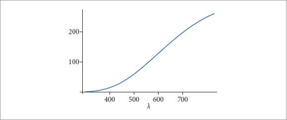


*Figure 4.13: Plot of the CIE Standard Illuminant A’s Spectral Power Distribution as a Function of Wavelength in nm. This illuminant represents incandescent illumination and is close to a blackbody at 2856 K.*

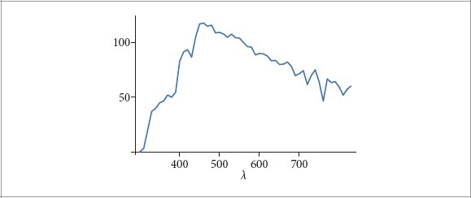


*Figure 4.14: Plot of the CIE Standard D65 Illuminant Spectral Distribution as a Function of Wavelength in nm. This illuminant represents noontime daylight at European latitudes and is commonly used to define the whitepoint of color spaces (Section 4.6.3).*

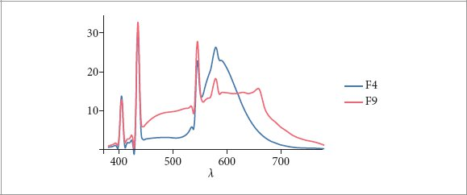


*Figure 4.15: Plots of the F4 and F9 Standard Illuminants as a Function of Wavelength in nm. These represent two fluorescent lights. Note that the distributions are quite different. Spikes in the two distributions correspond to the wavelengths directly emitted by atoms in the gas, while the other wavelengths are generated by the bulb’s fluorescent coating. The F9 illuminant is a “broadband” emitter that uses multiple phosphors to achieve a more uniform spectral distribution.*

The E illuminant is defined as having a constant spectral distribution and is used only for comparisons to other illuminants.)

The D illuminant describes various phases of daylight. It was defined based on characteristic vector analysis of a variety of daylight spectra, which made it possible to express daylight in terms of a linear

combination of three terms (one fixed and two weighted), with one weight essentially corresponding to yellow-blue color change due to cloudiness and the other corresponding to pink-green due to water in the atmosphere (from haze, etc.). D65 is roughly 6504 K color temperature (not 6500 K—again due to changes in the values used for the constants in Planck’s law) and is intended to correspond to mid-day sunlight in Europe. (See Figure 4.14.) The CIE recommends that this illuminant be used for daylight unless there is a specific reason not to.

Finally, the F series of illuminants describes fluorescents; it is based on measurements of a number of actual fluorescent lights. Figure 4.15 shows the spectral distributions of two of them.

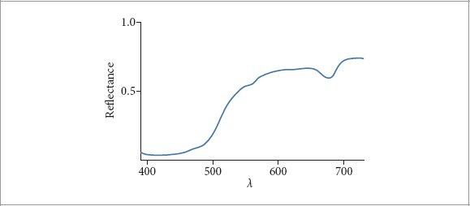


*Figure 4.16: Spectral Distribution of Reflection from Lemon Skin.*

## 4.5 REPRESENTING SPECTRAL DISTRIBUTIONS

Spectral distributions in the real world can be complex; we have already seen a variety of complex emission spectra and Figure 4.16 shows a graph of the spectral distribution of the reflectance of lemon skin. In order to render images of scenes that include a variety of complex spectra, a renderer must have efficient and accurate representations of spectral distributions. This section will introduce pbrt’s abstractions for representing and performing computation with them; the corresponding code can be found in the files util/spectrum.rs and util/spectrum.rs.

We will start by defining constants that give the range of visible wavelengths. Both here and for the remainder of the spectral code in pbrt, wavelengths are specified in nanometers, which are of a magnitude that gives easily human-readable values for the visible wavelengths.

〈Spectrum Constants〉 ≡ constexpr Float Lambda_min = 360, Lambda_max = 830;

### 4.5.1 SPECTRUM INTERFACE

We will find a variety of spectral representations useful in pbrt, ranging from spectral sample values tabularized by wavelength to functional descriptions such as the blackbody function. This brings us to our first interface class, `Spectrum`. A `Spectrum` corresponds to a pointer to a class that implements one such spectral representation.

```text
    BlackbodySpectrum 169
    ConstantSpectrum 167
    DenselySampledSpectrum 167
    Float 23
    PiecewiseLinearSpectrum 168
    RGBAlbedoSpectrum 197
    RGBIlluminantSpectrum 199
    RGBUnboundedSpectrum 198
    Spectrum 165
    TaggedPointer 1073
```

Spectrum inherits from TaggedPointer, which handles the details of runtime polymorphism. TaggedPointer requires that all the types of Spectrum implementations be provided as template parameters, which allows it to associate a unique integer identifier with each type. (See Section B.4.4 for details of its implementation.) 〈Spectrum Definition〉 ≡ class Spectrum : public TaggedPointer<ConstantSpectrum, DenselySampledSpectrum, PiecewiseLinearSpectrum, RGBAlbedoSpectrum, RGBUnboundedSpectrum, RGBIlluminantSpectrum, BlackbodySpectrum> { public: 〈Spectrum Interface 166〉 };

As with other classes that are based on `TaggedPointer`, `Spectrum` defines an interface that must be implemented by all the spectral representations. Typical practice in C++ would be for such an interface to be specified by pure virtual methods in `Spectrum` and for `Spectrum` implementations to inherit from `Spectrum` and implement those methods. With the `TaggedPointer` approach, the interface is specified implicitly: for each method in the interface, there is a method in `Spectrum` that dispatches calls to the appropriate type’s implementation. We will discuss the details of how this works for a single method here but will omit them for other `Spectrum` methods and for other interface classes since they all follow the same boilerplate.

The most important method that Spectrum defines is operator(), which takes a single wavelength λ and returns the value of the spectral distribution for that wavelength. 〈Spectrum Interface〉 ≡ 165

Float operator()(Float lambda) const;

The corresponding method implementation is brief, though dense. A call to TaggedPointer:: Dispatch() begins the process of dispatching the method call. The TaggedPointer class stores an integer tag along with the object’s pointer that encodes its type; in turn, Dispatch() is able to determine the specific type of the pointer at runtime. It then calls the callback function provided to it with a pointer to the object, cast to be a pointer to its actual type. The lambda function that is called here, op, takes a pointer with the auto type specifier for its parameter. In C++17, such a lambda function acts as a templated function; a call to it with a concrete type acts as an instantiation of a lambda that takes that type. Thus, the call (*ptr)(lambda) in the lambda body ends up as a direct call to the appropriate method. 〈Spectrum Inline Method Definitions〉 ≡ inline Float Spectrum::operator()(Float lambda) const { auto op = [&](auto ptr) { return (*ptr)(lambda); }; return Dispatch(op); }

Spectrum implementations must also provide a MaxValue() method that returns a bound on the maximum value of the spectral distribution over its wavelength range. This method’s main use in pbrt is for computing bounds on the power emitted by light sources so that lights can be sampled according to their expected contribution to illumination in the scene. 〈Spectrum Interface〉 +≡ 165

Float MaxValue() const;

### 4.5.2 GENERAL SPECTRAL DISTRIBUTIONS

With the `Spectrum` interface specified, we will start by defining a few `Spectrum` class implementations that explicitly tabularize values of the spectral distribution function. `ConstantSpectrum` is the simplest: it represents a constant spectral distribution over all wavelengths. The most common use of the `ConstantSpectrum` class in pbrt is to define a zero-valued spectral distribution in cases where a particular form of scattering is not present.

```text
   ConstantSpectrum 167
   Float 23
   Spectrum 165
   TaggedPointer 1073
   TaggedPointer::Dispatch() 1075
```

The `ConstantSpectrum` implementation is straightforward and we omit its trivial `MaxValue()` method here. Note that it does not inherit from `Spectrum`. This is another difference from using traditional C++ abstract base classes with virtual functions—as far as the C++ type system is concerned, there is no explicit connection between `ConstantSpectrum` and `Spectrum`.

〈Spectrum Definitions〉 ≡ class ConstantSpectrum { public: ConstantSpectrum(Float c) : c(c) {} Float operator()(Float lambda) const { return c; } private: Float c; };

More expressive is `DenselySampledSpectrum`, which stores a spectral distribution sampled at 1 nm intervals over a given range of integer wavelengths [λmin, λmax].

〈Spectrum Definitions〉 +≡ class DenselySampledSpectrum { public:

〈DenselySampledSpectrum Public Methods 167〉 private: 〈DenselySampledSpectrum Private Members 167〉 };

Its constructor takes another Spectrum and evaluates that spectral distribution at each wavelength in the range. DenselySampledSpectrum can be useful if the provided spectral distribution is computationally expensive to evaluate, as it allows subsequent evaluations to be performed by reading a single value from memory. 〈DenselySampledSpectrum Public Methods〉 ≡ 167

DenselySampledSpectrum(Spectrum spec, int lambda_min = Lambda_min, int lambda_max = Lambda_max, Allocator alloc = {}) : lambda_min(lambda_min), lambda_max(lambda_max), values(lambda_max - lambda_min + 1, alloc) { if (spec) for (int lambda = lambda_min; lambda <= lambda_max; ++lambda) values[lambda - lambda_min] = spec(lambda); } 〈DenselySampledSpectrum Private Members〉 ≡ 167

int lambda_min, lambda_max; pstd::vector<Float> values;

Finding the spectrum’s value for a given wavelength lambda is a matter of returning zero for wavelengths outside of the valid range and indexing into the stored values otherwise. 〈DenselySampledSpectrum Public Methods〉 +≡ 167

Float operator()(Float lambda) const { int offset = std::lround(lambda) - lambda_min; if (offset < 0 || offset >= values.size()) return 0; return values[offset]; }

```text
   Allocator 40
   ConstantSpectrum 167
   ConstantSpectrum::c 167
```

```text
   DenselySampledSpectrum 167
   DenselySampledSpectrum::lambda_max 167
   DenselySampledSpectrum::lambda_min 167
   DenselySampledSpectrum::values 167
   Float 23
   Lambda_max 165
   Lambda_min 165
   Spectrum 165
   Spectrum::operator() 166
```

While sampling a spectral distribution at 1 nm wavelengths gives sufficient accuracy for most uses in rendering, doing so requires nearly 2 kB of memory to store a distribution that covers the visible wavelengths. `PiecewiseLinearSpectrum` offers another representation that is often more compact; its distribution is specified by a set of pairs of values (λi, vi) where the spectral distribution is defined by linearly interpolating between them; see Figure 4.17. For spectra that are smooth in some regions and change rapidly in others, this representation makes it possible to specify the distribution at a higher rate in regions where its variation is greatest.

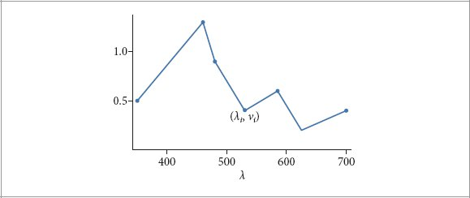


*Figure 4.17: PiecewiseLinearSpectrum defines a spectral distribution using a set of sample values (λi, vi). A continuous distribution is then defined by linearly interpolating between them.*

〈Spectrum Definitions〉 +≡ class PiecewiseLinearSpectrum { public:

〈PiecewiseLinearSpectrum Public Methods 168〉 private: 〈PiecewiseLinearSpectrum Private Members 168〉 };

The PiecewiseLinearSpectrum constructor, not included here, checks that the provided lambda values are sorted and then stores them and the associated spectrum values in corresponding member variables. 〈PiecewiseLinearSpectrum Public Methods〉 ≡ 168

PiecewiseLinearSpectrum(pstd::span<const Float> lambdas, pstd::span<const Float> values, Allocator alloc = {}); 〈PiecewiseLinearSpectrum Private Members〉 ≡ 168

pstd::vector<Float> lambdas, values;

Finding the value for a given wavelength requires first finding the pair of values in the lambdas array that bracket it and then linearly interpolating between them. 〈Spectrum Method Definitions〉 ≡ Float PiecewiseLinearSpectrum::operator()(Float lambda) const { 〈Handle PiecewiseLinearSpectrum corner cases 168〉 〈Find offset to largest lambdas below lambda and interpolate 169〉 }

```text
   Allocator 40
   DenselySampledSpectrum 167
   Float 23
   PiecewiseLinearSpectrum 168
   PiecewiseLinearSpectrum:: lambdas 168
```

As with DenselySampledSpectrum, wavelengths outside of the specified range are given a value of zero. 〈Handle PiecewiseLinearSpectrum corner cases〉 ≡ 168

if (lambdas.empty() || lambda < lambdas.front() || lambda > lambdas.back()) return 0;

If lambda is in range, then FindInterval() gives the offset to the largest value of lambdas that is less than or equal to lambda. In turn, lambda’s offset between that wavelength and the next gives the linear interpolation parameter to use with the stored values. 〈Find offset to largest lambdas below lambda and interpolate〉 ≡ int o = FindInterval(lambdas.size(), [&](int i) { return lambdas[i] <= lambda; }); Float t = (lambda - lambdas[o]) / (lambdas[o + 1] - lambdas[o]); return Lerp(t, values[o], values[o + 1]);

The maximum value of the distribution is easily found using std::max_element(), which performs a linear search. This function is not currently called in any performance-sensitive parts of pbrt; if it was, it would likely be worth caching this value to avoid recomputing it. 〈Spectrum Method Definitions〉 +≡ Float PiecewiseLinearSpectrum::MaxValue() const { if (values.empty()) return 0; return *std::max_element(values.begin(), values.end()); }

Another useful Spectrum implementation, BlackbodySpectrum, gives the spectral distribution of a blackbody emitter at a specified temperature. 〈Spectrum Definitions〉 +≡ class BlackbodySpectrum { public: 〈BlackbodySpectrum Public Methods 169〉 private: 〈BlackbodySpectrum Private Members 169 〉 };

The temperature of the blackbody in Kelvin is the constructor’s only parameter. 〈BlackbodySpectrum Public Methods〉 ≡ 169

BlackbodySpectrum(Float T) : T(T) {

```text
         〈Compute blackbody normalization constant for given temperature
         169〉
```

} 〈BlackbodySpectrum Private Members〉 ≡ 169

Float T;

```text
    Blackbody() 162
    BlackbodySpectrum 169
    FindInterval() 1039
    Float 23
    Lerp() 72
    PiecewiseLinearSpectrum:: lambdas 168
    PiecewiseLinearSpectrum:: values 168
    Spectrum 165
```

Because the power emitted by a blackbody grows so quickly with temperature (recall the Stefan–Boltzmann law, Equation (4.19)), the BlackbodySpectrum represents a normalized blackbody spectral distribution where the maximum value at any wavelength is 1. Wien’s displacement law, Equation (4.20), gives the wavelength in meters where emitted radiance is at its maximum; we must convert this value to nm before calling Blackbody() to find the corresponding radiance value. 〈Compute blackbody normalization constant for given temperature〉 ≡ 169

Float lambdaMax = 2.8977721e-3f / T; normalizationFactor = 1 / Blackbody(lambdaMax * 1e9f, T); 〈BlackbodySpectrum Private Members〉 +≡ 169

Float normalizationFactor;

The method that returns the value of the distribution at a wavelength then returns the product of the value returned by Blackbody() and the normalization factor. 〈BlackbodySpectrum Public Methods〉 +≡ 169

Float operator()(Float lambda) const { return Blackbody(lambda, T) * normalizationFactor; }

### 4.5.3 EMBEDDED SPECTRAL DATA

pbrt’s scene description format provides multiple ways to specify spectral data, ranging from blackbody temperatures to arrays of λ-value pairs to specify a piecewise-linear spectrum. For convenience, a variety of useful spectral distributions are also embedded directly in the pbrt binary, including ones that describe the emission profiles of various types of light source, the scattering properties of various conductors, and the wavelength-dependent indices of refraction of various types of glass. See the online pbrt file format documentation for a list of all of them.

The GetNamedSpectrum() function searches through these spectra and returns a Spectrum corresponding to a given named spectrum if it is available. 〈Spectral Function Declarations〉 ≡ Spectrum GetNamedSpectrum(std::string name);

A number of important spectra are made available directly through corresponding functions, all of which are in a Spectra namespace. Among them are Spectra::X(), Spectra::Y(), and Spectra::Z(), which return the color matching curves that are described in Section 4.6.1, and Spectra::D(), which returns a DenselySampledSpectrum representing the D illuminant at the given temperature. 〈Spectrum Function Declarations〉 +≡ DenselySampledSpectrum D(Float T, Allocator alloc);

### 4.5.4 SAMPLED SPECTRAL DISTRIBUTIONS

The attentive reader may have noticed that although `Spectrum` makes it possible to evaluate spectral distribution functions, it does not provide the ability to do very much computation with them other than sampling their value at a specified wavelength. Yet, for example, evaluating the integrand of the reflection equation, (4.14), requires taking the product of two spectral distributions, one for the BSDF and one for the incident radiance function. Providing this functionality with the abstractions that have been introduced so far would quickly become unwieldy. For example, while the product of two `DenselySampledSpectrum`s could be faithfully represented by another

`DenselySampledSpectrum`, consider taking the product of two `PiecewiseLinearSpectrum`s: the resulting function would be piecewise-quadratic and subsequent products would only increase its degree. Further, operations between `Spectrum` implementations of different types would not only require a custom implementation for each pair, but would require choosing a suitable `Spectrum` representation for each result.

pbrt avoids this complexity by performing spectral calculations at a set of discrete wavelengths as part of the Monte Carlo integration that is already being performed for image synthesis. To understand how this works, consider computing the (non-spectral) irradiance at some point p with surface normal n over some range of wavelengths of interest, [λ0, λ1]. Using Equation (4.7), which expresses irradiance in terms of incident radiance, and Equation (4.5), which expresses radiance in terms of spectral radiance,

we have where Li(p, ω, λ) is the incident spectral radiance at wavelength λ.

```text
   Allocator 40
   Blackbody() 162
   BlackbodySpectrum:: normalizationFactor 169
   DenselySampledSpectrum 167
   Float 23
   PiecewiseLinearSpectrum 168
   Spectrum 165
```

Applying the standard Monte Carlo estimator and taking advantage of the fact that ω and λ are independent, we can see that estimates of E can be computed by sampling directions ωi from some distribution pω, wavelengths λi from some distribution pλ, and then evaluating: art Thus, we only need to be able to evaluate the integrand at the specified discrete wavelengths to estimate the irradiance. More generally, we will see that it is possible to express all the spectral quantities that pbrt outputs as integrals over wavelength. For example, Section 4.6 shows that when rendering an image represented using `RGB` colors, each pixel’s color can be computed by integrating the spectral radiance arriving at a pixel with functions that model red, green, and blue color response. pbrt therefore uses only discrete spectral samples for spectral computation.

So that we can proceed to the implementation of the classes related to sampling spectra and performing computations with spectral samples, we will define the constant that sets the number of spectral samples here. (Section 4.6.5 will discuss in more detail the trade-offs involved in choosing this value.) pbrt uses 4 wavelength samples by default; this value can easily be changed, though doing so requires recompiling the system. 〈Spectrum Constants〉 +≡ static constexpr int NSpectrumSamples = 4;

SampledSpectrum The SampledSpectrum class stores an array of NSpectrumSamples values that represent values of the spectral distribution at discrete wavelengths. It provides methods that allow a variety of mathematical operations to be performed with them. 〈SampledSpectrum Definition〉 ≡ class SampledSpectrum { public: 〈SampledSpectrum Public Methods 171〉 private: pstd::array<Float, NSpectrumSamples> values; };

Its constructors include one that allows providing a single value for all wavelengths and one that takes an appropriately sized pstd::span of per-wavelength values. 〈SampledSpectrum Public Methods〉 ≡ 171

explicit SampledSpectrum(Float c) { values.fill(c); } SampledSpectrum(pstd::span<const Float> v) { for (int i = 0; i < NSpectrumSamples; ++i) values[i] = v[i]; }

The usual indexing operations are also provided for accessing and setting each wavelength’s value.

```text
   Float 23
   NSpectrumSamples 171
   SampledSpectrum 171
   SampledSpectrum::values 171
```

〈SampledSpectrum Public Methods〉 +≡ 171

Float operator[](int i) const { return values[i]; } Float &operator[](int i) { return values[i]; }

It is often useful to know if all the values in a SampledSpectrum are zero. For example, if a surface has zero reflectance, then the light transport routines can avoid the computational cost of casting reflection rays that have contributions that would eventually be multiplied by zeros. This capability is provided through a type conversion operator to bool.5 〈SampledSpectrum Public Methods〉 +≡ 171

explicit operator bool() const { for (int i = 0; i < NSpectrumSamples; ++i) if (values[i] != 0) return true; return false; }

All the standard arithmetic operations on SampledSpectrum objects are provided; each operates component-wise on the stored values. The implementation of operator+= is below. The others are analogous and are therefore not included in the text. 〈SampledSpectrum Public Methods〉 +≡ 171

SampledSpectrum &operator+=(const SampledSpectrum &s) { for (int i = 0; i < NSpectrumSamples; ++i) values[i] += s.values[i]; return *this; }

SafeDiv() divides two sampled spectra, but generates zero for any sample where the divisor is zero. 〈SampledSpectrum Inline Functions〉 ≡ SampledSpectrum SafeDiv(SampledSpectrum a, SampledSpectrum b) { SampledSpectrum r;

for (int i = 0; i < NSpectrumSamples; ++i) r[i] = (b[i] != 0) ? a[i] / b[i] : 0.; return r; }

In addition to the basic arithmetic operations, `SampledSpectrum` also provides `Lerp()`, `Sqrt()`, `Clamp()`, `ClampZero()`, `Pow()`, `Exp()`, and `FastExp()` functions that operate (again, component-wise) on `SampledSpectrum` objects; some of these operations are necessary for evaluating some of the reflection models in Chapter 9 and for evaluating volume scattering models in Chapter 14. Finally, `MinComponentValue()` and `MaxComponentValue()` return the minimum and maximum of all the values, and `Average()` returns their average. These methods are all straightforward and are therefore not included in the text.

`SampledWavelengths` A separate class, `SampledWavelengths`, stores the wavelengths for which a `SampledSpectrum` stores samples. Thus, it is important not only to keep careful track of the `SampledWavelengths` that are represented by an individual `SampledSpectrum` but also to not perform any operations that combine `SampledSpectrum`s that have samples at different wavelengths.

```text
   NSpectrumSamples 171
   SampledSpectrum 171
   SampledSpectrum::values 171
```

〈SampledWavelengths Definitions〉 ≡ class SampledWavelengths { public: 〈SampledWavelengths Public Methods 173〉 private: 〈SampledWavelengths Private Members 173〉 };

To be used in the context of Monte Carlo integration, the wavelengths stored in Sampled Wavelengths must be sampled from some probability

distribution. Therefore, the class stores the wavelengths themselves as well as each one’s probability density. 〈SampledWavelengths Private Members〉 ≡ 173

pstd::array<Float, NSpectrumSamples> lambda, pdf;

The easiest way to sample wavelengths is uniformly over a given range. This approach is implemented in the SampleUniform() method, which takes a single uniform sample u and a range of wavelengths. 〈SampledWavelengths Public Methods〉 ≡ 173

static SampledWavelengths SampleUniform(Float u, Float lambda_min = Lambda_min, Float lambda_max = Lambda_max) { SampledWavelengths swl; 〈Sample first wavelength using u 173〉 〈Initialize lambda for remaining wavelengths 173〉 〈Compute PDF for sampled wavelengths 173〉 return swl; }

It chooses the first wavelength uniformly within the range. 〈Sample first wavelength using u〉 ≡ 173

swl.lambda[0] = Lerp(u, lambda_min, lambda_max);

The remaining wavelengths are chosen by taking uniform steps delta starting from the first wavelength and wrapping around if lambda_max is passed. The result is a set of stratified wavelength samples that are generated using a single random number. One advantage of sampling wavelengths in this way rather than using a separate uniform sample for each one is that the value of NSpectrumSamples can be changed without requiring the modification of code that calls SampleUniform() to adjust the number of sample values that are passed to this method. 〈Initialize lambda for remaining wavelengths〉 ≡ 173

```rust
    let delta = (lambda_max - lambda_min) / (NSpectrumSamples as f64);
    for i in 1..NSpectrumSamples {
        swl.lambda[i] = swl.lambda[i - 1] + delta;
        if swl.lambda[i] > lambda_max {
            swl.lambda[i] = lambda_min + (swl.lambda[i] - lambda_max);
        }
    }
```

The probability density for each sample is easily computed, since the sampling distribution is uniform.

```text
   Float 23
   Lambda_max 165
   Lambda_min 165
   Lerp() 72
   NSpectrumSamples 171
   SampledWavelengths 173
   SampledWavelengths::lambda 173
   SampledWavelengths::pdf 173
```

〈Compute PDF for sampled wavelengths〉 ≡ 173

for (int i = 0; i < NSpectrumSamples; ++i) swl.pdf[i] = 1 / (lambda_max - lambda_min);

Additional methods provide access to the individual wavelengths and to all of their PDFs. PDF values are returned in the form of a SampledSpectrum, which makes it easy to compute the value of associated Monte Carlo estimators. 〈SampledWavelengths Public Methods〉 +≡ 173

Float operator[](int i) const { return lambda[i]; } Float &operator[](int i) { return lambda[i]; } SampledSpectrum PDF() const { return SampledSpectrum(pdf); }

In some cases, different wavelengths of light may follow different paths after a scattering event. The most common example is when light undergoes dispersion and different wavelengths of light refract to different directions. When this happens, it is no longer possible to track multiple wavelengths of light with a single ray. For this case, SampledWavelengths provides the capability of terminating all but one of the wavelengths; subsequent computations can then consider the single surviving wavelength exclusively. 〈SampledWavelengths Public Methods〉 +≡ 173

void TerminateSecondary() { if (SecondaryTerminated()) return; 〈Update wavelength probabilities for termination 174〉 }

The wavelength stored in lambda[0] is always the survivor: there is no need to randomly select the surviving wavelength so long as each lambda value was randomly sampled from the same distribution as is the case with `SampleUniform()`, for example. Note that this means that it would be incorrect for `SampledWavelengths::SampleUniform()` to always place lambda[0] in a first wavelength stratum between lambda_min and lambda_min+delta, lambda[1] in the second, and so forth.6

Terminated wavelengths have their PDF values set to zero; code that computes Monte Carlo estimates using SampledWavelengths must therefore detect this case and ignore terminated wavelengths accordingly. The surviving wavelength’s PDF is updated to account for the termination event by multiplying it by the probability of a wavelength surviving termination, 1 / NSpectrumSamples. (This is similar to how applying Russian roulette affects the Monte Carlo estimator—see Section 2.2.4.) 〈Update wavelength probabilities for termination〉 ≡ 174

for (int i = 1; i < NSpectrumSamples; ++i) pdf[i] = 0; pdf[0] /= NSpectrumSamples;

SecondaryTerminated() indicates whether TerminateSecondary() has already been called. Because path termination is the only thing that causes zero-valued PDFs after the first wavelength, checking the PDF values suffices for this test. 〈SampledWavelengths Public Methods〉 +≡ 173

bool SecondaryTerminated() const { for (int i = 1; i < NSpectrumSamples; ++i) if (pdf[i] != 0) return false; return true; }

```text
   Float 23
   NSpectrumSamples 171
   SampledSpectrum 171
   SampledWavelengths 173
   SampledWavelengths::lambda 173
   SampledWavelengths::pdf 173
```

```text
   SampledWavelengths:: SampleUniform() 173
   SampledWavelengths:: SecondaryTerminated() 174
```

We will often have a Spectrum and a set of wavelengths for which we would like to evaluate it. Therefore, we will add a method to the Spectrum interface that provides a Sample() method that takes a set of wavelengths, evaluates its spectral distribution function at each one, and returns a SampledSpectrum. This convenience method eliminates the need for an explicit loop over wavelengths with individual calls to Spectrum::operator() in this common case. The implementations of this method are straightforward and not included here. 〈Spectrum Interface〉 +≡ 165

SampledSpectrum Sample(const SampledWavelengths &lambda) const;

Discussion Now that `SampledWavelengths` and `SampledSpectrum` have been introduced, it is reasonable to ask the question: why are they separate classes, rather than a single class that stores both wavelengths and their sample values? Indeed, an advantage of such a design would be that it would be possible to detect at runtime if an operation was performed with two `SampledSpectrum` instances that stored values for different wavelengths—such an operation is nonsensical and would signify a bug in the system. However, in practice many `SampledSpectrum` objects are created during rendering, many as temporary values in the course of evaluating expressions involving spectral computation. It is therefore worthwhile to minimize the object’s size, if only to avoid initialization and copying of additional data. While the pbrt’s CPU-based integrators do not store many `SampledSpectrum` values in memory at the same time, the GPU rendering path stores a few million of them, giving further motivation to minimize their size. Our experience has been that bugs from mixing computations at different wavelengths have been rare. With the way that computation is structured in pbrt, wavelengths are generally sampled at the start of following a ray’s

path through the scene, and then the same wavelengths are used throughout for all spectral calculations along the path. There ends up being little opportunity for inadvertent mingling of sampled wavelengths in `SampledSpectrum` instances. Indeed, in an earlier version of the system, `SampledSpectrum` did carry along a `SampledWavelengths` member variable in debug builds in order to be able to check for that case. It was eliminated in the interests of simplicity after a few months’ existence without finding a bug. 4.6 COLOR

“Spectral distribution” and “color” might seem like two names for the same thing, but they are distinct. A spectral distribution is a purely physical concept, while color describes the human perception of a spectrum. Color is thus closely connected to the physiology of the human visual system and the brain’s processing of visual stimulus. Although the majority of rendering computation in pbrt is based on spectral distributions, color still must be treated carefully. For example, the spectral distribution at each pixel in a rendered image must be converted to `RGB` color to be displayed on a monitor. Performing this conversion accurately requires using information about the monitor’s color characteristics. The renderer also finds color in scene descriptions that use it to describe reflectance and light emission. Although it is convenient for humans to use colors to describe the appearance of modeled scenes, these colors must be converted to spectra if a renderer uses spectral distributions in its light transport simulation. Unfortunately, doing so is an underspecified problem. A variety of approaches have been developed for it; the one implemented in pbrt is described in Section 4.6.6.

```text
   SampledSpectrum 171
   SampledWavelengths 173
   Spectrum 165
   Spectrum::operator() 166
```

The tristimulus theory of color perception says that all visible spectral distributions can be accurately represented for human observers using three scalar values. Its basis is that there are three types of photoreceptive cone

cells in the eye, each sensitive to different wavelengths of light. This theory, which has been tested in numerous experiments since its introduction in the 1800s, has led to the development of spectral matching functions, which are functions of wavelength that can be used to compute a tristimulus representation of a spectral distribution. Integrating the product of a spectral distribution S(λ) with three tristimulus matching functions m{1,2,3}(λ) gives three tristimulus values vi: art The matching functions thus define a color space, which is a 3D vector space of the tristimulus values: the tristimulus values for the sum of two spectra are given by the sum of their tristimulus values and the tristimulus values associated with a spectrum that has been scaled by a constant can be found by scaling the tristimulus values by the same factor. Note that from these definitions, the tristimulus values for the product of two spectral distributions are not given by the product of their tristimulus values. This nit is why using tristimulus color like `RGB` for rendering may not give accurate results; we will say more about this topic in Section 4.6.6. The files util/color.rs and util/color.rs in the pbrt distribution contain the implementation of the functionality related to color that is introduced in this section.

### 4.6.1 XYZ COLOR

An important set of color matching functions were determined by the Commission Internationale de l’Éclairage (CIE) standards body after a series of experiments with human test subjects. They define the `XYZ` color space and are graphed in Figure 4.18. `XYZ` is a device-independent color space, which means that it does not describe the characteristics of a particular display or color measurement device.

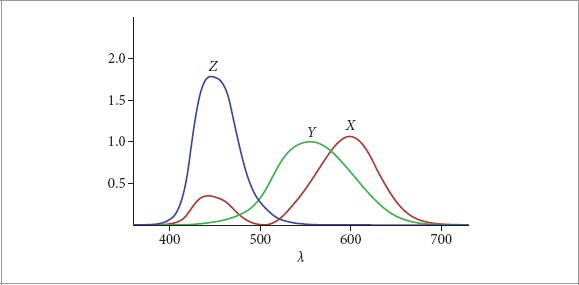


*Figure 4.18: The XYZ Color Matching Curves. A given spectral distribution can be converted to XYZ by multiplying it by each of the three matching curves and integrating the result to compute the values xλ, yλ, and zλ, using Equation (4.22).*

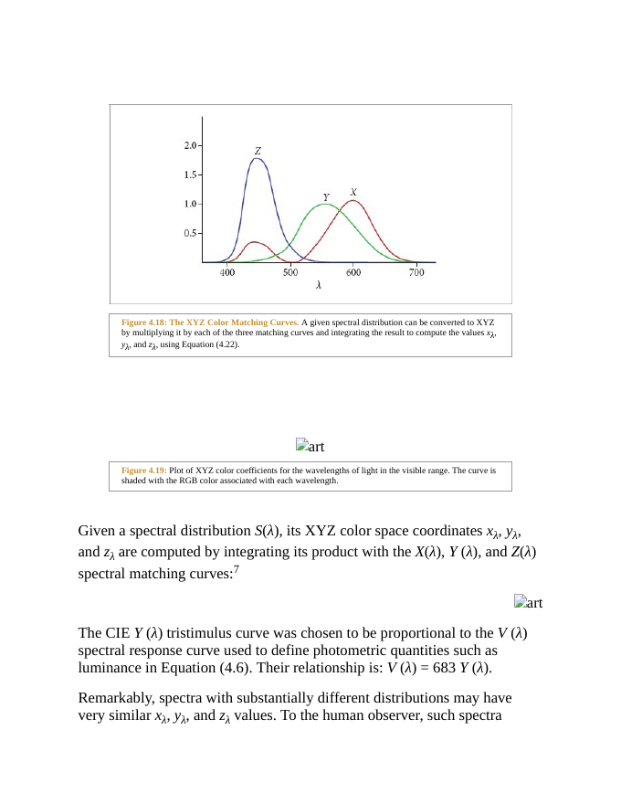

*Figure 4.19: Plot of XYZ color coefficients for the wavelengths of light in the visible range. The curve is shaded with the RGB color associated with each wavelength.*

Given a spectral distribution S(λ), its `XYZ` color space coordinates xλ, yλ, and zλ are computed by integrating its product with the X(λ), Y (λ), and Z(λ) spectral matching curves:7 art The CIE Y (λ) tristimulus curve was chosen to be proportional to the V (λ) spectral response curve used to define photometric quantities such as luminance in Equation (4.6). Their relationship is: V (λ) = 683 Y (λ). Remarkably, spectra with substantially different distributions may have very similar xλ, yλ, and zλ values. To the human observer, such spectra

appear the same. Pairs of such spectra are called metamers. Figure 4.19 shows a 3D plot of the curve in the XYZ space corresponding to the XYZ coefficients for single wavelengths of light over the visible range. The coefficients for more complex spectral distributions therefore correspond to linear combinations of points along this curve. Although all spectral distributions can be represented with XYZ coefficients, not all values of XYZ coefficients correspond to realizable spectra; such sets of coefficients are termed imaginary colors. Three functions in the Spectra namespace provide the CIE XYZ matching curves sampled at 1-nm increments from 360 nm to 830 nm. 〈Spectral Function Declarations〉 +≡ namespace Spectra { const DenselySampledSpectrum &X(); const DenselySampledSpectrum &Y(); const DenselySampledSpectrum &Z(); }

The integral of Y (λ) is precomputed and available in a constant. 〈Spectrum Constants〉 +≡ static constexpr Float CIE_Y_integral = 106.856895;

There is also an `XYZ` class that represents `XYZ` colors.

〈XYZ Definition〉 ≡ class XYZ { public: 〈XYZ Public Methods 178〉 〈XYZ Public Members 178〉 };

Its implementation is the obvious one, using three `Float` values to represent the three color components. All the regular arithmetic operations are provided for `XYZ` in methods that are not included in the text here.

〈XYZ Public Methods〉 ≡ 178

XYZ(Float X, Float Y, Float Z) : X(X), Y(Y), Z(Z) {} 〈XYZ Public Members〉 ≡ 178

Float X = 0, Y = 0, Z = 0;

The `SpectrumToXYZ()` function computes the `XYZ` coefficients of a spectral distribution following Equation (4.22) using the following `InnerProduct()` utility function to handle each component.

〈Spectrum Function Definitions〉 ≡ XYZ SpectrumToXYZ(Spectrum s) { return XYZ(InnerProduct(&Spectra::X(), s), InnerProduct(&Spectra::Y(), s), InnerProduct(&Spectra::Z(), s)) / CIE_Y_integral; }

Monte Carlo is not necessary for a simple 1D integral of two spectra, so InnerProduct() computes a Riemann sum over integer wavelengths instead: art 〈Spectrum Inline Functions〉 ≡ Float InnerProduct(Spectrum f, Spectrum g) { Float integral = 0; for (Float lambda = Lambda_min; lambda <= Lambda_max; ++lambda) integral += f(lambda) * g(lambda); return integral; }

```text
   CIE_Y_integral 178
   DenselySampledSpectrum 167
   Float 23
   Lambda_max 165
   Lambda_min 165
   Spectra::X() 170
   Spectra::Y() 170
   Spectra::Z() 170
   Spectrum 165
```

```text
   Spectrum::InnerProduct() 178
   Spectrum::operator() 166
   XYZ 178
```

It is also useful to be able to compute `XYZ` coefficients for a `SampledSpectrum`. Because `SampledSpectrum` only has point samples of the spectral distribution at predetermined wavelengths, they are found via a Monte Carlo estimate of Equation (4.22) using the sampled spectral values si at wavelengths λi and their associated PDFs: art and so forth, where n is the number of wavelength samples. `SampledSpectrum::ToXYZ()` computes the value of this estimator.

〈Spectrum Method Definitions〉 +≡ XYZ SampledSpectrum::ToXYZ(const SampledWavelengths &lambda) const { 〈Sample the X, Y , and Z matching curves at lambda 179〉 〈Evaluate estimator to compute (x, y, z) coefficients 179〉 }

The first step is to sample the matching curves at the specified wavelengths. 〈Sample the X, Y , and Z matching curves at lambda〉 ≡ 179

SampledSpectrum X = Spectra::X().Sample(lambda); SampledSpectrum Y = Spectra::Y().Sample(lambda); SampledSpectrum Z = Spectra::Z().Sample(lambda);

The summand in Equation (4.23) is easily computed with values at hand. Here, we evaluate all terms of each sum with a single expression. Using SampledSpectrum::SafeDiv() to divide by the PDF values handles the case of the PDF being equal to zero for some wavelengths, as can happen if SampledWavelengths::TerminateSecondary() was called. Finally, SampledSpectrum::Average() conveniently takes care of summing the individual terms and dividing by n to compute the estimator’s value for each coefficient. 〈Evaluate estimator to compute (x, y, z) coefficients〉 ≡ 179

SampledSpectrum pdf = lambda.PDF(); return XYZ(SafeDiv(X * *this, pdf).Average(),

```rust
    SafeDiv(y * self, pdf).Average(),
    SafeDiv(z * self, pdf).Average()) / CIE_Y_integral;
```

To avoid the expense of computing the X and Z coefficients when only luminance is needed, there is a `y()` method that only returns Y. Its implementation is the obvious subset of `XYZ()` and so is not included here.

```text
   CIE_Y_integral 178
   SampledSpectrum 171
   SampledSpectrum::Average() 172
   SampledSpectrum::SafeDiv() 172
   SampledSpectrum::ToXYZ() 179
   SampledWavelengths 173
   SampledWavelengths::PDF() 174
   SampledWavelengths:: TerminateSecondary() 174
   Spectra::X() 170
   Spectra::Y() 170
   Spectra::Z() 170
   Spectrum::Sample() 175
   XYZ 178
```

Chromaticity and xyY Color Color can be separated into lightness, which describes how bright it is relative to something white, and chroma, which describes its relative colorfulness with respect to white. One approach to quantifying chroma is the xyz chromaticity coordinates, which are defined in terms of `XYZ` color space coordinates by art Note that any two of them are sufficient to specify chromaticity.

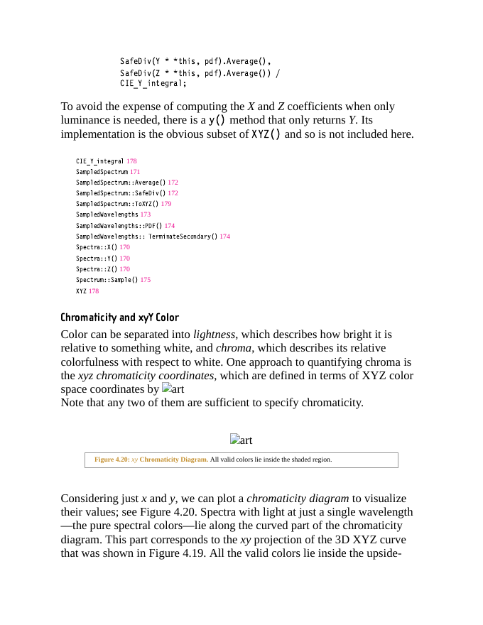

*Figure 4.20: xy Chromaticity Diagram. All valid colors lie inside the shaded region.*

Considering just x and y, we can plot a chromaticity diagram to visualize their values; see Figure 4.20. Spectra with light at just a single wavelength —the pure spectral colors—lie along the curved part of the chromaticity diagram. This part corresponds to the xy projection of the 3D `XYZ` curve that was shown in Figure 4.19. All the valid colors lie inside the upside-

down horseshoe shape; points outside that region correspond to imaginary colors. The xyY color space separates a color’s chromaticity from its lightness. It uses the x and y chromaticity coordinates and yλ from `XYZ`, since the Y (λ) matching curve was defined to be proportional to luminance. pbrt makes limited use of xyY colors and therefore does not provide a class to represent them, but the `XYZ` class does provide a method that returns its xy chromaticity coordinates as a `Point2f`.

〈XYZ Public Methods〉 +≡ 178

Point2f xy() const { return Point2f(X / (X + Y + Z), Y / (X + Y + Z)); }

A corresponding method converts from xyY to `XYZ`, given xy and optionally yλ coordinates.

〈XYZ Public Methods〉 +≡ static XYZ FromxyY(Point2f xy, Float Y = 1) { if (xy.y == 0) return XYZ(0, 0, 0); return XYZ(xy.x * Y / xy.y, Y, (1 - xy.x - xy.y) * Y / xy.y); }

### 4.6.2 RGB COLOR

RGB color is used more commonly than XYZ in rendering applications. In RGB color spaces, colors are represented by a triplet of values corresponding to red, green, and blue colors, often referred to as RGB. However, an RGB triplet on its own is meaningless; it must be defined with respect to a specific RGB color space. To understand why, consider what happens when an RGB color is shown on a display: the spectrum that is displayed is given by the weighted sum of three spectral emission curves, one for each of red, green, and blue, as emitted by the display elements, be they phosphors, LED or LCD elements,

or plasma cells.8 Figure 4.21 plots the red, green, and blue distributions emitted by an LCD display and an LED display; note that they are remarkably different. Figure 4.22 in turn shows the spectral distributions that result from displaying the `RGB` color (0.6, 0.3, 0.2) on those displays. Not surprisingly, the resulting spectra are quite different as well.

```text
   Float 23
   Point2f 92
   XYZ 178
   XYZ::X 178
   XYZ::Y 178
   XYZ::Z 178
```

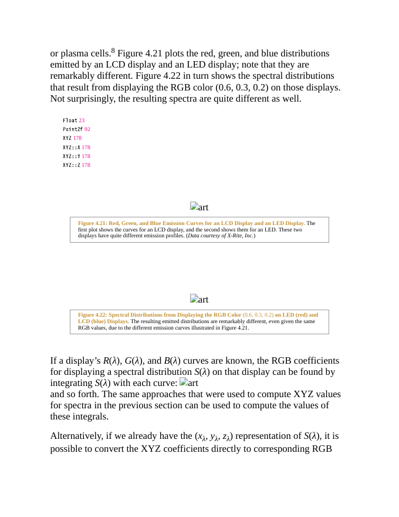

*Figure 4.21: Red, Green, and Blue Emission Curves for an LCD Display and an LED Display. The first plot shows the curves for an LCD display, and the second shows them for an LED. These two displays have quite different emission profiles. (Data courtesy of X-Rite, Inc.)*


*Figure 4.22: Spectral Distributions from Displaying the RGB Color (0.6, 0.3, 0.2) on LED (red) and LCD (blue) Displays. The resulting emitted distributions are remarkably different, even given the same RGB values, due to the different emission curves illustrated in Figure 4.21.*

If a display’s R(λ), G(λ), and B(λ) curves are known, the `RGB` coefficients for displaying a spectral distribution S(λ) on that display can be found by integrating S(λ) with each curve: art and so forth. The same approaches that were used to compute `XYZ` values for spectra in the previous section can be used to compute the values of these integrals. Alternatively, if we already have the (xλ, yλ, zλ) representation of S(λ), it is possible to convert the `XYZ` coefficients directly to corresponding `RGB`

coefficients. Consider, for example, computing the value of the red component for a spectral distribution S(λ): art where the second step takes advantage of the tristimulus theory of color perception. The integrals of the products of an `RGB` response function and `XYZ` matching function can be precomputed for given response curves, making it possible to express the full conversion as a matrix: art pbrt frequently uses this approach in order to efficiently convert colors from one color space to another. An `RGB` class that has the obvious representation and provides a variety of useful arithmetic operations (not included in the text) is also provided by pbrt.

〈RGB Definition〉 ≡ class RGB { public: 〈RGB Public Methods 182〉 〈RGB Public Members 182〉 };

〈RGB Public Methods〉 ≡ 182

RGB(Float r, Float g, Float b) : r(r), g(g), b(b) {}

〈RGB Public Members〉 ≡ 182

Float r = 0, g = 0, b = 0;

### 4.6.3 RGB COLOR SPACES

Full spectral response curves are not necessary to define color spaces. For example, a color space can be defined using xy chromaticity coordinates to specify three color primaries. From them, it is possible to derive matrices that convert `XYZ` colors to and from that color space. In cases where we do not otherwise need explicit spectral response curves, this is a convenient way to specify a color space. The `RGBColorSpace` class, which is defined in the files util/colorspace.rs and util/colorspace.rs, uses this approach to

encapsulate a representation of an `RGB` color space as well as a variety of useful operations like converting `XYZ` colors to and from its color space.

```text
   Float 23
   RGB 182
```

〈RGBColorSpace Definition〉 ≡ class RGBColorSpace { public: 〈RGBColorSpace Public Methods 184〉 private: 〈RGBColorSpace Private Members 184〉 };

An `RGB` color space is defined using the chromaticities of red, green, and blue color primaries. The primaries define the gamut of the color space, which is the set of colors it can represent with `RGB` values between 0 and 1. For three primaries, the gamut forms a triangle on the chromaticity diagram where each primary’s chromaticity defines one of the vertices.9 In addition to the primaries, it is necessary to specify the color space’s whitepoint, which is the color that is displayed when all three primaries are activated to their maximum emission. It may be surprising that this is necessary—after all, should not white correspond to a spectral distribution with the same value at every wavelength? White is, however, a color, and as a color it is what humans perceive as being uniform and label “white.” The spectra for white colors tend to have more power in the lower wavelengths that correspond to blues and greens than they do at higher wavelengths that correspond to oranges and reds. The D65 illuminant, which was described in Section 4.4.2 and plotted in Figure 4.14, is a common choice for specifying color spaces’ whitepoints. While the chromaticities of the whitepoint are sufficient to define a color space, the `RGBColorSpace` constructor takes its full spectral distribution, which is useful for forthcoming code that converts from color to spectral distributions. Storing the illuminant spectrum allows users of the renderer to

specify emission from light sources using RGB color; the provided illuminant then gives the spectral distribution for RGB white, (1, 1, 1). 〈RGBColorSpace Method Definitions〉 ≡ RGBColorSpace::RGBColorSpace(Point2f r, Point2f g, Point2f b, Spectrum illuminant, const RGBToSpectrumTable *rgbToSpec, Allocator alloc) : r(r), g(g), b(b), illuminant(illuminant, alloc), rgbToSpectrumTable(rgbToSpec) { 〈Compute whitepoint primaries and XYZ coordinates 184〉 〈Initialize XYZ color space conversion matrices 184〉 }

RGBColorSpace represents the illuminant as a DenselySampledSpectrum for efficient lookups by wavelength. 〈RGBColorSpace Public Members〉 ≡ Point2f r, g, b, w; DenselySampledSpectrum illuminant;

`RGBColorSpace`s also store a pointer to an `RGBToSpectrumTable` class that stores information related to converting `RGB` values in the color space to full spectral distributions; it will be introduced shortly, in Section 4.6.6.

```text
   Allocator 40
   DenselySampledSpectrum 167
   Point2f 92
   RGBColorSpace 183
   RGBToSpectrumTable 194
   Spectrum 165
```

〈RGBColorSpace Private Members〉 ≡ 183

const RGBToSpectrumTable *rgbToSpectrumTable;

To find `RGB` values in the color space, it is useful to be able to convert to and from `XYZ`. This can be done using 3 × 3 matrices. To compute them,

we will require the XYZ coordinates of the chromaticities and the whitepoint. 〈Compute whitepoint primaries and XYZ coordinates〉 ≡ 183

XYZ W = SpectrumToXYZ(illuminant); w = W.xy(); XYZ R = XYZ::FromxyY(r), G = XYZ::FromxyY(g), B = XYZ::FromxyY(b);

We will first derive the matrix M that transforms from RGB coefficients in the color space to art This matrix can be found by considering the relationship between the RGB triplet (1, 1, 1) and the whitepoint in XYZ coordinates, which is available in W. In this case, we know that wxλ must be proportional to the sum of the xλ coordinates of the red, green, and blue primaries, since we are considering the case of a (1, 1, 1) RGB. The same follows for yλ and zλ. This relationship can be expressed as art which only has unknowns cr, cg, and cb. These can be found by multiplying the whitepoint XYZ coordinates by the inverse of the remaining matrix. Inverting this matrix then gives the matrix that goes to RGB from XYZ. 〈Initialize XYZ color space conversion matrices〉 ≡ 183

```rust
    let rgb = SquareMatrix::<3>::from_array([
        [r.x, g.x, b.x],
        [r.y, g.y, b.y],
        [r.z, g.z, b.z],
    ]);
    let c = rgb.InvertOrExit() * w;
    xyz_from_rgb = rgb * SquareMatrix::<3>::Diag([c[0], c[1], c[2]]);
    rgb_from_xyz = xyz_from_rgb.InvertOrExit();
```

〈RGBColorSpace Public Members〉 +≡ SquareMatrix<3> XYZFromRGB, RGBFromXYZ;

Given a color space’s `XYZ`/`RGB` conversion matrices, a matrix-vector multiplication is sufficient to convert any `XYZ` triplet into the color space and to convert any `RGB` in the color space to `XYZ`.

```text
   RGB 182
```

```text
   RGBColorSpace::w 183
   RGBToSpectrumTable 194
   SpectrumToXYZ() 178
   SquareMatrix 1049
   SquareMatrix::Diag() 1049
   SquareMatrix::InvertOrExit() 1051
   SquareMatrix::Mul() 1050
   XYZ 178
   XYZ::FromxyY() 180
   XYZ::xy() 180
```

〈RGBColorSpace Public Methods〉 ≡ 183

RGB ToRGB(XYZ xyz) const { return Mul<RGB>(RGBFromXYZ, xyz); } XYZ ToXYZ(RGB rgb) const { return Mul<XYZ>(XYZFromRGB, rgb); }

Furthermore, it is easy to compute a matrix that converts from one color space to another by using these matrices and converting by way of XYZ colors. 〈RGBColorSpace Method Definitions〉 +≡ SquareMatrix<3> ConvertRGBColorSpace(const RGBColorSpace &from, const RGBColorSpace &to) { if (from == to) return {}; return to.RGBFromXYZ * from.XYZFromRGB; }

SampledSpectrum provides a convenience method that converts to RGB in a given color space, again via XYZ. 〈Spectrum Method Definitions〉 +≡ RGB SampledSpectrum::ToRGB(const SampledWavelengths &lambda, const RGBColorSpace &cs) const { XYZ xyz = ToXYZ(lambda); return cs.ToRGB(xyz); }

Standard Color Spaces There are a number of widely used standard color spaces for which pbrt includes built-in support. A few examples include: sRGB, which was developed in the 1990s and was widely used for monitors for many years. One of the original motivations for its development was to standardize color on the web. DCI-P3, which was developed for digital film projection and covers a wider gamut than sRGB. At the time of writing, it is increasingly being adopted for computer displays and mobile phones. Rec2020, which covers an even wider gamut, and is used in the UHDTV television standard. ACES2065-1, which has primaries that are outside of the representable colors and are placed so that all colors can be represented by it. One reason for this choice was for it to be suitable as a format for long-term archival storage. The gamuts of each are shown in Figure 4.23.

```text
   RGB 182
   RGBColorSpace 183
   RGBColorSpace::RGBFromXYZ 184
   RGBColorSpace::ToRGB() 184
   RGBColorSpace::XYZFromRGB 184
   SampledSpectrum 171
   SampledWavelengths 173
   SquareMatrix 1049
   XYZ 178
```

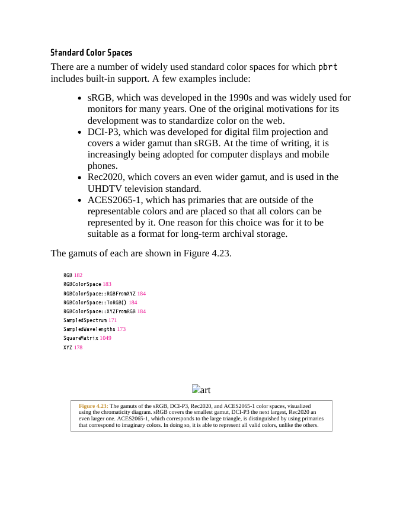

*Figure 4.23: The gamuts of the sRGB, DCI-P3, Rec2020, and ACES2065-1 color spaces, visualized using the chromaticity diagram. sRGB covers the smallest gamut, DCI-P3 the next largest, Rec2020 an even larger one. ACES2065-1, which corresponds to the large triangle, is distinguished by using primaries that correspond to imaginary colors. In doing so, it is able to represent all valid colors, unlike the others.*

The `RGBColorSpace` class provides pre-initialized instances of the `RGBColorSpace`s for each of these.

〈RGBColorSpace Public Members〉 +≡ static const RGBColorSpace *sRGB, *DCI_P3, *Rec2020, *ACES2065_1;

It is also possible to look color spaces up by name or by specifying the chromaticity of primaries and a whitepoint. 〈RGBColorSpace Public Methods〉 +≡ 183

static const RGBColorSpace *GetNamed(std::string name); static const RGBColorSpace *Lookup(Point2f r, Point2f g, Point2f b, Point2f w);

### 4.6.4 WHY SPECTRAL RENDERING?

Thus far, we have been proceeding with the description of pbrt’s implementation with the understanding that it uses point-sampled spectra to represent spectral quantities. While that may seem natural given pbrt’s physical basis and general adoption of Monte Carlo integration, it does not fit with the current widespread practice of using `RGB` color for spectral computations in rendering. We hinted at a significant problem with that practice at the start of this section; having introduced `RGB` color spaces, we can now go farther. As discussed earlier, because color spaces are vector spaces, addition of two colors in the same color space gives the same color as adding the underlying spectra and then finding the resulting spectrum’s color. That is not so for multiplication. To understand the problem, suppose that we are rendering a uniformly colored object (e.g., green) that is uniformly illuminated by light of the same color. For simplicity, assume that both illumination and the object’s reflectance value are represented by the `RGB` color (0, 1, 0). The scattered light is then given by a product of reflectance and incident illumination: art where componentwise multiplication of `RGB` colors is indicated by the “ʘ” operator.

In the sRGB color space, the green color (0, 1, 0) maps to the upper vertex of the gamut of representable colors (Figure 4.24), and this `RGB` color value furthermore remains unchanged by the multiplication. Now suppose that we change to the wide-gamut color space ACES2065-1. The sRGB color (0, 1, 0) can be found to be (0.38, 0.82, 0.12) in this color space—it thus maps to a location that lies in the interior of the set of representable colors. Performing the same component-wise multiplication gives the result: art This time, the resulting color has lower intensity than it started with and has also become more saturated due to an increase in the relative proportion of green light. That leads to the somewhat bizarre situation shown in Figure 4.24: component-wise multiplication in this new color space not only produces a different color—it also increases saturation so severely that the color is pushed outside of the CIE horseshoe shape of physically realizable colors! The ability to multiply spectral values is crucial for evaluating the interaction of materials and light sources in the context of rendering. At the same time, this example demonstrates the problem when `RGB` values are used for this purpose: the multiplication operation is in some sense arbitrary, because its behavior heavily depends on the chosen color space. Thus, rendering using a spectral model is preferable even in situations where `RGB` output is ultimately desired, as is the case with pbrt.

```text
   Point2f 92
   RGBColorSpace 183
```

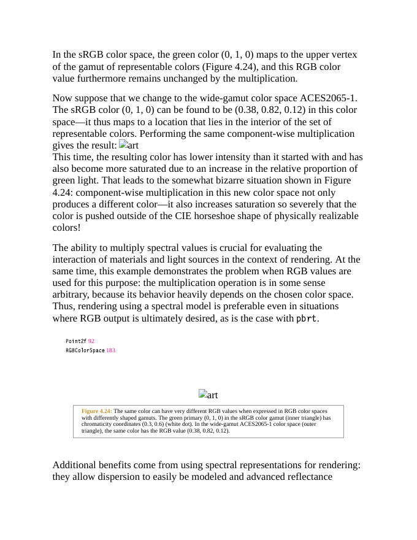

*Figure 4.24: The same color can have very different RGB values when expressed in RGB color spaces with differently shaped gamuts. The green primary (0, 1, 0) in the sRGB color gamut (inner triangle) has chromaticity coordinates (0.3, 0.6) (white dot). In the wide-gamut ACES2065-1 color space (outer triangle), the same color has the RGB value (0.38, 0.82, 0.12).*

Additional benefits come from using spectral representations for rendering: they allow dispersion to easily be modeled and advanced reflectance

models often have a natural dependence on wavelength to account for iridescence in thin layers or diffraction from surface microstructure.

### 4.6.5 CHOOSING THE NUMBER OF WAVELENGTH SAMPLES

Even though it uses a spectral model for light transport simulation, pbrt’s output is generally an image in a tristimulus color representation like `RGB`. Having described how those colors are computed—Monte Carlo estimates of the products of spectra and matching functions of the form of Equation (4.23)—we will briefly return to the question of how many spectral samples are used for the `SampledSpectrum` class. The associated Monte Carlo estimators are easy to evaluate, but error in them leads to color noise in images. Figure 4.25 shows an example of this phenomenon. Figure 4.25(a) shows a scene illuminated by a point light source where only direct illumination from the light is included. In this simple setting, the Monte Carlo estimator for the scattered light has zero variance at all wavelengths, so the only source of Monte Carlo error is the integrals of the color matching functions. With a single ray path per pixel and each one tracking a single wavelength, the image is quite noisy, as shown in Figure 4.25(b). Intuitively, the challenge in this case can be understood from the fact that the renderer is trying to estimate three values at each pixel—red, green, and blue—all from the spectral value at a single wavelength.

```text
    SampledSpectrum 171
```

Increasing the number of pixel samples can reduce this error (as long as they sample different wavelengths), though it is more effective to associate multiple wavelength samples with each ray. The path that a ray takes through the scene is usually independent of wavelength and the incremental cost to compute lighting at multiple wavelengths is generally small compared to the cost of finding ray intersections and computing other wavelength-independent quantities. (Considering multiple wavelengths for each ray can be seen as an application of the Monte Carlo splitting technique that is described in Section 2.2.5.) Figure 4.25(c) shows the improvement from associating four wavelengths with each ray; color noise is substantially reduced.

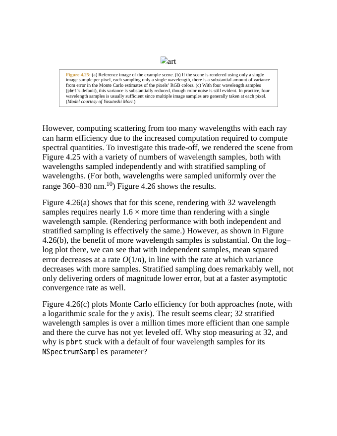

*Figure 4.25: (a) Reference image of the example scene. (b) If the scene is rendered using only a single image sample per pixel, each sampling only a single wavelength, there is a substantial amount of variance from error in the Monte Carlo estimates of the pixels’ RGB colors. (c) With four wavelength samples (pbrt’s default), this variance is substantially reduced, though color noise is still evident. In practice, four wavelength samples is usually sufficient since multiple image samples are generally taken at each pixel. (Model courtesy of Yasutoshi Mori.)*

However, computing scattering from too many wavelengths with each ray can harm efficiency due to the increased computation required to compute spectral quantities. To investigate this trade-off, we rendered the scene from Figure 4.25 with a variety of numbers of wavelength samples, both with wavelengths sampled independently and with stratified sampling of wavelengths. (For both, wavelengths were sampled uniformly over the range 360–830 nm.10) Figure 4.26 shows the results. Figure 4.26(a) shows that for this scene, rendering with 32 wavelength samples requires nearly 1.6 × more time than rendering with a single wavelength sample. (Rendering performance with both independent and stratified sampling is effectively the same.) However, as shown in Figure 4.26(b), the benefit of more wavelength samples is substantial. On the log– log plot there, we can see that with independent samples, mean squared error decreases at a rate O(1/n), in line with the rate at which variance decreases with more samples. Stratified sampling does remarkably well, not only delivering orders of magnitude lower error, but at a faster asymptotic convergence rate as well. Figure 4.26(c) plots Monte Carlo efficiency for both approaches (note, with a logarithmic scale for the y axis). The result seems clear; 32 stratified wavelength samples is over a million times more efficient than one sample and there the curve has not yet leveled off. Why stop measuring at 32, and why is pbrt stuck with a default of four wavelength samples for its `NSpectrumSamples` parameter?

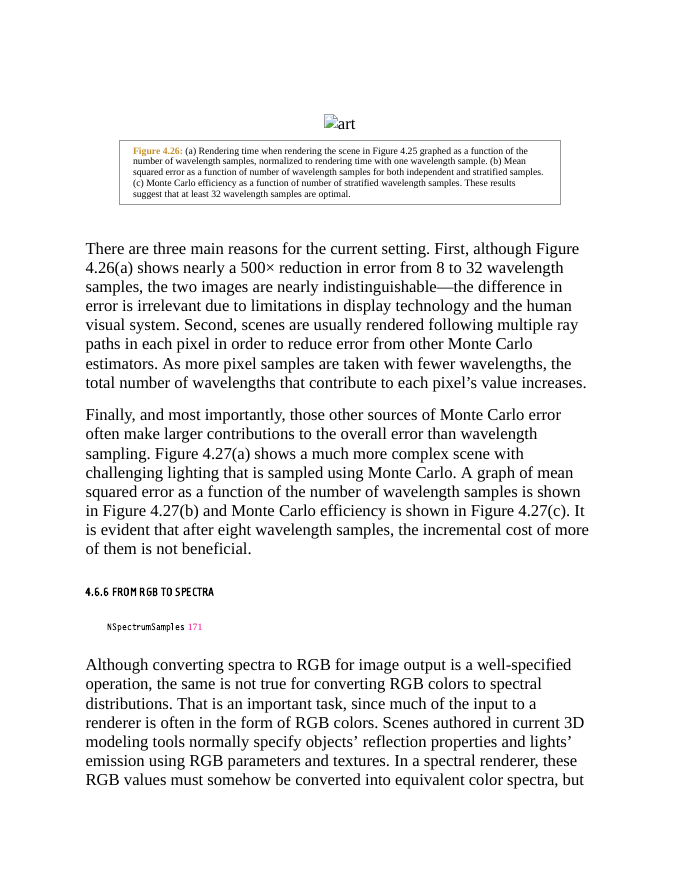

*Figure 4.26: (a) Rendering time when rendering the scene in Figure 4.25 graphed as a function of the number of wavelength samples, normalized to rendering time with one wavelength sample. (b) Mean squared error as a function of number of wavelength samples for both independent and stratified samples. (c) Monte Carlo efficiency as a function of number of stratified wavelength samples. These results suggest that at least 32 wavelength samples are optimal.*

There are three main reasons for the current setting. First, although Figure 4.26(a) shows nearly a 500× reduction in error from 8 to 32 wavelength samples, the two images are nearly indistinguishable—the difference in error is irrelevant due to limitations in display technology and the human visual system. Second, scenes are usually rendered following multiple ray paths in each pixel in order to reduce error from other Monte Carlo estimators. As more pixel samples are taken with fewer wavelengths, the total number of wavelengths that contribute to each pixel’s value increases. Finally, and most importantly, those other sources of Monte Carlo error often make larger contributions to the overall error than wavelength sampling. Figure 4.27(a) shows a much more complex scene with challenging lighting that is sampled using Monte Carlo. A graph of mean squared error as a function of the number of wavelength samples is shown in Figure 4.27(b) and Monte Carlo efficiency is shown in Figure 4.27(c). It is evident that after eight wavelength samples, the incremental cost of more of them is not beneficial.

### 4.6.6 FROM RGB TO SPECTRA

```text
    NSpectrumSamples 171
```

Although converting spectra to `RGB` for image output is a well-specified operation, the same is not true for converting `RGB` colors to spectral distributions. That is an important task, since much of the input to a renderer is often in the form of `RGB` colors. Scenes authored in current 3D modeling tools normally specify objects’ reflection properties and lights’ emission using `RGB` parameters and textures. In a spectral renderer, these `RGB` values must somehow be converted into equivalent color spectra, but

unfortunately any such conversion is inherently ambiguous due to the existence of metamers. How we can expect to find a reasonable solution if the problem is so poorly defined? On the flip side, this ambiguity can also be seen positively: it leaves a large space of possible answers containing techniques that are simple and efficient.

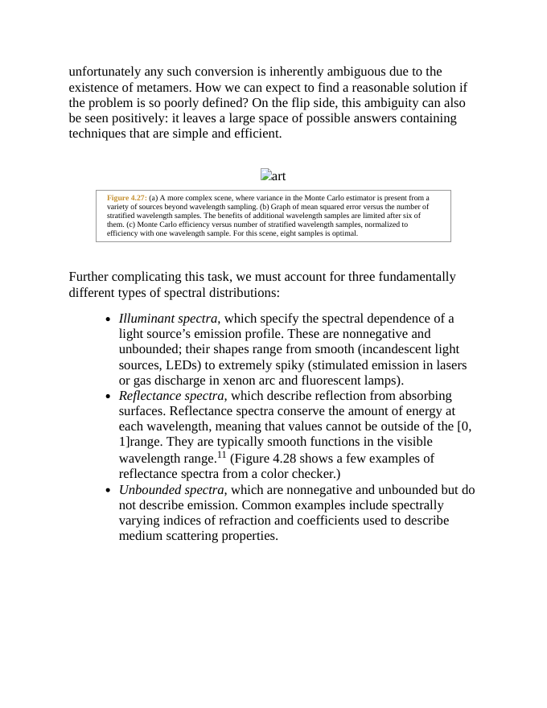

*Figure 4.27: (a) A more complex scene, where variance in the Monte Carlo estimator is present from a variety of sources beyond wavelength sampling. (b) Graph of mean squared error versus the number of stratified wavelength samples. The benefits of additional wavelength samples are limited after six of them. (c) Monte Carlo efficiency versus number of stratified wavelength samples, normalized to efficiency with one wavelength sample. For this scene, eight samples is optimal.*

Further complicating this task, we must account for three fundamentally different types of spectral distributions: Illuminant spectra, which specify the spectral dependence of a light source’s emission profile. These are nonnegative and unbounded; their shapes range from smooth (incandescent light sources, LEDs) to extremely spiky (stimulated emission in lasers or gas discharge in xenon arc and fluorescent lamps). Reflectance spectra, which describe reflection from absorbing surfaces. Reflectance spectra conserve the amount of energy at each wavelength, meaning that values cannot be outside of the [0, 1]range. They are typically smooth functions in the visible wavelength range.11 (Figure 4.28 shows a few examples of reflectance spectra from a color checker.) Unbounded spectra, which are nonnegative and unbounded but do not describe emission. Common examples include spectrally varying indices of refraction and coefficients used to describe medium scattering properties.

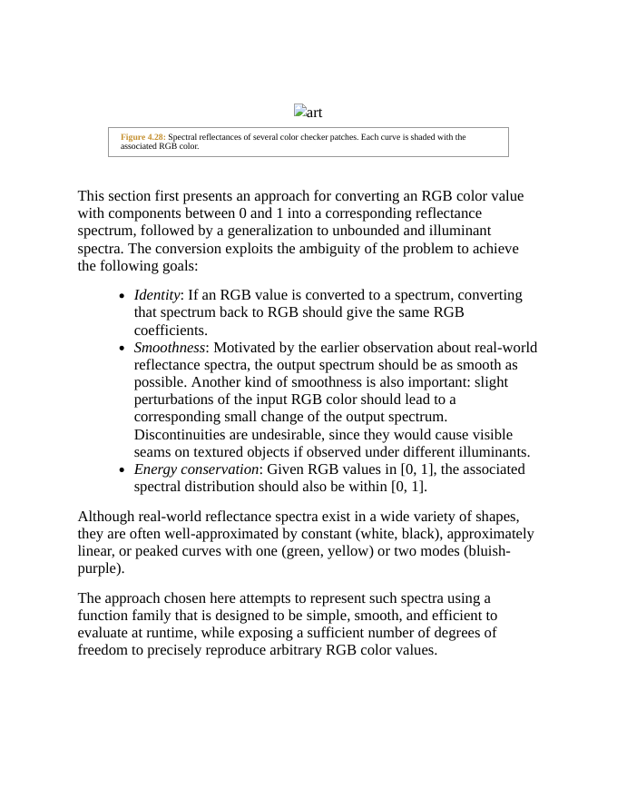

*Figure 4.28: Spectral reflectances of several color checker patches. Each curve is shaded with the associated RGB color.*

This section first presents an approach for converting an `RGB` color value with components between 0 and 1 into a corresponding reflectance spectrum, followed by a generalization to unbounded and illuminant spectra. The conversion exploits the ambiguity of the problem to achieve the following goals: Identity: If an `RGB` value is converted to a spectrum, converting that spectrum back to `RGB` should give the same `RGB` coefficients. Smoothness: Motivated by the earlier observation about real-world reflectance spectra, the output spectrum should be as smooth as possible. Another kind of smoothness is also important: slight perturbations of the input `RGB` color should lead to a corresponding small change of the output spectrum. Discontinuities are undesirable, since they would cause visible seams on textured objects if observed under different illuminants. Energy conservation: Given `RGB` values in [0, 1], the associated spectral distribution should also be within [0, 1]. Although real-world reflectance spectra exist in a wide variety of shapes, they are often well-approximated by constant (white, black), approximately linear, or peaked curves with one (green, yellow) or two modes (bluish-purple). The approach chosen here attempts to represent such spectra using a function family that is designed to be simple, smooth, and efficient to evaluate at runtime, while exposing a sufficient number of degrees of freedom to precisely reproduce arbitrary `RGB` color values.

Polynomials are typically a standard building block in such constructions; indeed, a quadratic polynomial could represent constant and linear curves, as well as ones that peak in the middle or toward the endpoints of the wavelength range. However, their lack of energy conservation poses a problem that we address using a sigmoid function: art This function, plotted in Figure 4.29, is strictly monotonic and smoothly approaches the endpoints 0 and 1 as x → ∓∞.

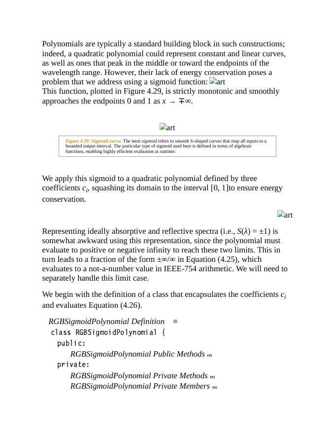

*Figure 4.29: Sigmoid curve. The term sigmoid refers to smooth S-shaped curves that map all inputs to a bounded output interval. The particular type of sigmoid used here is defined in terms of algebraic functions, enabling highly efficient evaluation at runtime.*

We apply this sigmoid to a quadratic polynomial defined by three coefficients ci, squashing its domain to the interval [0, 1]to ensure energy conservation. art Representing ideally absorptive and reflective spectra (i.e., S(λ) = ±1) is somewhat awkward using this representation, since the polynomial must evaluate to positive or negative infinity to reach these two limits. This in turn leads to a fraction of the form ±∞/∞ in Equation (4.25), which evaluates to a not-a-number value in IEEE-754 arithmetic. We will need to separately handle this limit case. We begin with the definition of a class that encapsulates the coefficients ci and evaluates Equation (4.26). 〈RGBSigmoidPolynomial Definition〉 ≡ class RGBSigmoidPolynomial { public: 〈RGBSigmoidPolynomial Public Methods 192〉 private: 〈RGBSigmoidPolynomial Private Methods 193〉 〈RGBSigmoidPolynomial Private Members 192〉 };

It has the expected constructor and member variables. 〈RGBSigmoidPolynomial Public Methods〉 ≡ 192

RGBSigmoidPolynomial(Float c0, Float c1, Float c2) : c0(c0), c1(c1), c2(c2) {} 〈RGBSigmoidPolynomial Private Members〉 ≡ 192

Float c0, c1, c2;

Given coefficient values, it is easy to evaluate the spectral function at a specified wavelength. 〈RGBSigmoidPolynomial Public Methods〉 +≡ 192

Float operator()(Float lambda) const { return s(EvaluatePolynomial(lambda, c2, c1, c0)); }

```text
   EvaluatePolynomial() 1035
   Float 23
   RGBSigmoidPolynomial 192
   RGBSigmoidPolynomial::c0 192
   RGBSigmoidPolynomial::c1 192
   RGBSigmoidPolynomial::c2 192
   RGBSigmoidPolynomial::s() 193
```

The sigmoid function follows the earlier definition and adds a special case to handle positive and negative infinity. 〈RGBSigmoidPolynomial Private Methods〉 ≡ 192

static Float s(Float x) { if (IsInf(x)) return x > 0 ? 1 : 0; return .5f + x / (2 * std::sqrt(1 + Sqr(x))); };

The `MaxValue()` method returns the maximum value of the spectral distribution over the visible wavelength range 360–830 nm. Because the sigmoid function is monotonically increasing, this problem reduces to locating the maximum of the quadratic polynomial from Equation (4.25) and evaluating the model there.

We conservatively check the endpoints of the interval along with the extremum found by setting the polynomial’s derivative to zero and solving for the wavelength lambda. The value will be ignored if it happens to be a local minimum. 〈RGBSigmoidPolynomial Public Methods〉 +≡ 192

Float MaxValue() const { Float result = std::max((*this)(360), (*this)(830)); Float lambda = -c1 / (2 * c0); if (lambda >= 360 && lambda <= 830) result = std::max(result, (*this)(lambda)); return result; }

We now turn to the second half of `RGBSigmoidPolynomial`, which is the computation that determines suitable coefficients c0, c1, c2 for a given `RGB` color. This step depends on the spectral emission curves of the color primaries and generally does not have an explicit solution. We instead formulate it as an optimization problem that minimizes the round-trip error (i.e., the identity goal mentioned above) by computing the difference between input and output `RGB` values following forward and reverse conversion. The precise optimization goal is art where R(λ), G(λ), B(λ) describe emission curves of the color primaries and W(λ) represents the whitepoint (e.g., D65 shown in Figure 4.14 in the case of the sRGB color space). Including the whitepoint in this optimization problem ensures that monochromatic `RGB` values map to uniform reflectance spectra. In spaces with a relatively compact gamut like sRGB, this optimization can achieve zero error regardless of the method used to quantify color distances. In larger color spaces, particularly those including imaginary colors like ACES2065-1, zero round-trip error is clearly not achievable, and the choice of norm ‖·‖ becomes relevant. In principle, we could simply use the 2-norm —however, a problem with such a basic choice is that it is not perceptually uniform: whether a given amount of error is actually visible depends on its position within the `RGB` cube. We instead use CIE76 ΔE, which first transforms both colors into a color space known as CIELAB before evaluating the L2-distance.

```text
   Float 23
   IsInf() 363
   RGBSigmoidPolynomial::c0 192
   RGBSigmoidPolynomial::c1 192
   Sqr() 1034
```

We then solve this optimization problem using the Gauss–Newton algorithm, an approximate form of Newton’s method. This optimization takes on the order of a few microseconds, which would lead to inefficiencies if performed every time an `RGB` value must be converted to a spectrum (e.g., once for every pixel of a high-resolution texture).

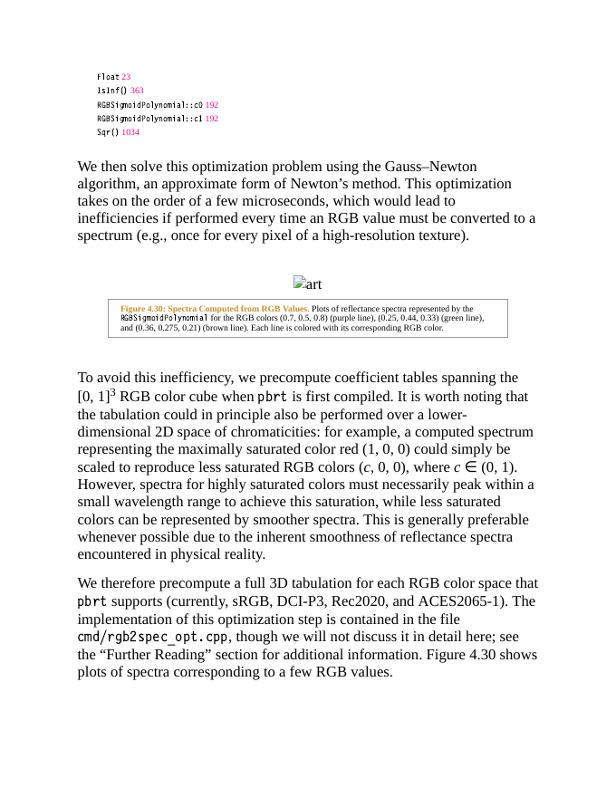

*Figure 4.30: Spectra Computed from RGB Values. Plots of reflectance spectra represented by the RGBSigmoidPolynomial for the RGB colors (0.7, 0.5, 0.8) (purple line), (0.25, 0.44, 0.33) (green line), and (0.36, 0.275, 0.21) (brown line). Each line is colored with its corresponding RGB color.*

To avoid this inefficiency, we precompute coefficient tables spanning the [0, 1]3 `RGB` color cube when pbrt is first compiled. It is worth noting that the tabulation could in principle also be performed over a lower-dimensional 2D space of chromaticities: for example, a computed spectrum representing the maximally saturated color red (1, 0, 0) could simply be scaled to reproduce less saturated `RGB` colors (c, 0, 0), where c ∈ (0, 1). However, spectra for highly saturated colors must necessarily peak within a small wavelength range to achieve this saturation, while less saturated colors can be represented by smoother spectra. This is generally preferable whenever possible due to the inherent smoothness of reflectance spectra encountered in physical reality. We therefore precompute a full 3D tabulation for each `RGB` color space that pbrt supports (currently, sRGB, DCI-P3, Rec2020, and ACES2065-1). The implementation of this optimization step is contained in the file cmd/rgb2spec_opt.cpp, though we will not discuss it in detail here; see the “Further Reading” section for additional information. Figure 4.30 shows plots of spectra corresponding to a few `RGB` values.

The resulting tables are stored in the pbrt binary. At system startup time, an `RGBToSpectrumTable` for each of the `RGB` color spaces is created.

〈RGBToSpectrumTable Definition〉 ≡ class RGBToSpectrumTable { public: 〈RGBToSpectrumTable Public Constants 195〉 〈RGBToSpectrumTable Public Methods〉 private: 〈RGBToSpectrumTable Private Members 196〉 };

```text
   RGBSigmoidPolynomial 192
```

The principal method of `RGBToSpectrumTable` returns the `RGBSigmoidPolynomial` corresponding to the given `RGB` color.

〈RGBToSpectrumTable Method Definitions〉 ≡ RGBSigmoidPolynomial RGBToSpectrumTable::operator()(RGB rgb) const { 〈Handle uniform rgb values 195〉 〈Find maximum component and compute remapped component values 195〉 〈Compute integer indices and offsets for coefficient interpolation 196〉

〈Trilinearly interpolate sigmoid polynomial coefficients c 197〉 return RGBSigmoidPolynomial(c[0], c[1], c[2]); }

If the three `RGB` values are equal, it is useful to ensure that the returned spectrum is exactly constant. (In some cases, a slight color shift may otherwise be evident if interpolated values from the coefficient tables are used.) A constant spectrum results if c0 = c1 = 0 in Equation (4.26) and the appropriate value of c2 can be found by inverting the sigmoid function.

〈Handle uniform rgb values〉 ≡ 195

```rust
    if rgb[0] == rgb[1] && rgb[1] == rgb[2] {
        return RGBSigmoidPolynomial::new(
            0.0,
            0.0,
            (rgb[0] - 0.5) / (rgb[0] * (1.0 - rgb[0])).sqrt(),
        );
    }
```

The coefficients ci from the optimization are generally smoothly varying; small changes in RGB generally lead to small changes in their values. (This property also ends up being helpful for the smoothness goal.) However, there are a few regions of the RGB space where they change rapidly, which makes direct 3D tabularization of them prone to error in those regions—see Figure 4.31(a), (b), and (c). A better approach is to tabularize them independently based on which of the red, green, or blue RGB coefficients has the largest magnitude. This partitioning matches the coefficient discontinuities well, as is shown in Figure 4.31(d). A 3D tabularization problem remains within each of the three partitions. We will use the partition where the red component r has the greatest magnitude to explain how the table is indexed. For a given (r, g, b), the first step is to compute a renormalized coordinate art (By convention, the largest component is always mapped to z.) A similar remapping is applied if g or b is the maximum. With this mapping, all three coordinates span the range [0, 1], which makes it possible to make better use of samples in a fixed grid. 〈Find maximum component and compute remapped component values〉 ≡ 195

int maxc = (rgb[0] > rgb[1]) ? ((rgb[0] > rgb[2]) ? 0 : 2) : ((rgb[1] > rgb[2]) ? 1 : 2); float z = rgb[maxc]; float x = rgb[(maxc + 1) % 3] * (res - 1) / z; float y = rgb[(maxc + 2) % 3] * (res - 1) / z;

The resolution of the tabularization, res, is the same in all three dimensions. Because it is set to be a compile time constant here, changing the size of the tables would require recompiling pbrt. 〈RGBToSpectrumTable Public Constants〉 ≡ 194

static constexpr int res = 64;

An equally spaced discretization is used for the x and y coordinates in the coefficient tables, though z is remapped through a nonlinear function that

allocates more samples near both 0 and 1. The ci coefficients vary most rapidly in that region, so this remapping allocates samples more effectively.

```text
   RGB 182
   RGBSigmoidPolynomial 192
   RGBToSpectrumTable::res 195
```

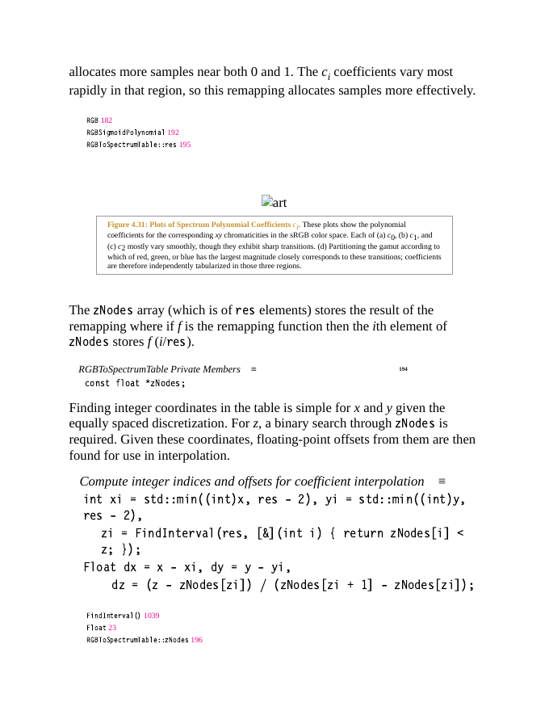

*Figure 4.31: Plots of Spectrum Polynomial Coefficients ci. These plots show the polynomial coefficients for the corresponding xy chromaticities in the sRGB color space. Each of (a) c0, (b) c1, and (c) c2 mostly vary smoothly, though they exhibit sharp transitions. (d) Partitioning the gamut according to which of red, green, or blue has the largest magnitude closely corresponds to these transitions; coefficients are therefore independently tabularized in those three regions.*

The zNodes array (which is of res elements) stores the result of the remapping where if f is the remapping function then the ith element of zNodes stores f (i/res).

〈RGBToSpectrumTable Private Members〉 ≡ 194

const float *zNodes;

Finding integer coordinates in the table is simple for x and y given the equally spaced discretization. For z, a binary search through zNodes is required. Given these coordinates, floating-point offsets from them are then found for use in interpolation. 〈Compute integer indices and offsets for coefficient interpolation〉 ≡ int xi = std::min((int)x, res - 2), yi = std::min((int)y, res - 2), zi = FindInterval(res, [&](int i) { return zNodes[i] < z; }); Float dx = x - xi, dy = y - yi, dz = (z - zNodes[zi]) / (zNodes[zi + 1] - zNodes[zi]);

```text
   FindInterval() 1039
   Float 23
   RGBToSpectrumTable::zNodes 196
```

We can now implement the fragment that trilinearly interpolates between the eight coefficients around the (x, y, z) lookup point. The details of indexing into the coefficient tables are handled by the co lambda function, which we will define shortly, after describing the layout of the tables in memory. Note that although the z coordinate has a nonlinear mapping applied to it, we still linearly interpolate between coefficient samples in z. In practice, the error from doing so is minimal. 〈Trilinearly interpolate sigmoid polynomial coefficients c〉 ≡ 195

pstd::array<Float, 3> c; for (int i = 0; i < 3; ++i) { 〈Define co lambda for looking up sigmoid polynomial coefficients 197〉

c[i] = Lerp(dz, Lerp(dy, Lerp(dx, co(0, 0, 0), co(1, 0, 0)), Lerp(dx, co(0, 1, 0), co(1, 1, 0))), Lerp(dy, Lerp(dx, co(0, 0, 1), co(1, 0, 1)), Lerp(dx, co(0, 1, 1), co(1, 1, 1)))); }

The coefficients are stored in a five-dimensional array. The first dimension corresponds to whether r, g, or b had the largest magnitude and the next three correspond to z, y, and x, respectively. The last dimension is over the three coefficients ci.

〈RGBToSpectrumTable Public Constants〉 +≡ 194

using CoefficientArray = float[3][res][res][res][3]; 〈RGBToSpectrumTable Private Members〉 +≡ 194

const CoefficientArray *coeffs;

The coefficient lookup lambda function is now just a matter of using the correct values for each dimension of the array. The provided integer deltas are applied in x, y, and z when doing so. 〈Define co lambda for looking up sigmoid polynomial coefficients〉 ≡ 197

auto co = [&](int dx, int dy, int dz) { return (*coeffs)[maxc][zi + dz][yi + dy][xi + dx][i]; };

With `RGBSigmoidPolynomial`’s implementation complete, we can now add a method to `RGBColorSpace` to transform an `RGB` in its color space to an `RGBSigmoidPolynomial`.

〈RGBColorSpace Method Definitions〉 +≡ RGBSigmoidPolynomial RGBColorSpace::ToRGBCoeffs(RGB rgb) const { return (*rgbToSpectrumTable)(ClampZero(rgb)); }

With these capabilities, we can now define the RGBAlbedoSpectrum class, which implements the Spectrum interface to return spectral samples according to the sigmoid-polynomial model. 〈Spectrum Definitions〉 +≡ class RGBAlbedoSpectrum { public: 〈RGBAlbedoSpectrum Public Methods 198〉 private: 〈RGBAlbedoSpectrum Private Members 198〉 };

```text
   Float 23
   Lerp() 72
   RGB 182
   RGBColorSpace 183
   RGBSigmoidPolynomial 192
   RGBToSpectrumTable::coeffs 197
   RGBToSpectrumTable::res 195
   Spectrum 165
```

Runtime assertions in the constructor, not shown here, verify that the provided RGB value is between 0 and 1. 〈Spectrum Method Definitions〉 +≡ RGBAlbedoSpectrum::RGBAlbedoSpectrum(const RGBColorSpace &cs, RGB rgb) { rsp = cs.ToRGBCoeffs(rgb); }

The only member variable necessary is one to store the polynomial coefficients. 〈RGBAlbedoSpectrum Private Members〉 ≡ 197

RGBSigmoidPolynomial rsp;

Implementation of the required Spectrum methods is a matter of forwarding the requests on to the appropriate RGBSigmoidPolynomial methods. As with most Spectrum implementations, we will not include the Sample() method here since it just loops over the wavelengths and evaluates Equation (4.26) at each one. 〈RGBAlbedoSpectrum Public Methods〉 ≡ 197

Float operator()(Float lambda) const { return rsp(lambda); } Float MaxValue() const { return rsp.MaxValue(); }

Unbounded `RGB` For unbounded (positive-valued) `RGB` values, the `RGBSigmoidPolynomial` foundation can still be used—just with the addition of a scale factor that remaps its range to the necessary range for the given `RGB`. That approach is implemented in the `RGBUnboundedSpectrum` class.

〈Spectrum Definitions〉 +≡ class RGBUnboundedSpectrum { public: 〈RGBUnboundedSpectrum Public Methods 199〉 private: 〈RGBUnboundedSpectrum Private Members 198〉 };

A natural choice for a scale factor would be one over the maximum of the red, green, and blue color components. We would then use that to normalize the `RGB` value before finding polynomial coefficients and then rescale values returned by `RGBSigmoidPolynomial` accordingly. However, it is possible to get better results by instead normalizing `RGB` to have a maximum value of 1/2 rather than 1. The reason is illustrated in Figure

4.32: because reflectance spectra must not exceed one, when highly saturated colors are provided, the resulting spectra may have unusual features, including large magnitudes in the unsaturated region of the spectrum. Rescaling to 1/2 gives the fit more room to work with, since the normalization constraint does not immediately affect it. 〈Spectrum Method Definitions〉 +≡ RGBUnboundedSpectrum::RGBUnboundedSpectrum(const RGBColorSpace &cs, RGB rgb) { Float m = std::max({rgb.r, rgb.g, rgb.b}); scale = 2 * m; rsp = cs.ToRGBCoeffs(scale ? rgb / scale : RGB(0, 0, 0)); }

〈RGBUnboundedSpectrum Private Members〉 ≡ 198

Float scale = 1; RGBSigmoidPolynomial rsp;

```text
   Float 23
   RGB 182
   RGBAlbedoSpectrum 197
   RGBAlbedoSpectrum::rsp 198
   RGBColorSpace 183
   RGBColorSpace::ToRGBCoeffs() 197
   RGBSigmoidPolynomial 192
   RGBSigmoidPolynomial:: MaxValue() 193
   RGBSigmoidPolynomial:: operator() 192
   RGBUnboundedSpectrum 198
   RGBUnboundedSpectrum::rsp 198
   RGBUnboundedSpectrum::scale 198
   Spectrum 165
```

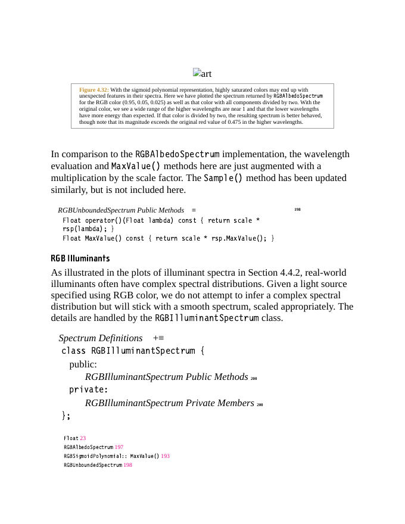

*Figure 4.32: With the sigmoid polynomial representation, highly saturated colors may end up with unexpected features in their spectra. Here we have plotted the spectrum returned by RGBAlbedoSpectrum for the RGB color (0.95, 0.05, 0.025) as well as that color with all components divided by two. With the original color, we see a wide range of the higher wavelengths are near 1 and that the lower wavelengths have more energy than expected. If that color is divided by two, the resulting spectrum is better behaved, though note that its magnitude exceeds the original red value of 0.475 in the higher wavelengths.*

In comparison to the RGBAlbedoSpectrum implementation, the wavelength evaluation and MaxValue() methods here are just augmented with a multiplication by the scale factor. The Sample() method has been updated similarly, but is not included here. 〈RGBUnboundedSpectrum Public Methods〉 ≡ 198

Float operator()(Float lambda) const { return scale * rsp(lambda); } Float MaxValue() const { return scale * rsp.MaxValue(); }

RGB Illuminants As illustrated in the plots of illuminant spectra in Section 4.4.2, real-world illuminants often have complex spectral distributions. Given a light source specified using RGB color, we do not attempt to infer a complex spectral distribution but will stick with a smooth spectrum, scaled appropriately. The details are handled by the RGBIlluminantSpectrum class. 〈Spectrum Definitions〉 +≡ class RGBIlluminantSpectrum { public: 〈RGBIlluminantSpectrum Public Methods 200〉 private: 〈RGBIlluminantSpectrum Private Members 200〉 };

```text
   Float 23
   RGBAlbedoSpectrum 197
   RGBSigmoidPolynomial:: MaxValue() 193
   RGBUnboundedSpectrum 198
```

```text
   RGBUnboundedSpectrum::rsp 198
   RGBUnboundedSpectrum::scale 198
```

Beyond a scale factor that is equivalent to the one used in RGBUnboundedSpectrum to allow an arbitrary maximum RGB value, the RGBIlluminantSpectrum also multiplies the value returned at the given wavelength by the value of the color space’s standard illuminant at that wavelength. A non-intuitive aspect of spectral modeling of illuminants is that uniform spectra generally do not map to neutral white colors following conversion to RGB. Color spaces always assume that the viewer is adapted to some type of environmental illumination that influences color perception and the notion of a neutral color. For example, the commonly used D65 whitepoint averages typical daylight illumination conditions. To reproduce illuminants with a desired color, we therefore use a crude but effective solution, which is to multiply the whitepoint with a suitable reflectance spectra. Conceptually, this resembles viewing a white reference light source through a colored film. It also ensures that white objects lit by white lights lead to white pixel values in the rendered image. 〈Spectrum Method Definitions〉 +≡ RGBIlluminantSpectrum::RGBIlluminantSpectrum(const RGBColorSpace &cs, RGB rgb) : illuminant(&cs.illuminant) { Float m = std::max({rgb.r, rgb.g, rgb.b}); scale = 2 * m; rsp = cs.ToRGBCoeffs(scale ? rgb / scale : RGB(0, 0, 0)); }

Thus, a pointer to the illuminant is held in a member variable. 〈RGBIlluminantSpectrum Private Members〉 ≡ Float scale; RGBSigmoidPolynomial rsp; const DenselySampledSpectrum *illuminant;

Implementations of the various Spectrum interface methods follow; here is the one that evaluates the spectral distribution at a single wavelength. One detail is that it must handle the case of a nullptr illuminant, as will happen if an RGBIlluminantSpectrum is default-initialized. In that case, a zero-valued spectrum should be the result. 〈RGBIlluminantSpectrum Public Methods〉 ≡ Float operator()(Float lambda) const { if (!illuminant) return 0; return scale * rsp(lambda) * (*illuminant)(lambda); }

We will not include the implementations of the `Sample()` or `MaxValue()` methods here, as their implementations are as would be expected. FURTHER READING

McCluney’s book on radiometry is an excellent introduction to the topic (McCluney 1994). Preisendorfer (1965) also covered radiometry in an accessible manner and delved into the relationship between radiometry and the physics of light. Nicodemus et al. (1977) carefully defined the BRDF, BSSRDF, and various quantities that can be derived from them. Books by Moon and Spencer (1936, 1948) and Gershun (1939) are classic early introductions to radiometry. Lambert’s seminal early writings about photometry from the mid-18th century have been translated into English by DiLaura (Lambert 1760). Preisendorfer (1965) has connected radiative transfer theory to Maxwell’s classical equations describing electromagnetic fields, and further work was done in this area by Fante (1981). Going well beyond earlier work that represented radiance with Wigner distribution functions to model wave effects (Oh et al. 2010, Cuypers et al. 2012), Steinberg and Yan (2021) have recently introduced a comprehensive model of light transport based on a wave model, including a generalization of the light transport equation. Correctly implementing radiometric computations can be tricky: one missed cosine factor and one is computing a completely different quantity than

expected. Debugging these sorts of issues can be quite time-consuming. Ou and Pellacini (2010) showed how to use C++’s type system to associate units with each term of these sorts of computations so that, for example, trying to add a radiance value to another value that represents irradiance would trigger a compile time error.

```text
   DenselySampledSpectrum 167
   Float 23
   RGB 182
   RGBColorSpace 183
   RGBColorSpace::illuminant 183
   RGBColorSpace::ToRGBCoeffs() 197
   RGBIlluminantSpectrum 199
   RGBIlluminantSpectrum:: illuminant 200
   RGBIlluminantSpectrum::rsp 200
   RGBIlluminantSpectrum::scale 200
   RGBSigmoidPolynomial 192
   Spectrum 165
```

The books by McCluney (1994) and Malacara (2002) discuss blackbody emitters and the standard illuminants in detail. The Standard Illuminants are defined in a CIE Technical Report (2004); Judd et al. (1964) developed the approach that was used to define the D Standard Illuminant. Wilkie and Weidlich (2011) noted that common practice in rendering has been to use the blackbody distribution of Equation (4.17) to model light emission for rendering, while Kirchhoff’s law, Equation (4.18), would be more accurate. They also pointed out that as objects become hot, their BRDFs often change, which makes Kirchhoff’s law more difficult to adopt, especially in that models that account for the effect of temperature variation on BRDFs generally are not available.

Spectral Representations Meyer was one of the first researchers to closely investigate spectral representations in graphics (Meyer and Greenberg 1980; Meyer et al. 1986). Hall (1989) summarized the state of the art in spectral representations through 1989, and Glassner’s Principles of Digital Image Synthesis (1995) covers the topic through the mid-1990s. Survey articles by Hall (1999), Johnson and Fairchild (1999), and Devlin et al. (2002) are good resources on early work on this topic.

Borges (1991) analyzed the error introduced from the tristimulus representation when used for spectral computation. A variety of approaches based on representing spectra using basis functions have been developed, including Peercy (1993), who developed a technique based on choosing basis functions in a scene-dependent manner by considering the spectral distributions of the lights and reflecting objects in the scene. Rougeron and Péroche (1997) projected all spectra in the scene onto a hierarchical basis (the Haar wavelets), and showed that this adaptive representation can be used to stay within a desired error bound. Ward and Eydelberg-Vileshin (2002) developed a method for improving the spectral fidelity of regular `RGB`-only rendering systems by carefully adjusting the color values provided to the system before rendering. Another approach to spectral representation was investigated by Sun et al. (2001), who partitioned spectral distributions into a smooth base distribution and a set of spikes. Each part was represented differently, using basis functions that worked well for each of these parts of the distribution. Drew and Finlayson (2003) applied a “sharp” basis, which is adaptive but has the property that computing the product of two functions in the basis does not require a full matrix multiplication as many other basis representations do. Both Walter et al. (1997) and Morley et al. (2006) described light transport algorithms based on associating a single wavelength with each light path. Evans and McCool (1999) generalized these techniques with stratified wavelength clusters, which are effectively the approach implemented in `SampledSpectrum` and `SampledWavelengths`.

Radziszewski et al. (2009) noted that it is not necessary to terminate all secondary spectral wavelengths when effects like dispersion happen at non-specular interfaces; they showed that it is possible to compute all wavelengths’ contributions for a single path, weighting the results using multiple importance sampling. Wilkie et al. (2014) used equally spaced point samples in the wavelength domain and showed how this approach can also be used for photon mapping and rendering of participating media.

```text
   SampledSpectrum 171
   SampledWavelengths 173
```

Color For background information on properties of the human visual system, Wandell’s book on vision is an excellent starting point (Wandell 1995). Ferwerda (2001) presented an overview of the human visual system for applications in graphics, and Malacara (2002) gave a concise overview of color theory and basic properties of how the human visual system processes color. Ciechanowski (2019) presented an excellent interactive introduction to color spaces; his treatment has influenced our presentation of the `XYZ` color space and chromaticity. A number of different approaches have been developed for mapping out-of-gamut colors to ones that can be displayed on a device with particular display primaries. This problem can manifest itself in a few ways: a color’s chromaticity may be outside of the displayed range, its chromaticity may be valid but it may be too bright for display, or both may be out of range. For the issue of how to handle colors with undisplayable chromaticities, see Rougeron and Péroche’s survey article, which includes references to many approaches (Rougeron and Péroche 1998). This topic was also covered by Hall (1989). Morovi’s book (2008) covers this topic, and a more recent survey has been written by Faridul et al. (2016). While high dynamic range displays that can display a wide range of intensities are now starting to become available, most of them are still not able to reproduce the full range of brightness in rendered images. This problem can be addressed with tone reproduction algorithms that use models of human visual response to make the most of displays’ available dynamic ranges. This topic became an active area of research starting with the work of Tumblin and Rushmeier (1993). The survey article of Devlin et al. (2002) summarizes most of the work in this area through 2002, giving pointers to the original papers. See Reinhard et al.’s book (2010) on high dynamic range imaging, which includes comprehensive coverage of this topic through 2010. More recently, Reinhard et al. (2012) have developed tone reproduction algorithms that consider both accurate brightness and color reproduction together, also accounting for the display and viewing environment, and Eilertsen et al. (2017) surveyed algorithms for tone mapping of video.

From `RGB` to Spectra Glassner (1989b) did early work on converting `RGB` values to spectral distributions. Smits (1999) optimized discrete reflectance spectra to reproduce primaries (red, green, blue) and combinations of primaries (yellow, cyan, magenta, white) based on the observation that linear interpolation in such an extended space tends to produce smoother reflectance spectra. Mallett and Yuksel (2019) presented a surprising result showing that linear interpolation of three carefully chosen spectra can fully cover the sRGB gamut, albeit at some cost in terms of smoothness. Meng et al. (2015) optimized a highly smooth spectral interpolant based on a dense sampling of the xy space of chromaticities, enabling usage independent of any specific `RGB` gamut. The method described in Section 4.6.6 was developed by Jakob and Hanika (2019). Several properties motivated its choice in pbrt: the spectral representation is based on a smooth function family with 3 parameters (i.e., the same dimension as an `RGB`). Conversion can then occur in two steps: a preprocessing step (e.g., per texel) replaces `RGB` values with polynomial coefficients, while the performance-critical evaluation at render time only requires a few floating-point instructions. Jung et al. (2019) extended this approach, using fluorescence to permit conversion of highly saturated `RGB` values that cannot be recreated using reflection alone. Peters et al. (2019) proposed a powerful parameterization of smooth reflectance spectra in terms of Fourier coefficients. Instead of using them in a truncated Fourier series, which would suffer from ringing, they built on the theory of moments to reconstruct smooth and energy-conserving spectra. The previous methods all incorporated smoothness as a central design constraint. While natural spectra indeed often tend to be smooth, maximally smooth spectra are not necessarily the most natural, especially when more information about the underlying type of material is available. Otsu et al. (2018) processed a large database of measured spectra, using principal component analysis to create a data-driven interpolant. Tódová et al. (2021) built on the moment-based method by Peters et al. (2019) to precompute an efficient spectral interpolant that is designed to reproduce user-specified spectra for certain `RGB` inputs.

## EXERCISES

➊ 4.1 How many photons would a 50-W lightbulb that emits light at the single wavelength λ = 600 nm emit in 1 second? ➊ 4.2 Compute the irradiance at a point due to a unit-radius disk h units directly above its normal with constant outgoing radiance of 10 W/m2 sr. Do the computation twice, once as an integral over solid angle and once as an integral over area. (Hint: If the results do not match at first, see Section A.5.1.) ➊ 4.3 Similarly, compute the irradiance at a point due to a square quadrilateral with outgoing radiance of 10 W/m2 sr that has sides of length 1 and is 1 unit directly above the point in the direction of its surface normal. ➋ 4.4 Modify the `SampledSpectrum` class to also store the wavelengths associated with the samples and their PDFs. Using pbrt’s assertion macros, add checks to ensure that no computations are performed using `SampledSpectrum` values associated with different wavelengths. Measure the performance of pbrt with and without your changes. How much runtime overhead is there? Did you find any bugs in pbrt?

_________________ 1 The full range of perceptible wavelengths slightly extends beyond this interval, though the eye’s sensitivity at these wavelengths is lower by many orders of magnitude. The range 360–830 nm is often used as a conservative bound when tabulating spectral curves. 2 The spectral response curve model is based on experiments done in a normally illuminated indoor environment. Because sensitivity to color decreases in dark environments, it does not model the human visual system’s response well under all lighting situations. Nonetheless, it forms the basis for the definition of luminance and other related photometric properties. 3 The various photometric quantities have fairly unusual names; the somewhat confusing state of affairs was nicely summarized by Jim Kajiya: “Thus one nit is one lux per steradian is one candela per square meter is one lumen per square meter per steradian. Got it?” 4 The fact that these two quantities are equal is due to the reciprocity of reflection functions. 5 C++ arcana: the explicit qualifier ensures that a `SampledSpectrum` is not unintentionally passed as a bool argument to a function without an explicit cast. However, if a `SampledSpectrum` is used as the condition in an “if” test, it is still automatically converted to a Boolean value without a cast. 6 This mistake is one of the bugs that the authors encountered during the initial development of this functionality in pbrt. 7 A variety of conventions are used to define these integrals, sometimes with other or no normalization factors. For use in pbrt, the normalization by one over the integral of the Y matching curve is convenient, as it causes a spectral distribution with a constant value of 1 to have yλ = 1. 8 This model is admittedly a simplification in that it neglects any additional processing the display does; in particular, many displays perform nonlinear remappings of the displayed values; this topic will be discussed in Section B.5.6. 9 Some displays use more than three primaries to increase the size of the gamut, though we will assume conventional `RGB` here. 10 In Section 5.4.2, we will see that nonuniform sampling of wavelengths is beneficial but will stick to uniform sampling here for simplicity. 11 Note that this observation does not always hold: in the ultraviolet and infrared wavelength range, absorption bands cause sharp spikes in reflectance spectra. Furthermore, wave-optical effects such as iridescence produce oscillatory spectral variation. These behaviors could likely be handled using specialized conversion techniques, which are beyond the scope of the simple approach discussed here.
