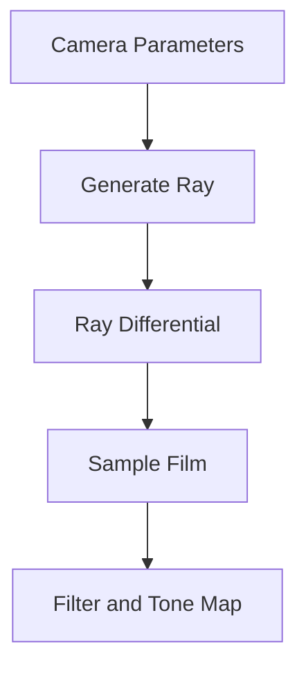
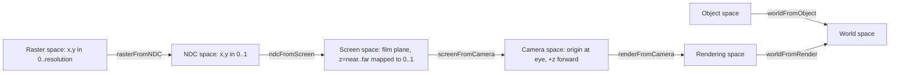
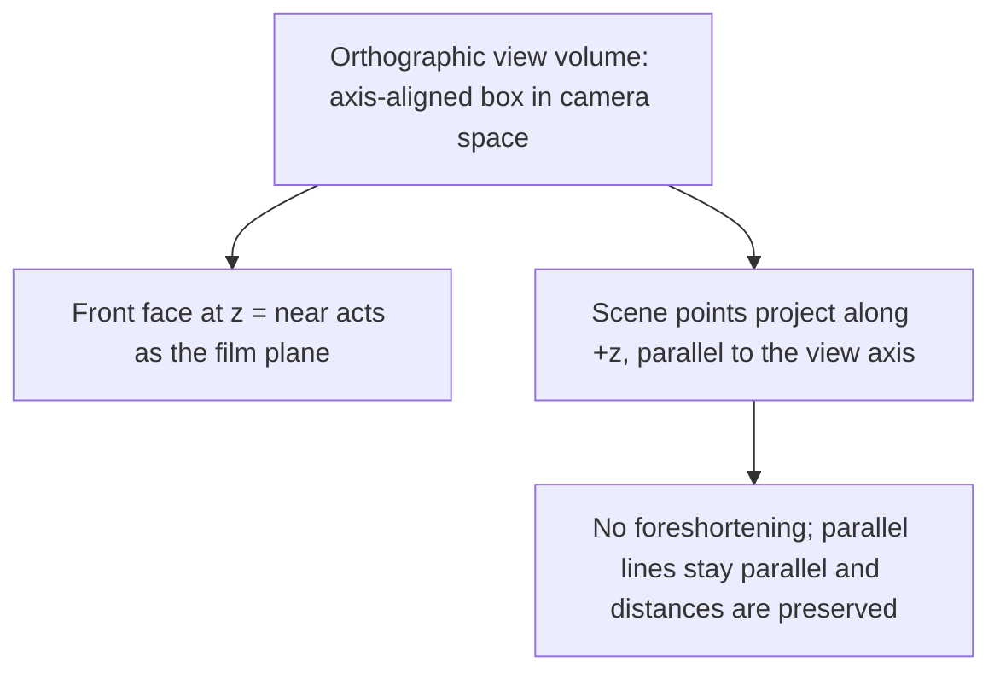
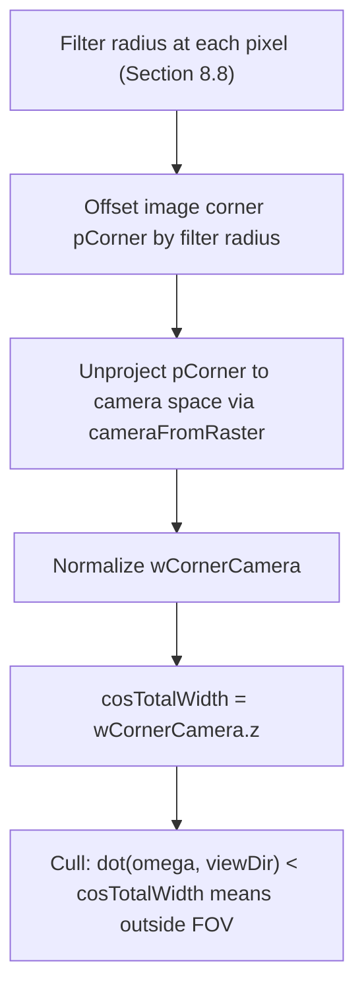
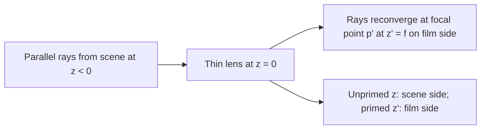
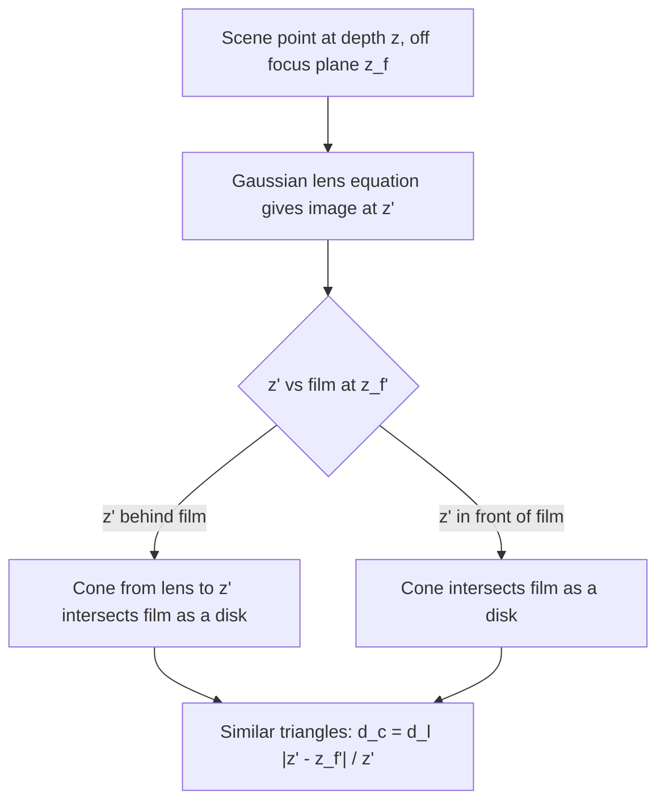
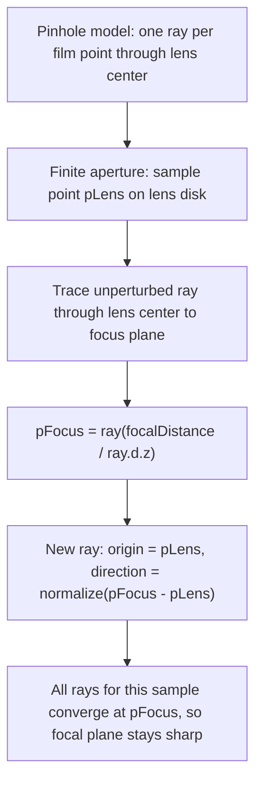
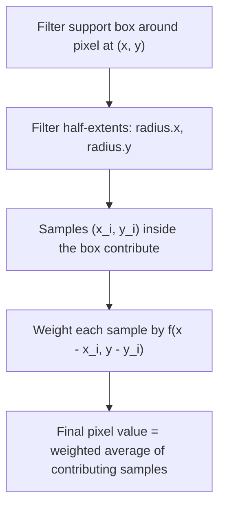

# Chapter 5: Cameras and Film

<!-- interactive-nav -->
## Contents

- [Camera and Film (wgpu)](#camera-and-film-wgpu)
- [5.1 CAMERA INTERFACE](#51-camera-interface)
- [5.2 PROJECTIVE CAMERA MODELS](#52-projective-camera-models)
- [5.3 SPHERICAL CAMERA](#53-spherical-camera)
- [5.4 FILM AND IMAGING](#54-film-and-imaging)
- [FURTHER READING](#further-reading)
- [EXERCISES](#exercises)

---

## Camera and Film (wgpu)



In Chapter 1, we described the pinhole camera model that is commonly used in computer graphics. This model is easy to describe and simulate, but it neglects important effects that physical lenses have on light passing through them. For example, everything rendered with a pinhole camera is in sharp focus—a state of affairs not possible with real lens systems. Such images often look computer generated for their perfection. More generally, the distribution of radiance leaving a lens system is quite different from the distribution entering it; modeling this effect of lenses is important for accurately simulating the radiometry of image formation.

Camera lens systems introduce various aberrations that affect the images that they form; for example, vignetting causes a darkening toward the edges of images due to less light making it through to the edges of the film or sensor than to the center. Lenses can also cause pincushion or barrel distortion, which causes straight lines to be imaged as curves. Although lens designers work to minimize aberrations in their designs, they can still have a meaningful effect on images.

This chapter starts with a description of the `Camera` interface, after which we present a few implementations, starting with ideal pinhole models. We then generalize those models to account for the effect of finite aperture using a simple approximation of a single lens. (The online edition of this book includes a more sophisticated camera implementation that simulates light passing through a collection of glass lens elements to form an image, similar to real-world cameras.) After light has been captured by a camera, it is measured by a sensor. While traditional film uses a chemical process to measure light, most modern cameras use solid-state sensors that are divided into pixels, each of which counts the number of photons that arrive over a period of time for some range of wavelengths. Accurately modeling the radiometry of how sensors measure light is an important part of simulating the process of image formation.

To that end, all of pbrt’s camera models use an instance of the `Film` class, which defines the basic interface for the classes that represent images captured by cameras. We describe two film implementations in this chapter, both of which use the `PixelSensor` class to model the spectral response of a particular image sensor, be it film or digital. The film and sensor classes are described in the final section of this chapter.

> **Index terms:** `Film` 244 · `PixelSensor` 234

## 5.1 CAMERA INTERFACE

The `Camera` class uses the usual `TaggedPointer`-based approach to dynamically dispatch interface method calls to the correct implementation based on the actual type of the camera. (As usual, we will not include the implementations of those methods in the book here.) `Camera` is defined in the file `base/camera.h`.

`⟨Camera Definition⟩ ≡` a tagged union over `PerspectiveCamera`, `OrthographicCamera`, `SphericalCamera`, and `RealisticCamera`. In Rust we express this as a trait plus a small enum wrapper (or, on the GPU, as a tagged struct in a uniform buffer):

```rust
/// Dynamic dispatch over the concrete camera models. On the CPU this can be
/// an enum; on the GPU it is a `u32` tag plus the union's payload in a buffer.
pub enum Camera {
    Perspective(PerspectiveCamera),
    Orthographic(OrthographicCamera),
    Spherical(SphericalCamera),
    Realistic(RealisticCamera), // described only in the online edition
}
```

The implementation of the first three cameras follows in this chapter. `RealisticCamera` is described only in the online edition.

The first method that cameras must implement is `generate_ray()`, which computes the ray corresponding to a given image sample. It is important that the direction component of the returned ray be normalized—many other parts of the system will depend on this behavior. If for some reason there is no valid ray for the given `CameraSample`, then the `Option` return value should be `None`. The `SampledWavelengths` for the ray are passed as a mutable reference so that cameras can model dispersion in their lenses, in which case only a single wavelength of light is tracked by the ray and `generate_ray()` will call `SampledWavelengths::terminate_secondary()`.

`⟨Camera Interface⟩ ≡ 206`

```rust
fn generate_ray(&self, sample: CameraSample, lambda: &mut SampledWavelengths) -> Option<CameraRay>;
```

The `CameraSample` structure that is passed to `generate_ray()` holds all the sample values needed to specify a camera ray. Its `p_film` member gives the point on the film to which the generated ray should carry radiance. The point on the lens the ray passes through is in `p_lens` (for cameras that include the notion of lenses), and `time` gives the time at which the ray should sample the scene. If the camera itself is in motion, the `time` value determines what camera position to use when generating the ray.

Finally, `filter_weight` is an additional scale factor that is applied when the ray’s radiance is added to the image stored by the film; it accounts for the reconstruction filter used to filter image samples at each pixel. This topic is discussed in Sections 5.4.3 and 8.8.

`⟨CameraSample Definition⟩ ≡`

```rust
#[derive(Clone, Copy, Debug)]
pub struct CameraSample {
    pub p_film: Point2f,       // point on the film
    pub p_lens: Point2f,       // point on the lens (if any)
    pub time: f32,             // ray time, in [shutter_open, shutter_close)
    pub filter_weight: f32,    // reconstruction-filter weight
}

impl Default for CameraSample {
    fn default() -> Self {
        Self { p_film: Point2f::ZERO, p_lens: Point2f::ZERO,
               time: 0.0, filter_weight: 1.0 }
    }
}
```

The `CameraRay` structure that is returned by `generate_ray()` includes both a ray and a spectral weight associated with it. Simple camera models leave the weight at the default value of one, while more sophisticated ones like `RealisticCamera` return a weight that is used in modeling the radiometry of image formation. (Section 5.4.1 contains more information about how exactly this weight is computed and used in the latter case.)

`⟨CameraRay Definition⟩ ≡`

```rust
pub struct CameraRay {
    pub ray: Ray,
    pub weight: SampledSpectrum, // default: SampledSpectrum::from(1.0)
}
```

<details>
<summary>Reference / notes: Camera 206…</summary>

`Camera` 206 · `CameraRay` 207 · `CameraSample` 206 · `Float` 23 · `OrthographicCamera` 217 · `PerspectiveCamera` 220 · `Point2f` 92 · `RealisticCamera` 206 · `SampledWavelengths` 173 · `SampledWavelengths::TerminateSecondary()` 174 · `SphericalCamera` 229 · `TaggedPointer` 1073

</details>

Cameras must also provide an implementation of `generate_ray_differential()`, which computes a main ray like `generate_ray()` but also computes the corresponding rays for pixels shifted one pixel in the $x$ and $y$ directions on the film plane. This information about how camera rays change as a function of position on the film helps give other parts of the system a notion of how much of the film area a particular camera ray’s sample represents, which is useful for antialiasing texture lookups. `⟨Camera Interface⟩ +≡ 206`

```rust
fn generate_ray_differential(
    &self,
    sample: CameraSample,
    lambda: &mut SampledWavelengths,
) -> Option<CameraRayDifferential>;
```

`generate_ray_differential()` returns a `CameraRayDifferential`, which is equivalent to `CameraRay`, except that it stores a `RayDifferential`.

`⟨CameraRayDifferential Definition⟩ ≡`

```rust
pub struct CameraRayDifferential {
    pub ray: RayDifferential,
    pub weight: SampledSpectrum, // default: SampledSpectrum::from(1.0)
}
```

`Camera` implementations must provide access to their film, which allows other parts of the system to determine things such as the resolution of the output image. `⟨Camera Interface⟩ +≡ 206`

```rust
fn film(&self) -> &Film;
```

Just like real-world cameras, pbrt’s camera models include the notion of a shutter that opens for a short period of time to expose the film to light. One result of this nonzero exposure time is motion blur: objects that are in motion relative to the camera during the exposure are blurred. Time is yet another thing that is amenable to point sampling and Monte Carlo integration: given an appropriate distribution of ray times between the shutter open time and the shutter close time, it is possible to compute images that exhibit motion blur. The `sample_time()` interface method should therefore map a uniform random sample $u \in [0, 1)$ to a time when the camera’s shutter is open. Normally, it is just used to linearly interpolate between the shutter open and close times:

$t = (1 - u)\,t_{\text{open}} + u\,t_{\text{close}}$.

`⟨Camera Interface⟩ +≡ 206`

```rust
fn sample_time(&self, u: f32) -> f32;
```

The last interface method allows camera implementations to set fields in the `ImageMetadata` class to specify transformation matrices related to the camera. If the output image format has support for storing this sort of auxiliary information, it will be included in the final image that is written to disk. `⟨Camera Interface⟩ +≡ 206`

```rust
fn init_metadata(&self, metadata: &mut ImageMetadata);
```

<details>
<summary>Reference / notes: CameraRay 207…</summary>

`CameraRay` 207 · `CameraRayDifferential` 207 · `CameraSample` 206 · `Film` 244 · `Float` 23 · `ImageMetadata` 1086 · `Ray` 95 · `RayDifferential` 96 · `SampledSpectrum` 171 · `SampledWavelengths` 173

</details>

### 5.1.1 CAMERA COORDINATE SPACES

Before we start to describe the implementation of pbrt’s camera models, we will define some of the coordinate spaces that they use. In addition to world space, which was introduced in Section 3.1, we will now introduce four additional coordinate spaces: object space, camera space, camera-world space, and rendering space. In sum, we have:

- **Object space:** This is the coordinate system in which geometric primitives are defined. For example, spheres in pbrt are defined to be centered at the origin of their object space.
- **World space:** While each primitive may have its own object space, all objects in the scene are placed in relation to a single world space. A world-from-object transformation determines where each object is located in world space. World space is the standard frame that all other spaces are defined in terms of.
- **Camera space:** A camera is placed in the scene at some world space point with a particular viewing direction and orientation. This camera defines a new coordinate system with its origin at the camera’s location. The $z$ axis of this coordinate system is mapped to the viewing direction, and the $y$ axis is mapped to the up direction.
- **Camera-world space:** Like camera space, the origin of this coordinate system is the camera’s position, but it maintains the orientation of world space (i.e., unlike camera space, the camera is not necessarily looking down the $z$ axis).
- **Rendering space:** This is the coordinate system into which the scene is transformed for the purposes of rendering. In pbrt, it may be world space, camera space, or camera-world space.

Renderers based on rasterization traditionally do most of their computations in camera space: triangle vertices are transformed all the way from object space to camera space before being projected onto the screen and rasterized. In that context, camera space is a handy space for reasoning about which objects are potentially visible to the camera. For example, if an object’s camera space bounding box is entirely behind the $z = 0$ plane (and the camera does not have a field of view wider than 180 degrees), the object will not be visible. Conversely, many ray tracers (including all versions of pbrt prior to this one) render in world space. `Camera` implementations may start out in camera space when generating rays, but they transform those rays to world space where all subsequent ray intersection and shading calculations are performed.

A problem with that approach stems from the fact that floating-point numbers have more precision close to the origin than far away from it. If the camera is placed far from the origin, there may be insufficient precision to accurately represent the part of the scene that it is looking at. Figure 5.1 illustrates the precision problem with rendering in world space. In Figure 5.1(a), the scene is rendered with the camera and objects as they were provided in the original scene specification, which happened to be in the range of $\pm 10$ in each coordinate in world space. In Figure 5.1(b), both the camera and the scene have been translated 1,000,000 units in each dimension. In principle, both images should be the same, but much less precision is available for the second viewpoint, to the extent that the discretization of floating-point numbers is visible in the geometric model. Rendering in camera space naturally provides the most floating-point precision for the objects closest to the camera. If the scene in Figure 5.1 is rendered in camera space, translating both the camera and the scene geometry by 1,000,000 units has no effect—the translations cancel. However, there is a problem with using camera space with ray tracing. Scenes are often modeled with major features aligned to the coordinate axes (e.g., consider an architectural model, where the floor and ceiling might be aligned with $y$ planes). Axis-aligned bounding boxes of such features are degenerate in one dimension, which reduces their surface area. Acceleration structures like the BVH that will be introduced in Chapter 7 are particularly effective with such bounding boxes. In turn, if the camera is rotated with respect to the scene, axis-aligned bounding boxes are less effective at bounding such features and rendering performance is affected: for the scene in Figure 5.1, rendering time increases by 27%.

*Figure 5.1: Effect of the Loss of Floating-Point Precision Far from the Origin. (a) As originally specified, this scene is within 10 units of the origin. Rendering the scene in world space produces the expected image. (b) If both the scene and the camera are translated 1,000,000 units from the origin and the scene is rendered in world space, there is significantly less floating-point precision to represent the scene, giving this poor result. (c) If the translated scene is rendered in camera-world space, much more precision is available and the geometric detail is preserved. However, the viewpoint has shifted slightly due to a loss of accuracy in the representation of the camera position. (Model courtesy of Yasutoshi Mori.)*

Rendering using camera-world space gives the best of both worlds: the camera is at the origin and the scene is translated accordingly. However, the rotation is not applied to the scene geometry, thus preserving good bounding boxes for the acceleration structures. With camera-world space, there is no increase in rendering time and higher precision is maintained, as is shown in Figure 5.1(c). The `CameraTransform` class abstracts the choice of which particular coordinate system is used for rendering by handling the details of transforming among the various spaces. pbrt's `⟨CameraTransform Definition⟩` fragment defines the `CameraTransform` class with public methods and two private members (`⟨CameraTransform Private Members 210⟩`).

`Camera` implementations must make their `CameraTransform` available to other parts of the system, so we will add one more method to the `Camera` interface. `⟨Camera Interface⟩ +≡ 206`

```rust
fn camera_transform(&self) -> &CameraTransform;
```

`CameraTransform` maintains two transformations: one from camera space to the rendering space, and one from the rendering space to world space. In pbrt, the latter transformation cannot be animated; any animation in the camera transformation is kept in the first transformation. This ensures that a moving camera does not cause static geometry in the scene to become animated, which in turn would harm performance.

`⟨CameraTransform Private Members⟩ ≡ 210`

```rust
pub struct CameraTransform {
    render_from_camera: AnimatedTransform,
    world_from_render: Transform,
}
```

The `CameraTransform` constructor takes the world-from-camera transformation as specified in the scene description and decomposes it into the two transformations described earlier. The default rendering space is camera-world, though this choice can be overridden using a command-line option. `⟨CameraTransform Method Definitions⟩ ≡`

```rust
impl CameraTransform {
    pub fn new(world_from_camera: AnimatedTransform) -> Self {
        let (render_from_camera, world_from_render) = match OPTIONS.rendering_space {
            RenderingCoordinateSystem::Camera => {
                // Compute world_from_render for camera-space rendering. The
                // two spaces are equivalent, so we sample the midpoint of the
                // animation and fold any animation into render_from_camera.
                let t_mid = (world_from_camera.start_time + world_from_camera.end_time) / 2.0;
                let wfr = world_from_camera.interpolate(t_mid);
                (compose_remaining(&world_from_camera, wfr), wfr)
            }
            RenderingCoordinateSystem::CameraWorld => {
                // Default: translate to the camera position at mid-frame.
                let t_mid = (world_from_camera.start_time + world_from_camera.end_time) / 2.0;
                let p_camera = world_from_camera.apply(Point3f::ZERO, t_mid);
                let wfr = Transform::translate(Vector3f::from(p_camera));
                (compose_remaining(&world_from_camera, wfr), wfr)
            }
            RenderingCoordinateSystem::World => {
                // world-space rendering: the identity.
                (world_from_camera, Transform::IDENTITY)
            }
        };
        Self { render_from_camera, world_from_render }
    }
}
```

where the helper that extracts the remaining animation is `⟨Compute renderFromCamera transformation⟩ ≡ 210`:

```rust
fn compose_remaining(world_from_camera: &AnimatedTransform, world_from_render: Transform) -> AnimatedTransform {
    let render_from_world = world_from_render.inverse();
    let rfc = [
        render_from_world * world_from_camera.start_transform,
        render_from_world * world_from_camera.end_transform,
    ];
    AnimatedTransform::new(rfc[0], world_from_camera.start_time,
                           rfc[1], world_from_camera.end_time)
}
```

For camera-space rendering, the world-from-camera transformation should be used for `world_from_render` and an identity transformation for `render_from_camera`, since those two coordinate systems are equivalent. However, because `world_from_render` cannot be animated, the implementation takes the world-from-camera transformation at the midpoint of the frame and then folds the effect of any animation in the camera transformation into `render_from_camera`. `⟨Compute worldFromRender for camera-space rendering⟩ ≡ 210`

```rust
let t_mid = (world_from_camera.start_time + world_from_camera.end_time) / 2.0;
let world_from_render = world_from_camera.interpolate(t_mid);
```

For the default case of rendering in camera-world space, the world-from-render transformation is given by translating to the camera’s position at the midpoint of the frame. `⟨Compute worldFromRender for camera-world space rendering⟩ ≡ 210`

```rust
let t_mid = (world_from_camera.start_time + world_from_camera.end_time) / 2.0;
let p_camera = world_from_camera.apply(Point3f::new(0.0, 0.0, 0.0), t_mid);
let world_from_render = Transform::translate(Vector3f::from(p_camera));
```

For world-space rendering, `world_from_render` is the identity transformation. `⟨Compute worldFromRender for world-space rendering⟩ ≡ 210`

```rust
let world_from_render = Transform::IDENTITY;
```

Once `world_from_render` has been set, whatever transformation remains in `world_from_camera` is extracted and stored in `render_from_camera`.

The `CameraTransform` class provides a variety of overloaded methods named `render_from_camera()`, `camera_from_render()`, and `render_from_world()` that transform points, vectors, normals, and rays among the coordinate systems it manages. Other methods return the corresponding transformations directly. Their straightforward implementations are not included here.

<details>
<summary>Reference / notes: AnimatedTransform 135…</summary>

`AnimatedTransform` 135 · `AnimatedTransform::Interpolate()` 135 · `CameraTransform` 210 · `CameraTransform::renderFromCamera` 210 · `CameraTransform::worldFromRender` 210 · `Float` 23 · `Point3f` 92 · `Transform` 120 · `Transform::Inverse()` 121 · `Transform::Transform()` 120 · `Translate()` 123 · `Vector3f` 86

</details>

### 5.1.2 THE CameraBase CLASS

All of the camera implementations in this chapter share some common functionality that we have factored into a single class, `CameraBase`, from which all of them inherit. `CameraBase`, as well as all the camera implementations, is defined in the files `cameras.h` and `cameras.cpp`.

pbrt's `⟨CameraBase Definition⟩` fragment defines `CameraBase` with `⟨CameraBase Public Methods 213⟩`, `⟨CameraBase Protected Members 212⟩`, and `⟨CameraBase Protected Methods 212⟩`.

The `CameraBase` constructor takes a variety of parameters that are applicable to all of pbrt’s cameras: One of the most important is the transformation that places the camera in the scene, which is represented by a `CameraTransform` and is stored in the `camera_transform` member variable. Next is a pair of floating-point values that give the times at which the camera’s shutter opens and closes. A `Film` instance stores the final image and models the film sensor. Last is a `Medium` instance that represents the scattering medium that the camera lies in, if any (`Medium` is described in Section 11.4). A small structure bundles them together and helps shorten the length of the parameter lists for `Camera` constructors.

`⟨CameraBaseParameters Definition⟩ ≡`

```rust
pub struct CameraBaseParameters {
    pub camera_transform: CameraTransform,
    pub shutter_open: f32,
    pub shutter_close: f32,
    pub film: Film,
    pub medium: Option<Medium>,
}
```

<details>
<summary>Reference / notes: CameraBase 212…</summary>

`CameraBase` 212 · `CameraBaseParameters` 212 · `CameraTransform` 210 · `Film` 244 · `Float` 23 · `Medium` 714

</details>

We will only include the constructor’s prototype here because its implementation does no more than assign the parameters to the corresponding member variables. `⟨CameraBase Protected Methods⟩ ≡ 212`

`⟨CameraBase Protected Members⟩ ≡ 212`

```rust
pub struct CameraBase {
    pub camera_transform: CameraTransform,
    pub shutter_open: f32,
    pub shutter_close: f32,
    pub film: Film,
    pub medium: Option<Medium>,
}
```

`CameraBase` can implement a number of the methods required by the `Camera` interface directly, thus saving the trouble of needing to redundantly implement them in the camera implementations that inherit from it. For example, accessor methods make the film and `CameraTransform` available. `⟨CameraBase Public Methods⟩ ≡ 212`

```rust
fn film(&self) -> &Film { &self.film }
fn camera_transform(&self) -> &CameraTransform { &self.camera_transform }
```

The `sample_time()` method is implemented by linearly interpolating between the shutter open and close times using the sample $u$:

$t = \operatorname{Lerp}(u, t_{\text{open}}, t_{\text{close}}) = (1-u)\,t_{\text{open}} + u\,t_{\text{close}}$.

`⟨CameraBase Public Methods⟩ +≡ 212`

```rust
fn sample_time(&self, u: f32) -> f32 { lerp(u, self.shutter_open, self.shutter_close) }
```

`CameraBase` provides a `generate_ray_differential()` method that computes a ray differential via multiple calls to a camera’s `generate_ray()` method. One subtlety is that camera implementations that use this method still must implement a `Camera::generate_ray_differential()` method themselves, but then call this method from theirs. (Note that this method’s signature is different than that one.) Cameras pass their `self` as a `&Camera` parameter, which allows it to call the camera’s `generate_ray()` method. This additional complexity stems from our not using virtual functions for the camera interface, which means that the `CameraBase` class does not on its own have the ability to call that method unless a `Camera` is provided to it. `⟨CameraBase Method Definitions⟩ ≡`

```rust
impl CameraBase {
    pub fn generate_ray_differential<C: Camera>(
        &self,
        camera: &C,
        sample: CameraSample,
        lambda: &mut SampledWavelengths,
    ) -> Option<CameraRayDifferential> {
        // ⟨Generate regular camera ray cr for ray differential⟩
        let cr = camera.generate_ray(sample, lambda)?;
        let mut rd = RayDifferential::new(cr.ray);

        // ⟨Find camera ray after shifting one pixel in the x direction⟩
        let mut rx = None;
        for eps in [0.05f32, -0.05] {
            let mut shift = sample;
            shift.p_film.x += eps;
            if let Some(r) = camera.generate_ray(shift, lambda) {
                rd.rx_origin = rd.o + (r.ray.o - rd.o) / eps;
                rd.rx_direction = rd.d + (r.ray.d - rd.d) / eps;
                rx = Some(r);
                break;
            }
        }

        // ⟨Find camera ray after shifting one pixel in the y direction⟩
        // (Identical to the x case, shifting p_film.y.)
        let mut ry = None;
        for eps in [0.05f32, -0.05] {
            let mut shift = sample;
            shift.p_film.y += eps;
            if let Some(r) = camera.generate_ray(shift, lambda) {
                rd.ry_origin = rd.o + (r.ray.o - rd.o) / eps;
                rd.ry_direction = rd.d + (r.ray.d - rd.d) / eps;
                ry = Some(r);
                break;
            }
        }

        // ⟨Return approximate ray differential and weight⟩
        rd.has_differentials = rx.is_some() && ry.is_some();
        Some(CameraRayDifferential { ray: rd, weight: cr.weight })
    }
}
```

The primary ray is found via a first call to `generate_ray()`. If there is no valid ray for the given sample, then there can be no ray differential either. `⟨Generate regular camera ray cr for ray differential⟩ ≡ 213`

Two attempts are made to find the $x$ ray differential: one using forward differencing and one using backward differencing by a fraction of a pixel. It is important to try both of these due to vignetting at the edges of images formed by realistic camera models—sometimes the main ray is valid but shifting in one direction moves past the image formed by the lens system. In that case, trying the other direction may successfully generate a ray.

<details>
<summary>Reference / notes: Camera 206…</summary>

`Camera` 206 · `Camera::GenerateRay()` 206 · `CameraBase` 212 · `CameraBase::cameraTransform` 212 · `CameraBase::film` 212 · `CameraBase::shutterClose` 212 · `CameraBase::shutterOpen` 212 · `CameraRay` 207 · `CameraRay::ray` 207 · `CameraRayDifferential` 207 · `CameraSample` 206 · `CameraTransform` 210 · `Film` 244 · `Float` 23 · `Lerp()` 72 · `RayDifferential` 96 · `SampledWavelengths` 173

</details>

`⟨Return approximate ray differential and weight⟩ ≡ 213`

```rust
rd.has_differentials = rx.is_some() && ry.is_some();
return Some(CameraRayDifferential { ray: rd, weight: cr.weight });
```

Finally, for the convenience of its subclasses, `CameraBase` provides various transformation methods that use the `CameraTransform`. We will only include the `Ray` method here; the others are analogous. `⟨CameraBase Protected Methods⟩ +≡ 212`

```rust
fn render_from_camera(&self, r: &Ray) -> Ray { self.camera_transform.render_from_camera(r) }
```

## 5.2 PROJECTIVE CAMERA MODELS

One of the fundamental issues in 3D computer graphics is the 3D viewing problem: how to project a 3D scene onto a 2D image for display. Most of the classic approaches can be expressed by a $4 \times 4$ projective transformation matrix. Therefore, we will introduce a projection matrix camera class, `ProjectiveCamera`, and then define two camera models based on it. The first implements an orthographic projection, and the other implements a perspective projection—two classic and widely used projections.

pbrt's `⟨ProjectiveCamera Definition⟩` fragment derives `ProjectiveCamera` from `CameraBase`, with `⟨ProjectiveCamera Public Methods 216⟩` and `⟨ProjectiveCamera Protected Members 216⟩`.

```rust
pub struct ProjectiveCamera {
    base: CameraBase,
    screen_from_camera: Transform,
    camera_from_raster: Transform,
    raster_from_screen: Transform,
    screen_from_raster: Transform,
    lens_radius: f32,
    focal_distance: f32,
}
```

<details>
<summary>Reference / notes: CameraBase 212…</summary>

`Camera::GenerateRay()` 206 · `CameraBase` 212 · `CameraBase::cameraTransform` 212 · `CameraRay` 207 · `CameraRay::ray` 207 · `CameraRay::weight` 207 · `CameraRayDifferential` 207 · `CameraSample` 206 · `CameraSample::pFilm` 206

</details>

<details>
<summary>Reference / notes: CameraTransform 210…</summary>

`CameraTransform` 210 · `CameraTransform::RenderFromCamera()` 211 · `Float` 23 · `Ray` 95 · `Ray::d` 95 · `Ray::o` 95 · `RayDifferential::hasDifferentials` 96 · `RayDifferential::rxDirection` 96 · `RayDifferential::rxOrigin` 96

</details>

*Figure 5.2: Several camera-related coordinate spaces are commonly used to simplify the implementation of cameras. The camera class holds transformations between them. Scene objects in rendering space are viewed by the camera, which sits at the origin of camera space and points along the $+z$ axis. Objects between the near and far planes are projected onto the film plane at $z = \text{near}$ in camera space. The film plane is at $z = 0$ in raster space, where $x$ and $y$ range from $(0,0)$ to the image resolution in pixels. Normalized device coordinate (NDC) space normalizes raster space so that $x$ and $y$ range from $(0,0)$ to $(1,1)$.*

The relationships among these spaces are summarized below (redrawn from the scanned Figure 5.2):



The orthographic and perspective projections both require the specification of two planes perpendicular to the viewing direction: the near and far planes. When rasterization is used for rendering, objects that are not between those two planes are culled and not included in the final image. (Culling objects in front of the near plane is particularly important in order to avoid a singularity at the depth 0 and because otherwise the projection matrices map points behind the camera to appear to be in front of it.) In a ray tracer, the projection matrices are used purely to determine rays leaving the camera and these concerns do not apply; there is therefore less need to worry about setting those planes’ depths carefully in this context.

Three more coordinate systems (summarized in Figure 5.2) are useful for defining and discussing projective cameras:

- **Screen space:** Screen space is defined on the film plane. The camera projects objects in camera space onto the film plane; the parts inside the screen window are visible in the image that is generated. Points at the near plane are mapped to a depth $z$ value of 0 and points at the far plane are mapped to 1. Note that, although this is called “screen” space, it is still a 3D coordinate system, since $z$ values are meaningful.
- **Normalized device coordinate (NDC) space:** This is the coordinate system for the actual image being rendered. In $x$ and $y$, this space ranges from $(0,0)$ to $(1,1)$, with $(0,0)$ being the upper-left corner of the image. Depth values are the same as in screen space, and a linear transformation converts from screen to NDC space.
- **Raster space:** This is almost the same as NDC space, except the $x$ and $y$ coordinates range from $(0,0)$ to the resolution of the image in $x$ and $y$ pixels.

Projective cameras use $4 \times 4$ matrices to transform among all of these spaces.

In addition to the parameters required by the `CameraBase` class, `ProjectiveCamera` takes the projective transformation matrix, the screen space extent of the image, and additional parameters related to the distance at which the camera is focused and the size of its lens aperture. If the lens aperture is not an infinitesimal pinhole, then parts of the image may be blurred, as happens for out-of-focus objects with real lens systems. Simulation of this effect will be discussed later in this section. `⟨ProjectiveCamera Public Methods⟩ ≡ 214`

```rust
impl ProjectiveCamera {
    pub fn new(
        base: CameraBaseParameters,
        screen_from_camera: Transform,
        screen_window: Bounds2f,
        lens_radius: f32,
        focal_distance: f32,
    ) -> Self {
        // ⟨Compute projective camera transformations⟩
        // ⟨Compute projective camera screen transformations⟩
        let ndc_from_screen = Transform::scale(
            1.0 / (screen_window.p_max.x - screen_window.p_min.x),
            1.0 / (screen_window.p_max.y - screen_window.p_min.y),
            1.0,
        ) * Transform::translate(Vector3f::new(
            -screen_window.p_min.x, -screen_window.p_max.y, 0.0,
        ));
        // Increasing y moves up in screen coordinates but down in raster
        // coordinates, hence the negative y scale.
        let raster_from_ndc = Transform::scale(
            base.film.full_resolution().x as f32,
            -(base.film.full_resolution().y as f32),
            1.0,
        );
        let raster_from_screen = raster_from_ndc * ndc_from_screen;
        let screen_from_raster = raster_from_screen.inverse();
        let camera_from_raster = screen_from_camera.inverse() * screen_from_raster;

        Self { base: CameraBase::new(base), screen_from_camera, camera_from_raster,
               raster_from_screen, screen_from_raster, lens_radius, focal_distance }
    }
}
```

`ProjectiveCamera` implementations pass the projective transformation up to the base class constructor shown here. This transformation gives the screen-from-camera projection; from that, the constructor can easily compute the other transformations that go all the way from raster space to camera space. `⟨Compute projective camera transformations⟩ ≡ 216`

```rust
let camera_from_raster = screen_from_camera.inverse() * screen_from_raster;
```

The only nontrivial transformation to compute in the constructor is the raster-from-screen projection. It is computed in two steps, via composition of the raster-from-NDC and NDC-from-screen transformations. An important detail here is that the $y$ coordinate is inverted by the final transformation; this is necessary because increasing $y$ values move up the image in screen coordinates but down in raster coordinates. `⟨Compute projective camera screen transformations⟩ ≡ 216`

```rust
let ndc_from_screen = Transform::scale(
    1.0 / (screen_window.p_max.x - screen_window.p_min.x),
    1.0 / (screen_window.p_max.y - screen_window.p_min.y), 1.0)
    * Transform::translate(Vector3f::new(-screen_window.p_min.x, -screen_window.p_max.y, 0.0));
let raster_from_ndc = Transform::scale(
    film.full_resolution().x as f32, -(film.full_resolution().y as f32), 1.0);
let raster_from_screen = raster_from_ndc * ndc_from_screen;
let screen_from_raster = raster_from_screen.inverse();
```

<details>
<summary>Reference / notes: Bounds2::pMax 98…</summary>

`Bounds2::pMax` 98 · `Bounds2::pMin` 98 · `Bounds2f` 97 · `CameraBase` 212 · `CameraBase::film` 212 · `CameraBaseParameters` 212 · `Film::FullResolution()` 246 · `Float` 23 · `ProjectiveCamera` 214 · `ProjectiveCamera::cameraFromRaster` 216 · `ProjectiveCamera::focalDistance` 226

</details>

`ProjectiveCamera::lensRadius` 226 · `ProjectiveCamera::rasterFromScreen` 216 · `ProjectiveCamera::screenFromCamera` 216 · `ProjectiveCamera::screenFromRaster` 216 · `Scale()` 123 · `Transform` 120 · `Transform::Inverse()` 121 · `Translate()` 123 · `Vector3f` 86

### 5.2.1 ORTHOGRAPHIC CAMERA

The orthographic camera is based on the orthographic projection transformation. The orthographic transformation takes a rectangular region of the scene and projects it onto the front face of the box that defines the region. It does not give the effect of foreshortening—objects becoming smaller on the image plane as they get farther away—but it does leave parallel lines parallel, and it preserves relative distance between objects.

*Figure 5.3: The orthographic view volume is an axis-aligned box in camera space, defined such that objects inside the region are projected onto the $z = \text{near}$ face of the box.* (The scanned figure was a missing-art placeholder; its geometry is redrawn below.)



*Figure 5.4: Kroken Scene Rendered with Different Camera Models. Images are rendered from the same viewpoint with (a) orthographic and (b) perspective cameras. The lack of foreshortening makes the orthographic view feel like it has less depth, although it does preserve parallel lines, which can be a useful property. (Scene courtesy of Angelo Ferretti.)* (The original pictorial figures are not available in this edition’s image set; the caption is preserved.)

Figure 5.4 compares the result of using the orthographic projection for rendering to that of the perspective projection defined in the next section.

The orthographic camera constructor generates the orthographic transformation matrix with the `orthographic()` function, which will be defined shortly. `⟨OrthographicCamera Public Methods⟩ ≡ 217`

```rust
pub struct OrthographicCamera {
    base: ProjectiveCamera,
    dx_camera: Vector3f,
    dy_camera: Vector3f,
}

impl OrthographicCamera {
    pub fn new(base: CameraBaseParameters, screen_window: Bounds2f,
               lens_radius: f32, focal_dist: f32) -> Self {
        let base = ProjectiveCamera::new(base, orthographic(0.0, 1.0),
                                         screen_window, lens_radius, focal_dist);
        // ⟨Compute differential changes in origin for orthographic camera rays⟩
        let dx_camera = base.camera_from_raster.apply(Vector3f::new(1.0, 0.0, 0.0));
        let dy_camera = base.camera_from_raster.apply(Vector3f::new(0.0, 1.0, 0.0));
        // ⟨Compute minimum differentials for orthographic camera (see Ch. 10)⟩
        Self { base, dx_camera, dy_camera }
    }
}
```

The orthographic viewing transformation leaves $x$ and $y$ coordinates unchanged but maps $z$ values at the near plane to 0 and $z$ values at the far plane to 1. To do this, the scene is first translated along the $z$ axis so that the near plane is aligned with $z = 0$. Then, the scene is scaled in $z$ so that the far plane maps to $z = 1$. The composition of these two transformations gives the overall transformation. For a ray tracer like pbrt, we would like the near plane to be at 0 so that rays start at the plane that goes through the camera’s position; the far plane’s position does not particularly matter.

$\mathbf{P}_{\text{ortho}} = \mathbf{S}\!\left(1, 1, \tfrac{1}{z_f - z_n}\right)\,\mathbf{T}(0, 0, -z_n)$, i.e.

$$
\begin{pmatrix}
1 & 0 & 0 & 0 \\
0 & 1 & 0 & 0 \\
0 & 0 & \frac{1}{z_f - z_n} & -\frac{z_n}{z_f - z_n} \\
0 & 0 & 0 & 1
\end{pmatrix}
$$

`⟨Transform Function Definitions⟩ +≡`

```rust
fn orthographic(z_near: f32, z_far: f32) -> Transform {
    Transform::scale(1.0, 1.0, 1.0 / (z_far - z_near))
        * Transform::translate(Vector3f::new(0.0, 0.0, -z_near))
}
```

A WGSL version for a GPU ray-generation pass is:

```wgsl
fn orthographic(z_near: f32, z_far: f32) -> mat4x4<f32> {
    // WGSL matrices are column-major; the last column holds the translation.
    return mat4x4<f32>(
        vec4f(1.0, 0.0, 0.0, 0.0),
        vec4f(0.0, 1.0, 0.0, 0.0),
        vec4f(0.0, 0.0, 1.0 / (z_far - z_near), 0.0),
        vec4f(0.0, 0.0, -z_near / (z_far - z_near), 1.0),
    );
}
```

Thanks to the simplicity of the orthographic projection, it is easy to directly compute the differential rays in the $x$ and $y$ directions in the `generate_ray_differential()` method. The directions of the differential rays will be the same as the main ray (as they are for all rays generated by an orthographic camera), and the difference in origins will be the same for all rays. Therefore, the constructor here precomputes how much the ray origins shift in camera space coordinates due to a single pixel shift in the $x$ and $y$ directions on the film plane. `⟨Compute differential changes in origin for orthographic camera rays⟩ ≡ 218`

```rust
let dx_camera = camera_from_raster.apply(Vector3f::new(1.0, 0.0, 0.0));
let dy_camera = camera_from_raster.apply(Vector3f::new(0.0, 1.0, 0.0));
```

We can now go through the code that takes a sample point in raster space and turns it into a camera ray. The process is summarized in Figure 5.5. First, the raster space sample position is transformed into a point in camera space, giving a point located on the near plane, which is the origin of the camera ray. Because the camera space viewing direction points down the $z$ axis, the camera space ray direction is $(0, 0, 1)$. If the lens aperture is not a pinhole, the ray’s origin and direction are modified so that defocus blur is simulated. Finally, the ray is transformed into rendering space before being returned.

*Figure 5.5: To create a ray with the orthographic camera, a raster space position on the film plane is transformed to camera space, giving the ray’s origin on the near plane. The ray’s direction in camera space is $(0,0,1)$, down the $z$ axis.* (Redrawn from the scanned figure.)

```mermaid
flowchart LR
    A[Sample pFilm in raster space] --> B[pFilm = Point3f(pFilm.x, pFilm.y, 0)]
    B --> C[pCamera = cameraFromRaster pFilm on near plane]
    C --> D[Ray origin = pCamera, direction = 0 0 1]
    D --> E{lensRadius > 0?}
    E -->|yes| F[Modify ray for depth of field]
    E -->|no| G[Keep ray]
    F --> H[RenderFromCamera ray]
    G --> H
    H --> I[CameraRay with spectral weight]
```

`⟨OrthographicCamera Method Definitions⟩ ≡`

```rust
fn generate_ray(&self, sample: CameraSample, lambda: &mut SampledWavelengths)
    -> Option<CameraRay>
{
    // ⟨Compute raster and camera sample positions⟩
    let p_film = Point3f::new(sample.p_film.x, sample.p_film.y, 0.0);
    let p_camera = self.base.camera_from_raster.apply(p_film);
    let mut ray = Ray::new(p_camera, Vector3f::new(0.0, 0.0, 1.0),
                           self.sample_time(sample.time), self.medium);
    // ⟨Modify ray for depth of field⟩
    Some(CameraRay { ray: self.render_from_camera(&ray), weight: SampledSpectrum::ONE })
}
```

<details>
<summary>Reference / notes: Bounds2f 97…</summary>

`Bounds2f` 97 · `CameraBase::RenderFromCamera()` 214 · `CameraBase::SampleTime()` 213 · `CameraBaseParameters` 212 · `CameraRay` 207 · `CameraSample` 206 · `CameraSample::time` 206 · `Float` 23 · `Orthographic()` 218 · `OrthographicCamera` 217 · `OrthographicCamera::dxCamera` 218 · `OrthographicCamera::dyCamera` 218 · `ProjectiveCamera` 214 · `ProjectiveCamera::cameraFromRaster` 216 · `Ray` 95 · `SampledWavelengths` 173 · `Scale()` 123 · `Transform` 120 · `Translate()` 123 · `Vector3f` 86

</details>

Once all the transformation matrices have been set up, it is easy to transform the raster space sample point to camera space. `⟨Compute raster and camera sample positions⟩ ≡ 218, 222`

```rust
let p_film = Point3f::new(sample.p_film.x, sample.p_film.y, 0.0);
let p_camera = self.base.camera_from_raster.apply(p_film);
```

The implementation of `generate_ray_differential()` performs the same computation to generate the main camera ray. The differential ray origins are found using the offsets computed in the `OrthographicCamera` constructor, and then the full ray differential is transformed to rendering space.

`⟨OrthographicCamera Method Definitions⟩ +≡`

```rust
fn generate_ray_differential(&self, sample: CameraSample, lambda: &mut SampledWavelengths)
    -> Option<CameraRayDifferential>
{
    // ⟨Compute main orthographic viewing ray⟩
    let mut ray = self.generate_main_orthographic_ray(sample, lambda)?;
    // ⟨Compute ray differentials for OrthographicCamera⟩
    if self.base.lens_radius > 0.0 {
        // ⟨Compute OrthographicCamera ray differentials accounting for lens⟩
    } else {
        ray.rx_origin = ray.o + self.dx_camera;
        ray.ry_origin = ray.o + self.dy_camera;
        ray.rx_direction = ray.d;
        ray.ry_direction = ray.d;
    }
    ray.has_differentials = true;
    Some(CameraRayDifferential { ray: self.render_from_camera(&ray), weight: SampledSpectrum::ONE })
}
```

### 5.2.2 PERSPECTIVE CAMERA

The perspective projection is similar to the orthographic projection in that it projects a volume of space onto a 2D film plane. However, it includes the effect of foreshortening: objects that are far away are projected to be smaller than objects of the same size that are closer. Unlike the orthographic projection, the perspective projection does not preserve distances or angles, and parallel lines no longer remain parallel. The perspective projection is a reasonably close match to how an eye or camera lens generates images of the 3D world.

<details>
<summary>Reference / notes: CameraBase::RenderFromCamera() 214…</summary>

`CameraBase::RenderFromCamera()` 214 · `CameraRayDifferential` 207 · `CameraSample` 206 · `CameraSample::pFilm` 206 · `OrthographicCamera` 217 · `OrthographicCamera::dxCamera` 218 · `OrthographicCamera::dyCamera` 218 · `Point3f` 92 · `ProjectiveCamera::cameraFromRaster` 216 · `ProjectiveCamera::lensRadius` 226 · `Ray::d` 95 · `Ray::o` 95

</details>

`RayDifferential::hasDifferentials` 96 · `RayDifferential::rxDirection` 96 · `RayDifferential::rxOrigin` 96 · `RayDifferential::ryDirection` 96 · `RayDifferential::ryOrigin` 96 · `SampledWavelengths` 173

pbrt's `⟨PerspectiveCamera Definition⟩` fragment derives `PerspectiveCamera` from `ProjectiveCamera`, with `⟨PerspectiveCamera Public Methods 220⟩` and `⟨PerspectiveCamera Private Members 221⟩`.

```rust
pub struct PerspectiveCamera {
    base: ProjectiveCamera,
    dx_camera: Vector3f,
    dy_camera: Vector3f,
    cos_total_width: f32,
}
```

```rust
impl PerspectiveCamera {
    pub fn new(base: CameraBaseParameters, fov: f32, screen_window: Bounds2f,
               lens_radius: f32, focal_dist: f32) -> Self {
        let base = ProjectiveCamera::new(base, perspective(fov, 1e-2, 1000.0),
                                         screen_window, lens_radius, focal_dist);
        // ⟨Compute differential changes in origin for perspective camera rays⟩
        let dx_camera = base.camera_from_raster.apply(Point3f::new(1.0, 0.0, 0.0))
                      - base.camera_from_raster.apply(Point3f::ZERO);
        let dy_camera = base.camera_from_raster.apply(Point3f::new(0.0, 1.0, 0.0))
                      - base.camera_from_raster.apply(Point3f::ZERO);
        // ⟨Compute cosTotalWidth for perspective camera⟩
        let radius = Point2f::from(base.film().get_filter().radius());
        let p_corner = Point3f::new(-radius.x, -radius.y, 0.0);
        let w_corner_camera = normalize(Vector3f::from(
            base.camera_from_raster.apply(p_corner)));
        let cos_total_width = w_corner_camera.z;
        // ⟨Compute image plane area at z = 1 for PerspectiveCamera⟩
        // ⟨Compute minimum differentials for PerspectiveCamera (Ch. 10)⟩
        Self { base, dx_camera, dy_camera, cos_total_width }
    }
}
```

The perspective projection describes perspective viewing of the scene. Points in the scene are projected onto a viewing plane perpendicular to the $z$ axis. The `perspective()` function computes this transformation; it takes a field-of-view angle `fov` and the distances to a near $z$ plane $n$ and a far $z$ plane $f$. `⟨Transform Function Definitions⟩ +≡`

```rust
fn perspective(fov: f32, n: f32, f: f32) -> Transform {
    // ⟨Perform projective divide for perspective projection⟩
    // ⟨Scale canonical perspective view to specified field of view⟩
    let persp = SquareMatrix::<4>::from_array([
        1.0, 0.0, 0.0, 0.0,
        0.0, 1.0, 0.0, 0.0,
        0.0, 0.0, f / (f - n), -f * n / (f - n),
        0.0, 0.0, 1.0, 0.0,
    ]);
    let inv_tan_ang = 1.0 / ((Radians(fov) / 2.0).tan());
    Transform::scale(inv_tan_ang, inv_tan_ang, 1.0) * Transform::from(persp)
}
```

The transformation is most easily understood in two steps:

1. Points $\mathbf{p}$ in camera space are projected onto the viewing plane. A bit of algebra shows that the projected $x'$ and $y'$ coordinates on the viewing plane can be computed by dividing $x$ and $y$ by the point’s $z$ coordinate value. The projected $z$ depth is remapped so that $z$ values at the near plane are 0 and $z$ values at the far plane are 1. The computation we would like to do is

$$x' = \frac{x}{z}, \qquad y' = \frac{y}{z}, \qquad z' = \frac{f}{f-n} - \frac{fn}{(f-n)\,z}.$$

All of this computation can be encoded in a $4 \times 4$ matrix that can then be applied to homogeneous coordinates:

$$
\mathbf{P}_{\text{persp}} =
\begin{pmatrix}
1 & 0 & 0 & 0 \\
0 & 1 & 0 & 0 \\
0 & 0 & \frac{f}{f-n} & -\frac{fn}{f-n} \\
0 & 0 & 1 & 0
\end{pmatrix}
$$

2. The angular field of view (`fov`) specified by the user is accounted for by scaling the $(x, y)$ values on the projection plane so that points inside the field of view project to coordinates between $[-1, 1]$ on the view plane. For square images, both $x$ and $y$ lie between $[-1, 1]$ in screen space. Otherwise, the direction in which the image is narrower maps to $[-1, 1]$, and the wider direction maps to a proportionally larger range of screen space values. Recall that the tangent is equal to the ratio of the opposite side of a right triangle to the adjacent side. Here the adjacent side has length 1, so the opposite side has the length $\tan(\text{fov}/2)$. Scaling by the reciprocal of this length maps the field of view to the range $[-1, 1]$. `⟨Scale canonical perspective view to specified field of view⟩ ≡ 220`

```rust
let inv_tan_ang = 1.0 / (Radians(fov) / 2.0).tan();
return Transform::scale(inv_tan_ang, inv_tan_ang, 1.0) * Transform::from(persp);
```

*Figure 5.6: The perspective transformation matrix projects points in camera space onto the near plane. The $x'$ and $y'$ coordinates of the projected points are equal to the unprojected $x$ and $y$ coordinates divided by the $z$ coordinate. That operation is depicted here, where the effect of the projection is indicated by an arrow. The projected $z'$ coordinate is then computed so that points on the near plane map to $z' = 0$ and points on the far plane map to $z' = 1$.* (Redrawn below.)


As with the `OrthographicCamera`, the `PerspectiveCamera`’s constructor computes information about how the rays it generates change with shifts in pixels. In this case, the ray origins are unchanged and the ray differentials are only different in their directions. Here, we compute the change in position on the near perspective plane in camera space with respect to shifts in pixel location. `⟨Compute differential changes in origin for perspective camera rays⟩ ≡ 220`

```rust
let dx_camera = camera_from_raster.apply(Point3f::new(1.0, 0.0, 0.0))
              - camera_from_raster.apply(Point3f::new(0.0, 0.0, 0.0));
let dy_camera = camera_from_raster.apply(Point3f::new(0.0, 1.0, 0.0))
              - camera_from_raster.apply(Point3f::new(0.0, 0.0, 0.0));
```

<details>
<summary>Reference / notes: Float 23…</summary>

`Float` 23 · `OrthographicCamera` 217 · `PerspectiveCamera::dxCamera` 221 · `PerspectiveCamera::dyCamera` 221 · `Point3f` 92 · `ProjectiveCamera::cameraFromRaster` 216 · `Scale()` 123 · `SquareMatrix` 1049 · `Transform` 120 · `Vector3f` 86

</details>

The cosine of the maximum angle of the perspective camera’s field of view will occasionally be useful. In particular, points outside the field of view can be quickly culled via a dot product with the viewing direction and comparison to this value. This cosine can be found by computing the angle between the camera’s viewing vector and a vector to one of the corners of the image. This corner needs a small adjustment here to account for the width of the filter function centered at each pixel that is used to weight image samples according to their location (this topic is discussed in Section 8.8).

*Figure 5.7: Computing the Cosine of the Perspective Camera’s Maximum View Angle. A cone that bounds the viewing directions of a `PerspectiveCamera` can be found by using the camera’s viewing direction as the center axis and by computing the cosine of the angle $\theta$ between that axis and a vector to one of the corners of the image. In camera space, that simplifies to be the $z$ component of that vector, normalized.* (Redrawn below.)



`⟨Compute cosTotalWidth for perspective camera⟩ ≡ 220`

```rust
let radius = Point2f::from(film.get_filter().radius());
let p_corner = Point3f::new(-radius.x, -radius.y, 0.0);
let w_corner_camera = normalize(Vector3f::from(camera_from_raster.apply(p_corner)));
let cos_total_width = w_corner_camera.z;
```

With the perspective projection, camera space rays all originate from the origin, $(0,0,0)$. A ray’s direction is given by the vector from the origin to the point on the near plane, `pCamera`, that corresponds to the provided `CameraSample`’s `pFilm` location. In other words, the ray’s vector direction is component-wise equal to this point’s position, so rather than doing a useless subtraction to compute the direction, we just initialize the direction directly from the point `pCamera`. `⟨PerspectiveCamera Method Definitions⟩ ≡`

```rust
fn generate_ray(&self, sample: CameraSample, lambda: &mut SampledWavelengths)
    -> Option<CameraRay>
{
    // ⟨Compute raster and camera sample positions⟩
    let p_film = Point3f::new(sample.p_film.x, sample.p_film.y, 0.0);
    let p_camera = self.base.camera_from_raster.apply(p_film);
    let mut ray = Ray::new(Point3f::ZERO, normalize(Vector3f::from(p_camera)),
                           self.sample_time(sample.time), self.medium);
    // ⟨Modify ray for depth of field⟩
    Some(CameraRay { ray: self.render_from_camera(&ray), weight: SampledSpectrum::ONE })
}
```

The `generate_ray_differential()` method follows the implementation of `generate_ray()`, except for this additional fragment that computes the differential rays. `⟨Compute offset rays for PerspectiveCamera ray differentials⟩ ≡`

```rust
if self.base.lens_radius > 0.0 {
    // ⟨Compute PerspectiveCamera ray differentials accounting for lens⟩
} else {
    ray.rx_origin = ray.o;
    ray.ry_origin = ray.o;
    ray.rx_direction = normalize(Vector3f::from(p_camera) + self.dx_camera);
    ray.ry_direction = normalize(Vector3f::from(p_camera) + self.dy_camera);
}
```

<details>
<summary>Reference / notes: CameraBase::film 212…</summary>

`CameraBase::film` 212 · `CameraBase::RenderFromCamera()` 214 · `CameraBase::SampleTime()` 213 · `CameraRay` 207 · `CameraSample` 206 · `CameraSample::time` 206 · `Film::GetFilter()` 246 · `Filter::Radius()` 515 · `Float` 23 · `Normalize()` 88 · `PerspectiveCamera` 220 · `PerspectiveCamera::cosTotalWidth` 222 · `PerspectiveCamera::dxCamera` 221

</details>

`PerspectiveCamera::dyCamera` 221 · `Point2f` 92 · `Point3f` 92 · `ProjectiveCamera::cameraFromRaster` 216 · `ProjectiveCamera::lensRadius` 226 · `Ray` 95 · `Ray::o` 95 · `RayDifferential::rxDirection` 96 · `RayDifferential::rxOrigin` 96 · `RayDifferential::ryDirection` 96 · `RayDifferential::ryOrigin` 96 · `SampledWavelengths` 173 · `Vector3f` 86

### 5.2.3 THE THIN LENS MODEL AND DEPTH OF FIELD

An ideal pinhole camera that only allows rays passing through a single point to reach the film is not physically realizable; while it is possible to make cameras with extremely small apertures that approach this behavior, small apertures allow relatively little light to reach the film sensor. With a small aperture, long exposure times are required to capture enough photons to accurately capture the image, which in turn can lead to blur from objects in the scene moving while the camera shutter is open. Real cameras have lens systems that focus light through a finite-sized aperture onto the film plane. Camera designers (and photographers using cameras with adjustable apertures) face a trade-off: the larger the aperture, the more light reaches the film and the shorter the exposures that are needed. However, lenses can only focus on a single plane (the focal plane), and the farther objects in the scene are from this plane, the blurrier they are. The larger the aperture, the more pronounced this effect is. The `RealisticCamera` (included only in the online edition of the book) implements a fairly accurate simulation of lens systems in real-world cameras. For the simple camera models introduced so far, we can apply a classic approximation from optics, the thin lens approximation, to model the effect of finite apertures with traditional computer graphics projection models. The thin lens approximation models an optical system as a single lens with spherical profiles, where the thickness of the lens is small relative to the radius of curvature of the lens.

Under the thin lens approximation, incident rays that are parallel to the optical axis and pass through the lens focus at a point behind the lens called the focal point. The distance the focal point is behind the lens, $f$, is the lens’s focal length. If the film plane is placed at a distance equal to the focal length behind the lens, then objects infinitely far away will be in focus, as they image to a single point on the film. Figure 5.8 illustrates the basic setting. Here we have followed the typical lens coordinate system convention of placing the lens perpendicular to the $z$ axis, with the lens at $z = 0$ and the scene along $-z$. (Note that this is a different coordinate system from the one we used for camera space, where the viewing direction is $+z$.) Distances on the scene side of the lens are denoted with unprimed variables $z$, and distances on the film side of the lens (positive $z$) are primed, $z'$.

<details>
<summary>Reference / notes: RealisticCamera 206</summary>

`RealisticCamera` 206

</details>

*Figure 5.8: A thin lens, located along the $z$ axis at $z = 0$. Incident rays that are parallel to the optical axis and pass through a thin lens (dashed lines) all pass through a point $p$, the focal point. The distance between the lens and the focal point, $f$, is the lens’s focal length.* (Redrawn below.)



For points in the scene at a depth $z$ from a thin lens with focal length $f$, the Gaussian lens equation relates the distances from the object to the lens and from the lens to the image of the point:

$$\frac{1}{z'} - \frac{1}{z} = \frac{1}{f}. \tag{5.1}$$

Note that for $z = -\infty$, we have $z' = f$, as expected.

We can use the Gaussian lens equation to solve for the distance between the lens and the film that sets the plane of focus at some $z$, the focal distance (Figure 5.9):

$$z' = \frac{zf}{z + f}. \tag{5.2}$$

*Figure 5.9: To focus a thin lens at a depth $z$ in the scene, Equation (5.2) can be used to compute the distance $z'$ on the film side of the lens that points at $z$ focus to. Focusing is performed by adjusting the distance between the lens and the film plane.* (The scanned diagram was a missing-art placeholder; the relation is given by Equation (5.2).)

A point that does not lie on the plane of focus is imaged to a disk on the film plane, rather than to a single point. The boundary of this disk is called the circle of confusion. The size of the circle of confusion is affected by the diameter of the aperture that light rays pass through, the focal distance, and the distance between the object and the lens. Although the circle of confusion only has zero radius for a single depth, a range of nearby depths have small enough circles of confusion that they still appear to be in focus. (As long as its circle of confusion is smaller than the spacing between pixels, a point will effectively appear to be in focus.) The range of depths that appear in focus are termed the depth of field. Figure 5.10 shows this effect, in the Watercolor scene. As the size of the lens aperture increases, blurriness increases the farther a point is from the plane of focus. Note that the pencil cup in the center remains in focus throughout all the images, as the plane of focus has been placed at its depth. Figure 5.11 shows depth of field used to render the landscape scene. Note how the effect draws the viewer’s eye to the in-focus grass in the center of the image.

The Gaussian lens equation also lets us compute the size of the circle of confusion; given a lens with focal length $f$ that is focused at a distance $z_f$, the film plane is at

$$z_f' = \frac{z_f f}{z_f + f}.$$

Given another point at depth $z$, the Gaussian lens equation gives the distance $z'$ that the lens focuses the point to. This point is either in front of or behind the film plane; Figure 5.12(a) shows the case where it is behind. The diameter of the circle of confusion is given by the intersection of the cone between $z'$ and the lens with the film plane. If we know the diameter of the lens $d_l$, then we can use similar triangles to solve for the diameter of the circle of confusion $d_c$ (Figure 5.12(b)):

$$\frac{d_l}{z'} = \frac{d_c}{|\,z' - z_f'\,|} \quad\Longrightarrow\quad d_c = d_l\,\frac{|\,z' - z_f'\,|}{z'}.$$

*Figure 5.10: (a) Scene rendered with no defocus blur, (b) extensive depth of field due to a relatively small lens aperture, which gives only a small amount of blurriness in the out-of-focus regions, and (c) a very large aperture, giving a larger circle of confusion in the out-of-focus areas, resulting in a greater amount of blur on the film plane. (Scene courtesy of Angelo Ferretti.)* (Pictorial figures not available in this edition’s image set; caption preserved.)

*Figure 5.11: Depth of field gives a greater sense of depth and scale to this part of the landscape scene. (Scene courtesy of Laubwerk.)* (Pictorial figure not available; caption preserved.)

*Figure 5.12: (a) If a thin lens with focal length $f$ is focused at some depth $z_f$, then the distance from the lens to the focus plane is $z_f' = \frac{z_f f}{z_f + f}$, given by the Gaussian lens equation. A point in the scene at depth $z \neq z_f$ will be imaged as a circle on the film plane; here $z$ focuses at $z'$, which is behind the film plane. (b) To compute the diameter of the circle of confusion, we can apply similar triangles: the ratio of $d_l$, the diameter of the lens, to $z'$ must be the same as the ratio of $d_c$, the diameter of the circle of confusion, to $|\,z' - z_f'\,|$.* (Redrawn below.)



*Figure 5.13: The diameter of the circle of confusion as a function of depth for a 50-mm focal length lens with 25-mm aperture, focused at 1 meter.* (The scanned figure was a missing-art placeholder; the relationship is given by the equation below.)

Solving for $d_c$, we have

$$d_c = d_l\,\frac{|\,z' - z_f'\,|}{z'}.$$

Applying the Gaussian lens equation to express the result in terms of scene depths, we can find that

$$d_c = d_l\,\frac{f\,|\,z - z_f\,|}{z\,(z_f - f)}.$$

Note that the diameter of the circle of confusion is proportional to the diameter of the lens. The lens diameter is often expressed as the lens’s f-number $n$, which expresses diameter as a fraction of focal length, $d_l = f/n$.

Figure 5.13 shows a graph of this function for a 50-mm focal length lens with a 25-mm aperture, focused at $z_f = 1\text{ m}$. Note that the blur is asymmetric with depth around the focal plane and grows much more quickly for objects in front of the plane of focus than for objects behind it.

Modeling a thin lens in a ray tracer is remarkably straightforward: all that is necessary is to choose a point on the lens and find the appropriate ray that starts on the lens at that point such that objects in the plane of focus are in focus on the film (Figure 5.14). Therefore, projective cameras take two extra parameters for depth of field: one sets the size of the lens aperture, and the other sets the focal distance. `⟨ProjectiveCamera Protected Members⟩ +≡ 214`

```rust
lens_radius: f32,
focal_distance: f32,
```

<details>
<summary>Reference / notes: Float 23…</summary>

`Float` 23 · `ProjectiveCamera::lensRadius` 226

</details>

It is generally necessary to trace many rays for each image pixel in order to adequately sample the lens for smooth defocus blur. Figure 5.15 shows the landscape scene from Figure 5.11 with only four samples per pixel (Figure 5.11 had 2048 samples per pixel). `⟨Modify ray for depth of field⟩ ≡ 218, 222`

```rust
if self.base.lens_radius > 0.0 {
    // ⟨Sample point on lens⟩
    // ⟨Compute point on plane of focus⟩
    // ⟨Update ray for effect of lens⟩
}
```

*Figure 5.14: (a) For a pinhole camera model, a single camera ray is associated with each point on the film plane (filled circle), given by the ray that passes through the single point of the pinhole lens (empty circle). (b) For a camera model with a finite aperture, we sample a point (filled circle) on the disk-shaped lens for each ray. We then compute the ray that passes through the center of the lens (corresponding to the pinhole model) and the point where it intersects the plane of focus (solid line). We know that all objects in the plane of focus must be in focus, regardless of the lens sample position. Therefore, the ray corresponding to the lens position sample (dashed line) is given by the ray starting on the lens sample point and passing through the computed intersection point on the plane of focus.* (Redrawn below.)



*Figure 5.15: Landscape scene with depth of field and only four samples per pixel: the depth of field is undersampled and the image is grainy. (Scene courtesy of Laubwerk.)* (Pictorial figure not available; caption preserved.)

The `sample_uniform_disk_concentric()` function, which is defined in Section A.5.1, takes a $(u, v)$ sample position in $[0,1)^2$ and maps it to a 2D unit disk centered at the origin $(0,0)$. To turn this into a point on the lens, these coordinates are scaled by the lens radius. The `CameraSample` class provides the $(u, v)$ lens-sampling parameters in the `p_lens` member variable. `⟨Sample point on lens⟩ ≡ 226`

```rust
let p_lens = lens_radius * sample_uniform_disk_concentric(sample.p_lens);
```

The ray’s origin is this point on the lens. Now it is necessary to determine the proper direction for the new ray. We know that all rays from the given image sample through the lens must converge at the same point on the plane of focus. Furthermore, we know that rays pass through the center of the lens without a change in direction, so finding the appropriate point of convergence is a matter of intersecting the unperturbed ray from the pinhole model with the plane of focus and then setting the new ray’s direction to be the vector from the point on the lens to the intersection point.

For this simple model, the plane of focus is perpendicular to the $z$ axis and the ray starts at the origin, so intersecting the ray through the lens center with the plane of focus is straightforward. The $t$ value of the intersection is

$$t = \frac{d_{\text{focal}}}{\mathbf{d}_z},$$

where $\mathbf{d}_z$ is the $z$ component of the ray direction. `⟨Compute point on plane of focus⟩ ≡ 226`

```rust
let ft = focal_distance / ray.d.z;
let p_focus = ray.at(ft);
```

Now the ray can be initialized. The origin is set to the sampled point on the lens, and the direction is set so that the ray passes through the point on the plane of focus, `pFocus`. `⟨Update ray for effect of lens⟩ ≡ 226`

```rust
ray.o = Point3f::new(p_lens.x, p_lens.y, 0.0);
ray.d = normalize(p_focus - ray.o);
```

A complete WGSL version of perspective ray generation with thin-lens defocus blur is:

```wgsl
fn generate_ray_perspective(
    p_film: vec2f, p_lens: vec2f,
    camera_from_raster: mat4x4<f32>,
    lens_radius: f32, focal_distance: f32,
) -> Ray {
    let p = camera_from_raster * vec4f(p_film.x, p_film.y, 0.0, 1.0);
    var ray: Ray;
    ray.o = vec3f(0.0, 0.0, 0.0);
    ray.d = normalize(p.xyz);
    if (lens_radius > 0.0) {
        let lens = lens_radius * sample_uniform_disk_concentric(p_lens);
        let t = focal_distance / ray.d.z;
        let p_focus = ray.o + t * ray.d;
        ray.o = vec3f(lens.x, lens.y, 0.0);
        ray.d = normalize(p_focus - ray.o);
    }
    return ray;
}
```

To compute ray differentials with the thin lens, the approach used in the fragment `⟨Update ray for effect of lens⟩` is applied to rays offset one pixel in the $x$ and $y$ directions on the film plane. The fragments that implement this, `⟨Compute OrthographicCamera ray differentials accounting for lens⟩` and `⟨Compute PerspectiveCamera ray differentials accounting for lens⟩`, are not included here.

<details>
<summary>Reference / notes: CameraSample 206…</summary>

`CameraSample` 206 · `CameraSample::pLens` 206 · `Float` 23 · `Normalize()` 88 · `OrthographicCamera` 217 · `PerspectiveCamera` 220 · `Point2f` 92 · `Point3f` 92 · `ProjectiveCamera::focalDistance` 226 · `ProjectiveCamera::lensRadius` 226 · `Ray::d` 95 · `Ray::o` 95 · `SampleUniformDiskConcentric()` 1014

</details>

## 5.3 SPHERICAL CAMERA

One advantage of ray tracing compared to scan line or rasterization-based rendering methods is that it is easy to employ unusual image projections. We have great freedom in how the image sample positions are mapped into ray directions, since the rendering algorithm does not depend on properties such as straight lines in the scene always projecting to straight lines in the image. In this section, we will describe a camera model that traces rays in all directions around a point in the scene, giving a view of everything that is visible from that point. The `SphericalCamera` supports two spherical parameterizations from Section 3.8 to map points in the image to associated directions.

*Figure 5.16: The San Miguel scene rendered with the `SphericalCamera`, which traces rays in all directions from the camera position. (a) Rendered using an equirectangular mapping. (b) Rendered with an equal-area mapping. (Scene courtesy of Guillermo M. Leal Llaguno.)* (Pictorial figures not available in this edition’s image set; caption preserved.)

pbrt's `⟨SphericalCamera Definition⟩` fragment derives `SphericalCamera` from `CameraBase`, containing `⟨SphericalCamera::Mapping Definition 230⟩`, `⟨SphericalCamera Public Methods 229⟩`, and `⟨SphericalCamera Private Members 230⟩`.

```rust
pub struct SphericalCamera {
    base: CameraBase,
    mapping: Mapping,
}
```

`SphericalCamera` does not derive from `ProjectiveCamera` since the projections that it uses are nonlinear and cannot be captured by a single $4 \times 4$ matrix. `⟨SphericalCamera Public Methods⟩ ≡ 229`

```rust
impl SphericalCamera {
    pub fn new(base: CameraBaseParameters, mapping: Mapping) -> Self {
        // ⟨Compute minimum differentials for SphericalCamera⟩
        Self { base: CameraBase::new(base), mapping }
    }
}
```

The first mapping that `SphericalCamera` supports is the equirectangular mapping that was defined in Section 3.8.3. In the implementation here, $\theta$ values range from 0 at the top of the image to $\pi$ at the bottom of the image, and $\phi$ values range from 0 to $2\pi$, moving from left to right across the image. The equirectangular mapping is easy to evaluate and has the advantage that lines of constant latitude and longitude on the sphere remain straight. However, it preserves neither area nor angles between curves on the sphere (i.e., it is not conformal). These issues are especially evident at the top and bottom of the image in Figure 5.16(a). Therefore, the `SphericalCamera` also supports the equal-area mapping from Section 3.8.3. With this mapping, any finite solid angle of directions on the sphere maps to the same area in the image, regardless of where it is on the sphere. (This mapping is also used by the `ImageInfiniteLight`, which is described in Section 12.5.2, and so images rendered using this camera can be used as light sources.) The equal-area mapping’s use with the `SphericalCamera` is shown in Figure 5.16(b).

An enumeration reflects which mapping should be used. `⟨SphericalCamera::Mapping Definition⟩ ≡ 229`

```rust
#[derive(Clone, Copy, PartialEq, Eq)]
pub enum Mapping { EquiRectangular, EqualArea }
```

`⟨SphericalCamera Private Members⟩ ≡ 229`

```rust
mapping: Mapping,
```

The main task of the `generate_ray()` method is to apply the requested mapping. The rest of it follows the earlier `generate_ray()` methods.

`⟨SphericalCamera Method Definitions⟩ ≡`

```rust
fn generate_ray(&self, sample: CameraSample, lambda: &mut SampledWavelengths)
    -> Option<CameraRay>
{
    // ⟨Compute spherical camera ray direction⟩
    let dir = self.compute_ray_direction(sample);
    let ray = Ray::new(Point3f::ZERO, dir, self.sample_time(sample.time), self.medium);
    Some(CameraRay { ray: self.render_from_camera(&ray), weight: SampledSpectrum::ONE })
}
```

For the use of both mappings, $(u,v)$ coordinates in NDC space are found by dividing the raster space sample location by the image’s overall resolution. Then, after the mapping is applied, the $y$ and $z$ coordinates are swapped to account for the fact that both mappings are defined with $z$ as the “up” direction, while $y$ is “up” in camera space. `⟨Compute spherical camera ray direction⟩ ≡ 230`

```rust
let mut uv = Point2f::new(
    sample.p_film.x / self.film().full_resolution().x as f32,
    sample.p_film.y / self.film().full_resolution().y as f32,
);
let mut dir: Vector3f;
if self.mapping == Mapping::EquiRectangular {
    // ⟨Compute ray direction using equirectangular mapping⟩
    let theta = PI * uv.y;
    let phi = 2.0 * PI * uv.x;
    dir = spherical_direction(theta.sin(), theta.cos(), phi);
} else {
    // ⟨Compute ray direction using equal-area mapping⟩
    uv = wrap_equal_area_square(uv);
    dir = equal_area_square_to_sphere(uv);
}
std::mem::swap(&mut dir.y, &mut dir.z);
```

For the equirectangular mapping, the $(u,v)$ coordinates are scaled to cover the $(\theta,\phi)$ range and the spherical coordinate formula is used to compute the ray direction:

$\theta = \pi v,\quad \phi = 2\pi u,\quad \mathbf{d} = (\sin\theta\cos\phi,\ \sin\theta\sin\phi,\ \cos\theta)$.

The $(u,v)$ values for the `CameraSample` may be slightly outside of the range $[0,1]^2$, due to the pixel sample filter function. A call to `wrap_equal_area_square()` takes care of handling the boundary conditions before `equal_area_square_to_sphere()` performs the actual mapping.

A WGSL version of the direction mapping is:

```wgsl
fn spherical_direction(sin_theta: f32, cos_theta: f32, phi: f32) -> vec3f {
    return vec3f(sin_theta * cos(phi), sin_theta * sin(phi), cos_theta);
}

fn spherical_ray_direction(uv_in: vec2f, mapping: u32) -> vec3f {
    var uv = uv_in;
    var d: vec3f;
    if (mapping == 0u) { // equirectangular
        let theta = PI * uv.y;
        let phi = 2.0 * PI * uv.x;
        d = spherical_direction(sin(theta), cos(theta), phi);
    } else { // equal area
        uv = wrap_equal_area_square(uv);
        d = equal_area_square_to_sphere(uv);
    }
    // Swap y and z: mappings use z-up, camera space uses y-up.
    return vec3f(d.x, d.z, d.y);
}
```

<details>
<summary>Reference / notes: CameraBase::film 212…</summary>

`CameraBase::film` 212 · `CameraBase::RenderFromCamera()` 214 · `CameraBase::SampleTime()` 213 · `CameraRay` 207 · `CameraSample` 206 · `CameraSample::pFilm` 206 · `CameraSample::time` 206 · `EqualAreaSquareToSphere()` 112 · `Film::FullResolution()` 246 · `Float` 23 · `Pi` 1033 · `PixelSensor` 234 · `Point2f` 92 · `Point3f` 92 · `Ray` 95 · `SampledWavelengths` 173 · `SphericalCamera::mapping` 230 · `SphericalCamera::Mapping::EquiRectangular` 230 · `SphericalDirection()` 106 · `Vector3f` 86 · `WrapEqualAreaSquare()` 113

</details>

<details>
<summary>Reference / notes: Film 244</summary>

`Film` 244

</details>

## 5.4 FILM AND IMAGING

After the camera’s projection or lens system forms an image of the scene on the film, it is necessary to model how the film measures light to create the final image generated by the renderer. This section starts with an overview of the radiometry of how light is measured on the film and then continues with the topic of how spectral energy is converted to tristimulus colors (typically, `RGB`). This leads to the `PixelSensor` class, which models that process as well as further processing that is generally performed by cameras. After next considering how image samples on the film are accumulated into the pixels of the final image, we introduce the `Film` interface and then two implementations of it that put this model into practice.

*Figure 5.17: The Image of the Scene on the Lens, as Seen from Two Points on the Film Plane. Both are from a rendering of the San Miguel scene. (a) As seen from a point where the scene is in sharp focus; the incident radiance is effectively constant over its area. (b) As seen from a pixel in an out-of-focus area, a small image of part of the scene is visible, with potentially rapidly varying radiance.* (Pictorial figure not available in this edition’s image set; caption preserved.)

### 5.4.1 THE CAMERA MEASUREMENT EQUATION

Given a simulation of the process of real image formation, it is also worthwhile to more carefully define the radiometry of the measurement made by a film or a camera sensor. Rays from the rear of the lens to the film carry radiance from the scene. As considered from a point on the film plane, there is thus a set of directions from which radiance is incident. The distribution of radiance leaving the lens is affected by the amount of defocus blur seen by the point on the film—Figure 5.17 shows two images of the radiance from the lens as seen from two points on the film.

Given the incident radiance function, we can define the irradiance at a point on the film plane. If we start with the definition of irradiance in terms of radiance, Equation (4.7), we can then convert from an integral over solid angle to an integral over area (in this case, an area $A_e$ of the plane tangent to the rear lens element) using Equation (4.9). This gives us the irradiance for a point $\mathbf{p}$ on the film plane:

$$E(\mathbf{p}) = \int_{A_e} L(\mathbf{p}', \mathbf{p}-\mathbf{p}')\,\frac{\cos\theta\,\cos\theta'}{\|\mathbf{p}-\mathbf{p}'\|^2}\,dA'.$$

Figure 5.18 shows the geometry of the situation. Because the film plane is perpendicular to the lens’s plane, $\theta = \theta'$. We can further take advantage of the fact that the distance between $\mathbf{p}$ and $\mathbf{p}'$ is equal to the axial distance from the film plane to the lens (which we will denote here by $z$) divided by $\cos\theta$. Putting this all together, we have

$$E(\mathbf{p}) = \frac{1}{z^2}\int_{A_e} L(\mathbf{p}', \mathbf{p}-\mathbf{p}')\cos^4\theta\,dA'. \tag{5.3}$$

For cameras where the extent of the film is relatively large with respect to the distance $z$, the $\cos^4\theta$ term can meaningfully reduce the incident irradiance—this factor also contributes to vignetting. Most modern digital cameras correct for this effect with preset correction factors that increase pixel values toward the edges of the sensor.

*Figure 5.18: Geometric setting for the irradiance measurement equation, (5.3). Radiance can be measured as it passes through points $\mathbf{p}'$ on the plane tangent to the rear lens element to a point on the film plane $\mathbf{p}$. $z$ is the axial distance from the film plane to the rear element tangent plane, and $\theta$ is the angle between the vector from $\mathbf{p}'$ to $\mathbf{p}$ and the optical axis.* (Redrawn below.)


<details>
<summary>Reference / notes: RealisticCamera 206</summary>

`RealisticCamera` 206

</details>

Integrating irradiance at a point on the film over the time that the shutter is open gives radiant exposure, which is the radiometric unit for energy per area, $\mathrm{J/m^2}$:

$$H(\mathbf{p}) = \int_{t_{\text{open}}}^{t_{\text{close}}} E(\mathbf{p}, t)\,dt. \tag{5.4}$$

(Radiant exposure is also known as fluence.) Measuring radiant exposure at a point captures the effect that the amount of energy received on the film plane is partially related to the length of time the camera shutter is open. Photographic film (or CCD or CMOS sensors in digital cameras) measures radiant energy over a small area. Taking Equation (5.4) and also integrating over sensor pixel area, $A_p$, we have

$$J = \int_{A_p} H(\mathbf{p})\,dA_p = \int_{A_p}\int_{t_{\text{open}}}^{t_{\text{close}}}\int_{A_e}\frac{L\cos^4\theta}{z^2}\,dA'\,dt\,dA_p, \tag{5.5}$$

the Joules arriving at a pixel; this is called the camera measurement equation. Although these factors apply to all of the camera models introduced in this chapter, they are only included in the implementation of the `RealisticCamera`. The reason is purely pragmatic: most renderers do not model this effect, so omitting it from the simpler camera models makes it easier to compare images rendered by pbrt with those rendered by other systems.

### 5.4.2 MODELING SENSOR RESPONSE

Traditional film is based on a chemical process where silver halide crystals produce silver bromide when they are exposed to light. Silver halide is mostly sensitive to blue light, but color images can be captured using multiple layers of crystals with color filters between them and dyes that make silver halide more responsive to other wavelengths. Modern digital cameras use CCD or CMOS sensors where each pixel effectively counts the number of photons it is exposed to by transforming photons into electrical charge. A variety of approaches to capturing color images have been developed, but the most common of them is to have a color filter over each pixel so that each measures red, green, or blue by counting only the photons that make it through the filter. Each pixel is often supplemented with a microlens that increases the amount of light that reaches the sensor.

For both film and digital sensors, color measurements at pixels can be modeled using spectral response curves that characterize the color filter or film’s chemical response to light as a function of wavelength. These functions are defined such that, for example, given an incident spectral distribution $s(\lambda)$, a pixel’s red component is given by

$$r = \int_{\lambda_{\min}}^{\lambda_{\max}} \bar{r}(\lambda)\,s(\lambda)\,d\lambda. \tag{5.6}$$

Digital sensor pixels are typically arranged in a mosaic, with twice as many green pixels as red and blue, due to the human visual system’s greater sensitivity to green. One implication of pixel mosaics is that a demosaicing algorithm must be used to convert these sensor pixels to image pixels where the red, green, and blue color components are colocated. The naive approach of taking quads of mosaiced pixels and using their color values as is does not work well, since the constituent sensor pixels are at slightly different locations. There are many challenges in designing digital sensors, most of them stemming from the small size of pixels, which is a result of demand for high-resolution images. The smaller a pixel is, the fewer photons it is exposed to given a lens and exposure time, and in turn, the harder it is to accurately measure the light. Pixel arrays suffer from a variety of types of noise, of which shot noise is generally the most significant. It is due to the discrete nature of photons: there is random fluctuation in the number of photons that are counted, which matters more the fewer of them that are captured. Shot noise can be modeled using a Poisson distribution.

Each pixel must receive a sufficient amount of light either to cause the necessary chemical reactions or to count enough photons to capture an accurate image. In Equation (5.5), we saw that the energy captured at a pixel depends on the incident radiance, the pixel area, the exit pupil area, and the exposure time. With pixel area fixed for a given camera design, both increasing the lens aperture area and increasing the exposure time may introduce undesired side-effects in return for the additional light provided. A larger aperture reduces depth of field, which may lead to undesired defocus blur. Longer exposures can also cause blur due to moving objects in the scene or due to camera motion while the shutter is open. Sensors and film therefore provide an additional control in the form of an ISO setting. For physical film, ISO encodes its responsiveness to light (higher ISO values require less light to record an image). In digital cameras, ISO controls the gain—a scaling factor that is applied to pixel values as they are read from the sensor. With physical cameras, increasing gain exacerbates noise, as noise in the initial pixel measurements is amplified. Because pbrt does not model the noise present in readings from physical sensors, the ISO value can be set arbitrarily to achieve a desired exposure. In pbrt’s sensor model, we model neither mosaicing nor noise, nor other effects like blooming, where a pixel that is exposed to enough light will “spill over” and start increasing the measured value at adjacent pixels. We also do not simulate the process of image readout from the sensor: many cameras use a rolling shutter where scanlines are read in succession. For scenes with rapidly moving objects, this can give surprising results. Exercises at the end of the chapter suggest modifying pbrt in various ways to explore these effects.

The `PixelSensor` class implements pbrt’s semi-idealized model of pixel color measurement. It is defined in the files `film.h` and `film.cpp`. <details>
<summary>Reference / notes: Allocator 40…</summary>

`Allocator` 40 · `Camera` 206 · `DenselySampledSpectrum` 167 · `Float` 23 · `PixelSensor` 234 · `RealisticCamera` 206 · `RGBColorSpace` 183 · `Spectrum` 165

</details>

pbrt's `⟨PixelSensor Definition⟩` fragment declares `PixelSensor` with `⟨PixelSensor Public Methods 234⟩`, `⟨PixelSensor Public Members 237⟩`, `⟨PixelSensor Private Methods 236⟩`, and `⟨PixelSensor Private Members 234⟩`.

`PixelSensor` models three components of sensor pixels’ operation:

1. **Exposure controls:** These are the user-settable parameters that control how bright or dark the image is.
2. **`RGB` response:** `PixelSensor` uses spectral response curves that are based on measurements of physical camera sensors to model the conversion of spectral radiance to tristimulus colors.
3. **White balance:** Cameras generally process the images they capture, including adjusting initial `RGB` values according to the color of illumination to model chromatic adaptation in the human visual system. Thus, captured images appear visually similar to what a human observer would remember having seen when taking a picture.

pbrt includes a realistic camera model as well as idealized models based on projection matrices. Because pinhole cameras have apertures with infinitesimal area, we make some pragmatic trade-offs in the implementation of the `PixelSensor` so that images rendered with pinhole models are not completely black. We leave it the Camera’s responsibility to model the effect of the aperture size. The idealized models do not account for it at all, while the `RealisticCamera` does so in the `⟨Compute weighting for RealisticCamera ray⟩` fragment. The `PixelSensor` then only accounts for the shutter time and the ISO setting. These two factors are collected into a single quantity called the imaging ratio.

The `PixelSensor` constructor takes the sensor’s `RGB` matching functions—$\bar{r}$, $\bar{g}$, and $\bar{b}$—and the imaging ratio as parameters. It also takes the color space requested by the user for the final output `RGB` values as well as the spectrum of an illuminant that specifies what color to consider to be white in the scene; together, these will make it possible to convert spectral energy to `RGB` as measured by the sensor and then to `RGB` in the output color space.

Figure 5.19 shows the effect of modeling camera response, comparing rendering a scene using the XYZ matching functions to compute initial pixel colors with rendering with the matching functions for an actual camera sensor. `⟨PixelSensor Public Methods⟩ ≡ 234`

```rust
pub struct PixelSensor {
    r_bar: DenselySampledSpectrum,
    g_bar: DenselySampledSpectrum,
    b_bar: DenselySampledSpectrum,
    imaging_ratio: f32,
    xyz_from_sensor_rgb: SquareMatrix<3>,
}

impl PixelSensor {
    pub fn new(r: Spectrum, g: Spectrum, b: Spectrum,
               output_color_space: &RGBColorSpace, sensor_illum: Spectrum,
               imaging_ratio: f32, alloc: &Allocator) -> Self {
        // ⟨Compute XYZ from camera RGB matrix⟩
    }
}
```

`⟨PixelSensor Private Members⟩ ≡ 234`

```rust
r_bar: DenselySampledSpectrum,
g_bar: DenselySampledSpectrum,
b_bar: DenselySampledSpectrum,
imaging_ratio: f32,
```

<details>
<summary>Reference / notes: PixelSensor 234</summary>

`PixelSensor` 234

</details>

*Figure 5.19: The Effect of Accurately Modeling Camera Sensor Response. (a) Scene rendered using the XYZ matching functions for the `PixelSensor`. (b) Scene rendered using measured sensor response curves for a Canon EOS 5D camera. Note that the color tones are slightly cooler—they have less orange and more blue to them. (Scene courtesy of Beeple.)* (Pictorial figure not available; caption preserved.)

The `RGB` color space in which a sensor pixel records light is generally not the same as the `RGB` color space that the user has specified for the final image. The former is generally specific to a camera and is determined by the physical properties of its pixel color filters, and the latter is generally a device-independent color space like sRGB or one of the other color spaces described in Section 4.6.3. Therefore, the `PixelSensor` constructor computes a $3 \times 3$ matrix that converts from its `RGB` space to `XYZ`. From there, it is easy to convert to a particular output color space. This matrix is found by solving an optimization problem. It starts with over twenty spectral distributions, representing the reflectance of patches with a variety of colors from a standardized color chart. The constructor computes the `RGB` colors of those patches under the camera’s illuminant in the camera’s color space as well as their `XYZ` colors under the illuminant of the output color space. If these colors are respectively denoted by column vectors, then we can consider the problem of finding a $3 \times 3$ matrix $\mathbf{M}$:

$$\mathbf{M} = \arg\min_{\mathbf{M}} \sum_{i=1}^{n}\left\|\mathbf{M}\,\mathbf{rgb}_i - \mathbf{xyz}_i\right\|^2. \tag{5.7}$$

As long as there are more than three reflectances, this is an over-constrained problem that can be solved using linear least squares. `⟨Compute XYZ from camera RGB matrix⟩ ≡ 234`

```rust
// ⟨Compute rgbCamera values for training swatches⟩
// ⟨Compute xyzOutput values for training swatches⟩
// ⟨Initialize XYZFromSensorRGB using linear least squares⟩
```

Given the sensor’s illuminant, the work of computing the `RGB` coefficients for each reflectance is handled by the `project_reflectance()` method. `⟨Compute rgbCamera values for training swatches⟩ ≡ 236`

```rust
let mut rgb_camera = [[0.0f32; 3]; n_swatch_reflectances];
for i in 0..n_swatch_reflectances {
    let rgb: Rgb = project_reflectance::<Rgb>(swatch_reflectances[i], sensor_illum,
                                              &r_bar, &g_bar, &b_bar);
    for c in 0..3 { rgb_camera[i][c] = rgb[c]; }
}
```

For good results, the spectra used for this optimization problem should present a good variety of representative real-world spectra. The ones used in pbrt are based on measurements of a standard color chart. `⟨PixelSensor Private Members⟩ +≡ 234`

```rust
const N_SWATCH_REFLECTANCES: usize = 24;
static SWATCH_REFLECTANCES: [Spectrum; N_SWATCH_REFLECTANCES];
```

The `project_reflectance()` utility method takes spectral distributions for a reflectance and an illuminant as well as three spectral matching functions $\bar{b}_1$, $\bar{b}_2$, $\bar{b}_3$ for a tristimulus color space. It returns a triplet of color coefficients $c_i$ given by

$$c_i = \frac{\int_\lambda r(\lambda)\,L(\lambda)\,\bar{b}_i(\lambda)\,d\lambda}{\int_\lambda L(\lambda)\,\bar{b}_2(\lambda)\,d\lambda},$$

where $r$ is the spectral reflectance function, $L$ is the illuminant’s spectral distribution, and $\bar{b}_i$ is a spectral matching function. Under the assumption that the second matching function $\bar{b}_2$ generally corresponds to luminance or at least something green, the color that causes the greatest response by the human visual system, the returned color triplet is normalized by $\bar{b}_2$. In this way, the linear least squares fit at least roughly weights each `RGB`/`XYZ` pair according to visual importance. The `project_reflectance()` utility function takes the color space triplet type as a template parameter and is therefore able to return both `RGB` and `XYZ` values as appropriate. Its implementation follows the same general form as `Spectrum::InnerProduct()`, computing a Riemann sum over 1 nm spaced wavelengths, so it is not included here. `⟨PixelSensor Private Methods⟩ ≡ 234`

```rust
fn project_reflectance<Triplet>(
    r: Spectrum, illum: Spectrum, b1: Spectrum, b2: Spectrum, b3: Spectrum,
) -> Triplet;
```

<details>
<summary>Reference / notes: Allocator 40…</summary>

`Allocator` 40 · `Float` 23 · `PixelSensor::nSwatchReflectances` 236 · `PixelSensor::ProjectReflectance()` 236 · `PixelSensor::swatchReflectances` 236 · `RGB` 182 · `Spectrum` 165 · `Spectrum::InnerProduct()` 178 · `XYZ` 178

</details>

The fragment that computes `XYZ` coefficients in the output color space, `⟨Compute xyzOutput values for training swatches⟩`, is generally similar to the one for `RGB`, with the differences that it uses the output illuminant and the `XYZ` spectral matching functions and initializes the `xyz_output` array. It is therefore also not included here. Given the two matrices of color coefficients, a call to the `linear_least_squares()` function solves the optimization problem of Equation (5.7). `⟨Initialize XYZFromSensorRGB using linear least squares⟩ ≡ 236`

```rust
let m = linear_least_squares(rgb_camera, xyz_output, n_swatches);
if m.is_none() {
    error_exit("Sensor XYZ from RGB matrix could not be solved.");
}
self.xyz_from_sensor_rgb = m.unwrap();
```

Because the `RGB` and `XYZ` colors are computed using the color spaces’ respective illuminants, the matrix $\mathbf{M}$ also performs white balancing. `⟨PixelSensor Public Members⟩ ≡ 234`

```rust
xyz_from_sensor_rgb: SquareMatrix<3>,
```

A second `PixelSensor` constructor uses `XYZ` matching functions for the pixel sensor’s spectral response curves. If a specific camera sensor is not specified in the scene description file, this is the default. Note that with this usage, the member variables `r_bar`, `g_bar`, and `b_bar` are misnamed in that they are actually $X$, $Y$, and $Z$. `⟨PixelSensor Public Methods⟩ +≡ 234`

```rust
pub fn new_xyz(output_color_space: &RGBColorSpace, sensor_illum: Spectrum,
               imaging_ratio: f32, alloc: &Allocator) -> Self {
    // r_bar, g_bar, b_bar are actually X, Y, Z here.
    // ⟨Compute white balancing matrix for XYZ PixelSensor⟩
}
```

By default, no white balancing is performed when `PixelSensor` converts to XYZ coefficients; that task is left for post-processing. However, if the user does specify a color temperature, white balancing is handled by the `XYZFromSensorRGB` matrix. (It is otherwise the identity matrix.) The `white_balance()` function that computes this matrix will be described shortly; it takes the chromaticities of the white points of two color spaces and returns a matrix that maps the first to the second. `⟨Compute white balancing matrix for XYZ PixelSensor⟩ ≡ 237`

```rust
if let Some(sensor_illum) = sensor_illum {
    let source_white = spectrum_to_xyz(sensor_illum).xy();
    let target_white = output_color_space.w;
    xyz_from_sensor_rgb = white_balance(source_white, target_white);
}
```

<details>
<summary>Reference / notes: Allocator 40…</summary>

`Allocator` 40 · `ErrorExit()` 1064 · `Float` 23 · `LinearLeastSquares()` 1051 · `NSpectrumSamples` 171 · `PixelSensor` 234 · `PixelSensor::b_bar` 234 · `PixelSensor::g_bar` 234 · `PixelSensor::imagingRatio` 234 · `PixelSensor::r_bar` 234 · `PixelSensor::XYZFromSensorRGB` 237 · `Point2f` 92 · `RGBColorSpace` 183 · `RGBColorSpace::w` 183 · `SampledSpectrum` 171 · `SampledWavelengths` 173 · `Spectrum` 165 · `SpectrumToXYZ()` 178 · `SquareMatrix` 1049 · `WhiteBalance()` 238 · `XYZ::xy()` 180

</details>

The main functionality provided by the `PixelSensor` is the `to_sensor_rgb()` method, which converts a point-sampled spectral distribution $L(\lambda_i)$ in a `SampledSpectrum` to `RGB` coefficients in the sensor’s color space. It does so via Monte Carlo evaluation of the sensor response integral, Equation (5.6), giving estimators of the form

$$\hat{r} = \frac{1}{n}\sum_{i=1}^{n}\frac{\bar{r}(\lambda_i)\,L(\lambda_i)}{p(\lambda_i)}, \tag{5.8}$$

where $n$ is equal to `NSpectrumSamples`. The associated PDF values are available from the `SampledWavelengths` and the sum over wavelengths and division by $n$ is handled using `SampledSpectrum::Average()`. These coefficients are scaled by the imaging ratio, which completes the conversion. `⟨PixelSensor Public Methods⟩ +≡ 234`

```rust
fn to_sensor_rgb(&self, l: SampledSpectrum, lambda: &SampledWavelengths) -> Rgb {
    let l = l.safe_div(lambda.pdf());
    self.imaging_ratio * Rgb::new(
        (self.r_bar.sample(lambda) * l).average(),
        (self.g_bar.sample(lambda) * l).average(),
        (self.b_bar.sample(lambda) * l).average(),
    )
}
```

**Chromatic Adaptation and White Balance.** One of the remarkable properties of the human visual system is that the color of objects is generally seen as the same, even under different lighting conditions; this effect is called chromatic adaptation. Cameras perform a similar function so that photographs capture the colors that the person taking the picture remembers seeing; in that context, this process is called white balancing. pbrt provides a `white_balance()` function that implements a white balancing algorithm called the von Kries transform. It takes two chromaticities: one is the chromaticity of the illumination and the other the chromaticity of the color white. (Recall the discussion in Section 4.6.3 of why white is not usually a constant spectrum but is instead defined as the color that humans perceive as white.) It returns a $3 \times 3$ matrix that applies the corresponding white balancing operation to XYZ colors. `⟨White Balance Definitions⟩ ≡`

```rust
fn white_balance(src_white: Point2f, target_white: Point2f) -> SquareMatrix<3> {
    // ⟨Find LMS coefficients for source and target white⟩
    // ⟨Return white balancing matrix for source and target white⟩
}
```

White balance with the von Kries transform is performed in the LMS color space, which is a color space where the responsivity of the three matching functions is specified to match the three types of cone in the human eye. By performing white balancing in the LMS space, we can model the effect of modulating the contribution of each type of cone in the eye, which is believed to be how chromatic adaptation is implemented in humans. After computing normalized `XYZ` colors corresponding to the provided chromaticities, the `LMSFromXYZ` matrix can be used to transform to LMS from `XYZ`. `⟨Find LMS coefficients for source and target white⟩ ≡ 238`

```rust
let src_xyz = Xyz::from_xy_y(src_white);
let dst_xyz = Xyz::from_xy_y(target_white);
let src_lms = LMS_FROM_XYZ * src_xyz;
let dst_lms = LMS_FROM_XYZ * dst_xyz;
```

$3 \times 3$ matrices that convert between LMS and XYZ are available as constants. `⟨Color Space Constants⟩ ≡`

```rust
pub static LMS_FROM_XYZ: SquareMatrix<3>;
pub static XYZ_FROM_LMS: SquareMatrix<3>;
```

Given a color in LMS space, white balancing is performed by dividing out the color of the scene’s illuminant and then multiplying by the color of the desired illuminant, which can be represented by a diagonal matrix. The complete white balance matrix that operates on `XYZ` colors follows directly:

$$\mathbf{M}_{\text{WB}} = \mathbf{M}_{\text{XYZFromLMS}}\;\operatorname{diag}\!\left(\frac{d_L}{s_L},\ \frac{d_M}{s_M},\ \frac{d_S}{s_S}\right)\;\mathbf{M}_{\text{LMSFromXYZ}}.$$

<details>
<summary>Reference / notes: LMSFromXYZ 238…</summary>

`LMSFromXYZ` 238 · `PixelSensor::b_bar` 234 · `PixelSensor::g_bar` 234 · `PixelSensor::imagingRatio` 234 · `PixelSensor::r_bar` 234 · `Point2f` 92 · `RGB` 182 · `SampledSpectrum` 171 · `SampledSpectrum::Average()` 172 · `SampledSpectrum::SafeDiv()` 172 · `SampledWavelengths` 173 · `SampledWavelengths::PDF()` 174 · `Spectrum::Sample()` 175 · `SquareMatrix` 1049 · `WhiteBalance()` 238 · `XYZ` 178 · `XYZ::FromxyY()` 180

</details>

*Figure 5.20: The Effect of White Balance. (a) Image of a scene with a yellow illuminant that has a similar spectral distribution to an incandescent light bulb. (b) White balanced image, using a color temperature of 3000 K. Due to chromatic adaptation, this image is much closer than (a) to what a human observer would perceive viewing this scene. (Scene courtesy of Wig42 from Blend Swap, via Benedikt Bitterli.)* (Pictorial figure not available; caption preserved.)

`⟨Return white balancing matrix for source and target white⟩ ≡ 238`

```rust
let lms_correct = SquareMatrix::<3>::diag([
    dst_lms[0] / src_lms[0],
    dst_lms[1] / src_lms[1],
    dst_lms[2] / src_lms[2],
]);
return XYZ_FROM_LMS * lms_correct * LMS_FROM_XYZ;
```

Figure 5.20 shows an image rendered with a yellowish illuminant and the image after white balancing with the illuminant’s chromaticity.

**Sampling Sensor Response.** Because the sensor response functions used by a `PixelSensor` describe the sensor’s wavelength-dependent response to radiance, it is worth at least approximately accounting for their variation when sampling the wavelengths of light that a ray is to carry. At minimum, a wavelength where all of them are zero should never be chosen, as that wavelength will make no contribution to the final image. More generally, applying importance sampling according to the sensor response functions is desirable as it offers the possibility of reducing error in the estimates of Equation (5.8).

*Figure 5.21: (a) Plot of normalized PDFs corresponding to the CIE Y matching function and the sum of the X, Y, and Z matching functions. (b) Plot of the parametric distribution $p_v(\lambda)$ from Equation (5.9).* (The scanned figure was a missing-art placeholder; the distribution is given below.)

<details>
<summary>Reference / notes: LMSFromXYZ 238…</summary>

`LMSFromXYZ` 238 · `PixelSensor` 234 · `SquareMatrix` 1049 · `SquareMatrix::Diag()` 1049 · `XYZFromLMS` 238

</details>

However, choosing a distribution to use for sampling is challenging since the goal is minimizing error perceived by humans rather than strictly minimizing numeric error. Figure 5.21(a) shows the plots of both the CIE Y matching function and the sum of X, Y, and Z matching functions, both of which could be used. In practice, sampling according to Y alone gives excessive chromatic noise, but sampling by the sum of all three matching functions devotes too many samples to wavelengths between 400 nm and 500 nm, which are relatively unimportant visually. A parametric probability distribution function that balances these concerns and works well for sampling the visible wavelengths is

$$p_v(\lambda) = \frac{c}{\cosh^2\!\big(A(\lambda - B)\big)}, \tag{5.9}$$

with $A = 0.0072\ \mathrm{nm}^{-1}$ and $B = 538\ \mathrm{nm}$, and normalization constant $c$. Figure 5.21(b) shows a plot of $p_v(\lambda)$.

Our implementation samples over the wavelength range from 360 nm to 830 nm. The normalization constant that converts $f$ into a PDF is precomputed. `⟨Sampling Inline Functions⟩ +≡`

```rust
fn visible_wavelengths_pdf(lambda: f32) -> f32 {
    if lambda < 360.0 || lambda > 830.0 { return 0.0; }
    0.003_939_804_2 / sqr((0.0072f64 * f64::from(lambda - 538.0)).cosh()) as f32
}
```

<details>
<summary>Reference / notes: Float 23…</summary>

`Float` 23 · `Sqr()` 1034

</details>

The PDF can be sampled using the inversion method; the result is implemented in `sample_visible_wavelengths()`. `⟨Sampling Inline Functions⟩ +≡`

```rust
fn sample_visible_wavelengths(u: f32) -> f32 {
    538.0 - 138.888_889 * (0.856_910_62 - 1.827_501_97 * u).atanh()
}
```

We can now implement another sampling method in the `SampledWavelengths` class, `sample_visible()`, which uses this technique. `⟨SampledWavelengths Public Methods⟩ +≡ 173`

```rust
fn sample_visible(u: f32) -> SampledWavelengths {
    let mut swl = SampledWavelengths::default();
    for i in 0..NSPECTRUM_SAMPLES {
        // ⟨Compute up for ith wavelength sample⟩
        let mut u_p = u + i as f32 / NSPECTRUM_SAMPLES as f32;
        if u_p > 1.0 { u_p -= 1.0; }
        swl.lambda[i] = sample_visible_wavelengths(u_p);
        swl.pdf[i] = visible_wavelengths_pdf(swl.lambda[i]);
    }
    swl
}
```

Like `SampledWavelengths::SampleUniform()`, `sample_visible()` uses a single random sample to generate all wavelength samples. It uses a slightly different approach, taking uniform steps across the $[0,1)$ sample space before sampling each wavelength. `⟨Compute up for ith wavelength sample⟩ ≡ 241`

```rust
let mut u_p = u + i as f32 / NSPECTRUM_SAMPLES as f32;
if u_p > 1.0 { u_p -= 1.0; }
```

<details>
<summary>Reference / notes: Float 23…</summary>

`Float` 23 · `NSpectrumSamples` 171 · `SampledWavelengths` 173 · `SampledWavelengths::lambda` 173 · `SampledWavelengths::pdf` 173 · `SampledWavelengths::SampleUniform()` 173 · `SampledWavelengths::SampleVisible()` 241 · `SampleVisibleWavelengths()` 241 · `VisibleWavelengthsPDF()` 240

</details>

Using this distribution for sampling in place of a uniform distribution is worthwhile. Figure 5.22 shows two images of a scene, one rendered using uniform wavelength samples and the other rendered using `sample_visible()`. Color noise is greatly reduced, with only a 1% increase in runtime.

*Figure 5.22: (a) Scene rendered with 4 samples per pixel, each with 4 wavelength samples, sampled uniformly over the visible range. (b) Rendered at the same sampling rates but instead sampling wavelengths using `SampledWavelengths::SampleVisible()`. This image has substantially less color noise, at a negligible cost in additional computation. (Model courtesy of Yasutoshi Mori.)* (Pictorial figure not available; caption preserved.)

### 5.4.3 FILTERING IMAGE SAMPLES

<details>
<summary>Reference / notes: Film 244</summary>

`Film` 244

</details>

The main responsibility of `Film` implementations is to aggregate multiple spectral samples at each pixel in order to compute a final value for it. In a physical camera, each pixel integrates light over a small area. Its response may have some spatial variation over that area that depends on the physical design of the sensor. In Chapter 8 we will consider this operation from the perspective of signal processing and will see that the details of where the image function is sampled and how those samples are weighted can significantly affect the final image quality. Pending those details, for now we will assume that some filter function $f$ is used to define the spatial variation in sensor response around each image pixel. These filter functions quickly go to zero, encoding the fact that pixels only respond to light close to them on the film. They also encode any further spatial variation in the pixel’s response. With this approach, if we have an image function $r(x,y)$ that gives the red color at an arbitrary position on the film (e.g., as measured using a sensor response function $\bar{r}$ with Equation (5.6)), then the filtered red value $r_f$ at a position $(x,y)$ is given by

$$r_f(x,y) = \iint f(x - x', y - y')\,r(x',y')\,dx'\,dy', \tag{5.10}$$

where the filter function $f$ is assumed to integrate to 1. As usual, we will estimate this integral using point samples of the image function. The estimator is

$$\left\langle r_f(x,y)\right\rangle = \frac{1}{n}\sum_{i=1}^{n}\frac{f(x - x_i, y - y_i)}{p(x_i, y_i)}\,r(x_i,y_i). \tag{5.11}$$

Two approaches have been used in graphics to sample the integrand. The first, which was used in all three previous versions of pbrt, is to sample the image uniformly. Each image sample may then contribute to multiple pixels’ final values, depending on the extent of the filter function being used. This approach gives the estimator

$$\left\langle r_f(x,y)\right\rangle = \frac{A}{n}\sum_{i=1}^{n} f(x - x_i, y - y_i)\,r(x_i,y_i), \tag{5.12}$$

where $A$ is the film area. Figure 5.23 illustrates the approach; it shows a pixel at location $(x,y)$ that has a pixel filter with extent `radius.x` in the $x$ direction and `radius.y` in the $y$ direction. All the samples at positions $(x_i,y_i)$ inside the box given by the filter extent may contribute to the pixel’s value, depending on the filter function’s value for $f(x - x_i, y - y_i)$.

*Figure 5.23: 2D Image Filtering. To compute a filtered pixel value for the pixel marked with a filled circle located at $(x,y)$, all the image samples inside the box around $(x,y)$ with extent `radius.x` and `radius.y` need to be considered. Each of the image samples $(x_i,y_i)$, denoted by open circles, is weighted by a 2D filter function, $f(x - x_i, y - y_i)$. The weighted average of all samples is the final pixel value.* (Redrawn below.)



While Equation (5.12) gives an unbiased estimate of the pixel value, variation in the filter function leads to variance in the estimates. Consider the case of a constant image function $r$: in that case, we would expect the resulting image pixels to all be exactly equal to $r$. However, the sum of filter values $f(x - x_i, y - y_i)$ will not generally be equal to 1: it only equals 1 in expectation. Thus, the image will include noise, even in this simple setting. If the alternative estimator

$$\left\langle r_f(x,y)\right\rangle = \frac{\sum_i f(x - x_i, y - y_i)\,r(x_i,y_i)}{\sum_i f(x - x_i, y - y_i)}$$

is used instead, that variance is eliminated at the cost of a small amount of bias. (This is the weighted importance sampling Monte Carlo estimator.) In practice, this trade-off is worthwhile.

Equation (5.10) can also be estimated independently at each pixel. This is the approach used in this version of pbrt. In this case, it is worthwhile to sample points on the film using a distribution based on the filter function. This approach is known as filter importance sampling. With it, the spatial variation of the filter is accounted for purely via the distribution of sample locations for a pixel rather than scaling each sample’s contribution according to the filter’s value. If $p \propto f$, then those two factors cancel in Equation (5.11) and we are left with an average of the $r(x_i, y_i)$ sample values scaled by the constant of proportionality. However, here we must handle the rare (for rendering) case of estimating an integral that may be negative: as we will see in Chapter 8, filter functions that are partially negative can give better results than those that are nonnegative. In that case, we have $p \propto |f|$, which gives

$$\left\langle r_f(x,y)\right\rangle = \frac{1}{n}\sum_{i=1}^{n}\operatorname{sign}\!\big(f(x_i,y_i)\big)\,r(x_i,y_i),$$

where $\operatorname{sign}(x)$ is 1 if $x > 0$, 0 if it is 0, and $-1$ otherwise. However, this estimator has the same problem as Equation (5.12): even with a constant function $r$, the estimates will have variance depending on how many of the sign function evaluations give 1 and how many give $-1$. Therefore, this version of pbrt continues to use the weighted importance sampling estimator, computing pixel values as

$$\left\langle r_f(x,y)\right\rangle = \frac{\sum_i w(x_i,y_i)\,r(x_i,y_i)}{\sum_i w(x_i,y_i)}, \qquad w(x,y) = \frac{f(x,y)}{p(x,y)}. \tag{5.13}$$

The first of these two approaches has the advantage that each image sample can contribute to multiple pixels’ final filtered values. This can be beneficial for rendering efficiency, as all the computation involved in computing the radiance for an image sample can be used to improve the accuracy of multiple pixels. However, using samples generated for other pixels is not always helpful: some of the sample generation algorithms implemented in Chapter 8 carefully position samples in ways that ensure good coverage of the sampling domain in a pixel. If samples from other pixels are mixed in with those, the full set of samples for a pixel may no longer have that same structure, which in turn can increase error. By not sharing samples across pixels, filter importance sampling does not have this problem. Filter importance sampling has further advantages. It makes parallel rendering easier: if the renderer is parallelized in a way that has different threads working on different pixels, there is never a chance that multiple threads will need to concurrently modify the same pixel’s value. A final advantage is that if there are any samples that are much brighter than the others due to a variance spike from a poorly sampled integrand, then those samples only contribute to a single pixel, rather than being smeared over multiple pixels. It is easier to fix up the resulting single-pixel artifacts than a neighborhood of them that have been affected by such a sample.

### 5.4.4 THE FILM INTERFACE

With the foundations of sensor response and pixel sample filtering established, we can introduce the `Film` interface. It is defined in the file `base/film.h`.

pbrt uses a `TaggedPointer` over `RGBFilm`, `GBufferFilm`, and `SpectralFilm`; the `⟨Film Definition⟩` fragment declares the `Film` interface (`⟨Film Interface 244⟩`).

```rust
pub enum Film {
    Rgb(RgbFilm),
    GBuffer(GBufferFilm),
    Spectral(SpectralFilm),
}
```

`SpectralFilm`, which is not described here, records spectral images over a specified wavelength range that is discretized into non-overlapping ranges. See the documentation of pbrt’s file format for more information about the `SpectralFilm`’s use.

<details>
<summary>Reference / notes: Film 244</summary>

`Film` 244

</details>

Samples can be provided to the film in two ways. The first is from the Sampler selecting points on the film at which the Integrator estimates the radiance. These samples are provided to the Film via the `add_sample()` method, which takes the following parameters:

- The sample’s pixel coordinates, `pFilm`.
- The spectral radiance of the sample, $L$.
- The sample’s wavelengths, `lambda`.
- An optional `VisibleSurface` that describes the geometry at the first visible point along the sample’s camera ray.
- A weight for the sample to use in computing Equation (5.13) that is returned by `Filter::Sample()`.

`Film` implementations can assume that multiple threads will not call `add_sample()` concurrently with the same `pFilm` location (though they should assume that threads will call it concurrently with different ones). Therefore, it is not necessary to worry about mutual exclusion in this method’s implementation unless some data that is not unique to a pixel is modified. `⟨Film Interface⟩ ≡ 244`

```rust
fn add_sample(&self, p_film: Point2i, l: SampledSpectrum,
              lambda: &SampledWavelengths,
              visible_surface: Option<&VisibleSurface>, weight: f32);
```

<details>
<summary>Reference / notes: Filter::Sample() 516…</summary>

`Filter::Sample()` 516 · `Float` 23 · `GBufferFilm` 253 · `Integrator` 22 · `Point2i` 92 · `RGBFilm` 248 · `SampledSpectrum` 171 · `SampledWavelengths` 173 · `SpectralFilm` 244 · `TaggedPointer` 1073 · `VisibleSurface` 245

</details>

The `Film` interface also includes a method that returns a bounding box of all the samples that may be generated. Note that this is different than the bounding box of the image pixels in the common case that the pixel filter extents are wider than a pixel. `⟨Film Interface⟩ +≡ 244`

```rust
fn sample_bounds(&self) -> Bounds2f;
```

`VisibleSurface` holds an assortment of information about a point on a surface. pbrt's `⟨VisibleSurface Definition⟩` fragment holds `⟨VisibleSurface Public Methods 245⟩` and `⟨VisibleSurface Public Members 245⟩`.

In addition to the point, normal, shading normal, and time, `VisibleSurface` stores the partial derivatives of depth at each pixel, $\partial z/\partial x$ and $\partial z/\partial y$, where $x$ and $y$ are in raster space and $z$ in camera space. These values are useful in image denoising algorithms, since they make it possible to test whether the surfaces in adjacent pixels are coplanar. The surface’s albedo is its spectral distribution of reflected light under uniform illumination; this quantity can be useful for separating texture from illumination before denoising. `⟨VisibleSurface Public Members⟩ ≡ 245`

```rust
pub struct VisibleSurface {
    pub p: Point3f,
    pub n: Normal3f,
    pub ns: Normal3f,
    pub uv: Point2f,
    pub time: Float,
    pub dpdx: Vector3f,
    pub dpdy: Vector3f,
    pub albedo: SampledSpectrum,
}
```

We will not include the `VisibleSurface` constructor here, as its main function is to copy appropriate values from the `SurfaceInteraction` into its member variables. `⟨VisibleSurface Public Methods⟩ ≡ 245`

```rust
impl VisibleSurface {
    pub fn new(si: &SurfaceInteraction, albedo: SampledSpectrum,
               lambda: &SampledWavelengths) -> Self;
}
```

The `set` member variable indicates whether a `VisibleSurface` has been initialized. `⟨VisibleSurface Public Members⟩ +≡ 245`

```rust
set: bool, // default false

impl VisibleSurface {
    fn initialized(&self) -> bool { self.set }
}
```

`Film` implementations can indicate whether they use the `VisibleSurface` passed to their `add_sample()` method via `uses_visible_surface()`. Providing this information allows integrators to skip the expense of initializing a `VisibleSurface` if it will not be used. `⟨Film Interface⟩ +≡ 244`

```rust
fn uses_visible_surface(&self) -> bool;
```

<details>
<summary>Reference / notes: Bounds2f 97…</summary>

`Bounds2f` 97 · `Float` 23 · `Normal3f` 94 · `Point2f` 92 · `Point3f` 92 · `SampledSpectrum` 171 · `SampledWavelengths` 173 · `SurfaceInteraction` 138 · `Vector3f` 86 · `VisibleSurface` 245 · `VisibleSurface::set` 245

</details>

Light transport algorithms that sample paths starting from the light sources (such as bidirectional path tracing) require the ability to “splat” contributions to arbitrary pixels. Rather than computing the final pixel value as a weighted average of contributing splats, splats are simply summed. Generally, the more splats that are around a given pixel, the brighter the pixel will be. `add_splat()` splats the provided value at the given location in the image. In contrast to `add_sample()`, this method may be called concurrently by multiple threads that end up updating the same pixel. Therefore, `Film` implementations must either implement some form of mutual exclusion or use atomic operations in their implementations of this method. `⟨Film Interface⟩ +≡ 244`

```rust
fn add_splat(&self, p: Point2f, v: SampledSpectrum, lambda: &SampledWavelengths);
```

`Film` implementations must also provide a `sample_wavelengths()` method that samples from the range of wavelengths that the film’s sensor responds to (e.g., using `SampledWavelengths::SampleVisible()`). `⟨Film Interface⟩ +≡ 244`

```rust
fn sample_wavelengths(&self, u: f32) -> SampledWavelengths;
```

In addition, they must provide a handful of methods that give the extent of the image and the diagonal length of its sensor, measured in meters. `⟨Film Interface⟩ +≡ 244`

```rust
fn full_resolution(&self) -> Point2i;
fn pixel_bounds(&self) -> Bounds2i;
fn diagonal(&self) -> Float;
```

A call to the `film.write_image()` method directs the film to do the processing necessary to generate the final image and store it in a file. In addition to the camera transform, this method takes a scale factor that is applied to the samples provided to the `add_splat()` method. `⟨Film Interface⟩ +≡ 244`

```rust
fn write_image(&self, metadata: ImageMetadata, splat_scale: f32);
```

The `to_output_rgb()` method allows callers to find the output `RGB` value that results for given spectral radiance samples from applying the `PixelSensor`’s model, performing white balancing, and then converting to the output color space. (This method is used by the `SPPMIntegrator` included in the online edition, which has requirements that cause it to maintain the final image itself rather than using a Film implementation.) `⟨Film Interface⟩ +≡ 244`

```rust
fn to_output_rgb(&self, l: SampledSpectrum, lambda: &SampledWavelengths) -> Rgb;
```

A caller can also request the entire image to be returned, as well as the `RGB` value for a single pixel. The latter method is used for displaying in-progress images during rendering. `⟨Film Interface⟩ +≡ 244`

```rust
fn get_image(&self, metadata: &mut ImageMetadata, splat_scale: f32) -> Image;
fn get_pixel_rgb(&self, p: Point2i, splat_scale: f32) -> Rgb;
```

Finally, `Film` implementations must provide access to a few additional values for use in other parts of the system. `⟨Film Interface⟩ +≡ 244`

```rust
fn filter(&self) -> Filter;
fn pixel_sensor(&self) -> &PixelSensor;
fn filename(&self) -> &str;
```

<details>
<summary>Reference / notes: Bounds2i 97…</summary>

`Bounds2i` 97 · `Film` 244 · `Film::WriteImage()` 246 · `Filter` 515 · `Float` 23 · `Image` 1079 · `ImageMetadata` 1086 · `PixelSensor` 234 · `Point2f` 92 · `Point2i` 92 · `RGB` 182 · `SampledSpectrum` 171 · `SampledWavelengths` 173 · `SampledWavelengths::SampleVisible()` 241

</details>

### 5.4.5 COMMON FILM FUNCTIONALITY

As we did with `CameraBase` for `Camera` implementations, we have written a `FilmBase` class that `Film` implementations can inherit from. It collects commonly used member variables and is able to provide a few of the methods required by the `Film` interface. pbrt's `⟨FilmBase Definition⟩` fragment declares `FilmBase` with `⟨FilmBase Public Methods 247⟩` and `⟨FilmBase Protected Members 247⟩`.

The `FilmBase` constructor takes a number of values: the overall resolution of the image in pixels; a bounding box that may specify a subset of the full image; a filter function; a `PixelSensor`; the length of the diagonal of the film’s physical area; and the filename for the output image. These are all bundled up into a small structure in order to shorten the parameter lists of forthcoming constructors. `⟨FilmBaseParameters Definition⟩ ≡`

```rust
pub struct FilmBaseParameters {
    pub full_resolution: Point2i,
    pub pixel_bounds: Bounds2i,
    pub filter: Filter,
    pub diagonal: Float,
    pub sensor: &'static PixelSensor,
    pub filename: String,
}
```

The `FilmBase` constructor then just copies the various values from the parameter structure, converting the film diagonal length from millimeters (as specified in scene description files) to meters, the unit used for measuring distance in pbrt. `⟨FilmBase Public Methods⟩ ≡ 247`

```rust
pub struct FilmBase {
    pub full_resolution: Point2i,
    pub pixel_bounds: Bounds2i,
    pub filter: Filter,
    pub diagonal: Float,
    pub sensor: &'static PixelSensor,
    pub filename: String,
}

impl FilmBase {
    pub fn new(p: FilmBaseParameters) -> Self {
        Self {
            full_resolution: p.full_resolution,
            pixel_bounds: p.pixel_bounds,
            filter: p.filter,
            diagonal: p.diagonal * 0.001, // mm -> m
            sensor: p.sensor,
            filename: p.filename,
        }
    }
}
```

`⟨FilmBase Protected Members⟩ ≡ 247` (the six fields shown above).

<details>
<summary>Reference / notes: Bounds2i 97…</summary>

`Bounds2i` 97 · `Camera` 206 · `CameraBase` 212 · `Film` 244 · `FilmBase` 247 · `FilmBaseParameters` 247 · `Filter` 515 · `Float` 23 · `PixelSensor` 234 · `Point2i` 92

</details>

Having these values makes it possible to immediately implement a number of the methods required by the `Film` interface. `⟨FilmBase Public Methods⟩ +≡ 247`

```rust
fn full_resolution(&self) -> Point2i { self.full_resolution }
fn pixel_bounds(&self) -> Bounds2i { self.pixel_bounds }
fn diagonal(&self) -> Float { self.diagonal }
fn filter(&self) -> Filter { self.filter }
fn pixel_sensor(&self) -> &PixelSensor { self.sensor }
fn filename(&self) -> &str { &self.filename }
```

An implementation of `sample_wavelengths()` samples according to the distribution in Equation (5.9). `⟨FilmBase Public Methods⟩ +≡ 247`

```rust
fn sample_wavelengths(&self, u: f32) -> SampledWavelengths {
    SampledWavelengths::sample_visible(u)
}
```

The `Film::SampleBounds()` method can also be easily implemented, given the Filter. Computing the sample bounds involves both expanding by the filter radius and accounting for half-pixel offsets that come from the conventions used in pbrt for pixel coordinates; these are explained in more detail in Section 8.1.4. `⟨FilmBase Method Definitions⟩ ≡`

```rust
fn sample_bounds(&self) -> Bounds2f {
    let radius = self.filter.radius();
    Bounds2f::new(
        self.pixel_bounds.p_min - radius + Vector2f::new(0.5, 0.5),
        self.pixel_bounds.p_max + radius - Vector2f::new(0.5, 0.5),
    )
}
```

### 5.4.6 RGBFilm

`RGBFilm` records an image represented by `RGB` color. pbrt's `⟨RGBFilm Definition⟩` fragment derives `RGBFilm` from `FilmBase`, with `⟨RGBFilm Public Methods 249⟩`, `⟨RGBFilm::Pixel Definition 249⟩`, and `⟨RGBFilm Private Members 249⟩`.

In addition to the parameters that are passed along to `FilmBase`, `RGBFilm` takes a color space to use for the output image, a parameter that allows specifying the maximum value of an `RGB` color component, and a parameter that controls the floating-point precision in the output image. `⟨RGBFilm Method Definitions⟩ ≡`

```rust
pub struct RgbFilm {
    base: FilmBase,
    pixels: Array2D<Pixel>,
    color_space: &'static RgbColorSpace,
    max_component_value: Float,
    write_fp16: bool,
    filter_integral: Float,
    output_rgb_from_sensor_rgb: SquareMatrix<3>,
}

impl RgbFilm {
    pub fn new(p: FilmBaseParameters, color_space: &'static RgbColorSpace,
               max_component_value: Float, write_fp16: bool,
               alloc: &Allocator) -> Self {
        let filter_integral = p.filter.integral();
        // ⟨Compute outputRGBFromSensorRGB matrix⟩
    }
}
```

<details>
<summary>Reference / notes: Allocator 40…</summary>

`Allocator` 40 · `Bounds2f` 97 · `Bounds2i` 97 · `Bounds3::pMax` 98 · `Bounds3::pMin` 98 · `Film::SampleBounds()` 245 · `FilmBase` 247 · `FilmBase::diagonal` 247 · `FilmBase::filename` 247 · `FilmBase::filter` 247 · `FilmBase::fullResolution` 247 · `FilmBase::pixelBounds` 247 · `FilmBase::sensor` 247 · `FilmBaseParameters` 247 · `Filter` 515 · `Filter::Integral()` 516 · `Filter::Radius()` 515 · `Float` 23 · `PixelSensor` 234 · `Point2i` 92 · `RGBColorSpace` 183 · `RGBFilm` 248 · `RGBFilm::filterIntegral` 249 · `SampledWavelengths` 173 · `SampledWavelengths::SampleVisible()` 241 · `Vector2f` 86

</details>

The integral of the filter function will be useful to normalize the filter values used for samples provided via `add_splat()`, so it is cached in a member variable. `⟨RGBFilm Private Members⟩ ≡ 248`

```rust
color_space: &'static RgbColorSpace,
max_component_value: Float,
write_fp16: bool,
filter_integral: Float,
```

The color space for the final image is given by a user-specified `RGBColorSpace` that is unlikely to be the same as the sensor’s `RGB` color space. The constructor therefore computes a $3 \times 3$ matrix that transforms sensor `RGB` values to the output color space. `⟨Compute outputRGBFromSensorRGB matrix⟩ ≡ 248`

```rust
output_rgb_from_sensor_rgb = color_space.rgb_from_xyz * sensor.xyz_from_sensor_rgb;
```

`⟨RGBFilm Private Members⟩ +≡ 248`

```rust
output_rgb_from_sensor_rgb: SquareMatrix<3>,
```

Given the pixel resolution of the (possibly cropped) image, the constructor allocates a 2D array of `Pixel` structures, with one for each pixel. The running weighted sums of pixel contributions are represented using `RGB` colors in the `rgb_sum` member variable. `weight_sum` holds the sum of filter weight values for the sample contributions to the pixel. These respectively correspond to the numerator and denominator in Equation (5.13). Finally, `rgb_splat` holds an (unweighted) sum of sample splats.

Double-precision floating point is used for all of these quantities. Single-precision floats are almost always sufficient, but when used for reference images rendered with high sample counts they may have insufficient precision to accurately store their associated sums. Although it is rare for this error to be visually evident, it can cause problems with reference images that are used to evaluate the error of Monte Carlo sampling algorithms. Figure 5.24 shows an example of this problem. We rendered a reference image of a test scene using 4 million samples in each pixel, using both 32-bit and 64-bit floating-point values for the `RGBFilm` pixel values. We then plotted mean squared error (MSE) as a function of sample count. For an unbiased Monte Carlo estimator, MSE is $O(1/n)$ in the number of samples taken $n$; on a log–log plot, it should be a straight line with slope $-1$. However, we can see that for $n > 1000$ with a 32-bit float reference image, the reduction in MSE seems to flatten out—more samples do not seem to reduce error. With 64-bit floats, the curve maintains its expected path. `⟨RGBFilm::Pixel Definition⟩ ≡ 248`

```rust
struct Pixel {
    rgb_sum: [f64; 3],     // default [0., 0., 0.]
    weight_sum: f64,       // default 0.
    rgb_splat: [AtomicF64; 3],
}

// ⟨RGBFilm Private Members⟩ +≡ 248
pixels: Array2D<Pixel>,
```

The `RGBFilm` does not use the `VisibleSurface` passed to `add_sample()`. `⟨RGBFilm Public Methods⟩ ≡ 248`

```rust
fn uses_visible_surface(&self) -> bool { false }
```

*Figure 5.24: Mean Squared Error as a Function of Sample Count. When rendering a scene using an unbiased Monte Carlo estimator, we expect MSE to be related to the number of samples $n$ by $O(1/n)$. With a log–log plot, this rate corresponds to a straight line with slope $-1$. For the test scene considered here, we can see that using 32-bit floats for the reference image causes reported error to inaccurately stop decreasing after 1,000 or so samples.* (The scanned figure was a missing-art placeholder; the relationship is described in the text.)

`add_sample()` converts spectral radiance to sensor `RGB` before updating the Pixel corresponding to the point `pFilm`. `⟨RGBFilm Public Methods⟩ +≡ 248`

```rust
fn add_sample(&self, p_film: Point2i, l: SampledSpectrum,
              lambda: &SampledWavelengths, _visible_surface: Option<&VisibleSurface>,
              weight: f32)
{
    // ⟨Convert sample radiance to PixelSensor RGB⟩
    // ⟨Optionally clamp sensor RGB value⟩
    // ⟨Update pixel values with filtered sample contribution⟩
}
```

The radiance value is first converted to `RGB` by the sensor. `⟨Convert sample radiance to PixelSensor RGB⟩ ≡ 250, 252`

```rust
let mut rgb = self.sensor.to_sensor_rgb(l, lambda);
```

Images rendered with Monte Carlo integration can exhibit bright spikes of noise in pixels where the sampling distributions that were used do not match the integrand well such that when $f(x)/p(x)$ is computed in the Monte Carlo estimator, $f(x)$ is very large and $p(x)$ is very small. (Such pixels are colloquially called “fireflies.”) Many additional samples may be required to get an accurate estimate for that pixel. A widely used technique to reduce the effect of fireflies is to clamp all sample contributions to some maximum amount. Doing so introduces error: energy is lost, and the image is no longer an unbiased estimate of the true image. However, when the aesthetics of rendered images are more important than their mathematics, this can be a useful remedy. Figure 5.25 shows an example of its use. The `RGBFilm`’s `maxComponentValue` parameter can be set to a threshold that is used for clamping. It is infinite by default, and no clamping is performed.

*Figure 5.25: Image with High Variance in Some Pixels. This scene suffers from variance spikes in pixels due to difficult-to-sample light paths that occasionally intersect the sun. (a) Image rendered normally. (b) Image rendered with clamping, where pixel sample RGB values are clamped to have values no larger than 10. The image looks much better with clamping, though at a cost of some loss of energy. (Model courtesy of Yasutoshi Mori.)* (Pictorial figure not available; caption preserved.)

`⟨Optionally clamp sensor RGB value⟩ ≡ 250, 252`

```rust
let m = rgb.r.max(rgb.g).max(rgb.b);
if m > self.max_component_value { rgb *= self.max_component_value / m; }
```

Given the possibly clamped `RGB` value, the pixel it lies in can be updated by adding its contributions to the running sums of the numerator and denominator of Equation (5.13). `⟨Update pixel values with filtered sample contribution⟩ ≡ 250`

```rust
let pixel = &self.pixels[p_film];
for c in 0..3 { pixel.rgb_sum[c] += weight as f64 * rgb[c] as f64; }
pixel.weight_sum += weight as f64;
```

The `add_splat()` method first reuses the first two fragments from `add_sample()` to compute the `RGB` value of the provided radiance $L$. `⟨RGBFilm Method Definitions⟩ +≡`

```rust
fn add_splat(&self, p: Point2f, l: SampledSpectrum, lambda: &SampledWavelengths) {
    // ⟨Convert sample radiance to PixelSensor RGB⟩
    // ⟨Optionally clamp sensor RGB value⟩
    // ⟨Compute bounds of affected pixels for splat, splatBounds⟩
    for pi in splat_bounds {
        // ⟨Evaluate filter at pi and add splat contribution⟩
    }
}
```

Because splatted contributions are not a result of pixel samples but are points in the scene that are projected onto the film plane, it is necessary to consider their contribution to multiple pixels, since each pixel’s reconstruction filter generally extends out to include contributions from nearby pixels. First, a bounding box of potentially affected pixels is found using the filter’s radius. See Section 8.1.4, which explains the conventions for indexing into pixels in pbrt and, in particular, the addition of $(0.5, 0.5)$ to the pixel coordinate here. `⟨Compute bounds of affected pixels for splat, splatBounds⟩ ≡ 252`

```rust
let p_discrete = p + Vector2f::new(0.5, 0.5);
let radius = self.filter.radius();
let mut splat_bounds = Bounds2i::new(
    Point2i::from(p_discrete - radius),
    Point2i::from(p_discrete + radius) + Vector2i::new(1, 1),
);
splat_bounds = splat_bounds.intersect(self.pixel_bounds);
```

If the filter weight is nonzero, the splat’s weighted contribution is added. Unlike with `add_sample()`, no sum of filter weights is maintained; normalization is handled later using the filter’s integral, as per Equation (5.10). `⟨Evaluate filter at pi and add splat contribution⟩ ≡ 252`

```rust
let wt = self.filter.evaluate(Point2f::from(p - pi - Vector2f::new(0.5, 0.5)));
if wt != 0.0 {
    let pixel = &self.pixels[pi];
    for i in 0..3 { pixel.rgb_splat[i].add(wt as f64 * rgb[i] as f64); }
}
```

A wgpu compute shader for splat accumulation uses atomics, since multiple work items may hit the same pixel:

```wgsl
struct Pixel {
    rgb_sum: array<atomic<f32>, 3>,
    weight_sum: atomic<f32>,
    rgb_splat: array<atomic<f32>, 3>,
};
@group(0) @binding(0) var<storage, read_write> pixels: array<Pixel>;

@compute @workgroup_size(8, 8)
fn add_splat(@builtin(global_invocation_id) gid: vec3u,
             splat: vec3f, filter_weight: f32, pixel_index: u32) {
    if (filter_weight != 0.0) {
        for (var c = 0u; c < 3u; c++) {
            atomicAdd(&pixels[pixel_index].rgb_splat[c], filter_weight * splat[c]);
        }
    }
}
```

`get_pixel_rgb()` returns the final `RGB` value for a given pixel in the `RGBFilm`’s output color space. `⟨RGBFilm Public Methods⟩ +≡ 248`

```rust
fn get_pixel_rgb(&self, p: Point2i, splat_scale: f32) -> Rgb {
    let pixel = &self.pixels[p];
    let mut rgb = Rgb::new(pixel.rgb_sum[0], pixel.rgb_sum[1], pixel.rgb_sum[2]);
    // ⟨Normalize rgb with weight sum⟩
    // ⟨Add splat value at pixel⟩
    // ⟨Convert rgb to output RGB color space⟩
    rgb
}
```

<details>
<summary>Reference / notes: AtomicDouble::Add() 1100…</summary>

`AtomicDouble::Add()` 1100 · `Bounds2::Intersect()` 99 · `Bounds2i` 97 · `FilmBase::filter` 247 · `Filter::Evaluate()` 516 · `Filter::Radius()` 515 · `Float` 23 · `Point2f` 92 · `Point2i` 92 · `RGB` 182 · `RGBFilm::Pixel::rgbSplat` 249 · `RGBFilm::Pixel::rgbSum` 249 · `RGBFilm::pixels` 249 · `SampledSpectrum` 171 · `SampledWavelengths` 173 · `Vector2f` 86 · `Vector2i` 86

</details>

First, the final pixel contribution from the values provided by `add_sample()` is computed via Equation (5.13). `⟨Normalize rgb with weight sum⟩ ≡ 252`

```rust
let weight_sum = pixel.weight_sum;
if weight_sum != 0.0 { rgb /= weight_sum as f32; }
```

Then Equation (5.10) can be applied to incorporate any splatted values. `⟨Add splat value at pixel⟩ ≡ 252`

```rust
for c in 0..3 {
    rgb[c] += (splat_scale as f64 * pixel.rgb_splat[c].load() / self.filter_integral as f64) as f32;
}
```

Finally, the color conversion matrix brings the `RGB` value into the output color space. `⟨Convert rgb to output RGB color space⟩ ≡ 252`

```rust
rgb = self.output_rgb_from_sensor_rgb * rgb;
```

`to_output_rgb()`’s implementation first uses the sensor to compute a sensor `RGB` and then converts to the output color space. `⟨RGBFilm Public Methods⟩ +≡ 248`

```rust
fn to_output_rgb(&self, l: SampledSpectrum, lambda: &SampledWavelengths) -> Rgb {
    let sensor_rgb = self.sensor.to_sensor_rgb(l, lambda);
    self.output_rgb_from_sensor_rgb * sensor_rgb
}
```

We will not include the straightforward `RGBFilm` `write_image()` or `get_image()` method implementations in the book. The former calls `get_image()` before calling `Image::Write()`, and the latter fills in an image using `get_pixel_rgb()` to get each pixel’s value.

### 5.4.7 GBufferFilm

The `GBufferFilm` stores not only RGB at each pixel, but also additional information about the geometry at the first visible intersection point. This additional information is useful for a variety of applications, ranging from image denoising algorithms to providing training data for machine learning applications. pbrt's `⟨GBufferFilm Definition⟩` fragment derives `GBufferFilm` from `FilmBase`, with `⟨GBufferFilm Public Methods⟩`, `⟨GBufferFilm::Pixel Definition 254⟩`, and `⟨GBufferFilm Private Members⟩`.

<details>
<summary>Reference / notes: FilmBase::sensor 247…</summary>

`FilmBase::sensor` 247 · `Float` 23 · `Image::Write()` 1086 · `PixelSensor::ToSensorRGB()` 238 · `RGB` 182 · `RGBFilm` 248 · `RGBFilm::filterIntegral` 249 · `RGBFilm::outputRGBFromSensorRGB` 249 · `RGBFilm::Pixel::rgbSplat` 249 · `RGBFilm::Pixel::weightSum` 249 · `SampledSpectrum` 171 · `SampledWavelengths` 173 · `VarianceEstimator` 1048

</details>

<details>
<summary>Reference / notes: AtomicDouble 1100…</summary>

`AtomicDouble` 1100 · `Float` 23 · `Normal3f` 94 · `Point2f` 92 · `Point3f` 92 · `RGBFilm` 248 · `VarianceEstimator` 1048

</details>

We will not include any of the `GBufferFilm` implementation other than its Pixel structure, which augments the one used in `RGBFilm` with additional fields that store geometric information. It also stores estimates of the variance of the red, green, and blue color values at each pixel using the `VarianceEstimator` class, which is defined in Section B.2.11. The rest of the implementation is a straightforward generalization of `RGBFilm` that also updates these additional values. `⟨GBufferFilm::Pixel Definition⟩ ≡ 253`

```rust
struct Pixel {
    rgb_sum: [f64; 3],          // default [0., 0., 0.]
    weight_sum: f64,
    g_buffer_weight_sum: f64,
    rgb_splat: [AtomicF64; 3],
    p_sum: Point3f,
    dzdx_sum: Float,            // default 0.
    dzdy_sum: Float,            // default 0.
    n_sum: Normal3f,
    ns_sum: Normal3f,
    uv_sum: Point2f,
    rgb_albedo_sum: [f64; 3],   // default [0., 0., 0.]
    rgb_variance: [VarianceEstimator<Float>; 3],
}
```

## FURTHER READING

In his seminal Sketchpad system, Sutherland (1963) was the first to use projection matrices for computer graphics. Akenine-Möller et al. (2018) have provided a particularly well-written derivation of the orthographic and perspective projection matrices. Other good references for projections are Rogers and Adams’s *Mathematical Elements for Computer Graphics* (1990) and Eberly’s book (2001) on game engine design. See Adams and Levoy (2007) for a broad analysis of the types of radiance measurements that can be taken with cameras that have non-pinhole apertures. An unusual projection method was used by Greene and Heckbert (1986) for generating images for OMNIMAX® theaters. Potmesil and Chakravarty (1981, 1982, 1983) did early work on depth of field and motion blur in computer graphics. Cook and collaborators developed a more accurate model for these effects based on the thin lens model; this is the approach used for the depth of field calculations in Section 5.2.3 (Cook et al. 1984; Cook 1986). An alternative approach to motion blur was described by Gribel and Akenine-Möller (2017), who analytically computed the time ranges of ray–triangle intersections to eliminate stochastic sampling in time. Kolb, Mitchell, and Hanrahan (1995) showed how to simulate complex camera lens systems with ray tracing in order to model the imaging effects of real cameras; the `RealisticCamera` is based on their approach. Steinert et al. (2011) improved a number of details of this simulation, incorporating wavelength-dependent effects and accounting for both diffraction and glare. Joo et al. (2016) extended this approach to handle aspheric lenses and modeled diffraction at the aperture stop, which causes some brightening at the edges of the circle of confusion in practice. See the books by Hecht (2002) and Smith (2007) for excellent introductions to optics and lens systems. Hullin et al. (2012) used polynomials to model the effect of lenses on rays passing through them; they were able to construct polynomials that approximate entire lens systems from polynomial approximations of individual lenses. This approach saves the computational expense of tracing rays through lenses, though for complex scenes, this cost is generally negligible in relation to the rest of the rendering computations. Hanika and Dachsbacher (2014) improved the accuracy of this approach and showed how to combine it with bidirectional path tracing. Schrade et al. (2016) showed good results with approximation of wide-angle lenses using sparse higher-degree polynomials.

**Film and Imaging.** The film sensor model presented in Section 5.4.2 and the `PixelSensor` class implementation are from the PhysLight system described by Langlands and Fascione (2020). See also Chen et al. (2009), who described the implementation of a fairly complete simulation of a digital camera, including the analog-to-digital conversion and noise in the measured pixel values inherent in this process. Filter importance sampling, as described in Section 8.8, was described in a paper by Ernst et al. (2006). This technique is also proposed in Shirley’s Ph.D. thesis (1990). The idea of storing additional information about the properties of the visible surface in a pixel was introduced by Perlin (1985a) and Saito and Takahashi (1990), who also coined the term G-Buffer. Shade et al. (1998) introduced the generalization of storing information about all the surfaces along each camera ray and applied this representation to view interpolation, using the originally hidden surfaces to handle disocclusion. Celarek et al. (2019) developed techniques for evaluating sampling schemes based on computing both the expectation and variance of MSE and described approaches for evaluating error in rendered images across both pixels and frequencies. The sampling technique that approximates the `XYZ` matching curves is due to Radziszewski et al. (2009). The `SpectralFilm` uses a representation for spectral images in the OpenEXR format that was introduced by Fichet et al. (2021). As discussed in Section 5.4.2, the human visual system generally factors out the illumination color to perceive surfaces’ colors independently of it. A number of methods have been developed to process photographs to perform white balancing to eliminate the tinge of light source colors; see Gijsenij et al. (2011) for a survey. White balancing photographs can be challenging, since the only information available to white balancing algorithms is the final pixel values. In a renderer, the problem is easier, as information about the light sources is directly available; Wilkie and Weidlich (2009) developed an efficient method to perform accurate white balancing in a renderer.

**Denoising.** A wide range of approaches have been developed for removing Monte Carlo noise from rendered images. Here we will discuss those that are based on the statistical characteristics of the sample values themselves. In the “Further Reading” section of Chapter 8, we will discuss ones that derive filters that account for the underlying light transport equations used to form the image. Zwicker et al.’s report (2015) has thorough coverage of both approaches to denoising through 2015. We will therefore focus here on some of the foundational work as well as more recent developments. Lee and Redner (1990) suggested using an alpha-trimmed mean filter for this task; it discards some number of samples at the low and high range of the sample values. The median filter, where all but a single sample are discarded, is a special case of it. Jensen and Christensen (1995) observed that it can be effective to separate out the contributions to pixel values based on the type of illumination they represent; low-frequency indirect illumination can be filtered differently from high-frequency direct illumination, thus reducing noise in the final image. They developed an effective filtering technique based on this observation.

McCool (1999) used the depth, surface normal, and color at each pixel to determine how to blend pixel values with their neighbors in order to better preserve edges in the filtered image. Keller and collaborators introduced the discontinuity buffer (Keller 1998; Wald et al. 2002). In addition to filtering slowly varying quantities like indirect illumination separately from more quickly varying quantities like surface reflectance, the discontinuity buffer also uses geometric quantities like the surface normal to determine filter extents. Dammertz et al. (2010) introduced a denoising algorithm based on edge-aware image filtering, applied hierarchically so that very wide kernels can be used with good performance. This approach was improved by Schied et al. (2017), who used estimates of variance at each pixel to set filter widths and incorporated temporal reuse, using filtered results from the previous frame in a real-time ray tracer. Bitterli et al. (2016) analyzed a variety of previous denoising techniques in a unified framework and derived a new approach based on a first-order regression of pixel values. Boughida and Boubekeur (2017) described a Bayesian approach based on statistics of all the samples in a pixel, and Vicini et al. (2019) considered the problem of denoising “deep” images, where each pixel may contain multiple color values, each at a different depth. Some filtering techniques focus solely on the outlier pixels that result when the sampling probability in the Monte Carlo estimator is a poor match to the integrand and is far too small for a sample. (As mentioned previously, the resulting pixels are sometimes called “fireflies,” in a nod to their bright transience.) Rushmeier and Ward (1994) developed an early technique to address this issue based on detecting outlier pixels and spreading their energy to nearby pixels in order to maintain an unbiased estimate of the true image. DeCoro et al. (2010) suggested storing all pixel sample values and then rejecting outliers before filtering them to compute final pixel values. Zirr et al. (2018) proposed an improved approach that uses the distribution of sample values at each pixel to detect and reweight outlier samples. Notably, their approach does not need to store all the individual samples, but can be implemented by partitioning samples into one of a small number of image buffers based on their magnitude. More recently, Buisine et al. (2021) proposed using a technique from robust statistics called the median of means estimator to detect bright outliers, replacing their values with the sample mean; they found that it compared favorably to prior approaches. Similarly, Bako et al. (2017) explored methods that used relatively small neural networks to determine parameters for conventional denoising filters. Approaches based on deep learning and convolutional neural networks soon followed with Bako et al. (2017), Chaitanya et al. (2017), and Vogels et al. (2018) developing autoencoders based on the u-net architecture (Ronneberger et al. 2015). Xu et al. (2019) applied adversarial networks to improve the training of such denoisers. Gharbi et al. (2019) showed that filtering the individual samples with a neural network can give much better results than sampling the pixels with the samples already averaged. Munkberg and Hasselgren (2020) described an architecture that reduces the memory and computation required for this approach.

## EXERCISES

➋ **5.1** Some types of cameras expose the film by sliding a rectangular slit across the film. This leads to interesting effects when objects are moving in a different direction from the exposure slit (Glassner 1999; Stephenson 2007). Furthermore, most digital cameras read out pixel values from scanlines in succession over a period of a few milliseconds; this leads to rolling shutter artifacts, which have similar visual characteristics. Modify the way that time samples are generated in one or more of the camera implementations in this chapter to model such effects. Render images with moving objects that clearly show the effect of accounting for this issue.

➋ **5.2** Write an application that loads images rendered by the `SphericalCamera` and uses texture mapping to apply them to a sphere centered at the eyepoint such that they can be viewed interactively. The user should be able to freely change the viewing direction. If the correct texture-mapping function is used for generating texture coordinates on the sphere, the image generated by the application will appear as if the viewer was at the camera’s location in the scene when it was rendered, thus giving the user the ability to interactively look around the scene.

➋ **5.3** Focal stack rendering: A focal stack is a series of images of a fixed scene where the camera is focused at a different distance for each image. Hasinoff and Kutulakos (2011) and Jacobs et al. (2012) introduced a number of applications of focal stacks, including freeform depth of field, where the user can specify arbitrary depths that are in focus, achieving effects not possible with traditional optics. Render focal stacks with pbrt and write an interactive tool to control focus effects with them.

➌ **5.4** Light field camera: Ng et al. (2005) discussed the physical design and applications of a camera that captures small images of the exit pupil across the film, rather than averaging the radiance over the entire exit pupil at each pixel, as conventional cameras do. Such a camera captures a representation of the light field—the spatially and directionally varying distribution of radiance arriving at the camera sensor. By capturing the light field, a number of interesting operations are possible, including refocusing photographs after they have been taken. Read Ng et al.’s paper and implement a Camera in pbrt that captures the light field of a scene. Write a tool to allow users to interactively refocus these light fields.

➌ **5.5** The Cameras in this chapter place the film at the center of and perpendicular to the optical axis. While this is the most common configuration of actual cameras, interesting effects can be achieved by adjusting the film’s placement with respect to the lens system. For example, the plane of focus in the current implementation is always perpendicular to the optical axis; if the film plane (or the lens system) is tilted so that the film is not perpendicular to the optical axis, then the plane of focus is no longer perpendicular to the optical axis. (This can be useful for landscape photography, for example, where aligning the plane of focus with the ground plane allows greater depth of field even with larger apertures.) Alternatively, the film plane can be shifted so that it is not centered on the optical axis; this shift can be used to keep the plane of focus aligned with a very tall object, for example. Modify the `PerspectiveCamera` to allow one or both of these adjustments and render images showing the result. (You may find Kensler’s (2021) chapter useful.)

➋ **5.6** The clamping approach used to suppress outlier sample values in the `RGBFilm` and `GBufferFilm` is a heavy-handed solution that can cause a significant amount of energy loss in the image. (Consider, for example, pixels where the sun is directly visible—the radiance along rays in those pixels may be extremely high, though it is not a cause of spiky pixels and should not be clamped.) Implement a more principled solution to this problem such as the technique of Zirr et al. (2018). Render images with your implementation and pbrt’s current approach and compare the results.

<details>
<summary>Reference / notes: SphericalCamera 229</summary>

`SphericalCamera` 229

</details>

➋ **5.7** Investigate the sources of noise in camera sensors and mathematical models to simulate them. Then, modify the `PixelSensor` class to model the effect of noise. In addition to shot noise, which depends on the number of photons reaching each pixel, you may also want to model factors like read noise and dark noise, which are independent of the number of photons. Render images that exhibit noise and show the effect of different types of it as exposure time varies.

➋ **5.8** Because they are based on floating-point addition, which is not associative, the `AddSplat()` methods implemented in this chapter do not live up to pbrt’s goal of producing deterministic output: if different threads add splats to the same pixel in a different order over multiple runs of pbrt, the final image may differ. An alternative implementation might allocate a separate buffer for each thread’s splats and then sum the buffers at the end of rendering, which would be deterministic but would incur a memory cost proportional to the number of threads. Either implement that approach or come up with another one to address this issue and implement it in pbrt. Measure the memory and performance overhead of your approach as well as how often the current implementation is non-deterministic. Is the current implementation defensible?

<details>
<summary>Reference / notes: PixelSensor 234</summary>

`PixelSensor` 234

</details>

➌ **5.9** Image-based rendering is the general name for a set of techniques that use one or more images of a scene to synthesize new images from viewpoints different from the original ones. One such approach is light field rendering, where a set of images from a densely spaced set of positions is used—as described by Levoy and Hanrahan (1996) and Gortler et al. (1996). Read these two papers on light fields, and modify pbrt to directly generate light fields of scenes, without requiring that the renderer be run multiple times, once for each camera position. It will probably be necessary to write a specialized Camera, Sampler, and Film to do this. Also, write an interactive light field viewer that loads light fields generated by your implementation and that generates new views of the scene.

---

**Footnotes**

1. “Camera-world space” and “rendering space” are non-standard names, though we are unaware of generally accepted names for those coordinate spaces.
2. A moving camera generally does not affect ray tracing performance, as rendering with one just causes different camera rays to be traced. Moving geometry requires larger bounding boxes to bound the motion of objects, which in turn reduces the effectiveness of acceleration structures. Thus, it is undesirable to make objects move that do not need to be in motion.
3. One inconvenience with pbrt’s custom dynamic dispatch approach is that the interface class cannot provide such functionality via default method implementations. It is not too much work to do so with an explicitly shared base class as is done here.
4. A typical size for pixels in digital cameras in 2022-era mobile phones is 1.8 microns per side.
5. Its original implementation is due to Anders Langlands and Luca Fascione and is based on the sensor model in Weta Digital’s PhysLight system, which is used in Weta’s Manuka renderer.
6. These reflectance measurements are courtesy of Danny Pascale and are used with permission.

[↑ Back to top](#contents)


