# Chapter 6: Shapes

## Shapes (wgpu)

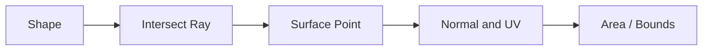


In this chapter, we will present pbrt’s abstraction for geometric primitives such as spheres and triangles. Careful abstraction of geometric shapes in a ray tracer is a key component of a clean system design, and shapes are the ideal candidate for an object-oriented approach. All geometric primitives implement a common interface, and the rest of the renderer can use this interface without needing any details about the underlying shape. This makes it possible to separate the geometric and shading subsystems of pbrt.

pbrt hides details about primitives behind a two-level abstraction. The Shape interface provides access to the basic geometric properties of the primitive, such as its surface area and bounding box, and provides a ray intersection routine. Then, the Primitive interface encapsulates additional non-geometric information about the primitive, such as its material properties. The rest of the renderer then deals only with the abstract Primitive interface. This chapter will focus on the geometry-only Shape class; the Primitive interface is a key topic of Chapter 7.

## 6.1 BASIC SHAPE INTERFACE

The interface for Shapes is defined in the file base/shape.rs, and the shape implementations can be found in shapes.rs and shapes.rs. The Shape class defines the general shape interface.

〈Shape Definition〉 ≡ class Shape : public TaggedPointer<Sphere, Cylinder, Disk, Triangle, BilinearPatch, Curve> { public: 〈Shape Interface 262〉 };

```text
    BilinearPatch 328
    Curve 346
    Cylinder 286
    Disk 292
    Primitive 398
    Shape 261
    Sphere 271
    TaggedPointer 1073
    Triangle 301
```

### 6.1.1 BOUNDING

The scenes that pbrt renders often contain objects that are computationally expensive to process. For many operations, it is useful to have a 3D bounding volume that encloses an object. For example, if a ray does not pass through a particular bounding volume, pbrt can avoid processing all the objects inside of it for that ray.

Axis-aligned bounding boxes are a convenient bounding volume, as they require only six floating-point values to store. They fit many shapes well and it is fairly inexpensive to test for the intersection of a ray with an axis-aligned bounding box. Each Shape implementation must therefore be capable of bounding itself with an axis-aligned bounding box represented by a Bounds3f. The returned bounding box should be in the rendering coordinate system (recall the discussion of coordinate systems in Section 5.1.1).

〈Shape Interface〉 ≡ 261

```rust
   Bounds3f Bounds() const;
```

In addition to bounding their spatial extent, shapes must also be able to bound their range of surface normals. The NormalBounds() method should return such a bound using a DirectionCone, which was defined in Section 3.8.4. Normal bounds are specifically useful in lighting calculations: when a shape is emissive, they sometimes make it possible to efficiently determine that the shape does not illuminate a particular point in the scene.

〈Shape Interface〉 +≡ 261

```rust
   DirectionCone NormalBounds() const;
```

### 6.1.2 RAY–BOUNDS INTERSECTIONS

Given the use of Bounds3f instances to bound shapes, we will add a Bounds3 method, Bounds3::IntersectP(), that checks for a ray–box intersection and returns the two parametric t values of the intersection, if any.

One way to think of bounding boxes is as the intersection of three slabs, where a slab is the region of space between two parallel planes. To intersect a ray with a box, we intersect the ray with each of the box’s three slabs in turn. Because the slabs are aligned with the three coordinate axes, a number of optimizations can be made in the ray–slab tests.

The basic ray–bounding box intersection algorithm works as follows: we start with a parametric interval that covers that range of positions t along the ray where we are interested in finding intersections; typically, this is (0, ∞). We will then successively compute the two parametric t positions where the ray intersects each axis-aligned slab. We compute the set intersection of the per-slab intersection interval with the current intersection interval, returning failure if we find that the resulting interval is degenerate. If, after checking all three slabs, the interval is nondegenerate, we have the parametric range of the ray that is inside the box. Figure 6.1 illustrates this process, and Figure 6.2 shows the basic geometry of a ray intersecting a slab.

If the Bounds3::IntersectP() method returns true, the intersection’s parametric range is returned in the optional arguments hitt0 and hitt1. Intersections outside of the (0, tMax) range of the ray are ignored. If the ray’s origin is inside the box, 0 is returned for hitt0.

〈Bounds3 Inline Functions〉 +≡ template <typename T> bool Bounds3<T>::IntersectP(Point3f o, Vector3f d, Float tMax, Float *hitt0, Float *hitt1) const { Float t0 = 0, t1 = tMax; for (int i = 0; i < 3; ++i) { 〈Update interval for ith bounding box slab 264〉 } if (hitt0) *hitt0 = t0; if (hitt1) *hitt1 = t1; return true; }

```rust
    Bounds3 97
    Bounds3::IntersectP() 262
    Bounds3f 97
    DirectionCone 114
    Float 23
    Point3f 92
    Shape 261
    Vector3f 86
```

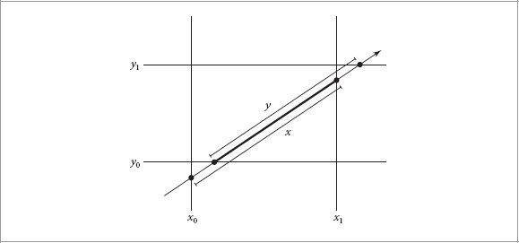

*Figure 6.1: Intersecting a Ray with an Axis-Aligned Bounding Box. We compute intersection points with each slab in turn, progressively narrowing the parametric interval. Here, in 2D, the intersection of the x and y extents along the ray (thick segment) gives the extent where the ray is inside the box.*

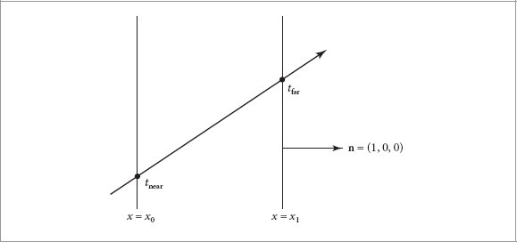

*Figure 6.2: Intersecting a Ray with an Axis-Aligned Slab. The two planes shown here are described by x = c for constant values c. The normal of each plane is (1, 0, 0). Unless the ray is parallel to the planes, it will intersect the slab twice, at parametric positions tnear and tfar.*

For each pair of planes, this routine needs to compute two ray–plane intersections. For example, the slab described by two planes perpendicular to the x axis can be described by planes through points (x0, 0, 0) and (x1, 0, 0), each with normal (1, 0, 0). Consider the first t value for a plane intersection,

t0. The parametric t value for the intersection between a ray with origin o and direction d and a plane ax + by + cz + d = 0 can be found by substituting the ray equation into the plane equation:

```text
                          = a(ox + tdx) + b(oy + tdy) + c(oz + tdz) + d
                          = (a, b, c) · o + t(a, b, c) · d + d.
```

Solving for t gives

Because the y and z components of the plane’s normal are zero, b and c are zero, and a is one. The plane’s d coefficient is −x0. We can use this information and the definition of the dot product to

simplify the calculation substantially: The code to compute the t values of the slab intersections starts by computing the reciprocal of the corresponding component of the ray direction so that it can multiply by this factor instead of performing multiple divisions. Note that, although it divides by this component, it is not necessary to verify that it is nonzero. If it is zero, then invRayDir will hold an infinite value, either −∞ or ∞, and the rest of the algorithm still works correctly.1

〈Update interval for ith bounding box slab〉 ≡ 262

```rust
   Float invRayDir = 1 / d[i];
   Float tNear = (pMin[i] - o[i]) * invRayDir;
   Float tFar = (pMax[i] - o[i]) * invRayDir;
   〈Update parametric interval from slab intersection t values 264〉
```

The two distances are reordered so that tNear holds the closer intersection and tFar the farther one. This gives a parametric range [tNear, tFar], which is used to compute the set intersection with the current range [t0, t1]to compute a new range. If this new range is empty (i.e., t0 > t1), then the code can immediately return failure.

There is another floating-point-related subtlety here: in the case where the ray origin is in the plane of one of the bounding box slabs and the ray lies in the plane of the slab, it is possible that tNear or tFar will be computed by an expression of the form 0/0, which results in a floating-point “not a number” (NaN) value. Like infinity values, NaNs have well-specified semantics: for example, any logical comparison involving a NaN always evaluates to false. Therefore, the code that updates the values of t0 and t1 is carefully written so that if tNear or tFar is NaN, then t0 or t1 will not ever take on a NaN value but will always remain unchanged.

〈Update parametric interval from slab intersection t values〉 ≡ 264

```rust
   if (tNear > tFar) pstd::swap(tNear, tFar);
```

```rust
    〈Update tFar to ensure robust ray–bounds intersection 370〉
    t0 = tNear > t0 ? tNear : t0;
    t1 = tFar < t1 ? tFar : t1;
    if (t0 > t1) return false;
```

Bounds3 also provides a specialized IntersectP() method that takes the reciprocal of the ray’s direction as an additional parameter, so that the three reciprocals do not need to be computed each time IntersectP() is called.

This version of the method also takes precomputed values that indicate whether each direction component is negative, which makes it possible to eliminate the comparisons of the computed tNear and tFar values in the original routine and to directly compute the respective near and far values. Because the comparisons that order these values from low to high in the original code are dependent on computed values, they can be inefficient for processors to execute, since the computation of their values must be finished before the comparison can be made. Because many ray–bounds intersection tests may be performed during rendering, this small optimization is worth using.

```text
    Bounds3::pMax 98
    Bounds3::pMin 98
    Float 23
```

This routine returns true if the ray segment is entirely inside the bounding box, even if the intersections are not within the ray’s (0, tMax) range.

〈Bounds3 Inline Functions〉 +≡ template <typename T> bool Bounds3<T>::IntersectP(Point3f o, Vector3f d, Float raytMax, Vector3f invDir, const int dirIsNeg[3]) const { const Bounds3f &bounds = *this; 〈Check for ray intersection against x and y slabs 265〉 〈Check for ray intersection against z slab〉 return (tMin < raytMax) && (tMax > 0); }

If the ray direction vector is negative, the “near” parametric intersection will be found with the slab with the larger of the two bounding values, and the far intersection will be found with the slab with the smaller of them. The implementation can use this observation to compute the near and far parametric values in each direction directly.

〈Check for ray intersection against x and y slabs〉 ≡ 265

```rust
   Float tMin = (bounds[ dirIsNeg[0]].x - o.x) * invDir.x;
   Float tMax = (bounds[1-dirIsNeg[0]].x - o.x) * invDir.x;
   Float tyMin = (bounds[ dirIsNeg[1]].y - o.y) * invDir.y;
```

```rust
    Float tyMax = (bounds[1-dirIsNeg[1]].y - o.y) * invDir.y;
    〈Update tMax and tyMax to ensure robust bounds intersection〉
    if (tMin > tyMax || tyMin > tMax)
        return false;
    if (tyMin > tMin) tMin = tyMin;
    if (tyMax < tMax) tMax = tyMax;
```

The fragment 〈Check for ray intersection against z slab〉 is analogous and is not included here.

This intersection test is at the heart of traversing the BVHAggregate acceleration structure, which is introduced in Section 7.3. Because so many ray–bounding box intersection tests are performed while traversing the BVH tree, we found that this optimized method provided approximately a 15% performance improvement in overall rendering time compared to using the Bounds3::IntersectP() variant that did not take the precomputed direction reciprocals and signs.

### 6.1.3 INTERSECTION TESTS

Shape implementations must provide an implementation of two methods that test for ray intersections with their shape. The first, Intersect(), returns geometric information about a single ray–shape intersection corresponding to the first intersection, if any, in the (0, tMax) parametric range along the given ray.

〈Shape Interface〉 +≡ 261

```rust
   Option<ShapeIntersection> Intersect(const Ray &ray,
                                            Float tMax = Infinity) const;
```

In the event that an intersection is found, a SurfaceInteraction corresponding to the intersection point and the parametric t distance along the ray where the intersection occurred are returned via a ShapeIntersection instance.

```rust
    Bounds3 97
    Bounds3::IntersectP() 262
    Bounds3f 97
    BVHAggregate 407
    Float 23
    Infinity 361
    Point3f 92
    Ray 95
    Shape 261
    ShapeIntersection 266
    SurfaceInteraction 138
    Vector3f 86
```

〈ShapeIntersection Definition〉 ≡

```rust
   struct ShapeIntersection {
       SurfaceInteraction intr;
       Float tHit;
   };
```

There are a few important things to keep in mind when reading (and writing) intersection routines:

```rust
               The provided tMax value defines the endpoint of the ray. Intersection routines must
               ignore any intersections that occur after this point.
               If there are multiple intersections with a shape along the ray, the closest one should be
               reported.
               The rays passed into intersection routines are in rendering space, so shapes are
               responsible for transforming them to object space if needed for intersection tests. The
               intersection information returned should be in rendering space.
```

The second intersection test method, Shape::IntersectP(), is a predicate function that determines whether or not an intersection occurs without returning any details about the intersection itself. That test is often more efficient than a full intersection test. This method is used in particular for shadow rays that are testing the visibility of a light source from a point in the scene.

〈Shape Interface〉 +≡ 261

```rust
   bool IntersectP(const Ray &ray, Float tMax = Infinity) const;
```

### 6.1.4 INTERSECTION COORDINATE SPACES

For some shapes, intersection routines are most naturally expressed in their object space. For example, the following Sphere shape computes the intersection with a sphere of a given radius positioned at the origin. The sphere being at the origin allows various simplifications to the intersection algorithm. Other shapes, like the Triangle, transform their representation to rendering space and perform intersection tests there.

Shapes like Sphere that operate in object space must transform the specified ray to object space and then transform any intersection results back to rendering space. Most of this is handled easily using associated methods in the Transform class that were introduced in Section 3.10, though a natural question to ask is, “What effect does the object-from-rendering-space transformation have on the correct parametric distance to return?” The intersection method has found a parametric t distance to the intersection for the object-space ray, which may have been translated, rotated, scaled, or worse when it was transformed from rendering space.

Using the properties of transformations, it is possible to show that the t distance to the intersection is unaffected by the transformation. Consider a rendering-space ray rr with associated origin or and direction dr. Given an object-from-rendering-space transformation matrix M, we can then find the object-space ray ro with origin Moo and direction Mdo.

```text
    Float 23
```

```text
    Infinity 361
    Ray 95
    Shape::IntersectP() 266
    Sphere 271
    SurfaceInteraction 138
    Transform 120
    Triangle 301
```

If the ray–shape intersection algorithm finds an object-space intersection at a distance t along the ray, then the object-space intersection point is po = oo + tdo. Now consider the rendering-space intersection point pr that is found by applying M’s inverse to both sides of that equation:

```text
                    M−1po = M−1 (oo + tdo)
```

```text
                    M−1po = M−1oo + M−1 (tdo)
```

```text
                    M−1po = M−1oo + tM−1 (do)
                        pr = or + tdr.
```

Therefore, the t value that was computed in object space is the correct t value for the intersection point in rendering space as well. Note that if the object-space ray’s direction had been normalized after the transformation, then this would no longer be the case and a correction factor related to the unnormalized ray’s length would be needed. This is one reason that pbrt does not normalize object-space rays’ directions after transformation.

### 6.1.5 SIDEDNESS

Many rendering systems, particularly those based on scanline or z-buffer algorithms, support the concept of shapes being “one-sided”—the shape is visible if seen from the front but disappears when viewed from behind. In particular, if a geometric object is closed and always viewed from the outside, then the backfacing parts of it can be discarded without changing the resulting image. This optimization can substantially improve the speed of these types of hidden surface removal algorithms. The potential for improved performance is reduced when using this technique with ray tracing, however, since it is often necessary to perform the ray–object intersection before determining the surface normal to do the backfacing test. Furthermore, this feature can lead to a physically inconsistent scene description if one-sided objects are not in fact closed. For example, a surface might block light when a shadow ray is traced from a light source to a point on another surface, but not if the shadow ray is traced in the other direction. For all of these reasons, pbrt does not support this feature.

### 6.1.6 AREA

In pbrt, area lights are defined by attaching an emission profile to a Shape. To use Shapes as area lights, it is necessary that shapes be able to return their surface area of a shape in rendering space.

〈Shape Interface〉 +≡ 261

```rust
   Float Area() const;
```

### 6.1.7 SAMPLING

A few methods are necessary to sample points on the surface of shapes in order to use them as emitters. Additional Shape methods make this possible.

There are two shape sampling methods, both named Sample(). The first chooses points on the surface of the shape using a sampling distribution with respect to surface area and returns the local geometric information about the sampled point in a ShapeSample. The provided sample value u, a uniform sample in [0, 1)2, should be used to determine the point on the shape.

〈Shape Interface〉 +≡ 261

```rust
   Option<ShapeSample> Sample(Point2f u) const;
```

```text
    Float 23
    Interaction 136
    Point2f 92
    ShapeSample 268
```

The ShapeSample structure that is returned stores an Interaction corresponding to a sampled point on the surface as well as the probability density with respect to surface area on the shape for sampling that point.

〈ShapeSample Definition〉 ≡ struct ShapeSample { Interaction intr; Float pdf; };

Shapes must also provide an associated PDF() method that returns probability density for sampling the specified point on the shape that corresponds to the given Interaction. This method should only be called with interactions that are on the shape’s surface. Although Sample() already returns the probability density for the point it samples, this method is useful when using multiple importance sampling, in which case it is necessary to compute the probability density for samples generated using other sampling techniques. An important detail is that implementations are allowed to assume that the provided point is on their surface; callers are responsible for ensuring that this is the case.

〈Shape Interface〉 +≡ 261

```rust
   Float PDF(const Interaction &) const;
```

The second shape sampling method takes a reference point from which the shape is being viewed. This method is particularly useful for lighting, since the caller can pass in the point to be lit and allow shape implementations to ensure that they only sample the portion of the shape that is potentially visible from that point.

Unlike the first Shape sampling method, which generates points on the shape according to a probability density with respect to surface area on the shape, the second one uses a density with respect to solid angle from the reference point. This difference stems from the fact that the area light sampling routines evaluate the direct lighting integral as an integral over directions from the reference point—expressing these sampling densities with respect to solid angle at the point is more convenient.

〈Shape Interface〉 +≡ 261

```rust
   Option<ShapeSample> Sample(const ShapeSampleContext &ctx,
                                    Point2f u) const;
```

Information about the reference point and its geometric and shading normals is provided by the ShapeSampleContext structure. The reference point position is specified using the Point3fi class, which can represent the numerical uncertainty in a ray intersection point computed using floating-point arithmetic. Discussion of related topics is in Section 6.8. For points in participating media that are not associated with a surface, the normal and shading normal are left with their default values of (0, 0, 0).

〈ShapeSampleContext Definition〉 ≡ struct ShapeSampleContext { 〈ShapeSampleContext Public Methods 269〉 Point3fi pi; Normal3f n, ns; Float time; };

ShapeSampleContext provides a variety of convenience constructors that allow specifying the member variable values directly or from various types of Interaction.

```text
    Float 23
    Interaction 136
    Normal3f 94
    Point2f 92
    Point3fi 1061
    Shape 261
    ShapeSample 268
    ShapeSampleContext 268
```

〈ShapeSampleContext Public Methods〉 ≡ 268

```rust
   ShapeSampleContext(Point3fi pi, Normal3f n, Normal3f ns, Float time)
```

```rust
      : pi(pi), n(n), ns(ns), time(time) {}
    ShapeSampleContext(const SurfaceInteraction &si)
      : pi(si.pi), n(si.n), ns(si.shading.n), time(si.time) {}
    ShapeSampleContext(const MediumInteraction &mi)
      : pi(mi.pi), time(mi.time) {}
```

For code that does not need to be aware of numeric error in the intersection point, a method provides it as a regular Point3.

〈ShapeSampleContext Public Methods〉 +≡ 268

```rust
   Point3f p() const { return Point3f(pi); }
```

A second PDF() method comes along with this sampling approach. It returns the shape’s probability of sampling a point on the light such that the incident direction ωi at the reference point is wi. As with the corresponding sampling method, this density should be with respect to solid angle at the reference point. As with the other Shape PDF() method, this should only be called for a direction that is known to intersect the shape from the reference point; as such, implementations are not responsible for checking that case.

〈Shape Interface〉 +≡ 261

```rust
   Float PDF(const ShapeSampleContext &ctx, Vector3f wi) const;
```

Some of the PDF() method implementations will need to trace a ray from the reference point in the direction ωi to see if it intersects the shape. The following ShapeSampleContext methods should be used to find the origin or the ray itself rather than using the point returned by ShapeSampleContext::p(). This, too, stems from a subtlety related to handling numeric error in intersection points. The implementation of these methods and discussion of the underlying issues can be found in Section 6.8.6.

〈ShapeSampleContext Public Methods〉 +≡ 268

```rust
   Point3f OffsetRayOrigin(Vector3f w) const;
   Point3f OffsetRayOrigin(Point3f pt) const;
   Ray SpawnRay(Vector3f w) const;
```

## 6.2 SPHERES

Spheres are a special case of a general type of surface called quadrics—surfaces described by quadratic polynomials in x, y, and z. They offer a good starting point for introducing ray intersection algorithms. In conjunction with a transformation matrix, pbrt’s Sphere shape can also take the form of an ellipsoid. pbrt supports two other basic types of quadrics: cylinders and disks. Other quadrics such as the cone, hyperboloid, and paraboloid are less useful for most rendering applications, and so are not included in the system.

```rust
    Float 23
    MediumInteraction 141
    Normal3f 94
    Point3 92
    Point3f 92
    Point3fi 1061
    Ray 95
    Shape 261
    ShapeSampleContext 268
    ShapeSampleContext::p() 269
    ShapeSampleContext::pi 268
    SurfaceInteraction 138
    Vector3f 86
```

Many surfaces can be described in one of two main ways: in implicit form and in parametric form. An implicit function describes a 3D surface as f (x, y, z) = 0. The set of all points (x, y, z) that fulfill this condition defines the surface. For a unit sphere at the origin, the familiar implicit equation is x2 + y2 + z2 − 1 = 0. Only the set of points one unit from the origin satisfies this constraint, giving the unit sphere’s surface.

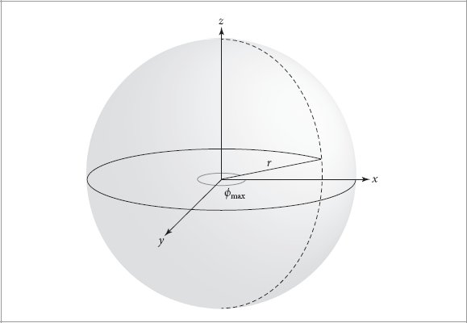

*Figure 6.3: Basic Setting for the Sphere Shape. It has a radius of r and is centered at the object space origin. A partial sphere may be described by specifying a maximum ϕ value.*

Many surfaces can also be described parametrically using a function to map 2D points to 3D points on the surface. For example, a sphere of radius r can be described as a function of 2D spherical coordinates (θ, ϕ), where θ ranges from 0 to π and ϕ ranges from 0 to 2π (Figure 6.3):

We can transform this function f (θ, ϕ) into a function f (u, v) over [0, 1]2 and generalize it slightly to allow partial spheres that only sweep out θ ∊ [θmin, θmax] and ϕ ∊ [0, ϕmax] with the substitution

This form is particularly useful for texture mapping, where it can be directly used to map a texture defined over [0, 1]2 to the sphere. Figure 6.4 shows an image of two spheres; a grid image map has been used to show the (u, v) parameterization.

As we describe the implementation of the sphere shape, we will make use of both the implicit and parametric descriptions of the shape, depending on which is a more natural way to approach the particular problem we are facing.

The Sphere class represents a sphere that is centered at the origin. As with all the other shapes, its implementation is in the files shapes.rs and shapes.rs.

```text
    Sphere 271
```

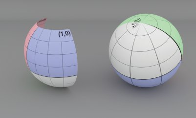

*Figure 6.4: Two Spheres. On the left is a partial sphere (with zmax < r and ϕmax < 2π) and on the right is a complete sphere. Note that the texture image used shows the (u, v) parameterization of the shape; the singularity at one of the poles is visible in the complete sphere.*

〈Sphere Definition〉 ≡ class Sphere { public: 〈Sphere Public Methods 272〉 private: 〈Sphere Private Members 272〉 };

As mentioned earlier, spheres in pbrt are defined in a coordinate system where the center of the sphere is at the origin. The sphere constructor is provided transformations that map between the sphere’s object space and rendering space.

Although pbrt supports animated transformation matrices, the transformations here are not AnimatedTransforms. (Such is also the case for all the shapes defined in this chapter.) Animated shape transformations are instead handled by using a TransformedPrimitive to represent the shape in the scene. Doing so allows us to centralize some of the tricky details related to animated transformations in a single place, rather than requiring all Shapes to handle this case.

The radius of the sphere can have an arbitrary positive value, and the sphere’s extent can be truncated in two different ways. First, minimum and maximum z values may be set; the parts of the sphere below and above these planes, respectively, are cut off. Second, considering the parameterization of the sphere in spherical coordinates, a maximum ϕ value can be set. The sphere sweeps out ϕ values from 0 to the given ϕmax such that the section of the sphere with spherical ϕ values above ϕmax is also removed.

Finally, the Sphere constructor also takes a Boolean parameter, reverseOrientation, that indicates whether their surface normal directions should be reversed from the default (which is pointing outside the sphere). This capability is useful because the orientation of the surface normal is used to determine which side of a shape is “outside.” For example, shapes that emit illumination are by default emissive only on the side the surface normal lies on. The value of this parameter is managed via the ReverseOrientation statement in pbrt scene description files.

```text
    AnimatedTransform 135
    Shape 261
    TransformedPrimitive 403
```

〈Sphere Public Methods〉 ≡ 271

```rust
   Sphere(const         Transform    *renderFromObject,     const      Transform
   *objectFromRender,
           bool reverseOrientation, Float radius, Float zMin, Float zMax,
           Float phiMax)
       :                                     renderFromObject(renderFromObject),
       objectFromRender(objectFromRender),
         reverseOrientation(reverseOrientation),
```

transformSwapsHandedness(renderFromObject->SwapsHandedness()), radius(radius), zMin(Clamp(std::min(zMin, zMax), -radius, radius)), zMax(Clamp(std::max(zMin, zMax), -radius, radius)), thetaZMin(std::acos(Clamp(std::min(zMin, zMax) / radius, -1, 1))), thetaZMax(std::acos(Clamp(std::max(zMin, zMax) / radius, -1, 1))), phiMax(Radians(Clamp(phiMax, 0, 360))) {} 〈Sphere Private Members〉 ≡ 271

```rust
   Float radius;
   Float zMin, zMax;
   Float thetaZMin, thetaZMax, phiMax;
   const Transform *renderFromObject, *objectFromRender;
   bool reverseOrientation, transformSwapsHandedness;
```

### 6.2.1 BOUNDING

Computing an object-space bounding box for a sphere is straightforward. The implementation here uses the values of zmin and zmax provided by the user to tighten up the bound when less than an entire sphere is being rendered. However, it does not do the extra work to compute a tighter bounding box when ϕmax is less than 3π/2. This improvement is left as an exercise. This object-space bounding box is transformed to rendering space before being returned.

〈Sphere Method Definitions〉 ≡ Bounds3f Sphere::Bounds() const { return (*renderFromObject)( Bounds3f(Point3f(-radius, -radius, zMin), Point3f( radius, radius, zMax))); }

The Sphere’s NormalBounds() method does not consider any form of partial spheres but always returns the bounds for an entire sphere, which is all possible directions.

〈Sphere Public Methods〉 +≡ 271

```rust
   DirectionCone NormalBounds() const { return DirectionCone::EntireSphere();
   }
```

### 6.2.2 INTERSECTION TESTS

The ray intersection test is broken into two stages. First, BasicIntersect() does the basic ray– sphere intersection test and returns a small structure, QuadricIntersection, if an intersection is found. A subsequent call to the InteractionFromIntersection() method transforms the

QuadricIntersection into a full-blown SurfaceInteraction, which can be returned from the Intersection() method.

There are two motivations for separating the intersection test into two stages like this. One is that doing so allows the IntersectP() method to be implemented as a trivial wrapper around BasicIntersect(). The second is that pbrt’s GPU rendering path is organized such that the closest intersection among all shapes is found before the full SurfaceInteraction is constructed; this decomposition fits that directly.

```rust
    Bounds3f 97
    DirectionCone 114
    DirectionCone::EntireSphere() 115
    Float 23
    Point3f 92
    Sphere 271
    Sphere::objectFromRender 272
    Sphere::phiMax 272
    Sphere::radius 272
    Sphere::renderFromObject 272
    Sphere::reverseOrientation 272
    Sphere::thetaZMax 272
    Sphere::thetaZMin 272
    Sphere:: transformSwapsHandedness 272
    Sphere::zMax 272
    Sphere::zMin 272
    Transform 120
    Transform::SwapsHandedness() 133
```

〈Sphere Public Methods〉 +≡ 271

```rust
   Option<ShapeIntersection> Intersect(const Ray &ray,
                                             Float tMax = Infinity) const {
        Option<QuadricIntersection> isect = BasicIntersect(ray, tMax);
        if (!isect) return {};
        SurfaceInteraction intr =
            InteractionFromIntersection(*isect, -ray.d, ray.time);
        return ShapeIntersection{intr, isect->tHit};
   }
```

QuadricIntersection stores the parametric t along the ray where the intersection occurred, the object-space intersection point, and the sphere’s ϕ value there. As its name suggests, this structure will be used by the other quadrics in the same way it is here.

〈QuadricIntersection Definition〉 ≡

```rust
   struct QuadricIntersection {
       Float tHit;
       Point3f pObj;
       Float phi;
   };
```

The basic intersection test transforms the provided rendering-space ray to object space and intersects it with the complete sphere. If a partial sphere has been specified, some additional tests reject intersections with portions of the sphere that have been removed.

〈Sphere Public Methods〉 +≡ 271

```rust
   Option<QuadricIntersection> BasicIntersect(const Ray &r,
                                                                  Float tMax) const {
        Float phi;
        Point3f pHit;
        〈Transform Ray origin and direction to object space 273〉
        〈Solve quadratic equation to compute sphere t0 and t1 274〉
        〈Check quadric shape t0 and t1 for nearest intersection 275〉
        〈Compute sphere hit position and ϕ 275〉
        〈Test sphere intersection against clipping parameters 276〉
        〈Return QuadricIntersection for sphere intersection 276〉
   }
```

```rust
    Float 23
    Infinity 361
    Point3f 92
    Point3fi 1061
    QuadricIntersection 273
    QuadricIntersection::tHit 273
    Ray 95
    Ray::d 95
    Ray::o 95
    Ray::time 95
    ShapeIntersection 266
    Sphere::BasicIntersect() 273
    Sphere::InteractionFromIntersection() 276
    Sphere::objectFromRender 272
    SurfaceInteraction 138
    Vector3f 86
    Vector3fi 1060
```

The transformed ray origin and direction are respectively stored using Point3fi and Vector3fi classes rather than the usual Point3f and Vector3f. These classes represent those quantities as small intervals in each dimension that bound the floating-point round-off error that was introduced by applying the transformation. Later, we will see that these error bounds will be useful for improving the geometric accuracy of the intersection computation. For the most part, these classes can respectively be used just like Point3f and Vector3f.

〈Transform Ray origin and direction to object space〉 ≡ 273, 288, 293

```rust
   Point3fi oi = (*objectFromRender)(Point3fi(r.o));
   Vector3fi di = (*objectFromRender)(Vector3fi(r.d));
```

If a sphere is centered at the origin with radius r, its implicit representation is

```text
                                           x2 + y2 + z2 − r2 = 0.
```

By substituting the parametric representation of the ray from Equation (3.4) into the implicit sphere equation, we have (ox + tdx)2 + (oy + tdy)2 + (oz + tdz)2 = r2. Note that all elements of this equation besides t are known values. The t values where the equation holds give the parametric positions along the ray where the implicit sphere equation is satisfied and thus the points along the ray where it intersects the sphere. We can expand this equation and gather the coefficients for a general quadratic equation in t, at2 + bt + c = 0, where2

The Interval class stores a small range of floating-point values to maintain bounds on floating-point rounding error. It is defined in Section B.2.15 and is analogous to Float in the way that Point3fi is to Point3f, for example.

〈Solve quadratic equation to compute sphere t0 and t1〉 ≡ 273

```rust
   Interval t0, t1;
   〈Compute sphere quadratic coefficients 274〉
   〈Compute sphere quadratic discriminant discrim 372〉
   〈Compute quadratic t values 275〉
```

Given Interval, Equation (6.3) directly translates to the following fragment of source code.

〈Compute sphere quadratic coefficients〉 ≡ 274

```rust
   Interval a = Sqr(di.x) + Sqr(di.y) + Sqr(di.z);
   Interval b = 2 * (di.x * oi.x + di.y * oi.y + di.z * oi.z);
```

```rust
    Interval c = Sqr(oi.x) + Sqr(oi.y) + Sqr(oi.z) - Sqr(Interval(radius));
```

The fragment 〈Compute sphere quadratic discriminant discrim〉 computes the discriminant b2 − 4ac in a way that maintains numerical accuracy in tricky cases. It is defined later, in Section 6.8.3, after related topics about floating-point arithmetic have been introduced. Proceeding here with its value in discrim, the quadratic equation can be applied. Here we use a variant of the traditional approach that gives more accuracy; it is described in Section B.2.10.

```rust
    Float 23
    Interval 1057
    Interval::Sqr() 1060
    Point3f 92
    Point3fi 1061
    Sphere::radius 272
    Sqr() 1034
```

〈Compute quadratic t values〉 ≡ 274, 288

```rust
   Interval rootDiscrim = Sqrt(discrim);
   Interval q;
   if ((Float)b < 0) q = -.5f * (b - rootDiscrim);
   else q = -.5f * (b + rootDiscrim);
   t0 = q / a;
   t1 = c / q;
   〈Swap quadratic t values so that t0 is the lesser 275〉
```

Because t0 and t1 represent intervals of floating-point values, it may be ambiguous which of them is less than the other. We use their lower bound for this test, so that in ambiguous cases, at least we do not risk returning a hit that is potentially farther away than an actual closer hit.

〈Swap quadratic t values so that t0 is the lesser〉 ≡ 275

```rust
   if (t0.LowerBound() > t1.LowerBound())
        pstd::swap(t0, t1);
```

A similar ambiguity must be accounted for when testing the t values against the acceptable range. In ambiguous cases, we err on the side of returning no intersection rather than an invalid one. The closest valid t is then stored in tShapeHit.

〈Check quadric shape t0 and t1 for nearest intersection〉 ≡ 273, 288

```rust
   if (t0.UpperBound() > tMax || t1.LowerBound() <= 0)
        return {};
   Interval tShapeHit = t0;
   if (tShapeHit.LowerBound() <= 0) {
```

```rust
         tShapeHit = t1;
         if (tShapeHit.UpperBound() > tMax)
            return {};
    }
```

Given the parametric distance along the ray to the intersection with a full sphere, the intersection point pHit can be computed as that offset along the ray. In its initializer, all the respective interval types are cast back to their non-interval equivalents, which gives their midpoint. (The remainder of the intersection test no longer needs the information provided by the intervals.) Due to floating-point precision limitations, this computed intersection point pHit may lie a bit to one side of the actual sphere surface; the 〈Refine sphere intersection point〉 fragment, which is defined in Section 6.8.5, improves the accuracy of this value.

It is next necessary to handle partial spheres with clipped z or ϕ ranges—intersections that are in clipped areas must be ignored. The implementation starts by computing the ϕ value for the hit point.

Using the parametric representation of the sphere, so ϕ = arctan y/x. It is necessary to remap the result of the standard library’s std::atan() function to a value between 0 and 2π, to match the sphere’s original definition.

```rust
    Float 23
    Interval 1057
    Interval::LowerBound() 1059
    Interval::Sqrt() 1060
    Interval::UpperBound() 1059
    Pi 1033
    Point3f 92
    Sphere::radius 272
    Vector3f 86
```

〈Compute sphere hit position and ϕ〉 ≡ 273, 276

```rust
   pHit = Point3f(oi) + (Float)tShapeHit * Vector3f(di);
   〈Refine sphere intersection point 375〉
   if (pHit.x == 0 && pHit.y == 0) pHit.x = 1e-5f * radius;
   phi = std::atan2(pHit.y, pHit.x);
   if (phi < 0) phi += 2 * Pi;
```

The hit point can now be tested against the specified minima and maxima for z and ϕ. One subtlety is that it is important to skip the z tests if the z range includes the entire sphere; the computed pHit.z value may be slightly out of the z range due to floating-point round-off, so we should only perform this test when the user expects the sphere to be partially incomplete. If the t0 intersection is not valid, the routine tries again with t1.

〈Test sphere intersection against clipping parameters〉 ≡ 273

```rust
   if ((zMin > -radius && pHit.z < zMin) ||
         (zMax < radius && pHit.z > zMax) || phi > phiMax) {
         if (tShapeHit == t1) return {};
         if (t1.UpperBound() > tMax) return {};
         tShapeHit = t1;
         〈Compute sphere hit position and ϕ 275〉
         if ((zMin > -radius && pHit.z < zMin) ||
              (zMax < radius && pHit.z > zMax) || phi > phiMax)
              return {};
   }
```

At this point in the routine, it is certain that the ray hits the sphere. A QuadricIntersection is returned that encapsulates sufficient information about it to determine the rest of the geometric information at the intersection point. Recall from Section 6.1.4 that even though tShapeHit was computed in object space, it is also the correct t value in rendering space. Therefore, it can be returned directly.

〈Return QuadricIntersection for sphere intersection〉 ≡ 273

```rust
   return QuadricIntersection{Float(tShapeHit), pHit, phi};
```

With BasicIntersect() implemented, Sphere::IntersectP() is easily taken care of.

〈Sphere Public Methods〉 +≡ 271

```rust
   bool IntersectP(const Ray &r, Float tMax = Infinity) const {
        return BasicIntersect(r, tMax).has_value();
   }
```

A QuadricIntersection can be upgraded to a SurfaceInteraction with a call to Interaction FromIntersection().

〈Sphere Public Methods〉 +≡ 271

```rust
   SurfaceInteraction InteractionFromIntersection(
            const QuadricIntersection &isect, Vector3f wo, Float time) const {
        Point3f pHit = isect.pObj;
        Float phi = isect.phi;
        〈Find parametric representation of sphere hit 277〉
        〈Compute error bounds for sphere intersection 375〉
        〈Return SurfaceInteraction for quadric intersection 279〉
   }
```

```text
    Float 23
```

```text
    Infinity 361
    Interval::UpperBound() 1059
    Point3f 92
    QuadricIntersection 273
    QuadricIntersection::phi 273
    QuadricIntersection::pObj 273
    Ray 95
    Sphere::BasicIntersect() 273
    Sphere::phiMax 272
    Sphere::radius 272
    Sphere::zMax 272
    Sphere::zMin 272
    SurfaceInteraction 138
    Vector3f 86
```

The method first computes u and v values by scaling the previously computed ϕ value for the hit to lie between 0 and 1 and by computing a θ value between 0 and 1 for the hit point based on the range of θ values for the given sphere. Then it finds the parametric partial derivatives of position ∂p/∂u and ∂p/ ∂v and surface normal ∂n/∂u and ∂n/∂v.

〈Find parametric representation of sphere hit〉 ≡ 276

```rust
   Float u = phi / phiMax;
   Float cosTheta = pHit.z / radius;
   Float theta = SafeACos(cosTheta);
   Float v = (theta - thetaZMin) / (thetaZMax - thetaZMin);
   〈Compute sphere ∂p/∂u and ∂p/∂v 277〉
   〈Compute sphere ∂n/∂u and ∂n/∂v 278〉
```

Computing the partial derivatives of a point on the sphere is a short exercise in algebra. Here we will show how the x component of ∂p/∂u, ∂px/∂u, is calculated; the other components are found similarly.

Using the parametric definition of the sphere, we have Using a substitution based on the parametric definition of the sphere’s y coordinate, this simplifies to

Similarly,

and

A similar process gives ∂p/∂v. The complete result is

and the implementation follows directly.

〈Compute sphere ∂p/∂u and ∂p/∂v〉 ≡ 277

```rust
   Float zRadius = std::sqrt(Sqr(pHit.x) + Sqr(pHit.y));
   Float cosPhi = pHit.x / zRadius, sinPhi = pHit.y / zRadius;
   Vector3f dpdu(-phiMax * pHit.y, phiMax * pHit.x, 0);
   Float sinTheta = SafeSqrt(1 - Sqr(cosTheta));
   Vector3f dpdv = (thetaZMax - thetaZMin) *
       Vector3f(pHit.z * cosPhi, pHit.z * sinPhi, -radius * sinTheta);
```

```rust
      Float 23
      SafeACos() 1035
      SafeSqrt() 1034
      Sphere::phiMax 272
      Sphere::radius 272
      Sphere::thetaZMax 272
      Sphere::thetaZMin 272
      Sqr() 1034
      Vector3f 86
```

It is also useful to determine how the normal changes as we move along the surface in the u and v directions. (For example, the antialiasing techniques in Chapter 10 use this information to antialias textures on objects that are seen reflected in curved surfaces.) The differential changes in normal ∂n/ ∂u and ∂n/∂v are given by the Weingarten equations from differential geometry:

where E, F, and G are coefficients of the first fundamental form and are given by These are easily computed with the ∂p/∂u and ∂p/∂v values found earlier. The e, f, and g are

coefficients of the second fundamental form, The two fundamental forms capture elementary metric properties of a surface, including notions of distance, angle, and curvature; see a differential geometry textbook such as Gray (1993) for details. To find e, f, and g, it is necessary to compute the second-order partial derivatives ∂2p/∂u2 and so on.

For spheres, a little more algebra gives the second derivatives:

The translation into code is straightforward.

〈Compute sphere ∂n/∂u and ∂n/∂v〉 ≡ 277

```rust
   Vector3f d2Pduu = -phiMax * phiMax * Vector3f(pHit.x, pHit.y, 0);
   Vector3f d2Pduv = (thetaZMax - thetaZMin) * pHit.z * phiMax *
       Vector3f(-sinPhi, cosPhi, 0.);
   Vector3f         d2Pdvv        =        -Sqr(thetaZMax         - thetaZMin)                     *
   Vector3f(pHit.x,pHit.y,pHit.z);
   〈Compute coefficients for fundamental forms 279〉
   〈Compute ∂n/∂u and ∂n/∂v from fundamental form coefficients 279〉
```

```text
    Sphere::phiMax 272
```

```text
    Sphere::thetaZMax 272
    Sphere::thetaZMin 272
    Sqr() 1034
    Vector3f 86
```

Given all the partial derivatives, it is also easy to compute the coefficients of the fundamental forms.

〈Compute coefficients for fundamental forms〉 ≡ 278, 290, 337

```rust
   Float E = Dot(dpdu, dpdu), F = Dot(dpdu, dpdv), G = Dot(dpdv, dpdv);
   Vector3f n = Normalize(Cross(dpdu, dpdv));
   Float e = Dot(n, d2Pduu), f = Dot(n, d2Pduv), g = Dot(n, d2Pdvv);
```

We now have all the values necessary to apply the Weingarten equations. For this computation, we have found it worthwhile to use DifferenceOfProducts() to compute EG − F2 for the greater numerical accuracy it provides than the direct expression of that computation. Note also that we must be careful to avoid dividing by 0 if that expression is zero-valued so that dndu and dndv do not take on not-a-number values in that case.

〈Compute ∂n/∂u and ∂n/∂v from fundamental form coefficients〉 ≡ 278, 290, 337

```rust
   Float EGF2 = DifferenceOfProducts(E, G, F, F);
   Float invEGF2 = (EGF2 == 0) ? Float(0) : 1 / EGF2;
   Normal3f dndu = Normal3f((f * F - e * G) * invEGF2 * dpdu +
                             (e * F - f * E) * invEGF2 * dpdv);
   Normal3f dndv = Normal3f((g * F - f * G) * invEGF2 * dpdu +
                             (f * F - g * E) * invEGF2 * dpdv);
```

Having computed the surface parameterization and all the relevant partial derivatives, a SurfaceInteraction structure that contains all the necessary geometric information for this intersection can be returned. There are three things to note in the parameter values passed to the SurfaceInteraction constructor.

```rust
           1. The intersection point is provided as a Point3i that takes the pHit point computed
              earlier and an error bound pError that is initialized in the fragment 〈Compute error
              bounds for sphere intersection〉, which is defined later, in Section 6.8.5.
           2. The SurfaceInteraction is initialized with object-space geometric quantities (pHit,
              dpdu, etc.) and is then transformed to rendering space when it is returned. However, one
              of the parameters is the outgoing direction, ωo. This is passed in to Interaction
              FromIntersection(), but must be transformed to object space before being passed to
              the constructor so that the returned Interaction::wo value is in rendering space again.
           3. The flipNormal parameter indicates whether the surface normal should be flipped after
              it is initially computed with the cross product of dpdu and dpdv. This should be done
              either if the ReverseOrientation directive has been enabled or if the object-to-
              rendering-space transform swaps coordinate system handedness (but not if both of these
              are the case). (The need for the latter condition was discussed in Section 3.11.1.)
```

```rust
    Cross() 91
    DifferenceOfProducts() 1044
    Dot() 89
    Float 23
    Normal3f 94
    Normalize() 88
    Point2f 92
    Point3fi 1061
    Point3i 92
    Sphere::objectFromRender 272
    Sphere::reverseOrientation 272
    Sphere:: transformSwapsHandedness 272
    SurfaceInteraction 138
    Vector3f 86
```

〈Return SurfaceInteraction for quadric intersection〉 ≡ 276, 290, 295

```rust
   bool flipNormal = reverseOrientation ^ transformSwapsHandedness;
   Vector3f woObject = (*objectFromRender)(wo);
   return (*renderFromObject)(
        SurfaceInteraction(Point3fi(pHit,           pError), Point2f(u,                     v),
        woObject,
                          dpdu, dpdv, dndu, dndv, time, flipNormal));
```

### 6.2.3 SURFACE AREA

To compute the surface area of quadrics, we use a standard formula from integral calculus. If a curve y = f (x) from x = a to x = b is revolved around the x axis, the surface area of the resulting swept surface is

where f′ (x) denotes the derivative df/dx. Since most of our surfaces of revolution are only partially

swept around the axis, we will instead use the formula The sphere is a surface of revolution of a circular arc. The function that defines the profile curve along the z axis of the sphere is

and its derivative is

Recall that the sphere is clipped at zmin and zmax. The surface area is therefore

For the full sphere ϕmax = 2π, zmin = −r, and zmax = r, so we have the standard formula A = 4πr2, confirming that the formula makes sense.

〈Sphere Public Methods〉 +≡ 271

```rust
   Float Area() const { return phiMax * radius * (zMax - zMin); }
```

### 6.2.4 SAMPLING

Uniformly sampling a point on the sphere’s area is easy: Sphere::Sample() generates a point on the unit sphere using SampleUniformSphere() and then scales the point by the sphere’s radius. A bound on the numeric error in this value is found in a fragment that will be defined later.

〈Sphere Method Definitions〉 +≡ pstd::optional<ShapeSample> Sphere::Sample(Point2f u) const { Point3f pObj = Point3f(0, 0, 0) + radius * SampleUniformSphere(u); 〈Reproject pObj to sphere surface and compute pObjError 376〉 〈Compute surface normal for sphere sample and return ShapeSample 281〉 }

```rust
    Float 23
    Point2f 92
    Point3f 92
    Point3fi 1061
    SampleUniformSphere() 1016
    ShapeSample 268
    Sphere::phiMax 272
    Sphere::radius 272
    Sphere::zMax 272
```

```text
    Sphere::zMin 272
```

Because the object-space sphere is at the origin, the object-space surface normal is easily found by converting the object-space point to a normal vector and then normalizing it. A Point3fi for the sample point can be initialized from pObj and its error bounds. The final sample is returned in rendering space with a PDF equal to one over the surface area, since this Sample() method samples uniformly by surface area.

〈Compute surface normal for sphere sample and return ShapeSample〉 ≡ 280

```rust
   Normal3f nObj(pObj.x, pObj.y, pObj.z);
   Normal3f n = Normalize((*renderFromObject)(nObj));
   if (reverseOrientation)
       n *= -1;
   〈Compute (u, v) coordinates for sphere sample 281〉
   Point3fi pi = (*renderFromObject)(Point3fi(pObj, pObjError));
   return ShapeSample{Interaction(pi, n, uv), 1 / Area()};
```

The (u, v) parametric coordinates for the point are given by inverting Equations (6.1) and (6.2).

〈Compute (u, v) coordinates for sphere sample〉 ≡ 281

```rust
   Float theta = SafeACos(pObj.z / radius);
   Float phi = std::atan2(pObj.y, pObj.x);
   if (phi < 0) phi += 2 * Pi;
   Point2f uv(phi / phiMax, (theta - thetaZMin) / (thetaZMax - thetaZMin));
```

The associated PDF() method returns the same PDF.

〈Sphere Public Methods〉 +≡ 271

```rust
   Float PDF(const Interaction &) const { return 1 / Area(); }
```

For the sphere sampling method that is given a point being illuminated, we can do much better than sampling over the sphere’s entire area. While uniform sampling over its surface would be perfectly correct, a better approach is not to sample points on the sphere that are definitely not visible (such as those on the back side of the sphere as seen from the point). The sampling routine here instead uniformly samples directions over the solid angle subtended by the sphere from the reference point and then computes the point on the sphere corresponding to the sampled direction.

〈Sphere Public Methods〉 +≡ 271

```rust
   Option<ShapeSample> Sample(const ShapeSampleContext &ctx,
                                             Point2f u) const {
        〈Sample uniformly on sphere if p is inside it 281〉
        〈Sample sphere uniformly inside subtended cone 282〉
        〈Return ShapeSample for sampled point on sphere 284〉
```

```rust
    }
```

```rust
    DistanceSquared() 93
    Float 23
    Interaction 136
    Normal3f 94
    Normalize() 88
    OffsetRayOrigin() 381
    Pi 1033
    Point2f 92
    Point3f 92
    Point3fi 1061
    SafeACos() 1035
    ShapeSample 268
    ShapeSampleContext 268
    ShapeSampleContext::OffsetRayOrigin() 383
    Sphere::Area() 280
    Sphere::phiMax 272
    Sphere::radius 272
    Sphere::renderFromObject 272
    Sphere::reverseOrientation 272
    Sphere::thetaZMax 272
    Sphere::thetaZMin 272
    Sqr() 1034
```

For points that lie inside the sphere, the entire sphere should be sampled, since the whole sphere is visible from inside it. Note that the reference point used in this determination, pOrigin, is computed using the OffsetRayOrigin() function. Doing so ensures that if the reference point came from a ray intersecting the sphere, the point tested does not lie on the wrong side of the sphere due to rounding error.

〈Sample uniformly on sphere if p is inside it〉 ≡ 281

```rust
   Point3f pCenter = (*renderFromObject)(Point3f(0, 0, 0));
   Point3f pOrigin = ctx.OffsetRayOrigin(pCenter);
   if (DistanceSquared(pOrigin, pCenter) <= Sqr(radius)) {
        〈Sample shape by area and compute incident direction wi 282〉
        〈Convert area sampling PDF in ss to solid angle measure 282〉
        return ss;
   }
```

A call to the first Sample() method gives an initial ShapeSample for a point on the sphere. The direction vector from the reference point to the sampled point wi is computed and then normalized, so long as it is non-degenerate.

〈Sample shape by area and compute incident direction wi〉 ≡ 281, 291, 317, 343

```rust
   Option<ShapeSample> ss = Sample(u);
   ss->intr.time = ctx.time;
   Vector3f wi = ss->intr.p() - ctx.p();
   if (LengthSquared(wi) == 0) return {};
   wi = Normalize(wi);
```

To compute the value of the PDF, the method converts the value of the PDF with respect to surface area from the call to Sample() to a PDF with respect to solid angle from the reference point. Doing so

requires division by the factor where θo is the angle between the direction of the ray from the point on the light to the reference point and the light’s surface normal, and r2 is the distance between the point on the light and the point being shaded (recall the discussion about transforming between area and directional integration domains in Section 4.2.3).

In the rare case that the surface normal and wi are perpendicular, this results in an infinite value, in which case no valid sample is returned.

〈Convert area sampling PDF in ss to solid angle measure〉 ≡ 281, 291, 317, 343

```rust
   ss->pdf /= AbsDot(ss->intr.n, -wi) /
                DistanceSquared(ctx.p(), ss->intr.p());
   if (IsInf(ss->pdf))
        return {};
```

For the more common case of a point outside the sphere, sampling within the cone proceeds.

〈Sample sphere uniformly inside subtended cone〉 ≡ 281

```rust
   〈Compute quantities related to the θmax for cone 283〉
    〈Compute θ and ϕ values for sample in cone 283〉
    〈Compute angle α from center of sphere to sampled point on surface 284〉
    〈Compute surface normal and sampled point on sphere 284〉
```

If the reference point is outside the sphere, then as seen from the reference point p the sphere

subtends an angle

```text
    AbsDot() 90
    DistanceSquared() 93
    Interaction::n 137
    Interaction::p() 137
    Interaction::time 137
```

```text
    IsInf() 363
    LengthSquared() 87
    Normalize() 88
    SampleUniformCone() 1018
    ShapeSample 268
    ShapeSample::intr 268
    ShapeSample::pdf 268
    ShapeSampleContext::p() 269
    ShapeSampleContext::time 268
    Vector3f 86
```

where r is the radius of the sphere and pc is its center (Figure 6.5). The sampling method here computes the cosine of the subtended angle θmax using Equation (6.4) and then uniformly samples directions inside this cone of directions using an approach that is derived for the SampleUniformCone() function in Section A.5.4, sampling an offset θ from the center vector ωc and then uniformly sampling a rotation angle ϕ around the vector. That function is not used here, however, as we will need some of the intermediate values in the following fragments.

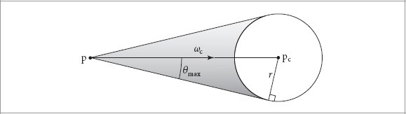

*Figure 6.5: To sample points on a spherical light source, we can uniformly sample within the cone of directions around a central vector ωc with an angular spread of up to θmax. Trigonometry can be used to derive the value of sin θmax, r/|pc − p|.*

〈Compute quantities related to the θmax for cone〉 ≡ 282

```rust
   Float sinThetaMax = radius / Distance(ctx.p(), pCenter);
   Float sin2ThetaMax = Sqr(sinThetaMax);
   Float cosThetaMax = SafeSqrt(1 - sin2ThetaMax);
   Float oneMinusCosThetaMax = 1 - cosThetaMax;
```

As shown in Section A.5.4, uniform sampling of cos θ between cos θmax and 1 gives the cosine of a uniformly sampled direction in the cone.

〈Compute θ and ϕ values for sample in cone〉 ≡ 282

```rust
    Float cosTheta = (cosThetaMax - 1) * u[0] + 1;
    Float sin2Theta = 1 - Sqr(cosTheta);
    if (sin2ThetaMax < 0.00068523f /* sin^2(1.5 deg) */) {
        〈Compute cone sample via Taylor series expansion for small angles 283〉
    }
```

For very small θmax angles, cos2 θmax is close to one. Computing sin2 θ by subtracting this value from 1 gives a value close to 0, but with very little accuracy, since there is much less floating-point precision close to 1 than there is by 0. Therefore, in this case, we use single-term Taylor expansions near 0 to compute sin2 θ and related terms, which gives much better accuracy.

〈Compute cone sample via Taylor series expansion for small angles〉 ≡ 283

```rust
   sin2Theta = sin2ThetaMax * u[0];
   cosTheta = std::sqrt(1 - sin2Theta);
   oneMinusCosThetaMax = sin2ThetaMax / 2;
```

Given a sample angle (θ, ϕ) with respect to the sampling coordinate system computed earlier, we can directly compute the corresponding point on the sphere. The first step is to find the angle γ between the vector from the reference point pr to the sampled point on the sphere ps and the vector from the center of the sphere pc to ps. The basic setting is shown in Figure 6.6.

We denote the distance from the reference point to the center of the sphere by dc. Applying the law of

sines, we can find that

```rust
    Distance() 93
    Float 23
    SafeSqrt() 1034
    ShapeSampleContext::p() 269
    Sqr() 1034
```

Because γ is an obtuse angle, γ = π − arcsin(dc/r sin θ). Given two of the three angles of the triangle, it

follows that

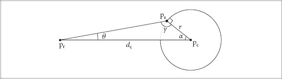

*Figure 6.6: Geometric Setting for Computing the Sampled Point on the Sphere Corresponding to a Sampled Angle θ. Consider the triangle shown here. The lengths of two sides are known: one is the radius of the sphere r and the other is dc, the distance from the reference point to the center of the sphere. We also know one angle, θ. Given these, we first solve for the angle γ before finding cos α.*

We can avoid expensive inverse trigonometric functions by taking advantage of the fact that we only need the sine and cosine of α. If we take the cosine of both sides of this equation, apply the cosine angle addition formula, and then use the two relationships sin θmax = r/dc and

, we can find The value of sin α follows from the identity .

〈Compute angle α from center of sphere to sampled point on surface〉 ≡ 282

```rust
   Float cosAlpha = sin2Theta / sinThetaMax +
                     cosTheta * SafeSqrt(1 - sin2Theta / Sqr(sinThetaMax));
   Float sinAlpha = SafeSqrt(1 - Sqr(cosAlpha));
```

The α angle and ϕ give the spherical coordinates for the sampled direction with respect to a coordinate system with z axis centered around the vector from the sphere center to the reference point. We can use an instance of the Frame class to transform the direction from that coordinate system to rendering space. The surface normal on the sphere can then be computed as the negation of that vector and the point on the sphere can be found by scaling by the radius and translating by the sphere’s center point.

```rust
    Float 23
    Frame 133
    Frame::FromLocal() 134
    Frame::FromZ() 134
    Interaction 136
    Normal3f 94
    Normalize() 88
    Pi 1033
```

```text
    Point3f 92
    Point3fi 1061
    SafeSqrt() 1034
    ShapeSample 268
    ShapeSampleContext::p() 269
    ShapeSampleContext::time 268
    Sphere::radius 272
    Sphere::reverseOrientation 272
    SphericalDirection() 106
    Sqr() 1034
    Vector3f 86
```

〈Compute surface normal and sampled point on sphere〉 ≡ 282

```rust
   Float phi = u[1] * 2 * Pi;
   Vector3f w = SphericalDirection(sinAlpha, cosAlpha, phi);
   Frame samplingFrame = Frame::FromZ(Normalize(pCenter - ctx.p()));
   Normal3f n(samplingFrame.FromLocal(-w));
   Point3f p = pCenter + radius * Point3f(n.x, n.y, n.z);
   if (reverseOrientation)
       n *= -1;
```

The 〈Compute (u, v) coordinates for sampled point on sphere〉 fragment applies the same mapping using the object space sampled point as is done in the Intersect() method, and so it is elided. The PDF for uniform sampling in a cone is 1/(2π(1 − cos θmax)). (A derivation is in Section A.5.4.)

〈Return ShapeSample for sampled point on sphere〉 ≡ 281

```rust
   〈Compute pError for sampled point on sphere〉
   〈Compute (u, v) coordinates for sampled point on sphere〉
   return ShapeSample{Interaction(Point3fi(p, pError), n, ctx.time, uv),
                       1 / (2 * Pi * oneMinusCosThetaMax)};
```

The method that computes the PDF for sampling a direction toward a sphere from a reference point also differs depending on which of the two sampling strategies would be used for the point.

〈Sphere Public Methods〉 +≡ 271

```rust
   Float PDF(const ShapeSampleContext &ctx, Vector3f wi) const {
        Point3f pCenter = (*renderFromObject)(Point3f(0, 0, 0));
        Point3f pOrigin = ctx.OffsetRayOrigin(pCenter);
        if (DistanceSquared(pOrigin, pCenter) <= Sqr(radius)) {
            〈Return solid angle PDF for point inside sphere 285〉
        }
        〈Compute general solid angle sphere PDF 285〉
```

```rust
    }
```

If the reference point is inside the sphere, a uniform area sampling strategy would have been used.

〈Return solid angle PDF for point inside sphere〉 ≡ 285

```rust
   〈Intersect sample ray with shape geometry 285〉
   〈Compute PDF in solid angle measure from shape intersection point 285〉
   return pdf;
```

First, the corresponding point on the sphere is found by intersecting a ray leaving the reference point in direction wi with the sphere. Note that this is a fairly efficient computation since it is only intersecting the ray with a single sphere and not the entire scene.

〈Intersect sample ray with shape geometry〉 ≡ 285, 291, 324, 345

```rust
   Ray ray = ctx.SpawnRay(wi);
   Option<ShapeIntersection> isect = Intersect(ray);
   if (!isect) return 0;
```

In turn, the uniform area density of one over the surface area is converted to a solid angle density following the same approach as was used in the previous Sample() method.

```rust
    AbsDot() 90
    DistanceSquared() 93
    Float 23
    Interaction::n 137
    Interaction::p() 137
    IsInf() 363
    Pi 1033
    Point3f 92
    Ray 95
    SafeSqrt() 1034
    ShapeIntersection 266
    ShapeIntersection::intr 266
    ShapeSampleContext 268
    ShapeSampleContext::OffsetRayOrigin() 383
    ShapeSampleContext::p() 269
    ShapeSampleContext::SpawnRay() 383
    Sphere::Area() 280
    Sphere::Intersect() 273
    Sphere::radius 272
    Sphere::renderFromObject 272
    Sqr() 1034
    Vector3f 86
```

〈Compute PDF in solid angle measure from shape intersection point〉 ≡ 285, 291, 324

```rust
   Float pdf = (1 / Area()) / (AbsDot(isect->intr.n, -wi) /
                                  DistanceSquared(ctx.p(), isect->intr.p()));
   if (IsInf(pdf)) pdf = 0;
```

The value of the PDF is easily computed using the same trigonometric identities as were used in the sampling routine.

〈Compute general solid angle sphere PDF〉 ≡ 285

```rust
   Float sin2ThetaMax = radius * radius / DistanceSquared(ctx.p(), pCenter);
   Float cosThetaMax = SafeSqrt(1 - sin2ThetaMax);
   Float oneMinusCosThetaMax = 1 - cosThetaMax;
   〈Compute more accurate oneMinusCosThetaMax for small solid angle 285〉
   return 1 / (2 * Pi * oneMinusCosThetaMax);
```

Here it is also worth considering numerical accuracy when the sphere subtends a small solid angle from the reference point. In that case, cosThetaMax will be close to 1 and the value of oneMinusCosThetaMax will be relatively inaccurate; we then switch to the one-term Taylor approximation of 1 − cos θ ≈ 1/2 sin2 θ, which is more accurate near zero.

〈Compute more accurate oneMinusCosThetaMax for small solid angle〉 ≡ 285

```rust
   if (sin2ThetaMax < 0.00068523f /* sin^2(1.5 deg) */)
       oneMinusCosThetaMax = sin2ThetaMax / 2;
```

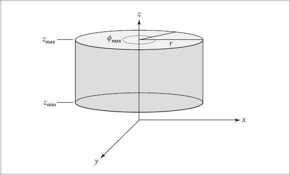

*Figure 6.7: Basic Setting for the Cylinder Shape. The cylinder has a radius of r and covers a range along the z axis. A partial cylinder may be swept by specifying a maximum ϕ value.*

## 6.3 CYLINDERS

Another useful quadric is the cylinder; pbrt provides a cylinder Shape that is centered around the z axis. The user can supply a minimum and maximum z value for the cylinder, as well as a radius and maximum ϕ sweep value (Figure 6.7).

〈Cylinder Definition〉 ≡ class Cylinder { public: 〈Cylinder Public Methods 287〉 private: 〈Cylinder Private Members 287〉 };

In parametric form, a cylinder is described by the following equations:

```text
                      ϕ = u ϕmax
                      x = r cos ϕ
                      y = r sin ϕ
```

```text
                       z = zmin + v(zmax − zmin).
```

*Figure 6.8 shows a rendered image of two cylinders. Like the sphere image, the right cylinder is a complete cylinder, while the left one is a partial cylinder because it has a ϕmax value less than 2π.*

```text
    Cylinder 286
    Shape 261
    Sphere 271
```

Similar to the Sphere constructor, the Cylinder constructor takes transformations that define its object space and the parameters that define the cylinder itself. Its constructor just initializes the corresponding member variables, so we will not include it here.

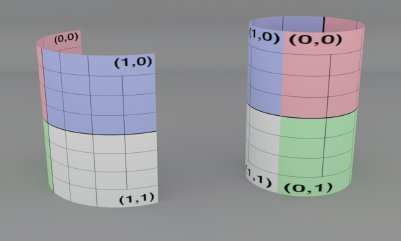

*Figure 6.8: Two Cylinders. A partial cylinder is on the left, and a complete cylinder is on the right.*

〈Cylinder Public Methods〉 ≡ 286

Cylinder(const Transform *renderFromObj, const Transform *objFromRender, bool reverseOrientation, Float radius, Float zMin, Float zMax, Float phiMax); 〈Cylinder Private Members〉 ≡ 286

```rust
   const Transform *renderFromObject, *objectFromRender;
   bool reverseOrientation, transformSwapsHandedness;
   Float radius, zMin, zMax, phiMax;
```

### 6.3.1 AREA AND BOUNDING

A cylinder is a rolled-up rectangle. If you unroll the rectangle, its height is zmax − zmin, and its width is rϕmax:

〈Cylinder Public Methods〉 +≡ 286

```rust
   Float Area() const { return (zMax - zMin) * radius * phiMax; }
```

As was done with the sphere, the cylinder’s spatial bounding method computes a conservative bounding box using the z range but does not take into account the maximum ϕ.

〈Cylinder Method Definitions〉 ≡ Bounds3f Cylinder::Bounds() const { return (*renderFromObject)(Bounds3f({-radius, -radius, zMin}, { radius, radius, zMax})); }

```rust
    Bounds3f 97
    Cylinder 286
    Cylinder::phiMax 287
    Cylinder::radius 287
    Cylinder::renderFromObject 287
    Cylinder::zMax 287
    Cylinder::zMin 287
    DirectionCone 114
    DirectionCone::EntireSphere() 115
    Float 23
    Transform 120
```

Its surface normal bounding function is conservative in two ways: not only does it not account for ϕmax < 2π, but the actual set of normals of a cylinder can be described by a circle on the sphere of all directions. However, DirectionCone’s representation is not able to bound such a distribution more tightly than with the entire sphere of directions, and so that is the bound that is returned.

〈Cylinder Public Methods〉 +≡ 286

```rust
   DirectionCone NormalBounds() const { return DirectionCone::EntireSphere();
   }
```

### 6.3.2 INTERSECTION TESTS

Also similar to the sphere (and for similar reasons), Cylinder provides a BasicIntersect() method that returns a QuadricIntersection as well as an InteractionFromIntersection() method that converts that to a full SurfaceInteraction. Given these, the Intersect() method is again a simple composition of them. (If pbrt used virtual functions, a design alternative would be to have a

QuadricShape class that provided a default Intersect() method and left BasicIntersect() and InteractionFromIntersection() as pure virtual functions for subclasses to implement.)

〈Cylinder Public Methods〉 +≡ 286

```rust
   Option<ShapeIntersection> Intersect(const Ray &ray,
                                             Float tMax = Infinity) const {
        Option<QuadricIntersection> isect = BasicIntersect(ray, tMax);
        if (!isect) return {};
        SurfaceInteraction intr =
            InteractionFromIntersection(*isect, -ray.d, ray.time);
        return ShapeIntersection{intr, isect->tHit};
   }
```

The form of the BasicIntersect() method also parallels the sphere’s, computing appropriate quadratic coefficients, solving the quadratic equation, and then handling the various cases for partial cylinders. A number of fragments can be reused from the Sphere’s implementation.

〈Cylinder Public Methods〉 +≡ 286

```rust
   Option<QuadricIntersection> BasicIntersect(const Ray &r,
                                                                  Float tMax) const {
        Float phi;
        Point3f pHit;
        〈Transform Ray origin and direction to object space 273〉
        〈Solve quadratic equation to find cylinder t0 and t1 values 288〉
        〈Check quadric shape t0 and t1 for nearest intersection 275〉
        〈Compute cylinder hit point and ϕ 289〉
        〈Test cylinder intersection against clipping parameters 289〉
        〈Return QuadricIntersection for cylinder intersection 289〉
   }
```

```rust
    Cylinder::BasicIntersect() 288
    Cylinder::InteractionFromIntersection() 290
    Float 23
    Infinity 361
    Interval 1057
    Point3f 92
    QuadricIntersection 273
    QuadricIntersection::tHit 273
    Ray 95
    Ray::d 95
    Ray::time 95
    ShapeIntersection 266
```

```text
    Sphere 271
    SurfaceInteraction 138
```

As before, the fragment that computes the quadratic discriminant, 〈Compute cylinder quadratic discriminant discrim〉, is defined in Section 6.8.3 after topics related to floating-point accuracy have been discussed.

〈Solve quadratic equation to find cylinder t0 and t1 values〉 ≡ 288

```rust
   Interval t0, t1;
   〈Compute cylinder quadratic coefficients 289〉
   〈Compute cylinder quadratic discriminant discrim 372〉
   〈Compute quadratic t values 275〉
```

As with spheres, the ray–cylinder intersection formula can be found by substituting the ray equation into the cylinder’s implicit equation. The implicit equation for an infinitely long cylinder centered on the z axis with radius r is x2 + y2 − r2 = 0. Substituting the ray equation, Equation (3.4), we have

```text
                                    (ox + tdx)2 + (oy + tdy)2 = r2.
```

When we expand this equation and find the coefficients of the quadratic equation at2 + bt + c = 0, we

have

〈Compute cylinder quadratic coefficients〉 ≡ 288

```rust
   Interval a = Sqr(di.x) + Sqr(di.y);
   Interval b = 2 * (di.x * oi.x + di.y * oi.y);
   Interval c = Sqr(oi.x) + Sqr(oi.y) - Sqr(Interval(radius));
```

As with spheres, the implementation refines the computed intersection point to reduce the rounding error in the point computed by evaluating the ray equation; see Section 6.8.5. Afterward, we invert the parametric description of the cylinder to compute ϕ from x and y; it turns out that the result is the same as for the sphere.

〈Compute cylinder hit point and ϕ〉 ≡ 288, 289

```rust
   pHit = Point3f(oi) + (Float)tShapeHit * Vector3f(di);
   〈Refine cylinder intersection point 375〉
   phi = std::atan2(pHit.y, pHit.x);
   if (phi < 0) phi += 2 * Pi;
```

The next step in the intersection method makes sure that the hit is in the specified z range and that the angle ϕ is acceptable. If not, it rejects the hit and checks t1 if it has not already been considered—these tests resemble the conditional logic in Sphere::Intersect().

〈Test cylinder intersection against clipping parameters〉 ≡ 288

```rust
   if (pHit.z < zMin || pHit.z > zMax || phi > phiMax) {
          if (tShapeHit == t1)
             return {};
          tShapeHit = t1;
          if (t1.UpperBound() > tMax)
             return {};
          〈Compute cylinder hit point and ϕ 289〉
          if (pHit.z < zMin || pHit.z > zMax || phi > phiMax)
             return {};
   }
```

```rust
    Cylinder::BasicIntersect() 288
    Cylinder::phiMax 287
    Cylinder::zMax 287
    Cylinder::zMin 287
    Float 23
    Infinity 361
    Interval 1057
    Interval::UpperBound() 1059
    Pi 1033
    Point3f 92
    QuadricIntersection 273
    Ray 95
    Sphere::Intersect() 273
    Sqr() 1034
    SurfaceInteraction 138
    Vector3f 86
```

For a successful intersection, the same three values suffice to provide enough information to later compute the corresponding SurfaceInteraction.

〈Return QuadricIntersection for cylinder intersection〉 ≡ 288

```rust
   return QuadricIntersection{Float(tShapeHit), pHit, phi};
```

As with the sphere, IntersectP()’s implementation is a simple wrapper around Basic Intersect().

〈Cylinder Public Methods〉 +≡ bool IntersectP(const Ray &r, Float tMax = Infinity) const { return BasicIntersect(r, tMax).has_value(); }

InteractionFromIntersection() computes all the quantities needed to initialize a Surface Interaction from a cylinder’s QuadricIntersection.

〈Cylinder Public Methods〉 +≡ 286

```rust
   SurfaceInteraction InteractionFromIntersection(
           const QuadricIntersection &isect, Vector3f wo, Float time) const {
        Point3f pHit = isect.pObj;
        Float phi = isect.phi;
        〈Find parametric representation of cylinder hit 290〉
        〈Compute error bounds for cylinder intersection 375〉
        〈Return SurfaceInteraction for quadric intersection 279〉
   }
```

Again the parametric u value is computed by scaling ϕ to lie between 0 and 1. Inversion of the parametric equation for the cylinder’s z value gives the v parametric coordinate.

〈Find parametric representation of cylinder hit〉 ≡ 290

```rust
   Float u = phi / phiMax;
   Float v = (pHit.z - zMin) / (zMax - zMin);
   〈Compute cylinder ∂p/∂u and ∂p/∂v 290〉
   〈Compute cylinder ∂n/∂u and ∂n/∂v 290〉
```

The partial derivatives for a cylinder are easy to derive:

〈Compute cylinder ∂p/∂u and ∂p/∂v〉 ≡ 290

```rust
   Vector3f dpdu(-phiMax * pHit.y, phiMax * pHit.x, 0);
   Vector3f dpdv(0, 0, zMax - zMin);
```

We again use the Weingarten equations to compute the parametric partial derivatives of the cylinder

normal. The relevant partial derivatives are

〈Compute cylinder ∂n/∂u and ∂n/∂v〉 ≡ 290

```rust
   Vector3f d2Pduu = -phiMax * phiMax * Vector3f(pHit.x, pHit.y, 0);
   Vector3f d2Pduv(0, 0, 0), d2Pdvv(0, 0, 0);
   〈Compute coefficients for fundamental forms 279〉
   〈Compute ∂n/∂u and ∂n/∂v from fundamental form coefficients 279〉
```

```text
    Cylinder::phiMax 287
    Cylinder::zMax 287
    Cylinder::zMin 287
    Float 23
    Point3f 92
    QuadricIntersection 273
    QuadricIntersection::phi 273
    QuadricIntersection::pObj 273
    SurfaceInteraction 138
    Vector3f 86
```

### 6.3.3 SAMPLING

Uniformly sampling the surface area of a cylinder is straightforward: uniform sampling of the height and ϕ give uniform area sampling. Intuitively, it can be understood that this approach works because a cylinder is just a rolled-up rectangle.

〈Cylinder Public Methods〉 +≡ 286

```rust
   Option<ShapeSample> Sample(Point2f u) const {
        Float z = Lerp(u[0], zMin, zMax);
        Float phi = u[1] * phiMax;
        〈Compute cylinder sample position pi and normal n from z and ϕ 291〉
        Point2f uv(phi / phiMax, (pObj.z - zMin) / (zMax - zMin));
        return ShapeSample{Interaction(pi, n, uv), 1 / Area()};
   }
```

Given z and ϕ, the corresponding object-space position and normal are easily found.

〈Compute cylinder sample position pi and normal n from z and ϕ〉 ≡ 291

Point3f pObj = Point3f(radius * std::cos(phi), radius * std::sin(phi), z); 〈Reproject pObj to cylinder surface and compute pObjError 376〉 Point3fi pi = (*renderFromObject)(Point3fi(pObj, pObjError)); Normal3f n = Normalize((*renderFromObject)(Normal3f(pObj.x, pObj.y, 0))); if (reverseOrientation) n *= -1; 〈Cylinder Public Methods〉 +≡ 286

```rust
   Float PDF(const Interaction &) const { return 1 / Area(); }
```

Unlike the Sphere, pbrt’s Cylinder does not have a specialized solid angle sampling method. Instead, it samples a point on the cylinder uniformly by area without making use of the reference point before converting the area density for that point to a solid angle density before returning it. Both the Sample() and PDF() methods can be implemented using the same fragments that were used for solid angle sampling of reference points inside spheres.

〈Cylinder Public Methods〉 +≡ 286

pstd::optional<ShapeSample> Sample(const ShapeSampleContext &ctx, Point2f u) const { 〈Sample shape by area and compute incident direction wi 282〉 〈Convert area sampling PDF in ss to solid angle measure 282〉 return ss; } 〈Cylinder Public Methods〉 +≡ 286

```rust
   Float PDF(const ShapeSampleContext &ctx, Vector3f wi) const {
        〈Intersect sample ray with shape geometry 285〉
        〈Compute PDF in solid angle measure from shape intersection point 285〉
        return pdf;
   }
```

```rust
    Cylinder::Area() 287
    Cylinder::phiMax 287
    Cylinder::radius 287
    Cylinder::reverseOrientation 287
    Cylinder::zMax 287
    Cylinder::zMin 287
    Disk 292
    Float 23
    Interaction 136
    Lerp() 72
    Normal3f 94
    Point2f 92
```

```text
    Point3f 92
    Point3fi 1061
    ShapeSample 268
    ShapeSampleContext 268
    Sphere 271
    Vector3f 86
```

## 6.4 DISKS

The disk is an interesting quadric since it has a particularly straightforward intersection routine that avoids solving the quadratic equation. In pbrt, a Disk is a circular disk of radius r at height h along the z axis.

To describe partial disks, the user may specify a maximum ϕ value beyond which the disk is cut off (Figure 6.9). The disk can also be generalized to an annulus by specifying an inner radius, ri. In parametric form, it is described by

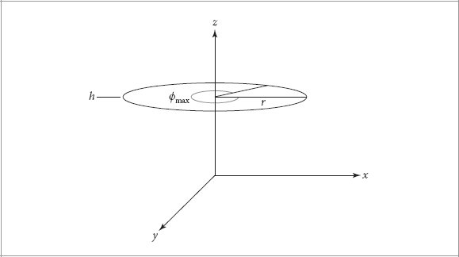

*Figure 6.9: Basic Setting for the Disk Shape. The disk has radius r and is located at height h along the z axis. A partial disk may be swept by specifying a maximum ϕ value and an inner radius ri.*

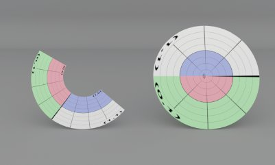

*Figure 6.10: Two Disks. A partial disk is on the left, and a complete disk is on the right.*

```text
                       ϕ = u ϕmax
                       x = ((1 − v)r + vri) cos ϕ
                       y = ((1 − v)r + vri) sin ϕ
                       z = h.
```

*Figure 6.10 is a rendered image of two disks.*

〈Disk Definition〉 ≡ class Disk { public: 〈Disk Public Methods 293〉 private: 〈Disk Private Members 293〉 };

The Disk constructor directly initializes its various member variables from the values passed to it. We have omitted it here because it is trivial.

〈Disk Private Members〉 ≡ 292

```rust
   const Transform *renderFromObject, *objectFromRender;
   bool reverseOrientation, transformSwapsHandedness;
   Float height, radius, innerRadius, phiMax;
```

### 6.4.1 AREA AND BOUNDING

Disks have easily computed surface area, since they are just portions of an annulus:

〈Disk Public Methods〉 ≡ 292

```rust
   Float Area() const {
        return phiMax * 0.5f * (Sqr(radius) - Sqr(innerRadius));
   }
```

The bounding method is also quite straightforward; it computes a bounding box centered at the height of the disk along z, with extent of radius in both the x and y directions.

〈Disk Method Definitions〉 ≡ Bounds3f Disk::Bounds() const { return (*renderFromObject)( Bounds3f(Point3f(-radius, -radius, height), Point3f( radius, radius, height))); }

A disk has a single surface normal.

〈Disk Method Definitions〉 +≡ DirectionCone Disk::NormalBounds() const { Normal3f n = (*renderFromObject)(Normal3f(0, 0, 1)); if (reverseOrientation) n = -n; return DirectionCone(Vector3f(n)); }

```rust
    Bounds3f 97
    Cylinder::Intersect() 288
    DirectionCone 114
    Disk::height 293
    Disk::innerRadius 293
    Disk::phiMax 293
    Disk::radius 293
    Disk::renderFromObject 293
    Disk::reverseOrientation 293
    Float 23
    Normal3f 94
    Point3f 92
    QuadricIntersection 273
```

```text
    Ray 95
    Sphere::Intersect() 273
    Sqr() 1034
    Transform 120
    Vector3f 86
```

### 6.4.2 INTERSECTION TESTS

The Disk intersection test methods follow the same form as the earlier quadrics. We omit Intersect(), as it is exactly the same as Sphere::Intersect() and Cylinder::Intersect(), with calls to BasicIntersect() and then InteractionFromIntersection().

The basic intersection test for a ray with a disk is easy. The intersection of the ray with the z = h plane that the disk lies in is found and then the intersection point is checked to see if it lies inside the disk.

〈Disk Public Methods〉 +≡ 292

```rust
   Option<QuadricIntersection> BasicIntersect(const Ray &r,
                                                                 Float tMax) const {
        〈Transform Ray origin and direction to object space 273〉
        〈Compute plane intersection for disk 294〉
        〈See if hit point is inside disk radii and ϕmax 294〉
         〈Return QuadricIntersection for disk intersection 295〉
    }
```

The first step is to compute the parametric t value where the ray intersects the plane that the disk lies in. We want to find t such that the z component of the ray’s position is equal to the height of the disk. Thus, h = oz + tdz

and so

The intersection method computes a t value and checks to see if it is inside the range of values (0, tMax). If not, the routine can report that there is no intersection.

〈Compute plane intersection for disk〉 ≡ 293

```rust
   〈Reject disk intersections for rays parallel to the disk’s plane 294〉
   Float tShapeHit = (height - Float(oi.z)) / Float(di.z);
   if (tShapeHit <= 0 || tShapeHit >= tMax)
        return {};
```

If the ray is parallel to the disk’s plane (i.e., the z component of its direction is zero), no intersection is reported. The case where a ray is both parallel to the disk’s plane and lies within the plane is somewhat ambiguous, but it is most reasonable to define intersecting a disk edge-on as “no intersection.” This case must be handled explicitly so that not-a-number floating-point values are not generated by the following code.

〈Reject disk intersections for rays parallel to the disk’s plane〉 ≡ 294

```rust
   if (Float(di.z) == 0)
         return {};
```

Now the intersection method can compute the point pHit where the ray intersects the plane. Once the plane intersection is known, an invalid intersection is returned if the distance from the hit to the center of the disk is more than Disk::radius or less than Disk::innerRadius. This check can be optimized by computing the squared distance to the center, taking advantage of the fact that the x and y coordinates of the center point (0, 0, height) are zero, and the z coordinate of pHit is equal to height.

〈See if hit point is inside disk radii and ϕmax〉 ≡ 293

```rust
    Point3f pHit = Point3f(oi) + (Float)tShapeHit * Vector3f(di);
    Float dist2 = Sqr(pHit.x) + Sqr(pHit.y);
    if (dist2 > Sqr(radius) || dist2 < Sqr(innerRadius))
         return {};
    〈Test disk ϕ value against ϕmax 294〉
```

If the distance check passes, a final test makes sure that the ϕ value of the hit point is between zero and ϕmax, specified by the caller. Inverting the disk’s parameterization gives the same expression for ϕ as the other quadric shapes. Because a ray can only intersect a disk once, there is no need to consider a second intersection if this test fails, as was the case with the two earlier quadrics.

```rust
    Disk::height 293
    Disk::innerRadius 293
    Disk::phiMax 293
    Disk::radius 293
    Float 23
    Pi 1033
    Point3f 92
    Sqr() 1034
    Vector3f 86
```

〈Test disk ϕ value against ϕmax〉 ≡ 294

```rust
    Float phi = std::atan2(pHit.y, pHit.x);
    if (phi < 0) phi += 2 * Pi;
    if (phi > phiMax)
        return {};
```

〈Return QuadricIntersection for disk intersection〉 ≡ 293

```rust
   return QuadricIntersection{tShapeHit, pHit, phi};
```

Finding the SurfaceInteraction corresponding to a disk intersection follows the same process of inverting the parametric representation we have seen before.

〈Disk Public Methods〉 +≡ 292

```rust
   SurfaceInteraction InteractionFromIntersection(
           const QuadricIntersection &isect, Vector3f wo, Float time) const {
        Point3f pHit = isect.pObj;
        Float phi = isect.phi;
        〈Find parametric representation of disk hit 295〉
        〈Refine disk intersection point 375〉
        〈Compute error bounds for disk intersection 376〉
        〈Return SurfaceInteraction for quadric intersection 279〉
   }
```

The parameter u is first scaled to reflect the partial disk specified by ϕmax, and v is computed by inverting the parametric equation. The equations for the partial derivatives at the hit point can be derived with a process similar to that used for the previous quadrics. Because the normal of a disk is the same everywhere, the partial derivatives ∂n/∂u and ∂n/∂v are both trivially (0, 0, 0).

〈Find parametric representation of disk hit〉 ≡ 295

```rust
   Float u = phi / phiMax;
   Float rHit = std::sqrt(Sqr(pHit.x) + Sqr(pHit.y));
   Float v = (radius - rHit) / (radius - innerRadius);
```

```rust
    Vector3f dpdu(-phiMax * pHit.y, phiMax * pHit.x, 0);
    Vector3f dpdv = Vector3f(pHit.x, pHit.y, 0) * (innerRadius - radius) /
    rHit;
    Normal3f dndu(0, 0, 0), dndv(0, 0, 0);
```

As usual, the implementation of IntersectP() is straightforward.

〈Disk Public Methods〉 +≡ 292

```rust
   bool IntersectP(const Ray &r, Float tMax = Infinity) const {
        return BasicIntersect(r, tMax).has_value();
   }
```

```rust
    Disk 292
    Disk::Area() 293
    Disk::BasicIntersect() 293
    Disk::height 293
    Disk::innerRadius 293
    Disk::phiMax 293
    Disk::radius 293
    Disk::renderFromObject 293
    Disk::reverseOrientation 293
    Float 23
    Infinity 361
    Interaction 136
    Normal3f 94
    Normalize() 88
    Point2f 92
    Point3f 92
    Point3fi 1061
    QuadricIntersection 273
    Ray 95
    SampleUniformDiskConcentric() 1014
    ShapeSample 268
    Sqr() 1034
    SurfaceInteraction 138
    Vector3f 86
```

### 6.4.3 SAMPLING

The Disk area sampling method uses a utility routine, SampleUniformDiskConcentric(), that uniformly samples a unit disk. (It is defined in Section A.5.1.) The point that it returns is then scaled by the radius and offset in z so that it lies on the disk of a given radius and height. Note that our implementation here does not account for partial disks due to Disk::innerRadius being nonzero or Disk::phiMax being less than 2π. Fixing this bug is left for an exercise at the end of the chapter.

〈Disk Public Methods〉 +≡ 292

```rust
   Option<ShapeSample> Sample(Point2f u) const {
        Point2f pd = SampleUniformDiskConcentric(u);
        Point3f pObj(pd.x * radius, pd.y * radius, height);
        Point3fi pi = (*renderFromObject)(Point3fi(pObj));
        Normal3f n = Normalize((*renderFromObject)(Normal3f(0, 0, 1)));
        if (reverseOrientation)
             n *= -1;
        〈Compute (u, v) for sampled point on disk 296〉
        return ShapeSample{Interaction(pi, n, uv), 1 / Area()};
   }
```

The same computation as in the Intersect() method gives the parametric (u, v) for the sampled point.

〈Compute (u, v) for sampled point on disk〉 ≡ 295

Float phi = std::atan2(pd.y, pd.x); if (phi < 0) phi += 2 * Pi; Float radiusSample = std::sqrt(Sqr(pObj.x) + Sqr(pObj.y)); Point2f uv(phi / phiMax, (radius - radiusSample) / (radius - innerRadius)); 〈Disk Public Methods〉 +≡ 292

```rust
   Float PDF(const Interaction &) const { return 1 / Area(); }
```

We do not provide a specialized solid angle sampling method for disks, but follow the same approach that we did for cylinders, sampling uniformly by area and then computing the probability density to be with respect to solid angle. The implementations of those methods are not included here, as they are the same as they were for cylinders.

## 6.5 TRIANGLE MESHES

The triangle is one of the most commonly used shapes in computer graphics; complex scenes may be modeled using millions of triangles to achieve great detail. (Figure 6.11 shows an image of a complex triangle mesh of over four million triangles.) While a natural representation would be to have a Triangle shape implementation where each triangle stored the positions of its three vertices, a more memory-efficient representation is to separately store entire triangle meshes with an array of vertex positions where each individual triangle just stores three offsets into this array for its three vertices. To see why this is the case, consider the celebrated Euler–Poincaré formula, which relates the number of vertices V, edges E, and faces F on closed discrete meshes as V − E + F = 2(1 − g), where g ∈ ℕ is the genus of the mesh. The genus is usually a small number and can be interpreted as the number of “handles” in the mesh (analogous to a handle of a teacup). On a triangle mesh, the

number of edges and vertices is furthermore related by the identity This can be seen by dividing each edge into two parts associated with the two adjacent triangles. There are 3F such half-edges, and all colocated pairs constitute the E mesh edges. For large closed triangle meshes, the overall effect of the genus usually becomes negligible and we can combine the previous two equations (with g = 0) to obtain F ≈ 2V.

```rust
    Disk::Area() 293
    Disk::innerRadius 293
    Disk::phiMax 293
    Disk::radius 293
    Float 23
    Interaction 136
    Pi 1033
    Point2f 92
    Sqr() 1034
```

In other words, there are approximately twice as many faces as vertices. Since each face references three vertices, every vertex is (on average) referenced a total of six times. Thus, when vertices are shared, the total amortized storage required per triangle will be 12 bytes of memory for the offsets (at 4 bytes for three 32-bit integer offsets) plus half of the storage for one vertex—6 bytes, assuming three 4-byte floats are used to store the vertex position—for a total of 18 bytes per triangle. This is much better than the 36 bytes per triangle that storing the three positions directly would require. The relative storage savings are even better when there are per-vertex surface normals or texture coordinates in a mesh.

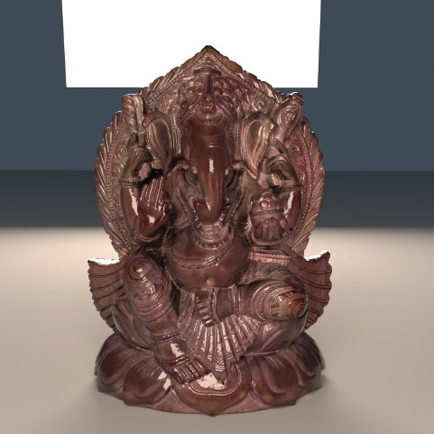

*Figure 6.11: Ganesha Model. This triangle mesh contains over four million individual triangles. It was created from a real statue using a 3D scanner that uses structured light to determine shapes of objects.*

### 6.5.1 MESH REPRESENTATION AND STORAGE

pbrt uses the TriangleMesh class to store the shared information about a triangle mesh. It is defined in the files util/mesh.rs and util/mesh.rs.

〈TriangleMesh Definition〉 ≡ class TriangleMesh { public: 〈TriangleMesh Public Methods〉 〈TriangleMesh Public Members 298〉 };

In addition to the mesh vertex positions and vertex indices, per-vertex normals n, tangent vectors s, and texture coordinates uv may be provided. The corresponding vectors should be empty if there are no such values or should be the same size as p otherwise.

```text
    TriangleMesh 297
```

〈TriangleMesh Method Definitions〉 ≡ TriangleMesh::TriangleMesh( const Transform &renderFromObject, bool reverseOrientation, std::vector<int> indices, std::vector<Point3f> p, std::vector<Vector3f> s, std::vector<Normal3f> n, std::vector<Point2f> uv, std::vector<int> faceIndices, Allocator alloc) : nTriangles(indices.size() / 3), nVertices(p.size()) { 〈Initialize mesh vertexIndices 298〉 〈Transform mesh vertices to rendering space and initialize mesh p 301〉 〈Remainder of TriangleMesh constructor〉 }

The mesh data is made available via public member variables; as with things like coordinates of points or rays’ directions, there would be little benefit and some bother from information hiding in this case.

〈TriangleMesh Public Members〉 ≡ 297

```rust
   int nTriangles, nVertices;
   const int *vertexIndices = nullptr;
   const Point3f *p = nullptr;
```

Although its constructor takes std::vector parameters, TriangleMesh stores plain pointers to its data arrays. The vertexIndices pointer points to 3 * nTriangles values, and the per-vertex pointers, if not nullptr, point to nVertices values.

We chose this design so that different TriangleMeshes could potentially point to the same arrays in memory in the case that they were both given the same values for some or all of their parameters. Although pbrt offers capabilities for object instancing, where multiple copies of the same geometry can be placed in the scene with different transformation matrices (e.g., via the TransformedPrimitive that is described in Section 7.1.2), the scenes provided to it do not always make full use of this capability. For example, with the landscape scene in Figures 5.11 and 7.2, over 400 MB is saved from detecting such redundant arrays.

The BufferCache class handles the details of storing a single unique copy of each buffer provided to it. Its LookupOrAdd() method, to be defined shortly, takes a std::vector of the type it manages and returns a pointer to memory that stores the same values.

〈Initialize mesh vertexIndices〉 ≡ 298

```rust
    vertexIndices = intBufferCache->LookupOrAdd(indices, alloc);
```

```text
    Allocator 40
    BufferCache 299
    BufferCache::LookupOrAdd() 300
    intBufferCache 298
    Normal3f 94
    Point2f 92
    Point3f 92
    Transform 120
    TransformedPrimitive 403
    TriangleMesh 297
    TriangleMesh::vertexIndices 298
    Vector3f 86
```

The BufferCaches are made available through global variables in the pbrt namespace. Additional ones, not included here, handle normals, tangent vectors, and texture coordinates.

〈BufferCache Global Declarations〉 ≡ extern BufferCache<int> *intBufferCache; extern BufferCache<Point3f> *point3BufferCache;

The BufferCache class is templated based on the array element type that it stores.

〈BufferCache Definition〉 ≡ template <typename T> class BufferCache { public: 〈BufferCache Public Methods 300〉 private: 〈BufferCache::Buffer Definition 299〉 〈BufferCache::BufferHasher Definition 300〉 〈BufferCache Private Members 299〉 };

BufferCache allows concurrent use by multiple threads so that multiple meshes can be added to the scene in parallel; the scene construction code in Appendix C takes advantage of this capability. While a single mutex could be used to manage access to it, contention over that mutex by multiple threads can inhibit concurrency, reducing the benefits of multi-threading. Therefore, the cache is broken into 64 independent shards, each holding a subset of the entries. Each shard has its own mutex, allowing different threads to concurrently access different shards.

〈BufferCache Private Members〉 ≡ 299

```rust
   static constexpr int logShards = 6;
   static constexpr int nShards = 1 << logShards;
```

```rust
   std::shared_mutex mutex[nShards];
   std::unordered_set<Buffer, BufferHasher> cache[nShards];
```

Buffer is a small helper class that wraps an allocation managed by the BufferCache.

〈BufferCache::Buffer Definition〉 ≡ 299

```rust
   struct Buffer {
        〈BufferCache::Buffer Public Methods 299〉
        const T *ptr = nullptr;
        size_t size = 0, hash;
   };
```

The Buffer constructor computes the buffer’s hash, which is stored in a member variable.

〈BufferCache::Buffer Public Methods〉 ≡ 299

```rust
   Buffer(const T *ptr, size_t size) : ptr(ptr), size(size) {
        hash = HashBuffer(ptr, size);
   }
```

An equality operator, which is required by the std::unordered_set, only returns true if both buffers are the same size and store the same values.

〈BufferCache::Buffer Public Methods〉 +≡ 299

```rust
   bool operator==(const Buffer &b) const {
        return size == b.size && hash == b.hash &&
            std::memcmp(ptr, b.ptr, size * sizeof(T)) == 0;
   }
```

```text
    BufferCache::Buffer::hash 299
    BufferCache::Buffer::ptr 299
    BufferCache::Buffer::size 299
    BufferCache::logShards 299
    BufferCache::nShards 299
    HashBuffer() 1042
```

BufferHasher is another helper class, used by std::unordered_set. It returns the buffer’s already-computed hash.

〈BufferCache::BufferHasher Definition〉 ≡ 299

```rust
   struct BufferHasher {
        size_t operator()(const Buffer &b) const {
            return b.hash;
```

```rust
         }
    };
```

The BufferCache LookUpOrAdd() method checks to see if the values stored by the provided buffer are already in the cache and returns a pointer to them if so. Otherwise, it allocates memory to store them and returns a pointer to it.

〈BufferCache Public Methods〉 ≡ 299

```rust
   const T *LookupOrAdd(pstd::span<const T> buf, Allocator alloc) {
        〈Return pointer to data if buf contents are already in the cache 300〉
        〈Add buf contents to cache and return pointer to cached copy 300〉
   }
```

The pstd::span’s contents need to be wrapped in a Buffer instance to be able to search for a matching buffer in the cache. The buffer’s pointer is returned if it is already present. Because the cache is only read here and is not being modified, the lock_shared() capability of std::shared_mutex is used here, allowing multiple threads to read the hash table concurrently.

〈Return pointer to data if buf contents are already in the cache〉 ≡ 300

```rust
   Buffer lookupBuffer(buf.data(), buf.size());
   int shardIndex = uint32_t(lookupBuffer.hash) >> (32 - logShards);
   mutex[shardIndex].lock_shared();
   if (auto iter = cache[shardIndex].find(lookupBuffer);
        iter != cache[shardIndex].end()) {
        const T *ptr = iter->ptr;
        mutex[shardIndex].unlock_shared();
        return ptr;
   }
```

Otherwise, memory is allocated using the allocator to store the buffer, and the values are copied from the provided span before the Buffer is added to the cache. An exclusive lock to the mutex must be held in order to modify the cache; one is acquired by giving up the shared lock and then calling the regular lock() method.

〈Add buf contents to cache and return pointer to cached copy〉 ≡ 300

```rust
   mutex[shardIndex].unlock_shared();
   T *ptr = alloc.allocate_object<T>(buf.size());
   std::copy(buf.begin(), buf.end(), ptr);
   mutex[shardIndex].lock();
   〈Handle the case of another thread adding the buffer first 301〉
   cache[shardIndex].insert(Buffer(ptr, buf.size()));
   mutex[shardIndex].unlock();
```

```rust
    return ptr;
```

```text
    Allocator 40
    BufferCache::Buffer::hash 299
    BufferCache::cache 299
    BufferCache::mutex 299
    std::pmr::polymorphic_allocator::allocate_object() 41
```

It is possible that another thread may have added the buffer to the cache before the current thread is able to; if the same buffer is being added by multiple threads concurrently, then one will end up acquiring the exclusive lock before the other. In that rare case, a pointer to the already-added buffer is returned and the memory allocated by this thread is released.

〈Handle the case of another thread adding the buffer first〉 ≡ 300

if (auto iter = cache[shardIndex].find(lookupBuffer); iter != cache[shardIndex].end()) { const T *cachePtr = iter->ptr; mutex[shardIndex].unlock(); alloc.deallocate_object(ptr, buf.size()); return cachePtr; }

Returning now to the TriangleMesh constructor, the vertex positions are processed next. Unlike the other shapes that leave the shape description in object space and then transform incoming rays from rendering space to object space, triangle meshes transform the shape into rendering space and thus save the work of transforming incoming rays into object space and the work of transforming the intersection’s geometric representation out to rendering space. This is a good idea because this operation can be performed once at startup, avoiding transforming rays many times during rendering. Using this approach with quadrics is more complicated, although possible—see Exercise 6.1 at the end of the chapter.

The resulting points are also provided to the buffer cache, though after the rendering from object transformation has been applied. Because the positions were transformed to rendering space, this cache lookup is rarely successful. The hit rate would likely be higher if positions were left in object space, though doing so would require additional computation to transform vertex positions when they were accessed. Vertex indices and uv texture coordinates fare better with the buffer cache, however.

〈Transform mesh vertices to rendering space and initialize mesh p〉 ≡ 298

```rust
   for (Point3f &pt : p)
        pt = renderFromObject(pt);
   this->p = point3BufferCache->LookupOrAdd(p, alloc);
```

We will omit the remainder of the TriangleMesh constructor, as handling the other per-vertex buffer types is similar to how the positions are processed. The remainder of its member variables are below. In addition to the remainder of the mesh vertex and face data, the TriangleMesh records whether the normals should be flipped by way of the values of reverseOrientation and transformSwapsHandedness. Because these two have the same value for all triangles in a mesh, memory can be saved by storing them once with the mesh itself rather than redundantly with each of the triangles.

〈TriangleMesh Public Members〉 +≡ 297

```rust
   const Normal3f *n = nullptr;
   const Vector3f *s = nullptr;
   const Point2f *uv = nullptr;
   bool reverseOrientation, transformSwapsHandedness;
```

```text
    BufferCache::Buffer::ptr 299
    BufferCache::cache 299
    BufferCache::LookupOrAdd() 300
    BufferCache::mutex 299
    Normal3f 94
    Point2f 92
    point3BufferCache 298
    Point3f 92
    Shape 261
    std::pmr::polymorphic_allocator:: deallocate_object() 41
    Triangle 301
    TriangleMesh 297
    TriangleMesh::p 298
    Vector3f 86
```

### 6.5.2 Triangle CLASS

The Triangle class actually implements the Shape interface. It represents a single triangle.

〈Triangle Definition〉 ≡ class Triangle { public: 〈Triangle Public Methods 302〉 private: 〈Triangle Private Methods 302〉 〈Triangle Private Members 302〉 };

Because complex scenes may have billions of triangles, it is important to minimize the amount of memory that each triangle uses. pbrt stores pointers to all the TriangleMeshes for the scene in a vector, which allows each triangle to be represented using just two integers: one to record which mesh it is a part of and another to record which triangle in the mesh it represents. With 4-byte ints, each Triangle uses just 8 bytes of memory.

Given this compact representation of triangles, recall the discussion in Section 1.5.7 about the memory cost of classes with virtual functions: if Triangle inherited from an abstract Shape base class that defined pure virtual functions, the virtual function pointer with each Triangle alone would double its size, assuming a 64-bit architecture with 8-byte pointers.

〈Triangle Public Methods〉 ≡ 301

Triangle(int meshIndex, int triIndex) : meshIndex(meshIndex), triIndex(triIndex) {} 〈Triangle Private Members〉 ≡ 301

```rust
   int meshIndex = -1, triIndex = -1;
   static pstd::vector<const TriangleMesh *> *allMeshes;
```

The bounding box of a triangle is easily found by computing a bounding box that encompasses its three vertices. Because the vertices have already been transformed to rendering space, no transformation of the bounds is necessary.

〈Triangle Method Definitions〉 ≡ Bounds3f Triangle::Bounds() const { 〈Get triangle vertices in p0, p1, and p2 302〉 return Union(Bounds3f(p0, p1), p2); }

Finding the positions of the three triangle vertices requires some indirection: first the mesh pointer must be found; then the indices of the three triangle vertices can be found given the triangle’s index in the mesh; finally, the positions can be read from the mesh’s p array. We will reuse this fragment repeatedly in the following, as the vertex positions are needed in many of the Triangle methods.

〈Get triangle vertices in p0, p1, and p2〉 ≡ 302, 303, 309, 313, 317,

```rust
   const TriangleMesh *mesh = GetMesh();
   const int *v = &mesh->vertexIndices[3 * triIndex];
   Point3f p0 = mesh->p[v[0]], p1 = mesh->p[v[1]], p2 = mesh-
   >p[v[2]];
```

The GetMesh() method encapsulates the indexing operation to get the mesh’s pointer.

〈Triangle Private Methods〉 ≡ 301

```rust
   const TriangleMesh *GetMesh() const {
         return (*allMeshes)[meshIndex];
```

```rust
    }
```

```rust
    Bounds3::Union() 99
    Bounds3f 97
    Cross() 91
    Float 23
    Length() 88
    Point3f 92
    Triangle 301
    Triangle::GetMesh() 302
    Triangle::triIndex 302
    TriangleMesh 297
    TriangleMesh::p 298
    TriangleMesh::vertexIndices 298
```

Using the fact that the area of a parallelogram is given by the length of the cross product of the two vectors along its sides, the Area() method computes the triangle area as half the area of the parallelogram formed by two of its edge vectors (see Figure 6.13).

〈Triangle Public Methods〉 +≡ 301

```rust
   Float Area() const {
         〈Get triangle vertices in p0, p1, and p2 302〉
         return 0.5f * Length(Cross(p1 - p0, p2 - p0));
   }
```

Bounding the triangle’s normal should be trivial: a cross product of appropriate edges gives its single normal vector direction. However, two subtleties that affect the orientation of the normal must be handled before the bounds are returned.

〈Triangle Method Definitions〉 +≡ DirectionCone Triangle::NormalBounds() const { 〈Get triangle vertices in p0, p1, and p2 302〉 Normal3f n = Normalize(Normal3f(Cross(p1 - p0, p2 - p0))); 〈Ensure correct orientation of geometric normal for normal bounds 303〉 return DirectionCone(Vector3f(n)); }

The first issue with the returned normal comes from the presence of per-vertex normals, even though it is a bound on geometric normals that NormalBounds() is supposed to return. pbrt requires that both the geometric normal and the interpolated per-vertex normal lie on the same side of the surface. If the two of them are on different sides, then pbrt follows the convention that the geometric normal is the one that should be flipped.

Furthermore, if there are not per-vertex normals, then—as with earlier shapes—the normal is flipped if either ReverseOrientation was specified in the scene description or the rendering to object transformation swaps the coordinate system handedness, but not both. Both of these considerations must be accounted for in the normal returned for the normal bounds.

〈Ensure correct orientation of geometric normal for normal bounds〉 ≡ 303

```rust
   if (mesh->n) {
        Normal3f ns(mesh->n[v[0]] + mesh->n[v[1]] + mesh->n[v[2]]);
        n = FaceForward(n, ns);
   } else if (mesh->reverseOrientation ^ mesh->transformSwapsHandedness)
        n *= -1;
```

Although it is not required by the Shape interface, we will find it useful to be able to compute the solid angle that a triangle subtends from a reference point. The previously defined SphericalTriangleArea() function takes care of this directly.

〈Triangle Public Methods〉 +≡ 301

```rust
   Float SolidAngle(Point3f p) const {
         〈Get triangle vertices in p0, p1, and p2 302〉
         return SphericalTriangleArea(Normalize(p0 - p), Normalize(p1 - p),
                                    Normalize(p2 - p));
   }
```

```rust
    Cross() 91
    DirectionCone 114
    FaceForward() 94
    Float 23
    Normal3f 94
    Normalize() 88
    Point3f 92
    Ray 95
    SphericalTriangleArea() 106
    Triangle 301
    TriangleIntersection 309
    TriangleMesh 297
    TriangleMesh::n 301
    TriangleMesh:: reverseOrientation 301
    TriangleMesh:: transformSwapsHandedness 301
    Vector3f 86
```

### 6.5.3 RAY–TRIANGLE INTERSECTION

Unlike the other shapes so far, pbrt provides a stand-alone triangle intersection function that takes a ray and the three triangle vertices directly. Having this functionality available without needing to instantiate both a Triangle and a TriangleMesh in order to do a ray–triangle intersection test is helpful in a few other parts of the system. The Triangle class intersection methods, described next, use this function in their implementations.

〈Triangle Functions〉 ≡ pstd::optional<TriangleIntersection> IntersectTriangle(const Ray &ray, Float tMax, Point3f p0, Point3f p1, Point3f p2) { 〈Return no intersection if triangle is degenerate 304〉 〈Transform triangle vertices to ray coordinate space 304〉 〈Compute edge function coefficients e0, e1, and e2 307〉 〈Fall back to double-precision test at triangle edges〉 〈Perform triangle edge and determinant tests 308〉 〈Compute scaled hit distance to triangle and test against ray t range 308〉 〈Compute barycentric coordinates and t value for triangle intersection 309〉 〈Ensure that computed triangle t is conservatively greater than zero 384〉 〈Return TriangleIntersection for intersection 309〉 }

pbrt’s ray–triangle intersection test is based on first computing an affine transformation that transforms the ray such that its origin is at (0, 0, 0) in the transformed coordinate system and such that its direction is along the +z axis. Triangle vertices are also transformed into this coordinate system before the intersection test is performed. In the following, we will see that applying this coordinate system transformation simplifies the intersection test logic since, for example, the x and y coordinates of any intersection point must be zero. Later, in Section 6.8.4, we will see that this transformation makes it possible to have a watertight ray–triangle intersection algorithm, such that intersections with tricky rays like those that hit the triangle right on the edge are never incorrectly reported as misses.

One side effect of the transformation that we will apply to the vertices is that, due to floating-point round-off error, a degenerate triangle may be transformed into a non-degenerate triangle. If an intersection is reported with a degenerate triangle, then later code that tries to compute the geometric properties of the intersection will be unable to compute valid results. Therefore, this function starts with testing for a degenerate triangle and returning immediately if one was provided.

〈Return no intersection if triangle is degenerate〉 ≡ 303

```rust
   if (LengthSquared(Cross(p2 - p0, p1 - p0)) == 0)
        return {};
```

There are three steps to computing the transformation from rendering space to the ray–triangle intersection coordinate space: a translation T, a coordinate permutation P, and a shear S. Rather than computing explicit transformation matrices for each of these and then computing an aggregate transformation matrix M = SPT to transform vertices to the coordinate space, the following

implementation applies each step of the transformation directly, which ends up being a more efficient approach.

〈Transform triangle vertices to ray coordinate space〉 ≡ 303

```text
   〈Translate vertices based on ray origin 305〉
   〈Permute components of triangle vertices and ray direction 305〉
   〈Apply shear transformation to translated vertex positions 305〉
```

The translation that places the ray origin at the origin of the coordinate system is:

This transformation does not need to be explicitly applied to the ray origin, but we will apply it to the three triangle vertices.

```text
    Cross() 91
    LengthSquared() 87
```

〈Translate vertices based on ray origin〉 ≡ 304

```rust
   Point3f p0t = p0 - Vector3f(ray.o);
   Point3f p1t = p1 - Vector3f(ray.o);
   Point3f p2t = p2 - Vector3f(ray.o);
```

Next, the three dimensions of the space are permuted so that the z dimension is the one where the absolute value of the ray’s direction is largest. The x and y dimensions are arbitrarily assigned to the other two dimensions. This step ensures that if, for example, the original ray’s z direction is zero, then a dimension with nonzero magnitude is mapped to +z.

For example, if the ray’s direction had the largest magnitude in x, the permutation would be:

As before, it is easiest to permute the dimensions of the ray direction and the translated triangle vertices directly.

〈Permute components of triangle vertices and ray direction〉 ≡ 304

```rust
   int kz = MaxComponentIndex(Abs(ray.d));
   int kx = kz + 1; if (kx == 3) kx = 0;
```

```rust
    int ky = kx + 1; if (ky == 3) ky = 0;
    Vector3f d = Permute(ray.d, {kx, ky, kz});
    p0t = Permute(p0t, {kx, ky, kz});
    p1t = Permute(p1t, {kx, ky, kz});
    p2t = Permute(p2t, {kx, ky, kz});
```

Finally, a shear transformation aligns the ray direction with the +z axis:

To see how this transformation works, consider its operation on the ray direction vector [dx dy dz 0]T.

For now, only the x and y dimensions are sheared; we can wait and shear the z dimension only if the ray intersects the triangle.

〈Apply shear transformation to translated vertex positions〉 ≡ 304

```rust
   Float Sx = -d.x / d.z;
   Float Sy = -d.y / d.z;
   Float Sz = 1 / d.z;
   p0t.x += Sx * p0t.z;
   p0t.y += Sy * p0t.z;
   p1t.x += Sx * p1t.z;
   p1t.y += Sy * p1t.z;
   p2t.x += Sx * p2t.z;
   p2t.y += Sy * p2t.z;
```

```rust
    Float 23
    Point3f 92
    Ray::d 95
    Ray::o 95
    Tuple3::MaxComponentIndex() 85
    Tuple3::Permute() 85
    Vector3f 86
```

Note that the calculations for the coordinate permutation and the shear coefficients only depend on the given ray; they are independent of the triangle. In a high-performance ray tracer, it may be worthwhile to compute these values once and store them in the Ray class, rather than recomputing them for each triangle the ray is intersected with.

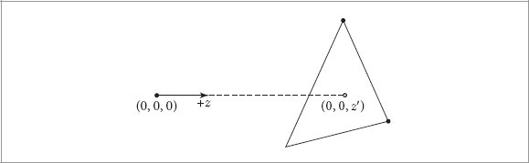

*Figure 6.12: In the ray–triangle intersection coordinate system, the ray starts at the origin and goes along the +z axis. The intersection test can be performed by considering only the xy projection of the ray and the triangle vertices, which in turn reduces to determining if the 2D point (0, 0) is within the triangle.*

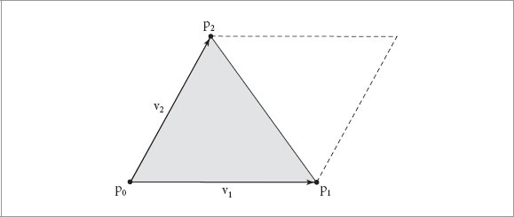

*Figure 6.13: The area of a triangle with two edges given by vectors v1 and v2 is one-half of the area of the parallelogram shown here. The parallelogram area is given by the length of the cross product of v1 and v2.*

With the triangle vertices transformed to this coordinate system, our task now is to find whether the ray starting from the origin and traveling along the +z axis intersects the transformed triangle. Because of the way the coordinate system was constructed, this problem is equivalent to the 2D problem of determining if the x, y coordinates (0, 0) are inside the xy projection of the triangle (Figure 6.12).

To understand how the intersection algorithm works, first recall from Figure 3.6 that the length of the cross product of two vectors gives the area of the parallelogram that they define. In 2D, with vectors a and b, the area is axby − bxay.

Half of this area is the area of the triangle that they define. Thus, we can see that in 2D, the area of a

triangle with vertices p0, p1, and p2 is Figure 6.13 visualizes this idea geometrically.

We will use this expression of triangle area to define a signed edge function: given two triangle vertices p0 and p1, we can define the directed edge function e as the function that gives twice the area of the triangle given by p0, p1, and a given third point p:

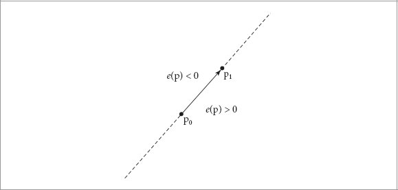

*Figure 6.14: The edge function e(p) characterizes points with respect to an oriented line between two points p0 and p1. The value of the edge function is positive for points p to the right of the line, zero for points on the line, and negative for points to the left of the line. The ray–triangle intersection algorithm uses an edge function that is twice the signed area of the triangle formed by the three points.*

(See Figure 6.14.)

The edge function gives a positive value for points to the left of the line, and a negative value for points to the right. Thus, if a point has edge function values of the same sign for all three edges of a triangle, it must be on the same side of all three edges and thus must be inside the triangle.

Thanks to the coordinate system transformation, the point p that we are testing has coordinates (0, 0). This simplifies the edge function expressions. For example, for the edge e0 from p1 to p2, we have:

In the following, we will use the indexing scheme that the edge function ei corresponds to the directed edge from vertex p(i+1) mod 3 to p(i+2) mod 3.

〈Compute edge function coefficients e0, e1, and e2〉 ≡ 303

```rust
   Float e0 = DifferenceOfProducts(p1t.x, p2t.y, p1t.y, p2t.x);
   Float e1 = DifferenceOfProducts(p2t.x, p0t.y, p2t.y, p0t.x);
   Float e2 = DifferenceOfProducts(p0t.x, p1t.y, p0t.y, p1t.x);
```

In the rare case that any of the edge function values is exactly zero, it is not possible to be sure if the ray hits the triangle or not, and the edge equations are reevaluated using double-precision floating-point arithmetic. (Section 6.8.4 discusses the need for this step in more detail.) The fragment that implements this computation, 〈Fall back to double-precision test at triangle edges〉, is just a reimplementation of 〈Compute edge function coefficients e0, e1, and e2〉 using doubles and so is not included here.

```rust
    DifferenceOfProducts() 1044
    Float 23
```

Given the values of the three edge functions, we have our first two opportunities to determine that there is no intersection. First, if the signs of the edge function values differ, then the point (0, 0) is not on the same side of all three edges and therefore is outside the triangle. Second, if the sum of the three edge function values is zero, then the ray is approaching the triangle edge-on, and we report no intersection. (For a closed triangle mesh, the ray will hit a neighboring triangle instead.)

〈Perform triangle edge and determinant tests〉 ≡ 303

```rust
   if ((e0 < 0 || e1 < 0 || e2 < 0) && (e0 > 0 || e1 > 0 || e2 > 0))
        return {};
   Float det = e0 + e1 + e2;
   if (det == 0)
        return {};
```

Because the ray starts at the origin, has unit length, and is along the +z axis, the z coordinate value of the intersection point is equal to the intersection’s parametric t value. To compute this z value, we first need to go ahead and apply the shear transformation to the z coordinates of the triangle vertices. Given these z values, the barycentric coordinates of the intersection point in the triangle can be used to interpolate them across the triangle. They are given by dividing each edge function value by the sum

of edge function values: Thus, the bi sum to one.

The interpolated z value is given by

```text
     z = b0z0 + b1z1 + b2z2, where zi are the coordinates of the three vertices in the ray–triangle
                                  intersection coordinate system.
```

To save the cost of the floating-point division to compute bi in cases where the final t value is out of the range of valid t values, the implementation here first computes t by interpolating zi with ei (in other words, not yet performing the division by d = e0 + e1 + e2). If the sign of d and the sign of the interpolated t value are different, then the final t value will certainly be negative and thus not a valid intersection.

Along similar lines, the check t < tmax can be equivalently performed in two ways:

〈Compute scaled hit distance to triangle and test against ray t range〉 ≡ 303

```rust
   p0t.z *= Sz;
   p1t.z *= Sz;
   p2t.z *= Sz;
   Float tScaled = e0 * p0t.z + e1 * p1t.z + e2 * p2t.z;
   if (det < 0 && (tScaled >= 0 || tScaled < tMax * det))
       return {};
   else if (det > 0 && (tScaled <= 0 || tScaled > tMax * det))
       return {};
```

Given a valid intersection, the actual barycentric coordinates and t value for the intersection are found.

```text
    Float 23
```

〈Compute barycentric coordinates and t value for triangle intersection〉 ≡ 303

```rust
   Float invDet = 1 / det;
   Float b0 = e0 * invDet, b1 = e1 * invDet, b2 = e2 * invDet;
   Float t = tScaled * invDet;
```

After a final test on the t value that will be discussed in Section 6.8.7, a TriangleIntersection object that represents the intersection can be returned.

〈Return TriangleIntersection for intersection〉 ≡ 303

```rust
   return TriangleIntersection{b0, b1, b2, t};
```

TriangleIntersection just records the barycentric coordinates and the t value along the ray where the intersection occurred.

〈TriangleIntersection Definition〉 ≡ struct TriangleIntersection { Float b0, b1, b2; Float t; };

The structure of the Triangle::Intersect() method follows the form of earlier intersection test methods.

〈Triangle Method Definitions〉 +≡ pstd::optional<ShapeIntersection> Triangle::Intersect(const Ray &ray, Float tMax) const { 〈Get triangle vertices in p0, p1, and p2 302〉 pstd::optional<TriangleIntersection> triIsect = IntersectTriangle(ray, tMax, p0, p1, p2); if (!triIsect) return {}; SurfaceInteraction intr = InteractionFromIntersection( mesh, triIndex, *triIsect, ray.time, -ray.d); return ShapeIntersection{intr, triIsect->t}; }

We will not include the Triangle::IntersectP() method here, as it is just based on calling IntersectTriangle().

The InteractionFromIntersection() method is different than the corresponding methods in the quadrics in that it is a stand-alone function rather than a regular member function. Because a call to it is thus not associated with a specific Triangle instance, it takes a TriangleMesh and the index of a triangle in the mesh as parameters. In the context of its usage in the Intersect() method, this may seem gratuitous—why pass that information as parameters rather than access it directly in a non-static method?

We have designed the interface in this way so that we are able to use this method in pbrt’s GPU rendering path, where the Triangle class is not used. There, the representation of triangles in the scene is abstracted by a ray intersection API and the geometric ray–triangle intersection test is performed using specialized hardware. Given an intersection, it provides the triangle index, a pointer to the mesh that the triangle is a part of, and the barycentric coordinates of the intersection. That information is sufficient to call this method, which then allows us to find the SurfaceInteraction for such intersections using the same code as executes on the CPU.

```rust
    Float 23
    IntersectTriangle() 303
    Ray 95
    Ray::d 95
    Ray::time 95
```

```text
    ShapeIntersection 266
    SurfaceInteraction 138
    Triangle:: InteractionFromIntersection() 310
    Triangle::triIndex 302
    TriangleIntersection 309
    TriangleIntersection::t 309
    TriangleMesh 297
```

〈Triangle Public Methods〉 +≡ 301

```rust
   static SurfaceInteraction InteractionFromIntersection(
             const TriangleMesh *mesh, int triIndex,
             TriangleIntersection ti, Float time, Vector3f wo) {
         const int *v = &mesh->vertexIndices[3 * triIndex];
         Point3f p0 = mesh->p[v[0]], p1 = mesh->p[v[1]], p2 = mesh->p[v[2]];
         〈Compute triangle partial derivatives 311〉
         〈Interpolate (u, v) parametric coordinates and hit point 311〉
         〈Return SurfaceInteraction for triangle hit 312〉
   }
```

To generate consistent tangent vectors over triangle meshes, it is necessary to compute the partial derivatives ∂p/∂u and ∂p/∂v using the parametric (u, v) values at the triangle vertices, if provided. Although the partial derivatives are the same at all points on the triangle, the implementation here recomputes them each time an intersection is found. Although this results in redundant computation, the storage savings for large triangle meshes can be significant.

A triangle can be described by the set of points

for some po, where u and v range over the parametric coordinates of the triangle. We also know the three vertex positions pi, i = 0, 1, 2, and the texture coordinates (ui, vi) at each vertex. From this it

follows that the partial derivatives of p must satisfy In other words, there is a unique affine mapping from the 2D (u, v) space to points on the triangle. (Such a mapping exists even though the triangle is specified in 3D because the triangle is planar.) To compute expressions for ∂p/∂u and ∂p/∂v, we start by computing the differences p0 − p2 and p1 − p2,

giving the matrix equation Thus,

```text
    Float 23
    Point3f 92
    SurfaceInteraction 138
    TriangleIntersection 309
    TriangleMesh 297
    TriangleMesh::p 298
    TriangleMesh::vertexIndices 298
    Vector3f 86
```

Inverting a 2×2 matrix is straightforward. The inverse of the (u, v) differences matrix is

This computation is performed by the 〈Compute triangle partial derivatives〉 fragment, with handling for various additional corner cases.

〈Compute triangle partial derivatives〉 ≡ 310

```rust
   〈Compute deltas and matrix determinant for triangle partial derivatives 311〉
   Vector3f dpdu, dpdv;
   bool degenerateUV = std::abs(determinant) < 1e-9f;
   if (!degenerateUV) {
       〈Compute triangle ∂p/∂u and ∂p/∂v via matrix inversion 311〉
   }
   〈Handle degenerate triangle (u, v) parameterization or partial derivatives 311〉
```

The triangle’s uv coordinates are found by indexing into the TriangleMesh::uv array, if present. Otherwise, a default parameterization is used. We will not include the fragment that initializes uv here.

〈Compute deltas and matrix determinant for triangle partial derivatives〉 ≡ 311

```rust
   〈Get triangle texture coordinates in uv array〉
   Vector2f duv02 = uv[0] - uv[2], duv12 = uv[1] - uv[2];
   Vector3f dp02 = p0 - p2, dp12 = p1 - p2;
   Float determinant =
        DifferenceOfProducts(duv02[0], duv12[1], duv02[1], duv12[0]);
```

In the usual case, the 2 × 2 matrix is non-degenerate, and the partial derivatives are computed using Equation (6.7).

〈Compute triangle ∂p/∂u and ∂p/∂v via matrix inversion〉 ≡ 311

```rust
   Float invdet = 1 / determinant;
   dpdu = DifferenceOfProducts(duv12[1], dp02, duv02[1], dp12) * invdet;
```

```rust
    dpdv = DifferenceOfProducts(duv02[0], dp12, duv12[0], dp02) * invdet;
```

However, there are a number of rare additional cases that must be handled. For example, the user may have provided (u, v) coordinates that specify a degenerate parameterization, such as the same (u, v) at all three vertices. Alternatively, the computed dpdu and dpdv values may have a degenerate cross product due to rounding error. In such cases we fall back to computing dpdu and dpdv that at least give the correct normal vector.

〈Handle degenerate triangle (u, v) parameterization or partial derivatives〉 ≡ 311

if (degenerateUV || LengthSquared(Cross(dpdu, dpdv)) == 0) { Vector3f ng = Cross(p2 - p0, p1 - p0); if (LengthSquared(ng) == 0) ng = Vector3f(Cross(Vector3<double>(p2 - p0), Vector3<double>(p1 - p0))); CoordinateSystem(Normalize(ng), &dpdu, &dpdv); }

```rust
    CoordinateSystem() 92
    Cross() 91
    DifferenceOfProducts() 1044
    Float 23
    LengthSquared() 87
    Normalize() 88
    Point2f 92
    Point3f 92
    SurfaceInteraction 138
    TriangleIntersection::b0 309
    TriangleIntersection::b1 309
    TriangleIntersection::b2 309
    TriangleMesh::uv 301
    Vector2f 86
    Vector3 86
    Vector3f 86
```

To compute the intersection point and the (u, v) parametric coordinates at the hit point, the barycentric interpolation formula is applied to the vertex positions and the (u, v) coordinates at the vertices. As we will see in Section 6.8.5, this gives a more accurate result for the intersection point than evaluating the parametric ray equation using t.

〈Interpolate (u, v) parametric coordinates and hit point〉 ≡ 310

```rust
   Point3f pHit = ti.b0 * p0 + ti.b1 * p1 + ti.b2 * p2;
   Point2f uvHit = ti.b0 * uv[0] + ti.b1 * uv[1] + ti.b2 * uv[2];
```

Unlike with the shapes we have seen so far, it is not necessary to transform the Surface Interaction here to rendering space, since the geometric per-vertex values are already in rendering space. Like the disk, the partial derivatives of the triangle’s normal are also both (0, 0, 0), since it is flat.

〈Return SurfaceInteraction for triangle hit〉 ≡ 310

```rust
   bool          flipNormal         =       mesh->reverseOrientation    ^  mesh-
   >transformSwapsHandedness;
   〈Compute error bounds pError for triangle intersection 377〉
   SurfaceInteraction isect(Point3fi(pHit, pError), uvHit, wo, dpdu, dpdv,
                                Normal3f(), Normal3f(), time, flipNormal);
   〈Set final surface normal and shading geometry for triangle 312〉
         return isect;
```

Before the SurfaceInteraction is returned, some final details related to its surface normal and shading geometry must be taken care of.

〈Set final surface normal and shading geometry for triangle〉 ≡ 312

```rust
   〈Override surface normal in isect for triangle 312〉
   if (mesh->n || mesh->s) {
          〈Initialize Triangle shading geometry 312〉
   }
```

The SurfaceInteraction constructor initializes the geometric normal n as the normalized cross product of dpdu and dpdv. This works well for most shapes, but in the case of triangle meshes it is preferable to rely on an initialization that does not depend on the underlying texture coordinates: it is fairly common to encounter meshes with bad parameterizations that do not preserve the orientation of the mesh, in which case the geometric normal would have an incorrect orientation.

We therefore initialize the geometric normal using the normalized cross product of the edge vectors dp02 and dp12, which results in the same normal up to a potential sign difference that depends on the exact order of triangle vertices (also known as the triangle’s winding order).3 3D modeling packages generally try to ensure that triangles in a mesh have consistent winding orders, which makes this approach more robust.

〈Override surface normal in isect for triangle〉 ≡ 312

isect.n = isect.shading.n = Normal3f(Normalize(Cross(dp02, dp12))); if (mesh->reverseOrientation ^ mesh->transformSwapsHandedness) isect.n = isect.shading.n = -isect.n;

With Triangles, the user can provide normal vectors and tangent vectors at the vertices of the mesh that are interpolated to give normals and tangents at points on the faces of triangles. Shading geometry with interpolated normals can make otherwise faceted triangle meshes appear to be smoother than they geometrically are. If either shading normals or shading tangents have been provided, they are used to initialize the shading geometry in the SurfaceInteraction.

```text
    Cross() 91
    Interaction::n 137
    Normal3f 94
    Normalize() 88
    Point3fi 1061
    SurfaceInteraction 138
    SurfaceInteraction:: SetShadingGeometry() 140
    SurfaceInteraction:: shading::n 139
    TriangleMesh::n 301
    TriangleMesh:: reverseOrientation 301
    TriangleMesh::s 301
    TriangleMesh:: transformSwapsHandedness 301
```

〈Initialize Triangle shading geometry〉 ≡ 312

```rust
   〈Compute shading normal ns for triangle 313〉
   〈Compute shading tangent ss for triangle 313〉
   〈Compute shading bitangent ts for triangle and adjust ss 313〉
   〈Compute ∂n/∂u and ∂n/∂v for triangle shading geometry〉
   isect.SetShadingGeometry(ns, ss, ts, dndu, dndv, true);
```

Given the barycentric coordinates of the intersection point, it is easy to compute the shading normal by interpolating among the appropriate vertex normals, if present.

〈Compute shading normal ns for triangle〉 ≡ 312

```rust
   Normal3f ns;
   if (mesh->n) {
       ns = ti.b0 * mesh->n[v[0]] + ti.b1 * mesh->n[v[1]] + ti.b2 * mesh-
       >n[v[2]];
       ns = LengthSquared(ns) > 0 ? Normalize(ns) : isect.n;
   } else
       ns = isect.n;
```

The shading tangent is computed similarly.

〈Compute shading tangent ss for triangle〉 ≡ 312

```rust
   Vector3f ss;
   if (mesh->s) {
       ss = ti.b0 * mesh->s[v[0]] + ti.b1 * mesh->s[v[1]] + ti.b2 * mesh-
       >s[v[2]];
       if (LengthSquared(ss) == 0)
          ss = isect.dpdu;
   } else
```

```rust
         ss = isect.dpdu;
```

The bitangent vector ts is found using the cross product of ns and ss, giving a vector orthogonal to the two of them. Next, ss is overwritten with the cross product of ts and ns; this ensures that the cross product of ss and ts gives ns. Thus, if per-vertex n and s values are provided and if the interpolated n and s values are not perfectly orthogonal, n will be preserved and s will be modified so that the coordinate system is orthogonal.

〈Compute shading bitangent ts for triangle and adjust ss〉 ≡ 312

```rust
   Vector3f ts = Cross(ns, ss);
   if (LengthSquared(ts) > 0)
       ss = Cross(ts, ns);
```

```rust
    else
           CoordinateSystem(ns, &ss, &ts);
```

The code to compute the partial derivatives ∂n/∂u and ∂n/∂v of the shading normal is almost identical to the code to compute the partial derivatives ∂p/∂u and ∂p/∂v. Therefore, it has been elided from the text here.

```text
    CoordinateSystem() 92
    Cross() 91
    Interaction 136
    Interaction::n 137
    LengthSquared() 87
    Normal3f 94
    Normalize() 88
    Point2f 92
    Point3fi 1061
    ShapeSample 268
    SurfaceInteraction::dpdu 138
    Triangle::Area() 302
    TriangleIntersection::b0 309
    TriangleIntersection::b1 309
    TriangleIntersection::b2 309
    TriangleMesh::n 301
    TriangleMesh::s 301
    Vector3f 86
```

⋆ 6.5.4 SAMPLING The uniform area triangle sampling method is based on mapping the provided random sample u to barycentric coordinates that are uniformly distributed over the triangle.

〈Triangle Public Methods〉 +≡ 301

```rust
   Option<ShapeSample> Sample(Point2f u) const {
         〈Get triangle vertices in p0, p1, and p2 302〉
         〈Sample point on triangle uniformly by area 314〉
         〈Compute surface normal for sampled point on triangle 314〉
         〈Compute (u, v) for sampled point on triangle 314〉
         〈Compute error bounds pError for sampled point on triangle 377〉
         return ShapeSample{Interaction(Point3fi(p, pError), n, uvSample),
                                 1 / Area()};
   }
```

Uniform barycentric sampling is provided via a stand-alone utility function (to be described shortly), which makes it easier to reuse this functionality elsewhere.

〈Sample point on triangle uniformly by area〉 ≡ 313

```rust
   pstd::array<Float, 3> b = SampleUniformTriangle(u);
   Point3f p = b[0] * p0 + b[1] * p1 + b[2] * p2;
```

As with Triangle::NormalBounds(), the surface normal of the sampled point is affected by the orientation of the shading normal, if present.

〈Compute surface normal for sampled point on triangle〉 ≡ 313, 318

```rust
   Normal3f n = Normalize(Normal3f(Cross(p1 - p0, p2 - p0)));
   if (mesh->n) {
       Normal3f ns(b[0] * mesh->n[v[0]] + b[1] * mesh->n[v[1]] +
                    (1 - b[0] - b[1]) * mesh->n[v[2]]);
       n = FaceForward(n, ns);
   } else if (mesh->reverseOrientation ^ mesh->transformSwapsHandedness)
       n *= -1;
```

The (u, v) coordinates for the sampled point are also found with barycentric interpolation.

〈Compute (u, v) for sampled point on triangle〉 ≡ 313, 318

```rust
   〈Get triangle texture coordinates in uv array〉
   Point2f uvSample = b[0] * uv[0] + b[1] * uv[1] + b[2] * uv[2];
```

Because barycentric interpolation is linear, it can be shown that if we can find barycentric coordinates that uniformly sample a specific triangle, then those barycentrics can be used to uniformly sample any triangle. To derive the sampling algorithm, we will therefore consider the case of uniformly sampling a unit right triangle. Given a uniform sample in [0, 1)2 that we would like to map to the triangle, the task can also be considered as finding an area-preserving mapping from the unit square to the unit triangle.

A straightforward approach is suggested by Figure 6.15: the unit square could be folded over onto itself, such that samples that are on the side of the diagonal that places them outside the triangle are reflected across the diagonal to be inside it. While this would provide a valid sampling technique, it is undesirable since it causes samples that were originally far away in [0, 1)2 to be close together on the triangle. (For example, (0.01, 0.01) and (0.99, 0.99) in the unit square would both map to the same point in the triangle.) The effect would be that sampling techniques that generate well-distributed uniform samples such as those discussed in Chapter 8 were less effective at reducing error.

```rust
    Cross() 91
    FaceForward() 94
    Float 23
    Normal3f 94
```

```text
    Normalize() 88
    Point2f 92
    Point3f 92
    SampleUniformTriangle() 315
    Triangle::NormalBounds() 303
    TriangleMesh::n 301
    TriangleMesh:: reverseOrientation 301
    TriangleMesh:: transformSwapsHandedness 301
```

*Figure 6.15: Samples from the unit square can be mapped to the unit right triangle by reflecting across the x + y = 1 diagonal, though doing so causes far away samples on the square to map to nearby points on the triangle.*

A better mapping translates points along the diagonal by a varying amount that brings the two opposite sides of the unit square to the triangle’s diagonal.

The determinant of the Jacobian matrix for this mapping is a constant and therefore this mapping is area preserving and uniformly distributed samples in the unit square are uniform in the triangle. (Recall Section 2.4.1, which presented the mathematics of transforming samples from one domain to the other; there it was shown that if the Jacobian of the transformation is constant, the mapping is area-preserving.) 〈Sampling Inline Functions〉 +≡ pstd::array<Float, 3> SampleUniformTriangle(Point2f u) { Float b0, b1; if (u[0] < u[1]) { b0 = u[0] / 2; b1 = u[1] - b0; } else { b1 = u[1] / 2; b0 = u[0] - b1;

} return {b0, b1, 1 - b0 - b1}; }

The usual normalization constraint gives the PDF in terms of the triangle’s surface area. 〈Triangle Public Methods〉 +≡ 301

Float PDF(const Interaction &) const { return 1 / Area(); }

In order to sample points on spheres with respect to solid angle from a reference point, we derived a specialized sampling method that only sampled from the potentially visible region of the sphere. For the cylinder and disk, we just sampled uniformly by area and rescaled the PDF to account for the change of measure from area to solid angle. It is tempting to do the same for triangles (and, indeed, all three previous editions of this book did so), but going through the work to apply a solid angle sampling approach can lead to much better results. To see why, consider a simplified form of the reflection integral from the

scattering equation, (4.14): where the BRDF f has been replaced with a constant ρ, which corresponds to a diffuse surface. If we consider the case of incident radiance only coming from a triangular light source that emits uniform diffuse radiance

Le, then we can rewrite this integral as

```rust
   Float 23
   Interaction 136
   Point2f 92
   Triangle::Area() 302
```

where V is a visibility function that is 1 if the ray from p in direction ωi hits the light source and 0 if it misses or is occluded by another object. If we sample the triangle uniformly within the solid angle that it subtends from

the reference point, we end up with the estimator where Asolid is the subtended solid angle. The constant values have been pulled out, leaving just the two factors in parentheses that vary based on p′.

They are the only source of variance in estimates of the integral. As an alternative, consider a Monte Carlo estimate of this function where a point p′ has been uniformly sampled on the surface of the triangle. If the triangle’s area is A, then the PDF is p(p′) = 1/A. Applying the standard Monte Carlo estimator and defining a new visibility function V that is

between two points, we end up with where the last factor accounts for the change of variables and where cos θl is the angle between the light source’s surface normal and the vector between the two points. The values of the four factors inside the parentheses in this estimator all depend on the choice of p′. With area sampling, the |cos θl| factor adds some additional variance, though not too much, since it is between 0 and 1. However, 1/‖p′ − p‖2 can have unbounded variation over the surface of the triangle, which can lead to high variance in the estimator since the method used to sample p′ does not account for it at all. This variance increases the larger the triangle is and the closer the reference point is to it. Figure 6.16 shows a scene where solid angle sampling significantly reduces error. The Triangle::Sample() method that takes a reference point therefore samples a point according to solid angle.

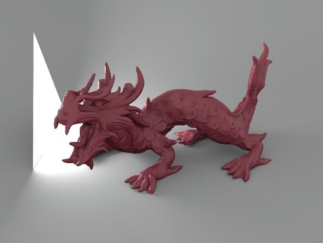

*Figure 6.16: A Scene Where Solid Angle Triangle Sampling Is Beneficial. When points on triangles are sampled using uniform area sampling, error is high at points on the ground close to the emitter. If points are sampled on the triangle by uniformly sampling the solid angle the triangle subtends, then the remaining non-constant factors in the estimator are both between 0 and 1, which results in much lower error. For this scene, mean squared error (MSE) is reduced by a factor of 3.86. (Dragon model courtesy of the Stanford Computer Graphics Laboratory.)*

〈Triangle Public Methods〉 +≡ 301

pstd::optional<ShapeSample> Sample(const ShapeSampleContext &ctx, Point2f u) const { 〈Get triangle vertices in p0, p1, and p2 302〉 〈Use uniform area sampling for numerically unstable cases 317〉 〈Sample spherical triangle from reference point 317〉 〈Compute error bounds pError for sampled point on triangle 377〉 〈Return ShapeSample for solid angle sampled point on triangle 318〉 }

Triangles that subtend a very small solid angle as well as ones that cover nearly the whole hemisphere can encounter problems with floating-point

accuracy in the following solid angle sampling approach. The sampling method falls back to uniform area sampling in those cases, which does not hurt results in practice: for very small triangles, the various additional factors tend not to vary as much over the triangle’s area. pbrt also samples the BSDF as part of the direct lighting calculation, which is an effective strategy for large triangles, so uniform area sampling is fine in that case as well. 〈Use uniform area sampling for numerically unstable cases〉 ≡ 317

Float solidAngle = SolidAngle(ctx.p()); if (solidAngle < MinSphericalSampleArea || solidAngle > MaxSphericalSampleArea) { 〈Sample shape by area and compute incident direction wi 282〉 〈Convert area sampling PDF in ss to solid angle measure 282〉 return ss; } 〈Triangle Private Members〉 +≡ 301

static constexpr Float MinSphericalSampleArea = 3e-4; static constexpr Float MaxSphericalSampleArea = 6.22;

pbrt also includes an approximation to the effect of the |cos θ′| factor in its triangle sampling algorithm, which leaves visibility and error in that approximation as the only sources of variance. We will defer discussion of the fragment that handles that, 〈Apply warp product sampling for cosine factor at reference point〉, until after we have discussed the uniform solid angle sampling algorithm. For now we will note that it affects the final sampling PDF, which turns out to be the product of the PDF for uniform solid angle sampling of the triangle and a correction factor.

```rust
   Float 23
   Point2f 92
   SampleSphericalTriangle() 318
   ShapeSample 268
   ShapeSampleContext 268
   ShapeSampleContext::p() 269
   Triangle:: MaxSphericalSampleArea 317
   Triangle:: MinSphericalSampleArea 317
   Triangle::SolidAngle() 303
```

Uniform sampling of the solid angle that a triangle subtends is equivalent to uniformly sampling the spherical triangle that results from its projection on

the unit sphere (recall Section 3.8.2). Spherical triangle sampling is implemented in a separate function described shortly, SampleSphericalTriangle(), that returns the barycentric coordinates for the sampled point. 〈Sample spherical triangle from reference point〉 ≡ 317

〈Apply warp product sampling for cosine factor at reference point 324〉 Float triPDF; pstd::array<Float, 3> b = SampleSphericalTriangle({p0, p1, p2}, ctx.p(), u, &triPDF); if (triPDF == 0) return {}; pdf *= triPDF;

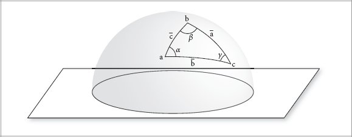

*Figure 6.17: Geometric Setting for Spherical Triangles. Given vertices a, b, and c, the respective opposite edges are labeled ā, b, and c and the interior angles are labeled with Greek letters α, β, and γ.*

Given the barycentric coordinates, it is simple to compute the sampled point. With that as well as the surface normal, computed by reusing a fragment from the other triangle sampling method, we have everything necessary to return a ShapeSample.

〈Return ShapeSample for solid angle sampled point on triangle〉 ≡ 317

Point3f p = b[0] * p0 + b[1] * p1 + b[2] * p2; 〈Compute surface normal for sampled point on triangle 314〉 〈Compute (u, v) for sampled point on triangle 314〉 return ShapeSample{Interaction(Point3fi(p, pError), n, ctx.time, uvSample), pdf};

The spherical triangle sampling function takes three triangle vertices v, a reference point p, and a uniform sample u. The value of the PDF for the sampled point is optionally returned via pdf, if it is not nullptr. Figure 6.17 shows the geometric setting. 〈Sampling Function Definitions〉 ≡ pstd::array<Float, 3> SampleSphericalTriangle( const pstd::array<Point3f, 3> &v, Point3f p, Point2f u, Float *pdf) { 〈Compute vectors a, b, and c to spherical triangle vertices 318〉 〈Compute normalized cross products of all direction pairs 319〉 〈Find angles α, β, and γ at spherical triangle vertices 319〉 〈Uniformly sample triangle area A to compute A′ 320〉 〈Find cos β′ for point along b for sampled area 321〉 〈Sample c′ along the arc between b′ and a 321〉 〈Compute sampled spherical triangle direction and return barycentrics 322〉 }

Given the reference point, it is easy to project the vertices on the unit sphere to find the spherical triangle vertices a, b, and c.

```rust
   Float 23
   Interaction 136
   Normalize() 88
   Point2f 92
   Point3f 92
   Point3fi 1061
   ShapeSample 268
   ShapeSampleContext::time 268
   Vector3f 86
```

〈Compute vectors a, b, and c to spherical triangle vertices〉 ≡ 318, 325

Vector3f a(v[0] - p), b(v[1] - p), c(v[2] - p); a = Normalize(a); b = Normalize(b); c = Normalize(c);

Because the plane containing an edge also passes through the origin, we can compute the plane normal for an edge from a to b as

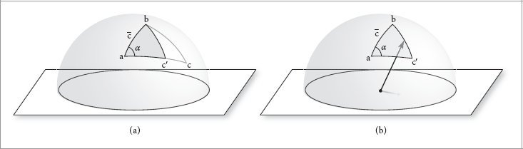

*Figure 6.18: (a) After sampling a triangle area, the first step of the sampling algorithm finds the vertex c′ that gives a spherical triangle abc′ with that area. The vertices a and b and the edge c are shared with the original triangle. (b) Given c′, a direction ω is sampled along the arc between b and c′.*

and similarly for the other edges. If any of these normals are degenerate, then the triangle has zero area. 〈Compute normalized cross products of all direction pairs〉 ≡ 318, 325

Vector3f n_ab = Cross(a, b), n_bc = Cross(b, c), n_ca = Cross(c, a); if (LengthSquared(n_ab) == 0 || LengthSquared(n_bc) == 0 || LengthSquared(n_ca) == 0) return {}; n_ab = Normalize(n_ab); n_bc = Normalize(n_bc); n_ca = Normalize(n_ca);

Given the pairs of plane normals, AngleBetween() gives the angles between them. In computing these angles, we can take advantage of the fact that the plane normal for the edge between two vertices b and a is the negation of the plane normal for the edge from a to b. 〈Find angles α, β, and γ at spherical triangle vertices〉 ≡ 318, 325

Float alpha = AngleBetween(n_ab, -n_ca); Float beta = AngleBetween(n_bc, -n_ab); Float gamma = AngleBetween(n_ca, -n_bc);

The spherical triangle sampling algorithm operates in two stages. The first step uniformly samples a new triangle with area A′ between 0 and the area of the original spherical triangle A using the first sample: A′ = ξ0A. This triangle is defined by finding a new vertex c′ along the arc between a and c such that the resulting triangle abc′ has area A′ (see Figure 6.18(a)). In the second step, a vertex ω is sampled along the arc between b and c′ with sampling density that is relatively lower near b and higher near c′; the result is a uniform distribution of points inside the spherical triangle (Figure 6.18(b)). (The need for a nonuniform density along the arc can be understood by considering the arcs bc′ as c′ sweeps from a to c: the velocity of a point on the arc increases the farther away from b and so the density of sampled points along a given arc must be adjusted accordingly.) AngleBetween() 89 Cross() 91 Float 23 LengthSquared() 87 Normalize() 88 Vector3f 86 Our implementation makes a small modification to the algorithm as described so far: rather than computing the triangle’s spherical area A and then sampling an area uniformly between 0 and A, it instead starts by computing its area plus π, which we will denote by Aπ.

Doing so lets us avoid the subtraction of π from the sum of the interior angles that is present in the spherical triangle area equation, (3.5). For very small triangles, where α + β + γ ≈ π, the subtraction of π can cause a significant loss of floating-point accuracy. The remainder of the algorithm’s implementation is then adjusted to be based on in order to avoid needing to perform the subtraction. Given Aπ, the sampled area-plus-π is easily computed by uniformly sampling between π and Aπ.

The returned PDF value can be initialized at this point; because the algorithm samples uniformly in the triangle’s solid angle, the probability

density function takes the constant value of one over the solid angle the triangle subtends, which is its spherical area. (For that, the value of π must be subtracted.) 〈Uniformly sample triangle area A to compute A′〉 ≡ 318

Float A_pi = alpha + beta + gamma; Float Ap_pi = Lerp(u[0], Pi, A_pi); if (pdf) { Float A = A_pi - Pi; *pdf = (A <= 0) ? 0 : 1 / A; }

At this point, we need to determine more values related to the sampled triangle. We have the vertices a and b, the edge c, and the angle α all unchanged from the given triangle. The area-plus-π of the sampled triangle is known, but we do not have the vertex c′, the edges b′ or ā′, or the angles β′ or γ′. To find the vertex c′, it is sufficient to find the length of the arc b′. In this case, cos b′ will do, since 0 ≤ b′ < π. The first step is to apply one of the spherical cosine laws, which gives the equality

Although we do not know γ′, we can apply the definition of ,

to express γ′ in terms of quantities that are either known or are β′:

Substituting this equality in Equation (6.8) and solving for cos b′ gives

Defining to simplify notation, we have

The cosine and sine sum identities then give

The only remaining unknowns on the right hand side are the sines and cosines of β′.

```rust
   Float 23
   Lerp() 72
   Pi 1033
```

To find sin β′ and cos β′, we can use another spherical cosine law, which gives the equality

It can be simplified in a similar manner to find the equation

The terms in parentheses are all known. We will denote them by k1 = cos ϕ + cos α and k2 = sin ϕ − sin α cos c. It is then easy to see that solutions to the equation 0 = k1 cos β′ + k2 sin β′

are given by

Substituting these into Equation (6.9), taking the solution with a positive cosine, and simplifying gives

which finally has only known values on the right hand side. The code to compute this cosine follows directly from this solution. In it, we have also applied trigonometric identities to compute sin ϕ and cos ϕ in terms of other sines and cosines. 〈Find cos β′ for point along b for sampled area〉 ≡ 318

Float cosAlpha = std::cos(alpha), sinAlpha = std::sin(alpha); Float sinPhi = std::sin(Ap_pi) * cosAlpha - std::cos(Ap_pi) * sinAlpha; Float cosPhi = std::cos(Ap_pi) * cosAlpha + std::sin(Ap_pi) * sinAlpha; Float k1 = cosPhi + cosAlpha; Float k2 = sinPhi - sinAlpha * Dot(a, b) /* cos c */; Float cosBp = (k2 + (DifferenceOfProducts(k2, cosPhi, k1, sinPhi)) * cosAlpha) / ((SumOfProducts(k2, sinPhi, k1, cosPhi)) * sinAlpha); cosBp = Clamp(cosBp, -1, 1);

The arc of the great circle between the two points a and c can be parameterized by cos θa + sin θc⊥, where c⊥ is the normalized perpendicular component of c with respect to a. This vector is given by the GramSchmidt() function introduced earlier, which makes the computation of c′ straightforward. In this case, sin b′ can then be found using cos b′ with the Pythagorean identity, since we know that it must be nonnegative. 〈Sample c′ along the arc between b′ and a〉 ≡ 318

Float sinBp = SafeSqrt(1 - Sqr(cosBp)); Vector3f cp = cosBp * a + sinBp * Normalize(GramSchmidt(c, a));

```text
   Clamp() 1033
   DifferenceOfProducts() 1044
```

```rust
   Dot() 89
   Float 23
   GramSchmidt() 90
   Normalize() 88
   SafeSqrt() 1034
   Sqr() 1034
   SumOfProducts() 1044
   Vector3f 86
```

For the sample points to be uniformly distributed in the spherical triangle, it can be shown that if the edge from b to c′ is parameterized using θ in the same way as was used for the edge from a to c, then cos θ should be sampled as (The “Further Reading” section has pointers to the details.) With that, we can compute the final sampled direction ω. The remaining step is to compute the barycentric coordinates for the sampled direction. 〈Compute sampled spherical triangle direction and return barycentrics〉 ≡ 318

Float cosTheta = 1 - u[1] * (1 - Dot(cp, b)); Float sinTheta = SafeSqrt(1 - Sqr(cosTheta)); Vector3f w = cosTheta * b + sinTheta * Normalize(GramSchmidt(cp, b)); 〈Find barycentric coordinates for sampled direction w 322〉 〈Return clamped barycentrics for sampled direction 322〉

The barycentric coordinates of the corresponding point in the planar triangle can be found using part of a ray–triangle intersection algorithm that finds the barycentrics along the way (Möller and Trumbore 1997). It starts with equating the parametric form of the ray with the barycentric interpolation of the triangle’s vertices vi, o + td = (1 − b0 − b1)v0 + b1v1 + b2v2, expressing this as a matrix equation, and solving the resulting linear system for the barycentrics. The solution is implemented in the following fragment, which includes the result of factoring out various common subexpressions. 〈Find barycentric coordinates for sampled direction w〉 ≡ 322

Vector3f e1 = v[1] - v[0], e2 = v[2] - v[0]; Vector3f s1 = Cross(w, e2); Float divisor = Dot(s1, e1); Float invDivisor = 1 / divisor; Vector3f s = p - v[0];

```rust
   Float b1 = Dot(s, s1) * invDivisor;
   Float b2 = Dot(w, Cross(s, e1)) * invDivisor;
```

The computed barycentrics may be invalid for very small and very large triangles. This happens rarely, but to protect against it, they are clamped to be within the triangle before they are returned. 〈Return clamped barycentrics for sampled direction〉 ≡ 322

b1 = Clamp(b1, 0, 1); b2 = Clamp(b2, 0, 1); if (b1 + b2 > 1) { b1 /= b1 + b2; b2 /= b1 + b2; } return {Float(1 - b1 - b2), Float(b1), Float(b2)};

As noted earlier, uniform solid angle sampling does not account for the incident cosine factor at the reference point. Indeed, there is no known analytic method to do so. However, it is possible to apply a warping function to the uniform samples u that approximately accounts for this factor. To understand the idea, first note that cos θ varies smoothly over the spherical triangle. Because the spherical triangle sampling algorithm that we have just defined maintains a continuous relationship between sample values and points in the triangle, then if we consider the image of the cos θ function back in the [0, 1]2 sampling domain, as would be found by mapping it through the inverse of the spherical triangle sampling algorithm, the cos θ function is smoothly varying there as well. (See Figure 6.19.) Clamp() 1033 Cross() 91 Dot() 89 Float 23 GramSchmidt() 90 Normalize() 88 SafeSqrt() 1034 Sqr() 1034

Vector3f 86 It can be shown through simple application of the chain rule that a suitable transformation of uniform [0, 1]2 sample points can account for the cos θ factor. Specifically, if transformed points are distributed according to the distribution of cos θ in [0, 1]2 and then used with the spherical triangle sampling algorithm, then the distribution of directions on the sphere will include the cos θ factor.

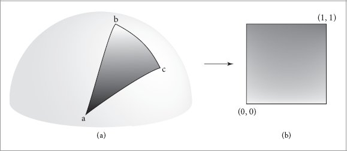

*Figure 6.19: (a) The cos θ factor varies smoothly over the area of a spherical triangle. (b) If it is mapped back to the [0, 1]2 sampling domain, it also varies smoothly there, thanks to the sampling algorithm not introducing any discontinuities or excessive distortion.*

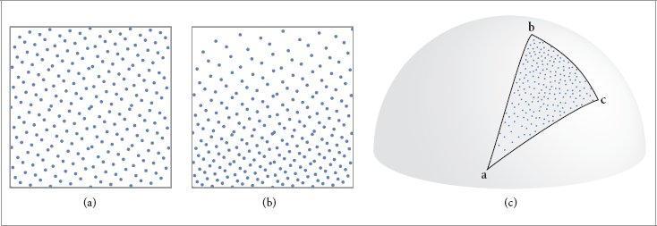

*Figure 6.20: If (a) uniform sample points are warped to (b) approximate the distribution of the incident cosine factor in [0, 1]2 before being used with the spherical triangle sampling algorithm, then (c) the resulting points in the triangle are approximately cosine-distributed.*

The true function has no convenient analytic form, but because it is smoothly varying, here we will approximate it with a bilinear function. Each corner of the [0, 1]2 sampling domain maps to one of the three vertices of the spherical triangle, and so we set the bilinear function’s value at each corner according to the cos θ factor computed at the associated triangle vertex. Sampling a point in the triangle then proceeds by using the initial uniform sample to sample the bilinear distribution and to use the resulting nonuniform point in [0, 1]2 with the triangle sampling algorithm. (See Figure 6.20.) Applying the principles of transforming between distributions that were introduced in Section 2.4.1, we can find that the overall PDF of such a sample is given by the product of the PDF for the bilinear sample and the PDF of the spherical triangle sample.

```text
   ShapeSampleContext::ns 268
```

This technique is only applied for reference points on surfaces. For points in scattering media, the surface normal ShapeSampleContext::ns is degenerate and no sample warping is applied. 〈Apply warp product sampling for cosine factor at reference point〉 ≡ 317

Float pdf = 1;

```rust
   if (ctx.ns != Normal3f(0, 0, 0)) {
       〈Compute cos θ-based weights w at sample domain corners 324〉
       u = SampleBilinear(u, w);
       pdf = BilinearPDF(u, w);
   }
```

For the spherical triangle sampling algorithm, the vertex v0 corresponds to the sample (0, 1), v1 to (0, 0) and (1, 0) (and the line in between), and v2 to (1, 1). Therefore, the sampling weights at the corners of the [0, 1]2 domain are computed using the cosine of the direction to the corresponding vertex. 〈Compute cos θ-based weights w at sample domain corners〉 ≡ 324, 325

Point3f rp = ctx.p(); Vector3f wi[3] = {Normalize(p0 - rp), Normalize(p1 - rp), Normalize(p2 - rp)}; pstd::array<Float, 4> w = pstd::array<Float, 4>{std::max<Float>(0.01, AbsDot(ctx.ns, wi[1])), std::max<Float>(0.01, AbsDot(ctx.ns, wi[1])), std::max<Float>(0.01, AbsDot(ctx.ns, wi[0])), std::max<Float>(0.01, AbsDot(ctx.ns, wi[2]))};

The associated PDF() method is thankfully much simpler than the sampling routine. 〈Triangle Public Methods〉 +≡ 301

Float PDF(const ShapeSampleContext &ctx, Vector3f wi) const { Float solidAngle = SolidAngle(ctx.p()); 〈Return PDF based on uniform area sampling for challenging triangles 324〉 Float pdf = 1 / solidAngle; 〈Adjust PDF for warp product sampling of triangle cos θ factor 325〉 return pdf; }

It is important that the PDF() method makes exactly the same decisions about which technique is used to sample the triangle as the Sample() method does. This method therefore starts with the same check for very small and very large triangles to determine whether it should fall back to returning the PDF based on uniform area sampling.

```rust
   AbsDot() 90
   BilinearPDF() 76
   Float 23
```

```text
   InvertSphericalTriangleSample() 325
   Normal3f 94
   Normalize() 88
   Point3f 92
   SampleBilinear() 76
   ShapeSampleContext 268
   ShapeSampleContext::ns 268
   ShapeSampleContext::p() 269
   Triangle:: MaxSphericalSampleArea 317
   Triangle:: MinSphericalSampleArea 317
   Triangle::SolidAngle() 303
   Vector3f 86
```

〈Return PDF based on uniform area sampling for challenging triangles〉 ≡ 324

if (solidAngle < MinSphericalSampleArea || solidAngle > MaxSphericalSampleArea) { 〈Intersect sample ray with shape geometry 285〉 〈Compute PDF in solid angle measure from shape intersection point 285〉 return pdf; }

If Sample() would have warped the initial uniform random sample to account for the incident cos θ factor, it is necessary to incorporate the corresponding change of variables factor in the returned PDF here. To do so, we need to be able to invert the spherical triangle sampling algorithm in order to determine the sample value u that samples a point on the triangle that gives the incident direction wi at the reference point. The InvertSphericalTriangleSample() function performs this computation.

〈Adjust PDF for warp product sampling of triangle cos θ factor〉 ≡ 324

if (ctx.ns != Normal3f(0, 0, 0)) { 〈Get triangle vertices in p0, p1, and p2 302〉 Point2f u = InvertSphericalTriangleSample({p0, p1, p2}, ctx.p(), wi); 〈Compute cos θ-based weights w at sample domain corners 324〉 pdf *= BilinearPDF(u, w); }

The pair of sample values that give a sampled direction ω can be found by inverting each of the sampling operations individually. The function that performs this computation starts out with a few reused fragments to compute the angles at the three vertices of the spherical triangle.

〈Sampling Function Definitions〉 +≡ Point2f InvertSphericalTriangleSample(const pstd::array<Point3f, 3> &v, Point3f p, Vector3f w) { 〈Compute vectors a, b, and c to spherical triangle vertices 318〉 〈Compute normalized cross products of all direction pairs 319〉 〈Find angles α, β, and γ at spherical triangle vertices 319〉 〈Find vertex c′ along ac arc for ω 326〉 〈Invert uniform area sampling to find u0 326〉 〈Invert arc sampling to find u1 and return result 326〉 }

Next, it finds the vertex c′ along the arc between a and c that defines the subtriangle that would have been sampled when sampling ω. This vertex can be found by computing the intersection of the great circle defined by b and ω and the great circle defined by a and c; see Figure 6.21. Recall from Section 3.8.2 that the great circle passing through two points on the sphere is given by the intersection of the sphere with a plane passing through the origin and those two points. Therefore, we can find the intersection between the two corresponding planes, which is a line. In 3D, the cross product of the plane normals gives this line’s direction. This line intersects the sphere at two points and so it is necessary to choose the one of them that is between a and c.

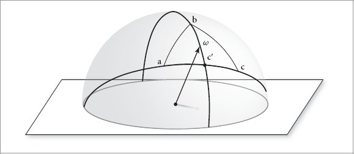

*Figure 6.21: Given a spherical triangle abc and a direction ω that is inside it, the vertex c′ along the edge from a to c can be found from the intersection of the great circle that passes through b and ω and the great circle that passes through a and c.*

```text
   BilinearPDF() 76
   InvertSphericalTriangleSample() 325
   Normal3f 94
   Point2f 92
   Point3f 92
   ShapeSampleContext::ns 268
   ShapeSampleContext::p() 269
   Vector3f 86
```

〈Find vertex c′ along ac arc for ω〉 ≡ 325

Vector3f cp = Normalize(Cross(Cross(b, w), Cross(c, a))); if (Dot(cp, a + c) < 0) cp = -cp;

Given c′, it is easy to compute the area of the triangle abc′; the ratio of that area to the original area gives the first sample value u0. However, it is necessary to be aware of the case where a and c′ are nearly coincident; in that case, computation of the angle γ′ may have high error, sometimes to the point that the subtriangle abc′ seems to have larger area than the original triangle abc. That case is caught with a dot product test. 〈Invert uniform area sampling to find u0〉 ≡ 325

```rust
   Float u0;
   if (Dot(a, cp) > 0.99999847691f /* 0.1 degrees */)
       u0 = 0;
   else {
       〈Compute area A′ of subtriangle 326〉
       〈Compute sample u0 that gives the area A′ 326〉
   }
```

Otherwise, the area of the subtriangle A′ is computed using Girard’s theorem. 〈Compute area A′ of subtriangle〉 ≡ 326

Vector3f n_cpb = Cross(cp, b), n_acp = Cross(a, cp); if (LengthSquared(n_cpb) == 0 || LengthSquared(n_acp) == 0) return Point2f(0.5, 0.5); n_cpb = Normalize(n_cpb); n_acp = Normalize(n_acp); Float Ap = alpha + AngleBetween(n_ab, n_cpb) + AngleBetween(n_acp, -n_cpb) - Pi;

The first sample value is then easily found given these two areas. 〈Compute sample u0 that gives the area A′〉 ≡ 326

Float A = alpha + beta + gamma - Pi; u0 = Ap / A;

The sampling method for choosing ω along the arc through b and c′, Equation (6.10), is also easily inverted. 〈Invert arc sampling to find u1 and return result〉 ≡ 325

```rust
   Float u1 = (1 - Dot(w, b)) / (1 - Dot(cp, b));
   return Point2f(Clamp(u0, 0, 1), Clamp(u1, 0, 1));
```

```rust
   AngleBetween() 89
   Clamp() 1033
   Cross() 91
   Dot() 89
   Float 23
   LengthSquared() 87
   Normalize() 88
   Pi 1033
   Point2f 92
   Vector3f 86
```

## 6.6 BILINEAR PATCHES

It is useful to have a shape defined by four vertices. One option would be a planar quadrilateral, though not requiring all four vertices to be coplanar is preferable, as it is less restrictive. Such a shape is the bilinear patch, which is a parametric surface defined by four vertices p0,0, p1,0, p0,1, and p1,1. Each vertex gives the position associated with a corner of the parametric (u, v) domain [0, 1]2 and points on the surface are defined via bilinear interpolation:

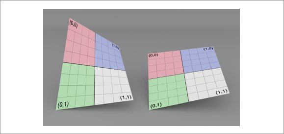

*Figure 6.22: Two Bilinear Patches. The bilinear patch is defined by four vertices that are not necessarily planar. It is able to represent a variety of simple curved surfaces.*

The bilinear patch is a doubly ruled surface: there are two straight lines through every point on it. (This can be seen by considering a parametric point on the surface (u, v) and then fixing either of u and v and considering the function that results: it is linear.) Not only can bilinear patches be used to represent planar quadrilaterals, but they can also represent simple curved surfaces. They are a useful target for converting higher-order parametric surfaces to simpler shapes that are amenable to direct ray intersection. Figure 6.22 shows two bilinear patches.

pbrt allows the specification of bilinear patch meshes for the same reasons that triangle meshes can be specified: to allow per-vertex attributes like position and surface normal to be shared by multiple patches and to allow mesh-wide properties to be stored just once. To this end, BilinearPatchMesh plays the equivalent role to the TriangleMesh.

〈BilinearPatchMesh Definition〉 ≡ class BilinearPatchMesh { public: 〈BilinearPatchMesh Public Methods〉 〈BilinearPatchMesh Public Members 327〉 };

We will skip past the BilinearPatchMesh constructor, as it mirrors the TriangleMesh’s, transforming the positions and normals to rendering space and using the BufferCache to avoid storing redundant buffers in memory.

〈BilinearPatchMesh Public Members〉 ≡ 327

bool reverseOrientation, transformSwapsHandedness; int nPatches, nVertices; const int *vertexIndices = nullptr; const Point3f *p = nullptr; const Normal3f *n = nullptr; const Point2f *uv = nullptr;

```text
   BilinearPatchMesh 327
   BufferCache 299
   Normal3f 94
   Point2f 92
   Point3f 92
   Shape 261
   TriangleMesh 297
```

The BilinearPatch class implements the Shape interface and represents a single patch in a bilinear patch mesh. 〈BilinearPatch Definition〉 ≡ class BilinearPatch { public:

〈BilinearPatch Public Methods 330〉 private: 〈BilinearPatch Private Methods 328〉 〈BilinearPatch Private Members 328〉 };

〈BilinearPatch Method Definitions〉 ≡ BilinearPatch::BilinearPatch(const BilinearPatchMesh *mesh, int meshIndex, int blpIndex) : meshIndex(meshIndex), blpIndex(blpIndex) { 〈Store area of bilinear patch in area 329〉 }

Also similar to triangles, each BilinearPatch stores the index of the mesh that it is a part of as well as its own index in the mesh’s patches. 〈BilinearPatch Private Members〉 ≡ 328

int meshIndex, blpIndex;

The GetMesh() method makes it easy for a BilinearPatch to get the pointer to its associated mesh. 〈BilinearPatch Private Methods〉 ≡ 328

const BilinearPatchMesh *GetMesh() const { return (*allMeshes)[meshIndex]; }

There is a subtlety that comes with the use of a vector to store the meshes. pbrt’s scene initialization code in Appendix C does its best to parallelize its work, which includes the parallelization of reading binary files that encode meshes from disk. A mutex is used to protect adding meshes to this vector, though as this vector grows, it is periodically reallocated to make more space. A consequence is that the BilinearPatch constructor must not call the GetMesh() method to get its BilinearPatchMesh *, since GetMesh() accesses allMeshes without mutual exclusion. Thus, the mesh is passed to the constructor as a parameter above.

〈BilinearPatch Private Members〉 +≡ 328

static pstd::vector<const BilinearPatchMesh *> *allMeshes;

The area of a parametric surface defined over [0, 1]2 is given by the integral

The partial derivatives of a bilinear patch are easily derived. They are:

```text
   BilinearPatch 328
   BilinearPatch::allMeshes 328
   BilinearPatch::blpIndex 328
   BilinearPatch::meshIndex 328
   BilinearPatchMesh 327
```

However, it is not generally possible to evaluate the area integral from Equation (6.12) in closed form with these partial derivatives. Therefore, the BilinearPatch constructor caches the patch’s surface area in a member variable, using numerical integration to compute its value if necessary. Because bilinear patches are often used to represent rectangles, the constructor checks for that case and takes the product of the lengths of the sides of the rectangle to compute the area when appropriate. In the general case, the fragment 〈Compute approximate area of bilinear patch〉 uses a Riemann sum evaluated at 3 × 3 points to approximate Equation (6.12). We do not include that code fragment here. 〈Store area of bilinear patch in area〉 ≡ 328

〈Get bilinear patch vertices in p00, p01, p10, and p11 329〉 if (IsRectangle(mesh)) area = Distance(p00, p01) * Distance(p00, p10); else { 〈Compute approximate area of bilinear patch〉 } 〈BilinearPatch Private Members〉 +≡ 328

Float area;

This fragment, which loads the four vertices of a patch into local variables, will be reused in many of the following methods. 〈Get bilinear patch vertices in p00, p01, p10, and p11〉 ≡ 329, 330, 335, 338, 342, 343, 344

const int *v = &mesh->vertexIndices[4 * blpIndex]; Point3f p00 = mesh->p[v[0]], p10 = mesh->p[v[1]]; Point3f p01 = mesh->p[v[2]], p11 = mesh->p[v[3]];

In addition to the surface area computation, there will be a number of additional cases where we will find it useful to use specialized algorithms if a BilinearPatch is a rectangle. Therefore, this check is encapsulated in the IsRectangle() method.

It first tests to see if any two neighboring vertices are coincident, in which case the patch is certainly not a rectangle. This check is important to perform first, since the following ones would otherwise end up trying to perform invalid operations like normalizing degenerate vectors in that case. 〈BilinearPatch Private Methods〉 +≡ 328

bool IsRectangle(const BilinearPatchMesh *mesh) const { 〈Get bilinear patch vertices in p00, p01, p10, and p11 329〉 if (p00 == p01 || p01 == p11 || p11 == p10 || p10 == p00) return false; 〈Check if bilinear patch vertices are coplanar 329〉 〈Check if planar vertices form a rectangle 330〉 }

```rust
   AbsDot() 90
   BilinearPatch::area 329
   BilinearPatch::blpIndex 328
   BilinearPatch::IsRectangle() 329
   BilinearPatchMesh 327
   BilinearPatchMesh::p 327
   BilinearPatchMesh:: vertexIndices 327
   Cross() 91
   Distance() 93
   Float 23
   Normal3f 94
   Normalize() 88
   Point3f 92
```

If the four vertices are not coplanar, then they do not form a rectangle. We can check this case by computing the surface normal of the plane formed by three of the vertices and then testing if the vector from one of those three to the fourth vertex is not (nearly) perpendicular to the plane normal. 〈Check if bilinear patch vertices are coplanar〉 ≡ 329

Normal3f n(Normalize(Cross(p10 - p00, p01 - p00))); if (AbsDot(Normalize(p11 - p00), n) > 1e-5f) return false;

Four coplanar vertices form a rectangle if they all have the same distance from the average of their positions. The implementation here computes the squared distance to save the square root operations and then tests the relative error with respect to the first squared distance. Because the test is based on relative error, it is not sensitive to the absolute size of the patch; scaling all the vertex positions does not affect it. 〈Check if planar vertices form a rectangle〉 ≡ 329

Point3f pCenter = (p00 + p01 + p10 + p11) / 4; Float d2[4] = { DistanceSquared(p00, pCenter), DistanceSquared(p01, pCenter), DistanceSquared(p10, pCenter), DistanceSquared(p11, pCenter) }; for (int i = 1; i < 4; ++i) if (std::abs(d2[i] - d2[0]) / d2[0] > 1e-4f) return false; return true;

With the area cached, implementation of the Area() method is trivial. 〈BilinearPatch Public Methods〉 ≡ 328

Float Area() const { return area; }

The bounds of a bilinear patch are given by the bounding box that bounds its four corner vertices. As with Triangles, the mesh vertices are already in rendering space, so no further transformation is necessary here. 〈BilinearPatch Method Definitions〉 +≡ Bounds3f BilinearPatch::Bounds() const { const BilinearPatchMesh *mesh = GetMesh(); 〈Get bilinear patch vertices in p00, p01, p10, and p11 329〉

return Union(Bounds3f(p00, p01), Bounds3f(p10, p11)); }

Although a planar patch has a single surface normal, the surface normal of a nonplanar patch varies across its surface. 〈BilinearPatch Method Definitions〉 +≡ DirectionCone BilinearPatch::NormalBounds() const { const BilinearPatchMesh *mesh = GetMesh(); 〈Get bilinear patch vertices in p00, p01, p10, and p11 329〉 〈If patch is a triangle, return bounds for single surface normal〉 〈Compute bilinear patch normal n00 at (0, 0) 331〉 〈Compute bilinear patch normals n10, n01, and n11〉 〈Compute average normal and return normal bounds for patch 331〉 }

If the bilinear patch is actually a triangle, the 〈If patch is a triangle, return bounds for single surface normal〉 fragment evaluates its surface normal and returns the corresponding DirectionCone. We have not included that straightforward fragment here.

```rust
   BilinearPatch::area 329
   BilinearPatch::GetMesh() 328
   BilinearPatchMesh 327
   Bounds3::Union() 99
   Bounds3f 97
   DirectionCone 114
   DistanceSquared() 93
   Float 23
   Point3f 92
   Triangle 301
```

Otherwise, the normals are computed at the four corners of the patch. The following fragment computes the normal at the (0, 0) parametric position. It is particularly easy to evaluate the partial derivatives at the corners; they work out to be the differences with the adjacent vertices in u and v. Some care is necessary with the orientation of the normals, however. As with triangle meshes, if per-vertex shading normals were specified, they

determine which side of the surface the geometric normal lies on. Otherwise, the normal may need to be flipped, depending on the user-specified orientation and the handedness of the rendering-to-object-space transformation. 〈Compute bilinear patch normal n00 at (0, 0)〉 ≡ 330

Vector3f n00 = Normalize(Cross(p10 - p00, p01 - p00)); if (mesh->n) n00 = FaceForward(n00, mesh->n[v[0]]); else if (mesh->reverseOrientation ^ mesh->transformSwapsHandedness) n00 = -n00;

Normals at the other three vertices are computed in an equivalent manner, so the fragment that handles the rest is not included here. A bounding cone for the normals is found by taking their average and then finding the cosine of the maximum angle that any of them makes with their average. Although this does not necessarily give an optimal bound, it usually works well in practice. (See the “Further Reading” section in Chapter 3 for more information on this topic.) 〈Compute average normal and return normal bounds for patch〉 ≡ 330

Vector3f n = Normalize(n00 + n10 + n01 + n11); Float cosTheta = std::min({Dot(n, n00), Dot(n, n01), Dot(n, n10), Dot(n, n11)}); return DirectionCone(n, Clamp(cosTheta, -1, 1));

### 6.6.1 INTERSECTION TESTS

Unlike triangles (but like spheres and cylinders), a ray may intersect a bilinear patch twice, in which case the closest of the two intersections is returned. An example is shown in Figure 6.23. As with triangles, it is useful to have a stand-alone ray–bilinear patch intersection test function rather than only providing this functionality through an instance of a BilinearPatch object. Rather than being based on computing t values along the ray and then finding the (u, v) coordinates for any found intersections, the algorithm here first determines the parametric u coordinates of any intersections. Only if any are found within [0, 1]are the

corresponding v and t values computed to find the full intersection information.

```rust
   BilinearPatchMesh::n 327
   BilinearPatchMesh:: reverseOrientation 327
   BilinearPatchMesh:: transformSwapsHandedness 327
   Clamp() 1033
   Cross() 91
   DirectionCone 114
   Dot() 89
   FaceForward() 94
   Float 23
   Normalize() 88
   Vector3f 86
```


*Figure 6.23: Ray–Bilinear Patch Intersections. Rays may intersect a bilinear patch either once or two times.*

〈Bilinear Patch Inline Functions〉 ≡ pstd::optional<BilinearIntersection> IntersectBilinearPatch(const Ray &ray, Float tMax, Point3f p00, Point3f p10, Point3f p01, Point3f p11) { 〈Find quadratic coefficients for distance from ray to u iso-lines 333〉

```rust
       〈Solve quadratic for bilinear patch u intersection 333〉
       〈Find epsilon eps to ensure that candidate t is greater than zero 386〉
       〈Compute v and t for the first u intersection 334〉
       〈Compute v and t for the second u intersection〉
       〈Check intersection t against tMax and possibly return intersection
       335〉
```

}

Going back to the definition of the bilinear surface, Equation (6.11), we can see that if we fix one of u or v, then we are left with an equation that defines a line. For example, with u fixed, we have fu(v) = (1 − v)pu,0 + vpu,1,

with

(See Figure 6.24.) The first step of the intersection test considers the set of all such lines defined by the patch’s vertices. For any intersection, the minimum distance from a point along the ray to a point along one of these lines will be zero. Therefore, we start with the task of trying to find u values that give lines with zero distance to a point on the ray. Given two infinite and non-parallel lines, one defined by the two points pa and pb and the other defined by pc and pd, the minimum distance between them can be found by determining the pair of parallel planes that each contain one of the lines and then finding the distance between them. (See Figure 6.25.) To find the coefficients of those plane equations, we start by taking the cross product (pb − pa)×(pd − pc). This gives a vector that is perpendicular to both lines and provides the first three coefficients of the plane equation ax + by + cz + d = 0. In turn, the dab and dcd coefficients can be found for each line’s plane by substituting a point along the respective line into the plane equation and solving for d. Because the planes are parallel, the distance between them is then

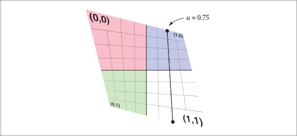

*Figure 6.24: Fixing the u parameter of a bilinear patch gives a linear function between two opposite edges of the patch.*

```text
   BilinearIntersection 335
   Float 23
   Point3f 92
   Ray 95
```

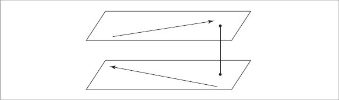

*Figure 6.25: The minimum distance between two lines can be computed by finding two parallel planes that contain each line and then computing the distance between them.*

In the case of ray–bilinear patch intersection, one line corresponds to the ray and the other to a line from the family of lines given by fu.

Given a ray and the bilinear patch vertices, we have pa = o, the ray’s origin, and pb can be set as the point along the ray pb = o + d. Then, pc and pd can be set as pc = pu,0 and pd = pu,1 from Equation (6.14). After taking the cross product to find the plane coefficients, finding each d value, and simplifying, we can find that dray − du is a quadratic equation in u. (That it is quadratic is reassuring, since a ray can intersect a bilinear patch up to two times.) Because we only care about finding zeros of the distance function, we can neglect the denominator of Equation (6.15). After equating the difference dray − du to 0, collecting terms and simplifying, we end up with the following code to compute the quadratic coefficients.4 〈Find quadratic coefficients for distance from ray to u iso-lines〉 ≡ 332

Float a = Dot(Cross(p10 - p00, p01 - p11), ray.d); Float c = Dot(Cross(p00 - ray.o, ray.d), p01 - p00);

```rust
   Float b = Dot(Cross(p10 - ray.o, ray.d), p11 - p10) - (a + c);
```

The u values where the ray intersects the patch are given by the solution to the corresponding quadratic equation. If there are no real solutions, then there is no intersection and the function returns. 〈Solve quadratic for bilinear patch u intersection〉 ≡ 332

Float u1, u2; if (!Quadratic(a, b, c, &u1, &u2)) return {};

```rust
   Cross() 91
   Dot() 89
   Float 23
   Quadratic() 1045
   Ray::d 95
```

The two u values are handled in turn. The first step is to check whether each is between 0 and 1. If not, it does not represent a valid intersection in the patch’s parametric domain. Otherwise, the v and t values for the intersection point are computed. 〈Compute v and t for the first u intersection〉 ≡ 332

Float t = tMax, u, v; if (0 <= u1 && u1 <= 1) { 〈Precompute common terms for v and t computation 334〉 〈Compute matrix determinants for v and t numerators 334〉 〈Set u, v, and t if intersection is valid 335〉 }

One way to compute the v and t values is to find the parametric values along the ray and the line fu where the distance between them is minimized. Although this distance should be zero since we have determined that there is an intersection between the ray and fu, there may be some round-off error in the computed u value. Thus, formulating this computation in terms of minimizing that distance is a reasonable way to make the most of the values at hand. With o the ray’s origin and d its direction, the parameter values where the distances are minimized are given by

and

where det is shorthand for the determinant of the 3 × 3 matrix formed from the three column vectors. We will not derive these equations here. The “Further Reading” section has more details. We start by computing a handful of common values that are used in computing the matrix determinants and final parametric values. 〈Precompute common terms for v and t computation〉 ≡ 334

Point3f uo = Lerp(u1, p00, p10); Vector3f ud = Lerp(u1, p01, p11) - uo; Vector3f deltao = uo - ray.o; Vector3f perp = Cross(ray.d, ud); Float p2 = LengthSquared(perp);

The matrix determinants in the numerators can easily be computed using the SquareMatrix class. Note that there are some common subexpressions among the two of them, though we leave it to the compiler to handle them. In a more optimized implementation, writing out the determinant computations explicitly in order to do so manually could be worthwhile. 〈Compute matrix determinants for v and t numerators〉 ≡ 334

Float v1 = Determinant(SquareMatrix<3>(deltao.x, ray.d.x, perp.x, deltao.y, ray.d.y, perp.y, deltao.z, ray.d.z, perp.z)); Float t1 = Determinant(SquareMatrix<3>(deltao.x, ud.x, perp.x, deltao.y, ud.y, perp.y, deltao.z, ud.z, perp.z));

```rust
   Float 23
   Point3f 92
   SquareMatrix 1049
   SquareMatrix::Determinant() 1051
   Vector3f 86
```

Due to round-off error, it is possible that the computed t distance is positive and seemingly represents a valid intersection even though the true value of t

is negative and corresponds to a point behind the ray’s origin. Testing t against an epsilon value (which is discussed further in Section 6.8.7) helps avoid reporting incorrect intersections in such cases. Because we defer the division to compute the final t value, it is necessary to test t1 against p2 * eps here.

〈Set u, v, and t if intersection is valid〉 ≡ 334

if (t1 > p2 * eps && 0 <= v1 && v1 <= p2) { u = u1; v = v1 / p2; t = t1 / p2; }

The second u root is handled with equivalent code, though with added logic to keep the closer of the intersections if there are two of them. That fragment is not included here. If the final closest t value is less than the given tMax, then an intersection is returned. 〈Check intersection t against tMax and possibly return intersection〉 ≡ 332

if (t >= tMax) return {}; return BilinearIntersection{{u, v}, t};

The (u, v) coordinates and ray parametric t value are sufficient to encapsulate the intersection so that the rest of its geometric properties can be computed later. 〈BilinearIntersection Definition〉 ≡ struct BilinearIntersection { Point2f uv; Float t; };

The InteractionFromIntersection() method computes all the geometric information necessary to return the SurfaceInteraction corresponding to a specified (u, v) point on a bilinear path, as is found by the intersection routine.

〈BilinearPatch Public Methods〉 +≡ 328

static SurfaceInteraction InteractionFromIntersection( const BilinearPatchMesh *mesh, int blpIndex, Point2f uv, Float time, Vector3f wo) { 〈Compute bilinear patch point p, ∂p/∂u, and ∂p/∂v for (u, v) 335〉 〈Compute (s, t) texture coordinates at bilinear patch (u, v) 336〉 〈Find partial derivatives ∂n/∂u and ∂n/∂v for bilinear patch 337〉 〈Initialize bilinear patch intersection point error pError 377〉 〈Initialize SurfaceInteraction for bilinear patch intersection 337〉 〈Compute bilinear patch shading normal if necessary 337〉 return isect; }

Given the parametric (u, v) coordinates of an intersection point, it is easy to compute the corresponding point on the bilinear patch using Equation (6.11) and its partial derivatives with Equation (6.13).

```rust
   BilinearIntersection 335
   BilinearPatchMesh 327
   Float 23
   Lerp() 72
   Point2f 92
   Point3f 92
   SurfaceInteraction 138
   Vector3f 86
```

〈Compute bilinear patch point p, ∂p/∂u, and ∂p/∂v for (u, v)〉 ≡ 335

〈Get bilinear patch vertices in p00, p01, p10, and p11 329〉 Point3f p = Lerp(uv[0], Lerp(uv[1], p00, p01), Lerp(uv[1], p10, p11)); Vector3f dpdu = Lerp(uv[1], p10, p11) - Lerp(uv[1], p00, p01); Vector3f dpdv = Lerp(uv[0], p01, p11) - Lerp(uv[0], p00, p10);

If per-vertex texture coordinates have been specified, then they, too, are interpolated at the intersection point. Otherwise, the parametric (u, v) coordinates are used for texture mapping. For the remainder of this method, we will denote the texture coordinates as (s, t) to distinguish them from the patch’s (u, v) parameterization. (Because this method does not use the parametric t distance along the ray, this notation is unambiguous.) Variables are also defined here to store the partial derivatives between the two sets of coordinates: ∂u/∂s, ∂u/∂t, ∂v/∂s, and ∂v/∂t. These are initialized for now to the appropriate values for when (s, t) = (u, v).

〈Compute (s, t) texture coordinates at bilinear patch (u, v)〉 ≡ 335

Point2f st = uv; Float duds = 1, dudt = 0, dvds = 0, dvdt = 1; if (mesh->uv) { 〈Compute texture coordinates for bilinear patch intersection point 336〉 〈Update bilinear patch ∂p/∂u and ∂p/∂v accounting for (s, t) 336〉 }

If per-vertex texture coordinates have been specified, they are bilinearly interpolated in the usual manner. 〈Compute texture coordinates for bilinear patch intersection point〉 ≡ 336, 341, 344

Point2f uv00 = mesh->uv[v[0]], uv10 = mesh->uv[v[1]]; Point2f uv01 = mesh->uv[v[2]], uv11 = mesh->uv[v[3]]; st = Lerp(uv[0], Lerp(uv[1], uv00, uv01), Lerp(uv[1], uv10, uv11));

Because the partial derivatives ∂p/∂u and ∂p/∂v in the SurfaceInteraction are in terms of the (u, v) parameterization used for texturing, these values must be updated if texture coordinates have been specified. 〈Update bilinear patch ∂p/∂u and ∂p/∂v accounting for (s, t)〉 ≡ 336

〈Compute partial derivatives of (u, v) with respect to (s, t) 336〉 〈Compute partial derivatives of p with respect to (s, t) 337〉 〈Set dpdu and dpdv to updated partial derivatives 337〉

The first step is to compute the updated partial derivatives ∂u/∂s and so forth. These can be found by first taking the corresponding partial derivatives of the bilinear interpolation used to compute (s, t) to find ∂(s, t)/ ∂u and ∂(s, t)/∂v. (Note the similar form to how the partial derivatives of p were computed earlier.) The desired partial derivatives can be found by taking reciprocals. 〈Compute partial derivatives of (u, v) with respect to (s, t)〉 ≡ 336

Vector2f dstdu = Lerp(uv[1], uv10, uv11) - Lerp(uv[1], uv00, uv01); Vector2f dstdv = Lerp(uv[0], uv01, uv11) - Lerp(uv[0], uv00, uv10); duds = std::abs(dstdu[0]) < 1e-8f ? 0 : 1 / dstdu[0]; dvds = std::abs(dstdv[0]) < 1e-8f ? 0 : 1 / dstdv[0]; dudt = std::abs(dstdu[1]) < 1e-8f ? 0 : 1 / dstdu[1]; dvdt = std::abs(dstdv[1]) < 1e-8f ? 0 : 1 / dstdv[1];

```text
    BilinearPatchMesh::uv 327
```

```rust
    Float 23
    Lerp() 72
    Point2f 92
    SurfaceInteraction 138
    Vector2f 86
```

Given the partial derivatives, the chain rule can be applied to compute the updated partial derivatives of position. For example,

and similarly for ∂p/∂t. 〈Compute partial derivatives of p with respect to (s, t)〉 ≡ 336

Vector3f dpds = dpdu * duds + dpdv * dvds; Vector3f dpdt = dpdu * dudt + dpdv * dvdt;

If the provided texture coordinates specify a degenerate mapping, ∂p/∂s or ∂p/∂t may be zero. In that case, dpdu and dpdv are left unchanged, as at least their cross product provides a correct normal vector. A dot product checks that the normal given by ∂p/∂s × ∂p/∂t lies in the same hemisphere as the normal given by the cross product of the original partial derivatives of p, flipping ∂p/∂t if necessary. Finally, dpdu and dpdv can be updated. 〈Set dpdu and dpdv to updated partial derivatives〉 ≡ 336

if (Cross(dpds, dpdt) != Vector3f(0, 0, 0)) { if (Dot(Cross(dpdu, dpdv), Cross(dpds, dpdt)) < 0) dpdt = -dpdt; dpdu = dpds; dpdv = dpdt; }

The second partial derivatives of p are easily found to compute the partial derivatives of the surface normal; all but ∂2p/∂u∂v are zero vectors. Thence, the partial derivatives of the normal can be computed using the regular approach. These are then adjusted to account for the (s, t) parameterization in the same way that ∂p/∂u and ∂p/∂v were. The corresponding fragment follows the same form as 〈Compute partial derivatives of p with respect to (s, t)〉 and is therefore not included here. 〈Find partial derivatives ∂n/∂u and ∂n/∂v for bilinear patch〉 ≡ 335

```rust
   Vector3f d2Pduu(0, 0, 0), d2Pdvv(0, 0, 0);
   Vector3f d2Pduv = (p00 - p01) + (p11 - p10);
   〈Compute coefficients for fundamental forms 279〉
   〈Compute ∂n/∂u and ∂n/∂v from fundamental form coefficients 279〉
   〈Update ∂n/∂u and ∂n/∂v to account for (s, t) parameterization〉
```

All the necessary information for initializing the SurfaceInteraction is now at hand. 〈Initialize SurfaceInteraction for bilinear patch intersection〉 ≡ 335

```rust
   bool flipNormal = mesh->reverseOrientation ^ mesh-
   >transformSwapsHandedness;
   SurfaceInteraction isect(Point3fi(p, pError), st, wo, dpdu, dpdv,
                                 dndu, dndv, time, flipNormal);
```

```text
   BilinearPatchMesh::n 327
   BilinearPatchMesh:: reverseOrientation 327
   BilinearPatchMesh:: transformSwapsHandedness 327
   Cross() 91
   Dot() 89
   Point3fi 1061
   SurfaceInteraction 138
   Vector3f 86
```

Shading geometry is set in the SurfaceInteraction after it is created. Therefore, per-vertex shading normals are handled next. 〈Compute bilinear patch shading normal if necessary〉 ≡ 335

if (mesh->n) { 〈Compute shading normals for bilinear patch intersection point 338〉 }

The usual bilinear interpolation is performed and if the resulting normal is non-degenerate, the shading geometry is provided to the SurfaceInteraction. 〈Compute shading normals for bilinear patch intersection point〉 ≡ 337

Normal3f n00 = mesh->n[v[0]], n10 = mesh->n[v[1]]; Normal3f n01 = mesh->n[v[2]], n11 = mesh->n[v[3]]; Normal3f ns = Lerp(uv[0], Lerp(uv[1], n00, n01), Lerp(uv[1], n10, n11)); if (LengthSquared(ns) > 0) { ns = Normalize(ns); 〈Set shading geometry for bilinear patch intersection 338〉

```rust
   }
```

The partial derivatives of the shading normal are computed in the same manner as the partial derivatives of p were found, including the adjustment for the parameterization given by per-vertex texture coordinates, if provided. Because shading geometry is specified via shading ∂p/∂u and ∂p/ ∂v vectors, here we find the rotation matrix that takes the geometric normal to the shading normal and apply it to dpdu and dpdv. The cross product of the resulting vectors then gives the shading normal. 〈Set shading geometry for bilinear patch intersection〉 ≡ 338

Normal3f dndu = Lerp(uv[1], n10, n11) - Lerp(uv[1], n00, n01); Normal3f dndv = Lerp(uv[0], n01, n11) - Lerp(uv[0], n00, n10); 〈Update ∂n/∂u and ∂n/∂v to account for (s, t) parameterization〉 Transform r = RotateFromTo(Vector3f(Normalize(isect.n)), Vector3f(ns)); isect.SetShadingGeometry(ns, r(dpdu), r(dpdv), dndu, dndv, true);

Given the intersection and InteractionFromIntersection() methods, both of the Bilinear Patch::Intersect() and IntersectP() methods are easy to implement. Since they both follow what should be by now a familiar form, we have not included them here.

### 6.6.2 SAMPLING

The sampling routines for bilinear patches select between sampling algorithms depending on the characteristics of the patch. For area sampling, both rectangular patches and patches that have an emission distribution defined by an image map are given special treatment. When sampling by solid angle from a reference point, rectangular patches are projected on to the sphere and sampled as spherical rectangles. For both cases, general-purpose sampling routines are used otherwise.

```text
    BilinearPatch 328
    BilinearPatch::GetMesh() 328
    BilinearPatchMesh 327
    BilinearPatchMesh::n 327
    DiffuseAreaLight 759
    Interaction::n 137
    LengthSquared() 87
    Lerp() 72
    Normal3f 94
```

```text
   Normalize() 88
   Point2f 92
   RotateFromTo() 127
   ShapeSample 268
   SurfaceInteraction:: SetShadingGeometry() 140
   Transform 120
   Vector3f 86
```

The area sampling method first samples parametric (u, v) coordinates, from which the rest of the necessary geometric values are derived. 〈BilinearPatch Method Definitions〉 +≡ pstd::optional<ShapeSample> BilinearPatch::Sample(Point2f u) const { const BilinearPatchMesh *mesh = GetMesh(); 〈Get bilinear patch vertices in p00, p01, p10, and p11 329〉 〈Sample bilinear patch parametric (u, v) coordinates 339〉 〈Compute bilinear patch geometric quantities at sampled (u, v) 341〉 〈Return ShapeSample for sampled bilinear patch point 341〉 }

While all the Shape implementations we have implemented so far can be used as area light sources, none of their sampling routines have accounted for the fact that pbrt’s DiffuseArea Light allows specifying an image that is used to represent spatially varying emission over the shape’s (u, v) surface. Because such emission profiles are most frequently used with rectangular light sources, the BilinearPatch has the capability of sampling in (u, v) according to the emission function. Figure 6.26 demonstrates the value of doing so.


*Figure 6.26: Area Sampling Accounting for Image-Based Emission. For a scene with an emissive bilinear patch where the amount of emission varies across the patch based on an image, (a) uniformly sampling in the patch’s (u, v) parametric space leads to high variance since some samples have much higher contributions than others. (b) Sampling according to the image’s distribution of brightness gives a significantly better result for the same number of rays. Here, MSE is improved by a factor of 2.28 ×. (Bunny model courtesy of the Stanford Computer Graphics Laboratory.)*

Otherwise, if the patch is not a rectangle, an approximation to uniform area sampling is used. If it is a rectangle, then uniform area sampling is trivial and the provided sample value is used directly for (u, v). In all of these

cases, the pdf value is with respect to the (u, v) parametric domain over [0, 1)2. 〈Sample bilinear patch parametric (u, v) coordinates〉 ≡ 338

Float pdf = 1; Point2f uv; if (mesh->imageDistribution) uv = mesh->imageDistribution->Sample(u, &pdf); else if (!IsRectangle(mesh)) { 〈Sample patch (u, v) with approximate uniform area sampling 340〉 } else uv = u;

```rust
   BilinearPatch::IsRectangle() 329
   BilinearPatchMesh:: imageDistribution 340
   Float 23
   PiecewiseConstant2D::Sample() 1020
   Point2f 92
```

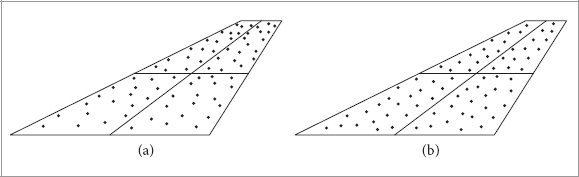

*Figure 6.27: Nonuniform Sample Distribution from Uniform Parametric Sampling. (a) When a bilinear patch is sampled uniformly in (u, v), the sample points are denser close to pairs of nearby vertices. (b) When using an approximate equal-area distribution, the points are more uniformly distributed over the patch.*

〈BilinearPatchMesh Public Members〉 +≡ 327

PiecewiseConstant2D *imageDistribution;

For patches without an emissive image to sample from, we would like to uniformly sample over their surface area, as we have done with all the shapes so far. Unfortunately, an exact equal-area sampling algorithm cannot

be derived for bilinear patches. This is a consequence of the fact that it is not possible to integrate the expression that gives the area of a bilinear patch, Equation (6.12). It is easy to uniformly sample in parametric (u, v) space, but doing so can give a poor distribution of samples, especially for bilinear patches where two vertices are close together and the others are far apart. Figure 6.27 shows such a patch as well as the distribution of points that results from uniform parametric sampling. While the nonuniform distribution of points can be accounted for in the PDF such that Monte Carlo estimates using such samples still converge to the correct result, the resulting estimators will generally have higher error than if a more uniform distribution is used. An exact equal-area sampling algorithm would sample points p with probability proportional to its differential surface area ‖∂p/∂u×∂p/∂v‖. Lacking the ability to sample directly from this distribution, we will approximate it with a bilinear function where the value of the function at each corner is given by the patch’s differential surface area there. Sampling a (u, v) location from that distribution generally works well to approximate exact equal-area sampling; see Figure 6.28. 〈Sample patch (u, v) with approximate uniform area sampling〉 ≡ 339

〈Initialize w array with differential area at bilinear patch corners 340〉 uv = SampleBilinear(u, w); pdf = BilinearPDF(uv, w);

It is especially easy to compute the partial derivatives at the patch corners; they are just differences with the adjacent vertices. 〈Initialize w array with differential area at bilinear patch corners〉 ≡ 340, 342

```rust
   pstd::array<Float, 4> w = {
         Length(Cross(p10 - p00, p01 - p00)),
         Length(Cross(p10 - p00, p11 - p10)),
         Length(Cross(p01 - p00, p11 - p01)),
         Length(Cross(p11 - p10, p11 - p01)) };
```

```rust
    BilinearPDF() 76
    Cross() 91
    Float 23
    Length() 88
    PiecewiseConstant2D 1019
    SampleBilinear() 76
```

Given a (u, v) position on the patch, the corresponding position, partial derivatives, and surface normal can all be computed, following the same approach as was implemented in InteractionFromIntersection(). The fragment 〈Compute p, ∂p/∂u, and ∂p/∂v for sampled (u, v)〉 is therefore not included here, and (s, t) texture coordinates for the sampled point are computed using a fragment defined earlier.

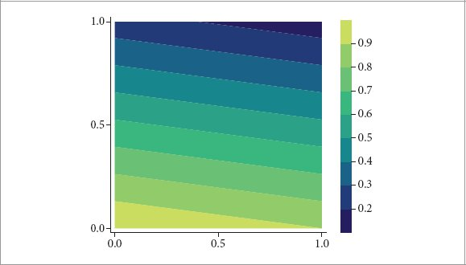

*Figure 6.28: Plot of differential area ‖∂p/∂u×∂p/∂v‖ in parametric space for the bilinear patch shown in Figure 6.27. Although the differential area is not a bilinear function, a bilinear fit to it has low error and is easy to draw samples from.*

〈Compute bilinear patch geometric quantities at sampled (u, v)〉 ≡ 338

〈Compute p, ∂p/∂u, and ∂p/∂v for sampled (u, v)〉 Point2f st = uv; if (mesh->uv) { 〈Compute texture coordinates for bilinear patch intersection point 336〉 } 〈Compute surface normal for sampled bilinear patch (u, v) 341〉 〈Compute pError for sampled bilinear patch (u, v) 377〉

Only the geometric normal is needed for sampled points. It is easily found via the cross product of partial derivatives of the position. The 〈Flip normal at sampled (u, v) if necessary〉 fragment negates the normal if

necessary, depending on the mesh properties and shading normals, if present. It follows the same form as earlier fragments that orient the geometric normal based on the shading normal, if present, and otherwise the reverseOrientation and transformSwapsHandedness properties of the mesh. 〈Compute surface normal for sampled bilinear patch (u, v)〉 ≡ 341

Normal3f n = Normal3f(Normalize(Cross(dpdu, dpdv))); 〈Flip normal at sampled (u, v) if necessary〉

```text
   BilinearPatchMesh::uv 327
   Cross() 91
   Interaction 136
   Length() 88
   Normal3f 94
   Normalize() 88
   Point2f 92
   Point3fi 1061
   ShapeSample 268
```

The PDF value stored in pdf gives the probability of sampling the position uv in parametric space. In order to return a PDF defined with respect to the patch’s surface area, it is necessary to account for the corresponding change of variables, which results in an additional factor of 1/‖∂p/∂u×∂p/∂v‖. 〈Return ShapeSample for sampled bilinear patch point〉 ≡ 338

return ShapeSample{Interaction(Point3fi(p, pError), n, st), pdf / Length(Cross(dpdu, dpdv))};

The PDF for sampling a given point on a bilinear patch is found by first computing the probability density for sampling its (u, v) position in parametric space and then transforming that density to be with respect to the patch’s surface area. 〈BilinearPatch Method Definitions〉 +≡ Float BilinearPatch::PDF(const Interaction &intr) const { const BilinearPatchMesh *mesh = GetMesh(); 〈Get bilinear patch vertices in p00, p01, p10, and p11 329〉 〈Compute parametric (u, v) of point on bilinear patch 342〉

```rust
        〈Compute PDF for sampling the (u, v) coordinates given by
        intr.uv 342〉
        〈Find ∂p/∂u and ∂p/∂v at bilinear patch (u, v)〉
        〈Return final bilinear patch area sampling PDF 342〉
   }
```

If (u, v) coordinates have been specified at the vertices of a bilinear patch, then the member variable Interaction::uv stores interpolated texture coordinates. In the following, we will need the parametric (u, v) coordinates over the patch’s [0, 1]2 domain, which can be found via a call to InvertBilinear().

〈Compute parametric (u, v) of point on bilinear patch〉 ≡ 342

Point2f uv = intr.uv; if (mesh->uv) { Point2f uv00 = mesh->uv[v[0]], uv10 = mesh->uv[v[1]]; Point2f uv01 = mesh->uv[v[2]], uv11 = mesh->uv[v[3]]; uv = InvertBilinear(uv, {uv00, uv10, uv01, uv11}); }

Regardless of which (u, v) sampling technique is used for a bilinear patch, finding the PDF for a (u, v) sample is straightforward. 〈Compute PDF for sampling the (u, v) coordinates given by intr.uv〉 ≡ 342

Float pdf; if (mesh->imageDistribution) pdf = mesh->imageDistribution->PDF(uv); else if (!IsRectangle(mesh)) { 〈Initialize w array with differential area at bilinear patch corners 340〉 pdf = BilinearPDF(uv, w); } else pdf = 1;

```text
   BilinearPatch::GetMesh() 328
   BilinearPatch::IsRectangle() 329
   BilinearPatchMesh 327
   BilinearPatchMesh:: imageDistribution 340
   BilinearPatchMesh::uv 327
   BilinearPDF() 76
   Cross() 91
   Cylinder 286
   Disk 292
```

```rust
   Float 23
   Interaction 136
   Interaction::uv 137
   InvertBilinear() 1033
   Length() 88
   PiecewiseConstant2D::PDF() 1021
   Point2f 92
```

The partial derivatives are computed from (u, v) as they have been before and so we omit the corresponding fragment. Given dpdu and dpdv, the same scaling factor as was used in Sample() is used to transform the PDF. 〈Return final bilinear patch area sampling PDF〉 ≡ 342

return pdf / Length(Cross(dpdu, dpdv));

The solid angle sampling method handles general bilinear patches with the same approach that was used for Cylinders and Disks: a sample is taken with respect to surface area on the surface using the first sampling method and is returned with a probability density expressed in terms of solid angle. Rectangular patches are handled using a specialized sampling technique that gives better results. 〈BilinearPatch Method Definitions〉 +≡ pstd::optional<ShapeSample> BilinearPatch::Sample(const ShapeSampleContext &ctx, Point2f u) const { const BilinearPatchMesh *mesh = GetMesh(); 〈Get bilinear patch vertices in p00, p01, p10, and p11 329〉 〈Sample bilinear patch with respect to solid angle from reference point 343〉 }

If the patch is not a rectangle, is very small, or has a sampling distribution associated with it to match textured emission, then the regular area sampling method is used and the PDF with respect to area is converted to be with respect to solid angle. Otherwise, a specialized solid angle sampling technique is used. 〈Sample bilinear patch with respect to solid angle from reference point〉 ≡ 343

```rust
   Vector3f v00 = Normalize(p00 - ctx.p()), v10 = Normalize(p10 - ctx.p());
   Vector3f v01 = Normalize(p01 - ctx.p()), v11 = Normalize(p11 - ctx.p());
   if (!IsRectangle(mesh) || mesh->imageDistribution ||
       SphericalQuadArea(v00, v10, v11, v01) <= MinSphericalSampleArea) {
       〈Sample shape by area and compute incident direction wi 282〉
       〈Convert area sampling PDF in ss to solid angle measure 282〉
       return ss;
   }
```

〈Sample direction to rectangular bilinear patch 343〉 〈BilinearPatch Private Members〉 +≡ 328

static constexpr Float MinSphericalSampleArea = 1e-4;

Rectangular patches are projected on the sphere to form a spherical rectangle that can then be sampled directly. Doing so gives similar benefits to sampling spherical triangles, as was implemented in Section 6.5.4.

```rust
   BilinearPatch 328
   BilinearPatch::GetMesh() 328
   BilinearPatch::IsRectangle() 329
   BilinearPatch:: MinSphericalSampleArea 343
   BilinearPatchMesh 327
   BilinearPatchMesh:: imageDistribution 340
   BilinearPDF() 76
   Float 23
   Interaction 136
   Normal3f 94
   Normalize() 88
   Point2f 92
   SampleBilinear() 76
   ShapeSample 268
   ShapeSampleContext 268
   ShapeSampleContext::ns 268
   ShapeSampleContext::p() 269
   ShapeSampleContext::time 268
   SphericalQuadArea() 106
   Vector3f 86
```

〈Sample direction to rectangular bilinear patch〉 ≡ 343

Float pdf = 1; 〈Warp uniform sample u to account for incident cos θ factor 343〉 〈Sample spherical rectangle at reference point 344〉 〈Compute (u, v) and surface normal for sampled point on rectangle 344〉 〈Compute (s, t) texture coordinates for sampled (u, v) 344〉 return ShapeSample{Interaction(p, n, ctx.time, st), pdf};

Also as with triangles, we incorporate an approximation to the cos θ factor at the reference point by warping the uniform sample u using a bilinear approximation to the cos θ function in the [0, 1]2 sampling space. 〈Warp uniform sample u to account for incident cos θ factor〉 ≡ 343

if (ctx.ns != Normal3f(0, 0, 0)) { 〈Compute cos θ weights for rectangle seen from reference point 344〉 u = SampleBilinear(u, w); pdf *= BilinearPDF(u, w); }

The spherical rectangle sampling algorithm maintains the relationship between each corner of the [0, 1]2 sampling space and the corresponding corner of the patch in its parametric space. Therefore, each bilinear sampling weight is set using the cos θ factor to the corresponding vertex of the patch. 〈Compute cos θ weights for rectangle seen from reference point〉 ≡ 343, 345

pstd::array<Float, 4> w = pstd::array<Float, 4>{ std::max<Float>(0.01, AbsDot(v00, ctx.ns)), std::max<Float>(0.01, AbsDot(v10, ctx.ns)), std::max<Float>(0.01, AbsDot(v01, ctx.ns)), std::max<Float>(0.01, AbsDot(v11, ctx.ns))};

In addition to the sample u, SampleSphericalRectangle() takes a reference point, the (0, 0) corner of the rectangle, and two vectors that define its edges. It returns a point on the patch and the sampling PDF, which is one over the solid angle that it subtends. 〈Sample spherical rectangle at reference point〉 ≡ 343

Vector3f eu = p10 - p00, ev = p01 - p00; Float quadPDF; Point3f p = SampleSphericalRectangle(ctx.p(), p00, eu, ev, u, &quadPDF); pdf *= quadPDF;

The implementation of the SampleSphericalRectangle() function is another interesting exercise in spherical trigonometry, like SampleSphericalTriangle() was. However, in the interests of space, we will not include discussion of its implementation here; the “Further Reading” section has a pointer to the paper that introduced the approach and describes its derivation.

〈Sampling Function Declarations〉 ≡ Point3f SampleSphericalRectangle(Point3f p, Point3f v00, Vector3f eu, Vector3f ev, Point2f u, Float *pdf = nullptr);

A rectangle has the same surface normal across its entire surface, which can be found by taking the cross product of the two edge vectors. The parametric (u, v) coordinates for the point p are then found by computing the normalized projection of p onto each of the edges. 〈Compute (u, v) and surface normal for sampled point on rectangle〉 ≡ 343

Point2f uv(Dot(p - p00, eu) / DistanceSquared(p10, p00), Dot(p - p00, ev) / DistanceSquared(p01, p00)); Normal3f n = Normal3f(Normalize(Cross(eu, ev))); 〈Flip normal at sampled (u, v) if necessary〉

```rust
   AbsDot() 90
   BilinearPatch 328
   BilinearPatch::GetMesh() 328
   BilinearPatchMesh 327
   BilinearPatchMesh::uv 327
   Cross() 91
   DistanceSquared() 93
   Dot() 89
   Float 23
   Normal3f 94
   Normalize() 88
   Point2f 92
   Point3f 92
   SampleSphericalRectangle() 344
   SampleSphericalTriangle() 318
   ShapeSampleContext 268
   ShapeSampleContext::ns 268
   ShapeSampleContext::p() 269
   Vector3f 86
```

If the bilinear patch has per-vertex texture coordinates associated with it, the interpolated texture coordinates at the sampled point are easily computed. 〈Compute (s, t) texture coordinates for sampled (u, v)〉 ≡ 343

```rust
   Point2f st = uv;
   if (mesh->uv) {
       〈Compute texture coordinates for bilinear patch intersection point 336〉
   }
```

The associated PDF() method follows the usual form, determining which sampling method would be used for the patch and then computing its solid angle PDF. 〈BilinearPatch Method Definitions〉 +≡ Float BilinearPatch::PDF(const ShapeSampleContext &ctx, Vector3f wi) const { const BilinearPatchMesh *mesh = GetMesh(); 〈Get bilinear patch vertices in p00, p01, p10, and p11 329〉 〈Compute solid angle PDF for sampling bilinear patch from ctx 345〉

}

In all cases, the SurfaceInteraction corresponding to the intersection of the ray from ctx in the direction wi will be needed, so the method starts by performing a ray–patch intersection test. 〈Compute solid angle PDF for sampling bilinear patch from ctx〉 ≡ 344

〈Intersect sample ray with shape geometry 285〉 Vector3f v00 = Normalize(p00 - ctx.p()), v10 = Normalize(p10 - ctx.p()); Vector3f v01 = Normalize(p01 - ctx.p()), v11 = Normalize(p11 - ctx.p()); if (!IsRectangle(mesh) || mesh->imageDistribution || SphericalQuadArea(v00, v10, v11, v01) <= MinSphericalSampleArea) { 〈Return solid angle PDF for area-sampled bilinear patch 345〉 } else { 〈Return PDF for sample in spherical rectangle 345〉 }

If one of the area sampling approaches was used, then a call to the other PDF() method provides the PDF with respect to surface area, which is converted to be with respect to solid angle before it is returned. 〈Return solid angle PDF for area-sampled bilinear patch〉 ≡ 345

Float pdf = PDF(isect->intr) * (DistanceSquared(ctx.p(), isect->intr.p()) / AbsDot(isect->intr.n, -wi));

```rust
   return IsInf(pdf) ? 0 : pdf;
```

Otherwise, the spherical rectangle sampling technique was used. The uniform solid angle PDF is 1 over the solid angle that the rectangle subtends. If the reference point is on a surface and the approximation to the cos θ factor would be applied in the Sample() method, then the PDF for sampling u must be included as well.

```rust
   AbsDot() 90
   BilinearPatch::IsRectangle() 329
   BilinearPatch:: MinSphericalSampleArea 343
   BilinearPatch::PDF() 342
   BilinearPatchMesh:: imageDistribution 340
   BilinearPDF() 76
   Curve 346
   DistanceSquared() 93
   Float 23
   Interaction::n 137
   Interaction::p() 137
   InvertSphericalRectangleSample() 345
   IsInf() 363
   Normal3f 94
   Normalize() 88
   Point2f 92
   Point3f 92
   SampleSphericalRectangle() 344
   ShapeIntersection::intr 266
   ShapeSampleContext::ns 268
   ShapeSampleContext::p() 269
   SphericalQuadArea() 106
   SurfaceInteraction 138
   Vector3f 86
```

〈Return PDF for sample in spherical rectangle〉 ≡ 345

Float pdf = 1 / SphericalQuadArea(v00, v10, v11, v01); if (ctx.ns != Normal3f(0, 0, 0)) { 〈Compute cos θ weights for rectangle seen from reference point 344〉 Point2f u = InvertSphericalRectangleSample(ctx.p(), p00, p10 - p00, p01 - p00, isect->intr.p()); return BilinearPDF(u, w) * pdf; } else return pdf;

The InvertSphericalRectangleSample() function, not included here, returns the sample value u that maps to the given point pRect on the rectangle when the SampleSpherical Rectangle() is called with the given reference point pRef. 〈Sampling Function Declarations〉 +≡ Point2f InvertSphericalRectangleSample( Point3f pRef, Point3f v00, Vector3f eu, Vector3f ev, Point3f pRect);

⋆ 6.7 CURVES While triangles or bilinear patches can be used to represent thin shapes for modeling fine geometry like hair, fur, or fields of grass, it is worthwhile to have a specialized Shape in order to more efficiently render these sorts of objects, since many individual instances of them are often present. The Curve shape, introduced in this section, represents thin geometry modeled with cubic Bézier curves, which are defined by four control points, p0, p1, p2, and p3. The Bézier spline passes through the first and last control points. Points along it are given by the polynomial

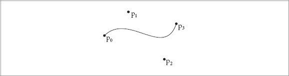

*Figure 6.29: A cubic Bézier curve is defined by four control points, pi. The curve p(u), defined in Equation (6.16), passes through the first and last control points at u = 0 and u = 1, respectively.*

*Figure 6.30: Basic Geometry of the Curve Shape. A 1D Bézier curve is offset by half of the specified width in both the directions orthogonal to the curve at each point along it. The resulting area represents the curve’s surface.*

(See Figure 6.29.) Curves specified using another basis (e.g., Hermite splines or b-splines) must therefore be converted to the Bézier basis to be used with this Shape.

The Curve shape is defined by a 1D Bézier curve along with a width that is linearly interpolated from starting and ending widths along its extent.

Together, these define a flat 2D surface (Figure 6.30).5 It is possible to directly intersect rays with this representation without tessellating it, which in turn makes it possible to efficiently render smooth curves without using too much storage. Figure 6.31 shows a bunny model with fur modeled with over one million Curves.

〈Curve Definition〉 ≡ class Curve { public: 〈Curve Public Methods 348〉 private: 〈Curve Private Methods〉 〈Curve Private Members 348〉 };

There are three types of curves that the Curve shape can represent, shown in Figure 6.32.

```text
   Curve 346
```

```rust
           Flat: Curves with this representation are always oriented to face
           the ray being intersected with them; they are useful for modeling
           fine swept cylindrical shapes like hair or fur.
           Cylinder: For curves that span a few pixels on the screen (like
           spaghetti seen from not too far away), the Curve shape can
           compute a shading normal that makes the curve appear to actually
           be a cylinder.
           Ribbon: This variant is useful for modeling shapes that do not
           actually have a cylindrical cross section (such as a blade of grass).
```

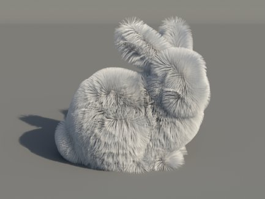

*Figure 6.31: Furry Bunny. Bunny model with over one million Curve shapes used to model fur. Here, we have used unrealistically long curves to better show off the Curve’s capabilities, giving an unrealistically shaggy bunny. (Underlying bunny mesh courtesy of the Stanford Computer Graphics Laboratory.)*


*Figure 6.32: The Three Types of Curves That the Curve Shape Can Represent. On the top is a flat curve that is always oriented to be perpendicular to a ray approaching it. The middle is a variant of this curve where the shading normal is set so that the curve appears to be cylindrical. On the bottom is a ribbon, which has a fixed orientation at its starting and ending points; intermediate orientations are smoothly interpolated between them.*

The CurveType enumerator records which of them a given Curve instance models. The flat and cylinder curve variants are intended to be used as convenient approximations of deformed cylinders. It should be noted that intersections found with respect to them do not correspond to a physically realizable 3D shape, which can potentially lead to minor inconsistencies when taking a scene with true cylinders as a reference.

```text
   Curve 346
```

〈CurveType Definition〉 ≡ enum class CurveType { Flat, Cylinder, Ribbon };

Given a curve specified in a pbrt scene description file, it can be worthwhile to split it into a few segments, each covering part of the u parametric range of the curve. (One reason for doing so is that axis-aligned bounding boxes do not tightly bound wiggly curves, but subdividing Bézier curves makes them less wiggly—the variation diminishing property of polynomials.) Therefore, the Curve constructor takes a parametric range of u values, [umin, umax], as well as a pointer to a CurveCommon structure,

which stores the control points and other information about the curve that is shared across curve segments. In this way, the memory footprint for individual curve segments is reduced, which makes it easier to keep many of them in memory. 〈Curve Public Methods〉 ≡ 346

Curve(const CurveCommon *common, Float uMin, Float uMax) : common(common), uMin(uMin), uMax(uMax) {} 〈Curve Private Members〉 ≡ 346

const CurveCommon *common; Float uMin, uMax;

The CurveCommon constructor initializes member variables with values passed into it for the control points, the curve width, etc. The control points provided to it should be in the curve’s object space. For Ribbon curves, CurveCommon stores a surface normal to orient the curve at each endpoint. The constructor precomputes the angle between the two normal vectors and one over the sine of this angle; these values will be useful when computing the orientation of the curve at arbitrary points along its extent. 〈CurveCommon Definition〉 ≡ struct CurveCommon { 〈CurveCommon Public Methods〉 〈CurveCommon Public Members 348〉 }; 〈CurveCommon Public Members〉 ≡ 348

CurveType type; Point3f cpObj[4]; Float width[2]; Normal3f n[2]; Float normalAngle, invSinNormalAngle; const Transform *renderFromObject, *objectFromRender; bool reverseOrientation, transformSwapsHandedness;

```text
   BoundCubicBezier() 1054
   Bounds3f 97
   Curve 346
   Curve::common 348
   Curve::uMax 348
   Curve::uMin 348
```

```text
    CurveCommon 348
    CurveCommon::cpObj 348
    CurveCommon::renderFromObject 348
    CurveType 347
    Float 23
    Normal3f 94
    Point3f 92
    Transform 120
```

### 6.7.1 BOUNDING CURVES

The object-space bound of a curve can be found by first bounding the spline along the center of the curve and then expanding that bound by half the maximum width the curve takes on over its extent. The Bounds() method then transforms that bound to rendering space before returning it. 〈Curve Method Definitions〉 ≡ Bounds3f Curve::Bounds() const { pstd::span<const Point3f> cpSpan(common->cpObj); Bounds3f objBounds = BoundCubicBezier(cpSpan, uMin, uMax); 〈Expand objBounds by maximum curve width over u range 349〉 return (*common->renderFromObject)(objBounds); }

〈Expand objBounds by maximum curve width over u range〉 ≡ 348

Float width[2] = {Lerp(uMin, common->width[0], common->width[1]), Lerp(uMax, common->width[0], common->width[1])}; objBounds = Expand(objBounds, std::max(width[0], width[1]) * 0.5f);

The Curve shape cannot be used as an area light, as it does not provide implementations of the required sampling methods. It does provide a NormalBounds() method that returns a conservative bound.

〈Curve Public Methods〉 +≡ 346

DirectionCone NormalBounds() const { return DirectionCone::EntireSphere(); }

### 6.7.2 INTERSECTION TESTS

Both of the intersection methods required by the Shape interface are implemented via another Curve method, IntersectRay(). Rather than returning an optional ShapeIntersection, it takes a pointer to one.

〈Curve Method Definitions〉 +≡ pstd::optional<ShapeIntersection> Curve::Intersect(const Ray &ray, Float tMax) const { pstd::optional<ShapeIntersection> si; IntersectRay(ray, tMax, &si); return si; }

IntersectP() passes nullptr to IntersectRay(), which indicates that it can return immediately if an intersection is found. 〈Curve Method Definitions〉 +≡ bool Curve::IntersectP(const Ray &ray, Float tMax) const { return IntersectRay(ray, tMax, nullptr); }

The Curve intersection algorithm is based on discarding curve segments as soon as it can be determined that the ray definitely does not intersect them and otherwise recursively splitting the curve in half to create two smaller segments that are then tested. Eventually, the curve is linearly approximated for an efficient intersection test. That process starts after some initial preparation and early culling tests in IntersectRay().

```rust
   Bounds3::Expand() 101
   CubicBezierControlPoints() 1053
   Curve 346
   Curve::common 348
   Curve::IntersectRay() 349
   CurveCommon 348
   CurveCommon::objectFromRender 348
   CurveCommon::width 348
   DirectionCone 114
   DirectionCone::EntireSphere() 115
   Float 23
   Ray 95
```

```text
   ShapeIntersection 266
```

〈Curve Method Definitions〉 +≡ bool Curve::IntersectRay(const Ray &r, Float tMax, pstd::optional<ShapeIntersection> *si) const { 〈Transform Ray to curve’s object space 349〉 〈Get object-space control points for curve segment, cpObj 350〉 〈Project curve control points to plane perpendicular to ray 350〉 〈Test ray against bound of projected control points 351〉 〈Compute refinement depth for curve, maxDepth〉 〈Recursively test for ray–curve intersection 351〉 } 〈Transform Ray to curve’s object space〉 ≡ 349

Ray ray = (*common->objectFromRender)(r);

The CurveCommon class stores the control points for the full curve, but a Curve instance generally needs the four control points that represent the Bézier curve for its u extent. The CubicBezierControlPoints() utility function performs this computation.

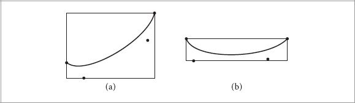

*Figure 6.33: 2D Bounding Boxes of a Bézier Curve. (a) Bounding box computed using the curve’s control points as given. (b) The effect of rotating the curve so that the vector from its first to last control point is aligned with the x axis before computing bounds. The resulting bounding box is a much tighter fit.*

〈Get object-space control points for curve segment, cpObj〉 ≡ 349

pstd::array<Point3f, 4> cpObj = CubicBezierControlPoints(pstd::span<const Point3f>(common->cpObj), uMin, uMax);

Like the ray–triangle intersection algorithm from Section 6.5.3, the ray– curve intersection test is based on transforming the curve to a coordinate

system with the ray’s origin at the origin of the coordinate system and the ray’s direction aligned to be along the +z axis. Performing this transformation at the start greatly reduces the number of operations that must be performed for intersection tests. For the Curve shape, we will need an explicit representation of the transformation, so the LookAt() function is used to generate it here. The origin is the ray’s origin and the “look at” point is a point offset from the origin along the ray’s direction. The “up” direction is set to be perpendicular to both the ray’s direction and the vector from the first to the last control point. Doing so helps orient the curve to be roughly parallel to the x axis in the ray coordinate system, which in turn leads to tighter bounds in y (see Figure 6.33). This improvement in the fit of the bounds often makes it possible to terminate the recursive intersection tests earlier than would be possible otherwise. If the ray and the vector between the first and last control points are parallel, dx will be degenerate. In that case we find an arbitrary “up” vector direction so that intersection tests can proceed in this unusual case.

```text
   CoordinateSystem() 92
   Cross() 91
   CubicBezierControlPoints() 1053
   Curve::Bounds() 348
   Curve::common 348
   Curve::uMax 348
   Curve::uMin 348
   CurveCommon::cpObj 348
   LengthSquared() 87
   LookAt() 129
   Point3f 92
   Ray::d 95
   Ray::o 95
   Transform 120
   Vector3f 86
```

〈Project curve control points to plane perpendicular to ray〉 ≡ 349

Vector3f dx = Cross(ray.d, cpObj[3] - cpObj[0]); if (LengthSquared(dx) == 0) { Vector3f dy; CoordinateSystem(ray.d, &dx, &dy);

```rust
   }
   Transform rayFromObject = LookAt(ray.o, ray.o + ray.d, dx);
   pstd::array<Point3f, 4> cp = {
       rayFromObject(cpObj[0]), rayFromObject(cpObj[1]),
       rayFromObject(cpObj[2]), rayFromObject(cpObj[3]) };
```

Along the lines of the implementation in Curve::Bounds(), a conservative bounding box for a curve segment can be found by taking the bounds of the curve’s control points and expanding by half of the maximum width of the curve over the u range being considered.

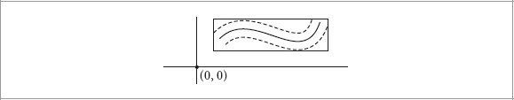

*Figure 6.34: Ray–Curve Bounds Test. In the ray coordinate system, the ray’s origin is at (0, 0, 0) and its direction is aligned with the +z axis. Therefore, if the 2D point (x, y) = (0, 0) is outside the xy bounding box of the curve segment, then it is impossible that the ray intersects the curve.*

Because the ray’s origin is at (0, 0, 0) and its direction is aligned with the +z axis in the intersection space, its bounding box only includes the origin in x and y (Figure 6.34); its z extent is given by the z range that its parametric extent covers. Before proceeding with the recursive intersection testing algorithm, the ray’s bounding box is tested for intersection with the curve’s bounding box. The method can return immediately if they do not intersect. 〈Test ray against bound of projected control points〉 ≡ 349

Float maxWidth = std::max(Lerp(uMin, common->width[0], common->width[1]), Lerp(uMax, common->width[0], common->width[1])); Bounds3f curveBounds = Union(Bounds3f(cp[0], cp[1]), Bounds3f(cp[2], cp[3])); curveBounds = Expand(curveBounds, 0.5f * maxWidth); Bounds3f rayBounds(Point3f(0, 0, 0), Point3f(0, 0, Length(ray.d) * tMax)); if (!Overlaps(rayBounds, curveBounds)) return false;

The maximum number of times to subdivide the curve is computed so that the maximum distance from the eventual linearized curve at the finest

refinement level is bounded to be less than a small fixed distance. We will not go into the details of this computation, which is implemented in the fragment 〈Compute refinement depth for curve, maxDepth〉. With the culling tests passed and that value in hand, the recursive intersection tests begin. 〈Recursively test for ray–curve intersection〉 ≡ 349

pstd::span<const Point3f> cpSpan(cp); return RecursiveIntersect(ray, tMax, cpSpan, Inverse(rayFromObject), uMin, uMax, maxDepth, si);

```rust
   Bounds3::Expand() 101
   Bounds3::Union() 99
   Bounds3f 97
   Curve::common 348
   Curve::RecursiveIntersect() 351
   Curve::uMax 348
   Curve::uMin 348
   CurveCommon::width 348
   Float 23
   Length() 88
   Lerp() 72
   Point3f 92
   Ray 95
   Ray::d 95
   ShapeIntersection 266
   Transform 120
```

The RecursiveIntersect() method then tests whether the given ray intersects the given curve segment over the given parametric range [u0, u1]. It assumes that the ray has already been tested against the curve’s bounding box and found to intersect it. 〈Curve Method Definitions〉 +≡ bool Curve::RecursiveIntersect( const Ray &ray, Float tMax, pstd::span<const Point3f> cp, const Transform &objectFromRay, Float u0, Float u1, int depth, pstd::optional<ShapeIntersection> *si) const {

```rust
       Float rayLength = Length(ray.d);
       if (depth > 0) {
         〈Split curve segment into subsegments and test for intersection
         352〉
```

} else { 〈Intersect ray with curve segment 352〉 } }

If the maximum depth has not been reached, a call to SubdivideCubicBezier() gives the control points for the two Bézier curves that result in splitting the Bézier curve given by cp in half. The last control point of the first curve is the same as the first control point of the second, so 7 values are returned for the total of 8 control points. The u array is then initialized so that it holds the parametric range of the two curves before each one is processed in turn. 〈Split curve segment into subsegments and test for intersection〉 ≡ 351

pstd::array<Point3f, 7> cpSplit = SubdivideCubicBezier(cp); Float u[3] = {u0, (u0 + u1) / 2, u1}; for (int seg = 0; seg < 2; ++seg) { 〈Check ray against curve segment’s bounding box〉 〈Recursively test ray-segment intersection 352〉 } return si ? si->has_value() : false;

The bounding box test in the 〈Check ray against curve segment’s bounding box〉 fragment is essentially the same as the one in 〈Test ray against bound of projected control points〉 except that it takes u values from the u array when computing the curve’s maximum width over the u range and it uses control points from cpSplit. Therefore, it is not included here. If the ray does intersect the bounding box, the corresponding segment is given to a recursive call of RecursiveIntersect(). If an intersection is found and the ray is a shadow ray, si will be nullptr and an intersection can immediately be reported. For non-shadow rays, even if an intersection has been found, it may not be the closest intersection, so the other segment still must be considered.

〈Recursively test ray-segment intersection〉 ≡ 352

bool hit = RecursiveIntersect(ray, tMax, cps, objectFromRay, u[seg], u[seg + 1], depth - 1, si); if (hit && !si) return true;

The intersection test is made more efficient by using a linear approximation of the curve; the variation diminishing property allows us to make this approximation without introducing too much error. 〈Intersect ray with curve segment〉 ≡ 351

```rust
   〈Test ray against segment endpoint boundaries 352〉
   〈Find line w that gives minimum distance to sample point 355〉
   〈Compute u coordinate of curve intersection point and hitWidth 355〉
   〈Test intersection point against curve width 355〉
   if (si) {
        〈Initialize ShapeIntersection for curve intersection 356〉
   }
   return true;
```

It is important that the intersection test only accepts intersections that are on the Curve’s surface for the u segment currently under consideration. Therefore, the first step of the intersection test is to compute edge functions for lines perpendicular to the curve starting point and ending point and to classify the potential intersection point against them (Figure 6.35).

```rust
   Curve::RecursiveIntersect() 351
   Float 23
   Point3f 92
   SubdivideCubicBezier() 1053
```

〈Test ray against segment endpoint boundaries〉 ≡ 352

〈Test sample point against tangent perpendicular at curve start 353〉 〈Test sample point against tangent perpendicular at curve end〉

*Figure 6.35: Curve Segment Boundaries. The intersection test for a segment of a larger curve computes edge functions for the lines that are perpendicular to the segment endpoints (dashed lines). If a potential intersection point (solid dot) is on the other side of the edge than the segment, it is rejected; another curve segment (if present on that side) should account for this intersection instead.*

Projecting the curve control points into the ray coordinate system makes this test more efficient for two reasons. First, because the ray’s direction is oriented with the +z axis, the problem is reduced to a 2D test in x and y. Second, because the ray origin is at the origin of the coordinate system, the point we need to classify is (0, 0), which simplifies evaluating the edge function, just like the ray–triangle intersection test. Edge functions were introduced for ray–triangle intersection tests in Equation (6.5); see also Figure 6.14. To define the edge function here, we need any two points on the line perpendicular to the curve going through the starting point. The first control point, p0, is a fine choice for the first. For the second, we will compute the vector perpendicular to the curve’s tangent and add that offset to the control point. Differentiation of Equation (6.16) shows that the tangent to the curve at the first control point p0 is 3(p1 − p0). The scaling factor does not matter here, so we will use t = p1 − p0 here. Computing the vector perpendicular to the tangent is easy in 2D: it is just necessary to swap the x and y coordinates and negate one of them. (To see why this works, consider the dot product (x, y) · (y, −x) = xy + −yx = 0. Because the cosine of the angle between the two vectors is zero, they must be perpendicular.) Thus, the second point on the edge is p0 + (p1y − p0y, −(p1x − p0x)) = p0 + (p1y − p0y, p0x − p1x). Substituting these two points into the definition of the edge function, Equation (6.5), and simplifying gives e(p) = (p1y − p0y)(py − p0y) − (px − p0x)(p0x − p1x).

Finally, substituting p = (0, 0) gives the final expression to test: e((0, 0)) = (p1y − p0y)(−p0y) + p0x(p0x − p1x).

〈Test sample point against tangent perpendicular at curve start〉 ≡ 352

Float edge = (cp[1].y - cp[0].y) * -cp[0].y + cp[0].x * (cp[0].x - cp[1].x); if (edge < 0) return false;

The 〈Test sample point against tangent perpendicular at curve end〉 fragment, not included here, does the corresponding test at the end of the curve.

```text
   Float 23
```

The next part of the test is to determine the u value along the curve segment where the point (0, 0) is closest to the curve. This will be the intersection point, if it is no farther than the curve’s width away from the center at that point. Determining this distance for a cubic Bézier curve requires a significant amount of computation, so instead the implementation here approximates the curve with a linear segment to compute this u value.

*Figure 6.36: Approximation of a Cubic Bézier Curve with a Linear Segment. For this part of the ray– curve intersection test, we approximate the Bézier with a linear segment (dashed line) passing through its starting and ending points. (In practice, after being subdivided, the curve will be already nearly linear, so the error is less than this figure suggests.)*

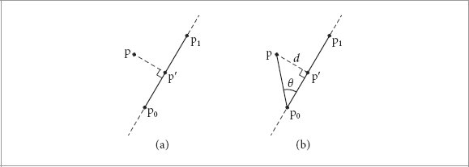

*Figure 6.37: (a) Given an infinite line and a point p, the vector from the point to the closest point on the line, p′, is then perpendicular to the line. (b) Because this vector is perpendicular, we can compute the distance from the first point of the line to the point of closest approach, p′, as d = ‖p − p0‖ cos θ.*

We linearly approximate the Bézier curve with a line segment from its starting point p0 to its endpoint p3 that is parameterized by w. In this case, the position is p0 at w = 0 and p3 at w = 1 (Figure 6.36). Our task is to compute the value of w along the line corresponding to the point on the line p′ that is closest to the point p. The key insight to apply is that at p′, the vector from the corresponding point on the line to p will be perpendicular to the line (Figure 6.37(a)). Equation (3.1) gives us a relationship between the dot product of two vectors, their lengths, and the cosine of the angle between them. In particular, it shows us how to compute the cosine of the angle between the

vector from p0 to p and the vector from p0 to p3: Because the vector from p′ to p is perpendicular to the line (Figure 6.37(b)), we can compute the distance along the line from p0 to p′ as

Finally, the parametric offset w along the line is the ratio of d to the line’s length,

The computation of the value of w is in turn slightly simplified from the fact that p = (0, 0) in the intersection coordinate system. 〈Find line w that gives minimum distance to sample point〉 ≡ 352

Vector2f segmentDir = Point2f(cp[3].x, cp[3].y) - Point2f(cp[0].x, cp[0].y); Float denom = LengthSquared(segmentDir); if (denom == 0) return false; Float w = Dot(-Vector2f(cp[0].x, cp[0].y), segmentDir) / denom;

The parametric u coordinate of the (presumed) closest point on the Bézier curve to the candidate intersection point is computed by linearly interpolating along the u range of the segment. Given this u value, the width of the curve at that point can be computed. 〈Compute u coordinate of curve intersection point and hitWidth〉 ≡ 352

Float u = Clamp(Lerp(w, u0, u1), u0, u1); Float hitWidth = Lerp(u, common->width[0], common->width[1]); Normal3f nHit; if (common->type == CurveType::Ribbon) { 〈Scale hitWidth based on ribbon orientation 355〉 }

For Ribbon curves, the curve is not always oriented to face the ray. Rather, its orientation is interpolated between two surface normals given at each endpoint. Here, spherical linear interpolation is used to interpolate the normal at u. The curve’s width is then scaled by the cosine of the angle between the normalized ray direction and the ribbon’s orientation so that it corresponds to the visible width of the curve from the given direction. 〈Scale hitWidth based on ribbon orientation〉 ≡ 355

if (common->normalAngle == 0) nHit = common->n[0]; else { Float sin0 = std::sin((1 - u) * common->normalAngle) * common->invSinNormalAngle; Float sin1 = std::sin(u * common->normalAngle) * common->invSinNormalAngle; nHit = sin0 * common->n[0] + sin1 * common->n[1]; } hitWidth *= AbsDot(nHit, ray.d) / rayLength;

```rust
   AbsDot() 90
   Clamp() 1033
   Curve::common 348
   CurveCommon:: invSinNormalAngle 348
   CurveCommon::n 348
   CurveCommon::normalAngle 348
   CurveCommon::type 348
   CurveCommon::width 348
   CurveType::Ribbon 347
   Dot() 89
   EvaluateCubicBezier() 1052
   Float 23
   Lerp() 72
   Normal3f 94
   Point2f 92
   Point3f 92
   Ray::d 95
   Sqr() 1034
   Vector2f 86
   Vector3f 86
```

To finally classify the potential intersection as a hit or miss, the Bézier curve must still be evaluated at u. (Because the control points cp represent the curve segment currently under consideration, it is important to use w rather than u in the function call, however, since w is in the range [0, 1].) The derivative of the curve at this point will be useful shortly, so it is recorded now. We would like to test whether the distance from p to this point on the curve pc is less than half the curve’s width. Because p = (0, 0), we can equivalently test whether the distance from pc to the origin is less than half the width or whether the squared distance is less than one quarter the width squared. If this test passes, the last thing to check is if the intersection point is in the ray’s parametric t range. 〈Test intersection point against curve width〉 ≡ 352

Vector3f dpcdw; Point3f pc = EvaluateCubicBezier(pstd::span<const Point3f>(cp), Clamp(w, 0, 1), &dpcdw); Float ptCurveDist2 = Sqr(pc.x) + Sqr(pc.y); if (ptCurveDist2 > Sqr(hitWidth) * 0.25f) return false; if (pc.z < 0 || pc.z > rayLength * tMax)

```rust
        return false;
```

For non-shadow rays, the ShapeIntersection for the intersection can finally be initialized. Doing so requires computing the ray t value for the intersection as well as its Surface Interaction. 〈Initialize ShapeIntersection for curve intersection〉 ≡ 352

```rust
   〈Compute tHit for curve intersection 356〉
   〈Initialize SurfaceInteraction intr for curve intersection 356〉
   *si = ShapeIntersection{intr, tHit};
```

After the tHit value has been computed, it is compared against the tHit of a previously found ray–curve intersection, if there is one. This check ensures that the closest intersection is returned. 〈Compute tHit for curve intersection〉 ≡ 356

Float tHit = pc.z / rayLength; if (si->has_value() && tHit > si->value().tHit) return false;

A variety of additional quantities need to be computed in order to be able to initialize the intersection’s SurfaceInteraction. 〈Initialize SurfaceInteraction intr for curve intersection〉 ≡ 356

```rust
   〈Compute v coordinate of curve intersection point 356〉
   〈Compute ∂p/∂u and ∂p/∂v for curve intersection 357〉
   〈Compute error bounds for curve intersection 378〉
   bool flipNormal = common->reverseOrientation ^
                       common->transformSwapsHandedness;
   Point3fi pi(ray(tHit), pError);
   SurfaceInteraction intr(pi, {u, v}, -ray.d, dpdu, dpdv, Normal3f(),
                            Normal3f(), ray.time, flipNormal);
   intr = (*common->renderFromObject)(intr);
```

We have gotten this far without computing the v coordinate of the intersection point, which is now needed. The curve’s v coordinate ranges from 0 to 1, taking on the value 0.5 at the center of the curve; here, we classify the intersection point, (0, 0), with respect to an edge function going through the point on the curve pc and a point along its derivative to determine which side of the center the intersection point is on and in turn how to compute v.

```rust
   Curve::common 348
   CurveCommon::renderFromObject 348
   CurveCommon:: reverseOrientation 348
   CurveCommon:: transformSwapsHandedness 348
   Float 23
   Normal3f 94
   Point3fi 1061
   ShapeIntersection 266
   ShapeIntersection::tHit 266
   SurfaceInteraction 138
```

〈Compute v coordinate of curve intersection point〉 ≡ 356

Float ptCurveDist = std::sqrt(ptCurveDist2); Float edgeFunc = dpcdw.x * -pc.y + pc.x * dpcdw.y; Float v = (edgeFunc > 0) ? 0.5f + ptCurveDist / hitWidth : 0.5f - ptCurveDist / hitWidth;

The partial derivative ∂p/∂u comes directly from the derivative of the underlying Bézier curve. The second partial derivative, ∂p/∂v, is computed in different ways based on the type of the curve. For ribbons, we have ∂p/∂u and the surface normal, and so ∂p/∂v must be the vector such that ∂p/∂u×∂p/ ∂v = n and has length equal to the curve’s width. 〈Compute ∂p/∂u and ∂p/∂v for curve intersection〉 ≡ 356

Vector3f dpdu, dpdv; EvaluateCubicBezier(pstd::MakeConstSpan(common->cpObj), u, &dpdu); if (common->type == CurveType::Ribbon) dpdv = Normalize(Cross(nHit, dpdu)) * hitWidth; else { 〈Compute curve ∂p/∂v for flat and cylinder curves 357〉 }

For flat and cylinder curves, we transform ∂p/∂u to the intersection coordinate system. For flat curves, we know that ∂p/∂v lies in the xy plane, is perpendicular to ∂p/∂u, and has length equal to hitWidth. We can find the 2D perpendicular vector using the same approach as was used earlier for the perpendicular curve segment boundary edges. 〈Compute curve ∂p/∂v for flat and cylinder curves〉 ≡ 357

Vector3f dpduPlane = objectFromRay.ApplyInverse(dpdu); Vector3f dpdvPlane = Normalize(Vector3f(-dpduPlane.y, dpduPlane.x, 0)) * hitWidth; if (common->type == CurveType::Cylinder) {

```rust
        〈Rotate dpdvPlane to give cylindrical appearance 357〉
   }
   dpdv = objectFromRay(dpdvPlane);
```

The ∂p/∂v vector for cylinder curves is rotated around the dpduPlane axis so that its appearance resembles a cylindrical cross-section. 〈Rotate dpdvPlane to give cylindrical appearance〉 ≡ 357

Float theta = Lerp(v, -90, 90); Transform rot = Rotate(-theta, dpduPlane); dpdvPlane = rot(dpdvPlane);

⋆ 6.8 MANAGING ROUNDING ERROR

Thus far, we have been discussing ray–shape intersection algorithms with respect to idealized arithmetic operations based on the real numbers. This approach has gotten us far, although the fact that computers can only represent finite quantities and therefore cannot actually represent all the real numbers is important. In place of real numbers, computers use floating-point numbers, which have fixed storage requirements. However, error may be introduced each time a floating-point operation is performed, since the result may not be representable in the designated amount of memory.

```rust
   Cross() 91
   Curve::common 348
   CurveCommon::cpObj 348
   CurveCommon::type 348
   CurveType::Cylinder 347
   CurveType::Ribbon 347
   Cylinder 286
   EvaluateCubicBezier() 1052
   Float 23
   Lerp() 72
   Normalize() 88
   Rotate() 126
   Transform 120
   Transform::ApplyInverse() 130
   Vector3f 86
```

The accumulation of this error has several implications for the accuracy of intersection tests. First, it is possible that it will cause valid intersections to be missed completely—for example, if a computed intersection’s t value is

negative even though the precise value is positive. Furthermore, computed ray–shape intersection points may be above or below the actual surface of the shape. This leads to a problem: when new rays are traced starting from computed intersection points for shadow rays and reflection rays, if the ray origin is below the actual surface, we may find an incorrect reintersection with the surface. Conversely, if the origin is too far above the surface, shadows and reflections may appear detached. (See Figure 6.38.) Typical practice to address this issue in ray tracing is to offset spawned rays by a fixed “ray epsilon” value, ignoring any intersections along the ray p + td closer than some tmin value.

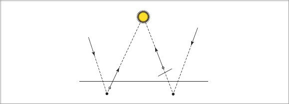

*Figure 6.38: Geometric Settings for Rounding-Error Issues That Can Cause Visible Errors in Images. The incident ray on the left intersects the surface. On the left, the computed intersection point (black circle) is slightly below the surface and a too-low “epsilon” offsetting the origin of the shadow ray leads to an incorrect self-intersection, as the shadow ray origin (white circle) is still below the surface; thus the light is incorrectly determined to be occluded. On the right, a too-high “epsilon” causes a valid intersection to be missed as the ray’s origin is past the occluding surface.*

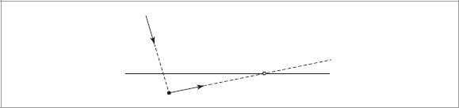

*Figure 6.39: If the computed intersection point (filled circle) is below the surface and the spawned ray is oblique, incorrect reintersections may occur some distance from the ray origin (open circle). If a minimum t value along the ray is used to discard nearby intersections, a relatively large tmin is needed to handle oblique rays well.*

*Figure 6.39 shows why this approach requires fairly high tmin values to work effectively: if the spawned ray is oblique to the surface, incorrect ray intersections may occur quite some distance from the ray origin. Unfortunately, large tmin values cause ray origins to be relatively far from the original intersection points, which in turn can cause valid nearby intersections to be missed, leading to loss of fine detail in shadows and reflections. In this section, we will introduce the ideas underlying floating-point arithmetic and describe techniques for analyzing the error in floating-point computations. We will then apply these methods to the ray–shape algorithms introduced earlier in this chapter and show how to compute ray intersection points with bounded error. This will allow us to conservatively position ray origins so that incorrect self-intersections are never found, while keeping ray origins extremely close to the actual intersection point so that incorrect misses are minimized. In turn, no additional “ray epsilon” values are needed.*

### 6.8.1 FLOATING-POINT ARITHMETIC

Computation must be performed on a finite representation of numbers that fits in a finite amount of memory; the infinite set of real numbers cannot be represented on a computer. One such finite representation is fixed point, where given a 16-bit integer, for example, one might map it to positive real numbers by dividing by 256. This would allow us to represent the range [0,

65535/256] = [0, 255 + 255/256] with equal spacing of 1/256 between values. Fixed-point numbers can be implemented efficiently using integer arithmetic operations (a property that made them popular on early PCs that did not support floating-point computation), but they suffer from a number of shortcomings; among them, the maximum number they can represent is limited, and they are not able to accurately represent very small numbers near zero. An alternative representation for real numbers on computers is floating-point numbers. These are based on representing numbers with a sign, a significand,6 and an exponent: essentially, the same representation as scientific notation but with a fixed number of digits devoted to significand and exponent. (In the following, we will assume base-2 digits exclusively.) This representation makes it possible to represent and perform computations on numbers with a wide range of magnitudes while using a fixed amount of storage. Programmers using floating-point arithmetic are generally aware that floating-point values may be inaccurate; this understanding sometimes leads to a belief that floating-point arithmetic is unpredictable. In this section we will see that floating-point arithmetic has a carefully designed foundation that in turn makes it possible to compute conservative bounds on the error introduced in a particular computation. For ray-tracing calculations, this error is often surprisingly small. Modern CPUs and GPUs nearly ubiquitously implement a model of floating-point arithmetic based on a standard promulgated by the Institute of Electrical and Electronics Engineers (1985, 2008). (Henceforth when we refer to floats, we will specifically be referring to 32-bit floating-point numbers as specified by IEEE 754.) The IEEE 754 technical standard specifies the format of floating-point numbers in memory as well as specific rules for precision and rounding of floating-point computations; it is these rules that make it possible to reason rigorously about the error present in a computed floating-point value.

Floating-Point Representation

The IEEE standard specifies that 32-bit floats are represented with a sign bit, 8 bits for the exponent, and 23 bits for the significand. The exponent stored in a float ranges from 0 to 255. We will denote it by eb, with the subscript indicating that it is biased; the actual exponent used in computation, e, is computed as The significand actually has 24 bits of precision when a normalized floating-point value is stored. When a number expressed with significand and exponent is normalized, there are no leading 0s in the significand. In binary, this means that the leading digit of the significand must be one; in turn, there is no need to store this value explicitly. Thus, the implicit leading 1 digit with the 23 digits encoding the fractional part of the significand gives a total of 24 bits of precision. Given a sign s = ±1, significand m, and biased exponent eb, the corresponding floating-point value is

For example, with a normalized significand, the floating-point number 6.5 is written as 1.1012 × 22, where the 2 subscript denotes a base-2 value. (If non-whole binary numbers are not immediately intuitive, note that the first number to the right of the radix point contributes 2−1 = 1/2, and so forth.) Thus, we have (1 × 20 + 1 × 2−1 + 0 × 2−2 + 1 × 2−3) × 22 = 1.625 × 22 = 6.5. e = 2, so eb = 129 = 100000012 and m = 101000000000000000000002.

Floats are laid out in memory with the sign bit at the most significant bit of the 32-bit value (with negative signs encoded with a 1 bit), then the exponent, and the significand. Thus, for the value 6.5 the binary in-memory representation of the value is 0 10000001 10100000000000000000000 = 40d0000016. Similarly, the floating-point value 1.0 has m = 0 … 02 and e = 0, so eb = 127 = 011111112 and its binary representation is: 0 01111111 00000000000000000000000 = 3f80000016. This hexadecimal number is a value worth remembering, as it often comes up in memory dumps when debugging graphics programs.

An implication of this representation is that the spacing between representable floats between two adjacent powers of two is uniform throughout the range. (It corresponds to increments of the significand bits by one.) In a range [2e, 2e+1), the spacing is

Thus, for floating-point numbers between 1 and 2, e = 0, and the spacing between floating-point values is 2−23 ≈ 1.19209 … × 10−7. This spacing is also referred to as the magnitude of a unit in last place (“ulp”); note that the magnitude of an ulp is determined by the floating-point value that it is with respect to—ulps are relatively larger at numbers with larger magnitudes than they are at numbers with smaller magnitudes. As we have described the representation so far, it is impossible to exactly represent zero as a floating-point number. This is obviously an unacceptable state of affairs, so the minimum exponent eb = 0, or e = −127, is set aside for special treatment. With this exponent, the floating-point value is interpreted as not having the implicit leading 1 bit in the significand, which means that a significand of all 0 bits results in s × 0.0 … 02 × 2−127 = 0. Eliminating the leading 1 significand bit also makes it possible to represent denormalized numbers:7 if the leading 1 was always present, then the smallest 32-bit float would be 1.0 … 02 × 2−127 ≈ 5.8774718 × 10−39. Without the leading 1 bit, the minimum value is

```text
           0.00 … 12 × 2−126 = 2−23 × 2−126 ≈ 1.4012985 × 10−45.
```

(The −126 exponent is used because denormalized numbers are encoded with eb = 0 but are interpreted as if eb = 1 so that there is no excess gap between them and the adjacent smallest regular floating-point number.) Providing some capability to represent these small values can make it possible to avoid needing to round very small values to zero. Note that there is both a “positive” and “negative” zero value with this representation. This detail is mostly transparent to the programmer. For example, the standard guarantees that the comparison -0.0 == 0.0 evaluates to true, even though the in-memory representations of these two values are different. Conveniently, a floating-point zero value with an unset sign bit is represented by the value 0 in memory.

The maximum exponent, eb = 255, is also reserved for special treatment. Therefore, the largest regular floating-point value that can be represented has eb = 254 (or e = 127) and is approximately 3.402823 … × 1038. With eb = 255, if the significand bits are all 0, the value corresponds to positive or negative infinity, according to the sign bit. Infinite values result when performing computations like 1/0 in floating point, for example. Arithmetic operations with infinity and a noninfinite value usually result in infinity, though dividing a finite value by infinity gives 0. For comparisons, positive infinity is larger than any noninfinite value and similarly for negative infinity. The Infinity constant is initialized to be the “infinity” floating-point value. We make it available in a separate constant so that code that uses its value does not need to use the wordy C++ standard library call. 〈Floating-point Constants〉 ≡ static constexpr Float Infinity = std::numeric_limits<Float>::infinity();

With eb = 255, nonzero significand bits correspond to special “not a number” (NaN) values (defined on page 83), which result from invalid operations like taking the square root of a negative number or trying to compute 0/0. NaNs propagate through computations: any arithmetic operation where one of the operands is a NaN itself always returns NaN. Thus, if a NaN emerges from a long chain of computations, we know that something went awry somewhere along the way. In debug builds, pbrt has many assertion statements that check for NaN values, as we almost never expect them to come up in the regular course of events. Any comparison with a NaN value returns false; thus, checking for !(x == x) serves to check if a value is not a number.8 By default, the majority of floating-point computation in pbrt uses 32-bit floats. However, as discussed in Section 1.3.3, it is possible to configure it to use 64-bit double-precision values instead. In addition to the sign bit, doubles allocate 11 bits to the exponent and 52 to the significand. pbrt also supports 16-bit floats (which are known as halfs) as an in-memory representation for floating-point values stored at pixels in images. Halfs use

5 bits for the exponent and 10 for the significand. (A convenience Half class, not discussed further in the text, provides capabilities for working with halfs and converting to and from 32-bit floats.)

Arithmetic Operations IEEE 754 provides important guarantees about the properties of floating-point arithmetic: specifically, it guarantees that addition, subtraction, multiplication, division, and square root give the same results given the same inputs and that these results are the floating-point number that is closest to the result of the underlying computation if it had been performed in infinite-precision arithmetic.9 It is remarkable that this is possible on finite-precision digital computers at all; one of the achievements in IEEE 754 was the demonstration that this level of accuracy is possible and can be implemented fairly efficiently in hardware.

```text
   Float 23
```

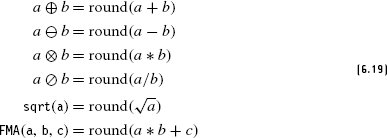

*Figure 6.40: The IEEE standard specifies that floating-point calculations must be implemented as if the calculation was performed with infinite-precision real numbers and then rounded to the nearest representable float. Here, an infinite-precision result in the real numbers is denoted by a filled dot, with the representable floats around it denoted by ticks on a number line. We can see that the error introduced by rounding to the nearest float, δ, can be no more than half the spacing between floats.*

Using circled operators to denote floating-point arithmetic operations and sqrt for floating-point square root, these accuracy guarantees can be

written as:

where round(x) indicates the result of rounding a real number to the closest floating-point value and where FMA denotes the fused multiply add operation, which only rounds once. It thus gives better accuracy than computing (a ⊗ b) ⊕ c. This bound on the rounding error can also be represented with an interval of real numbers: for example, for addition, we can say that the rounded result

is within an interval for some ∊. The amount of error introduced from this rounding can be no more than half the floating-point spacing at a + b—if it was more than half the floating-point spacing, then it would be possible to round to a different floating-point number with less error (Figure 6.40). For 32-bit floats, we can bound the floating-point spacing at a + b from above using Equation (6.18) (i.e., an ulp at that value) by (a + b)2−23, so half the spacing is bounded from above by (a + b)2−24 and so |∊| ≤ 2−24. This bound is the machine epsilon.10 For 32-bit floats, ∊m = 2−24 ≈ 5.960464 … × 10−8. 〈Floating-point Constants〉 +≡ static constexpr Float MachineEpsilon = std::numeric_limits<Float>::epsilon() * 0.5;

Thus, we have a ⊕ b = round(a + b) ∈ (a + b)(1 ± ∊m) = [(a + b)(1 − ∊m), (a + b)(1 + ∊m)].

Analogous relations hold for the other arithmetic operators and the square root operator.11 A number of useful properties follow directly from Equation (6.19). For a floating-point number x,

```text
         1 ⊗ x = x.
         x ⊘ x = 1.
         x ⊕ 0 = x.
         x ⊖ x = 0.
```

2 ⊗ x and x ⊘ 2 are exact; no rounding is performed to compute the final result. More generally, any multiplication by or division by a power of two gives an exact result (assuming there is no overflow or underflow). x ⊘ 2i = x ⊗ 2−i for all integer i, assuming 2i does not overflow. All of these properties follow from the principle that the result must be the nearest floating-point value to the actual result; when the result can be represented exactly, the exact result must be computed.

Utility Routines A few basic utility routines will be useful in the following. First, we define our own IsNaN() function to check for NaN values. It comes with the baggage of a use of C++’s enable_if construct to declare its return type in a way that requires that this function only be called with floating-point types. 〈Floating-point Inline Functions〉 ≡ template <typename T> inline typename std::enable_if_t<std::is_floating_point_v<T>, bool> IsNaN(T v) { return std::isnan(v); }

We also define IsNaN() for integer-based types; it trivially returns false, since NaN is not representable in those types. One might wonder why we have bothered with enable_if and this second definition that tells us something that we already know. One motivation is the templated Tuple2 and Tuple3 classes from Section 3.2, which are used with both Float and int for their element types. Given these two functions, they can freely have assertions that their elements do not store NaN values without worrying about which particular type their elements are. 〈Floating-point Inline Functions〉 +≡ template <typename T> inline typename std::enable_if_t<std::is_integral_v<T>, bool>

IsNaN(T v) { return false; }

For similar motivations, we define a pair of IsInf() functions that test for infinity. 〈Floating-point Inline Functions〉 +≡ template <typename T> inline typename std::enable_if_t<std::is_floating_point_v<T>, bool> IsInf(T v) { return std::isinf(v); }

```text
   Float 23
   Tuple2 83
   Tuple3 83
```

Once again, because infinity is not representable with integer types, the integer variant of this function returns false. 〈Floating-point Inline Functions〉 +≡ template <typename T> inline typename std::enable_if_t<std::is_integral_v<T>, bool> IsInf(T v) { return false; }

A pair of IsFinite() functions check whether a number is neither infinite or NaN. 〈Floating-point Inline Functions〉 +≡ template <typename T> inline typename std::enable_if_t<std::is_floating_point_v<T>, bool> IsFinite(T v) { return std::isfinite(v); } template <typename T> inline

typename std::enable_if_t<std::is_integral_v<T>, bool> IsFinite(T v) { return true; }

Although fused multiply add is available through the standard library, we also provide our own FMA() function.

〈Floating-point Inline Functions〉 +≡ float FMA(float a, float b, float c) { return std::fma(a, b, c); }

A separate version for integer types allows calling FMA() from code regardless of the numeric type being used. 〈Math Inline Functions〉 +≡ template <typename T> inline typename std::enable_if_t<std::is_integral_v<T>, T> FMA(T a, T b, T c) { return a * b + c; }

For certain low-level operations, it can be useful to be able to interpret a floating-point value in terms of its constituent bits and to convert the bits representing a floating-point value to an actual float or double. A natural approach to this would be to take a pointer to a value to be converted and cast it to a pointer to the other type: float f = …; uint32_t bits = *((uint32_t *)&f);

However, modern versions of C++ specify that it is illegal to cast a pointer of one type, float, to a different type, uint32_t. (This restriction allows the compiler to optimize more aggressively in its analysis of whether two pointers may point to the same memory location, which can inhibit storing values in registers.) Another popular alternative, using a union with elements of both types, assigning to one type and reading from the other, is also illegal: the C++ standard says that reading an element of a union different from the last one assigned to is undefined behavior. Fortunately, as of C++20, the standard library provides a std::bit_cast function that performs such conversions. Because this version of pbrt only

requires C++17, we provide an implementation in the pstd library that is used by the following conversion functions. 〈Floating-point Inline Functions〉 +≡ inline uint32_t FloatToBits(float f) { return pstd::bit_cast<uint32_t>(f); }

〈Floating-point Inline Functions〉 +≡ inline float BitsToFloat(uint32_t ui) { return pstd::bit_cast<float>(ui); }

(Versions of these functions that convert between double and uint64_t are also available but are similar and are therefore not included here.) The corresponding integer type with a sufficient number of bits to store pbrt’s Float type is available through FloatBits.

〈Float Type Definitions〉 +≡ #ifdef PBRT_FLOAT_AS_DOUBLE using FloatBits = uint64_t; #else using FloatBits = uint32_t; #endif // PBRT_FLOAT_AS_DOUBLE

Given the ability to extract the bits of a floating-point value and given the description of their layout in Section 6.8.1, it is easy to extract various useful quantities from a float. 〈Floating-point Inline Functions〉 +≡ inline int Exponent(float v) { return (FloatToBits(v) >> 23) - 127; }

〈Floating-point Inline Functions〉 +≡ inline int Significand(float v) { return FloatToBits(v) & ((1 << 23) - 1); }

〈Floating-point Inline Functions〉 +≡ inline uint32_t SignBit(float v) { return FloatToBits(v) & 0x80000000; }

These conversions can be used to implement functions that bump a floating-point value up or down to the next greater or next smaller representable floating-point value.12 They are useful for some conservative rounding operations that we will need in code to follow. Thanks to the specifics of the in-memory representation of floats, these operations are quite efficient. 〈Floating-point Inline Functions〉 +≡ inline float NextFloatUp(float v) { 〈Handle infinity and negative zero for NextFloatUp() 365〉 〈Advance v to next higher float 366〉 }

There are two important special cases: first, if v is positive infinity, then this function just returns v unchanged. Second, negative zero is skipped forward to positive zero before continuing on to the code that advances the significand. This step must be handled explicitly, since the bit patterns for −0.0 and 0.0 are not adjacent. 〈Handle infinity and negative zero for NextFloatUp()〉 ≡ 365

if (IsInf(v) && v > 0.f) return v; if (v == -0.f) v = 0.f;

```rust
   Float 23
   FloatBits 365
   FloatToBits() 364
   IsInf() 363
```

Conceptually, given a floating-point value, we would like to increase the significand by one, where if the result overflows, the significand is reset to zero and the exponent is increased by one. Fortuitously, adding one to the in-memory integer representation of a float achieves this: because the exponent lies at the high bits above the significand, adding one to the low bit of the significand will cause a one to be carried all the way up into the

exponent if the significand is all ones and otherwise will advance to the next higher significand for the current exponent. (This is yet another example of the careful thought that was applied to the development of the IEEE floating-point specification.) Note also that when the highest representable finite floating-point value’s bit representation is incremented, the bit pattern for positive floating-point infinity is the result. For negative values, subtracting one from the bit representation similarly advances to the next higher value. 〈Advance v to next higher float〉 ≡ 365

uint32_t ui = FloatToBits(v); if (v >= 0) ++ui; else --ui; return BitsToFloat(ui);

The NextFloatDown() function, not included here, follows the same logic but effectively in reverse. pbrt also provides versions of these functions for doubles.

Error Propagation Using the guarantees of IEEE floating-point arithmetic, it is possible to develop methods to analyze and bound the error in a given floating-point computation. For more details on this topic, see the excellent book by Higham (2002), as well as Wilkinson’s earlier classic (1994). Two measurements of error are useful in this effort: absolute and relative. If we perform some floating-point computation and get a rounded result ã, we say that the magnitude of the difference between ã and the result of doing that computation in the real numbers is the absolute error, δa: δa = |ã − a|. Relative error, δr, is the ratio of the absolute error to the precise result:

as long as a ≠ 0. Using the definition of relative error, we can thus write the computed value ã as a perturbation of the exact result a: ã ∊ a ± δa = a(1 ± δr).

As a first application of these ideas, consider computing the sum of four numbers, a, b, c, and d, represented as floats. If we compute this sum as r = (((a + b) + c) + d), Equation (6.20) gives us

Because ∊m is small, higher-order powers of ∊m can be bounded by an additional ∊m term, and so we can bound the (1 ± ∊m)n terms with (1 ± ∊m)n ≤ (1 ± (n + 1) ∊m).

```text
   BitsToFloat() 365
   FloatToBits() 364
```

(As a practical matter, (1 ± n∊m) almost bounds these terms, since higher powers of ∊m get very small very quickly, but the above is a fully conservative bound.) This bound lets us simplify the result of the addition to:

The term in square brackets gives the absolute error: its magnitude is bounded by

Thus, if we add four floating-point numbers together with the above parenthesization, we can be certain that the difference between the final rounded result and the result we would get if we added them with infinite-precision real numbers is bounded by Equation (6.22); this error bound is easily computed given specific values of a, b, c, and d. This is a fairly interesting result; we see that the magnitude of a + b makes a relatively large contribution to the error bound, especially compared to d. (This result gives a sense for why, if adding a large number of floating-point numbers together, sorting them from small to large magnitudes generally gives a result with a lower final error than an arbitrary ordering.) Our analysis here has implicitly assumed that the compiler would generate instructions according to the expression used to define the sum. Compilers

are required to follow the form of the given floating-point expressions in order to not break carefully crafted computations that may have been designed to minimize round-off error. Here again is a case where certain transformations that would be valid on expressions with integers cannot be safely applied when floats are involved. What happens if we change the expression to the algebraically equivalent float r = (a + b) + (c + d)? This corresponds to the floating-point computation ((a ⊕ b) ⊕ (c ⊕ d)). If we use the same process of applying Equation (6.20), expanding out terms, converting higher-order (1 ± ∊m)n terms to (1 ± (n + 1)∊m), we get absolute error bounds of 3∊m|a + b| + 3∊m|c + d|, which are lower than the first formulation if |a + b| is relatively large, but possibly higher if |c + d| is relatively large. This approach to computing error is known as forward error analysis; given inputs to a computation, we can apply a fairly mechanical process that provides conservative bounds on the error in the result. The derived bounds in the result may overstate the actual error—in practice, the signs of the error terms are often mixed, so that there is cancellation when they are added.13 An alternative approach is backward error analysis, which treats the computed result as exact and finds bounds on perturbations on the inputs that give the same result. This approach can be more useful when analyzing the stability of a numerical algorithm but is less applicable to deriving conservative error bounds on the geometric computations we are interested in here.

The conservative bounding of (1 ± ∊m)n by (1 ± (n + 1)∊m) is somewhat unsatisfying since it adds a whole ∊m term purely to conservatively bound the sum of various higher powers of ∊m. Higham (2002, Section 3.1) gives an approach to more tightly bound products of (1 ± ∊m) error terms. If we have (1 ± ∊m)n, it can be shown that this value is bounded by 1 + θn, where

as long as n ∊m < 1 (which will certainly be the case for the calculations we consider). Note that the denominator of this expression will be just less than

one for reasonable n values, so it just barely increases n∊m to achieve a conservative bound. We will denote this bound by γn:

The function that computes its value is declared as constexpr so that any invocations with compile-time constants will be replaced with the corresponding floating-point return value. 〈Floating-point Inline Functions〉 +≡ inline constexpr Float gamma(int n) { return (n * MachineEpsilon) / (1 - n * MachineEpsilon); }

Using the γ notation, our bound on the error of the first sum of four values is |a + b|γ3 + |c|γ2 + |d|γ1.

An advantage of this approach is that quotients of (1 ± ∊m)n terms can also

be bounded with the γ function. Given the interval is bounded by (1 ± γm+n). Thus, γ can be used to collect ∊m terms from both sides of an equality over to one side by dividing them through; this will be useful in some of the following derivations. (Note that because (1 ± ∊m) terms represent intervals, canceling them would be

incorrect: the γm+n bounds must be used instead.)

Given inputs to some computation that themselves carry some amount of error, it is instructive to see how this error is carried through various elementary arithmetic operations. Given two values, a(1 ± γi) and b(1 ± γj), that each carry accumulated error from earlier operations, consider their product. Using the definition of ⊗, the result is in the interval: a(1 ± γi) ⊗

b(1 ± γj) ∊ ab(1 ± γi+j+1), where we have used the relationship (1 ± γi)(1 ± γj) ∈ (1 ± γi+j), which follows directly from Equation (6.23).

The relative error in this result is bounded by

and so the final error is no more than roughly (i + j + 1)/2 ulps at the value of the product—about as good as we might hope for, given the error going into the multiplication. (The situation for division is similarly good.) Float 23 MachineEpsilon 362 Unfortunately, with addition and subtraction, it is possible for the relative error to increase substantially. Using the same definitions of the values being operated on, consider a(1 ± γi) ⊕ b(1 ± γj), which is in the interval a(1 ± γi+1) + b(1 ± γj+1), and so the absolute error is bounded by |a|γi+1 + |b|γj+1.

If the signs of a and b are the same, then the absolute error is bounded by |a + b|γi+j+1 and the relative error is approximately (i + j + 1)/2 ulps around the computed value. However, if the signs of a and b differ (or, equivalently, they are the same but subtraction is performed), then the relative error can be quite high. Consider the case where a ≈ −b: the relative error is

The numerator’s magnitude is proportional to the original value |a| yet is divided by a very small number, and thus the relative error is quite high. This substantial increase in relative error is called catastrophic cancellation. Equivalently, we can have a sense of the issue from the fact that the absolute error is in terms of the magnitude of |a|, though it is in relation to a value much smaller than a.

Running Error Analysis

In addition to working out error bounds algebraically, we can also have the computer do this work for us as some computation is being performed. This approach is known as running error analysis. The idea behind it is simple: each time a floating-point operation is performed, we compute intervals based on Equation (6.20) that bound its true value. The Interval class, which is defined in Section B.2.15, provides this functionality. The Interval class also tracks rounding errors in floating-point arithmetic and is useful even if none of the initial values are intervals. While computing error bounds in this way has higher runtime overhead than using derived expressions that give an error bound directly, it can be convenient when derivations become unwieldy.

### 6.8.2 CONSERVATIVE RAY–BOUNDS INTERSECTIONS

Floating-point round-off error can cause the ray–bounding box intersection test to miss cases where a ray actually does intersect the box. While it is acceptable to have occasional false positives from ray–box intersection tests, we would like to never miss an intersection—getting this right is important for the correctness of the BVHAggregate acceleration data structure in Section 7.3 so that valid ray–shape intersections are not missed. The ray–bounding box test introduced in Section 6.1.2 is based on computing a series of ray–slab intersections to find the parametric tmin along the ray where the ray enters the bounding box and the tmax where it exits. If tmin < tmax, the ray passes through the box; otherwise, it misses it. With floating-point arithmetic, there may be error in the computed t values —if the computed tmin value is greater than tmax purely due to round-off error, the intersection test will incorrectly return a false result. Recall that the computation to find the t value for a ray intersection with a plane perpendicular to the x axis at a point x is t = (x − ox)/dx. Expressed as a floating-point computation and applying Equation (6.19), we have

and so

```text
   BVHAggregate 407
   Interval 1057
```

The difference between the computed result t and the precise result is bounded by γ3|t|.

*Figure 6.41: If the error bounds of the computed tmin and tmax values overlap, the comparison tmin < tmax may not indicate if a ray hit a bounding box. It is better to conservatively return true in this case than to miss an intersection. Extending tmax by twice its error bound ensures that the comparison is conservative.*

If we consider the intervals around the computed t values that bound the true value of t, then the case we are concerned with is when the intervals overlap; if they do not, then the comparison of computed values will give the correct result (Figure 6.41). If the intervals do overlap, it is impossible to know the true ordering of the t values. In this case, increasing tmax by twice the error bound, 2γ3tmax, before performing the comparison ensures that we conservatively return true in this case. We can now define the fragment for the ray–bounding box test in Section 6.1.2 that makes this adjustment. 〈Update tFar to ensure robust ray–bounds intersection〉 ≡ 264

tFar *= 1 + 2 * gamma(3);

The fragments for the Bounds3::IntersectP() method, 〈Update tMax and tyMax to ensure robust bounds intersection〉 and 〈Update tzMax6 to ensure robust bounds intersection〉, are similar and therefore not included here.

### 6.8.3 ACCURATE QUADRATIC DISCRIMINANTS

Recall from Sections 6.2.2 and 6.3.2 that intersecting a ray with a sphere or cylinder involves finding the zeros of a quadratic equation, which requires calculating its discriminant, b2 − 4ac. If the discriminant is computed as written, then when the sphere is far from the ray origin, b2 ≈ 4ac and catastrophic cancellation occurs. This issue is made worse since the magnitudes of the two terms of the discriminant are related to the squared distance between the sphere and the ray origin. Even for rays that are far from ever hitting the sphere, a discriminant may be computed that is exactly equal to zero, leading to the intersection code reporting an invalid intersection. See Figure 6.42, which shows that this error can be meaningful in practice. Algebraically rewriting the discriminant computation makes it possible to compute it with more accuracy. First, if we rewrite the quadratic discriminant as

and then substitute in the values of a, b, and c from Equation (6.3) to the terms inside the parentheses, we have

```text
    gamma() 368
```

where we have denoted the vector from (0, 0, 0) to the ray’s origin as o and is the ray’s normalized direction.


*Figure 6.42: The Effect of Reducing the Error in the Computation of the Discriminant for Ray– Sphere Intersection. Unit sphere, viewed using an orthographic projection with a camera 400 units away. (a) If the quadratic discriminant is computed in the usual fashion, numeric error causes intersections at the edges to be missed. In the found intersections, the inaccuracy is evident in the wobble of the textured lines. (b) With the more precise formulation described in this section, the sphere is rendered correctly. (With the improved discriminant, such a sphere can be translated as far as 7,500 or so units from an orthographic camera and still be rendered accurately.)*

Now consider the decomposition of o into the sum of two vectors, d⊥ and d‖, where d‖ is parallel to and d⊥ is perpendicular to it. Those vectors are

given by These three vectors form a right triangle, and therefore ‖o‖2 = ‖d⊥‖2 +

‖d‖‖2. Applying Equation (6.25),

Rearranging terms gives

Expressing the right hand side in terms of the sphere quadratic coefficients from Equation (6.3) gives

Note that the left hand side is equal to the term in square brackets in Equation (6.24). Computing that term in this way eliminates c from the discriminant, which is of great benefit since its magnitude is proportional to the squared distance to the origin, with accordingly limited accuracy. In the implementation below, we take advantage of the fact that the discriminant is now the difference of squared values and make use of the identity x2 − y2 = (x + y)(x − y) to reduce the magnitudes of the intermediate values, which further reduces error. 〈Compute sphere quadratic discriminant discrim〉 ≡ 274

Vector3fi v(oi - b / (2 * a) * di); Interval length = Length(v); Interval discrim = 4 * a * (Interval(radius) + length) * (Interval(radius) - length); if (discrim.LowerBound() < 0) return {};

One might ask, why go through this trouble when we could use the DifferenceOfProducts() function to compute the discriminant, presumably with low error? The reason that is not an equivalent alternative is that the values a, b, and c already suffer from rounding error. In turn, a result computed by DifferenceOfProducts() will be inaccurate if its inputs already are inaccurate themselves. is particularly problematic, since it is the difference of two positive values, so is susceptible to catastrophic cancellation. A similar derivation gives a more accurate discriminant for the cylinder.

〈Compute cylinder quadratic discriminant discrim〉 ≡ 288

Interval f = b / (2 * a); Interval vx = oi.x - f * di.x, vy = oi.y - f * di.y; Interval length = Sqrt(Sqr(vx) + Sqr(vy)); Interval discrim = 4 * a * (Interval(radius) + length) * (Interval(radius) - length); if (discrim.LowerBound() < 0) return {};

### 6.8.4 ROBUST TRIANGLE INTERSECTIONS

The details of the ray–triangle intersection algorithm described in Section 6.5.3 were carefully designed to avoid cases where rays could incorrectly pass through an edge or vertex shared by two adjacent triangles without generating an intersection. Fittingly, an intersection algorithm with this guarantee is referred to as being watertight. Recall that the algorithm is based on transforming triangle vertices into a coordinate system with the ray’s origin at its origin and the ray’s direction aligned along the +z axis. Although round-off error may be introduced by transforming the vertex positions to this coordinate system, this error does not affect the watertightness of the intersection test, since the same transformation is applied to all triangles. (Further, this error is quite small, so it does not significantly impact the accuracy of the computed intersection points.) Given vertices in this coordinate system, the three edge functions defined in Equation (6.5) are evaluated at the point (0, 0); the corresponding expressions, Equation (6.6), are quite straightforward. The key to the robustness of the algorithm is that with floating-point arithmetic, the edge function evaluations are guaranteed to have the correct sign. In general, we have

```text
    DifferenceOfProducts() 1044
    Interval 1057
    Interval::LowerBound() 1059
    Interval::Sqr() 1060
    Interval::Sqrt() 1060
    Length() 88
    Vector3fi 1060
```

First, note that if ab = cd, then Equation (6.26) evaluates to exactly zero, even in floating point. We therefore just need to show that if ab > cd, then (a ⊗ b) ⊖ (c ⊗ d) is never negative. If ab > cd, then (a ⊗ b) must be greater than or equal to (c ⊗ d). In turn, their difference must be greater than or equal to zero. (These properties both follow from the fact that floating-point arithmetic operations are all rounded to the nearest representable floating-point value.) If the value of the edge function is zero, then it is impossible to tell whether it is exactly zero or whether a small positive or negative value has rounded to zero. In this case, the fragment 〈Fall back to double-precision test at triangle edges〉 reevaluates the edge function with double precision; it can be shown that doubling the precision suffices to accurately distinguish these cases, given 32-bit floats as input. The overhead caused by this additional precaution is minimal: in a benchmark with 88 million ray intersection tests, the double-precision fallback had to be used in less than 0.0000023% of the cases.

### 6.8.5 BOUNDING INTERSECTION POINT ERROR

We can apply the machinery introduced in this section for analyzing rounding error to derive conservative bounds on the absolute error in computed ray–shape intersection points, which allows us to construct bounding boxes that are guaranteed to include an intersection point on the actual surface (Figure 6.43). These bounding boxes provide the basis of the algorithm for generating spawned ray origins that will be introduced in Section 6.8.6. It is illuminating to start by looking at the sources of error in conventional approaches to computing intersection points. It is common practice in ray tracing to compute 3D intersection points by first solving the parametric ray equation o + td for a value thit where a ray intersects a surface and then computing the hit point p with p = o + thitd. If thit carries some error δt, then we can bound the error in the computed intersection point. Considering the x coordinate, for example, we have x = ox ⊕ (thit ± δt) ⊗ dx

```text
                        ∈ ox ⊕ (thit ± δt)dx(1 ± γ1)
                        ⊂ ox(1 ± γ1) + (thit ± δt)dx(1 ± γ2)
                        = ox + thitdx + [±oxγ1 ± δtdx ± thitdxγ2 ± δtdxγ2].
```

The error term (in square brackets) is bounded by

There are two things to see from Equation (6.27): first, the magnitudes of the terms that contribute to the error in the computed intersection point (ox, dx, and thitdx) may be quite different from the magnitude of the intersection point. Thus, there is a danger of catastrophic cancellation in the intersection point’s computed value. Second, ray intersection algorithms generally perform tens of floating-point operations to compute t values, which in turn means that we can expect δt to be at least of magnitude γnt, with n in the tens (and possibly much more, due to catastrophic cancellation).

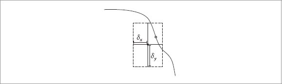

*Figure 6.43: Shape intersection algorithms in pbrt compute an intersection point, shown here in the 2D setting with a filled circle. The absolute error in this point is bounded by δx and δy, giving a small box around the point. Because these bounds are conservative, we know that the actual intersection point on the surface (open circle) must lie somewhere within the box.*

Each of these terms may introduce a significant amount of error in the computed point x. We introduce better approaches in the following.

Reprojection: Quadrics We would like to reliably compute surface intersection points with just a few ulps of error rather than the orders of magnitude greater error that intersection points computed with the parametric ray equation may have.

Previously, Woo et al. (1996) suggested using the first intersection point computed as a starting point for a second ray–plane intersection, for ray– polygon intersections. From the bounds in Equation (6.27), we can see why the second intersection point will often be much closer to the surface than the first: the thit value along the second ray will be quite close to zero, so that the magnitude of the absolute error in thit will be quite small, and thus using this value in the parametric ray equation will give a point quite close to the surface (Figure 6.44). Further, the ray origin will have similar magnitude to the intersection point, so the γ1|ox| term will not introduce much additional error. Although the second intersection point computed with this approach is much closer to the plane of the surface, it still suffers from error by being offset due to error in the first computed intersection. The farther away the ray origin is from the intersection point (and thus, the larger the absolute error is in thit), the larger this error will be. In spite of this error, the approach has merit: we are generally better off with a computed intersection point that is quite close to the actual surface, even if offset from the most accurate possible intersection point, than we are with a point that is some distance above or below the surface (and likely also far from the most accurate intersection point). Rather than doing a full reintersection computation, which may not only be computationally costly but also will still have error in the computed t value, an effective alternative is to refine computed intersection points by reprojecting them to the surface. The error bounds for these reprojected points are often remarkably small. (It should be noted that these reprojection error bounds do not capture tangential errors that were present in the original intersection p—the main focus here is to detect errors that might cause the reprojected point p′ to fall below the surface.) Consider a ray–sphere intersection: given a computed intersection point (e.g., from the ray equation) p with a sphere at the origin with radius r, we can reproject the point onto the surface of the sphere by scaling it with the ratio of the sphere’s radius to the computed point’s distance to the origin, computing a new point p′ = (x′, y′, z′) with

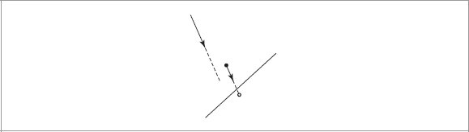

*Figure 6.44: Reintersection to Improve the Accuracy of the Computed Intersection Point. Given a ray and a surface, an initial intersection point has been computed with the ray equation (filled circle). This point may be fairly inaccurate due to rounding error but can be used as the origin for a second ray–shape intersection. The intersection point computed from this second intersection (open circle) is much closer to the surface, though it may be shifted from the true intersection point due to error in the first computed intersection.*

and so forth. The floating-point computation is

Because x2, y2, and z2 are all positive, the terms in the square root can share the same γ term, and we have

Thus, the absolute error of the reprojected x coordinate is bounded by γ5|x′| (and similarly for y′ and z′) and is thus no more than 2.5 ulps in each dimension from a point on the surface of the sphere. Here is the fragment that reprojects the intersection point for the Sphere shape.

〈Refine sphere intersection point〉 ≡ 275

pHit *= radius / Distance(pHit, Point3f(0, 0, 0));

The error bounds follow from Equation (6.28). 〈Compute error bounds for sphere intersection〉 ≡ 276

Vector3f pError = gamma(5) * Abs((Vector3f)pHit);

Reprojection algorithms and error bounds for other quadrics can be defined similarly: for example, for a cylinder along the z axis, only the x and y coordinates need to be reprojected, and the error bounds in x and y turn out to be only γ3 times their magnitudes.

〈Refine cylinder intersection point〉 ≡ 289

Float hitRad = std::sqrt(Sqr(pHit.x) + Sqr(pHit.y)); pHit.x *= radius / hitRad; pHit.y *= radius / hitRad; 〈Compute error bounds for cylinder intersection〉 ≡ 290

Vector3f pError = gamma(3) * Abs(Vector3f(pHit.x, pHit.y, 0));

```rust
   Cylinder::radius 287
   Disk::height 293
   Distance() 93
   Float 23
   gamma() 368
   Point3f 92
   Sphere 271
   Sphere::radius 272
   Sqr() 1034
   Tuple3::Abs() 85
   Vector3f 86
```

The disk shape is particularly easy; we just need to set the z coordinate of the point to lie on the plane of the disk. 〈Refine disk intersection point〉 ≡ 295

pHit.z = height;

In turn, we have a point with zero error; it lies exactly on the surface on the disk. 〈Compute error bounds for disk intersection〉 ≡ 295

```rust
   Vector3f pError(0, 0, 0);
```

The quadrics’ Sample() methods also use reprojection. For example, the Sphere’s area sampling method is based on SampleUniformSphere(), which uses std::sin() and std::cos(). Therefore, the error bounds on the computed pObj value depend on the accuracy of those functions. By reprojecting the sampled point to the sphere’s surface, the error bounds derived earlier in Equation (6.28) can be used without needing to worry about those functions’ accuracy. 〈Reproject pObj to sphere surface and compute pObjError〉 ≡ 280

pObj *= radius / Distance(pObj, Point3f(0, 0, 0)); Vector3f pObjError = gamma(5) * Abs((Vector3f)pObj);

The same issue and solution apply to sampling cylinders. 〈Reproject pObj to cylinder surface and compute pObjError〉 ≡ 291

Float hitRad = std::sqrt(Sqr(pObj.x) + Sqr(pObj.y)); pObj.x *= radius / hitRad; pObj.y *= radius / hitRad; Vector3f pObjError = gamma(3) * Abs(Vector3f(pObj.x, pObj.y, 0));

Parametric Evaluation: Triangles Another effective approach to computing accurate intersection points near the surface of a shape uses the shape’s parametric representation. For example, the triangle intersection algorithm in Section 6.5.3 computes three edge function values e0, e1, and e2 and reports an intersection if all three have the same sign. Their values can be used to find the barycentric coordinates Attributes vi at the triangle vertices (including the vertex positions) can be interpolated across the face of the triangle by v′ = b0v0 + b1v1 + b2v2.

We can show that interpolating the positions of the vertices in this manner gives a point very close to the surface of the triangle. First consider

precomputing the reciprocal of the sum of ei:

```rust
   Cylinder::radius 287
   Distance() 93
   Float 23
   gamma() 368
   Point3f 92
   SampleUniformSphere() 1016
   Sphere 271
   Sqr() 1034
   Tuple3::Abs() 85
   Vector3f 86
```

Because all ei have the same sign if there is an intersection, we can collect

the ei terms and conservatively bound d: If we now consider interpolation of the x coordinate of the position in the triangle corresponding to the edge function values, we have x′ = ((e0 ⊗ x0) ⊕ (e1 ⊗ x1) ⊕ (e2 ⊗ x2)) ⊗ d

```text
                          ∈ (e0x0(1 ± ∊m)3 + e1x1(1 ± ∊m)3 + e2x2(1 ±
                          ∊m)2)d(1 ± ∊m)
                          ⊂ (e0x0(1 ± γ4) + e1x1(1 ± γ4) + e2x2(1 ± γ3))d.
```

Using the bounds on d,

Thus, we can finally see that the absolute error in the computed x′ value is in the interval ±b0x0γ7 ± b1x1γ7 ± b2x2γ7, which is bounded by

(Note that the b2x2 term could have a γ6 factor instead of γ7, but the difference between the two is very small, so we choose a slightly simpler final expression.) Equivalent bounds hold for y′ and z′. Equation (6.29) lets us bound the error in the interpolated point computed in Triangle:: Intersect().

〈Compute error bounds pError for triangle intersection〉 ≡ 312

Point3f pAbsSum = Abs(ti.b0 * p0) + Abs(ti.b1 * p1) + Abs(ti.b2 * p2); Vector3f pError = gamma(7) * Vector3f(pAbsSum);

The bounds for a sampled point on a triangle can be found in a similar manner. 〈Compute error bounds pError for sampled point on triangle〉 ≡ 313, 317

Point3f pAbsSum = Abs(b[0] * p0) + Abs(b[1] * p1) + Abs((1 - b[0] - b[1]) * p2); Vector3f pError = Vector3f(gamma(6) * pAbsSum);

Parametric Evaluation: Bilinear Patches Bilinear patch intersection points are found by evaluating the bilinear function from Equation (6.11). The computation performed is [(1 ⊖ u) ⊗ ((1 ⊖ v) ⊗ p0,0 ⊕ v ⊗ p0,1)] ⊕ [u ⊗ ((1 ⊖ v) ⊗ p1,0 ⊕ v ⊗ p1,1)]. Considering just the x coordinate, we can find that its error is bounded by γ6|(1 − u)(1 − v)x0,0| + γ5|(1 − u)vx0,1| + γ5|u(1 − v)x1,0| + γ4|uvx1,1|.

Because u and v are between 0 and 1, here we will use the looser but more computationally efficient bounds of the form γ6(|x0,0| + |x0,1| + |x1,0| + |x1,1|).

```text
   BilinearPatch::Sample() 338
   gamma() 368
   Point3f 92
   Triangle::Intersect() 309
   TriangleIntersection::b0 309
   TriangleIntersection::b1 309
   Tuple3::Abs() 85
```

```text
   Vector3f 86
```

〈Initialize bilinear patch intersection point error pError〉 ≡ 335

```rust
   Point3f pAbsSum = Abs(p00) + Abs(p01) + Abs(p10) + Abs(p11);
   Vector3f pError = gamma(6) * Vector3f(pAbsSum);
```

The same bounds apply for points sampled in the BilinearPatch::Sample() method. 〈Compute pError for sampled bilinear patch (u, v)〉 ≡ 341

Point3f pAbsSum = Abs(p00) + Abs(p01) + Abs(p10) + Abs(p11); Vector3f pError = gamma(6) * Vector3f(pAbsSum);

Parametric Evaluation: Curves Because the Curve shape orients itself to face incident rays, rays leaving it must be offset by the curve’s width in order to not incorrectly reintersect it when it is reoriented to face them. For wide curves, this bound is significant and may lead to visible errors in images. In that case, the Curve shape should probably be replaced with one or more bilinear patches. 〈Compute error bounds for curve intersection〉 ≡ 356

Vector3f pError(hitWidth, hitWidth, hitWidth);

Effect of Transformations The last detail to attend to in order to bound the error in computed intersection points is the effect of transformations, which introduce additional rounding error when they are applied. The quadric Shapes in pbrt transform rendering-space rays into object space before performing ray–shape intersections, and then transform computed intersection points back to rendering space. Both of these transformation steps introduce rounding error that needs to be accounted for in order to maintain robust rendering-space bounds around intersection points. If possible, it is best to try to avoid coordinate-system transformations of rays and intersection points. For example, it is better to transform triangle vertices to rendering space and intersect rendering-space rays with them than to transform rays to object space and then transform intersection points

to rendering space.14 Transformations are still useful—for example, for the quadrics and for object instancing—so we will show how to bound the error that they introduce. We will discuss these topics in the context of the Transform operator() method that takes a Point3fi, which is the Point3 variant that uses an Interval for each of the coordinates.

〈Transform Public Methods〉 +≡ 120

Point3fi operator()(const Point3fi &p) const { Float x = Float(p.x), y = Float(p.y), z = Float(p.z); 〈Compute transformed coordinates from point (x, y, z)〉 〈Compute absolute error for transformed point, pError 379〉 if (wp == 1) return Point3fi(Point3f(xp, yp, zp), pError);

```rust
        else
           return Point3fi(Point3f(xp, yp, zp), pError) / wp;
   }
```

This method starts by computing the transformed position of the point (x, y, z) where each coordinate is at the midpoint of its respective interval in p. The fragment that implements that computation, 〈Compute transformed coordinates from point (x, y, z)〉, is not included here; it implements the same matrix/point multiplication as in Section 3.10.

```text
   Curve 346
   Float 23
   Interval 1057
   Point3 92
   Point3f 92
   Point3fi 1061
   Transform 120
   Vector3f 86
```

Next, error bounds are computed, accounting both for rounding error when applying the transformation as well as the effect of non-empty intervals, if p is not exact. 〈Compute absolute error for transformed point, pError〉 ≡ 378

Vector3f pError; if (p.IsExact()) { 〈Compute error for transformed exact p 379〉 } else { 〈Compute error for transformed approximate p〉 }

If (x, y, z) has no accumulated error, then given a 4 × 4 non-projective transformation matrix with elements denoted by mi,j, the transformed coordinate x′ is x′ = ((m0,0 ⊗ x) ⊕ (m0,1 ⊗ y)) ⊕ ((m0,2 ⊗ z) ⊕ m0,3)

```text
                     ∈ m0,0x(1 ± ∊m)3 + m0,1y(1 ± ∊m)3 + m0,2z(1 ±
                     ∊m)3 + m0,3(1 ± ∊m)2
                     ⊂ (m0,0x + m0,1y + m0,2z + m0,3) + γ3(±m0,0x ± m0,1y
                     ± m0,2z ± m0,3)
```

```text
                      ⊂ (m0,0x + m0,1y + m0,2z + m0,3) ± γ3(|m0,0x| +
                      |m0,1y| + |m0,2z| + |m0,3|).
```

Thus, the absolute error in the result is bounded by

Similar bounds follow for the transformed y′ and z′ coordinates, and the implementation follows directly. 〈Compute error for transformed exact p〉 ≡ 379

pError.x = gamma(3) * (std::abs(m[0][0] * x) + std::abs(m[0][1] * y) + std::abs(m[0][2] * z) + std::abs(m[0][3])); pError.y = gamma(3) * (std::abs(m[1][0] * x) + std::abs(m[1][1] * y) + std::abs(m[1][2] * z) + std::abs(m[1][3])); pError.z = gamma(3) * (std::abs(m[2][0] * x) + std::abs(m[2][1] * y) + std::abs(m[2][2] * z) + std::abs(m[2][3]));

Now consider the case of the point p having error that is bounded by δx, δy, and δz in each dimension. The transformed x coordinate is given by: x′ = (m0,0 ⊗ (x ± δx) ⊕ m0,1 ⊗ (y ± δy)) ⊕ (m0,2 ⊗ (z ± δz) ⊕ m0,3). Applying the definitions of floating-point addition and multiplication and their error bounds, we have x′ = m (x ± δ )(1 ± ∊ )3 + m (y ± δ )(1 ± ∊ )3 0,0 x m 0,1 y m + m0,2(z ± δz)(1 ± ∊m)3 + m0,3(1 ± ∊m)2.

Transforming to use γ, we can find the absolute error term to be bounded by

We have not included the fragment 〈Compute error for transformed approximate p〉 that implements this computation, as it is nearly 20 lines of code for the direct translation of Equation (6.31).

```text
   gamma() 368
   Interval 1057
   Point3fi::IsExact() 1061
   Vector3f 86
```

It would have been much easier to implement this method using the Interval class to automatically compute error bounds. We found that that approach gives bounds that are generally 3–6 × wider and cause the method to be six times slower than the implementation presented here. Given that transformations are frequently applied during rendering, deriving and then using tighter bounds is worthwhile.

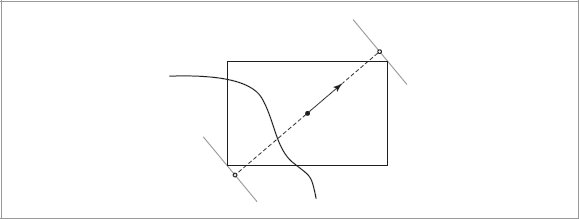

*Figure 6.45: Given a computed intersection point (filled circle) with surface normal (arrow) and error bounds (rectangle), we compute two planes offset along the normal that are offset just far enough so that they do not intersect the error bounds. The points on these planes along the normal from the computed intersection point give us the origins for spawned rays (open circles); one of the two is selected based on the ray direction so that the spawned ray will not pass through the error bounding box. By construction, such rays cannot incorrectly reintersect the actual surface (thick line).*

Note that the code that computes error bounds is buggy if the matrix is projective and the homogeneous w coordinate of the projected point is not one; this nit is not currently a problem for pbrt’s usage of this method.

The Transform class also provides methods to transform vectors and rays, returning the resulting error. The vector error bound derivations (and thence, implementations) are very similar to those for points, and so also are not included here.

### 6.8.6 ROBUST SPAWNED RAY ORIGINS

Computed intersection points and their error bounds give us a small 3D box that bounds a region of space. We know that the precise intersection point must be somewhere inside this box and that thus the surface must pass through the box (at least enough to present the point where the intersection

is). (Recall Figure 6.43.) Having these boxes makes it possible to position the origins of rays leaving the surface so that they are always on the right side of the surface and do not incorrectly reintersect it. When tracing spawned rays leaving the intersection point p, we offset their origins enough to ensure that they are past the boundary of the error box and thus will not incorrectly reintersect the surface. In order to ensure that the spawned ray origin is definitely on the right side of the surface, we move far enough along the normal so that the plane perpendicular to the normal is outside the error bounding box. To see how to do this, consider a computed intersection point at the origin, where the equation for the plane going through the intersection point is f (x, y, z) = nxx + nyy + nzz. The plane is implicitly defined by f (x, y, z) = 0, and the normal is (nx, ny, nz).

For a point not on the plane, the value of the plane equation f (x, y, z) gives the offset along the normal that gives a plane that goes through the point. We would like to find the maximum value of f (x, y, z) for the eight corners of the error bounding box; if we offset the plane plus and minus this offset, we have two planes that do not intersect the error box that should be (locally) on opposite sides of the surface, at least at the computed intersection point offset along the normal (Figure 6.45).

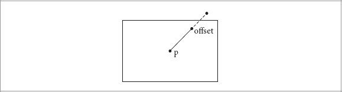

*Figure 6.46: The rounded value of the offset point p+offset computed in OffsetRayOrigin() may end up in the interior of the error box rather than on its boundary, which in turn introduces the risk of incorrect self-intersections if the rounded point is on the wrong side of the surface. Advancing each coordinate of the computed point one floating-point value away from p ensures that it is outside of the error box.*

If the eight corners of the error bounding box are given by (±δx, ±δy, ±δz), then the maximum value of f (x, y, z) is easily computed: d = |nx|δx + |ny|δy + |nz|δz. Computing spawned ray origins by offsetting along the surface normal in this way has a few advantages: assuming that the surface is locally planar (a reasonable assumption, especially at the very small scale of the intersection point error bounds), moving along the normal allows us to get from one side of the surface to the other while moving the shortest distance. In general, minimizing the distance that ray origins are offset is desirable for maintaining shadow and reflection detail. OffsetRayOrigin() is a short function that implements this computation.

〈Ray Inline Functions〉 ≡ Point3f OffsetRayOrigin(Point3fi pi, Normal3f n, Vector3f w) { 〈Find vector offset to corner of error bounds and compute initial po 381〉 〈Round offset point po away from p 382〉 return po; } 〈Find vector offset to corner of error bounds and compute initial po〉 ≡ 381

Float d = Dot(Abs(n), pi.Error()); Vector3f offset = d * Vector3f(n); if (Dot(w, n) < 0) offset = -offset; Point3f po = Point3f(pi) + offset;

We also must handle round-off error when computing the offset point: when offset is added to p, the result will in general need to be rounded to the nearest floating-point value. In turn, it may be rounded down toward p such that the resulting point is in the interior of the error box rather than on its boundary (Figure 6.46). Therefore, the offset point is rounded away from p here to ensure that it is not inside the box.15

```rust
   Dot() 89
   Float 23
   Normal3f 94
   OffsetRayOrigin() 381
   Point3f 92
   Point3fi 1061
   Point3fi::Error() 1061
```

```text
   Tuple3::Abs() 85
   Vector3f 86
```

Alternatively, the floating-point rounding mode could have been set to round toward plus or minus infinity (based on the sign of the value). Changing the rounding mode is fairly expensive on many processors, so we just shift the floating-point value by one ulp here. This will sometimes cause a value already outside of the error box to go slightly farther outside it, but because the floating-point spacing is so small, this is not a problem in practice. 〈Round offset point po away from p〉 ≡ 381

for (int i = 0; i < 3; ++i) { if (offset[i] > 0) po[i] = NextFloatUp(po[i]); else if (offset[i] < 0) po[i] = NextFloatDown(po[i]); }

For convenience, Interaction provides two variants of this functionality via methods that perform the ray offset computation using its stored position and surface normal. The first takes a ray direction, like the stand-alone OffsetRayOrigin() function. 〈Interaction Public Methods〉 +≡ 136

```rust
   Point3f OffsetRayOrigin(Vector3f w) const {
        return pbrt::OffsetRayOrigin(pi, n, w);
   }
```

The second takes a position for the ray’s destination that is used to compute a direction w to pass to the first method.

〈Interaction Public Methods〉 +≡ 136

```rust
   Point3f OffsetRayOrigin(Point3f pt) const {
        return OffsetRayOrigin(pt - p());
   }
```

There are also some helper functions for the Ray class that generate rays leaving intersection points that account for these offsets. 〈Ray Inline Functions〉 +≡ Ray SpawnRay(Point3fi pi, Normal3f n, Float time, Vector3f d) {

return Ray(OffsetRayOrigin(pi, n, d), d, time); }

〈Ray Inline Functions〉 +≡ Ray SpawnRayTo(Point3fi pFrom, Normal3f n, Float time, Point3f pTo) { Vector3f d = pTo - Point3f(pFrom); return SpawnRay(pFrom, n, time, d); }

To generate a ray between two points requires offsets at both endpoints before the vector between them is computed.

```rust
   Float 23
   Interaction 136
   Interaction::n 137
   Interaction:: OffsetRayOrigin() 382
   Interaction::p() 137
   Interaction::pi 137
   NextFloatDown() 366
   NextFloatUp() 365
   Normal3f 94
   OffsetRayOrigin() 381
   Point3f 92
   Point3fi 1061
   Ray 95
   SpawnRay() 382
   Vector3f 86
```

〈Ray Inline Functions〉 +≡ Ray SpawnRayTo(Point3fi pFrom, Normal3f nFrom, Float time, Point3fi pTo, Normal3f nTo) { Point3f pf = OffsetRayOrigin(pFrom, nFrom, Point3f(pTo) - Point3f(pFrom)); Point3f pt = OffsetRayOrigin(pTo, nTo, pf -Point3f(pTo)); return Ray(pf, pt - pf, time); }

We can also implement Interaction methods that generate rays leaving intersection points. 〈Interaction Public Methods〉 +≡ 136

RayDifferential SpawnRay(Vector3f d) const { return RayDifferential(OffsetRayOrigin(d), d, time, GetMedium(d)); } 〈Interaction Public Methods〉 +≡ 136

```rust
   Ray SpawnRayTo(Point3f p2) const {
        Ray r = pbrt::SpawnRayTo(pi, n, time, p2);
        r.medium = GetMedium(r.d);
        return r;
   }
```

A variant of Interaction::SpawnRayTo() that takes an Interaction is similar and not included here. The ShapeSampleContext class also provides OffsetRayOrigin() and SpawnRay() helper methods that correspond to the ones we have added to Interaction here. Their implementations are essentially the same, so they are not included here. The approach we have developed so far addresses the effect of floating-point error at the origins of rays leaving surfaces; there is a related issue for shadow rays to area light sources: we would like to find any intersections with shapes that are close to the light source and actually occlude it, while avoiding reporting incorrect intersections with the surface of the light source. Unfortunately, our implementation does not address this issue, so we set the tMax value of shadow rays to be just under one so that they stop before the surface of light sources. 〈Mathematical Constants〉 ≡ constexpr Float ShadowEpsilon = 0.0001f;

One last issue must be dealt with in order to maintain robust spawned ray origins: error introduced when performing transformations. Given a ray in one coordinate system where its origin was carefully computed to be on the appropriate side of some surface, transforming that ray to another coordinate system may introduce error in the transformed origin such that

the origin is no longer on the correct side of the surface it was spawned from. Therefore, whenever a ray is transformed by the Ray variant of Transform::operator() (which was implemented in Section 3.10.4), its origin is advanced to the edge of the bounds on the error that was introduced by the transformation. This ensures that the origin conservatively remains on the correct side of the surface it was spawned from, if any.

```rust
    Dot() 89
    Float 23
    Interaction 136
    Interaction::GetMedium() 716
    Interaction:: OffsetRayOrigin() 382
    LengthSquared() 87
    Point3f 92
    Point3fi::Error() 1061
    Ray 95
    Ray::d 95
    RayDifferential 96
    ShapeSampleContext 268
    SpawnRayTo() 382
    Tuple3::Abs() 85
    Vector3f 86
```

〈Offset ray origin to edge of error bounds and compute tMax〉 ≡ 132

if (Float lengthSquared = LengthSquared(d); lengthSquared > 0) { Float dt = Dot(Abs(d), o.Error()) / lengthSquared; o += d * dt; if (tMax) *tMax -= dt; }

### 6.8.7 AVOIDING INTERSECTIONS BEHIND RAY ORIGINS

Bounding the error in computed intersection points allows us to compute ray origins that are guaranteed to be on the right side of the surface so that a ray with infinite precision would not incorrectly intersect the surface it is leaving. However, a second source of rounding error must also be addressed: the error in parametric t values computed for ray–shape

intersections. Rounding error can lead to an intersection algorithm computing a value t > 0 for the intersection point even though the t value for the actual intersection is negative (and thus should be ignored). It is possible to show that some intersection test algorithms always return a t value with the correct sign; this is the best case, as no further computation is needed to bound the actual error in the computed t value. For example, consider the ray–axis-aligned slab computation: t = (x ⊖ ox) ⊘ dx. The IEEE floating-point standard guarantees that if a > b, then a ⊖ b ≥ 0 (and if a < b, then a ⊖ b ≤ 0). To see why this is so, note that if a > b, then the real number a − b must be greater than zero. When rounded to a floating-point number, the result must be either zero or a positive float; there is no a way a negative floating-point number could be the closest floating-point number. Second, floating-point division returns the correct sign; these together guarantee that the sign of the computed t value is correct. (Or that t = 0, but this case is fine, since our test for an intersection is carefully chosen to be t > 0.) For shape intersection routines that are based on the Interval class, the computed t value in the end has an error bound associated with it, and no further computation is necessary to perform this test. See the definition of the fragment 〈Check quadric shape t0 and t1 for nearest intersection〉 in Section 6.2.2.

Triangles Interval introduces computational overhead that we would prefer to avoid for more commonly used shapes where efficient intersection code is more important. For these shapes, we can derive efficient-to-evaluate conservative bounds on the error in computed t values. The ray–triangle intersection algorithm in Section 6.5.3 computes a final t value by computing three edge function values ei and using them to compute a barycentric-weighted sum of transformed vertex z coordinates, zi:

By successively bounding the error in these terms and then in the final t value, we can conservatively check that it is positive. 〈Ensure that computed triangle t is conservatively greater than zero〉 ≡ 303

〈Compute δz term for triangle t error bounds 384〉

```rust
   〈Compute δx and δy terms for triangle t error bounds 385〉
   〈Compute δe term for triangle t error bounds 385〉
   〈Compute δt term for triangle t error bounds and check t 385〉
```

Given a ray r with origin o, direction d, and a triangle vertex p, the projected z coordinate is

```text
                                    z = (1 ⊘ dz) ⊗ (pz ⊗ oz).
```

Applying the usual approach, we can find that the maximum error in zi for each of three vertices of the triangle pi is bounded by γ3|zi|, and we can thus find a conservative upper bound for the error in any of the z positions by taking the maximum of these errors: 〈Compute δz term for triangle t error bounds〉 ≡ 384

```rust
   Float maxZt = MaxComponentValue(Abs(Vector3f(p0t.z, p1t.z, p2t.z)));
   Float deltaZ = gamma(3) * maxZt;
```

```rust
   Float 23
   Tuple3::Abs() 85
   Tuple3::MaxComponentValue() 85
   Vector3f 86
```

The edge function values are computed as the difference of two products of transformed x and y vertex positions: e0 = (x1 ⊗ y2) ⊖ (y1 ⊗ x2) e1 = (x2 ⊗ y0) ⊖ (y2 ⊗ x0) e2 = (x0 ⊗ y1) ⊖ (y0 ⊗ x1).

Bounds for the error in the transformed positions xi and yi are

〈Compute δx and δy terms for triangle t error bounds〉 ≡ 384

```rust
   Float maxXt = MaxComponentValue(Abs(Vector3f(p0t.x, p1t.x, p2t.x)));
   Float maxYt = MaxComponentValue(Abs(Vector3f(p0t.y, p1t.y, p2t.y)));
   Float deltaX = gamma(5) * (maxXt + maxZt);
```

```rust
   Float deltaY = gamma(5) * (maxYt + maxZt);
```

Taking the maximum error over all three of the vertices, the xi ⊗ yj products in the edge functions are bounded by

which have an absolute error bound of

Dropping the (negligible) higher-order terms of products of γ and δ terms, the error bound on the difference of two x and y terms for the edge function is 〈Compute δe term for triangle t error bounds〉 ≡ 384

```rust
   Float deltaE = 2 * (gamma(2) * maxXt * maxYt + deltaY * maxXt +
                       deltaX * maxYt);
```

Again bounding error by taking the maximum of error over all the ei terms, the error bound for the computed value of the numerator of t in Equation (6.32) is A computed t value (before normalization by the sum of ei) must be greater than this value for it to be accepted as a valid intersection that definitely has a positive t value. 〈Compute δt term for triangle t error bounds and check t〉 ≡ 384

```rust
   Float maxE = MaxComponentValue(Abs(Vector3f(e0, e1, e2)));
   Float deltaT = 3 * (gamma(3) * maxE * maxZt + deltaE * maxZt +
                       deltaZ * maxE) * std::abs(invDet);
   if (t <= deltaT)
       return {};
```

```rust
   Float 23
   gamma() 368
   Tuple3::Abs() 85
   Tuple3::MaxComponentValue() 85
   Vector3f 86
```

Although it may seem that we have made a number of choices to compute looser bounds than we might have, in practice the bounds on error in t are extremely small. For a regular scene that fills a bounding box roughly ±10 in each dimension, our t error bounds near ray origins are generally around 10−7.

Bilinear Patches Recall from Section 6.6.1 that the t value for a bilinear patch intersection is found by taking the determinant of a 3 × 3 matrix. Each matrix element includes round-off error from the series of floating-point computations used to compute its value. While it is possible to derive bounds on the error in the computed t using a similar approach as was used for triangle intersections, the algebra becomes unwieldy because the computation involves many more operations. Therefore, here we compute an epsilon value that is based on the magnitudes of all of the inputs of the computation of t. 〈Find epsilon eps to ensure that candidate t is greater than zero〉 ≡ 332

Float eps = gamma(10) * (MaxComponentValue(Abs(ray.o)) + MaxComponentValue(Abs(ray.d)) + MaxComponentValue(Abs(p00)) + MaxComponentValue(Abs(p10)) + MaxComponentValue(Abs(p01)) + MaxComponentValue(Abs(p11)));

### 6.8.8 DISCUSSION

Minimizing and bounding numerical error in other geometric computations (e.g., partial derivatives of surface positions, interpolated texture coordinates, etc.) are much less important than they are for the positions of ray intersections. In a similar vein, the computations involving color and light in physically based rendering generally do not present trouble with respect to round-off error; they involve sums of products of positive numbers (usually with reasonably close magnitudes); hence catastrophic cancellation is not a commonly encountered issue. Furthermore, these sums are of few enough terms that accumulated error is small: the variance that is inherent in the Monte Carlo algorithms used for them dwarfs any floating-point error in computing them.

Interestingly enough, we saw an increase of roughly 20% in overall ray-tracing execution time after replacing the previous version of pbrt’s old ad hoc method to avoid incorrect self-intersections with the method described in this section. (In comparison, rendering with double-precision floating point causes an increase in rendering time of roughly 30%.) Profiling showed that very little of the additional time was due to the additional computation to find error bounds; this is not surprising, as the incremental computation our approach requires is limited—most of the error bounds are just scaled sums of absolute values of terms that have already been computed. The majority of this slowdown is due to an increase in ray–object intersection tests. The reason for this increase in intersection tests was first identified by Wächter (2008, p. 30); when ray origins are very close to shape surfaces, more nodes of intersection acceleration hierarchies must be visited when tracing spawned rays than if overly loose offsets are used. Thus, more intersection tests are performed near the ray origin. While this reduction in performance is unfortunate, it is a direct result of the greater accuracy of the method; it is the price to be paid for more accurate resolution of valid nearby intersections.

```rust
   Float 23
   gamma() 368
   Tuple3::Abs() 85
   Tuple3::MaxComponentValue() 85
```

## FURTHER READING

An Introduction to Ray Tracing has an extensive survey of algorithms for ray–shape intersection (Glassner 1989a). Goldstein and Nagel (1971) discussed ray–quadric intersections, and Heckbert (1984) discussed the mathematics of quadrics for graphics applications in detail, with many citations to literature in mathematics and other fields. Hanrahan (1983) described a system that automates the process of deriving a ray intersection routine for surfaces defined by implicit polynomials; his system emits C source code to perform the intersection test and normal computation for a surface described by a given equation. Mitchell (1990) showed that interval arithmetic could be applied to develop algorithms for robustly computing

intersections with implicit surfaces that cannot be described by polynomials and are thus more difficult to accurately compute intersections for (more recent work in this area was done by Knoll et al. (2009)). Other notable early papers related to ray–shape intersection include Kajiya’s (1983) work on computing intersections with surfaces of revolution and procedurally generated fractal terrains. Fournier et al.’s (1982) paper on rendering procedural stochastic models and Hart et al.’s (1989) paper on finding intersections with fractals illustrate the broad range of shape representations that can be used with ray-tracing algorithms. The ray–triangle intersection test in Section 6.5 was developed by Woop et al. (2013). See Möller and Trumbore (1997) for another widely used ray– triangle intersection algorithm. A ray–quadrilateral intersection routine was developed by Lagae and Dutré (2005). An interesting approach for developing a fast ray–triangle intersection routine was introduced by Kensler and Shirley (2006): they implemented a program that performed a search across the space of mathematically equivalent ray–triangle tests, automatically generating software implementations of variations and then benchmarking them. In the end, they found a more efficient ray–triangle routine than had been in use previously. Kajiya (1982) developed the first algorithm for computing intersections with parametric patches. Subsequent work on more efficient techniques for direct ray intersection with patches includes papers by Stürzlinger (1998), Martin et al. (2000), Roth et al. (2001), and Benthin et al. (2006), who also included additional references to previous work. Related to this, Ogaki and Tokuyoshi (2011) introduced a technique for directly intersecting smooth surfaces generated from triangle meshes with per-vertex normals. Ramsey et al. (2004) described an algorithm for computing intersections with bilinear patches, though double-precision computation was required for robust results. Reshetov (2019) derived a more efficient algorithm that operates in single precision; that algorithm is used in pbrt’s BilinearPatch implementation. See Akenine-Möller et al. (2018) for explanations of the algorithms used in its implementation that are related to the distance between lines.

Phong and Crow (1975) introduced the idea of interpolating per-vertex shading normals to give the appearance of smooth surfaces from polygonal meshes. The use of shading normals may cause rays reflected from a surface to be on the wrong side of the true surface; Reshetov et al. (2010) described a normal interpolation technique that avoids this problem. The layout of triangle meshes in memory can have a measurable impact on performance. In general, if triangles that are close together in 3D space are close together in memory, cache hit rates will be higher, and overall system performance will benefit. See Yoon et al. (2005) and Yoon and Lindstrom (2006) for algorithms for creating cache-friendly mesh layouts in memory. Relatedly, reducing the storage required for meshes can improve performance, in addition to making it possible to render more complex scenes; see for example Lauterbach et al. (2008).

```text
   BilinearPatch 328
```

Subdivision surfaces are a widely used representation of smooth surfaces; they were invented by Doo and Sabin (1978) and Catmull and Clark (1978). Warren’s book provides a good introduction to them (Warren 2002). Müller et al. (2003) described an approach that refines a subdivision surface on demand for the rays to be tested for intersection with it, and Benthin et al. (2007, 2015) described a related approach. A more memory-efficient approach was described by Tejima et al. (2015), who converted subdivision surfaces to Bézier patches and intersected rays with those. Previous editions of this book included a section in this chapter on the implementation of subdivision surfaces, which may also be of interest. The curve intersection algorithm in Section 6.7 is based on the approach developed by Nakamaru and Ohno (2002). Earlier methods for computing ray intersections with generalized cylinders are also applicable to rendering curves, though they are much less efficient (Bronsvoort and Klok 1985; de Voogt et al. 2000). Binder and Keller (2018) improved the recursive culling of curve intersections using cylinders to bound the curve in place of axis-aligned bounding boxes. Their approach is better suited for GPUs than the current implementation in the Curve shape, as it uses a compact bit field to record work to be done, in place of recursive evaluation.

More efficient intersection algorithms for curves have recently been developed by Reshetov (2017) and Reshetov and Luebke (2018). Related is a tube primitive described by a poly-line with a specified radius at each vertex that Han et al. (2019) provided an efficient intersection routine for. One challenge with rendering thin geometry like hair and fur is that thin geometry may require many pixel samples to be accurately resolved, which in turn increases rendering time. One approach to this problem was described by Qin et al. (2014), who used cone tracing for rendering fur, where narrow cones are traced instead of rays. In turn, all the curves that intersect a cone can be considered in computing the cone’s contribution, allowing high-quality rendering with a small number of cones per pixel. An excellent introduction to differential geometry was written by Gray (1993); Section 14.3 of his book presents the Weingarten equations.

Intersection Accuracy Higham’s (2002) book on floating-point computation is excellent; it also develops the γn notation that we have used in Section 6.8. Other good references to this topic are Wilkinson (1994) and Goldberg (1991). While we have derived floating-point error bounds manually, see the Gappa system by Daumas and Melquiond (2010) for a tool that automatically derives forward error bounds of floating-point computations. The Herbgrind (Sanchez-Stern et al. 2018) system implements an interesting approach, automatically finding floating-point computations that suffer from excessive error during the course of a program’s execution. The incorrect self-intersection problem has been a known problem for ray-tracing practitioners for quite some time (Haines 1989; Amanatides and Mitchell 1990). In addition to offsetting rays by an “epsilon” at their origin, approaches that have been suggested include ignoring intersections with the object that was previously intersected; “root polishing” (Haines 1989; Woo et al. 1996), where the computed intersection point is refined to become more numerically accurate; and using higher-precision floating-point representations (e.g., double instead of float).

Kalra and Barr (1989) and Dammertz and Keller (2006) developed algorithms for numerically robust intersections based on recursively

subdividing object bounding boxes, discarding boxes that do not encompass the object’s surface, and discarding boxes missed by the ray. Both of these approaches are much less efficient than traditional ray–object intersection algorithms as well as the techniques introduced in Section 6.8.

```text
   Curve 346
```

Ize showed how to perform numerically robust ray–bounding box intersections (Ize 2013); his approach is implemented in Section 6.8.2. (With a more careful derivation, he showed that a scale factor of 2γ2 can be used to increase tMax, rather than the 2γ3 we derived.) Wächter (2008) discussed self-intersection issues in his thesis; he suggested recomputing the intersection point starting from the initial intersection (root polishing) and offsetting spawned rays along the normal by a fixed small fraction of the intersection point’s magnitude. The approach implemented in this chapter uses his approach of offsetting ray origins along the normal but uses conservative bounds on the offsets based on the numerical error present in computed intersection points. (As it turns out, our bounds are generally tighter than Wächter’s offsets while also being provably conservative.) The method used for computing accurate discriminants for ray–quadratic intersections in Section 6.8.3 is due to Hearn and Baker (2004), via Haines et al. (2019). Geometric accuracy has seen much more attention in computational geometry than in rendering. Examples include Salesin et al. (1989), who introduced techniques to derive robust primitive operations for computational geometry that accounted for floating-point round-off error, and Shewchuk (1997), who applied adaptive-precision floating-point arithmetic to geometric predicates, using just enough precision to compute a correct result for given input values. The precision requirements of ray tracing have implications beyond practical implementation, which has been our focus. Reif et al. (1994) showed how to construct Turing machines based entirely on ray tracing and the geometric optics, which implies that ray tracing is undecidable in the sense of complexity theory. Yet in practice, optical computing systems can be constructed, though they are not able to solve undecidable problems.

Blakey (2012) showed that this can be explained by careful consideration of such optical Turing machines’ precision requirements, which can grow exponentially.

Sampling Shapes Turk (1990) described two approaches for uniformly sampling the surface area of triangles. The approach implemented in SampleUniformTriangle(), which is more efficient and better preserves sample stratification than the algorithms given by Turk, is due to Talbot (2011) and Heitz (2019). Shirley et al. (1996) derived methods for sampling a number of other shapes, and Arvo and Novins (2007) showed how to sample convex quadrilaterals. The aforementioned approaches are all based on warping samples from the unit square to the surface of the shape; an interesting alternative was given by Basu and Owen (2015, 2017), who showed how to recursively decompose triangles and disks to directly generate low-discrepancy points on their surfaces. Marques et al. (2013) showed how to generate low-discrepancy samples directly on the unit sphere; see also Christensen’s report (2018), which shows an error reduction from imposing structure on the distribution of multiple sample points on disk light sources. Uniformly sampling the visible area of a shape from a reference point is an improvement to uniform area sampling for direct lighting calculations. Gardner et al. (1987) and Zimmerman (1995) derived methods to do so for cylinders, and Wang et al. (2006) found an algorithm to sample the visible area of cones. (For planar shapes like triangles, the visible area is trivially the entire area.) SampleSphericalRectangle() 344 SampleSphericalTriangle() 318 SampleUniformTriangle() 315 Uniform solid angle sampling of shapes has also seen attention by a number of researchers. Wang (1992) introduced an approach for solid angle sampling of spheres. Arvo showed how to sample the projection of a triangle on the sphere of directions with respect to a reference point (Arvo 1995b); his approach is implemented in SampleSphericalTriangle(). (A more efficient approach to solid angle sampling of triangles was recently

developed by Peters (2021b, Section 5).) Ureña et al. (2013) and Pekelis and Hery (2014) developed analogous techniques for sampling quadrilateral light sources; Ureña et al.’s method is used in SampleSphericalRectangle(). (To better understand these techniques for sampling projected polygons, Donnay’s book on spherical trigonometry provides helpful background (Donnay 1945).) The approach implemented in Section 6.2.4 to convert an angle (θ, ϕ) in a cone to a point on a sphere was derived by Akalin (2015). The algorithm for inverting the spherical triangle sampling algorithm that is implemented in InvertSphericalTriangleSample() is due to Arvo (2001b). Gamito (2016) presented an approach for uniform solid angle sampling of disk and cylindrical lights based on bounding the solid angle they subtend in order to fit a quadrilateral, which is then sampled using Ureña et al.’s method (2013). Samples that do not correspond to points on the light source are rejected. A related approach was developed by Tsai et al. (2006), who approximate shapes with collections of triangles that are then sampled by solid angle. Guillén et al. (2017) subsequently developed an algorithm for directly sampling disks by solid angle that avoids rejection sampling. Spheres are the only shapes for which we are aware of algorithms for direct sampling of their projected solid angle. An algorithm to do so was presented by Ureña and Georgiev (2018). Peters and Dachsbacher developed a more efficient approach (2019) and Peters (2019) described how to use this method to compute the PDF associated with a direction so that it can be used with multiple importance sampling. A variety of additional techniques for projected solid angle sampling have been developed. Arvo (2001a) described a general framework for deriving sampling algorithms and showed its application to projected solid angle sampling of triangles, though numeric inversion of the associated CDF is required. Ureña (2000) approximated projected solid angle sampling of triangles by progressively decomposing them into smaller triangles until solid angle sampling is effectively equivalent. The approach based on warping uniform samples to approximate projected solid angle sampling that we implemented for triangles and quadrilateral bilinear patches was

described by Hart et al. (2020). Peters (2021b) has recently shown how to efficiently and accurately perform projected solid angle sampling of polygons. EXERCISES

➋ 6.1 One nice property of mesh-based shapes like triangle meshes and subdivision surfaces is that the shape’s vertices can be transformed into rendering space, so that it is not necessary to transform rays into object space before performing ray intersection tests. Interestingly enough, it is possible to do the same thing for ray–quadric intersections.

```text
        The implicit forms of the quadrics in this chapter were all of the form
```

```text
                                 ax2 + bxy + cxz + dy2 + eyz + f z2 + g = 0,
```

```text
        where some of the constants a … g were zero. More generally, we can define quadric
        surfaces by the equation
```

```text
                     ax2 + by2 + cz2 + 2dxy + 2eyz + 2f xz + 2gx + 2hy + 2iz + j = 0,
```

```text
        InvertSphericalTriangleSample() 325
        where most of the parameters a … j do not directly correspond to the earlier a … g. In this
        form, the quadric can be represented by a 4 × 4 symmetric matrixQ:
```

```text
        Given this representation, first show that the matrix Q′ representing a quadric transformed
        by the matrix M is
```

```text
                                            Q′ = (MT)−1QM−1.
```

```rust
        To do so, show that for any point p where pT Qp = 0, if we apply a transformation M to p
        and compute p′ = Mp, we would like to find Q′ so that (p′)T Q′p′ = 0.
```

```rust
        Next, substitute the ray equation into the earlier, more general quadric equation to
        compute coefficients for the quadratic equation in terms of entries of the matrix Q to pass
        to the Quadratic() function.
```

Now implement this approach in pbrt and use it instead of the original quadric intersection routines. Note that you will still need to transform the resulting rendering space hit points into object space to test against θmax, if it is not 2π, and so on. How does performance compare to the original scheme? ➋ 6.2 Transforming the object-space bounding box of a quadric to rendering space does not necessarily give an optimal bounding box. However, the matrix form of a quadric described in Exercise 6.1 can also be applied to computing optimal bounds. Read the

article by Barnes (2014) on this topic and implement the approach he described in pbrt. How much are bounding boxes improved with this approach? Measure the effect of your changes on rendering performance for a scene with many transformed quadrics. ➊ 6.3 Improve the object-space bounding box routines for the quadrics to properly account for ϕmax < 3π/2, and compute tighter bounding boxes when possible. How much does this improve performance when rendering scenes with partial quadric shapes? ➋ 6.4 There is room to optimize the implementations of the various quadric primitives in pbrt in a number of ways. For example, for complete spheres some of the tests in the intersection routine related to partial spheres are unnecessary. Furthermore, some of the quadrics have calls to trigonometric functions that could be turned into simpler expressions using insight about the geometry of the particular primitives. Investigate ways to speed up these methods. How much does doing so improve the overall run time of pbrt when rendering scenes with quadrics? ➊ 6.5 Fix the buggy Sphere::Sample() and Disk::Sample() methods, which currently do not properly account for partial spheres and disks when they sample points on the surface. Create a scene that demonstrates the error from the current implementations and for which your solution is clearly an improvement. ➋ 6.6 It is possible to derive a sampling method for cylinder area light sources that only chooses points over the visible area as seen from the receiving point, similar to the improved sphere sampling method in this chapter (Gardner et al. 1987; Zimmerman 1995). Write a new implementation of Cylinder::Sample() that implements such an algorithm. Verify that pbrt still generates correct images with your method, and measure how much the improved version reduces variance for a fixed number of samples taken. How much does it improve efficiency? How do you explain any discrepancy between the amount of reduction in variance and the amount of improvement in efficiency?

```text
            Cylinder::Sample() 291
            Disk::Sample() 295
            Quadratic() 1045
            Sphere::Sample() 280
```

➋ 6.7 Implement one of the approaches for sampling the spheres according to the projected solid angle in their visible region (Ureña and Georgiev 2018; Peters and Dachsbacher 2019). Measure the change in pbrt’s execution time when the alternative algorithm is used and discuss your results.

Then, measure the MSE of pbrt’s current approach as well as your approach for a few scenes with spherical light sources, using an image rendered with thousands of samples per pixel as a reference. How do the results differ if the light is always unoccluded versus if it is sometimes partially occluded? How does the BSDF of scene surfaces affect the results? ➊ 6.8 Currently pbrt recomputes the partial derivatives ∂p/∂u and ∂p/∂v for triangles every time they are needed, even though they are constant for each triangle. Precompute these vectors and analyze the speed/storage trade-off, especially for large triangle meshes. How do the depth complexity of the scene and the size of triangles in the image affect this trade-off? ➋ 6.9 Implement a general polygon primitive that supports an arbitrary number of vertices and convex or concave polygons as a new Shape in pbrt. You can assume that a valid

```text
          polygon has been provided and that all the vertices of the polygon lie on the same plane,
          although you might want to issue a warning when this is not the case.
```

```rust
          An efficient technique for computing ray–polygon intersections is to find the plane
          equation for the polygon from its normal and a point on the plane. Then compute the
          intersection of the ray with that plane and project the intersection point and the polygon
          vertices to 2D. You can then apply a 2D point-in-polygon test to determine if the point is
          inside the polygon. An easy way to do this is to effectively do a 2D ray-tracing
          computation: intersect the ray with each of the edge segments, and count how many it
          goes through. If it goes through an odd number of them, the point is inside the polygon
          and there is an intersection. See Figure 6.47 for an illustration of this idea.
```

You may find it helpful to read the article by Haines (1994) that surveys a number of approaches for efficient point-in-polygon tests. Some of the techniques described there may be helpful for optimizing this test. Furthermore, Section 13.3.3 of Schneider and Eberly (2003) discusses strategies for getting all the corner cases right: for example, when the 2D ray is aligned precisely with an edge or passes through a vertex of the polygon. ➋ 6.10 Constructive solid geometry (CSG) is a solid modeling technique where complex shapes are built up by considering the union, intersection, and differences of more primitive shapes. For example, a sphere could be used to create pits in a cylinder if a shape was modeled as the difference of a cylinder and set of spheres that partially overlapped it. See Hoffmann (1989) for further information about CSG.

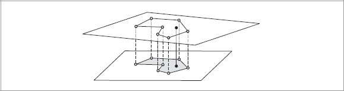

*Figure 6.47: A ray–polygon intersection test can be performed by finding the point where the ray intersects the polygon’s plane, projecting the hit point and polygon vertices onto an axis-aligned plane, and doing a 2D point-in-polygon test there.*

```text
   Shape 261
```

Add support for CSG to pbrt and render images that demonstrate interesting shapes that can be rendered using CSG. You may want to read Roth (1982), which first described how ray tracing could be used to render

models described by CSG, as well as Amanatides and Mitchell (1990), which discusses accuracy-related issues for CSG ray tracing. ➋ 6.11 Procedurally described parametric surfaces: Write a Shape that takes a general mathematical expression of the form f (u, v) → (x, y, z) that describes a parametric surface as a function of (u, v). Evaluate the given function at a grid of (u, v) positions, and create a bilinear patch mesh that approximates the given surface. Render images of interesting shapes using your new Shape. ➋ 6.12 Adaptive curve refinement: Adjust the number of levels of recursive refinement used for intersection with Curve shapes based on the on-screen area that they cover. One approach is to take advantage of the RayDifferential class, which represents the image space area that a given ray represents. (However, currently, only Rays—not RayDifferentials—are passed to the Shape::Intersect() method implementation, so you would need to modify other parts of the system to make ray differentials available.) Alternatively, you could modify the Camera to provide information about the projected length of vectors between points in rendering space on the image plane and make the camera available during Curve intersection.

Render images that show the benefit of adaptive refinement when the camera is close to curves. Measure performance, varying the camera-to-curves distance. Does performance improve when the camera is far away? How does it change when the camera is close? ➋ 6.13 Implement one of the more efficient ray–curve intersection algorithms described by Reshetov (2017) or by Reshetov and Luebke (2018). Measure the performance of pbrt’s current Curve implementation as well as your new one and discuss the results. Do rendered images match with both approaches? Can you find differences in the intersections returned that lead to changes in images, especially when the camera is close to a curve? Explain your findings. ➌ 6.14 Ray-tracing point-sampled geometry: Extending methods for rendering complex models represented as a collection of point samples (Levoy and Whitted 1985; Pfister et al. 2000; Rusinkiewicz and Levoy 2000), Schaufler and Jensen (2000) have described a method for intersecting rays with collections of oriented point samples in space. Their algorithm probabilistically determined that an intersection has occurred when a ray approaches a sufficient local density of point samples and computes a surface normal with a weighted average of the nearby samples. Read their paper and extend pbrt to support a point-sampled geometry shape. Do any of pbrt’s basic interfaces need to be extended or generalized to support a shape like this?

```text
             Curve 346
             Ray 95
             RayDifferential 96
             Shape 261
             Shape::Intersect() 265
             TransformedPrimitive 403
```

➌ 6.15 Deformation motion blur: The TransformedPrimitive in Section 7.1.2 of Chapter 7 supports animated shapes via transformations of primitives that vary over time. However, this type of animation is not general enough to represent a triangle mesh where each

```text
         vertex has a position given at the start time and another one at the end time. (For example,
         this type of animation description can be used to describe a running character model
         where different parts of the body are moving in different ways.) Implement a more
         general Triangle or BilinearPatch shape that supports specifying vertex positions at
         the start and end of frame and interpolates between them based on the ray time passed to
         the intersection methods. Be sure to update the bounding routines appropriately.
```

Meshes with very large amounts of motion may exhibit poor performance due to individual triangles or patches sweeping out large bounding boxes and thus many intersection tests being performed that do not hit the shape. Can you come up with approaches that could be used to reduce the impact of this problem? ➌ 6.16 Implicit functions: Just as implicit definitions of the quadric shapes are a useful starting point for deriving ray-intersection algorithms, more complex implicit functions can also be used to define interesting shapes. In particular, difficult-to-model organic shapes, water drops, and so on can be well represented by implicit surfaces. Blinn (1982a) introduced the idea of directly rendering implicit surfaces, and Wyvill and Wyvill (1989) gave a basis function for implicit surfaces with a number of advantages compared to Blinn’s.

Implement a method for finding ray intersections with implicit surfaces and add it to pbrt. You may wish to read papers by Kalra and Barr (1989), Hart (1996), and Sabbadin and Droske (2021) for methods for ray tracing them. Mitchell’s algorithm for robust ray intersections with implicit surfaces using interval arithmetic gives another effective method for finding these intersections (Mitchell 1990), and more recently Knoll et al. (2009) described refinements to this idea. You may find an approach along these lines easier to implement than the others. See Moore’s book on interval arithmetic as needed for reference (Moore 1966). ➌ 6.17 L-systems: A very successful technique for procedurally modeling plants was introduced to graphics by Alvy Ray Smith (1984), who applied Lindenmayer systems (L-systems) to model branching plant structures. Prusinkiewicz and collaborators have generalized this approach to encompass a much wider variety of types of plants and effects that determine their appearance (Prusinkiewicz 1986; Prusinkiewicz, James, and Mech 1994; Deussen et al. 1998; Prusinkiewicz et al. 2001). L-systems describe the branching structure of these types of shapes via a grammar. The grammar can be evaluated to form expressions that describe a topological representation of a plant, which can then be translated into a geometric representation. Add an L-system primitive to pbrt that takes a grammar as input and evaluates it to create the shape it describes. ➊ 6.18 Given an arbitrary point (x, y, z), what bound on the error from applying a scale transformation of (2, 1, 4) is given by Equation (6.30)? How much error is actually introduced?

```text
             Interval 1057
```

➋ 6.19 The quadric shapes all use the Interval class for their intersection tests in order to be able to bound the error in the computed t value so that intersections behind the ray origin are not incorrectly reported as intersections. First, measure the performance difference when using regular Floats for one or more quadrics when rendering a scene that includes those shapes. Next, manually derive conservative error bounds for t values computed by those shapes as was done for triangles in Section 6.8.7. Implement your method. You may

find it useful to use the Interval class to empirically test your derivation’s correctness. Measure the performance difference with your implementation. ➋ 6.20 One detail thwarts the watertightness of the current Triangle shape implementation: the translation and shearing of triangle vertices introduces round-off error, which must be accounted for in the extent of triangles’ bounding boxes; see Section 3.3 of Woop et al. (2013) for discussion (and a solution). Modify pbrt to incorporate a solution to this shortcoming. Can you find scenes where small image errors are eliminated thanks to your fix?

```text
                   Triangle 301
```

_________________ 1 This assumes that the architecture being used supports IEEE floating-point arithmetic, which is universal on modern systems. The relevant properties of IEEE floating-point arithmetic are that for all v > 0, v/0 = ∞ and for all w < 0, w/0 = −∞, where ∞ is a special value such that any positive number multiplied by ∞ gives ∞ and any negative number multiplied by ∞ gives −∞, and so on. See Section 6.8.1 for more information about floating-point arithmetic. 2 Some ray tracers require that the direction vector of a ray be normalized, meaning a = 1. This can lead to subtle errors, however, if the caller forgets to normalize the ray direction. Of course, these errors can be avoided by normalizing the direction in the ray constructor, but this wastes effort when the provided direction is already normalized. To avoid this needless complexity, pbrt never insists on vector normalization in intersection routines. This is particularly helpful since it reduces the amount of computation needed to transform rays to object space, because no normalization is necessary there. 3 This computation implicitly assumes a counterclockwise vertex ordering. ⋆ This section covers advanced topics and may be skipped on a first reading. 4 Note that these are coefficients to the equation au2 + bu + c = 0 and not a, b, and c plane coefficients. 5 Note the abuse of terminology: while a curve is a 1D mathematical entity, a Curve shape represents a 2D surface. In the following, we will generally refer to the Shape as a curve. The 1D entity will be distinguished by the name “Bézier curve” when the distinction would not otherwise be clear. 6 The word mantissa is often used in place of significand, though floating-point purists note that mantissa has a different meaning in the context of logarithms and thus prefer significand. We follow this usage here. 7 Denormalized numbers are also known as subnormal numbers. 8 This is one of a few places where compilers must not perform seemingly obvious and safe algebraic simplifications with expressions that include floating-point values—this particular comparison must not be simplified to false. Enabling compiler “fast math” or “perform unsafe math optimizations” flags may allow these optimizations to be performed. In turn, buggy behavior may be introduced in pbrt. 9 IEEE float allows the user to select one of a number of rounding modes, but we will assume the default—round to nearest even —here. 10 The C and C++ standards define the machine epsilon as the magnitude of one ulp above the number 1. For a 32-bit float, this value is 2−23, which is twice as large as the machine epsilon as the term is generally used in numerical analysis.

```text
     Float 23
```

11 This bound assumes that there is no overflow or underflow in the computation; these possibilities can be easily handled (Higham 2002, p. 56) but are not generally important for our application here. 12 These functions are equivalent to std::nextafter(v, Infinity) and std::nextafter(v, -Infinity), but are more efficient since they do not try to handle NaN values or deal with signaling floating-point exceptions. 13 Some numerical analysts use a rule of thumb that the number of ulps of error in practice is often close to the square root of the bound’s number of ulps, thanks to the cancellation of error in intermediate results. 14 Although rounding error is introduced when transforming triangle vertices to rendering space (for example), this error does not add error that needs to be handled in computing intersection points. In other words, the transformed vertices may represent a perturbed representation of the scene, but they are the most accurate representation available given the transformation. 15 The observant reader may now wonder about the effect of rounding error when computing the error bounds that are passed into this function. Indeed, these bounds should also be computed with rounding toward positive infinity. We ignore that issue under the expectation that the additional offset of one ulp here will be enough to cover that error.
