# Chapter 6: Shapes

<!-- interactive-nav -->
## Contents

- [Shapes (wgpu)](#shapes-wgpu)
- [6.1 Basic Shape Interface](#61-basic-shape-interface)
- [6.2 Spheres](#62-spheres)
- [6.3 Cylinders](#63-cylinders)
- [6.4 Disks](#64-disks)
- [6.5 Triangle Meshes](#65-triangle-meshes)
- [6.6 Bilinear Patches](#66-bilinear-patches)
- [6.7 Curves](#67-curves)
- [6.8 Managing Rounding Error](#68-managing-rounding-error)
- [Further Reading](#further-reading)
- [Exercises](#exercises)

---

## Shapes (wgpu)


In this chapter we present pbrt's abstraction for geometric primitives such as spheres and triangles. Careful abstraction of geometric shapes in a ray tracer is a key component of clean system design, and shapes are the ideal candidate for an object-oriented approach: all geometric primitives implement a common interface, and the rest of the renderer uses that interface without needing any details about the underlying shape. This makes it possible to separate the geometric and shading subsystems of pbrt.

pbrt hides details about primitives behind a two-level abstraction. The `Shape` interface provides access to the basic geometric properties of the primitive—surface area, bounding box, and a ray-intersection routine. The `Primitive` interface encapsulates additional non-geometric information such as material properties; the rest of the renderer deals only with the abstract `Primitive` interface. This chapter focuses on the geometry-only `Shape` class; `Primitive` is a key topic of Chapter 7.

> **wgpu / Rust note.** The implementations below are written in Rust with idiomatic `snake_case` method names (the canonical pbrt names such as `Shape::Intersect()` are still used in the prose). GPU-side intersection routines are given as WGSL snippets: tracing is done through the ray-tracing API or an explicit BVH traversal kernel, while the *per-primitive* intersection tests shown here are the ones that run in intersection shaders and any-hit shaders.

### Shape intersection at a glance

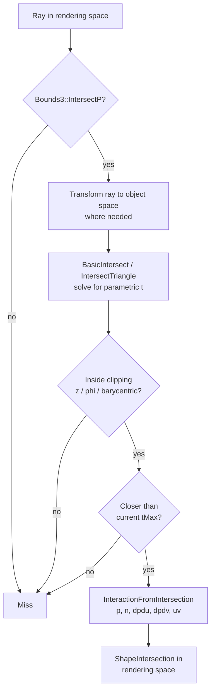

## 6.1 Basic Shape Interface

The interface for shapes is defined in `base/shape.rs`; the shape implementations live in `shapes.rs` (and its companion module). The `Shape` class defines the general shape interface.

**〈Shape Definition〉 ≡**

```rust
// pbrt dispatches with a tagged pointer; in Rust the shape set is an enum:
enum Shape {
    Sphere(Sphere),
    Cylinder(Cylinder),
    Disk(Disk),
    Triangle(Triangle),
    BilinearPatch(BilinearPatch),
    Curve(Curve),
}
```

<details>
<summary>Reference / notes</summary>

`BilinearPatch` 328 · `Curve` 346 · `Cylinder` 286 · `Disk` 292 · `Primitive` 398 · `Shape` 261 · `Sphere` 271 · `TaggedPointer` 1073 · `Triangle` 301

</details>

### 6.1.1 Bounding

Scenes often contain objects that are computationally expensive to process. For many operations it is useful to have a 3D bounding volume that encloses an object: if a ray does not pass through a particular bounding volume, pbrt can avoid processing all the objects inside it for that ray.

Axis-aligned bounding boxes are convenient because they require only six floating-point values to store, fit many shapes well, and are inexpensive to test against a ray. Each `Shape` implementation must be able to bound itself with an axis-aligned bounding box represented by a `Bounds3f`. The returned box is in the rendering coordinate system (recall Section 5.1.1).

**〈Shape Interface〉 ≡ 261**

```rust
/// Axis-aligned bounding box in rendering space.
fn bounds(&self) -> Bounds3f;
```

In addition to bounding spatial extent, shapes must bound their range of surface normals. `NormalBounds()` returns such a bound using a `DirectionCone` (Section 3.8.4). Normal bounds are useful in lighting: when a shape is emissive, they sometimes make it possible to efficiently determine that the shape does not illuminate a particular point in the scene.

**〈Shape Interface〉 +≡ 261**

```rust
/// Conservative cone containing all surface normals.
fn normal_bounds(&self) -> DirectionCone;
```

<details>
<summary>Reference / notes</summary>

`Bounds3f` 97 · `DirectionCone` 114 · `Float` 23 · `Shape` 261

</details>

### 6.1.2 Ray–Bounds Intersections

Given that `Bounds3f` instances bound shapes, we add a `Bounds3::IntersectP()` method that checks for a ray–box intersection and returns the two parametric $t$ values of the intersection, if any.

It is helpful to think of a bounding box as the intersection of three *slabs*, where a slab is the region of space between two parallel planes. To intersect a ray with a box, we intersect the ray with each of the box's three slabs in turn. Because the slabs are aligned with the coordinate axes, a number of optimizations can be made in the ray–slab tests.

The basic algorithm works as follows. We start with a parametric interval covering the range of positions $t$ along the ray where we are interested in finding intersections, typically $(0,\infty)$. We then successively compute the two parametric $t$ positions where the ray intersects each axis-aligned slab and compute the set intersection of the per-slab interval with the current interval, returning failure if the resulting interval becomes degenerate. If, after all three slabs, the interval is nondegenerate, we have the parametric range of the ray that is inside the box. Figures 6.1 and 6.2 illustrate the process.

*Figure 6.1: Intersecting a Ray with an Axis-Aligned Bounding Box. We compute intersection points with each slab in turn, progressively narrowing the parametric interval. Here, in 2D, the intersection of the $x$ and $y$ extents along the ray (thick segment) gives the extent where the ray is inside the box.*

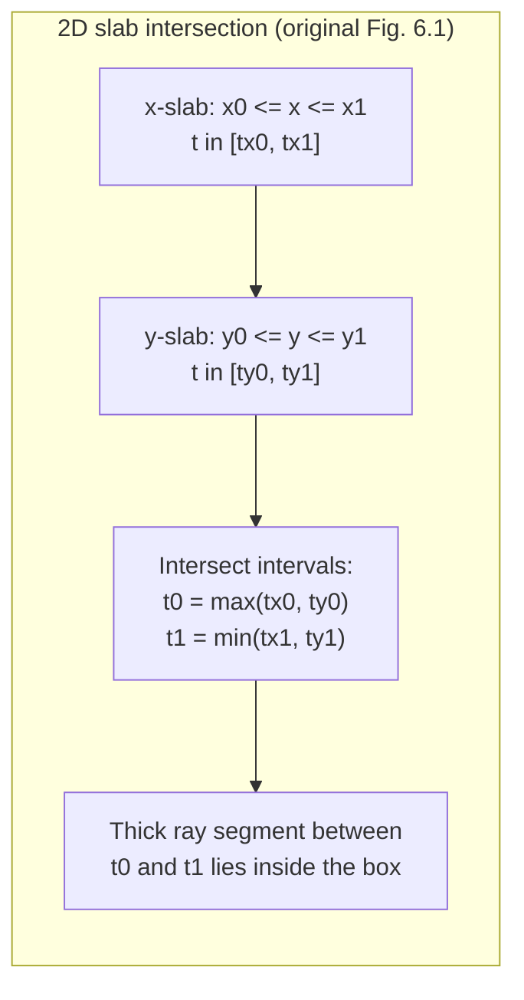

*Figure 6.2: Intersecting a Ray with an Axis-Aligned Slab. The two planes are $x=c$ for constants $c=x_0,x_1$, each with normal $(1,0,0)$. Unless the ray is parallel to the planes, it intersects the slab twice, at parametric positions $t_{\mathrm{near}}$ and $t_{\mathrm{far}}$.*

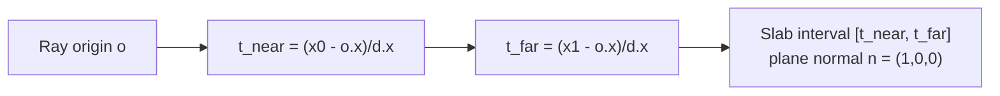

If `Bounds3::IntersectP()` returns true, the intersection's parametric range is returned in the optional arguments `hitt0` and `hitt1`. Intersections outside the ray's $(0,t_{\max})$ range are ignored. If the ray origin is inside the box, $0$ is returned for `hitt0`.

**〈Bounds3 Inline Functions〉 +≡**

```rust
impl<T: Float> Bounds3<T> {
    fn intersect_p(
        &self,
        o: Point3f,
        d: Vector3f,
        t_max: Float,
        hitt0: Option<&mut Float>,
        hitt1: Option<&mut Float>,
    ) -> bool {
        let mut t0 = 0.0;
        let mut t1 = t_max;
        for i in 0..3 {
            // 〈Update interval for ith bounding box slab〉
        }
        if let Some(v) = hitt0 { *v = t0; }
        if let Some(v) = hitt1 { *v = t1; }
        true
    }
}
```

<details>
<summary>Reference / notes</summary>

`Bounds3` 97 · `Bounds3::IntersectP()` 262 · `Bounds3f` 97 · `DirectionCone` 114 · `Float` 23 · `Point3f` 92 · `Shape` 261 · `Vector3f` 86

</details>

For each pair of planes the routine computes two ray–plane intersections. For the slab perpendicular to the $x$ axis, the two planes pass through $(x_0,0,0)$ and $(x_1,0,0)$ with normal $(1,0,0)$. Substituting the ray equation into a general plane $ax+by+cz+d=0$ gives

$$a(o_x+t d_x)+b(o_y+t d_y)+c(o_z+t d_z)+d = (a,b,c)\cdot\mathbf o + t\,(a,b,c)\cdot\mathbf d + d = 0,$$

so solving for $t$ yields

$$t = -\frac{(a,b,c)\cdot\mathbf o + d}{(a,b,c)\cdot\mathbf d}.$$

For the $x$ slab we have $a=1$, $b=c=0$, and $d=-x_0$, which simplifies the calculation to $t=(x_0-o_x)/d_x$.

Because $y$ and $z$ components of the plane normal are zero, the computation reduces to a few multiplies and adds. The code starts by computing the reciprocal of the corresponding component of the ray direction so that it can multiply by this factor rather than performing multiple divisions. Note that although it divides by this component, it is not necessary to verify that it is nonzero: if it is zero, `invRayDir` holds an infinite value, either $-\infty$ or $\infty$, and the rest of the algorithm still works correctly.[^1]

**〈Update interval for ith bounding box slab〉 ≡ 262**

```rust
let inv_ray_dir = 1.0 / d[i];
let t_near = (self.p_min[i] - o[i]) * inv_ray_dir;
let t_far = (self.p_max[i] - o[i]) * inv_ray_dir;
// 〈Update parametric interval from slab intersection t values〉
```

The two distances are reordered so that `t_near` holds the closer intersection and `t_far` the farther one, giving a range $[t_{\mathrm{near}},t_{\mathrm{far}}]$ that is intersected with the current range $[t_0,t_1]$. If the new range is empty ($t_0>t_1$), the code can immediately return failure.

There is a floating-point subtlety: if the ray origin lies in the plane of a slab and the ray lies in that plane, `t_near` or `t_far` can be computed as $0/0$, producing NaN. Comparisons involving NaN always evaluate to false, so the update is written so that `t0` and `t1` can never take on a NaN value and always remain unchanged in that case.

**〈Update parametric interval from slab intersection t values〉 ≡ 264**

```rust
let (mut t_near, mut t_far) = if t_near > t_far { (t_far, t_near) } else { (t_near, t_far) };

// 〈Update tFar to ensure robust ray–bounds intersection〉
t0 = if t_near > t0 { t_near } else { t0 };
t1 = if t_far < t1 { t_far } else { t1 };
if t0 > t1 { return false; }
```

`Bounds3` also provides a specialized `IntersectP()` method that takes the reciprocal of the ray direction as an additional parameter, so the three reciprocals need not be recomputed on each call. It also takes precomputed flags indicating whether each direction component is negative, which eliminates the comparisons that order `t_near` and `t_far`: those comparisons depend on computed values and can be inefficient to execute because the values must be finished before the comparison can be made. Since many ray–box tests are performed during rendering, this small optimization is worthwhile.

<details>
<summary>Reference / notes</summary>

`Bounds3::pMax` 98 · `Bounds3::pMin` 98 · `Float` 23

</details>

This routine returns true if the ray segment is entirely inside the bounding box, even if the intersections are not within the ray's $(0,t_{\max})$ range.

**〈Bounds3 Inline Functions〉 +≡**

```rust
fn intersect_p_fast(
    &self,
    o: Point3f,
    d: Vector3f,
    ray_t_max: Float,
    inv_dir: Vector3f,
    dir_is_neg: [i32; 3],
) -> bool {
    let bounds = self;
    // 〈Check for ray intersection against x and y slabs〉
    // 〈Check for ray intersection against z slab〉
    t_min < ray_t_max && t_max > 0.0
}
```

If the ray direction component is negative, the "near" parametric intersection is found with the *larger* of the two bounding values and the far intersection with the smaller one. The implementation uses this observation to compute the near and far values directly.

**〈Check for ray intersection against x and y slabs〉 ≡ 265**

```rust
let mut t_min = (bounds[dir_is_neg[0] as usize].x - o.x) * inv_dir.x;
let mut t_max = (bounds[1 - dir_is_neg[0] as usize].x - o.x) * inv_dir.x;
let mut ty_min = (bounds[dir_is_neg[1] as usize].y - o.y) * inv_dir.y;
let mut ty_max = (bounds[1 - dir_is_neg[1] as usize].y - o.y) * inv_dir.y;
// 〈Update tMax and tyMax to ensure robust bounds intersection〉
if t_min > ty_max || ty_min > t_max { return false; }
if ty_min > t_min { t_min = ty_min; }
if ty_max < t_max { t_max = ty_max; }
```

The fragment `〈Check for ray intersection against z slab〉` is analogous and is not included here.

This intersection test is at the heart of traversing the `BVHAggregate` acceleration structure (Section 7.3). Because so many ray–box tests are performed while traversing the BVH, this optimized method provided approximately a 15% improvement in overall rendering time compared with the variant that did not take precomputed direction reciprocals and signs.

#### GPU version (WGSL)

The slab test maps directly to a WGSL intersection-shader helper. The sign flags are replaced by selecting the near/far bounds with `select`, which is branch-free and thread-group friendly.

```wgsl
fn intersect_aabb(o: vec3f, inv_d: vec3f, t_max: f32,
                  p_min: vec3f, p_max: vec3f) -> vec2f {
  // returns (t0, t1); t0 > t1 means a miss
  let near = (p_min - o) * inv_d;
  let far  = (p_max - o) * inv_d;
  let t0v = min(near, far);
  let t1v = max(near, far);
  var t0 = max(max(t0v.x, t0v.y), max(t0v.z, 0.0));
  var t1 = min(min(t1v.x, t1v.y), min(t1v.z, t_max));
  // Conservative expansion for the overlap case (Section 6.8.2).
  t1 = t1 * (1.0 + 2.0 * gamma3());
  return vec2f(t0, t1);
}
```

### 6.1.3 Intersection Tests

`Shape` implementations must provide two methods that test for ray intersections. The first, `Intersect()`, returns geometric information about a single ray–shape intersection corresponding to the first intersection, if any, in the $(0,t_{\max})$ range along the given ray.

**〈Shape Interface〉 +≡ 261**

```rust
fn intersect(&self, ray: &Ray, t_max: Float) -> Option<ShapeIntersection>;
```

When an intersection is found, a `SurfaceInteraction` corresponding to the intersection point and the parametric $t$ distance along the ray are returned via a `ShapeIntersection` instance.

<details>
<summary>Reference / notes</summary>

`Bounds3` 97 · `Bounds3::IntersectP()` 262 · `Bounds3f` 97 · `BVHAggregate` 407 · `Float` 23 · `Infinity` 361 · `Point3f` 92 · `Ray` 95 · `Shape` 261 · `ShapeIntersection` 266 · `SurfaceInteraction` 138 · `Vector3f` 86

</details>

**〈ShapeIntersection Definition〉 ≡**

```rust
struct ShapeIntersection {
    intr: SurfaceInteraction,
    t_hit: Float,
}
```

Important points to keep in mind when reading (and writing) intersection routines:

- The provided `t_max` value defines the endpoint of the ray. Intersections after this point must be ignored.
- If there are multiple intersections with a shape along the ray, the closest one must be reported.
- Rays passed to intersection routines are in rendering space, so shapes are responsible for transforming them to object space if needed for the intersection test.[^2]

The second method, `Shape::IntersectP()`, is a predicate that determines whether an intersection occurs without returning any details about it. It is often more efficient than a full intersection test and is used in particular for shadow rays testing the visibility of a light source from a point in the scene.

**〈Shape Interface〉 +≡ 261**

```rust
fn intersect_p(&self, ray: &Ray, t_max: Float) -> bool;
```

On the GPU these two roles are played by *any-hit* shaders (visibility only, with early termination) and *closest-hit* shaders (full `SurfaceInteraction` construction). The two-stage structure used by the quadrics below—cheap `BasicIntersect()` first, full interaction second—matches that split exactly.

### 6.1.4 Intersection Coordinate Spaces

For some shapes, intersection routines are most naturally expressed in their object space. The `Sphere` shape below computes the intersection with a sphere of a given radius positioned at the origin; being at the origin allows various simplifications. Other shapes, like `Triangle`, transform their representation to rendering space and perform intersection tests there.

Shapes like `Sphere` that operate in object space must transform the specified ray to object space and then transform any intersection results back to rendering space. Most of this is handled using methods of `Transform` (Section 3.10), but a natural question is: what effect does the object-from-rendering-space transformation have on the correct parametric distance to return? The intersection method finds a parametric $t$ for the object-space ray, which may have been translated, rotated, scaled, or worse when transformed from rendering space.

Using the properties of transformations we can show that $t$ is unaffected. Consider a rendering-space ray $\mathbf r_r$ with origin $\mathbf o_r$ and direction $\mathbf d_r$. Given an object-from-rendering-space transformation matrix $M$, the object-space ray has origin $M\mathbf o_r$ and direction $M\mathbf d_r$ (directions transform with the linear part only).

<details>
<summary>Reference / notes</summary>

`Float` 23 · `Infinity` 361 · `Ray` 95 · `Shape::IntersectP()` 266 · `Sphere` 271 · `SurfaceInteraction` 138 · `Transform` 120 · `Triangle` 301

</details>

If the algorithm finds an object-space intersection at distance $t$, the object-space intersection point is

$$\mathbf p_o = \mathbf o_o + t\,\mathbf d_o.$$

Applying $M^{-1}$ to both sides gives the rendering-space intersection point $\mathbf p_r$:

$$M^{-1}\mathbf p_o = M^{-1}(\mathbf o_o + t\,\mathbf d_o) = M^{-1}\mathbf o_o + t\,M^{-1}\mathbf d_o = \mathbf o_r + t\,\mathbf d_r.$$

Therefore the $t$ computed in object space is also the correct $t$ in rendering space. Note that if the object-space ray's direction were normalized after transformation, this would no longer hold and a correction factor related to the unnormalized ray length would be needed. This is one reason pbrt does not normalize object-space ray directions after transformation.[^2]

### 6.1.5 Sidedness

Many rendering systems, particularly scanline and z-buffer systems, support "one-sided" shapes: a shape is visible from the front but disappears when viewed from behind. If a geometric object is closed and always viewed from the outside, backfacing parts can be discarded without changing the image, substantially speeding up hidden-surface removal. With ray tracing the benefit is reduced, since it is often necessary to perform the ray–object intersection before determining the surface normal for the backfacing test. Furthermore, the feature can produce a physically inconsistent scene if one-sided objects are not closed: a surface might block a shadow ray traced from a light to another surface but not when traced in the other direction. For all of these reasons, pbrt does not support this feature.

### 6.1.6 Area

In pbrt, area lights are defined by attaching an emission profile to a `Shape`. To use shapes as area lights they must be able to return their surface area in rendering space.

**〈Shape Interface〉 +≡ 261**

```rust
fn area(&self) -> Float;
```

### 6.1.7 Sampling

A few methods are needed to sample points on the surface of shapes in order to use them as emitters. There are two shape sampling methods, both named `Sample()`. The first chooses points on the surface with a distribution proportional to surface area and returns local geometric information about the sampled point in a `ShapeSample`. The provided sample $\mathbf u$, uniform in $[0,1)^2$, determines the point on the shape.

**〈Shape Interface〉 +≡ 261**

```rust
fn sample(&self, u: Point2f) -> Option<ShapeSample>;
```

<details>
<summary>Reference / notes</summary>

`Float` 23 · `Interaction` 136 · `Point2f` 92 · `ShapeSample` 268

</details>

The returned `ShapeSample` stores an `Interaction` corresponding to a sampled point on the surface together with the probability density with respect to surface area for sampling that point.

**〈ShapeSample Definition〉 ≡**

```rust
struct ShapeSample {
    intr: Interaction,
    pdf: Float,
}
```

Shapes must also provide an associated `PDF()` method returning the probability density for sampling the specified point on the shape corresponding to a given `Interaction`. This method should only be called with interactions known to be on the shape's surface: implementations are allowed to assume this, and callers are responsible for ensuring it. Although `Sample()` already returns the PDF for the point it samples, this method is needed for multiple importance sampling, where densities for samples generated by other techniques must be evaluated.

**〈Shape Interface〉 +≡ 261**

```rust
fn pdf(&self, intr: &Interaction) -> Float;
```

The second sampling method takes a reference point from which the shape is being viewed. This is especially useful for lighting: the caller passes the point to be lit and the shape only samples the portion of its surface potentially visible from that point.

Unlike the first method, which samples with respect to surface area, this one uses a density with respect to *solid angle* from the reference point. The difference stems from the area-light sampling routines evaluating the direct-lighting integral as an integral over directions from the reference point, where a solid-angle density is more convenient.

**〈Shape Interface〉 +≡ 261**

```rust
fn sample(&self, ctx: &ShapeSampleContext, u: Point2f) -> Option<ShapeSample>;
```

Information about the reference point and its geometric and shading normals is provided by `ShapeSampleContext`. The reference position uses `Point3fi`, which can represent the numerical uncertainty in a ray intersection point computed with floating-point arithmetic (Section 6.8). For points in participating media that are not associated with a surface, the normals are left at their default value $(0,0,0)$.

**〈ShapeSampleContext Definition〉 ≡**

```rust
struct ShapeSampleContext {
    // 〈ShapeSampleContext Public Methods〉
    pi: Point3fi,
    n: Normal3f,
    ns: Normal3f,
    time: Float,
}
```

`ShapeSampleContext` provides convenience constructors that specify the members directly or from various types of `Interaction`.

<details>
<summary>Reference / notes</summary>

`Float` 23 · `Interaction` 136 · `Normal3f` 94 · `Point2f` 92 · `Point3fi` 1061 · `Shape` 261 · `ShapeSample` 268 · `ShapeSampleContext` 268 · `ShapeSampleContext::pi` 268

</details>

**〈ShapeSampleContext Public Methods〉 ≡ 268**

```rust
impl ShapeSampleContext {
    fn new(pi: Point3fi, n: Normal3f, ns: Normal3f, time: Float) -> Self {
        Self { pi, n, ns, time }
    }
    fn from_surface(si: &SurfaceInteraction) -> Self {
        Self { pi: si.pi, n: si.n, ns: si.shading.n, time: si.time }
    }
    fn from_medium(mi: &MediumInteraction) -> Self {
        Self { pi: mi.pi, n: Normal3f::ZERO, ns: Normal3f::ZERO, time: mi.time }
    }
}
```

For code that does not need to be aware of numeric error in the intersection point, a method provides it as a regular `Point3f`.

**〈ShapeSampleContext Public Methods〉 +≡ 268**

```rust
fn p(&self) -> Point3f { Point3f::from(self.pi) }
```

A second `PDF()` method returns the shape's probability of sampling a point on the light such that the incident direction $\omega_i$ at the reference point is `wi`. As with the corresponding sampling method, this density is with respect to solid angle at the reference point, and it should only be called for a direction known to intersect the shape from the reference point; implementations are not responsible for checking that case.

**〈Shape Interface〉 +≡ 261**

```rust
fn pdf(&self, ctx: &ShapeSampleContext, wi: Vector3f) -> Float;
```

Some `PDF()` implementations need to trace a ray from the reference point in direction $\omega_i$ to see if it intersects the shape. Use the following `ShapeSampleContext` methods to find the ray origin or the ray itself rather than using `ShapeSampleContext::p()`. This too stems from a subtlety in handling numeric error in intersection points; the implementation and a discussion of the underlying issues are in Section 6.8.6.

**〈ShapeSampleContext Public Methods〉 +≡ 268**

```rust
fn offset_ray_origin(&self, w: Vector3f) -> Point3f;
fn offset_ray_origin_to(&self, pt: Point3f) -> Point3f;
fn spawn_ray(&self, w: Vector3f) -> Ray;
```

## 6.2 Spheres

Spheres are a special case of quadrics—surfaces described by quadratic polynomials in $x$, $y$, and $z$. They offer a good starting point for ray-intersection algorithms. Together with a transformation matrix, pbrt's `Sphere` can also take the form of an ellipsoid. The other basic quadrics are cylinders and disks; cones, hyperboloids, and paraboloids are less useful for rendering and are not included in the system.

Surfaces can be described in two main ways. An *implicit* function describes a 3D surface as $f(x,y,z)=0$; the set of points satisfying the condition defines the surface. For a unit sphere at the origin the familiar implicit equation is

$$x^2 + y^2 + z^2 - 1 = 0.$$

*Figure 6.3: Basic Setting for the Sphere Shape. It has radius $r$ and is centered at the object-space origin. A partial sphere is described by a maximum $\phi$ value.*

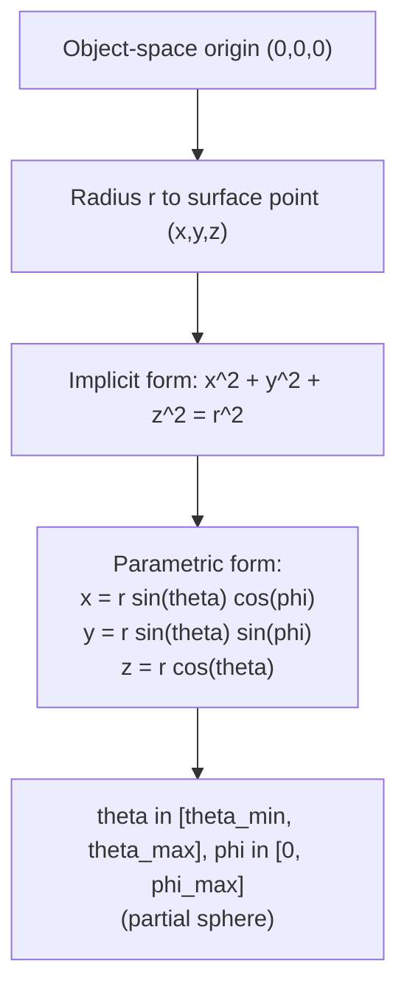

Many surfaces can also be described *parametrically*, by a function mapping 2D points to 3D points on the surface. A sphere of radius $r$ is a function of spherical coordinates $(\theta,\phi)$, with $\theta\in[0,\pi]$ and $\phi\in[0,2\pi]$:

$$\mathbf p(\theta,\phi) = \big(r\sin\theta\cos\phi,\; r\sin\theta\sin\phi,\; r\cos\theta\big).$$

We can transform this into a function $\mathbf f(u,v)$ over $[0,1]^2$ and allow partial spheres sweeping $\theta\in[\theta_{\min},\theta_{\max}]$ and $\phi\in[0,\phi_{\max}]$ with the substitution

$$\theta = \theta_{\min} + v\,(\theta_{\max}-\theta_{\min}), \qquad \phi = u\,\phi_{\max}.$$

This form is particularly useful for texture mapping, since a texture over $[0,1]^2$ maps directly to the sphere. Figure 6.4 shows two spheres with a grid image map revealing the $(u,v)$ parameterization.

*Figure 6.4: Two Spheres. On the left is a partial sphere (with $z_{\max}<r$ and $\phi_{\max}<2\pi$) and on the right a complete sphere. The texture image shows the $(u,v)$ parameterization; the singularity at one pole is visible in the complete sphere.*

<details>
<summary>Figure 6.4 — pictorial image (keep)</summary>


</details>

As we describe the implementation, we will use whichever of the implicit and parametric descriptions is more natural for the problem at hand. The `Sphere` class represents a sphere centered at the origin; its implementation is in `shapes.rs`.

<details>
<summary>Reference / notes</summary>

`Sphere` 271

</details>

**〈Sphere Definition〉 ≡**

```rust
struct Sphere {
    // 〈Sphere Public Methods〉
    // 〈Sphere Private Members〉
}
```

Spheres in pbrt are defined in a coordinate system with the center at the origin; the constructor receives transformations mapping between object space and rendering space. Although pbrt supports animated transformations, these shapes do not use `AnimatedTransform`: animated shapes are represented by a `TransformedPrimitive`, which centralizes the tricky details of animation rather than requiring every shape to handle it.

The radius may be any positive value, and the sphere's extent can be truncated in two ways: minimum and maximum $z$ values cut off the caps, and a maximum $\phi$ sweeps only part of the circle. Finally, a Boolean `reverse_orientation` parameter indicates whether surface normals should be reversed from the default (outward). This matters because the normal's orientation determines which side of a shape is "outside"—emissive shapes, for example, emit only on the side the normal points to. The parameter is set by the `ReverseOrientation` statement in pbrt scene description files.

<details>
<summary>Reference / notes</summary>

`AnimatedTransform` 135 · `Shape` 261 · `TransformedPrimitive` 403

</details>

**〈Sphere Public Methods〉 ≡ 271**

```rust
impl Sphere {
    fn new(
        render_from_object: &Transform,
        object_from_render: &Transform,
        reverse_orientation: bool,
        radius: Float,
        z_min: Float,
        z_max: Float,
        phi_max: Float,
    ) -> Self {
        let (z_min, z_max) = (z_min.min(z_max), z_min.max(z_max));
        Self {
            radius,
            z_min: z_min.clamp(-radius, radius),
            z_max: z_max.clamp(-radius, radius),
            theta_z_min: (z_min / radius).clamp(-1.0, 1.0).acos(),
            theta_z_max: (z_max / radius).clamp(-1.0, 1.0).acos(),
            phi_max: phi_max.to_radians().clamp(0.0, 360.0),
            render_from_object,
            object_from_render,
            reverse_orientation,
            transform_swaps_handedness: render_from_object.swaps_handedness(),
        }
    }
}
```

**〈Sphere Private Members〉 ≡ 271**

```rust
struct Sphere {
    radius: Float,
    z_min: Float,
    z_max: Float,
    theta_z_min: Float,
    theta_z_max: Float,
    phi_max: Float,
    render_from_object: Transform,
    object_from_render: Transform,
    reverse_orientation: bool,
    transform_swaps_handedness: bool,
}
```

### 6.2.1 Bounding

An object-space bounding box is straightforward. The implementation uses the user's $z_{\min}$ and $z_{\max}$ to tighten the bound when less than a full sphere is rendered, but does not do the extra work of tightening for $\phi_{\max}<3\pi/2$; that improvement is left as an exercise. The box is transformed to rendering space before being returned.

**〈Sphere Method Definitions〉 ≡**

```rust
fn bounds(&self) -> Bounds3f {
    self.render_from_object.apply(Bounds3f::new(
        Point3f::new(-self.radius, -self.radius, self.z_min),
        Point3f::new( self.radius,  self.radius, self.z_max),
    ))
}
```

`NormalBounds()` does not consider partial spheres and always returns the bound for a full sphere, i.e. all possible directions.

**〈Sphere Public Methods〉 +≡ 271**

```rust
fn normal_bounds(&self) -> DirectionCone { DirectionCone::entire_sphere() }
```

<details>
<summary>Reference / notes</summary>

`Bounds3f` 97 · `DirectionCone` 114 · `DirectionCone::EntireSphere()` 115 · `Float` 23 · `Point3f` 92 · `Sphere` 271 · `Transform` 120 · `Transform::SwapsHandedness()` 133

</details>

### 6.2.2 Intersection Tests

The ray-intersection test is split into two stages. `BasicIntersect()` does the ray–sphere test and returns a small `QuadricIntersection` if it hits; `InteractionFromIntersection()` upgrades that to a full `SurfaceInteraction` returned from `Intersect()`.

There are two motivations for this split. First, `IntersectP()` becomes a trivial wrapper around `BasicIntersect()`. Second, pbrt's GPU path finds the closest intersection among all shapes *before* constructing the full `SurfaceInteraction`; the decomposition fits that directly.

<details>
<summary>Reference / notes</summary>

`Bounds3f` 97 · `DirectionCone` 114 · `DirectionCone::EntireSphere()` 115 · `Float` 23 · `Point3f` 92 · `Sphere` 271 · `Sphere::objectFromRender` 272 · `Sphere::phiMax` 272 · `Sphere::radius` 272 · `Sphere::renderFromObject` 272 · `Sphere::reverseOrientation` 272 · `Sphere::thetaZMax` 272 · `Sphere::thetaZMin` 272 · `Sphere::transformSwapsHandedness` 272 · `Sphere::zMax` 272 · `Sphere::zMin` 272 · `Transform` 120 · `Transform::SwapsHandedness()` 133

</details>

**〈Sphere Public Methods〉 +≡ 271**

```rust
fn intersect(&self, ray: &Ray, t_max: Float) -> Option<ShapeIntersection> {
    let isect = self.basic_intersect(ray, t_max)?;
    let intr = self.interaction_from_intersection(&isect, -ray.d, ray.time);
    Some(ShapeIntersection { intr, t_hit: isect.t_hit })
}
```

`QuadricIntersection` stores the parametric $t$ along the ray, the object-space intersection point, and the sphere's $\phi$ value there. As its name suggests, the other quadrics use this structure in the same way.

**〈QuadricIntersection Definition〉 ≡**

```rust
struct QuadricIntersection {
    t_hit: Float,
    p_obj: Point3f,
    phi: Float,
}
```

The basic test transforms the rendering-space ray to object space and intersects it with the complete sphere; for partial spheres, additional tests reject intersections with removed portions.

**〈Sphere Public Methods〉 +≡ 271**

```rust
fn basic_intersect(&self, r: &Ray, t_max: Float) -> Option<QuadricIntersection> {
    let phi: Float;
    let mut p_hit: Point3f;
    // 〈Transform Ray origin and direction to object space〉
    // 〈Solve quadratic equation to compute sphere t0 and t1〉
    // 〈Check quadric shape t0 and t1 for nearest intersection〉
    // 〈Compute sphere hit position and phi〉
    // 〈Test sphere intersection against clipping parameters〉
    // 〈Return QuadricIntersection for sphere intersection〉
}
```

<details>
<summary>Reference / notes</summary>

`Float` 23 · `Infinity` 361 · `Point3f` 92 · `Point3fi` 1061 · `QuadricIntersection` 273 · `QuadricIntersection::tHit` 273 · `Ray` 95 · `Ray::d` 95 · `Ray::o` 95 · `Ray::time` 95 · `ShapeIntersection` 266 · `Sphere::BasicIntersect()` 273 · `Sphere::InteractionFromIntersection()` 276 · `Sphere::objectFromRender` 272 · `SurfaceInteraction` 138 · `Vector3f` 86 · `Vector3fi` 1060

</details>

The transformed ray origin and direction are stored as `Point3fi` and `Vector3fi` rather than `Point3f`/`Vector3f`. These represent each quantity as a small interval bounding the floating-point round-off introduced by the transformation; later we will use those bounds to improve geometric accuracy (Section 6.8). For the most part they can be used just like their non-interval counterparts.

**〈Transform Ray origin and direction to object space〉 ≡ 273, 288, 293**

```rust
let oi: Point3fi = self.object_from_render.apply(Point3fi::from(r.o));
let di: Vector3fi = self.object_from_render.apply(Vector3fi::from(r.d));
```

For a sphere centered at the origin with radius $r$, the implicit representation is

$$x^2+y^2+z^2-r^2=0.$$

Substituting the ray equation (Equation 3.4), $\mathbf p(t)=\mathbf o+t\mathbf d$, gives

$$(o_x+t d_x)^2+(o_y+t d_y)^2+(o_z+t d_z)^2=r^2.$$

Every quantity except $t$ is known. Expanding and gathering terms gives the quadratic equation

$$a t^2 + b t + c = 0, \qquad a = |\mathbf d|^2,\quad b = 2\,\mathbf d\!\cdot\!\mathbf o,\quad c = |\mathbf o|^2-r^2.$$

<details>
<summary>Reference / notes</summary>

`Interval` 1057 · `Interval::Sqr()` 1060 · `Point3f` 92 · `Point3fi` 1061 · `Sphere::radius` 272 · `Sqr()` 1034

</details>

**〈Solve quadratic equation to compute sphere t0 and t1〉 ≡ 273**

```rust
let (mut t0, mut t1): (Interval, Interval);
// 〈Compute sphere quadratic coefficients〉
// 〈Compute sphere quadratic discriminant discrim 372〉
// 〈Compute quadratic t values〉
```

`Interval` stores a small range of floats to bound rounding error (Section B.2.15); it relates to `Float` as `Point3fi` relates to `Point3f`. With `Interval`, Equation (6.3) translates directly to:

**〈Compute sphere quadratic coefficients〉 ≡ 274**

```rust
let a = di.x.sqr() + di.y.sqr() + di.z.sqr();
let b = 2.0 * (di.x * oi.x + di.y * oi.y + di.z * oi.z);
let c = oi.x.sqr() + oi.y.sqr() + oi.z.sqr() - Interval::from(self.radius).sqr();
```

The fragment `〈Compute sphere quadratic discriminant discrim〉` computes $b^2-4ac$ in a way that maintains accuracy in tricky cases; it is defined later in Section 6.8.3, after the relevant floating-point topics have been introduced. With `discrim` in hand, the quadratic formula can be applied. We use a more accurate variant of the traditional approach (Section B.2.10):

$$q = -\tfrac12\big(b \pm \sqrt{b^2-4ac}\big), \qquad t_0 = q/a,\qquad t_1 = c/q .$$

**〈Compute quadratic t values〉 ≡ 274, 288**

```rust
let root_discrim = discrim.sqrt();
let q = if b.to_float() < 0.0 { -0.5 * (b - root_discrim) }
        else                  { -0.5 * (b + root_discrim) };
t0 = q / a;
t1 = c / q;
// 〈Swap quadratic t values so that t0 is the lesser〉
```

<details>
<summary>Reference / notes</summary>

`Float` 23 · `Interval` 1057 · `Interval::LowerBound()` 1059 · `Interval::Sqrt()` 1060 · `Interval::UpperBound()` 1059 · `Pi` 1033 · `Point3f` 92 · `Sphere::radius` 272 · `Vector3f` 86

</details>

Because `t0` and `t1` are intervals, it may be ambiguous which is smaller. We use their lower bounds for the test: in ambiguous cases we then do not risk returning a farther hit in place of a closer one.

**〈Swap quadratic t values so that t0 is the lesser〉 ≡ 275**

```rust
if t0.lower_bound() > t1.lower_bound() { std::mem::swap(&mut t0, &mut t1); }
```

A similar ambiguity arises when testing $t$ against the acceptable range; again we err on the side of returning no intersection rather than an invalid one. The closest valid $t$ is stored in `t_shape_hit`.

**〈Check quadric shape t0 and t1 for nearest intersection〉 ≡ 273, 288**

```rust
if t0.upper_bound() > t_max || t1.lower_bound() <= 0.0 { return None; }
let mut t_shape_hit = t0;
if t_shape_hit.lower_bound() <= 0.0 {
    t_shape_hit = t1;
    if t_shape_hit.upper_bound() > t_max { return None; }
}
```

Given the parametric distance to the full-sphere intersection, the hit point is that offset along the ray. Casting the intervals back to non-interval values gives their midpoints. Due to floating-point precision, the computed $\mathbf p_{\mathrm{hit}}$ may lie slightly to one side of the true sphere surface; `〈Refine sphere intersection point〉` (Section 6.8.5) improves this.

Next we handle partial spheres with clipped $z$ or $\phi$ ranges. Using the parametric representation, $\phi=\arctan(y/x)$; the result of `atan2` is remapped to $[0,2\pi)$ to match the sphere's definition.

**〈Compute sphere hit position and phi〉 ≡ 273, 276**

```rust
p_hit = Point3f::from(oi) + t_shape_hit.to_float() * Vector3f::from(di);
// 〈Refine sphere intersection point 375〉
if p_hit.x == 0.0 && p_hit.y == 0.0 { p_hit.x = 1e-5 * self.radius; }
phi = p_hit.y.atan2(p_hit.x);
if phi < 0.0 { phi += 2.0 * PI; }
```

The hit point is tested against the specified $z$ and $\phi$ minima and maxima. One subtlety: the $z$ tests are skipped when the $z$ range includes the whole sphere, because computed `pHit.z` may be slightly outside due to round-off. If $t_0$ is invalid, the routine retries with $t_1$.

**〈Test sphere intersection against clipping parameters〉 ≡ 273**

```rust
if (self.z_min > -self.radius && p_hit.z < self.z_min)
    || (self.z_max < self.radius && p_hit.z > self.z_max)
    || phi > self.phi_max
{
    if t_shape_hit == t1 { return None; }
    if t1.upper_bound() > t_max { return None; }
    t_shape_hit = t1;
    // 〈Compute sphere hit position and phi 275〉
    if (self.z_min > -self.radius && p_hit.z < self.z_min)
        || (self.z_max < self.radius && p_hit.z > self.z_max)
        || phi > self.phi_max
    { return None; }
}
```

At this point the ray definitely hits the sphere. A `QuadricIntersection` is returned with enough information to determine the remaining geometry. Recall from Section 6.1.4 that $t$ computed in object space is also correct in rendering space, so it can be returned directly.

**〈Return QuadricIntersection for sphere intersection〉 ≡ 273**

```rust
Some(QuadricIntersection {
    t_hit: t_shape_hit.to_float(),
    p_obj: p_hit,
    phi,
})
```

With `BasicIntersect()` implemented, `IntersectP()` is a simple wrapper:

**〈Sphere Public Methods〉 +≡ 271**

```rust
fn intersect_p(&self, r: &Ray, t_max: Float) -> bool {
    self.basic_intersect(r, t_max).is_some()
}
```

#### GPU version (WGSL)

The two-stage structure becomes two WGSL functions: a cheap quadratic root finder usable from any-hit shaders, and the full interaction builder in the closest-hit shader.

```wgsl
struct QuadricHit { t: f32, p_obj: vec3f, phi: f32 };

fn sphere_basic_intersect(o: vec3f, d: vec3f, t_max: f32,
                          radius: f32, z_min: f32, z_max: f32,
                          phi_max: f32) -> QuadricHit {
  let a = dot(d, d);
  let b = 2.0 * dot(d, o);
  let c = dot(o, o) - radius * radius;
  // Accurate discriminant; Section 6.8.3 gives the derivation.
  let f = b / (2.0 * a);
  let v = o - f * d;
  let discrim = 4.0 * a * (radius + length(v)) * (radius - length(v));
  if (discrim < 0.0) { return QuadricHit(-1.0, vec3f(0.0), 0.0); }
  let root = sqrt(discrim);
  let q = select(-0.5 * (b + root), -0.5 * (b - root), b < 0.0);
  var t = q / a;
  if (t <= 0.0) { t = c / q; }
  if (t <= 0.0 || t >= t_max) { return QuadricHit(-1.0, vec3f(0.0), 0.0); }

  var p = o + t * d;
  p *= radius / length(p);                 // reproject (Section 6.8.5)
  var phi = atan2(p.y, p.x);
  if (phi < 0.0) { phi += 2.0 * PI; }
  if (p.z < z_min || p.z > z_max || phi > phi_max) {
    return QuadricHit(-1.0, vec3f(0.0), 0.0);
  }
  return QuadricHit(t, p, phi);
}
```

A `QuadricIntersection` is upgraded to a `SurfaceInteraction` by `InteractionFromIntersection()`.

**〈Sphere Public Methods〉 +≡ 271**

```rust
fn interaction_from_intersection(
    &self,
    isect: &QuadricIntersection,
    wo: Vector3f,
    time: Float,
) -> SurfaceInteraction {
    let p_hit = isect.p_obj;
    let phi = isect.phi;
    // 〈Find parametric representation of sphere hit〉
    // 〈Compute error bounds for sphere intersection 375〉
    // 〈Return SurfaceInteraction for quadric intersection 279〉
}
```

<details>
<summary>Reference / notes</summary>

`Float` 23 · `Infinity` 361 · `Interval::UpperBound()` 1059 · `Point3f` 92 · `QuadricIntersection` 273 · `QuadricIntersection::phi` 273 · `QuadricIntersection::pObj` 273 · `Ray` 95 · `Sphere::BasicIntersect()` 273 · `Sphere::phiMax` 272 · `Sphere::radius` 272 · `Sphere::zMax` 272 · `Sphere::zMin` 272 · `SurfaceInteraction` 138 · `Vector3f` 86

</details>

The method first computes $u$ and $v$ by scaling $\phi$ into $[0,1]$ and computing a $\theta$ value in $[0,1]$ from the sphere's $\theta$ range, then finds the parametric partial derivatives of position, $\partial\mathbf p/\partial u$ and $\partial\mathbf p/\partial v$, and of the normal, $\partial\mathbf n/\partial u$ and $\partial\mathbf n/\partial v$.

**〈Find parametric representation of sphere hit〉 ≡ 276**

```rust
let u = phi / self.phi_max;
let cos_theta = p_hit.z / self.radius;
let theta = safe_acos(cos_theta);
let v = (theta - self.theta_z_min) / (self.theta_z_max - self.theta_z_min);
// 〈Compute sphere dpdu and dpdv〉
// 〈Compute sphere dndu and dndv〉
```

Computing the partial derivatives of a point on the sphere is a short algebra exercise. Using $x=r\sin\theta\cos\phi$, the $x$ component is

$$\frac{\partial p_x}{\partial u} = \frac{\partial p_x}{\partial\phi}\frac{\partial\phi}{\partial u} = (-r\sin\theta\sin\phi)\,\phi_{\max} = -\phi_{\max}\,y,$$

and similarly $\partial p_y/\partial u=\phi_{\max}x$ and $\partial p_z/\partial u=0$. Likewise,

$$\frac{\partial\mathbf p}{\partial v} = (\theta_{\max}-\theta_{\min})\big(z\cos\phi,\; z\sin\phi,\; -r\sin\theta\big).$$

The complete result follows directly in code:

**〈Compute sphere dpdu and dpdv〉 ≡ 277**

```rust
let z_radius = (p_hit.x.sqr() + p_hit.y.sqr()).sqrt();
let cos_phi = p_hit.x / z_radius;
let sin_phi = p_hit.y / z_radius;
let dpdu = Vector3f::new(-self.phi_max * p_hit.y, self.phi_max * p_hit.x, 0.0);
let sin_theta = safe_sqrt(1.0 - cos_theta.sqr());
let dpdv = (self.theta_z_max - self.theta_z_min)
    * Vector3f::new(p_hit.z * cos_phi, p_hit.z * sin_phi, -self.radius * sin_theta);
```

<details>
<summary>Reference / notes</summary>

`SafeACos()` 1035 · `SafeSqrt()` 1034 · `Sphere::phiMax` 272 · `Sphere::radius` 272 · `Sphere::thetaZMax` 272 · `Sphere::thetaZMin` 272 · `Sqr()` 1034 · `Vector3f` 86

</details>

It is also useful to know how the normal changes as we move along the surface—the antialiasing techniques of Chapter 10 use this to antialias textures on curved reflected objects. The differential changes $\partial\mathbf n/\partial u$ and $\partial\mathbf n/\partial v$ are given by the *Weingarten equations* from differential geometry:

$$\frac{\partial\mathbf n}{\partial u} = \frac{fF-eG}{EG-F^2}\frac{\partial\mathbf p}{\partial u} + \frac{eF-fE}{EG-F^2}\frac{\partial\mathbf p}{\partial v}, \qquad \frac{\partial\mathbf n}{\partial v} = \frac{gF-fG}{EG-F^2}\frac{\partial\mathbf p}{\partial u} + \frac{fF-gE}{EG-F^2}\frac{\partial\mathbf p}{\partial v}.$$

Here $E$, $F$, $G$ are coefficients of the first fundamental form,

$$E = \frac{\partial\mathbf p}{\partial u}\!\cdot\!\frac{\partial\mathbf p}{\partial u}, \quad F = \frac{\partial\mathbf p}{\partial u}\!\cdot\!\frac{\partial\mathbf p}{\partial v}, \quad G = \frac{\partial\mathbf p}{\partial v}\!\cdot\!\frac{\partial\mathbf p}{\partial v},$$

and $e$, $f$, $g$ are coefficients of the second fundamental form,

$$e = \mathbf n\cdot\frac{\partial^2\mathbf p}{\partial u^2},\quad f = \mathbf n\cdot\frac{\partial^2\mathbf p}{\partial u\,\partial v},\quad g = \mathbf n\cdot\frac{\partial^2\mathbf p}{\partial v^2}.$$

The two forms capture elementary metric properties of a surface—distance, angle, and curvature; see a differential geometry textbook such as Gray (1993) for details. Finding $e,f,g$ requires the second-order partial derivatives. For spheres, a little more algebra gives

$$\frac{\partial^2\mathbf p}{\partial u^2}=-\phi_{\max}^2(x,y,0),\quad \frac{\partial^2\mathbf p}{\partial u\,\partial v}=(\theta_{\max}-\theta_{\min})\,z\,\phi_{\max}(-\sin\phi,\cos\phi,0), \quad \frac{\partial^2\mathbf p}{\partial v^2}=-(\theta_{\max}-\theta_{\min})^2(x,y,z).$$

**〈Compute sphere dndu and dndv〉 ≡ 277**

```rust
let d2_pduu = -self.phi_max.powi(2) * Vector3f::new(p_hit.x, p_hit.y, 0.0);
let d2_pduv = (self.theta_z_max - self.theta_z_min) * p_hit.z * self.phi_max
    * Vector3f::new(-sin_phi, cos_phi, 0.0);
let d2_pdvv = -(self.theta_z_max - self.theta_z_min).powi(2)
    * Vector3f::new(p_hit.x, p_hit.y, p_hit.z);
// 〈Compute coefficients for fundamental forms〉
// 〈Compute dndu and dndv from fundamental form coefficients〉
```

Given all the partial derivatives, the fundamental-form coefficients are easy to compute:

**〈Compute coefficients for fundamental forms〉 ≡ 278, 290, 337**

```rust
let E = dot(dpdu, dpdu);
let F = dot(dpdu, dpdv);
let G = dot(dpdv, dpdv);
let n = normalize(cross(dpdu, dpdv));
let e = dot(n, d2_pduu);
let f = dot(n, d2_pduv);
let g = dot(n, d2_pdvv);
```

We now have everything needed to apply the Weingarten equations. For this computation it is worthwhile to use `DifferenceOfProducts()` to compute $EG-F^2$ for the greater accuracy it provides over the direct expression. We must also avoid dividing by zero if that expression is zero, so that `dndu` and `dndv` do not become NaN.

**〈Compute dndu and dndv from fundamental form coefficients〉 ≡ 278, 290, 337**

```rust
let egf2 = difference_of_products(E, G, F, F);
let inv_egf2 = if egf2 == 0.0 { 0.0 } else { 1.0 / egf2 };
let dndu = Normal3f::from((f * F - e * G) * inv_egf2 * dpdu
                        + (e * F - f * E) * inv_egf2 * dpdv);
let dndv = Normal3f::from((g * F - f * G) * inv_egf2 * dpdu
                        + (f * F - g * E) * inv_egf2 * dpdv);
```

<details>
<summary>Reference / notes</summary>

`Cross()` 91 · `DifferenceOfProducts()` 1044 · `Dot()` 89 · `Float` 23 · `Normal3f` 94 · `Normalize()` 88 · `Point2f` 92 · `Point3fi` 1061 · `Point3i` 92 · `Sphere::objectFromRender` 272 · `Sphere::reverseOrientation` 272 · `Sphere::transformSwapsHandedness` 272 · `SurfaceInteraction` 138 · `Vector3f` 86

</details>

Having computed the surface parameterization and all relevant partial derivatives, we can return the `SurfaceInteraction` containing the geometric information for this intersection. Three details matter in the constructor arguments:

1. The intersection point is a `Point3i` taking `pHit` and an error bound `pError` initialized in `〈Compute error bounds for sphere intersection〉` (Section 6.8.5).
2. The `SurfaceInteraction` is initialized with object-space quantities (`pHit`, `dpdu`, …) and transformed to rendering space when returned. One argument is the outgoing direction $\omega_o$: it must be transformed to object space before being passed in so that the returned `Interaction::wo` is in rendering space again.
3. `flipNormal` indicates whether the surface normal should be flipped after its initial computation via $\partial\mathbf p/\partial u\times\partial\mathbf p/\partial v$. This is done if `ReverseOrientation` is enabled *or* if the object-to-rendering transform swaps handedness, but not if both.

**〈Return SurfaceInteraction for quadric intersection〉 ≡ 276, 290, 295**

```rust
let flip_normal = self.reverse_orientation ^ self.transform_swaps_handedness;
let wo_object = self.object_from_render.apply(wo);
self.render_from_object.apply(SurfaceInteraction::new(
    Point3fi::new(p_hit, p_error), Point2f::new(u, v), wo_object,
    dpdu, dpdv, dndu, dndv, time, flip_normal,
))
```

### 6.2.3 Surface Area

To compute the surface area of quadrics we use a standard formula from integral calculus: if a curve $y=f(x)$ from $x=a$ to $x=b$ is revolved around the $x$ axis, the swept surface has area

$$A = 2\pi\int_a^b f(x)\sqrt{1+f'(x)^2}\,dx,$$

where $f'(x)=df/dx$. Since most of our surfaces of revolution are only partially swept, we instead use

$$A = \phi\int_a^b f(x)\sqrt{1+f'(x)^2}\,dx .$$

The sphere is a surface of revolution of a circular arc. Its profile curve along the $z$ axis is

$$f(z)=\sqrt{r^2-z^2}, \qquad f'(z)=\frac{-z}{\sqrt{r^2-z^2}},$$

so $f(z)\sqrt{1+f'(z)^2}=r$, and the area is therefore

$$A = \phi_{\max}\, r\,(z_{\max}-z_{\min}).$$

For a full sphere, $\phi_{\max}=2\pi$, $z_{\min}=-r$, and $z_{\max}=r$, giving the standard $A=4\pi r^2$, which confirms the formula.

**〈Sphere Public Methods〉 +≡ 271**

```rust
fn area(&self) -> Float { self.phi_max * self.radius * (self.z_max - self.z_min) }
```

### 6.2.4 Sampling

Uniformly sampling a point on the sphere's area is easy: `Sphere::Sample()` generates a point on the unit sphere using `SampleUniformSphere()` and scales it by the radius. A bound on the numeric error is found in a fragment defined later (Section 6.8.5).

**〈Sphere Method Definitions〉 +≡**

```rust
fn sample(&self, u: Point2f) -> Option<ShapeSample> {
    let mut p_obj = Point3f::ZERO + self.radius * sample_uniform_sphere(u);
    // 〈Reproject pObj to sphere surface and compute pObjError 376〉
    // 〈Compute surface normal for sphere sample and return ShapeSample〉
}
```

<details>
<summary>Reference / notes</summary>

`Float` 23 · `Point2f` 92 · `Point3f` 92 · `Point3fi` 1061 · `SampleUniformSphere()` 1016 · `ShapeSample` 268 · `Sphere::phiMax` 272 · `Sphere::radius` 272 · `Sphere::zMin` 272

</details>

Because the object-space sphere is at the origin, its surface normal is found by converting the point to a normal vector and normalizing it. A `Point3fi` is initialized from `pObj` and its error bounds. The sample is returned in rendering space with a PDF equal to one over the surface area, since this method samples uniformly by surface area.

**〈Compute surface normal for sphere sample and return ShapeSample〉 ≡ 280**

```rust
let n_obj = Normal3f::new(p_obj.x, p_obj.y, p_obj.z);
let mut n = normalize(self.render_from_object.apply(n_obj));
if self.reverse_orientation { n = -n; }
// 〈Compute (u, v) coordinates for sphere sample〉
let pi = self.render_from_object.apply(Point3fi::new(p_obj, p_obj_error));
Some(ShapeSample { intr: Interaction::new(pi, n, uv), pdf: 1.0 / self.area() })
```

The $(u,v)$ parametric coordinates come from inverting Equations (6.1) and (6.2):

**〈Compute (u, v) coordinates for sphere sample〉 ≡ 281**

```rust
let theta = safe_acos(p_obj.z / self.radius);
let mut phi = p_obj.y.atan2(p_obj.x);
if phi < 0.0 { phi += 2.0 * PI; }
let uv = Point2f::new(phi / self.phi_max,
                      (theta - self.theta_z_min) / (self.theta_z_max - self.theta_z_min));
```

The associated `PDF()` returns the same PDF:

**〈Sphere Public Methods〉 +≡ 271**

```rust
fn pdf(&self, _intr: &Interaction) -> Float { 1.0 / self.area() }
```

For the sampling method given a point being illuminated, we can do much better than sampling the whole sphere. Uniform area sampling would be correct, but a better approach avoids points that are definitely not visible—for example those on the back side as seen from the point. This routine instead samples directions uniformly over the *solid angle subtended by the sphere* and computes the corresponding point on the sphere.

**〈Sphere Public Methods〉 +≡ 271**

```rust
fn sample(&self, ctx: &ShapeSampleContext, u: Point2f) -> Option<ShapeSample> {
    // 〈Sample uniformly on sphere if p is inside it〉
    // 〈Sample sphere uniformly inside subtended cone〉
    // 〈Return ShapeSample for sampled point on sphere〉
}
```

<details>
<summary>Reference / notes</summary>

`DistanceSquared()` 93 · `Float` 23 · `Interaction` 136 · `Normal3f` 94 · `Normalize()` 88 · `OffsetRayOrigin()` 381 · `Pi` 1033 · `Point2f` 92 · `Point3f` 92 · `Point3fi` 1061 · `SafeACos()` 1035 · `ShapeSample` 268 · `ShapeSampleContext` 268 · `ShapeSampleContext::OffsetRayOrigin()` 383 · `Sphere::Area()` 280 · `Sphere::phiMax` 272 · `Sphere::radius` 272 · `Sphere::renderFromObject` 272 · `Sphere::reverseOrientation` 272 · `Sphere::thetaZMax` 272 · `Sphere::thetaZMin` 272 · `Sqr()` 1034

</details>

For points inside the sphere, the entire sphere should be sampled, since it is all visible from inside. The reference point used in the test, `pOrigin`, is computed with `OffsetRayOrigin()` so that if the point came from a ray hitting the sphere, round-off does not put it on the wrong side of the surface.

**〈Sample uniformly on sphere if p is inside it〉 ≡ 281**

```rust
let p_center = self.render_from_object.apply(Point3f::ZERO);
let p_origin = ctx.offset_ray_origin_to(p_center);
if distance_squared(p_origin, p_center) <= self.radius.sqr() {
    // 〈Sample shape by area and compute incident direction wi〉
    // 〈Convert area sampling PDF in ss to solid angle measure〉
    return ss;
}
```

A call to the first `Sample()` gives an initial `ShapeSample`. The direction from the reference point to the sampled point, $\omega_i$, is computed and normalized if non-degenerate.

**〈Sample shape by area and compute incident direction wi〉 ≡ 281, 291, 317, 343**

```rust
let mut ss = self.sample(u)?;
ss.intr.time = ctx.time;
let mut wi = ss.intr.p() - ctx.p();
if length_squared(wi) == 0.0 { return None; }
wi = normalize(wi);
```

To compute the PDF, the area density from `Sample()` is converted to a solid-angle density at the reference point by dividing by $|\cos\theta_o|/r^2$, where $\theta_o$ is the angle between the ray from the light point to the reference point and the light's surface normal, and $r^2$ is the squared distance between the two points (Section 4.2.3). If the normal and $\omega_i$ are perpendicular the result is infinite and no valid sample is returned.

**〈Convert area sampling PDF in ss to solid angle measure〉 ≡ 281, 291, 317, 343**

```rust
ss.pdf /= abs_dot(ss.intr.n, -wi) / distance_squared(ctx.p(), ss.intr.p());
if is_inf(ss.pdf) { return None; }
```

For a point outside the sphere, sampling within the cone proceeds.

**〈Sample sphere uniformly inside subtended cone〉 ≡ 281**

```rust
// 〈Compute quantities related to the theta_max for cone〉
// 〈Compute theta and phi values for sample in cone〉
// 〈Compute angle alpha from center of sphere to sampled point on surface〉
// 〈Compute surface normal and sampled point on sphere〉
```

*Figure 6.5: To sample points on a spherical light source, we uniformly sample within the cone of directions around a central vector $\omega_c$ with angular spread up to $\theta_{\max}$. Trigonometry gives $\sin\theta_{\max}=r/|\mathbf p_c-\mathbf p|$.*

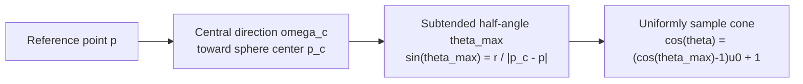

<details>
<summary>Reference / notes</summary>

`Interaction::time` 137 · `IsInf()` 363 · `LengthSquared()` 87 · `MediumInteraction` 141 · `Normalize()` 88 · `SampleUniformCone()` 1018 · `ShapeSample` 268 · `ShapeSample::intr` 268 · `ShapeSample::pdf` 268 · `ShapeSampleContext::p()` 269 · `ShapeSampleContext::time` 268 · `Vector3f` 86

</details>

If the reference point is outside the sphere, it subtends an angle

$$\theta_{\max} = \arcsin\!\frac{r}{|\mathbf p_c-\mathbf p|},$$

where $r$ is the radius and $\mathbf p_c$ the center (Figure 6.5). The sampling method computes $\cos\theta_{\max}$ using Equation (6.4) and samples directions uniformly inside the cone using the approach derived for `SampleUniformCone()` in Section A.5.4: sample an offset $\theta$ from the center vector $\omega_c$ and a rotation angle $\phi$ around it. That function is not used here because some intermediate values are needed below.

**〈Compute quantities related to the theta_max for cone〉 ≡ 282**

```rust
let sin_theta_max = self.radius / distance(ctx.p(), p_center);
let sin2_theta_max = sin_theta_max.sqr();
let cos_theta_max = safe_sqrt(1.0 - sin2_theta_max);
let one_minus_cos_theta_max = 1.0 - cos_theta_max;
```

As shown in Section A.5.4, uniform sampling of $\cos\theta$ between $\cos\theta_{\max}$ and $1$ gives a uniformly sampled direction in the cone.

**〈Compute theta and phi values for sample in cone〉 ≡ 282**

```rust
let mut cos_theta = (cos_theta_max - 1.0) * u[0] + 1.0;
let mut sin2_theta = 1.0 - cos_theta.sqr();
if sin2_theta_max < 0.00068523 /* sin^2(1.5 deg) */ {
    // 〈Compute cone sample via Taylor series expansion for small angles〉
}
```

For very small $\theta_{\max}$, $\cos^2\theta_{\max}$ is close to one and $1-\cos^2\theta_{\max}$ loses accuracy near 1. We use single-term Taylor expansions near zero instead:

**〈Compute cone sample via Taylor series expansion for small angles〉 ≡ 283**

```rust
sin2_theta = sin2_theta_max * u[0];
cos_theta = (1.0 - sin2_theta).sqrt();
one_minus_cos_theta_max = sin2_theta_max / 2.0;
```

Given a sample angle $(\theta,\phi)$, we can directly compute the corresponding point on the sphere. First find the angle $\gamma$ between the vector from the reference point $\mathbf p_r$ to the sampled point $\mathbf p_s$ and the vector from the sphere center $\mathbf p_c$ to $\mathbf p_s$; the setting is shown in Figure 6.6.

*Figure 6.6: Geometric Setting for Computing the Sampled Point on the Sphere Corresponding to a Sampled Angle $\theta$. In the triangle, two side lengths are known: the sphere radius $r$ and $d_c$, the distance from the reference point to the sphere center. One angle, $\theta$, is also known. We first solve for $\gamma$, then find $\cos\alpha$.*

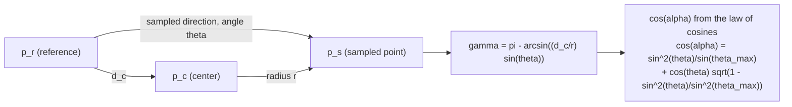

<details>
<summary>Reference / notes</summary>

`Distance()` 93 · `Float` 23 · `SafeSqrt()` 1034 · `ShapeSampleContext::p()` 269 · `Sqr()` 1034

</details>

Denoting by $d_c$ the distance from the reference point to the center, the law of sines gives $\sin\gamma=(d_c/r)\sin\theta$. Because $\gamma$ is obtuse, $\gamma=\pi-\arcsin\big((d_c/r)\sin\theta\big)$. Given two of the three triangle angles, $\alpha$ follows. We avoid expensive inverse trig functions by taking the cosine of both sides, applying the cosine angle-addition formula, and using $\sin\theta_{\max}=r/d_c$, which yields

$$\cos\alpha = \frac{\sin^2\theta}{\sin\theta_{\max}} + \cos\theta\,\sqrt{1-\frac{\sin^2\theta}{\sin^2\theta_{\max}}},$$

with $\sin\alpha=\sqrt{1-\cos^2\alpha}$.

**〈Compute angle alpha from center of sphere to sampled point on surface〉 ≡ 282**

```rust
let cos_alpha = sin2_theta / sin_theta_max
    + cos_theta * safe_sqrt(1.0 - sin2_theta / sin_theta_max.sqr());
let sin_alpha = safe_sqrt(1.0 - cos_alpha.sqr());
```

The angles $\alpha$ and $\phi$ give spherical coordinates for the sampled direction relative to a frame whose $z$ axis points from the sphere center to the reference point. A `Frame` transforms that direction to rendering space; the surface normal is its negation, and the point is the radius-scaled normal translated by the center.

<details>
<summary>Reference / notes</summary>

`Float` 23 · `Frame` 133 · `Frame::FromLocal()` 134 · `Frame::FromZ()` 134 · `Interaction` 136 · `Normal3f` 94 · `Normalize()` 88 · `Pi` 1033 · `Point3f` 92 · `Point3fi` 1061 · `SafeSqrt()` 1034 · `ShapeSample` 268 · `ShapeSampleContext::p()` 269 · `ShapeSampleContext::time` 268 · `Sphere::radius` 272 · `Sphere::reverseOrientation` 272 · `SphericalDirection()` 106 · `Sqr()` 1034 · `Vector3f` 86

</details>

**〈Compute surface normal and sampled point on sphere〉 ≡ 282**

```rust
let phi = u[1] * 2.0 * PI;
let w = spherical_direction(sin_alpha, cos_alpha, phi);
let sampling_frame = Frame::from_z(normalize(p_center - ctx.p()));
let mut n = Normal3f::from(sampling_frame.from_local(-w));
let mut p = p_center + self.radius * Point3f::from(n);
if self.reverse_orientation { n = -n; }
```

The `〈Compute (u, v) coordinates for sampled point on sphere〉` fragment applies the same mapping as `Intersect()` using the object-space sample point, so it is elided. The PDF for uniform cone sampling is

$$p(\omega)=\frac{1}{2\pi(1-\cos\theta_{\max})}.$$

(A derivation is in Section A.5.4.)

**〈Return ShapeSample for sampled point on sphere〉 ≡ 281**

```rust
// 〈Compute pError for sampled point on sphere〉
// 〈Compute (u, v) coordinates for sampled point on sphere〉
Some(ShapeSample {
    intr: Interaction::with_time(Point3fi::new(p, p_error), n, ctx.time, uv),
    pdf: 1.0 / (2.0 * PI * one_minus_cos_theta_max),
})
```

The `PDF()` method for sampling a direction toward a sphere likewise depends on which of the two strategies would be used.

**〈Sphere Public Methods〉 +≡ 271**

```rust
fn pdf(&self, ctx: &ShapeSampleContext, wi: Vector3f) -> Float {
    let p_center = self.render_from_object.apply(Point3f::ZERO);
    let p_origin = ctx.offset_ray_origin_to(p_center);
    if distance_squared(p_origin, p_center) <= self.radius.sqr() {
        // 〈Return solid angle PDF for point inside sphere〉
    }
    // 〈Compute general solid angle sphere PDF〉
}
```

<details>
<summary>Reference / notes</summary>

`AbsDot()` 90 · `DistanceSquared()` 93 · `Float` 23 · `Interaction::n` 137 · `Interaction::p()` 137 · `IsInf()` 363 · `Pi` 1033 · `Point3f` 92 · `Ray` 95 · `SafeSqrt()` 1034 · `ShapeIntersection` 266 · `ShapeIntersection::intr` 266 · `ShapeSampleContext` 268 · `ShapeSampleContext::OffsetRayOrigin()` 383 · `ShapeSampleContext::p()` 269 · `ShapeSampleContext::SpawnRay()` 383 · `Sphere::Area()` 280 · `Sphere::Intersect()` 273 · `Sphere::radius` 272 · `Sphere::renderFromObject` 272 · `Sqr()` 1034 · `Vector3f` 86

</details>

If the reference point is inside the sphere, uniform area sampling would have been used.

**〈Return solid angle PDF for point inside sphere〉 ≡ 285**

```rust
// 〈Intersect sample ray with shape geometry〉
// 〈Compute PDF in solid angle measure from shape intersection point〉
pdf
```

First, the point on the sphere is found by intersecting a ray from the reference point in direction $\omega_i$ with the sphere. This is cheap—a single sphere, not the whole scene.

**〈Intersect sample ray with shape geometry〉 ≡ 285, 291, 324, 345**

```rust
let ray = ctx.spawn_ray(wi);
let isect = self.intersect(&ray, Float::INFINITY)?;
```

The uniform area density $1/A$ is converted to a solid-angle density in the same way as in `Sample()`:

**〈Compute PDF in solid angle measure from shape intersection point〉 ≡ 285, 291, 324**

```rust
let mut pdf = (1.0 / self.area())
    / (abs_dot(isect.intr.n, -wi) / distance_squared(ctx.p(), isect.intr.p()));
if is_inf(pdf) { pdf = 0.0; }
```

The general PDF uses the same trigonometric identities as the sampling routine:

**〈Compute general solid angle sphere PDF〉 ≡ 285**

```rust
let sin2_theta_max = self.radius * self.radius / distance_squared(ctx.p(), p_center);
let cos_theta_max = safe_sqrt(1.0 - sin2_theta_max);
let mut one_minus_cos_theta_max = 1.0 - cos_theta_max;
// 〈Compute more accurate oneMinusCosThetaMax for small solid angle〉
1.0 / (2.0 * PI * one_minus_cos_theta_max)
```

For a small subtended solid angle, `cosThetaMax` is close to one and `oneMinusCosThetaMax` is inaccurate; we switch to the one-term Taylor approximation $1-\cos\theta\approx\tfrac12\sin^2\theta$, which is accurate near zero.

**〈Compute more accurate oneMinusCosThetaMax for small solid angle〉 ≡ 285**

```rust
if sin2_theta_max < 0.00068523 /* sin^2(1.5 deg) */ {
    one_minus_cos_theta_max = sin2_theta_max / 2.0;
}
```

## 6.3 Cylinders

Another useful quadric is the cylinder. pbrt provides a `Cylinder` shape centered on the $z$ axis; the user supplies minimum and maximum $z$ values, a radius, and a maximum $\phi$ sweep (Figure 6.7).

*Figure 6.7: Basic Setting for the Cylinder Shape. The cylinder has radius $r$ and covers a range along the $z$ axis. A partial cylinder sweeps $\phi\in[0,\phi_{\max}]$.*

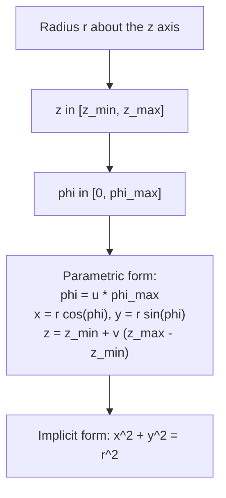

**〈Cylinder Definition〉 ≡**

```rust
struct Cylinder {
    // 〈Cylinder Public Methods〉
    // 〈Cylinder Private Members〉
}
```

In parametric form a cylinder is described by

$$\phi = u\,\phi_{\max},\qquad x = r\cos\phi,\qquad y = r\sin\phi,\qquad z = z_{\min} + v\,(z_{\max}-z_{\min}).$$

*Figure 6.8 shows a rendered image of two cylinders. Like the sphere image, the right cylinder is complete while the left one is partial, with $\phi_{\max}<2\pi$.*

<details>
<summary>Reference / notes</summary>

`Cylinder` 286 · `Shape` 261 · `Sphere` 271

</details>

*Figure 6.8: Two Cylinders. A partial cylinder is on the left and a complete cylinder on the right.*

<details>
<summary>Figure 6.8 — pictorial image (keep)</summary>


</details>

Like the `Sphere` constructor, the `Cylinder` constructor takes transformations defining its object space and the parameters defining the cylinder. It merely initializes member variables, so we omit it here.

**〈Cylinder Public Methods〉 ≡ 286**

```rust
impl Cylinder {
    fn new(
        render_from_obj: &Transform,
        obj_from_render: &Transform,
        reverse_orientation: bool,
        radius: Float,
        z_min: Float,
        z_max: Float,
        phi_max: Float,
    ) -> Self;
}
```

**〈Cylinder Private Members〉 ≡ 286**

```rust
struct Cylinder {
    render_from_object: Transform,
    object_from_render: Transform,
    reverse_orientation: bool,
    transform_swaps_handedness: bool,
    radius: Float,
    z_min: Float,
    z_max: Float,
    phi_max: Float,
}
```

### 6.3.1 Area and Bounding

A cylinder is a rolled-up rectangle. Unrolled, its height is $z_{\max}-z_{\min}$ and its width is $r\phi_{\max}$:

**〈Cylinder Public Methods〉 +≡ 286**

```rust
fn area(&self) -> Float { (self.z_max - self.z_min) * self.radius * self.phi_max }
```

As with the sphere, the spatial bound is conservative: it uses the $z$ range but does not account for $\phi_{\max}$.

**〈Cylinder Method Definitions〉 ≡**

```rust
fn bounds(&self) -> Bounds3f {
    self.render_from_object.apply(Bounds3f::new(
        Point3f::new(-self.radius, -self.radius, self.z_min),
        Point3f::new( self.radius,  self.radius, self.z_max),
    ))
}
```

<details>
<summary>Reference / notes</summary>

`Bounds3f` 97 · `Cylinder` 286 · `Cylinder::phiMax` 287 · `Cylinder::radius` 287 · `Cylinder::renderFromObject` 287 · `Cylinder::zMax` 287 · `Cylinder::zMin` 287 · `DirectionCone` 114 · `DirectionCone::EntireSphere()` 115 · `Float` 23 · `Transform` 120

</details>

The normal bound is conservative in two ways: it ignores $\phi_{\max}<2\pi$, and the actual set of cylinder normals is a circle on the sphere of directions, which `DirectionCone` cannot bound more tightly than the entire sphere.

**〈Cylinder Public Methods〉 +≡ 286**

```rust
fn normal_bounds(&self) -> DirectionCone { DirectionCone::entire_sphere() }
```

### 6.3.2 Intersection Tests

As with the sphere, `Cylinder` provides `BasicIntersect()` returning a `QuadricIntersection` and `InteractionFromIntersection()` converting it to a full `SurfaceInteraction`; `Intersect()` composes them. (Had pbrt used virtual functions, an alternative design would be a `QuadricShape` base class providing a default `Intersect()` and leaving the two pieces as pure virtual functions for subclasses.)

**〈Cylinder Public Methods〉 +≡ 286**

```rust
fn intersect(&self, ray: &Ray, t_max: Float) -> Option<ShapeIntersection> {
    let isect = self.basic_intersect(ray, t_max)?;
    let intr = self.interaction_from_intersection(&isect, -ray.d, ray.time);
    Some(ShapeIntersection { intr, t_hit: isect.t_hit })
}
```

`BasicIntersect()` parallels the sphere's: compute quadratic coefficients, solve, then handle partial-cylinder cases. Several fragments are reused from `Sphere`.

**〈Cylinder Public Methods〉 +≡ 286**

```rust
fn basic_intersect(&self, r: &Ray, t_max: Float) -> Option<QuadricIntersection> {
    let phi: Float;
    let mut p_hit: Point3f;
    // 〈Transform Ray origin and direction to object space 273〉
    // 〈Solve quadratic equation to find cylinder t0 and t1 values 288〉
    // 〈Check quadric shape t0 and t1 for nearest intersection 275〉
    // 〈Compute cylinder hit point and phi 289〉
    // 〈Test cylinder intersection against clipping parameters 289〉
    // 〈Return QuadricIntersection for cylinder intersection 289〉
}
```

<details>
<summary>Reference / notes</summary>

`Cylinder::BasicIntersect()` 288 · `Cylinder::InteractionFromIntersection()` 290 · `Float` 23 · `Infinity` 361 · `Interval` 1057 · `Point3f` 92 · `QuadricIntersection` 273 · `QuadricIntersection::tHit` 273 · `Ray` 95 · `Ray::d` 95 · `Ray::time` 95 · `ShapeIntersection` 266 · `Sphere` 271 · `SurfaceInteraction` 138

</details>

The discriminant fragment, `〈Compute cylinder quadratic discriminant discrim〉`, is defined in Section 6.8.3 after floating-point accuracy has been discussed.

**〈Solve quadratic equation to find cylinder t0 and t1 values〉 ≡ 288**

```rust
let (mut t0, mut t1): (Interval, Interval);
// 〈Compute cylinder quadratic coefficients 289〉
// 〈Compute cylinder quadratic discriminant discrim 372〉
// 〈Compute quadratic t values 275〉
```

As with spheres, the formula comes from substituting the ray equation into the cylinder's implicit equation. An infinitely long cylinder of radius $r$ on the $z$ axis satisfies $x^2+y^2-r^2=0$, so

$$(o_x+t d_x)^2 + (o_y+t d_y)^2 = r^2,$$

and the coefficients of $a t^2+bt+c=0$ are

$$a=d_x^2+d_y^2,\qquad b=2(d_x o_x + d_y o_y),\qquad c=o_x^2+o_y^2-r^2.$$

**〈Compute cylinder quadratic coefficients〉 ≡ 288**

```rust
let a = di.x.sqr() + di.y.sqr();
let b = 2.0 * (di.x * oi.x + di.y * oi.y);
let c = oi.x.sqr() + oi.y.sqr() - Interval::from(self.radius).sqr();
```

As with spheres, the hit point is refined to reduce rounding error (Section 6.8.5); then we invert the parametric description to compute $\phi$ from $x$ and $y$, which gives the same expression as for the sphere.

**〈Compute cylinder hit point and phi〉 ≡ 288, 289**

```rust
p_hit = Point3f::from(oi) + t_shape_hit.to_float() * Vector3f::from(di);
// 〈Refine cylinder intersection point 375〉
phi = p_hit.y.atan2(p_hit.x);
if phi < 0.0 { phi += 2.0 * PI; }
```

The next step verifies the hit lies in the $z$ range and that $\phi$ is acceptable. If not, it rejects the hit and checks $t_1$ if it has not already been considered; the logic resembles `Sphere::Intersect()`.

**〈Test cylinder intersection against clipping parameters〉 ≡ 288**

```rust
if p_hit.z < self.z_min || p_hit.z > self.z_max || phi > self.phi_max {
    if t_shape_hit == t1 { return None; }
    t_shape_hit = t1;
    if t1.upper_bound() > t_max { return None; }
    // 〈Compute cylinder hit point and phi 289〉
    if p_hit.z < self.z_min || p_hit.z > self.z_max || phi > self.phi_max {
        return None;
    }
}
```

<details>
<summary>Reference / notes</summary>

`Cylinder::BasicIntersect()` 288 · `Cylinder::phiMax` 287 · `Cylinder::zMax` 287 · `Cylinder::zMin` 287 · `Float` 23 · `Infinity` 361 · `Interval` 1057 · `Interval::UpperBound()` 1059 · `Pi` 1033 · `Point3f` 92 · `QuadricIntersection` 273 · `Ray` 95 · `Sphere::Intersect()` 273 · `Sqr()` 1034 · `SurfaceInteraction` 138 · `Vector3f` 86

</details>

For a successful intersection the same three values suffice for later construction of the `SurfaceInteraction`:

**〈Return QuadricIntersection for cylinder intersection〉 ≡ 288**

```rust
Some(QuadricIntersection { t_hit: t_shape_hit.to_float(), p_obj: p_hit, phi })
```

As with the sphere, `IntersectP()` wraps `BasicIntersect()`:

**〈Cylinder Public Methods〉 +≡**

```rust
fn intersect_p(&self, r: &Ray, t_max: Float) -> bool {
    self.basic_intersect(r, t_max).is_some()
}
```

`InteractionFromIntersection()` computes everything needed to initialize a `SurfaceInteraction` from a cylinder's `QuadricIntersection`.

**〈Cylinder Public Methods〉 +≡ 286**

```rust
fn interaction_from_intersection(
    &self,
    isect: &QuadricIntersection,
    wo: Vector3f,
    time: Float,
) -> SurfaceInteraction {
    let p_hit = isect.p_obj;
    let phi = isect.phi;
    // 〈Find parametric representation of cylinder hit 290〉
    // 〈Compute error bounds for cylinder intersection 375〉
    // 〈Return SurfaceInteraction for quadric intersection 279〉
}
```

Again, $u$ is computed by scaling $\phi$ into $[0,1]$ and $v$ by inverting the parametric $z$ equation:

**〈Find parametric representation of cylinder hit〉 ≡ 290**

```rust
let u = phi / self.phi_max;
let v = (p_hit.z - self.z_min) / (self.z_max - self.z_min);
// 〈Compute cylinder dpdu and dpdv 290〉
// 〈Compute cylinder dndu and dndv 290〉
```

The partial derivatives are easy to derive from the parametric form:

**〈Compute cylinder dpdu and dpdv〉 ≡ 290**

```rust
let dpdu = Vector3f::new(-self.phi_max * p_hit.y, self.phi_max * p_hit.x, 0.0);
let dpdv = Vector3f::new(0.0, 0.0, self.z_max - self.z_min);
```

We again use the Weingarten equations for the normal derivatives. The relevant second derivatives are

$$\frac{\partial^2\mathbf p}{\partial u^2}=-\phi_{\max}^2(x,y,0), \qquad \frac{\partial^2\mathbf p}{\partial u\,\partial v}=\mathbf 0, \qquad \frac{\partial^2\mathbf p}{\partial v^2}=\mathbf 0.$$

**〈Compute cylinder dndu and dndv〉 ≡ 290**

```rust
let d2_pduu = -self.phi_max.powi(2) * Vector3f::new(p_hit.x, p_hit.y, 0.0);
let d2_pduv = Vector3f::ZERO;
let d2_pdvv = Vector3f::ZERO;
// 〈Compute coefficients for fundamental forms 279〉
// 〈Compute dndu and dndv from fundamental form coefficients 279〉
```

<details>
<summary>Reference / notes</summary>

`Cylinder::phiMax` 287 · `Cylinder::zMax` 287 · `Cylinder::zMin` 287 · `Float` 23 · `Point3f` 92 · `QuadricIntersection` 273 · `QuadricIntersection::phi` 273 · `QuadricIntersection::pObj` 273 · `SurfaceInteraction` 138 · `Vector3f` 86

</details>

### 6.3.3 Sampling

Uniformly sampling a cylinder's surface area is straightforward: uniform sampling of height and $\phi$ gives uniform area sampling. Intuitively this works because a cylinder is just a rolled-up rectangle.

**〈Cylinder Public Methods〉 +≡ 286**

```rust
fn sample(&self, u: Point2f) -> Option<ShapeSample> {
    let z = lerp(u[0], self.z_min, self.z_max);
    let phi = u[1] * self.phi_max;
    // 〈Compute cylinder sample position pi and normal n from z and phi〉
    let uv = Point2f::new(phi / self.phi_max, (p_obj.z - self.z_min) / (self.z_max - self.z_min));
    Some(ShapeSample { intr: Interaction::new(pi, n, uv), pdf: 1.0 / self.area() })
}
```

Given $z$ and $\phi$, the object-space position and normal follow directly:

**〈Compute cylinder sample position pi and normal n from z and phi〉 ≡ 291**

```rust
let p_obj = Point3f::new(self.radius * phi.cos(), self.radius * phi.sin(), z);
// 〈Reproject pObj to cylinder surface and compute pObjError 376〉
let pi = self.render_from_object.apply(Point3fi::new(p_obj, p_obj_error));
let mut n = normalize(self.render_from_object.apply(
    Normal3f::new(p_obj.x, p_obj.y, 0.0)));
if self.reverse_orientation { n = -n; }
```

**〈Cylinder Public Methods〉 +≡ 286**

```rust
fn pdf(&self, _intr: &Interaction) -> Float { 1.0 / self.area() }
```

Unlike `Sphere`, pbrt's `Cylinder` has no specialized solid-angle sampling method. Instead it samples a point uniformly by area without using the reference point, then converts the area density to a solid-angle density before returning. Both methods reuse the fragments used for solid-angle sampling of reference points inside spheres.

**〈Cylinder Public Methods〉 +≡ 286**

```rust
fn sample(&self, ctx: &ShapeSampleContext, u: Point2f) -> Option<ShapeSample> {
    // 〈Sample shape by area and compute incident direction wi 282〉
    // 〈Convert area sampling PDF in ss to solid angle measure 282〉
    ss
}

fn pdf(&self, ctx: &ShapeSampleContext, wi: Vector3f) -> Float {
    // 〈Intersect sample ray with shape geometry 285〉
    // 〈Compute PDF in solid angle measure from shape intersection point 285〉
    pdf
}
```

<details>
<summary>Reference / notes</summary>

`Cylinder::Area()` 287 · `Cylinder::phiMax` 287 · `Cylinder::radius` 287 · `Cylinder::reverseOrientation` 287 · `Cylinder::Sample()` 291 · `Cylinder::zMax` 287 · `Cylinder::zMin` 287 · `Disk` 292 · `Float` 23 · `Interaction` 136 · `Lerp()` 72 · `Normal3f` 94 · `Point2f` 92 · `Point3f` 92 · `Point3fi` 1061 · `ShapeSample` 268 · `ShapeSampleContext` 268 · `Sphere` 271 · `Vector3f` 86

</details>

## 6.4 Disks

The disk is an interesting quadric because its intersection routine is particularly straightforward—it avoids solving the quadratic equation entirely. In pbrt a `Disk` is a circular disk of radius $r$ at height $h$ along the $z$ axis.

*Figure 6.9: Basic Setting for the Disk Shape. The disk has radius $r$ and lies at height $h$ along the $z$ axis. A partial disk is described by a maximum $\phi$ value and an inner radius $r_i$.*

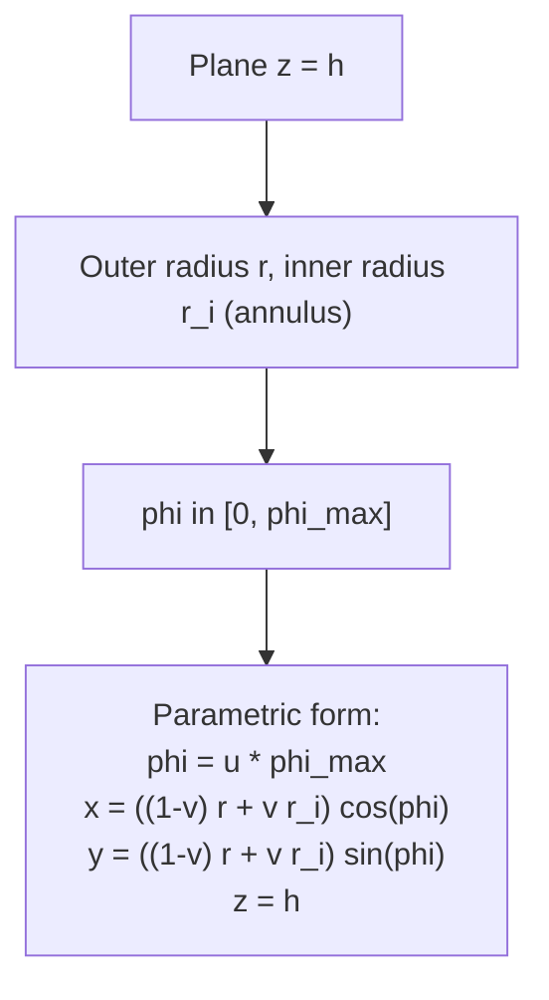

To describe partial disks, the user may specify a maximum $\phi$ beyond which the disk is cut off. The disk can also be generalized to an annulus with an inner radius $r_i$. In parametric form,

$$\phi=u\,\phi_{\max},\qquad x=\big((1-v)r+v r_i\big)\cos\phi,\qquad y=\big((1-v)r+v r_i\big)\sin\phi,\qquad z=h.$$

*Figure 6.10 is a rendered image of two disks.*

<details>
<summary>Reference / notes</summary>

`Cylinder::Intersect()` 288 · `Disk` 292 · `QuadricIntersection` 273 · `Sphere::Intersect()` 273

</details>

*Figure 6.10: Two Disks. A partial disk is on the left and a complete disk on the right.*

<details>
<summary>Figure 6.10 — pictorial image (keep)</summary>


</details>

**〈Disk Definition〉 ≡**

```rust
struct Disk {
    // 〈Disk Public Methods〉
    // 〈Disk Private Members〉
}
```

The `Disk` constructor directly initializes its member variables from the values passed to it; we omit it because it is trivial.

**〈Disk Private Members〉 ≡ 292**

```rust
struct Disk {
    render_from_object: Transform,
    object_from_render: Transform,
    reverse_orientation: bool,
    transform_swaps_handedness: bool,
    height: Float,
    radius: Float,
    inner_radius: Float,
    phi_max: Float,
}
```

### 6.4.1 Area and Bounding

Disks have easily computed surface area, since they are portions of an annulus:

**〈Disk Public Methods〉 ≡ 292**

```rust
fn area(&self) -> Float {
    self.phi_max * 0.5 * (self.radius.sqr() - self.inner_radius.sqr())
}
```

The bounding method is straightforward: a box centered at the disk's height in $z$, extending to $\pm r$ in $x$ and $y$.

**〈Disk Method Definitions〉 ≡**

```rust
fn bounds(&self) -> Bounds3f {
    self.render_from_object.apply(Bounds3f::new(
        Point3f::new(-self.radius, -self.radius, self.height),
        Point3f::new( self.radius,  self.radius, self.height),
    ))
}
```

A disk has a single surface normal.

**〈Disk Method Definitions〉 +≡**

```rust
fn normal_bounds(&self) -> DirectionCone {
    let mut n = self.render_from_object.apply(Normal3f::new(0.0, 0.0, 1.0));
    if self.reverse_orientation { n = -n; }
    DirectionCone::new(Vector3f::from(n))
}
```

<details>
<summary>Reference / notes</summary>

`Bounds3f` 97 · `Cylinder::Intersect()` 288 · `DirectionCone` 114 · `Disk::height` 293 · `Disk::innerRadius` 293 · `Disk::phiMax` 293 · `Disk::radius` 293 · `Disk::renderFromObject` 293 · `Disk::reverseOrientation` 293 · `Float` 23 · `Normal3f` 94 · `Point3f` 92 · `QuadricIntersection` 273 · `Ray` 95 · `Sphere::Intersect()` 273 · `Sqr()` 1034 · `Transform` 120 · `Vector3f` 86

</details>

### 6.4.2 Intersection Tests

The `Disk` methods follow the same form as the earlier quadrics. We omit `Intersect()`, which is identical to `Sphere::Intersect()` and `Cylinder::Intersect()` with calls to `BasicIntersect()` and then `InteractionFromIntersection()`.

The basic test is easy: find where the ray intersects the plane $z=h$ containing the disk, then check whether that point lies inside the disk.

**〈Disk Public Methods〉 +≡ 292**

```rust
fn basic_intersect(&self, r: &Ray, t_max: Float) -> Option<QuadricIntersection> {
    let phi: Float;
    // 〈Transform Ray origin and direction to object space 273〉
    // 〈Compute plane intersection for disk 294〉
    // 〈See if hit point is inside disk radii and phi_max 294〉
    // 〈Return QuadricIntersection for disk intersection 295〉
}
```

We want $t$ such that the $z$ component of the ray's position equals the disk's height:

$$h = o_z + t\,d_z \quad\Longrightarrow\quad t = \frac{h-o_z}{d_z}.$$

The method computes $t$ and checks it lies in $(0,t_{\max})$; otherwise there is no intersection.

**〈Compute plane intersection for disk〉 ≡ 293**

```rust
// 〈Reject disk intersections for rays parallel to the disk's plane 294〉
let t_shape_hit = (self.height - oi.z.to_float()) / di.z.to_float();
if t_shape_hit <= 0.0 || t_shape_hit >= t_max { return None; }
```

If the ray is parallel to the disk's plane ($d_z=0$), no intersection is reported. The case of a ray lying *in* the plane is ambiguous, but it is most reasonable to define an edge-on hit as "no intersection". This must be handled explicitly so the code below does not generate NaN.

**〈Reject disk intersections for rays parallel to the disk's plane〉 ≡ 294**

```rust
if di.z.to_float() == 0.0 { return None; }
```

Next the point $\mathbf p_{\mathrm{hit}}$ where the ray meets the plane is computed. An invalid intersection is returned if its distance from the disk center exceeds `Disk::radius` or is less than `Disk::innerRadius`. This check is optimized by computing the squared distance to the center: the center's $x$ and $y$ are zero and `pHit.z` equals the height.

**〈See if hit point is inside disk radii and phi_max〉 ≡ 293**

```rust
let p_hit = Point3f::from(oi) + t_shape_hit * Vector3f::from(di);
let dist2 = p_hit.x.sqr() + p_hit.y.sqr();
if dist2 > self.radius.sqr() || dist2 < self.inner_radius.sqr() { return None; }
// 〈Test disk phi value against phi_max 294〉
```

If the distance check passes, a final test ensures $\phi\in[0,\phi_{\max}]$. Inverting the disk's parameterization gives the same expression for $\phi$ as the other quadrics. Because a ray can hit a disk only once, there is no need to consider a second intersection if this test fails.

<details>
<summary>Reference / notes</summary>

`Disk::height` 293 · `Disk::innerRadius` 293 · `Disk::phiMax` 293 · `Disk::radius` 293 · `Float` 23 · `Pi` 1033 · `Point3f` 92 · `Sqr()` 1034 · `Vector3f` 86

</details>

**〈Test disk phi value against phi_max〉 ≡ 294**

```rust
let mut phi = p_hit.y.atan2(p_hit.x);
if phi < 0.0 { phi += 2.0 * PI; }
if phi > self.phi_max { return None; }
```

**〈Return QuadricIntersection for disk intersection〉 ≡ 293**

```rust
Some(QuadricIntersection { t_hit: t_shape_hit, p_obj: p_hit, phi })
```

Finding the `SurfaceInteraction` for a disk intersection follows the same process of inverting the parametric representation seen before.

**〈Disk Public Methods〉 +≡ 292**

```rust
fn interaction_from_intersection(
    &self,
    isect: &QuadricIntersection,
    wo: Vector3f,
    time: Float,
) -> SurfaceInteraction {
    let p_hit = isect.p_obj;
    let phi = isect.phi;
    // 〈Find parametric representation of disk hit 295〉
    // 〈Refine disk intersection point 375〉
    // 〈Compute error bounds for disk intersection 376〉
    // 〈Return SurfaceInteraction for quadric intersection 279〉
}
```

The parameter $u$ is scaled to reflect the partial disk specified by $\phi_{\max}$; $v$ is computed by inverting the parametric equation. The partial derivatives at the hit point are derived as for the previous quadrics. Because a disk's normal is the same everywhere, $\partial\mathbf n/\partial u$ and $\partial\mathbf n/\partial v$ are both trivially $(0,0,0)$, and

$$\frac{\partial\mathbf p}{\partial u}=\phi_{\max}(-y,x,0),\qquad \frac{\partial\mathbf p}{\partial v}=\frac{(r_i-r)}{r_{\mathrm{hit}}}(x,y,0), \quad r_{\mathrm{hit}}=\sqrt{x^2+y^2}.$$

**〈Find parametric representation of disk hit〉 ≡ 295**

```rust
let u = phi / self.phi_max;
let r_hit = (p_hit.x.sqr() + p_hit.y.sqr()).sqrt();
let v = (self.radius - r_hit) / (self.radius - self.inner_radius);
let dpdu = Vector3f::new(-self.phi_max * p_hit.y, self.phi_max * p_hit.x, 0.0);
let dpdv = Vector3f::new(p_hit.x, p_hit.y, 0.0) * (self.inner_radius - self.radius) / r_hit;
let dndu = Normal3f::ZERO;
let dndv = Normal3f::ZERO;
```

As usual, `IntersectP()` is straightforward:

**〈Disk Public Methods〉 +≡ 292**

```rust
fn intersect_p(&self, r: &Ray, t_max: Float) -> bool {
    self.basic_intersect(r, t_max).is_some()
}
```

<details>
<summary>Reference / notes</summary>

`Disk` 292 · `Disk::Area()` 293 · `Disk::BasicIntersect()` 293 · `Disk::height` 293 · `Disk::innerRadius` 293 · `Disk::phiMax` 293 · `Disk::radius` 293 · `Disk::renderFromObject` 293 · `Disk::reverseOrientation` 293 · `Disk::Sample()` 295 · `Float` 23 · `Infinity` 361 · `Interaction` 136 · `Normal3f` 94 · `Normalize()` 88 · `Point2f` 92 · `Point3f` 92 · `Point3fi` 1061 · `QuadricIntersection` 273 · `Ray` 95 · `SampleUniformDiskConcentric()` 1014 · `ShapeSample` 268 · `Sqr()` 1034 · `SurfaceInteraction` 138 · `Vector3f` 86

</details>

### 6.4.3 Sampling

The `Disk` area-sampling method uses the utility `SampleUniformDiskConcentric()`, which uniformly samples a unit disk (Section A.5.1). The returned point is scaled by the radius and offset in $z$ to lie on the disk of given radius and height. Note that our implementation here does *not* account for partial disks due to a nonzero `Disk::innerRadius` or `Disk::phiMax<2\pi`; fixing this bug is left as an exercise.

**〈Disk Public Methods〉 +≡ 292**

```rust
fn sample(&self, u: Point2f) -> Option<ShapeSample> {
    let pd = sample_uniform_disk_concentric(u);
    let p_obj = Point3f::new(pd.x * self.radius, pd.y * self.radius, self.height);
    let pi = self.render_from_object.apply(Point3fi::from(p_obj));
    let mut n = normalize(self.render_from_object.apply(Normal3f::new(0.0, 0.0, 1.0)));
    if self.reverse_orientation { n = -n; }
    // 〈Compute (u, v) for sampled point on disk 296〉
    Some(ShapeSample { intr: Interaction::new(pi, n, uv), pdf: 1.0 / self.area() })
}
```

The same computation as in `Intersect()` gives the parametric $(u,v)$ for the sampled point:

**〈Compute (u, v) for sampled point on disk〉 ≡ 295**

```rust
let mut phi = pd.y.atan2(pd.x);
if phi < 0.0 { phi += 2.0 * PI; }
let radius_sample = (p_obj.x.sqr() + p_obj.y.sqr()).sqrt();
let uv = Point2f::new(phi / self.phi_max,
                      (self.radius - radius_sample) / (self.radius - self.inner_radius));
```

**〈Disk Public Methods〉 +≡ 292**

```rust
fn pdf(&self, _intr: &Interaction) -> Float { 1.0 / self.area() }
```

We do not provide a specialized solid-angle sampling method for disks; we follow the same approach as for cylinders—sample uniformly by area and then compute the probability density with respect to solid angle. Those implementations are not included here because they are the same as for cylinders.

## 6.5 Triangle Meshes

The triangle is one of the most commonly used shapes in computer graphics; complex scenes may use millions of triangles to achieve great detail (Figure 6.11 shows a mesh of over four million triangles). A natural representation would be a `Triangle` shape storing its three vertex positions, but a more memory-efficient representation stores whole meshes as an array of vertex positions, with each triangle storing three offsets into that array.

To see why, consider the Euler–Poincaré formula, relating vertices $V$, edges $E$, and faces $F$ of a closed discrete mesh:

$$V-E+F = 2(1-g),$$

where $g\in\mathbb N$ is the genus, usually a small number interpreted as the number of "handles" in the mesh (analogous to a teacup handle). On a triangle mesh the numbers of edges and vertices are further related by

$$2E = 3F.$$

This follows by dividing each edge into two half-edges associated with the two adjacent triangles: there are $3F$ half-edges, and colocated pairs constitute the $E$ mesh edges. For large closed meshes the genus becomes negligible, so combining the two equations with $g=0$ gives $F\approx 2V$.

In other words, there are about twice as many faces as vertices. Since each face references three vertices, each vertex is referenced about six times on average. With shared vertices the amortized storage per triangle is 12 bytes for the three 32-bit integer offsets plus half of a vertex's storage—6 bytes, assuming three 4-byte floats—for **18 bytes per triangle**, much better than the 36 bytes required to store three positions directly. The savings are even greater when meshes carry per-vertex normals or texture coordinates.

*Figure 6.11: Ganesha Model. This triangle mesh contains over four million individual triangles, created from a real statue with a structured-light 3D scanner.*

<details>
<summary>Figure 6.11 — pictorial image (keep)</summary>


</details>

### 6.5.1 Mesh Representation and Storage

pbrt uses `TriangleMesh` to store the shared information about a mesh, defined in `util/mesh.rs`.

**〈TriangleMesh Definition〉 ≡**

```rust
struct TriangleMesh {
    // 〈TriangleMesh Public Methods〉
    // 〈TriangleMesh Public Members〉
}
```

In addition to vertex positions and indices, per-vertex normals $\mathbf n$, tangent vectors $\mathbf s$, and texture coordinates $\mathbf{uv}$ may be provided. The corresponding vectors should be empty if there are no such values, or have the same size as $\mathbf p$ otherwise.

<details>
<summary>Reference / notes</summary>

`TriangleMesh` 297

</details>

**〈TriangleMesh Method Definitions〉 ≡**

```rust
impl TriangleMesh {
    fn new(
        render_from_object: &Transform,
        reverse_orientation: bool,
        indices: Vec<i32>,
        mut p: Vec<Point3f>,
        s: Vec<Vector3f>,
        n: Vec<Normal3f>,
        uv: Vec<Point2f>,
        face_indices: Vec<i32>,
        alloc: Allocator,
    ) -> Self {
        let n_triangles = indices.len() / 3;
        let n_vertices = p.len();
        // 〈Initialize mesh vertexIndices 298〉
        // 〈Transform mesh vertices to rendering space and initialize mesh p 301〉
        // 〈Remainder of TriangleMesh constructor〉
    }
}
```

The mesh data is exposed through public member variables; as with point coordinates or ray directions, information hiding offers little benefit here.

**〈TriangleMesh Public Members〉 ≡ 297**

```rust
struct TriangleMesh {
    n_triangles: usize,
    n_vertices: usize,
    vertex_indices: &'static [i32],
    p: &'static [Point3f],
    // 〈additional per-vertex buffers + orientation flags〉
}
```

Although the constructor takes `Vec` parameters, `TriangleMesh` stores plain slices pointing to its data arrays. `vertex_indices` holds $3\,n_{\mathrm{triangles}}$ values, and each per-vertex slice, if present, holds $n_{\mathrm{vertices}}$ values.

This design lets different meshes point to the same arrays when given identical values for some or all parameters. pbrt supports object instancing via `TransformedPrimitive` (Section 7.1.2), but scenes do not always exploit it: for the landscape scene in Figures 5.11 and 7.2, over 400 MB is saved by detecting redundant arrays.

`BufferCache` stores a single unique copy of each buffer. Its `LookupOrAdd()` takes a slice of the managed type and returns a pointer to memory holding the same values.

**〈Initialize mesh vertexIndices〉 ≡ 298**

```rust
self.vertex_indices = int_buffer_cache.lookup_or_add(&indices, alloc);
```

<details>
<summary>Reference / notes</summary>

`Allocator` 40 · `BufferCache` 299 · `BufferCache::LookupOrAdd()` 300 · `intBufferCache` 298 · `Normal3f` 94 · `Point2f` 92 · `Point3f` 92 · `Transform` 120 · `TransformedPrimitive` 403 · `TriangleMesh` 297 · `TriangleMesh::vertexIndices` 298 · `Vector3f` 86

</details>

The buffer caches are global variables in the pbrt namespace; additional ones handle normals, tangents, and texture coordinates.

**〈BufferCache Global Declarations〉 ≡**

```rust
static mut INT_BUFFER_CACHE: Option<BufferCache<i32>> = None;
static mut POINT3_BUFFER_CACHE: Option<BufferCache<Point3f>> = None;
```

`BufferCache` is generic over the array element type:

**〈BufferCache Definition〉 ≡**

```rust
struct BufferCache<T> {
    // 〈BufferCache Public Methods〉
    // 〈BufferCache::Buffer Definition〉
    // 〈BufferCache::BufferHasher Definition〉
    // 〈BufferCache Private Members〉
}
```

`BufferCache` allows concurrent use by multiple threads so meshes can be added in parallel (Appendix C). A single mutex would serialize all access, so the cache is split into 64 independent shards, each with its own mutex, allowing different threads to access different shards concurrently.

**〈BufferCache Private Members〉 ≡ 299**

```rust
const LOG_SHARDS: u32 = 6;
const N_SHARDS: usize = 1 << LOG_SHARDS;
mutex: [RwLock<()>; N_SHARDS],
cache: [HashSet<Buffer<T>, BufferHasher>; N_SHARDS],
```

`Buffer` is a small helper wrapping an allocation managed by the cache.

**〈BufferCache::Buffer Definition〉 ≡ 299**

```rust
struct Buffer<T> {
    // 〈BufferCache::Buffer Public Methods〉
    ptr: *const T,
    size: usize,
    hash: u64,
}
```

Its constructor computes the buffer's hash, stored in a member variable.

**〈BufferCache::Buffer Public Methods〉 ≡ 299**

```rust
impl<T> Buffer<T> {
    fn new(ptr: *const T, size: usize) -> Self {
        Self { ptr, size, hash: hash_buffer(ptr, size) }
    }
}
```

An equality operator, required by the hash set, returns true only if both buffers have the same size and contents:

**〈BufferCache::Buffer Public Methods〉 +≡ 299**

```rust
fn eq(&self, b: &Self) -> bool {
    self.size == b.size && self.hash == b.hash
        && unsafe { slice::from_raw_parts(self.ptr, self.size)
                 == slice::from_raw_parts(b.ptr, b.size) }
}
```

<details>
<summary>Reference / notes</summary>

`BufferCache::Buffer::hash` 299 · `BufferCache::Buffer::ptr` 299 · `BufferCache::Buffer::size` 299 · `BufferCache::logShards` 299 · `BufferCache::nShards` 299 · `HashBuffer()` 1042

</details>

`BufferHasher` is another helper class, used by the hash set; it returns the buffer's already-computed hash.

**〈BufferCache::BufferHasher Definition〉 ≡ 299**

```rust
struct BufferHasher;
impl<T> Hash for Buffer<T> {
    fn hash<H: Hasher>(&self, state: &mut H) { self.hash.hash(state); }
}
```

`LookupOrAdd()` checks whether the provided buffer's values are already cached and returns a pointer to them if so; otherwise it allocates memory and copies the values in.

**〈BufferCache Public Methods〉 ≡ 299**

```rust
fn lookup_or_add(&self, buf: &[T], alloc: Allocator) -> &'static [T] {
    // 〈Return pointer to data if buf contents are already in the cache 300〉
    // 〈Add buf contents to cache and return pointer to cached copy 300〉
}
```

The slice's contents are wrapped in a `Buffer` to search the cache. The buffer's pointer is returned if present. Because the cache is only read here, a shared (read) lock is used, allowing multiple threads to read the hash table concurrently.

**〈Return pointer to data if buf contents are already in the cache〉 ≡ 300**

```rust
let lookup_buffer = Buffer::new(buf.as_ptr(), buf.len());
let shard_index = (lookup_buffer.hash as u32) >> (32 - LOG_SHARDS);
{
    let guard = self.mutex[shard_index].read().unwrap();
    if let Some(entry) = self.cache[shard_index].get(&lookup_buffer) {
        return unsafe { slice::from_raw_parts(entry.ptr, entry.size) };
    }
}
```

Otherwise memory is allocated, values copied, and the `Buffer` added to the cache. An exclusive lock is needed to modify the cache; the shared lock is released before acquiring it.

**〈Add buf contents to cache and return pointer to cached copy〉 ≡ 300**

```rust
let ptr = alloc.allocate_slice(buf.len());
ptr.copy_from_slice(buf);
let mut guard = self.mutex[shard_index].write().unwrap();
// 〈Handle the case of another thread adding the buffer first 301〉
self.cache[shard_index].insert(Buffer::new(ptr.as_ptr(), buf.len()));
drop(guard);
ptr
```

<details>
<summary>Reference / notes</summary>

`Allocator` 40 · `BufferCache::Buffer::hash` 299 · `BufferCache::cache` 299 · `BufferCache::mutex` 299 · `std::pmr::polymorphic_allocator::allocate_object()` 41

</details>

Another thread may have added the buffer first; in that rare case we return the already-added pointer and release the memory allocated by this thread.

**〈Handle the case of another thread adding the buffer first〉 ≡ 300**

```rust
if let Some(entry) = self.cache[shard_index].get(&lookup_buffer) {
    let cached = unsafe { slice::from_raw_parts(entry.ptr, entry.size) };
    drop(guard);
    alloc.deallocate_slice(ptr);
    return cached;
}
```

Returning to the `TriangleMesh` constructor, the vertex positions are processed next. Unlike the other shapes—which leave their description in object space and transform incoming rays to object space—triangle meshes transform themselves into rendering space once at startup, saving the work of transforming rays and intersection geometry during rendering. This is more complicated for quadrics but possible (Exercise 6.1).

The transformed points are also offered to the buffer cache, though after the transform the lookup rarely succeeds; leaving positions in object space would improve the hit rate at the cost of per-access transformations. Vertex indices and texture coordinates fare better with the cache.

**〈Transform mesh vertices to rendering space and initialize mesh p〉 ≡ 298**

```rust
for pt in &mut p { *pt = render_from_object.apply(*pt); }
self.p = point3_buffer_cache.lookup_or_add(&p, alloc);
```

We omit the rest of the constructor, since other per-vertex buffers are handled similarly. The remaining members are listed below. In addition to mesh vertex and face data, `TriangleMesh` records whether normals should be flipped via `reverse_orientation` and `transform_swaps_handedness`. These are identical for all triangles in a mesh, so storing them once saves memory.

**〈TriangleMesh Public Members〉 +≡ 297**

```rust
struct TriangleMesh {
    n: &'static [Normal3f],
    s: &'static [Vector3f],
    uv: &'static [Point2f],
    reverse_orientation: bool,
    transform_swaps_handedness: bool,
    // ...
}
```

<details>
<summary>Reference / notes</summary>

`BufferCache::Buffer::ptr` 299 · `BufferCache::cache` 299 · `BufferCache::LookupOrAdd()` 300 · `BufferCache::mutex` 299 · `Normal3f` 94 · `Point2f` 92 · `point3BufferCache` 298 · `Point3f` 92 · `Shape` 261 · `std::pmr::polymorphic_allocator::deallocate_object()` 41 · `Triangle` 301 · `TriangleMesh` 297 · `TriangleMesh::p` 298 · `Vector3f` 86

</details>

### 6.5.2 `Triangle` Class

The `Triangle` class actually implements the `Shape` interface, representing a single triangle.

**〈Triangle Definition〉 ≡**

```rust
struct Triangle {
    // 〈Triangle Public Methods〉
    // 〈Triangle Private Methods〉
    // 〈Triangle Private Members〉
}
```

Because scenes may have billions of triangles, minimizing per-triangle memory is important. pbrt stores pointers to all meshes in a vector, so each triangle is just two integers: which mesh it belongs to and which triangle within the mesh. With 4-byte integers, a `Triangle` uses only 8 bytes. Recall Section 1.5.7: if `Triangle` inherited from an abstract `Shape` base class with pure virtual functions, the vtable pointer alone would double its size on a 64-bit architecture.

**〈Triangle Public Methods〉 ≡ 301**

```rust
impl Triangle {
    fn new(mesh_index: i32, tri_index: i32) -> Self {
        Self { mesh_index, tri_index }
    }
}
```

**〈Triangle Private Members〉 ≡ 301**

```rust
struct Triangle {
    mesh_index: i32,
    tri_index: i32,
    // static mut ALL_MESHES: Vec<&'static TriangleMesh>;
}
```

The bounding box is found by encompassing the three vertices. Because vertices are already in rendering space, no transformation is necessary.

**〈Triangle Method Definitions〉 ≡**

```rust
fn bounds(&self) -> Bounds3f {
    // 〈Get triangle vertices in p0, p1, and p2 302〉
    Bounds3f::new(p0, p1).union(p2)
}
```

Reading the three vertices requires indirection: find the mesh pointer, then the three vertex indices from the triangle's index, then the positions from the mesh's `p` array. This fragment is reused repeatedly.

**〈Get triangle vertices in p0, p1, and p2〉 ≡ 302, 303, 309, 313, 317**

```rust
let mesh = self.get_mesh();
let v = &mesh.vertex_indices[3 * self.tri_index as usize..];
let (p0, p1, p2) = (mesh.p[v[0] as usize], mesh.p[v[1] as usize], mesh.p[v[2] as usize]);
```

`GetMesh()` encapsulates the indexing operation.

**〈Triangle Private Methods〉 ≡ 301**

```rust
fn get_mesh(&self) -> &'static TriangleMesh {
    &ALL_MESHES[self.mesh_index as usize]
}
```

<details>
<summary>Reference / notes</summary>

`Bounds3::Union()` 99 · `Bounds3f` 97 · `Cross()` 91 · `Float` 23 · `Length()` 88 · `Point3f` 92 · `Triangle` 301 · `Triangle::GetMesh()` 302 · `Triangle::triIndex` 302 · `TriangleMesh` 297 · `TriangleMesh::p` 298 · `TriangleMesh::vertexIndices` 298

</details>

Using the fact that a parallelogram's area is the length of the cross product of its edge vectors, `Area()` computes half the area of the parallelogram formed by two edge vectors (Figure 6.13):

**〈Triangle Public Methods〉 +≡ 301**

```rust
fn area(&self) -> Float {
    // 〈Get triangle vertices in p0, p1, and p2 302〉
    0.5 * length(cross(p1 - p0, p2 - p0))
}
```

Bounding the normal should be trivial—a cross product of appropriate edges gives the single normal direction—but two subtleties affecting orientation must be handled.

**〈Triangle Method Definitions〉 +≡**

```rust
fn normal_bounds(&self) -> DirectionCone {
    // 〈Get triangle vertices in p0, p1, and p2 302〉
    let mut n = normalize(Normal3f::from(cross(p1 - p0, p2 - p0)));
    // 〈Ensure correct orientation of geometric normal for normal bounds 303〉
    DirectionCone::new(Vector3f::from(n))
}
```

First, although `NormalBounds()` is supposed to bound *geometric* normals, per-vertex normals may be present. pbrt requires the geometric normal and interpolated shading normal to lie on the same side of the surface; if they differ, the convention is to flip the geometric normal. Second, without per-vertex normals the normal is flipped if `ReverseOrientation` was specified or if the rendering-to-object transform swaps handedness, but not both.

**〈Ensure correct orientation of geometric normal for normal bounds〉 ≡ 303**

```rust
if let Some(normals) = mesh.n {
    let ns = Normal3f::new(
        normals[v[0]] + normals[v[1]] + normals[v[2]]);
    n = face_forward(n, ns);
} else if mesh.reverse_orientation ^ mesh.transform_swaps_handedness {
    n = -n;
}
```

Although not required by the `Shape` interface, it is useful to compute the solid angle a triangle subtends from a reference point; `SphericalTriangleArea()` does this directly.

**〈Triangle Public Methods〉 +≡ 301**

```rust
fn solid_angle(&self, p: Point3f) -> Float {
    // 〈Get triangle vertices in p0, p1, and p2 302〉
    spherical_triangle_area(normalize(p0 - p), normalize(p1 - p), normalize(p2 - p))
}
```

<details>
<summary>Reference / notes</summary>

`Cross()` 91 · `DirectionCone` 114 · `FaceForward()` 94 · `Float` 23 · `Normal3f` 94 · `Normalize()` 88 · `Point3f` 92 · `Ray` 95 · `SphericalTriangleArea()` 106 · `Triangle` 301 · `TriangleIntersection` 309 · `TriangleMesh` 297 · `TriangleMesh::n` 301 · `TriangleMesh::reverseOrientation` 301 · `TriangleMesh::transformSwapsHandedness` 301 · `TriangleMesh::uv` 301 · `Vector3f` 86

</details>

### 6.5.3 Ray–Triangle Intersection

Unlike the other shapes, pbrt provides a stand-alone triangle intersection function taking a ray and three vertices directly. This is useful elsewhere without requiring a `Triangle` and `TriangleMesh` instance; the `Triangle` methods use it.

**〈Triangle Functions〉 ≡**

```rust
fn intersect_triangle(
    ray: &Ray,
    t_max: Float,
    p0: Point3f,
    p1: Point3f,
    p2: Point3f,
) -> Option<TriangleIntersection> {
    // 〈Return no intersection if triangle is degenerate 304〉
    // 〈Transform triangle vertices to ray coordinate space 304〉
    // 〈Compute edge function coefficients e0, e1, and e2 307〉
    // 〈Fall back to double-precision test at triangle edges〉
    // 〈Perform triangle edge and determinant tests 308〉
    // 〈Compute scaled hit distance to triangle and test against ray t range 308〉
    // 〈Compute barycentric coordinates and t value for triangle intersection 309〉
    // 〈Ensure that computed triangle t is conservatively greater than zero 384〉
    // 〈Return TriangleIntersection for intersection 309〉
}
```

pbrt's test first computes an affine transformation putting the ray origin at $(0,0,0)$ and its direction along $+z$; the triangle vertices are transformed too. In this space the $x$ and $y$ coordinates of any intersection must be zero, which simplifies the logic. Section 6.8.4 shows that this transformation also makes the algorithm *watertight*: rays hitting an edge or vertex shared by two triangles are never incorrectly reported as misses.

A side effect of transforming vertices is that round-off can turn a degenerate triangle into a non-degenerate one. If an intersection were reported with a degenerate triangle, later code could not compute valid geometric properties, so the function first tests for degeneracy.

**〈Return no intersection if triangle is degenerate〉 ≡ 303**

```rust
if length_squared(cross(p2 - p0, p1 - p0)) == 0.0 { return None; }
```

There are three steps in the transformation: translation $T$, a coordinate permutation $P$, and a shear $S$. Rather than building explicit matrices and composing $M=SPT$, the implementation applies each step directly, which is more efficient.

**〈Transform triangle vertices to ray coordinate space〉 ≡ 303**

```rust
// 〈Translate vertices based on ray origin 305〉
// 〈Permute components of triangle vertices and ray direction 305〉
// 〈Apply shear transformation to translated vertex positions 305〉
```

The translation placing the ray origin at the origin is

$$T(\mathbf p) = \mathbf p - \mathbf o,$$

applied to the three vertices (not explicitly to the ray origin).

**〈Translate vertices based on ray origin〉 ≡ 304**

```rust
let p0t = p0 - Vector3f::from(ray.o);
let p1t = p1 - Vector3f::from(ray.o);
let p2t = p2 - Vector3f::from(ray.o);
```

Next the dimensions are permuted so that $z$ is the direction of largest absolute ray component; $x$ and $y$ are assigned arbitrarily to the others. This ensures a nonzero component maps to $+z$ even if the original $z$ direction was zero.

**〈Permute components of triangle vertices and ray direction〉 ≡ 304**

```rust
let kz = max_component_index(abs(ray.d));
let mut kx = kz + 1; if kx == 3 { kx = 0; }
let mut ky = kx + 1; if ky == 3 { ky = 0; }
let d = permute(ray.d, [kx, ky, kz]);
let p0t = permute(p0t, [kx, ky, kz]);
let p1t = permute(p1t, [kx, ky, kz]);
let p2t = permute(p2t, [kx, ky, kz]);
```

Finally a shear aligns the ray direction with $+z$:

$$S = \begin{pmatrix} 1 & 0 & -d_x/d_z \\ 0 & 1 & -d_y/d_z \\ 0 & 0 & 1/d_z \end{pmatrix},$$

so applied to $[d_x\;d_y\;d_z\;0]^T$ it yields $[0\;0\;1\;0]^T$. Only $x$ and $y$ are sheared now; the $z$ shear is deferred until the ray actually intersects the triangle.

**〈Apply shear transformation to translated vertex positions〉 ≡ 304**

```rust
let sx = -d.x / d.z;
let sy = -d.y / d.z;
let sz = 1.0 / d.z;
let mut p0t = p0t; let mut p1t = p1t; let mut p2t = p2t;
p0t.x += sx * p0t.z; p0t.y += sy * p0t.z;
p1t.x += sx * p1t.z; p1t.y += sy * p1t.z;
p2t.x += sx * p2t.z; p2t.y += sy * p2t.z;
```

<details>
<summary>Reference / notes</summary>

`Float` 23 · `Point3f` 92 · `Ray::d` 95 · `Ray::o` 95 · `Tuple3::MaxComponentIndex()` 85 · `Tuple3::Permute()` 85 · `Vector3f` 86

</details>

Note that the permutation and shear coefficients depend only on the ray, not on the triangle. In a high-performance ray tracer it may be worthwhile to compute them once and store them in `Ray`, rather than recomputing per triangle.

*Figure 6.12: In the ray–triangle intersection coordinate system the ray starts at the origin and travels along $+z$. The test reduces to checking whether the 2D point $(0,0)$ lies inside the $xy$ projection of the triangle.*

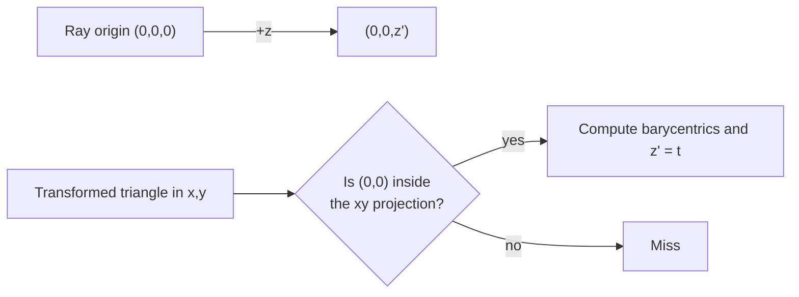

*Figure 6.13: The area of a triangle with edges $\mathbf v_1$ and $\mathbf v_2$ is half the parallelogram area, $\tfrac12\lVert\mathbf v_1\times\mathbf v_2\rVert$.*

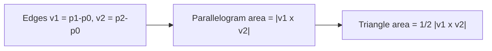

With the vertices transformed, the task is to determine whether the ray from the origin along $+z$ hits the transformed triangle. Because of how the coordinate system was constructed, this is equivalent to asking whether $(0,0)$ lies inside the $xy$ projection of the triangle (Figure 6.12).

Recall from Figure 3.6 that the length of the cross product of two vectors gives their parallelogram's area. In 2D, for vectors $\mathbf a$ and $\mathbf b$, the area is $a_xb_y-b_xa_y$, so the area of a triangle with vertices $\mathbf p_0,\mathbf p_1,\mathbf p_2$ is

$$A=\tfrac12\big[(p_{1x}-p_{0x})(p_{2y}-p_{0y})-(p_{1y}-p_{0y})(p_{2x}-p_{0x})\big].$$

We use this to define a signed *edge function*: given two vertices $\mathbf p_0$ and $\mathbf p_1$, the directed edge function $e$ gives twice the signed area of the triangle $(\mathbf p_0,\mathbf p_1,\mathbf p)$:

$$e(\mathbf p_0,\mathbf p_1,\mathbf p)=(p_{1x}-p_{0x})(p_y-p_{0y})-(p_{1y}-p_{0y})(p_x-p_{0x}).$$

*Figure 6.14: The edge function $e(\mathbf p)$ characterizes points relative to an oriented line through $\mathbf p_0$ and $\mathbf p_1$: positive to the right of the line, zero on it, negative to the left. The ray–triangle test uses an edge function equal to twice the signed area of the triangle formed by the three points.*

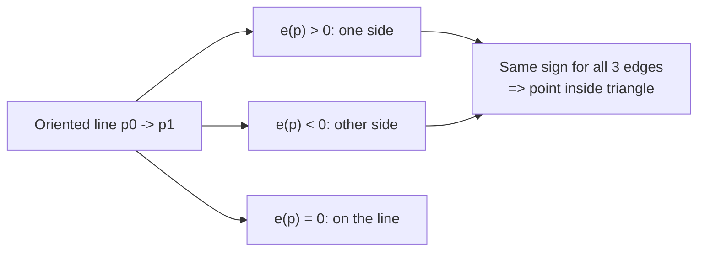

(See Figure 6.14.) The edge function is positive for points to the left of the line and negative for points to the right, so a point with the same sign for all three edges is inside the triangle.

Thanks to the coordinate transformation, the point being tested is $\mathbf p=(0,0)$, which simplifies the expressions. For the edge $e_0$ from $\mathbf p_1$ to $\mathbf p_2$,

$$e_0 = p_{1t,x}\,p_{2t,y} - p_{1t,y}\,p_{2t,x}.$$

We use the indexing scheme where $e_i$ corresponds to the directed edge from $\mathbf p_{(i+1)\bmod 3}$ to $\mathbf p_{(i+2)\bmod 3}$.

**〈Compute edge function coefficients e0, e1, and e2〉 ≡ 303**

```rust
let e0 = difference_of_products(p1t.x, p2t.y, p1t.y, p2t.x);
let e1 = difference_of_products(p2t.x, p0t.y, p2t.y, p0t.x);
let e2 = difference_of_products(p0t.x, p1t.y, p0t.y, p1t.x);
```

In the rare case that an edge function value is exactly zero, it is impossible to be sure whether the ray hits; the edge equations are reevaluated in double precision. (Section 6.8.4 discusses the need for this.) `〈Fall back to double-precision test at triangle edges〉` simply reimplements `〈Compute edge function coefficients e0, e1, and e2〉` using doubles and is not included.

<details>
<summary>Reference / notes</summary>

`DifferenceOfProducts()` 1044 · `Float` 23

</details>

The three edge functions give two opportunities to determine a miss. First, if their signs differ, $(0,0)$ is not on the same side of all three edges. Second, if their sum is zero, the ray approaches the triangle edge-on and we report a miss (for a closed mesh, the ray hits a neighboring triangle instead).

**〈Perform triangle edge and determinant tests〉 ≡ 303**

```rust
if (e0 < 0.0 || e1 < 0.0 || e2 < 0.0) && (e0 > 0.0 || e1 > 0.0 || e2 > 0.0) {
    return None;
}
let det = e0 + e1 + e2;
if det == 0.0 { return None; }
```

Because the ray starts at the origin, has unit length, and points along $+z$, the intersection's $z$ coordinate equals its parametric $t$. We first apply the shear to the vertices' $z$ coordinates, then interpolate with barycentric coordinates

$$b_i = \frac{e_i}{e_0+e_1+e_2}, \qquad b_0+b_1+b_2=1,$$

so $z=b_0z_0+b_1z_1+b_2z_2$. To avoid a division when the final $t$ is out of range, the implementation first computes $t$ by interpolating $z_i$ with $e_i$—without dividing by $\det$—and checks the sign. The test $t<t_{\max}$ can equivalently be applied to the scaled value, as shown below.

**〈Compute scaled hit distance to triangle and test against ray t range〉 ≡ 303**

```rust
let mut p0t = p0t; let mut p1t = p1t; let mut p2t = p2t;
p0t.z *= sz; p1t.z *= sz; p2t.z *= sz;
let t_scaled = e0 * p0t.z + e1 * p1t.z + e2 * p2t.z;
if det < 0.0 && (t_scaled >= 0.0 || t_scaled < t_max * det) { return None; }
else if det > 0.0 && (t_scaled <= 0.0 || t_scaled > t_max * det) { return None; }
```

Given a valid intersection, the actual barycentric coordinates and $t$ are found:

**〈Compute barycentric coordinates and t value for triangle intersection〉 ≡ 303**

```rust
let inv_det = 1.0 / det;
let b0 = e0 * inv_det;
let b1 = e1 * inv_det;
let b2 = e2 * inv_det;
let t = t_scaled * inv_det;
```

After a final test on $t$ (Section 6.8.7), the `TriangleIntersection` is returned.

**〈Return TriangleIntersection for intersection〉 ≡ 303**

```rust
Some(TriangleIntersection { b0, b1, b2, t })
```

**〈TriangleIntersection Definition〉 ≡**

```rust
struct TriangleIntersection {
    b0: Float,
    b1: Float,
    b2: Float,
    t: Float,
}
```

The `Triangle::Intersect()` method follows the form of earlier tests.

**〈Triangle Method Definitions〉 +≡**

```rust
fn intersect(&self, ray: &Ray, t_max: Float) -> Option<ShapeIntersection> {
    // 〈Get triangle vertices in p0, p1, and p2 302〉
    let tri = intersect_triangle(ray, t_max, p0, p1, p2)?;
    let intr = Self::interaction_from_intersection(
        mesh, self.tri_index, tri, ray.time, -ray.d);
    Some(ShapeIntersection { intr, t_hit: tri.t })
}
```

We omit `Triangle::IntersectP()`, which just calls `IntersectTriangle()`.

`InteractionFromIntersection()` differs from the quadrics' version in being a stand-alone function: since a call is not associated with a specific `Triangle` instance, it takes a `TriangleMesh` and a triangle index as parameters. In the context of `Intersect()` this may seem gratuitous—why not access them directly in a non-static method?

The reason is pbrt's GPU path, where the `Triangle` class is not used: triangles are abstracted by a ray-intersection API, and the geometric test is performed by specialized hardware. Given a hit, that API provides the triangle index, a pointer to its mesh, and the barycentric coordinates—exactly what this method needs, allowing the CPU and GPU paths to share the same `SurfaceInteraction` construction code.

<details>
<summary>Reference / notes</summary>

`Float` 23 · `IntersectTriangle()` 303 · `Ray` 95 · `Ray::d` 95 · `Ray::time` 95 · `ShapeIntersection` 266 · `SurfaceInteraction` 138 · `Triangle::InteractionFromIntersection()` 310 · `Triangle::triIndex` 302 · `TriangleIntersection` 309 · `TriangleIntersection::t` 309 · `TriangleMesh` 297

</details>

**〈Triangle Public Methods〉 +≡ 301**

```rust
fn interaction_from_intersection(
    mesh: &TriangleMesh,
    tri_index: i32,
    ti: TriangleIntersection,
    time: Float,
    wo: Vector3f,
) -> SurfaceInteraction {
    let v = &mesh.vertex_indices[3 * tri_index as usize..];
    let (p0, p1, p2) = (mesh.p[v[0] as usize], mesh.p[v[1] as usize], mesh.p[v[2] as usize]);
    // 〈Compute triangle partial derivatives 311〉
    // 〈Interpolate (u, v) parametric coordinates and hit point 311〉
    // 〈Return SurfaceInteraction for triangle hit 312〉
}
```

To generate consistent tangent vectors over meshes, $\partial\mathbf p/\partial u$ and $\partial\mathbf p/\partial v$ are computed from the parametric $(u,v)$ values at the vertices, if provided. Although the derivatives are constant over a triangle, they are recomputed at each hit: the redundant work buys significant storage savings for large meshes.

A triangle can be described as

$$\mathbf p(u,v) = \mathbf p_0 + u(\mathbf p_1-\mathbf p_0) + v(\mathbf p_2-\mathbf p_0),$$

with $(u,v)$ over the triangle's parametric coordinates. Given vertex positions $\mathbf p_i$ and texture coordinates $(u_i,v_i)$, the derivatives satisfy a unique affine mapping from 2D $(u,v)$ space to points on the (planar) triangle. Starting from the differences $\mathbf p_0-\mathbf p_2$ and $\mathbf p_1-\mathbf p_2$ we get the matrix equation

$$\begin{bmatrix}\mathbf p_0-\mathbf p_2 & \mathbf p_1-\mathbf p_2\end{bmatrix} \begin{bmatrix}u\\v\end{bmatrix} = \mathbf p-\mathbf p_2,$$

whose 2×2 coefficient matrix has inverse

$$\frac{1}{\det} \begin{bmatrix} \Delta v_{12} & -\Delta v_{02}\\ -\Delta u_{12} & \Delta u_{02} \end{bmatrix}, \qquad \det = \Delta u_{02}\Delta v_{12}-\Delta u_{12}\Delta v_{02}.$$

This computation is performed by `〈Compute triangle partial derivatives〉`, with handling for corner cases.

<details>
<summary>Reference / notes</summary>

`Float` 23 · `Point3f` 92 · `SurfaceInteraction` 138 · `TriangleIntersection` 309 · `TriangleMesh` 297 · `TriangleMesh::p` 298 · `TriangleMesh::vertexIndices` 298 · `Vector2f` 86 · `Vector3f` 86

</details>

**〈Compute triangle partial derivatives〉 ≡ 310**

```rust
// 〈Compute deltas and matrix determinant for triangle partial derivatives 311〉
let mut dpdu = Vector3f::ZERO;
let mut dpdv = Vector3f::ZERO;
let degenerate_uv = determinant.abs() < 1e-9;
if !degenerate_uv {
    // 〈Compute triangle dpdu and dpdv via matrix inversion 311〉
}
// 〈Handle degenerate triangle (u, v) parameterization or partial derivatives 311〉
```

The $uv$ coordinates come from `TriangleMesh::uv` if present, otherwise a default parameterization is used; we omit that fragment.

**〈Compute deltas and matrix determinant for triangle partial derivatives〉 ≡ 311**

```rust
// 〈Get triangle texture coordinates in uv array〉
let duv02 = uv[0] - uv[2];
let duv12 = uv[1] - uv[2];
let dp02 = p0 - p2;
let dp12 = p1 - p2;
let determinant = difference_of_products(duv02[0], duv12[1], duv02[1], duv12[0]);
```

In the usual case the 2×2 matrix is non-degenerate and Equation (6.7) gives:

**〈Compute triangle dpdu and dpdv via matrix inversion〉 ≡ 311**

```rust
let invdet = 1.0 / determinant;
dpdu = (difference_of_products(duv12[1], dp02, duv02[1], dp12)) * invdet;
dpdv = (difference_of_products(duv02[0], dp12, duv12[0], dp02)) * invdet;
```

Rare cases remain: the user may provide a degenerate parameterization (e.g., identical $(u,v)$ at all vertices), or the computed cross product may degenerate due to round-off. Then we fall back to derivatives that at least give the correct normal.

**〈Handle degenerate triangle (u, v) parameterization or partial derivatives〉 ≡ 311**

```rust
if degenerate_uv || length_squared(cross(dpdu, dpdv)) == 0.0 {
    let mut ng = cross(p2 - p0, p1 - p0);
    if length_squared(ng) == 0.0 {
        ng = cross(Vector3::<f64>::from(p2 - p0), Vector3::<f64>::from(p1 - p0));
    }
    coordinate_system(normalize(ng), &mut dpdu, &mut dpdv);
}
```

Barycentric interpolation gives the hit point and $(u,v)$ coordinates. As shown in Section 6.8.5 this is more accurate than evaluating the parametric ray equation with $t$.

**〈Interpolate (u, v) parametric coordinates and hit point〉 ≡ 310**

```rust
let p_hit = ti.b0 * p0 + ti.b1 * p1 + ti.b2 * p2;
let uv_hit = ti.b0 * uv[0] + ti.b1 * uv[1] + ti.b2 * uv[2];
```

Unlike the earlier shapes, no transform to rendering space is needed—the per-vertex geometric values are already there. Like the disk, the triangle's normal derivatives are both $(0,0,0)$ because it is flat.

**〈Return SurfaceInteraction for triangle hit〉 ≡ 310**

```rust
let flip_normal = mesh.reverse_orientation ^ mesh.transform_swaps_handedness;
// 〈Compute error bounds pError for triangle intersection 377〉
let mut isect = SurfaceInteraction::new(
    Point3fi::new(p_hit, p_error), uv_hit, wo, dpdu, dpdv,
    Normal3f::ZERO, Normal3f::ZERO, time, flip_normal);
// 〈Set final surface normal and shading geometry for triangle 312〉
isect
```

Before returning, some final details concerning the normal and shading geometry must be handled.

**〈Set final surface normal and shading geometry for triangle〉 ≡ 312**

```rust
// 〈Override surface normal in isect for triangle 312〉
if mesh.n || mesh.s {
    // 〈Initialize Triangle shading geometry 312〉
}
```

The `SurfaceInteraction` constructor initializes the geometric normal as the normalized cross product of `dpdu` and `dpdv`. That works for most shapes, but triangle meshes often have bad parameterizations that do not preserve orientation, giving a wrongly oriented normal. We therefore initialize the geometric normal from the normalized cross product of the edge vectors $\mathbf p_0-\mathbf p_2$ and $\mathbf p_1-\mathbf p_2$, which gives the same normal up to a sign depending on the winding order.[^3] Modeling packages generally try to keep winding orders consistent, making this more robust.

**〈Override surface normal in isect for triangle〉 ≡ 312**

```rust
isect.n = isect.shading.n = Normal3f::from(normalize(cross(dp02, dp12)));
if mesh.reverse_orientation ^ mesh.transform_swaps_handedness {
    isect.n = isect.shading.n = -isect.n;
}
```

With triangles, the user may provide normals and tangents at the mesh vertices, interpolated over the faces. Interpolated shading normals can make faceted meshes look smoother. If either is present, they initialize the shading geometry.

<details>
<summary>Reference / notes</summary>

`Cross()` 91 · `Interaction::n` 137 · `Normal3f` 94 · `Normalize()` 88 · `Point3fi` 1061 · `SurfaceInteraction` 138 · `SurfaceInteraction::SetShadingGeometry()` 140 · `SurfaceInteraction::shading::n` 139 · `TriangleMesh::n` 301 · `TriangleMesh::reverseOrientation` 301 · `TriangleMesh::s` 301 · `TriangleMesh::transformSwapsHandedness` 301

</details>

**〈Initialize Triangle shading geometry〉 ≡ 312**

```rust
// 〈Compute shading normal ns for triangle 313〉
// 〈Compute shading tangent ss for triangle 313〉
// 〈Compute shading bitangent ts for triangle and adjust ss 313〉
// 〈Compute dndu and dndv for triangle shading geometry〉
isect.set_shading_geometry(ns, ss, ts, dndu, dndv, true);
```

Given the barycentric coordinates, the shading normal is interpolated among the vertex normals if present:

**〈Compute shading normal ns for triangle〉 ≡ 312**

```rust
let ns = if let Some(normals) = mesh.n {
    let mut ns = Normal3f::new(
        ti.b0 * normals[v[0]] + ti.b1 * normals[v[1]] + ti.b2 * normals[v[2]]);
    if length_squared(ns) > 0.0 { normalize(ns) } else { isect.n }
} else { isect.n };
```

The shading tangent is computed similarly:

**〈Compute shading tangent ss for triangle〉 ≡ 312**

```rust
let ss = if let Some(s) = mesh.s {
    let mut ss = ti.b0 * s[v[0]] + ti.b1 * s[v[1]] + ti.b2 * s[v[2]];
    if length_squared(ss) == 0.0 { isect.dpdu } else { ss }
} else { isect.dpdu };
```

The bitangent $\mathbf t_s=\mathbf n_s\times\mathbf s_s$ is orthogonal to both. Then $\mathbf s_s$ is overwritten with $\mathbf t_s\times\mathbf n_s$ so that $\mathbf s_s\times\mathbf t_s=\mathbf n_s$: if provided normals and tangents are not perfectly orthogonal, $\mathbf n_s$ is preserved and $\mathbf s_s$ adjusted.

**〈Compute shading bitangent ts for triangle and adjust ss〉 ≡ 312**

```rust
let mut ts = cross(ns, ss);
if length_squared(ts) > 0.0 { ss = cross(ts, ns); }
else { coordinate_system(ns, &mut ss, &mut ts); }
```

The code computing the partial derivatives $\partial\mathbf n/\partial u$ and $\partial\mathbf n/\partial v$ of the shading normal is almost identical to that for $\partial\mathbf p/\partial u$ and $\partial\mathbf p/\partial v$, so it is elided.

<details>
<summary>Reference / notes</summary>

`CoordinateSystem()` 92 · `Cross()` 91 · `Interaction` 136 · `Interaction::n` 137 · `LengthSquared()` 87 · `Normal3f` 94 · `Normalize()` 88 · `Point2f` 92 · `Point3fi` 1061 · `ShapeSample` 268 · `SurfaceInteraction::dpdu` 138 · `Triangle::Area()` 302 · `TriangleIntersection::b0` 309 · `TriangleIntersection::b1` 309 · `TriangleIntersection::b2` 309 · `TriangleMesh::n` 301 · `TriangleMesh::s` 301 · `Vector3f` 86

</details>

#### GPU version (WGSL)

The watertight edge-function test maps to WGSL almost line for line. This is the closest-hit/any-hit kernel body for one triangle; `t` and the barycentrics are returned through a struct, and the double-precision edge fallback is omitted here (it is rarely taken).

```wgsl
struct TriHit { t: f32, b0: f32, b1: f32, b2: f32 };

fn intersect_triangle(o: vec3f, d: vec3f, t_max: f32,
                      p0: vec3f, p1: vec3f, p2: vec3f) -> TriHit {
  // Degenerate triangle: cross product has zero length.
  if (dot(cross(p2 - p0, p1 - p0), cross(p2 - p0, p1 - p0)) == 0.0) {
    return TriHit(-1.0, 0.0, 0.0, 0.0);
  }
  // Translate, permute (z = largest |d|), shear.
  var p0t = p0 - o; var p1t = p1 - o; var p2t = p2 - o;
  let ad = abs(d);
  let kz = select(select(0u, 1u, ad.y > ad.x), 2u, ad.z > max(ad.x, ad.y));
  let kx = (kz + 1u) % 3u; let ky = (kx + 1u) % 3u;
  let dd = permute3(d, kx, ky, kz);
  p0t = permute3(p0t, kx, ky, kz);
  p1t = permute3(p1t, kx, ky, kz);
  p2t = permute3(p2t, kx, ky, kz);
  let sx = -dd.x / dd.z; let sy = -dd.y / dd.z; let sz = 1.0 / dd.z;
  p0t.x += sx * p0t.z; p0t.y += sy * p0t.z;
  p1t.x += sx * p1t.z; p1t.y += sy * p1t.z;
  p2t.x += sx * p2t.z; p2t.y += sy * p2t.z;
  // Edge functions via fused multiply-add (DifferenceOfProducts).
  let e0 = fma(p1t.x, p2t.y, -p1t.y * p2t.x);
  let e1 = fma(p2t.x, p0t.y, -p2t.y * p0t.x);
  let e2 = fma(p0t.x, p1t.y, -p0t.y * p1t.x);
  if ((e0 < 0.0 || e1 < 0.0 || e2 < 0.0) &&
      (e0 > 0.0 || e1 > 0.0 || e2 > 0.0)) { return TriHit(-1.0,0.0,0.0,0.0); }
  let det = e0 + e1 + e2;
  if (det == 0.0) { return TriHit(-1.0,0.0,0.0,0.0); }
  p0t.z *= sz; p1t.z *= sz; p2t.z *= sz;
  let t_scaled = e0*p0t.z + e1*p1t.z + e2*p2t.z;
  if (det < 0.0 && (t_scaled >= 0.0 || t_scaled < t_max*det)) { return TriHit(-1.0,0.0,0.0,0.0); }
  if (det > 0.0 && (t_scaled <= 0.0 || t_scaled > t_max*det)) { return TriHit(-1.0,0.0,0.0,0.0); }
  let inv = 1.0 / det;
  return TriHit(t_scaled*inv, e0*inv, e1*inv, e2*inv);
}
```

#### 6.5.4 Sampling

The uniform area triangle sampling method maps a sample $\mathbf u$ to barycentric coordinates uniformly distributed over the triangle.

**〈Triangle Public Methods〉 +≡ 301**

```rust
fn sample(&self, u: Point2f) -> Option<ShapeSample> {
    // 〈Get triangle vertices in p0, p1, and p2 302〉
    // 〈Sample point on triangle uniformly by area 314〉
    // 〈Compute surface normal for sampled point on triangle 314〉
    // 〈Compute (u, v) for sampled point on triangle 314〉
    // 〈Compute error bounds pError for sampled point on triangle 377〉
    Some(ShapeSample {
        intr: Interaction::new(Point3fi::new(p, p_error), n, uv_sample),
        pdf: 1.0 / self.area(),
    })
}
```

Uniform barycentric sampling comes from a stand-alone utility function, making it reusable elsewhere.

**〈Sample point on triangle uniformly by area〉 ≡ 313**

```rust
let b = sample_uniform_triangle(u);
let p = b[0] * p0 + b[1] * p1 + b[2] * p2;
```

As with `Triangle::NormalBounds()`, the sampled point's surface normal depends on the orientation of the shading normal, if present.

**〈Compute surface normal for sampled point on triangle〉 ≡ 313, 318**

```rust
let mut n = normalize(Normal3f::from(cross(p1 - p0, p2 - p0)));
if let Some(normals) = mesh.n {
    let ns = Normal3f::new(b[0] * normals[v[0]] + b[1] * normals[v[1]]
                          + (1.0 - b[0] - b[1]) * normals[v[2]]);
    n = face_forward(n, ns);
} else if mesh.reverse_orientation ^ mesh.transform_swaps_handedness {
    n = -n;
}
```

The $(u,v)$ coordinates at the sampled point are also found by barycentric interpolation:

**〈Compute (u, v) for sampled point on triangle〉 ≡ 313, 318**

```rust
// 〈Get triangle texture coordinates in uv array〉
let uv_sample = b[0] * uv[0] + b[1] * uv[1] + b[2] * uv[2];
```

Because barycentric interpolation is linear, barycentric coordinates that uniformly sample one triangle uniformly sample any triangle. To derive the algorithm we therefore consider a unit right triangle and seek an area-preserving map from the unit square to that triangle.

*Figure 6.15: Samples from the unit square can be mapped to the unit right triangle by reflecting across the $x+y=1$ diagonal, though far-apart samples on the square then map to nearby points on the triangle.*

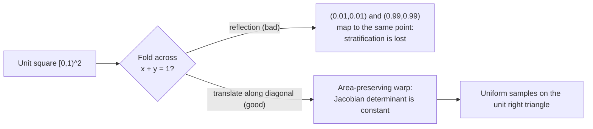

A straightforward approach is to fold the unit square over itself, reflecting samples outside the triangle across the diagonal. Although valid, this is undesirable: samples originally far apart in $[0,1)^2$ become close together on the triangle—$(0.01,0.01)$ and $(0.99,0.99)$ both map to the same point—so well-distributed sample sequences (Chapter 8) lose their effectiveness.

A better mapping translates points along the diagonal by a varying amount that brings the two opposite sides of the square to the triangle's diagonal. The determinant of this mapping's Jacobian is constant, so the mapping is area preserving and uniform samples in the square remain uniform in the triangle (Section 2.4.1).

**〈Sampling Inline Functions〉 +≡**

```rust
fn sample_uniform_triangle(u: Point2f) -> [Float; 3] {
    let (b0, b1);
    if u[0] < u[1] {
        b0 = u[0] / 2.0;
        b1 = u[1] - b0;
    } else {
        b1 = u[1] / 2.0;
        b0 = u[0] - b1;
    }
    [b0, b1, 1.0 - b0 - b1]
}
```

The usual normalization constraint gives the PDF in terms of the triangle's area:

**〈Triangle Public Methods〉 +≡ 301**

```rust
fn pdf(&self, _intr: &Interaction) -> Float { 1.0 / self.area() }
```

<details>
<summary>Reference / notes</summary>

`Float` 23 · `Interaction` 136 · `Point2f` 92 · `SampleUniformTriangle()` 315 · `Triangle::Area()` 302 · `Triangle::NormalBounds()` 303 · `Vector3` 86

</details>

In order to sample points on spheres with respect to solid angle, we derived a specialized method that samples only the potentially visible region. For cylinders and disks we simply sampled uniformly by area and rescaled the PDF. It is tempting to do the same for triangles—indeed, all three previous editions of this book did so—but a solid-angle sampling approach gives much better results.

To see why, consider a simplified form of the reflection integral from the scattering equation (4.14), with the BRDF replaced by a constant $\rho$ (a diffuse surface). If incident radiance comes only from a triangular light emitting uniform diffuse radiance $L_e$, the integral becomes

$$L_o = \frac{\rho}{\pi}\int_A L_e\, V(\mathbf p,\mathbf p')\, \cos\theta_o\,\frac{\cos\theta_l}{\|\mathbf p'-\mathbf p\|^2}\,dA,$$

where $V$ is 1 if the ray from $\mathbf p$ in direction $\omega_i$ hits the light and 0 if it misses or is occluded. Sampling the triangle uniformly within the solid angle $A_{\mathrm{solid}}$ it subtends gives the estimator

$$L_o \approx \frac{\rho}{\pi}\,L_e\,\frac{A_{\mathrm{solid}}}{N}\sum_i \big(\cos\theta_{o,i}\big)\big(\cos\theta_{l,i}\,V_i\big),$$

with the constants pulled out: only the two factors in parentheses vary with $\mathbf p'$, and both lie in $[0,1]$, so variance is low.

With area sampling, $\mathbf p'$ is uniform on the triangle ($p(\mathbf p')=1/A$) and the estimator contains four varying factors, including $1/\|\mathbf p'-\mathbf p\|^2$, which has unbounded variation over the triangle. This can produce high variance, especially for large triangles and reference points close to them. Figure 6.16 shows a scene where solid-angle sampling significantly reduces error. The `Triangle::Sample()` method taking a reference point therefore samples with respect to solid angle.

*Figure 6.16: A Scene Where Solid Angle Triangle Sampling Is Beneficial. Uniform area sampling leaves high error near the emitter; sampling the triangle's subtended solid angle leaves both remaining non-constant factors in $[0,1]$ and reduces MSE by a factor of 3.86. (Dragon model courtesy of the Stanford Computer Graphics Laboratory.)*

<details>
<summary>Figure 6.16 — pictorial image (keep)</summary>


</details>

**〈Triangle Public Methods〉 +≡ 301**

```rust
fn sample(&self, ctx: &ShapeSampleContext, u: Point2f) -> Option<ShapeSample> {
    // 〈Get triangle vertices in p0, p1, and p2 302〉
    // 〈Use uniform area sampling for numerically unstable cases 317〉
    // 〈Sample spherical triangle from reference point 317〉
    // 〈Compute error bounds pError for sampled point on triangle 377〉
    // 〈Return ShapeSample for solid angle sampled point on triangle 318〉
}
```

Triangles subtending a very small solid angle, or nearly the whole hemisphere, can suffer floating-point problems in the following approach. The method falls back to uniform area sampling in those cases, which does not hurt results in practice—small triangles have little variation across their area, and for large triangles the BSDF is also sampled as part of direct lighting.

**〈Use uniform area sampling for numerically unstable cases〉 ≡ 317**

```rust
let solid_angle = self.solid_angle(ctx.p());
if solid_angle < MIN_SPHERICAL_SAMPLE_AREA || solid_angle > MAX_SPHERICAL_SAMPLE_AREA {
    // 〈Sample shape by area and compute incident direction wi 282〉
    // 〈Convert area sampling PDF in ss to solid angle measure 282〉
    return ss;
}
```

**〈Triangle Private Members〉 +≡ 301**

```rust
const MIN_SPHERICAL_SAMPLE_AREA: Float = 3e-4;
const MAX_SPHERICAL_SAMPLE_AREA: Float = 6.22;
```

pbrt also approximates the effect of the incident cosine factor in its triangle sampling algorithm, leaving visibility and error in that approximation as the only sources of variance. We defer the fragment `〈Apply warp product sampling for cosine factor at reference point〉` until after the uniform solid-angle algorithm; for now we note that it affects the final PDF, which is the product of the uniform solid-angle PDF and a correction factor.

<details>
<summary>Reference / notes</summary>

`Float` 23 · `Point2f` 92 · `SampleSphericalTriangle()` 318 · `ShapeSample` 268 · `ShapeSampleContext` 268 · `ShapeSampleContext::p()` 269 · `Triangle::MaxSphericalSampleArea` 317 · `Triangle::MinSphericalSampleArea` 317 · `Triangle::SolidAngle()` 303

</details>

Uniform sampling of a triangle's solid angle is equivalent to uniformly sampling the spherical triangle obtained by projecting it onto the unit sphere (Section 3.8.2). `SampleSphericalTriangle()` returns barycentric coordinates for the sampled point.

**〈Sample spherical triangle from reference point〉 ≡ 317**

```rust
// 〈Apply warp product sampling for cosine factor at reference point 324〉
let mut tri_pdf = 0.0;
let b = sample_spherical_triangle([p0, p1, p2], ctx.p(), u, Some(&mut tri_pdf));
if tri_pdf == 0.0 { return None; }
pdf *= tri_pdf;
```

*Figure 6.17: Geometric Setting for Spherical Triangles. Given vertices $a$, $b$, and $c$, the opposite edges are $\bar a$, $\bar b$, $\bar c$ and the interior angles are $\alpha$, $\beta$, $\gamma$.*

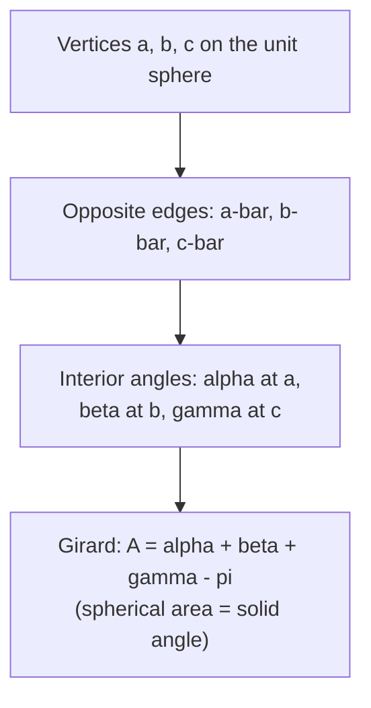

Given the barycentric coordinates, the sampled point is $\mathbf p = b_0\mathbf p_0+b_1\mathbf p_1+b_2\mathbf p_2$; with the normal from a reused fragment we have everything needed for a `ShapeSample`.

**〈Return ShapeSample for solid angle sampled point on triangle〉 ≡ 317**

```rust
let p = b[0] * p0 + b[1] * p1 + b[2] * p2;
// 〈Compute surface normal for sampled point on triangle 314〉
// 〈Compute (u, v) for sampled point on triangle 314〉
Some(ShapeSample {
    intr: Interaction::with_time(Point3fi::new(p, p_error), n, ctx.time, uv_sample),
    pdf,
})
```

The spherical triangle sampling function takes three vertices, a reference point, and a uniform sample; the PDF is optionally returned via `pdf`.

**〈Sampling Function Definitions〉 ≡**

```rust
fn sample_spherical_triangle(
    v: [Point3f; 3],
    p: Point3f,
    u: Point2f,
    pdf: Option<&mut Float>,
) -> [Float; 3] {
    // 〈Compute vectors a, b, and c to spherical triangle vertices 318〉
    // 〈Compute normalized cross products of all direction pairs 319〉
    // 〈Find angles alpha, beta, and gamma at spherical triangle vertices 319〉
    // 〈Uniformly sample triangle area A to compute A' 320〉
    // 〈Find cos beta' for point along b for sampled area 321〉
    // 〈Sample c' along the arc between b' and a 321〉
    // 〈Compute sampled spherical triangle direction and return barycentrics 322〉
}
```

<details>
<summary>Reference / notes</summary>

`Float` 23 · `Interaction` 136 · `Normalize()` 88 · `Point2f` 92 · `Point3f` 92 · `Point3fi` 1061 · `ShapeSample` 268 · `ShapeSampleContext::time` 268 · `Vector3f` 86

</details>

Projecting the vertices onto the unit sphere gives the spherical triangle vertices $\mathbf a$, $\mathbf b$, $\mathbf c$:

**〈Compute vectors a, b, and c to spherical triangle vertices〉 ≡ 318, 325**

```rust
let mut a = v[0] - p;
let mut b = v[1] - p;
let mut c = v[2] - p;
a = normalize(a); b = normalize(b); c = normalize(c);
```

Because the plane containing an edge also passes through the origin, an edge's plane normal is the cross product of its two vertex directions:

*Figure 6.18: (a) After sampling a triangle area, the first step finds the vertex $\mathbf c'$ giving a spherical triangle $\mathbf a\mathbf b\mathbf c'$ with that area; $\mathbf a$, $\mathbf b$ and edge $\bar{\mathbf c}$ are shared with the original triangle. (b) A direction $\omega$ is sampled along the arc between $\mathbf b$ and $\mathbf c'$.*

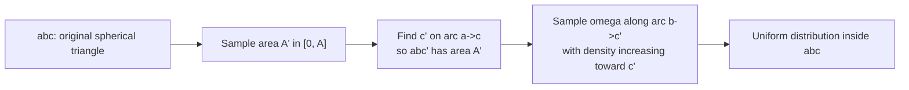

**〈Compute normalized cross products of all direction pairs〉 ≡ 318, 325**

```rust
let mut n_ab = cross(a, b);
let mut n_bc = cross(b, c);
let mut n_ca = cross(c, a);
if length_squared(n_ab) == 0.0 || length_squared(n_bc) == 0.0 || length_squared(n_ca) == 0.0 {
    return [0.0; 3]; // zero-area triangle
}
n_ab = normalize(n_ab); n_bc = normalize(n_bc); n_ca = normalize(n_ca);
```

`AngleBetween()` gives the angles between the plane normals; the normal of the edge from $\mathbf b$ to $\mathbf a$ is the negation of that from $\mathbf a$ to $\mathbf b$:

**〈Find angles alpha, beta, and gamma at spherical triangle vertices〉 ≡ 318, 325**

```rust
let alpha = angle_between(n_ab, -n_ca);
let beta  = angle_between(n_bc, -n_ab);
let gamma = angle_between(n_ca, -n_bc);
```

The algorithm operates in two stages. First, a new area $A'=\xi_0 A$ is uniformly sampled between 0 and the original area $A$; a vertex $\mathbf c'$ along the arc from $\mathbf a$ to $\mathbf c$ defines a triangle $\mathbf a\mathbf b\mathbf c'$ with that area (Figure 6.18a). Second, a vertex $\omega$ is sampled along the arc from $\mathbf b$ to $\mathbf c'$ with a density that is lower near $\mathbf b$ and higher near $\mathbf c'$, producing a uniform distribution inside the triangle (Figure 6.18b). A nonuniform density along the arc is necessary because the velocity of a point on the arc increases with distance from $\mathbf b$ as $\mathbf c'$ sweeps from $\mathbf a$ to $\mathbf c$.

Our implementation makes a small modification: rather than computing the spherical area $A$ and sampling between 0 and $A$, it computes the area *plus* $\pi$, denoted $A_\pi$. This avoids subtracting $\pi$ from the sum of interior angles in Equation (3.5), which loses accuracy for tiny triangles where $\alpha+\beta+\gamma\approx\pi$. The rest of the algorithm is adjusted to work with $A_\pi$; the sampled area-plus-$\pi$ is found by sampling uniformly between $\pi$ and $A_\pi$.

The returned PDF can be initialized here: the algorithm samples uniformly in solid angle, so the density is one over the triangle's spherical area $A=A_\pi-\pi$.

**〈Uniformly sample triangle area A to compute A'〉 ≡ 318**

```rust
let a_pi = alpha + beta + gamma;
let ap_pi = lerp(u[0], PI, a_pi);
if let Some(p) = pdf {
    let a = a_pi - PI;
    *p = if a <= 0.0 { 0.0 } else { 1.0 / a };
}
```

At this point $\mathbf a$, $\mathbf b$, edge $\bar{\mathbf c}$, and angle $\alpha$ are unchanged. We know the sampled triangle's area-plus-$\pi$ but not its vertex $\mathbf c'$, edge $\bar{\mathbf b}'$, or angles $\beta'$, $\gamma'$. To find $\mathbf c'$ it suffices to find $\cos b'$ (since $0\le b'<\pi$). A spherical cosine law gives

$$\cos A' = -\cos\alpha\cos b' + \sin\alpha\sin b'\cos\gamma', \quad\text{(6.8)}$$

and the definition of $A'_\pi=\alpha+\beta'+\gamma'$ lets us express $\gamma'=A'_\pi-\alpha-\beta'$. Substituting into Equation (6.8) and solving for $\cos b'$ gives, after defining $\Phi=A'_\pi-\alpha$,

$$\cos b' = \frac{k_2 + (k_2\cos\Phi - k_1\sin\Phi)\cos\alpha} {(k_2\sin\Phi + k_1\cos\Phi)\sin\alpha}, \quad\text{(6.9)}$$

where the cosine and sine sum identities were used and

$$k_1=\cos\Phi+\cos\alpha,\qquad k_2=\sin\Phi-\sin\alpha\cos c .$$

The only remaining unknowns are $\sin\beta'$ and $\cos\beta'$. Another spherical cosine law gives an equality that simplifies to

$$0 = k_1\cos\beta' + k_2\sin\beta',$$

whose solutions are $\cos\beta'=k_2/\sqrt{k_1^2+k_2^2}$ and $\sin\beta'=k_1/\sqrt{k_1^2+k_2^2}$. Substituting into Equation (6.9), taking the solution with positive cosine, and simplifying yields an expression with only known values on the right-hand side. The code also applies trig identities to compute $\sin\Phi$ and $\cos\Phi$ from other sines and cosines.

<details>
<summary>Reference / notes</summary>

`Clamp()` 1033 · `DifferenceOfProducts()` 1044 · `Dot()` 89 · `Float` 23 · `GramSchmidt()` 90 · `Lerp()` 72 · `Normalize()` 88 · `Pi` 1033 · `SafeSqrt()` 1034 · `Sqr()` 1034 · `SumOfProducts()` 1044 · `Vector3f` 86

</details>

**〈Find cos beta' for point along b for sampled area〉 ≡ 318**

```rust
let cos_alpha = alpha.cos();
let sin_alpha = alpha.sin();
let sin_phi = ap_pi.sin() * cos_alpha - ap_pi.cos() * sin_alpha;
let cos_phi = ap_pi.cos() * cos_alpha + ap_pi.sin() * sin_alpha;
let k1 = cos_phi + cos_alpha;
let k2 = sin_phi - sin_alpha * dot(a, b); // cos c
let mut cos_bp = (k2 + difference_of_products(k2, cos_phi, k1, sin_phi) * cos_alpha)
    / (sum_of_products(k2, sin_phi, k1, cos_phi) * sin_alpha);
cos_bp = cos_bp.clamp(-1.0, 1.0);
```

The great-circle arc between $\mathbf a$ and $\mathbf c$ can be parameterized as $\cos\theta\,\mathbf a+\sin\theta\,\mathbf c_\perp$, where $\mathbf c_\perp$ is the normalized component of $\mathbf c$ perpendicular to $\mathbf a$, given by `GramSchmidt()`. Then

$$\mathbf c' = \cos b'\,\mathbf a + \sin b'\,\frac{\mathbf c - (\mathbf a\cdot\mathbf c)\mathbf a}{\|\mathbf c-(\mathbf a\cdot\mathbf c)\mathbf a\|},$$

and $\sin b'=\sqrt{1-\cos^2 b'}$ since it must be nonnegative.

**〈Sample c' along the arc between b' and a〉 ≡ 318**

```rust
let sin_bp = safe_sqrt(1.0 - cos_bp.sqr());
let cp = cos_bp * a + sin_bp * normalize(gram_schmidt(c, a));
```

For the samples to be uniform in the spherical triangle, if the edge from $\mathbf b$ to $\mathbf c'$ is parameterized analogously, $\cos\theta$ must be sampled as

$$\cos\theta = 1 - u_1\big(1-\mathbf b\cdot\mathbf c'\big). \quad\text{(6.10)}$$

(The "Further Reading" section points to the details.) The final sampled direction is

$$\omega = \cos\theta\,\mathbf b + \sin\theta\, \frac{\mathbf c'-(\mathbf b\cdot\mathbf c')\mathbf b} {\|\mathbf c'-(\mathbf b\cdot\mathbf c')\mathbf b\|}.$$

**〈Compute sampled spherical triangle direction and return barycentrics〉 ≡ 318**

```rust
let cos_theta = 1.0 - u[1] * (1.0 - dot(cp, b));
let sin_theta = safe_sqrt(1.0 - cos_theta.sqr());
let w = cos_theta * b + sin_theta * normalize(gram_schmidt(cp, b));
// 〈Find barycentric coordinates for sampled direction w 322〉
// 〈Return clamped barycentrics for sampled direction 322〉
```

The barycentric coordinates of the corresponding point in the planar triangle come from part of the Möller–Trumbore ray–triangle algorithm (Möller and Trumbore 1997). Equating the ray's parametric form with barycentric interpolation, $\mathbf o+t\mathbf d=(1-b_0-b_1)\mathbf v_0+b_1\mathbf v_1+b_2\mathbf v_2$, and solving the linear system gives:

**〈Find barycentric coordinates for sampled direction w〉 ≡ 322**

```rust
let e1 = v[1] - v[0];
let e2 = v[2] - v[0];
let s1 = cross(w, e2);
let divisor = dot(s1, e1);
let inv_divisor = 1.0 / divisor;
let s = p - v[0];
let b1 = dot(s, s1) * inv_divisor;
let b2 = dot(w, cross(s, e1)) * inv_divisor;
```

For very small or very large triangles the computed barycentrics may be invalid. They are clamped into the triangle before being returned:

**〈Return clamped barycentrics for sampled direction〉 ≡ 322**

```rust
let mut b1 = b1.clamp(0.0, 1.0);
let mut b2 = b2.clamp(0.0, 1.0);
if b1 + b2 > 1.0 { b1 /= b1 + b2; b2 /= b1 + b2; }
[1.0 - b1 - b2, b1, b2]
```

Uniform solid-angle sampling does not account for the incident cosine factor at the reference point, and no analytic method to do so is known. However, a warping function on the uniform sample $\mathbf u$ can approximate it: $\cos\theta$ varies smoothly over the spherical triangle, and because the sampling algorithm maintains a continuous relationship between samples and points, its image in $[0,1]^2$ is also smooth (Figure 6.19). A chain-rule argument shows that transforming uniform $[0,1]^2$ points according to the distribution of $\cos\theta$ makes the resulting directions on the sphere include the cosine factor.

*Figure 6.19: (a) The $\cos\theta$ factor varies smoothly over a spherical triangle. (b) Mapped back to $[0,1]^2$ it also varies smoothly, thanks to the sampling algorithm's continuity.*

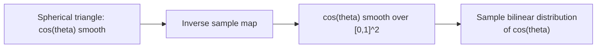

<details>
<summary>Reference / notes</summary>

`Clamp()` 1033 · `Cross()` 91 · `Dot()` 89 · `Float` 23 · `GramSchmidt()` 90 · `Normalize()` 88 · `SafeSqrt()` 1034 · `Sqr()` 1034 · `Vector3f` 86

</details>

*Figure 6.20: If (a) uniform sample points are warped to (b) approximate the distribution of the incident cosine factor in $[0,1]^2$, then (c) the resulting points in the triangle are approximately cosine-distributed.*


The true function has no convenient analytic form, but it is smooth, so we approximate it with a bilinear function. Each corner of $[0,1]^2$ maps to one of the spherical triangle's vertices, and we set the bilinear function's value at each corner from the $\cos\theta$ factor computed at the corresponding vertex. Sampling then uses the initial uniform sample to draw from the bilinear distribution and feeds the resulting nonuniform point to the triangle sampling algorithm. The overall PDF is the product of the bilinear PDF and the spherical triangle PDF.

This technique applies only to reference points on surfaces: for points in scattering media `ShapeSampleContext::ns` is degenerate and no warping is applied.

**〈Apply warp product sampling for cosine factor at reference point〉 ≡ 317**

```rust
let mut pdf = 1.0;
if ctx.ns != Normal3f::ZERO {
    // 〈Compute cos theta-based weights w at sample domain corners 324〉
    u = sample_bilinear(u, w);
    pdf *= bilinear_pdf(u, w);
}
```

For the spherical triangle sampler, vertex $\mathbf v_0$ corresponds to sample $(0,1)$, $\mathbf v_1$ to $(0,0)$ and $(1,0)$ (and the line between them), and $\mathbf v_2$ to $(1,1)$. The weights therefore use the cosine of the direction to the corresponding vertex:

**〈Compute cos theta-based weights w at sample domain corners〉 ≡ 324, 325**

```rust
let rp = ctx.p();
let wi = [normalize(p0 - rp), normalize(p1 - rp), normalize(p2 - rp)];
let w = [
    abs_dot(ctx.ns, wi[1]).max(0.01),
    abs_dot(ctx.ns, wi[1]).max(0.01),
    abs_dot(ctx.ns, wi[0]).max(0.01),
    abs_dot(ctx.ns, wi[2]).max(0.01),
];
```

<details>
<summary>Reference / notes</summary>

`ShapeSampleContext::ns` 268

</details>

The associated `PDF()` is much simpler than the sampling routine.

**〈Triangle Public Methods〉 +≡ 301**

```rust
fn pdf(&self, ctx: &ShapeSampleContext, wi: Vector3f) -> Float {
    let solid_angle = self.solid_angle(ctx.p());
    // 〈Return PDF based on uniform area sampling for challenging triangles 324〉
    let mut pdf = 1.0 / solid_angle;
    // 〈Adjust PDF for warp product sampling of triangle cos theta factor 325〉
    pdf
}
```

It is important that `PDF()` makes exactly the same decisions as `Sample()` about which technique is used. It starts with the same check for very small and very large triangles:

**〈Return PDF based on uniform area sampling for challenging triangles〉 ≡ 324**

```rust
if solid_angle < MIN_SPHERICAL_SAMPLE_AREA || solid_angle > MAX_SPHERICAL_SAMPLE_AREA {
    // 〈Intersect sample ray with shape geometry 285〉
    // 〈Compute PDF in solid angle measure from shape intersection point 285〉
    return pdf;
}
```

<details>
<summary>Reference / notes</summary>

`AbsDot()` 90 · `BilinearPDF()` 76 · `Float` 23 · `InvertSphericalTriangleSample()` 325 · `Normal3f` 94 · `Normalize()` 88 · `Point3f` 92 · `SampleBilinear()` 76 · `ShapeSampleContext` 268 · `ShapeSampleContext::ns` 268 · `ShapeSampleContext::p()` 269 · `Triangle::MaxSphericalSampleArea` 317 · `Triangle::MinSphericalSampleArea` 317 · `Triangle::SolidAngle()` 303 · `Vector3f` 86

</details>

If `Sample()` would have warped the uniform sample to account for $\cos\theta$, the corresponding change-of-variables factor must be included here. We invert the spherical triangle sampling algorithm to find the $\mathbf u$ that samples the point giving direction $\omega_i$; `InvertSphericalTriangleSample()` performs this computation.

**〈Adjust PDF for warp product sampling of triangle cos theta factor〉 ≡ 324**

```rust
if ctx.ns != Normal3f::ZERO {
    // 〈Get triangle vertices in p0, p1, and p2 302〉
    let u = invert_spherical_triangle_sample([p0, p1, p2], ctx.p(), wi);
    // 〈Compute cos theta-based weights w at sample domain corners 324〉
    pdf *= bilinear_pdf(u, w);
}
```

The pair of sample values giving a direction $\omega$ is found by inverting each sampling operation in turn. The function starts with the same reused fragments computing the spherical triangle's vertex angles.

**〈Sampling Function Definitions〉 +≡**

```rust
fn invert_spherical_triangle_sample(
    v: [Point3f; 3],
    p: Point3f,
    w: Vector3f,
) -> Point2f {
    // 〈Compute vectors a, b, and c to spherical triangle vertices 318〉
    // 〈Compute normalized cross products of all direction pairs 319〉
    // 〈Find angles alpha, beta, and gamma at spherical triangle vertices 319〉
    // 〈Find vertex c' along ac arc for omega 326〉
    // 〈Invert uniform area sampling to find u0 326〉
    // 〈Invert arc sampling to find u1 and return result 326〉
}
```

Next it finds the vertex $\mathbf c'$ on the arc from $\mathbf a$ to $\mathbf c$ defining the subtriangle that would have been sampled: the intersection of the great circle through $\mathbf b$ and $\omega$ with the great circle through $\mathbf a$ and $\mathbf c$ (Figure 6.21). Since each great circle is the intersection of the sphere with a plane through the origin and two points, the two planes intersect in a line whose direction is the cross product of their normals. That line meets the sphere twice; we choose the point between $\mathbf a$ and $\mathbf c$.

*Figure 6.21: Given a spherical triangle $\mathbf a\mathbf b\mathbf c$ and a direction $\omega$ inside it, $\mathbf c'$ along the edge from $\mathbf a$ to $\mathbf c$ is found from the intersection of the great circle through $\mathbf b$ and $\omega$ with the great circle through $\mathbf a$ and $\mathbf c$.*

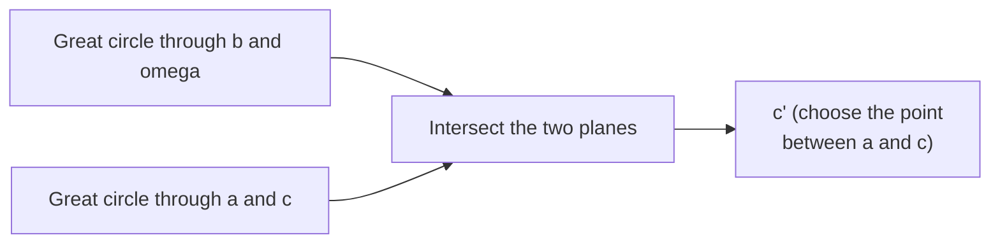

<details>
<summary>Reference / notes</summary>

`BilinearPDF()` 76 · `InvertSphericalTriangleSample()` 325 · `Normal3f` 94 · `Point2f` 92 · `Point3f` 92 · `ShapeSampleContext::ns` 268 · `ShapeSampleContext::p()` 269 · `Vector3f` 86

</details>

**〈Find vertex c' along ac arc for omega〉 ≡ 325**

```rust
let mut cp = normalize(cross(cross(b, w), cross(c, a)));
if dot(cp, a + c) < 0.0 { cp = -cp; }
```

Given $\mathbf c'$, the area of triangle $\mathbf a\mathbf b\mathbf c'$ gives the first sample value $u_0=A'/A$. When $\mathbf a$ and $\mathbf c'$ are nearly coincident, computing $\gamma'$ may have high error and the subtriangle may even appear to have larger area than the original; a dot-product test catches that case.

**〈Invert uniform area sampling to find u0〉 ≡ 325**

```rust
let u0;
if dot(a, cp) > 0.99999847691 /* 0.1 degrees */ {
    u0 = 0.0;
} else {
    // 〈Compute area A' of subtriangle 326〉
    // 〈Compute sample u0 that gives the area A' 326〉
}
```

Otherwise Girard's theorem gives the subtriangle's area:

**〈Compute area A' of subtriangle〉 ≡ 326**

```rust
let mut n_cpb = cross(cp, b);
let mut n_acp = cross(a, cp);
if length_squared(n_cpb) == 0.0 || length_squared(n_acp) == 0.0 {
    return Point2f::new(0.5, 0.5);
}
n_cpb = normalize(n_cpb);
n_acp = normalize(n_acp);
let ap = alpha + angle_between(n_ab, n_cpb)
              + angle_between(n_acp, -n_cpb) - PI;
```

**〈Compute sample u0 that gives the area A'〉 ≡ 326**

```rust
let a_area = alpha + beta + gamma - PI;
u0 = ap / a_area;
```

Equation (6.10), the arc-sampling rule for $\omega$ along the arc through $\mathbf b$ and $\mathbf c'$, is easily inverted:

**〈Invert arc sampling to find u1 and return result〉 ≡ 325**

```rust
let u1 = (1.0 - dot(w, b)) / (1.0 - dot(cp, b));
Point2f::new(u0.clamp(0.0, 1.0), u1.clamp(0.0, 1.0))
```

<details>
<summary>Reference / notes</summary>

`AngleBetween()` 89 · `Clamp()` 1033 · `Cross()` 91 · `Dot()` 89 · `Float` 23 · `LengthSquared()` 87 · `Normalize()` 88 · `Pi` 1033 · `Point2f` 92 · `Vector3f` 86

</details>

## 6.6 Bilinear Patches

It is useful to have a shape defined by four vertices. A planar quadrilateral is one option, but it is preferable not to require coplanarity. The bilinear patch is a parametric surface defined by four vertices $\mathbf p_{0,0}$, $\mathbf p_{1,0}$, $\mathbf p_{0,1}$, $\mathbf p_{1,1}$, each associated with a corner of the $(u,v)$ domain $[0,1]^2$. Points on the surface come from bilinear interpolation:

$$\mathbf p(u,v)=(1-u)(1-v)\mathbf p_{0,0}+u(1-v)\mathbf p_{1,0} +(1-u)v\,\mathbf p_{0,1}+uv\,\mathbf p_{1,1}. \quad\text{(6.11)}$$

*Figure 6.22: Two Bilinear Patches. A bilinear patch is defined by four vertices that need not be planar and can represent a variety of simple curved surfaces.*

<details>
<summary>Figure 6.22 — pictorial image (keep)</summary>


</details>

The bilinear patch is a doubly ruled surface: two straight lines pass through every point on it. Fixing either $u$ or $v$ in Equation (6.11) leaves a linear function, so the patch can represent planar quadrilaterals as well as simple curved surfaces. It is a useful target for converting higher-order parametric surfaces into shapes amenable to direct ray intersection.

pbrt allows bilinear patch meshes for the same reasons as triangle meshes: to share per-vertex attributes and to store mesh-wide properties once. `BilinearPatchMesh` plays the role of `TriangleMesh`.

**〈BilinearPatchMesh Definition〉 ≡**

```rust
struct BilinearPatchMesh {
    // 〈BilinearPatchMesh Public Methods〉
    // 〈BilinearPatchMesh Public Members〉
}
```

We skip the constructor, which mirrors `TriangleMesh`'s: it transforms positions and normals to rendering space and uses `BufferCache` to avoid redundant buffers.

**〈BilinearPatchMesh Public Members〉 ≡ 327**

```rust
struct BilinearPatchMesh {
    reverse_orientation: bool,
    transform_swaps_handedness: bool,
    n_patches: usize,
    n_vertices: usize,
    vertex_indices: &'static [i32],
    p: &'static [Point3f],
    n: &'static [Normal3f],
    uv: &'static [Point2f],
    // imageDistribution: PiecewiseConstant2D, added below
}
```

<details>
<summary>Reference / notes</summary>

`BilinearPatchMesh` 327 · `BufferCache` 299 · `Normal3f` 94 · `Point2f` 92 · `Point3f` 92 · `Shape` 261 · `TriangleMesh` 297

</details>

The `BilinearPatch` class implements `Shape` and represents a single patch in a mesh.

**〈BilinearPatch Definition〉 ≡**

```rust
struct BilinearPatch {
    // 〈BilinearPatch Public Methods〉
    // 〈BilinearPatch Private Methods〉
    // 〈BilinearPatch Private Members〉
}
```

**〈BilinearPatch Method Definitions〉 ≡**

```rust
impl BilinearPatch {
    fn new(mesh: &BilinearPatchMesh, mesh_index: i32, blp_index: i32) -> Self {
        let mut patch = Self { mesh_index, blp_index, area: 0.0 };
        // 〈Store area of bilinear patch in area 329〉
        patch
    }
}
```

Like triangles, each patch stores the index of its mesh and its own index in that mesh.

**〈BilinearPatch Private Members〉 ≡ 328**

```rust
struct BilinearPatch {
    mesh_index: i32,
    blp_index: i32,
    area: Float,
    // static allMeshes
}
```

`GetMesh()` returns the mesh pointer:

**〈BilinearPatch Private Methods〉 ≡ 328**

```rust
fn get_mesh(&self) -> &'static BilinearPatchMesh {
    &ALL_MESHES[self.mesh_index as usize]
}
```

There is a subtlety in using a vector of meshes: pbrt's scene initialization parallelizes work, including reading mesh binary files. A mutex protects additions to the vector, but the vector is periodically reallocated as it grows. Consequently the `BilinearPatch` constructor must not call `GetMesh()` to obtain its mesh pointer, because `GetMesh()` accesses `allMeshes` without mutual exclusion; the mesh is therefore passed in as a parameter.

**〈BilinearPatch Private Members〉 +≡ 328**

```rust
// static mut ALL_MESHES: Vec<&'static BilinearPatchMesh> = Vec::new();
```

The area of a parametric surface over $[0,1]^2$ is

$$A=\int_0^1\!\!\int_0^1 \left\|\frac{\partial\mathbf p}{\partial u} \times\frac{\partial\mathbf p}{\partial v}\right\| du\,dv, \quad\text{(6.12)}$$

and the partial derivatives of a bilinear patch are easily derived:

$$\frac{\partial\mathbf p}{\partial u}=(1-v)(\mathbf p_{1,0}-\mathbf p_{0,0}) +v(\mathbf p_{1,1}-\mathbf p_{0,1}), \qquad \frac{\partial\mathbf p}{\partial v}=(1-u)(\mathbf p_{0,1}-\mathbf p_{0,0}) +u(\mathbf p_{1,1}-\mathbf p_{1,0}). \quad\text{(6.13)}$$

In general Equation (6.12) cannot be evaluated in closed form with these derivatives. Therefore the constructor caches the area, using numerical integration when necessary. Because patches are often rectangles, it first checks for that case and takes the product of side lengths. Otherwise `〈Compute approximate area of bilinear patch〉` uses a 3×3 Riemann sum; we do not include it.

**〈Store area of bilinear patch in area〉 ≡ 328**

```rust
// 〈Get bilinear patch vertices in p00, p01, p10, and p11 329〉
let area = if is_rectangle(mesh) {
    distance(p00, p01) * distance(p00, p10)
} else {
    // 〈Compute approximate area of bilinear patch〉
};
```

This fragment loads the four patch vertices and is reused throughout.

**〈Get bilinear patch vertices in p00, p01, p10, and p11〉 ≡ 329, 330, 335, 338, 342, 343, 344**

```rust
let v = &mesh.vertex_indices[4 * self.blp_index as usize..];
let p00 = mesh.p[v[0] as usize];
let p10 = mesh.p[v[1] as usize];
let p01 = mesh.p[v[2] as usize];
let p11 = mesh.p[v[3] as usize];
```

In addition to area, several specialized algorithms need to know whether a patch is a rectangle, so that check is encapsulated in `IsRectangle()`.

**〈BilinearPatch Private Methods〉 +≡ 328**

```rust
fn is_rectangle(&self, mesh: &BilinearPatchMesh) -> bool {
    // 〈Get bilinear patch vertices in p00, p01, p10, and p11 329〉
    if p00 == p01 || p01 == p11 || p11 == p10 || p10 == p00 { return false; }
    // 〈Check if bilinear patch vertices are coplanar 329〉
    // 〈Check if planar vertices form a rectangle 330〉
}
```

The first test rejects coincident neighbors, since subsequent steps would otherwise normalize degenerate vectors. Four non-coplanar vertices cannot form a rectangle:

**〈Check if bilinear patch vertices are coplanar〉 ≡ 329**

```rust
let n = normalize(Normal3f::from(cross(p10 - p00, p01 - p00)));
if abs_dot(normalize(p11 - p00), n) > 1e-5 { return false; }
```

Four coplanar vertices form a rectangle if they are all the same distance from their average position. The implementation uses squared distances and a relative error test, so scaling the patch does not affect the result.

**〈Check if planar vertices form a rectangle〉 ≡ 329**

```rust
let p_center = (p00 + p01 + p10 + p11) / 4.0;
let d2 = [
    distance_squared(p00, p_center), distance_squared(p01, p_center),
    distance_squared(p10, p_center), distance_squared(p11, p_center),
];
for i in 1..4 { if (d2[i] - d2[0]).abs() / d2[0] > 1e-4 { return false; } }
true
```

<details>
<summary>Reference / notes</summary>

`AbsDot()` 90 · `BilinearPatch::area` 329 · `BilinearPatch::blpIndex` 328 · `BilinearPatch::IsRectangle()` 329 · `BilinearPatchMesh` 327 · `BilinearPatchMesh::p` 327 · `BilinearPatchMesh::vertexIndices` 327 · `Cross()` 91 · `Distance()` 93 · `Float` 23 · `Normal3f` 94 · `Normalize()` 88 · `Point3f` 92

</details>

With the area cached, `Area()` is trivial:

**〈BilinearPatch Public Methods〉 ≡ 328**

```rust
fn area(&self) -> Float { self.area }
```

The bounds are the box enclosing the four corners; vertices are already in rendering space, so no transformation is needed.

**〈BilinearPatch Method Definitions〉 +≡**

```rust
fn bounds(&self) -> Bounds3f {
    let mesh = self.get_mesh();
    // 〈Get bilinear patch vertices in p00, p01, p10, and p11 329〉
    Bounds3f::new(p00, p01).union(Bounds3f::new(p10, p11))
}
```

A planar patch has a single normal, but a nonplanar patch's normal varies across its surface.

**〈BilinearPatch Method Definitions〉 +≡**

```rust
fn normal_bounds(&self) -> DirectionCone {
    let mesh = self.get_mesh();
    // 〈Get bilinear patch vertices in p00, p01, p10, and p11 329〉
    // 〈If patch is a triangle, return bounds for single surface normal〉
    // 〈Compute bilinear patch normal n00 at (0, 0) 331〉
    // 〈Compute bilinear patch normals n10, n01, and n11〉
    // 〈Compute average normal and return normal bounds for patch 331〉
}
```

The triangle case simply evaluates the single normal and returns its `DirectionCone`; we omit that straightforward fragment. Otherwise the normals at the four corners are evaluated. At corners the partial derivatives reduce to differences with adjacent vertices, so evaluation is easy. Orientation needs care: if per-vertex shading normals were specified they determine which side the geometric normal lies on; otherwise it may need flipping based on orientation and handedness.

**〈Compute bilinear patch normal n00 at (0, 0)〉 ≡ 330**

```rust
let mut n00 = normalize(cross(p10 - p00, p01 - p00));
if let Some(normals) = mesh.n { n00 = face_forward(n00, normals[v[0]]); }
else if mesh.reverse_orientation ^ mesh.transform_swaps_handedness { n00 = -n00; }
```

A bounding cone is found by averaging the four normals and taking the cosine of the largest angle any of them makes with the average. This is not necessarily optimal but usually works well in practice (Chapter 3 "Further Reading").

**〈Compute average normal and return normal bounds for patch〉 ≡ 330**

```rust
let n = normalize(n00 + n10 + n01 + n11);
let cos_theta = [dot(n, n00), dot(n, n01), dot(n, n10), dot(n, n11)]
    .into_iter().fold(f32::INFINITY, f32::min);
DirectionCone::new_with_cos(n, cos_theta.clamp(-1.0, 1.0))
```

<details>
<summary>Reference / notes</summary>

`BilinearPatch::area` 329 · `BilinearPatch::GetMesh()` 328 · `BilinearPatchMesh` 327 · `Bounds3::Union()` 99 · `Bounds3f` 97 · `DirectionCone` 114 · `DistanceSquared()` 93 · `Float` 23 · `Point3f` 92 · `Triangle` 301

</details>

### 6.6.1 Intersection Tests

Unlike triangles (but like spheres and cylinders), a ray may intersect a bilinear patch twice; the closer hit is returned (Figure 6.23). As with triangles it is useful to have a stand-alone ray–patch intersection function. Rather than computing $t$ and then $(u,v)$, the algorithm first determines the parametric $u$ coordinates of any intersections; only if any lie in $[0,1]$ are $v$ and $t$ computed.

*Figure 6.23: Ray–Bilinear Patch Intersections. Rays may intersect a bilinear patch once or twice.*

<details>
<summary>Figure 6.23 — pictorial image (keep)</summary>

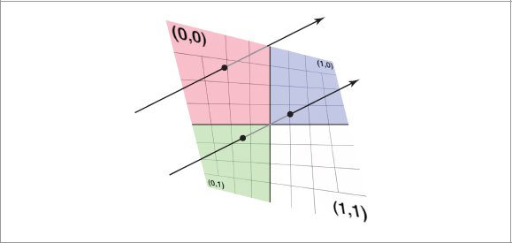

</details>

**〈Bilinear Patch Inline Functions〉 ≡**

```rust
fn intersect_bilinear_patch(
    ray: &Ray,
    t_max: Float,
    p00: Point3f, p10: Point3f, p01: Point3f, p11: Point3f,
) -> Option<BilinearIntersection> {
    // 〈Find quadratic coefficients for distance from ray to u iso-lines 333〉
    // 〈Solve quadratic for bilinear patch u intersection 333〉
    // 〈Find epsilon eps to ensure that candidate t is greater than zero 386〉
    // 〈Compute v and t for the first u intersection 334〉
    // 〈Compute v and t for the second u intersection〉
    // 〈Check intersection t against tMax and possibly return intersection 335〉
}
```

Going back to Equation (6.11), fixing $u$ leaves a line,

$$\mathbf f_u(v)=(1-v)\mathbf p_{u,0}+v\mathbf p_{u,1},$$

where $\mathbf p_{u,0}=(1-u)\mathbf p_{0,0}+u\mathbf p_{1,0}$ and $\mathbf p_{u,1}=(1-u)\mathbf p_{0,1}+u\mathbf p_{1,1}$ (Figure 6.24). At any intersection the minimum distance from a point on the ray to a point on one of these lines is zero. For two infinite non-parallel lines $(\mathbf p_a,\mathbf p_b)$ and $(\mathbf p_c,\mathbf p_d)$, the minimum distance is found from two parallel planes containing the lines:

$$a x+b y+c z+d=0,\qquad (a,b,c)=(\mathbf p_b-\mathbf p_a)\times(\mathbf p_d-\mathbf p_c),$$

with $d_{ab}$ and $d_{cd}$ found by substituting a point on each line; the distance is $(d_{ab}-d_{cd})/\sqrt{a^2+b^2+c^2}$ (Figure 6.25).

*Figure 6.24: Fixing the $u$ parameter of a bilinear patch gives a linear function between two opposite edges of the patch.*

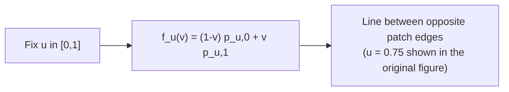

<details>
<summary>Reference / notes</summary>

`BilinearIntersection` 335 · `Float` 23 · `Point3f` 92 · `Ray` 95

</details>

*Figure 6.25: The minimum distance between two lines is computed from two parallel planes containing them, then measuring the distance between the planes.*

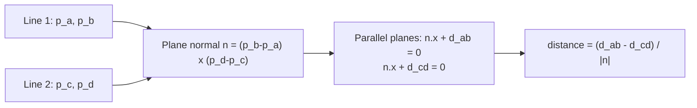

For ray–patch intersection, one line is the ray with $\mathbf p_a=\mathbf o$, $\mathbf p_b=\mathbf o+\mathbf d$, and the other is $\mathbf f_u$ with $\mathbf p_c=\mathbf p_{u,0}$, $\mathbf p_d=\mathbf p_{u,1}$. After taking the cross product, finding each $d$, and simplifying, $d_{\mathrm{ray}}-d_u$ is a quadratic in $u$—as expected, since a ray can hit a patch up to twice. Since only zeros matter, the denominator can be dropped. Equating the difference to zero and collecting terms gives:[^4]

**〈Find quadratic coefficients for distance from ray to u iso-lines〉 ≡ 332**

```rust
let a = dot(cross(p10 - p00, p01 - p11), ray.d);
let c = dot(cross(p00 - ray.o, ray.d), p01 - p00);
let b = dot(cross(p10 - ray.o, ray.d), p11 - p10) - (a + c);
```

The $u$ values where the ray meets the patch are the roots of $au^2+bu+c=0$. If there are no real roots, there is no intersection.

**〈Solve quadratic for bilinear patch u intersection〉 ≡ 332**

```rust
let (u1, u2);
if !quadratic(a, b, c, &mut u1, &mut u2) { return None; }
```

<details>
<summary>Reference / notes</summary>

`Cross()` 91 · `Dot()` 89 · `Float` 23 · `Quadratic()` 1045 · `Ray::d` 95

</details>

Each root is checked against $[0,1]$; if valid, $v$ and $t$ are computed. One way to compute them is to find the parameters along the ray and along $\mathbf f_u$ minimizing their distance. Although that distance should be zero, round-off in $u$ makes a minimization formulation preferable. With $\mathbf o$, $\mathbf d$ the ray origin and direction, the minimizing parameters are ratios of 3×3 determinants formed from column vectors; we will not derive them here (see "Further Reading"). We start with common subexpressions:

**〈Compute v and t for the first u intersection〉 ≡ 332**

```rust
let (mut t, mut u, mut v) = (t_max, 0.0, 0.0);
if 0.0 <= u1 && u1 <= 1.0 {
    // 〈Precompute common terms for v and t computation 334〉
    // 〈Compute matrix determinants for v and t numerators 334〉
    // 〈Set u, v, and t if intersection is valid 335〉
}
```

**〈Precompute common terms for v and t computation〉 ≡ 334**

```rust
let uo = lerp(u1, p00, p10);
let ud = lerp(u1, p01, p11) - uo;
let delta_o = uo - ray.o;
let perp = cross(ray.d, ud);
let p2 = length_squared(perp);
```

The determinants in the numerators can be computed with `SquareMatrix`. Common subexpressions exist but we leave them to the compiler; an optimized implementation might write them out explicitly.

**〈Compute matrix determinants for v and t numerators〉 ≡ 334**

```rust
let v1 = determinant(SquareMatrix3::new(
    delta_o.x, ray.d.x, perp.x,
    delta_o.y, ray.d.y, perp.y,
    delta_o.z, ray.d.z, perp.z));
let t1 = determinant(SquareMatrix3::new(
    delta_o.x, ud.x, perp.x,
    delta_o.y, ud.y, perp.y,
    delta_o.z, ud.z, perp.z));
```

<details>
<summary>Reference / notes</summary>

`Float` 23 · `Point3f` 92 · `SquareMatrix` 1049 · `SquareMatrix::Determinant()` 1051 · `Vector3f` 86

</details>

Due to round-off, a computed $t$ may be positive even though the true value is negative. Testing against an epsilon (Section 6.8.7) avoids such false hits; since the division is deferred, we test `t1` against `p2 * eps`.

**〈Set u, v, and t if intersection is valid〉 ≡ 334**

```rust
if t1 > p2 * eps && 0.0 <= v1 && v1 <= p2 {
    u = u1;
    v = v1 / p2;
    t = t1 / p2;
}
```

The second root is handled analogously, keeping the closer hit if both are valid. If the final $t<t_{\max}$, an intersection is returned:

**〈Check intersection t against tMax and possibly return intersection〉 ≡ 332**

```rust
if t >= t_max { return None; }
Some(BilinearIntersection { uv: Point2f::new(u, v), t })
```

**〈BilinearIntersection Definition〉 ≡**

```rust
struct BilinearIntersection {
    uv: Point2f,
    t: Float,
}
```

The $(u,v)$ coordinates and $t$ encapsulate the intersection so the remaining geometric properties can be computed later.

`InteractionFromIntersection()` computes all the geometry needed for a `SurfaceInteraction` from an intersection point $(u,v)$.

**〈BilinearPatch Public Methods〉 +≡ 328**

```rust
fn interaction_from_intersection(
    mesh: &BilinearPatchMesh,
    blp_index: i32,
    uv: Point2f,
    time: Float,
    wo: Vector3f,
) -> SurfaceInteraction {
    // 〈Compute bilinear patch point p, dpdu, and dpdv for (u, v) 335〉
    // 〈Compute (s, t) texture coordinates at bilinear patch (u, v) 336〉
    // 〈Find partial derivatives dndu and dndv for bilinear patch 337〉
    // 〈Initialize bilinear patch intersection point error pError 377〉
    // 〈Initialize SurfaceInteraction for bilinear patch intersection 337〉
    // 〈Compute bilinear patch shading normal if necessary 337〉
}
```

Equation (6.11) and Equation (6.13) give the point and its derivatives directly:

**〈Compute bilinear patch point p, dpdu, and dpdv for (u, v)〉 ≡ 335**

```rust
// 〈Get bilinear patch vertices in p00, p01, p10, and p11 329〉
let p = lerp(uv[0], lerp(uv[1], p00, p01), lerp(uv[1], p10, p11));
let dpdu = lerp(uv[1], p10, p11) - lerp(uv[1], p00, p01);
let dpdv = lerp(uv[0], p01, p11) - lerp(uv[0], p00, p10);
```

<details>
<summary>Reference / notes</summary>

`BilinearIntersection` 335 · `BilinearPatchMesh` 327 · `Float` 23 · `Lerp()` 72 · `Point2f` 92 · `Point3f` 92 · `SurfaceInteraction` 138 · `Vector3f` 86

</details>

If per-vertex texture coordinates exist they are interpolated too. We denote texture coordinates by $(s,t)$ to distinguish them from the patch's $(u,v)$; variables $\partial u/\partial s$, $\partial u/\partial t$, $\partial v/\partial s$, $\partial v/\partial t$ are initialized for the case $(s,t)=(u,v)$.

**〈Compute (s, t) texture coordinates at bilinear patch (u, v)〉 ≡ 335**

```rust
let mut st = uv;
let (mut duds, mut dudt, mut dvds, mut dvdt) = (1.0, 0.0, 0.0, 1.0);
if mesh.uv {
    // 〈Compute texture coordinates for bilinear patch intersection point 336〉
    // 〈Update bilinear patch dpdu and dpdv accounting for (s, t) 336〉
}
```

**〈Compute texture coordinates for bilinear patch intersection point〉 ≡ 336, 341, 344**

```rust
let uv00 = mesh.uv[v[0]]; let uv10 = mesh.uv[v[1]];
let uv01 = mesh.uv[v[2]]; let uv11 = mesh.uv[v[3]];
st = lerp(uv[0], lerp(uv[1], uv00, uv01), lerp(uv[1], uv10, uv11));
```

Because `SurfaceInteraction::dpdu` and `dpdv` are expressed in terms of the texturing parameterization, they must be updated when texture coordinates are provided:

**〈Update bilinear patch dpdu and dpdv accounting for (s, t)〉 ≡ 336**

```rust
// 〈Compute partial derivatives of (u, v) with respect to (s, t) 336〉
// 〈Compute partial derivatives of p with respect to (s, t) 337〉
// 〈Set dpdu and dpdv to updated partial derivatives 337〉
```

Taking derivatives of the bilinear interpolation gives $\partial(s,t)/\partial u$ and $\partial(s,t)/\partial v$; the desired derivatives are their reciprocals:

**〈Compute partial derivatives of (u, v) with respect to (s, t)〉 ≡ 336**

```rust
let dstdu = lerp(uv[1], uv10, uv11) - lerp(uv[1], uv00, uv01);
let dstdv = lerp(uv[0], uv01, uv11) - lerp(uv[0], uv00, uv10);
duds = if dstdu[0].abs() < 1e-8 { 0.0 } else { 1.0 / dstdu[0] };
dvds = if dstdv[0].abs() < 1e-8 { 0.0 } else { 1.0 / dstdv[0] };
dudt = if dstdu[1].abs() < 1e-8 { 0.0 } else { 1.0 / dstdu[1] };
dvdt = if dstdv[1].abs() < 1e-8 { 0.0 } else { 1.0 / dstdv[1] };
```

<details>
<summary>Reference / notes</summary>

`BilinearPatchMesh::uv` 327 · `Float` 23 · `Lerp()` 72 · `Point2f` 92 · `SurfaceInteraction` 138 · `Vector2f` 86

</details>

The chain rule then gives the updated position derivatives:

$$\frac{\partial\mathbf p}{\partial s}=\frac{\partial\mathbf p}{\partial u}\frac{\partial u}{\partial s} +\frac{\partial\mathbf p}{\partial v}\frac{\partial v}{\partial s}, \qquad \frac{\partial\mathbf p}{\partial t}=\frac{\partial\mathbf p}{\partial u}\frac{\partial u}{\partial t} +\frac{\partial\mathbf p}{\partial v}\frac{\partial v}{\partial t}.$$

**〈Compute partial derivatives of p with respect to (s, t)〉 ≡ 336**

```rust
let dpds = dpdu * duds + dpdv * dvds;
let dpdt = dpdu * dudt + dpdv * dvdt;
```

If the texture mapping is degenerate, $\partial\mathbf p/\partial s$ or $\partial\mathbf p/\partial t$ may vanish; then `dpdu` and `dpdv` are left unchanged so their cross product still gives a correct normal. A dot-product check ensures the normal from $\partial\mathbf p/\partial s\times\partial\mathbf p/\partial t$ lies in the same hemisphere as the original normal, flipping $\partial\mathbf p/\partial t$ if needed.

**〈Set dpdu and dpdv to updated partial derivatives〉 ≡ 336**

```rust
if cross(dpds, dpdt) != Vector3f::ZERO {
    if dot(cross(dpdu, dpdv), cross(dpds, dpdt)) < 0.0 { dpdt = -dpdt; }
    dpdu = dpds;
    dpdv = dpdt;
}
```

The second derivatives of $\mathbf p$ are simple—all but $\partial^2\mathbf p/\partial u\partial v$ vanish—so the normal derivatives come from the standard approach, then are adjusted for the $(s,t)$ parameterization just as $\partial\mathbf p/\partial u$ and $\partial\mathbf p/\partial v$ were. The corresponding fragment follows the same form as `〈Compute partial derivatives of p with respect to (s, t)〉` and is not included.

**〈Find partial derivatives dndu and dndv for bilinear patch〉 ≡ 335**

```rust
let d2_pduu = Vector3f::ZERO;
let d2_pdvv = Vector3f::ZERO;
let d2_pduv = (p00 - p01) + (p11 - p10);
// 〈Compute coefficients for fundamental forms 279〉
// 〈Compute dndu and dndv from fundamental form coefficients 279〉
// 〈Update dndu and dndv to account for (s, t) parameterization〉
```

All the information needed to initialize the `SurfaceInteraction` is now at hand:

**〈Initialize SurfaceInteraction for bilinear patch intersection〉 ≡ 335**

```rust
let flip_normal = mesh.reverse_orientation ^ mesh.transform_swaps_handedness;
let mut isect = SurfaceInteraction::new(
    Point3fi::new(p, p_error), st, wo, dpdu, dpdv,
    dndu, dndv, time, flip_normal);
```

Shading geometry is set after creation, so per-vertex shading normals are handled next:

**〈Compute bilinear patch shading normal if necessary〉 ≡ 335**

```rust
if mesh.n { // 〈Compute shading normals for bilinear patch intersection point 338〉 }
```

Bilinear interpolation is performed, and if the result is non-degenerate the shading geometry is provided to the `SurfaceInteraction`.

**〈Compute shading normals for bilinear patch intersection point〉 ≡ 337**

```rust
let n00 = mesh.n[v[0]]; let n10 = mesh.n[v[1]];
let n01 = mesh.n[v[2]]; let n11 = mesh.n[v[3]];
let mut ns = lerp(uv[0], lerp(uv[1], n00, n01), lerp(uv[1], n10, n11));
if length_squared(ns) > 0.0 {
    ns = normalize(ns);
    // 〈Set shading geometry for bilinear patch intersection 338〉
}
```

The derivatives of the shading normal are found like those of $\mathbf p$, including the $(s,t)$ adjustment. Since shading geometry is specified via shading $\partial\mathbf p/\partial u$ and $\partial\mathbf p/\partial v$, we find the rotation taking the geometric normal to the shading normal and apply it to `dpdu` and `dpdv`; their cross product then gives the shading normal.

**〈Set shading geometry for bilinear patch intersection〉 ≡ 338**

```rust
let mut dndu = lerp(uv[1], n10, n11) - lerp(uv[1], n00, n01);
let mut dndv = lerp(uv[0], n01, n11) - lerp(uv[0], n00, n10);
// 〈Update dndu and dndv to account for (s, t) parameterization〉
let r = rotate_from_to(Vector3f::from(normalize(isect.n)), Vector3f::from(ns));
isect.set_shading_geometry(ns, r.apply(dpdu), r.apply(dpdv), dndu, dndv, true);
```

<details>
<summary>Reference / notes</summary>

`BilinearPatchMesh::n` 327 · `BilinearPatchMesh::reverseOrientation` 327 · `BilinearPatchMesh::transformSwapsHandedness` 327 · `Cross()` 91 · `Dot()` 89 · `Point3fi` 1061 · `SurfaceInteraction` 138 · `Vector3f` 86

</details>

Given the intersection and `InteractionFromIntersection()` methods, `BilinearPatch::Intersect()` and `IntersectP()` are easy to implement; since they follow the now-familiar form, we do not include them.

### 6.6.2 Sampling

The sampling routines choose among algorithms depending on the patch's characteristics. For area sampling, rectangular patches and patches with an image-map emission distribution get special treatment; for solid-angle sampling from a reference point, rectangular patches are projected onto the sphere and sampled as spherical rectangles. General-purpose routines handle the other cases.

<details>
<summary>Reference / notes</summary>

`BilinearPatch` 328 · `BilinearPatch::GetMesh()` 328 · `BilinearPatchMesh` 327 · `BilinearPatchMesh::n` 327 · `DiffuseAreaLight` 759 · `Interaction::n` 137 · `LengthSquared()` 87 · `Lerp()` 72 · `Normal3f` 94 · `Normalize()` 88 · `Point2f` 92 · `RotateFromTo()` 127 · `ShapeSample` 268 · `SurfaceInteraction::SetShadingGeometry()` 140 · `Transform` 120 · `Vector3f` 86

</details>

The area sampling method first samples parametric $(u,v)$, from which the rest of the geometry follows.

**〈BilinearPatch Method Definitions〉 +≡**

```rust
fn sample(&self, u: Point2f) -> Option<ShapeSample> {
    let mesh = self.get_mesh();
    // 〈Get bilinear patch vertices in p00, p01, p10, and p11 329〉
    // 〈Sample bilinear patch parametric (u, v) coordinates 339〉
    // 〈Compute bilinear patch geometric quantities at sampled (u, v) 341〉
    // 〈Return ShapeSample for sampled bilinear patch point 341〉
}
```

While all shapes so far can act as area lights, none of their sampling routines account for pbrt's `DiffuseAreaLight` image map representing spatially varying emission over $(u,v)$. Because such emission profiles are most often used with rectangular lights, `BilinearPatch` can sample $(u,v)$ according to the emission function. Figure 6.26 demonstrates the value of doing so.

*Figure 6.26: Area Sampling Accounting for Image-Based Emission. Uniform parametric sampling gives high variance when emission varies across the patch; sampling according to image brightness gives a significantly better result for the same number of rays (MSE improved 2.28×). (Bunny model courtesy of the Stanford Computer Graphics Laboratory.)*

<details>
<summary>Figure 6.26 — pictorial image (keep)</summary>

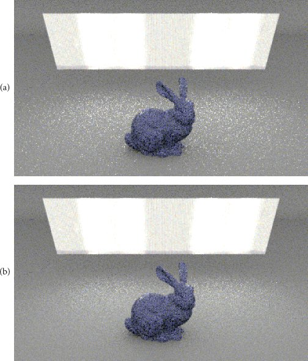

</details>

Otherwise, non-rectangular patches use an approximation to uniform area sampling; rectangles use the provided sample directly for $(u,v)$. In all cases the PDF is with respect to the $(u,v)$ domain.

**〈Sample bilinear patch parametric (u, v) coordinates〉 ≡ 338**

```rust
let mut pdf = 1.0;
let uv;
if let Some(dist) = mesh.image_distribution {
    uv = dist.sample(u, &mut pdf);
} else if !self.is_rectangle(mesh) {
    // 〈Sample patch (u, v) with approximate uniform area sampling 340〉
} else {
    uv = u;
}
```

<details>
<summary>Reference / notes</summary>

`BilinearPatch::IsRectangle()` 329 · `BilinearPatchMesh::imageDistribution` 340 · `Float` 23 · `PiecewiseConstant2D::Sample()` 1020 · `Point2f` 92

</details>

*Figure 6.27: Nonuniform Sample Distribution from Uniform Parametric Sampling. (a) Uniform $(u,v)$ sampling clusters points near close vertex pairs. (b) An approximate equal-area distribution spreads them more uniformly.*

```mermaid
flowchart LR
    A["(a) Uniform (u,v) samples"] --> D["Clustered near<br/>close vertex pairs"]
    B["(b) Approx. equal-area samples"] --> E["Evenly spread<br/>over the patch"]
```

**〈BilinearPatchMesh Public Members〉 +≡ 327**

```rust
image_distribution: Option<PiecewiseConstant2D>,
```

For patches without an emissive image, we would like to sample uniformly by surface area, as for all previous shapes. Unfortunately an exact equal-area algorithm cannot be derived for bilinear patches because Equation (6.12) cannot be integrated in closed form. Uniform sampling in $(u,v)$ can give a poor distribution when two vertices are close and the others far apart (Figure 6.27). Although the nonuniform density can be accounted for in the PDF, estimators generally have higher error. Exact equal-area sampling would pick points with probability proportional to the differential area $\|\partial\mathbf p/\partial u\times\partial\mathbf p/\partial v\|$. Lacking that, we approximate it with a bilinear function whose corner values are the differential areas at the corners (Figure 6.28).

**〈Sample patch (u, v) with approximate uniform area sampling〉 ≡ 339**

```rust
// 〈Initialize w array with differential area at bilinear patch corners 340〉
let uv = sample_bilinear(u, w);
let pdf = bilinear_pdf(uv, w);
```

The derivatives at the corners are just differences with adjacent vertices:

**〈Initialize w array with differential area at bilinear patch corners〉 ≡ 340, 342**

```rust
let w = [
    length(cross(p10 - p00, p01 - p00)),
    length(cross(p10 - p00, p11 - p10)),
    length(cross(p01 - p00, p11 - p01)),
    length(cross(p11 - p10, p11 - p01)),
];
```

<details>
<summary>Reference / notes</summary>

`BilinearPDF()` 76 · `Cross()` 91 · `Float` 23 · `Length()` 88 · `PiecewiseConstant2D` 1019 · `SampleBilinear()` 76

</details>

Given a $(u,v)$ position, the position, derivatives, and normal follow the same approach as `InteractionFromIntersection()`, so `〈Compute p, dpdu, and dpdv for sampled (u, v)〉` is omitted; $(s,t)$ coordinates come from an earlier fragment.

*Figure 6.28: Plot of differential area $\|\partial\mathbf p/\partial u\times\partial\mathbf p/\partial v\|$ in parametric space for the patch of Figure 6.27. Although the differential area is not bilinear, a bilinear fit has low error and is easy to sample from.*

**〈Compute bilinear patch geometric quantities at sampled (u, v)〉 ≡ 338**

```rust
// 〈Compute p, dpdu, and dpdv for sampled (u, v)〉
let mut st = uv;
if mesh.uv { // 〈Compute texture coordinates for bilinear patch intersection point 336〉 }
// 〈Compute surface normal for sampled bilinear patch (u, v) 341〉
// 〈Compute pError for sampled bilinear patch (u, v) 377〉
```

<details>
<summary>Figure 6.28 — pictorial image (keep)</summary>


</details>

Only the geometric normal is needed for a sampled point; it is the cross product of the position derivatives. `〈Flip normal at sampled (u, v) if necessary〉` negates it as needed based on mesh properties and shading normals, in the same form as earlier fragments.

**〈Compute surface normal for sampled bilinear patch (u, v)〉 ≡ 341**

```rust
let n = Normal3f::from(normalize(cross(dpdu, dpdv)));
// 〈Flip normal at sampled (u, v) if necessary〉
```

The PDF stored in `pdf` gives the probability of sampling parametric position `uv`. To express it with respect to surface area we apply the change of variables, multiplying by $1/\|\partial\mathbf p/\partial u\times\partial\mathbf p/\partial v\|$:

**〈Return ShapeSample for sampled bilinear patch point〉 ≡ 338**

```rust
Some(ShapeSample {
    intr: Interaction::new(Point3fi::new(p, p_error), n, st),
    pdf: pdf / length(cross(dpdu, dpdv)),
})
```

<details>
<summary>Reference / notes</summary>

`BilinearPatchMesh::uv` 327 · `Cross()` 91 · `Interaction` 136 · `Length()` 88 · `Normal3f` 94 · `Normalize()` 88 · `Point2f` 92 · `Point3fi` 1061 · `ShapeSample` 268

</details>

The `PDF()` for a given point first computes the density for its $(u,v)$ position, then transforms it to a surface-area density.

**〈BilinearPatch Method Definitions〉 +≡**

```rust
fn pdf(&self, intr: &Interaction) -> Float {
    let mesh = self.get_mesh();
    // 〈Get bilinear patch vertices in p00, p01, p10, and p11 329〉
    // 〈Compute parametric (u, v) of point on bilinear patch 342〉
    // 〈Compute PDF for sampling the (u, v) coordinates given by intr.uv 342〉
    // 〈Find dpdu and dpdv at bilinear patch (u, v)〉
    // 〈Return final bilinear patch area sampling PDF 342〉
}
```

If $(u,v)$ coordinates were specified at the patch vertices, `Interaction::uv` holds interpolated texture coordinates; we need the parametric coordinates over $[0,1]^2$, found with `InvertBilinear()`.

**〈Compute parametric (u, v) of point on bilinear patch〉 ≡ 342**

```rust
let mut uv = intr.uv;
if mesh.uv {
    let uv00 = mesh.uv[v[0]]; let uv10 = mesh.uv[v[1]];
    let uv01 = mesh.uv[v[2]]; let uv11 = mesh.uv[v[3]];
    uv = invert_bilinear(uv, [uv00, uv10, uv01, uv11]);
}
```

Regardless of the sampling technique, finding the $(u,v)$ PDF is straightforward:

**〈Compute PDF for sampling the (u, v) coordinates given by intr.uv〉 ≡ 342**

```rust
let pdf = if let Some(dist) = mesh.image_distribution {
    dist.pdf(uv)
} else if !self.is_rectangle(mesh) {
    // 〈Initialize w array with differential area at bilinear patch corners 340〉
    bilinear_pdf(uv, w)
} else { 1.0 };
```

Given `dpdu` and `dpdv`, the same scaling factor as in `Sample()` converts the PDF:

**〈Return final bilinear patch area sampling PDF〉 ≡ 342**

```rust
pdf / length(cross(dpdu, dpdv))
```

<details>
<summary>Reference / notes</summary>

`BilinearPatch::GetMesh()` 328 · `BilinearPatch::IsRectangle()` 329 · `BilinearPatchMesh` 327 · `BilinearPatchMesh::imageDistribution` 340 · `BilinearPatchMesh::uv` 327 · `BilinearPDF()` 76 · `Cross()` 91 · `Cylinder` 286 · `Disk` 292 · `Float` 23 · `Interaction` 136 · `Interaction::uv` 137 · `InvertBilinear()` 1033 · `Length()` 88 · `PiecewiseConstant2D::PDF()` 1021 · `Point2f` 92

</details>

The solid-angle sampling method handles general patches like cylinders and disks: sample by area using the first method, return the density in solid-angle measure. Rectangles use a specialized technique with better results.

**〈BilinearPatch Method Definitions〉 +≡**

```rust
fn sample(&self, ctx: &ShapeSampleContext, u: Point2f) -> Option<ShapeSample> {
    let mesh = self.get_mesh();
    // 〈Get bilinear patch vertices in p00, p01, p10, and p11 329〉
    // 〈Sample bilinear patch with respect to solid angle from reference point 343〉
}
```

If the patch is not a rectangle, is very small, or has an image distribution, the regular area-sampling method is used and its PDF converted to solid angle; otherwise specialized solid-angle sampling applies.

**〈Sample bilinear patch with respect to solid angle from reference point〉 ≡ 343**

```rust
let v00 = normalize(p00 - ctx.p());
let v10 = normalize(p10 - ctx.p());
let v01 = normalize(p01 - ctx.p());
let v11 = normalize(p11 - ctx.p());
if !self.is_rectangle(mesh) || mesh.image_distribution.is_some()
    || spherical_quad_area(v00, v10, v11, v01) <= MIN_SPHERICAL_SAMPLE_AREA
{
    // 〈Sample shape by area and compute incident direction wi 282〉
    // 〈Convert area sampling PDF in ss to solid angle measure 282〉
    return ss;
}
// 〈Sample direction to rectangular bilinear patch 343〉
```

**〈BilinearPatch Private Members〉 +≡ 328**

```rust
const MIN_SPHERICAL_SAMPLE_AREA: Float = 1e-4;
```

Rectangular patches are projected onto the sphere to form a spherical rectangle that can be sampled directly, with benefits similar to spherical triangles (Section 6.5.4).

<details>
<summary>Reference / notes</summary>

`BilinearPatch` 328 · `BilinearPatch::GetMesh()` 328 · `BilinearPatch::IsRectangle()` 329 · `BilinearPatch::MinSphericalSampleArea` 343 · `BilinearPatchMesh` 327 · `BilinearPatchMesh::imageDistribution` 340 · `BilinearPDF()` 76 · `Float` 23 · `Interaction` 136 · `Normal3f` 94 · `Normalize()` 88 · `Point2f` 92 · `SampleBilinear()` 76 · `ShapeSample` 268 · `ShapeSampleContext` 268 · `ShapeSampleContext::ns` 268 · `ShapeSampleContext::p()` 269 · `ShapeSampleContext::time` 268 · `SphericalQuadArea()` 106 · `Vector3f` 86

</details>

**〈Sample direction to rectangular bilinear patch〉 ≡ 343**

```rust
let mut pdf = 1.0;
// 〈Warp uniform sample u to account for incident cos theta factor 343〉
// 〈Sample spherical rectangle at reference point 344〉
// 〈Compute (u, v) and surface normal for sampled point on rectangle 344〉
// 〈Compute (s, t) texture coordinates for sampled (u, v) 344〉
Some(ShapeSample { intr: Interaction::with_time(p, n, ctx.time, st), pdf })
```

As with triangles, the incident cosine factor is approximated by warping $\mathbf u$ with a bilinear approximation of $\cos\theta$ in $[0,1]^2$:

**〈Warp uniform sample u to account for incident cos theta factor〉 ≡ 343**

```rust
if ctx.ns != Normal3f::ZERO {
    // 〈Compute cos theta weights for rectangle seen from reference point 344〉
    u = sample_bilinear(u, w);
    pdf *= bilinear_pdf(u, w);
}
```

The spherical rectangle sampler preserves the correspondence between corners of $[0,1]^2$ and corners of the patch, so each weight uses the cosine of the direction to the corresponding vertex:

**〈Compute cos theta weights for rectangle seen from reference point〉 ≡ 343, 345**

```rust
let w = [
    abs_dot(v00, ctx.ns).max(0.01),
    abs_dot(v10, ctx.ns).max(0.01),
    abs_dot(v01, ctx.ns).max(0.01),
    abs_dot(v11, ctx.ns).max(0.01),
];
```

`SampleSphericalRectangle()` takes a reference point, the $(0,0)$ corner, and the two edge vectors; it returns a point on the patch and the PDF $1/\Omega$, where $\Omega$ is the subtended solid angle.

**〈Sample spherical rectangle at reference point〉 ≡ 343**

```rust
let eu = p10 - p00;
let ev = p01 - p00;
let mut quad_pdf = 0.0;
let p = sample_spherical_rectangle(ctx.p(), p00, eu, ev, u, &mut quad_pdf);
pdf *= quad_pdf;
```

Its implementation is another exercise in spherical trigonometry, like `SampleSphericalTriangle()`; in the interests of space we omit the discussion. The "Further Reading" section points to the paper introducing the approach and deriving it.

**〈Sampling Function Declarations〉 ≡**

```rust
fn sample_spherical_rectangle(
    p: Point3f, v00: Point3f, eu: Vector3f, ev: Vector3f,
    u: Point2f, pdf: &mut Float,
) -> Point3f;
```

A rectangle has a single normal, given by the cross product of its edges; the $(u,v)$ coordinates of the sampled point come from normalized projections onto the edges.

**〈Compute (u, v) and surface normal for sampled point on rectangle〉 ≡ 343**

```rust
let uv = Point2f::new(
    dot(p - p00, eu) / distance_squared(p10, p00),
    dot(p - p00, ev) / distance_squared(p01, p00));
let n = Normal3f::from(normalize(cross(eu, ev)));
// 〈Flip normal at sampled (u, v) if necessary〉
```

<details>
<summary>Reference / notes</summary>

`AbsDot()` 90 · `BilinearPatch` 328 · `BilinearPatch::GetMesh()` 328 · `BilinearPatchMesh` 327 · `BilinearPatchMesh::uv` 327 · `Cross()` 91 · `DistanceSquared()` 93 · `Dot()` 89 · `Float` 23 · `Normal3f` 94 · `Normalize()` 88 · `Point2f` 92 · `Point3f` 92 · `SampleSphericalRectangle()` 344 · `SampleSphericalTriangle()` 318 · `ShapeSampleContext` 268 · `ShapeSampleContext::ns` 268 · `ShapeSampleContext::p()` 269 · `Vector3f` 86

</details>

If the patch has per-vertex texture coordinates, the interpolated $(s,t)$ at the sample are computed as before:

**〈Compute (s, t) texture coordinates for sampled (u, v)〉 ≡ 343**

```rust
let mut st = uv;
if mesh.uv {
    // 〈Compute texture coordinates for bilinear patch intersection point 336〉
}
```

The associated `PDF()` follows the usual form: determine which sampling method would be used, then compute its solid-angle PDF.

**〈BilinearPatch Method Definitions〉 +≡**

```rust
fn pdf(&self, ctx: &ShapeSampleContext, wi: Vector3f) -> Float {
    let mesh = self.get_mesh();
    // 〈Get bilinear patch vertices in p00, p01, p10, and p11 329〉
    // 〈Compute solid angle PDF for sampling bilinear patch from ctx 345〉
}
```

In all cases the `SurfaceInteraction` for the ray from `ctx` in direction $\omega_i$ is needed, so the method starts by intersecting that ray with the patch.

**〈Compute solid angle PDF for sampling bilinear patch from ctx〉 ≡ 344**

```rust
// 〈Intersect sample ray with shape geometry 285〉
let v00 = normalize(p00 - ctx.p()); let v10 = normalize(p10 - ctx.p());
let v01 = normalize(p01 - ctx.p()); let v11 = normalize(p11 - ctx.p());
if !self.is_rectangle(mesh) || mesh.image_distribution.is_some()
    || spherical_quad_area(v00, v10, v11, v01) <= MIN_SPHERICAL_SAMPLE_AREA
{
    // 〈Return solid angle PDF for area-sampled bilinear patch 345〉
} else {
    // 〈Return PDF for sample in spherical rectangle 345〉
}
```

If an area-sampling approach was used, the other `PDF()` method provides the area density, which is converted to solid angle:

**〈Return solid angle PDF for area-sampled bilinear patch〉 ≡ 345**

```rust
let mut pdf = self.pdf(&isect.intr)
    * (distance_squared(ctx.p(), isect.intr.p())
       / abs_dot(isect.intr.n, -wi));
if is_inf(pdf) { pdf = 0.0; }
```

Otherwise spherical rectangle sampling was used. The uniform solid-angle PDF is one over the subtended solid angle; if the reference point is on a surface and cosine warping would be applied in `Sample()`, its PDF factor must be included too.

<details>
<summary>Reference / notes</summary>

`AbsDot()` 90 · `BilinearPatch::IsRectangle()` 329 · `BilinearPatch::MinSphericalSampleArea` 343 · `BilinearPatch::PDF()` 342 · `BilinearPatchMesh::imageDistribution` 340 · `BilinearPDF()` 76 · `Curve` 346 · `DistanceSquared()` 93 · `Float` 23 · `Interaction::n` 137 · `Interaction::p()` 137 · `InvertSphericalRectangleSample()` 345 · `IsInf()` 363 · `Normal3f` 94 · `Normalize()` 88 · `Point2f` 92 · `Point3f` 92 · `SampleSphericalRectangle()` 344 · `ShapeIntersection::intr` 266 · `ShapeSampleContext::ns` 268 · `ShapeSampleContext::p()` 269 · `SphericalQuadArea()` 106 · `SurfaceInteraction` 138 · `Vector3f` 86

</details>

**〈Return PDF for sample in spherical rectangle〉 ≡ 345**

```rust
let pdf = 1.0 / spherical_quad_area(v00, v10, v11, v01);
if ctx.ns != Normal3f::ZERO {
    // 〈Compute cos theta weights for rectangle seen from reference point 344〉
    let u = invert_spherical_rectangle_sample(
        ctx.p(), p00, p10 - p00, p01 - p00, isect.intr.p());
    return bilinear_pdf(u, w) * pdf;
}
pdf
```

`InvertSphericalRectangleSample()` (not included here) returns the sample $\mathbf u$ mapping to the given point `pRect` when `SampleSphericalRectangle()` is called with reference point `pRef`.

**〈Sampling Function Declarations〉 +≡**

```rust
fn invert_spherical_rectangle_sample(
    p_ref: Point3f,
    v00: Point3f,
    eu: Vector3f,
    ev: Vector3f,
    p_rect: Point3f,
) -> Point2f;
```

## 6.7 Curves

Triangles and bilinear patches can represent thin shapes for hair, fur, or grass, but a specialized `Shape` is worthwhile when many such instances are present. The `Curve` shape models thin geometry with cubic Bézier curves defined by four control points $\mathbf p_0,\mathbf p_1,\mathbf p_2,\mathbf p_3$. The spline passes through the first and last control points; points along it are given by

$$\mathbf p(u)=(1-u)^3\mathbf p_0+3(1-u)^2u\,\mathbf p_1 +3(1-u)u^2\mathbf p_2+u^3\mathbf p_3. \quad\text{(6.16)}$$

*Figure 6.29: A cubic Bézier curve is defined by four control points $\mathbf p_i$. The curve $\mathbf p(u)$ passes through the first and last control points at $u=0$ and $u=1$, respectively.*

```mermaid
flowchart LR
    P0["p0 (start, u=0)"] --> C["Cubic Bezier p(u)"]
    P1["p1 (control)"] --> C
    P2["p2 (control)"] --> C
    P3["p3 (end, u=1)"] --> C
    C --> F["p(u) = (1-u)^3 p0 + 3(1-u)^2 u p1<br/>+ 3(1-u) u^2 p2 + u^3 p3"]
```

*Figure 6.30: Basic Geometry of the Curve Shape. A 1D Bézier curve is offset by half the specified width in both directions orthogonal to the curve at each point; the resulting area is the curve's surface.*

```mermaid
flowchart LR
    B["1D Bezier centerline p(u)"] --> N["Orthogonal direction at each u"]
    N --> O["Offset by +/- width/2<br/>to trace both edges"]
    O --> S["Flat 2D surface = curve's area"]
```

Curves specified in another basis (Hermite splines, b-splines) must be converted to the Bézier basis for use with this shape.

<details>
<summary>Reference / notes</summary>

`BoundCubicBezier()` 1054 · `Bounds3f` 97 · `Curve` 346 · `Curve::common` 348 · `Curve::uMax` 348 · `Curve::uMin` 348 · `CurveCommon` 348 · `CurveCommon::cpObj` 348 · `CurveCommon::renderFromObject` 348 · `CurveType` 347 · `Float` 23 · `Normal3f` 94 · `Point3f` 92 · `Transform` 120

</details>

The `Curve` shape is a 1D Bézier curve plus a width linearly interpolated between starting and ending widths. Together these define a flat 2D surface.[^5] Rays can be intersected with this representation directly, without tessellation, so smooth curves render efficiently without excessive storage. Figure 6.31 shows a bunny with fur modeled by over one million curves.

**〈Curve Definition〉 ≡**

```rust
struct Curve {
    // 〈Curve Public Methods〉
    // 〈Curve Private Methods〉
    // 〈Curve Private Members〉
}
```

There are three curve types (Figure 6.32):

- **Flat**: always oriented to face the ray being intersected; useful for fine swept cylindrical shapes like hair or fur.
- **Cylinder**: for curves spanning a few pixels on screen, a shading normal makes the curve appear cylindrical.
- **Ribbon**: for shapes without a cylindrical cross section, such as a blade of grass.

<details>
<summary>Reference / notes</summary>

`Curve` 346

</details>

*Figure 6.31: Furry Bunny. Over one million `Curve` shapes model the fur (unrealistically long here, to show off the shape's capabilities). Underlying bunny mesh courtesy of the Stanford Computer Graphics Laboratory.*

<details>
<summary>Figure 6.31 — pictorial image (keep)</summary>


</details>

*Figure 6.32: The Three Types of Curves. Top: flat, always perpendicular to an approaching ray. Middle: a variant whose shading normal makes it appear cylindrical. Bottom: a ribbon, with fixed orientation at its endpoints and smoothly interpolated intermediate orientations.*

<details>
<summary>Figure 6.32 — pictorial image (keep)</summary>

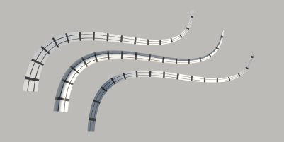

</details>

The `CurveType` enumerator records which type a `Curve` models. Flat and cylinder curves are convenient approximations of deformed cylinders; intersections found against them do not correspond to a physically realizable 3D shape, which can lead to minor inconsistencies when compared with scenes using true cylinders.

**〈CurveType Definition〉 ≡**

```rust
enum CurveType { Flat, Cylinder, Ribbon }
```

Given a curve specified in a pbrt scene file, it can be worthwhile to split it into segments covering parts of the $u$ range: axis-aligned boxes bound wiggly curves poorly, but subdivision makes Bézier curves less wiggly (the variation-diminishing property of polynomials). The `Curve` constructor therefore takes a parametric range $[u_{\min},u_{\max}]$ and a pointer to a `CurveCommon` structure holding control points and other data shared across segments, reducing per-segment memory.

**〈Curve Public Methods〉 ≡ 346**

```rust
impl Curve {
    fn new(common: &CurveCommon, u_min: Float, u_max: Float) -> Self {
        Self { common, u_min, u_max }
    }
}
```

**〈Curve Private Members〉 ≡ 346**

```rust
struct Curve {
    common: &'static CurveCommon,
    u_min: Float,
    u_max: Float,
}
```

The `CurveCommon` constructor initializes members from the control points, width, and so on, with control points in the curve's object space. For ribbons it stores a surface normal at each endpoint; the constructor precomputes the angle between the two normals and the reciprocal of its sine, which are useful for interpolating orientation at arbitrary points.

**〈CurveCommon Definition〉 ≡**

```rust
struct CurveCommon {
    // 〈CurveCommon Public Methods〉
    // 〈CurveCommon Public Members〉
}
```

**〈CurveCommon Public Members〉 ≡ 348**

```rust
struct CurveCommon {
    curve_type: CurveType,
    cp_obj: [Point3f; 4],
    width: [Float; 2],
    n: [Normal3f; 2],
    normal_angle: Float,
    inv_sin_normal_angle: Float,
    render_from_object: Transform,
    object_from_render: Transform,
    reverse_orientation: bool,
    transform_swaps_handedness: bool,
}
```

### 6.7.1 Bounding Curves

The object-space bound is found by bounding the spline along the curve's center, then expanding by half the maximum width over its extent. `Bounds()` transforms that bound to rendering space.

**〈Curve Method Definitions〉 ≡**

```rust
fn bounds(&self) -> Bounds3f {
    let cp_span = &self.common.cp_obj[..];
    let mut obj_bounds = bound_cubic_bezier(cp_span, self.u_min, self.u_max);
    // 〈Expand objBounds by maximum curve width over u range 349〉
    self.common.render_from_object.apply(obj_bounds)
}
```

**〈Expand objBounds by maximum curve width over u range〉 ≡ 348**

```rust
let width = [
    lerp(self.u_min, self.common.width[0], self.common.width[1]),
    lerp(self.u_max, self.common.width[0], self.common.width[1]),
];
obj_bounds = expand(obj_bounds, width[0].max(width[1]) * 0.5);
```

A curve cannot be used as an area light because it lacks the sampling methods. It does provide a conservative `NormalBounds()`:

**〈Curve Public Methods〉 +≡ 346**

```rust
fn normal_bounds(&self) -> DirectionCone { DirectionCone::entire_sphere() }
```

<details>
<summary>Reference / notes</summary>

`Bounds3::Expand()` 101 · `CubicBezierControlPoints()` 1053 · `Curve` 346 · `Curve::common` 348 · `Curve::IntersectRay()` 349 · `CurveCommon` 348 · `CurveCommon::objectFromRender` 348 · `CurveCommon::width` 348 · `DirectionCone` 114 · `DirectionCone::EntireSphere()` 115 · `Float` 23 · `Ray` 95 · `ShapeIntersection` 266

</details>

### 6.7.2 Intersection Tests

Both required intersection methods are implemented via `IntersectRay()`, which takes a pointer to an optional `ShapeIntersection` rather than returning one.

**〈Curve Method Definitions〉 +≡**

```rust
fn intersect(&self, ray: &Ray, t_max: Float) -> Option<ShapeIntersection> {
    let mut si = None;
    self.intersect_ray(ray, t_max, &mut si);
    si
}
```

`IntersectP()` passes `None`, indicating it can return immediately on a hit:

**〈Curve Method Definitions〉 +≡**

```rust
fn intersect_p(&self, ray: &Ray, t_max: Float) -> bool {
    let mut si = None;
    self.intersect_ray(ray, t_max, &mut si);
    si.is_some()
}
```

The algorithm discards curve segments as soon as it can determine the ray definitely misses, otherwise recursively splitting the segment in half until a linear approximation suffices. It begins with preparation and early culling in `IntersectRay()`.

**〈Curve Method Definitions〉 +≡**

```rust
fn intersect_ray(
    &self,
    r: &Ray,
    t_max: Float,
    si: &mut Option<ShapeIntersection>,
) -> bool {
    // 〈Transform Ray to curve's object space 349〉
    // 〈Get object-space control points for curve segment, cpObj 350〉
    // 〈Project curve control points to plane perpendicular to ray 350〉
    // 〈Test ray against bound of projected control points 351〉
    // 〈Compute refinement depth for curve, maxDepth〉
    // 〈Recursively test for ray–curve intersection 351〉
}
```

**〈Transform Ray to curve's object space〉 ≡ 349**

```rust
let ray = self.common.object_from_render.apply(r);
```

`CurveCommon` stores the control points of the full curve, but a segment needs the four points representing its $u$ extent; `CubicBezierControlPoints()` performs that computation.

**〈Get object-space control points for curve segment, cpObj〉 ≡ 349**

```rust
let cp_obj = cubic_bezier_control_points(&self.common.cp_obj[..], self.u_min, self.u_max);
```

Like ray–triangle intersection, the test transforms the curve into a space with the ray origin at the origin and direction along $+z$. Here we need the transformation explicitly, so `LookAt()` generates it: the eye is the ray origin, the look-at point is one step along the ray, and the "up" direction is perpendicular to both the ray and the vector from first to last control point. That orients the curve roughly along the $x$ axis, producing tighter bounds in $y$ (Figure 6.33) and often ending recursion earlier. If the ray and the endpoint vector are parallel, an arbitrary up vector is used instead.

*Figure 6.33: 2D Bounding Boxes of a Bézier Curve. (a) Using control points as given. (b) Rotating so the first-to-last control-point vector aligns with $x$ yields a much tighter box.*

```mermaid
flowchart LR
    A["(a) Control-point bounds<br/>loose fit"] --> R["Rotate: align p3-p0 with x axis"]
    R --> B["(b) Tighter 2D bounding box"]
    B --> E["Earlier termination of recursive tests"]
```

<details>
<summary>Reference / notes</summary>

`CoordinateSystem()` 92 · `Cross()` 91 · `CubicBezierControlPoints()` 1053 · `Curve::Bounds()` 348 · `Curve::common` 348 · `Curve::uMax` 348 · `Curve::uMin` 348 · `CurveCommon::cpObj` 348 · `LengthSquared()` 87 · `LookAt()` 129 · `Point3f` 92 · `Ray::d` 95 · `Ray::o` 95 · `Transform` 120 · `Vector3f` 86

</details>

**〈Project curve control points to plane perpendicular to ray〉 ≡ 349**

```rust
let mut dx = cross(ray.d, cp_obj[3] - cp_obj[0]);
if length_squared(dx) == 0.0 {
    let mut dy = Vector3f::ZERO;
    coordinate_system(ray.d, &mut dx, &mut dy);
}
let ray_from_object = look_at(ray.o, ray.o + ray.d, dx);
let cp = [
    ray_from_object.apply(cp_obj[0]), ray_from_object.apply(cp_obj[1]),
    ray_from_object.apply(cp_obj[2]), ray_from_object.apply(cp_obj[3]),
];
```

As in `Curve::Bounds()`, a conservative bound for a segment comes from its control points' bounds expanded by half the maximum width over the $u$ range.

*Figure 6.34: Ray–Curve Bounds Test. In ray space the origin is $(0,0,0)$ and the direction is $+z$, so if $(x,y)=(0,0)$ is outside the segment's $xy$ bounding box, the ray cannot intersect the curve.*

```mermaid
flowchart LR
    O["Ray bounds: x=y=0,<br/>z in [0, |d| t_max]"] --> T{"Overlaps<br/>curve bounds?"}
    T -- no --> M["Return miss"]
    T -- yes --> REC["Begin recursive intersection tests"]
```

**〈Test ray against bound of projected control points〉 ≡ 349**

```rust
let max_width = lerp(self.u_min, self.common.width[0], self.common.width[1])
    .max(lerp(self.u_max, self.common.width[0], self.common.width[1]));
let mut curve_bounds = Bounds3f::new(cp[0], cp[1]).union(Bounds3f::new(cp[2], cp[3]));
curve_bounds = expand(curve_bounds, 0.5 * max_width);
let ray_bounds = Bounds3f::new(
    Point3f::ZERO,
    Point3f::new(0.0, 0.0, length(ray.d) * t_max));
if !overlaps(ray_bounds, curve_bounds) { return false; }
```

The maximum subdivision depth is chosen so the distance from the linearized curve at the finest level stays below a small fixed value; we omit that computation. With the culling tests passed, recursion begins.

**〈Recursively test for ray–curve intersection〉 ≡ 349**

```rust
recursive_intersect(ray, t_max, &cp[..], ray_from_object.inverse(),
                    self.u_min, self.u_max, max_depth, si)
```

<details>
<summary>Reference / notes</summary>

`Bounds3::Expand()` 101 · `Bounds3::Union()` 99 · `Bounds3f` 97 · `Curve::common` 348 · `Curve::RecursiveIntersect()` 351 · `Curve::uMax` 348 · `Curve::uMin` 348 · `CurveCommon::width` 348 · `Float` 23 · `Length()` 88 · `Lerp()` 72 · `Point3f` 92 · `Ray` 95 · `Ray::d` 95 · `ShapeIntersection` 266 · `Transform` 120

</details>

`RecursiveIntersect()` tests the ray against a curve segment over a parametric range $[u_0,u_1]$, assuming the segment's bounding box has already been tested and intersected.

**〈Curve Method Definitions〉 +≡**

```rust
fn recursive_intersect(
    &self,
    ray: &Ray,
    t_max: Float,
    cp: &[Point3f],
    object_from_ray: &Transform,
    u0: Float,
    u1: Float,
    depth: i32,
    si: &mut Option<ShapeIntersection>,
) -> bool {
    let ray_length = length(ray.d);
    if depth > 0 {
        // 〈Split curve segment into subsegments and test for intersection 352〉
    } else {
        // 〈Intersect ray with curve segment 352〉
    }
}
```

If the maximum depth has not been reached, `SubdivideCubicBezier()` splits the Bézier curve in half. The last control point of the first curve equals the first of the second, so 7 values represent 8 control points. The `u` array then holds the two subranges.

**〈Split curve segment into subsegments and test for intersection〉 ≡ 351**

```rust
let cp_split = subdivide_cubic_bezier(cp);
let u = [u0, (u0 + u1) / 2.0, u1];
for seg in 0..2 {
    // 〈Check ray against curve segment's bounding box〉
    // 〈Recursively test ray-segment intersection 352〉
}
if si.is_some() { true } else { false }
```

The box test is essentially the earlier one, using `u` values for the width and `cpSplit` for control points, so it is omitted. If the ray hits the box, the segment is tested recursively. For shadow rays `si` is `None` and an intersection can be reported immediately; for other rays even a hit may not be the closest, so the second segment must be considered too.

**〈Recursively test ray-segment intersection〉 ≡ 352**

```rust
let hit = self.recursive_intersect(
    ray, t_max, cps, object_from_ray,
    u[seg], u[seg + 1], depth - 1, si);
if hit && si.is_none() { return true; }
```

The variation-diminishing property lets us approximate the curve with a line segment for the final test:

**〈Intersect ray with curve segment〉 ≡ 351**

```rust
// 〈Test ray against segment endpoint boundaries 352〉
// 〈Find line w that gives minimum distance to sample point 355〉
// 〈Compute u coordinate of curve intersection point and hitWidth 355〉
// 〈Test intersection point against curve width 355〉
if si.is_some() {
    // 〈Initialize ShapeIntersection for curve intersection 356〉
}
true
```

Only intersections on the current segment's surface are accepted, so the first step computes edge functions for lines perpendicular to the segment endpoints and classifies the candidate point against them (Figure 6.35).

**〈Test ray against segment endpoint boundaries〉 ≡ 352**

```rust
// 〈Test sample point against tangent perpendicular at curve start 353〉
// 〈Test sample point against tangent perpendicular at curve end〉
```

*Figure 6.35: Curve Segment Boundaries. The test computes edge functions for lines perpendicular to the segment endpoints (dashed). A candidate point on the far side of an edge is rejected; a neighboring segment accounts for that intersection instead.*

```mermaid
flowchart LR
    S["Segment endpoints p0, p3"] --> E["Perpendicular lines at endpoints<br/>(tangent = p1-p0 at start)"]
    E --> C{"Candidate (0,0)<br/>on segment side?"}
    C -- no --> R["Reject: another segment<br/>should handle this hit"]
    C -- yes --> H["Continue with distance test"]
```

Projecting control points into ray space makes the test efficient: the ray is along $+z$, reducing the problem to 2D in $x,y$, and the point to classify is $(0,0)$, simplifying the edge function as in ray–triangle intersection (Equation 6.5, Figure 6.14). We need two points on the line perpendicular to the curve through the starting point: $\mathbf p_0$ itself, and a point offset along the perpendicular to the tangent. Differentiating Equation (6.16) shows the tangent at $\mathbf p_0$ is $3(\mathbf p_1-\mathbf p_0)$; the scale does not matter, so we use $\mathbf t=\mathbf p_1-\mathbf p_0$. In 2D a perpendicular is obtained by swapping $x$ and $y$ and negating one component, since $(x,y)\cdot(y,-x)=xy-yx=0$. The second point is

$$\mathbf p_0+(p_{1y}-p_{0y},\;p_{0x}-p_{1x}).$$

Substituting into the edge function gives

$$e(\mathbf p)=(p_{1y}-p_{0y})(p_y-p_{0y})-(p_x-p_{0x})(p_{0x}-p_{1x}),$$

and with $\mathbf p=(0,0)$ the final test is

$$e((0,0))=(p_{1y}-p_{0y})(-p_{0y})+p_{0x}(p_{0x}-p_{1x}).$$

**〈Test sample point against tangent perpendicular at curve start〉 ≡ 352**

```rust
let edge = (cp[1].y - cp[0].y) * -cp[0].y
         + cp[0].x * (cp[0].x - cp[1].x);
if edge < 0.0 { return false; }
```

The end-of-curve fragment is analogous and not included.

<details>
<summary>Reference / notes</summary>

`Curve::RecursiveIntersect()` 351 · `Float` 23 · `Point3f` 92 · `SubdivideCubicBezier()` 1053

</details>

Next we find the $u$ along the segment where $(0,0)$ is closest to the curve—the intersection point if it lies within half the curve's width. An exact answer for a cubic Bézier requires significant computation, so the implementation approximates the curve with a line segment.

*Figure 6.36: Approximation of a Cubic Bézier Curve with a Linear Segment. After subdivision the curve is already nearly linear, so the error is smaller than the figure suggests.*

```mermaid
flowchart LR
    C["Cubic Bezier segment"] --> L["Linear segment p0 -> p3<br/>parameterized by w in [0,1]"]
    L --> Q["Find w minimizing distance<br/>to p = (0,0)"]
```

*Figure 6.37: Given a line and a point $\mathbf p$, the vector from $\mathbf p$ to the closest point $\mathbf p'$ on the line is perpendicular to the line, so $d=\lVert\mathbf p-\mathbf p_0\rVert\cos\theta$ gives the distance from $\mathbf p_0$ to $\mathbf p'$.*

```mermaid
flowchart LR
    P["Point p = (0,0)"] --> PP["Closest point p' on line<br/>(p-p') perpendicular to line"]
    PP --> D["d = |p - p0| cos(theta)"]
    D --> W["w = d / |p3 - p0|"]
```

We linearly approximate the Bézier with a segment from $\mathbf p_0$ to $\mathbf p_3$ parameterized by $w\in[0,1]$ (Figure 6.36). At the closest point $\mathbf p'$, the vector from the line to $\mathbf p$ is perpendicular to the line (Figure 6.37(a)). Equation (3.1) relates the dot product, lengths, and cosine of the angle between $\mathbf p-\mathbf p_0$ and $\mathbf p_3-\mathbf p_0$:

$$\cos\theta=\frac{(\mathbf p-\mathbf p_0)\cdot(\mathbf p_3-\mathbf p_0)} {\lVert\mathbf p-\mathbf p_0\rVert\,\lVert\mathbf p_3-\mathbf p_0\rVert}.$$

Because $\mathbf p-\mathbf p'$ is perpendicular (Figure 6.37(b)), the distance along the line from $\mathbf p_0$ to $\mathbf p'$ is

$$d = \lVert\mathbf p-\mathbf p_0\rVert\cos\theta = \frac{(\mathbf p-\mathbf p_0)\cdot(\mathbf p_3-\mathbf p_0)} {\lVert\mathbf p_3-\mathbf p_0\rVert},$$

and $w=d/\lVert\mathbf p_3-\mathbf p_0\rVert$. With $\mathbf p=(0,0)$ this simplifies further:

**〈Find line w that gives minimum distance to sample point〉 ≡ 352**

```rust
let segment_dir = Point2f::new(cp[3].x, cp[3].y) - Point2f::new(cp[0].x, cp[0].y);
let denom = length_squared(segment_dir);
if denom == 0.0 { return false; }
let w = dot(-Vector2f::new(cp[0].x, cp[0].y), segment_dir) / denom;
```

The parametric $u$ coordinate of the presumed closest point is found by interpolating over the segment's $u$ range, and the width there follows:

**〈Compute u coordinate of curve intersection point and hitWidth〉 ≡ 352**

```rust
let u = lerp(w, u0, u1).clamp(u0, u1);
let mut hit_width = lerp(u, self.common.width[0], self.common.width[1]);
let mut n_hit = Normal3f::ZERO;
if self.common.curve_type == CurveType::Ribbon {
    // 〈Scale hitWidth based on ribbon orientation 355〉
}
```

A ribbon is not always oriented toward the ray: its orientation is interpolated between two endpoint normals via spherical linear interpolation. The width is scaled by the cosine of the angle between the normalized ray direction and the ribbon orientation, giving the visible width from that direction.

**〈Scale hitWidth based on ribbon orientation〉 ≡ 355**

```rust
if self.common.normal_angle == 0.0 {
    n_hit = self.common.n[0];
} else {
    let sin0 = ((1.0 - u) * self.common.normal_angle).sin()
             * self.common.inv_sin_normal_angle;
    let sin1 = (u * self.common.normal_angle).sin()
             * self.common.inv_sin_normal_angle;
    n_hit = sin0 * self.common.n[0] + sin1 * self.common.n[1];
}
hit_width *= abs_dot(n_hit, ray.d) / ray_length;
```

<details>
<summary>Reference / notes</summary>

`AbsDot()` 90 · `Clamp()` 1033 · `Curve::common` 348 · `CurveCommon::invSinNormalAngle` 348 · `CurveCommon::n` 348 · `CurveCommon::normalAngle` 348 · `CurveCommon::type` 348 · `CurveCommon::width` 348 · `CurveType::Ribbon` 347 · `Dot()` 89 · `EvaluateCubicBezier()` 1052 · `Float` 23 · `Lerp()` 72 · `Normal3f` 94 · `Point2f` 92 · `Point3f` 92 · `Ray::d` 95 · `Sqr()` 1034 · `Vector2f` 86 · `Vector3f` 86

</details>

To classify the candidate as a hit we must still evaluate the Bézier at $u$ (using $w$, which lies in $[0,1]$, because `cp` describes the current segment). The derivative is recorded for later use. Because $\mathbf p=(0,0)$, we test whether the distance from $\mathbf p_c$ to the origin is less than half the width, equivalently $p_c.x^2+p_c.y^2\le \tfrac14\,\mathrm{hitWidth}^2$, then check the ray's $t$ range:

**〈Test intersection point against curve width〉 ≡ 352**

```rust
let mut dpcdw = Vector3f::ZERO;
let pc = evaluate_cubic_bezier(cp, w.clamp(0.0, 1.0), Some(&mut dpcdw));
let pt_curve_dist2 = pc.x.sqr() + pc.y.sqr();
if pt_curve_dist2 > hit_width.sqr() * 0.25 { return false; }
if pc.z < 0.0 || pc.z > ray_length * t_max { return false; }
```

For non-shadow rays the `ShapeIntersection` is finally initialized, requiring $t$ and the `SurfaceInteraction`.

**〈Initialize ShapeIntersection for curve intersection〉 ≡ 352**

```rust
// 〈Compute tHit for curve intersection 356〉
// 〈Initialize SurfaceInteraction intr for curve intersection 356〉
*si = Some(ShapeIntersection { intr, t_hit });
```

**〈Compute tHit for curve intersection〉 ≡ 356**

```rust
let t_hit = pc.z / ray_length;
if let Some(prev) = si {
    if t_hit > prev.t_hit { return false; }
}
```

<details>
<summary>Reference / notes</summary>

`Curve::common` 348 · `CurveCommon::renderFromObject` 348 · `CurveCommon::reverseOrientation` 348 · `CurveCommon::transformSwapsHandedness` 348 · `Float` 23 · `Normal3f` 94 · `Point3fi` 1061 · `ShapeIntersection` 266 · `ShapeIntersection::tHit` 266 · `SurfaceInteraction` 138

</details>

A variety of quantities are needed to initialize the `SurfaceInteraction`:

**〈Initialize SurfaceInteraction intr for curve intersection〉 ≡ 356**

```rust
// 〈Compute v coordinate of curve intersection point 356〉
// 〈Compute dpdu and dpdv for curve intersection 357〉
// 〈Compute error bounds for curve intersection 378〉
let flip_normal = self.common.reverse_orientation
               ^ self.common.transform_swaps_handedness;
let pi = Point3fi::new(ray(t_hit), p_error);
let mut intr = SurfaceInteraction::new(
    pi, Point2f::new(u, v), -ray.d, dpdu, dpdv,
    Normal3f::ZERO, Normal3f::ZERO, ray.time, flip_normal);
intr = self.common.render_from_object.apply(intr);
```

We have not yet computed the $v$ coordinate, which ranges over $[0,1]$ with $0.5$ at the curve's center. An edge function through $\mathbf p_c$ along its derivative classifies the candidate point $(0,0)$ as being on one side of the center or the other:

**〈Compute v coordinate of curve intersection point〉 ≡ 356**

```rust
let pt_curve_dist = pt_curve_dist2.sqrt();
let edge_func = dpcdw.x * -pc.y + pc.x * dpcdw.y;
let v = if edge_func > 0.0 { 0.5 + pt_curve_dist / hit_width }
        else                { 0.5 - pt_curve_dist / hit_width };
```

$\partial\mathbf p/\partial u$ comes directly from the Bézier derivative. The second derivative $\partial\mathbf p/\partial v$ depends on the curve type: for ribbons we have $\partial\mathbf p/\partial u$ and the surface normal, so $\partial\mathbf p/\partial v$ must satisfy $\partial\mathbf p/\partial u\times\partial\mathbf p/\partial v=\mathbf n$ with length equal to the curve's width.

**〈Compute dpdu and dpdv for curve intersection〉 ≡ 356**

```rust
let (mut dpdu, mut dpdv);
evaluate_cubic_bezier(&self.common.cp_obj[..], u, Some(&mut dpdu));
if self.common.curve_type == CurveType::Ribbon {
    dpdv = normalize(cross(n_hit, dpdu)) * hit_width;
} else {
    // 〈Compute curve dpdv for flat and cylinder curves 357〉
}
```

For flat and cylinder curves we transform $\partial\mathbf p/\partial u$ into the intersection space. A flat curve's $\partial\mathbf p/\partial v$ lies in the $xy$ plane, is perpendicular to $\partial\mathbf p/\partial u$, and has length `hitWidth`; we use the same 2D perpendicular trick as for segment boundaries.

**〈Compute curve dpdv for flat and cylinder curves〉 ≡ 357**

```rust
let dpdu_plane = object_from_ray.apply_inverse(dpdu);
let mut dpdv_plane = normalize(Vector3f::new(-dpdu_plane.y, dpdu_plane.x, 0.0))
                  * hit_width;
if self.common.curve_type == CurveType::Cylinder {
    // 〈Rotate dpdvPlane to give cylindrical appearance 357〉
}
dpdv = object_from_ray.apply(dpdv_plane);
```

For cylinder curves, rotating $\partial\mathbf p/\partial v$ around the $\partial\mathbf p/\partial u$ axis makes the appearance resemble a cylindrical cross-section:

**〈Rotate dpdvPlane to give cylindrical appearance〉 ≡ 357**

```rust
let theta = lerp(v, -90.0, 90.0);
let rot = rotate(theta, dpdu_plane);
dpdv_plane = rot.apply(dpdv_plane);
```

## 6.8 Managing Rounding Error

So far we have discussed ray–shape intersection in terms of idealized arithmetic on real numbers. That has taken us far, but computers can represent only finite quantities and therefore not all real numbers. In place of reals they use floating-point numbers with fixed storage, and error may be introduced each time an operation's result is not representable in the available memory.

The accumulation of this error has several implications for intersection accuracy. Valid intersections may be missed entirely—for example if a computed $t$ is negative although the precise value is positive. Computed ray–shape intersection points may lie above or below the actual surface. New rays traced from such points for shadowing or reflection can then incorrectly reintersect the surface, or shadows and reflections may appear detached (Figure 6.38). The standard remedy is to offset spawned rays by a fixed "ray epsilon", ignoring intersections closer than some $t_{\min}$ along $\mathbf p+t\mathbf d$.

*Figure 6.38: Geometric Settings for Rounding-Error Issues. Left: the computed intersection point (black circle) lies slightly below the surface and a too-small epsilon leaves the shadow-ray origin (white circle) below it, causing an incorrect self-intersection and a false occlusion. Right: a too-large epsilon skips a valid occluding surface.*

```mermaid
flowchart LR
    subgraph small["Too-small epsilon"]
        A["Computed point below surface"] --> B["Shadow origin still below"]
        B --> C["False self-intersection<br/>light incorrectly occluded"]
    end
    subgraph large["Too-large epsilon"]
        D["Origin past occluder"] --> E["Valid intersection missed"]
    end
```

*Figure 6.39: If the computed point is below the surface and the spawned ray is oblique, incorrect reintersections may occur some distance from the origin; a minimum $t$ must be relatively large to reject them, which in turn loses nearby detail.*

```mermaid
flowchart LR
    O["Computed point below surface"] --> R["Oblique spawned ray"]
    R --> X["False reintersection<br/>far from origin"]
    X --> T["Large t_min needed<br/>=> nearby detail lost"]
```

Figure 6.39 shows why this approach needs fairly large $t_{\min}$: an oblique spawned ray may reintersect at some distance, while a large $t_{\min}$ moves origins far from the intersection and misses valid nearby hits, losing fine shadow and reflection detail. This section introduces the ideas underlying floating-point arithmetic and ways to analyze and bound error in floating-point computations, then applies them to the ray–shape algorithms of this chapter to compute intersection points with *bounded* error. That lets us conservatively position ray origins so incorrect self-intersections never occur while keeping origins extremely close to the true intersection—with no additional "ray epsilon".[^1]

### 6.8.1 Floating-Point Arithmetic

Computation must use a finite representation. In *fixed point*, a 16-bit integer divided by 256, for example, represents $[0,65535/256]=[0,255+255/256]$ with uniform spacing $1/256$. Fixed point is efficient with integer arithmetic (popular on early PCs without floating-point hardware) but has a limited maximum value and cannot represent very small numbers near zero accurately.

Floating point represents numbers with a *sign*, a *significand*,[^6] and an *exponent*—essentially scientific notation with a fixed number of digits for each. Assuming base-2 digits throughout, this covers a wide range of magnitudes in fixed storage. Although programmers often believe floating point is unpredictable, it has a carefully designed foundation that permits conservative bounds on computation error; for ray tracing that error is often surprisingly small.

Modern CPUs and GPUs nearly universally implement the IEEE 754 standard (IEEE 1985, 2008), which specifies both the in-memory format and rules for precision and rounding. Those rules make rigorous reasoning about error possible. Hereafter "float" means a 32-bit IEEE 754 value.

**Floating-Point Representation.** A 32-bit float has a sign bit, 8 exponent bits, and 23 significand bits. The stored exponent ranges over $0\ldots255$; we denote the biased value by $e_b$, and the actual exponent is

$$e = e_b - 127.$$

A normalized stored significand has no leading zeros; in binary its leading digit must be 1, so that bit is implicit. The implicit leading 1 plus 23 fractional bits give 24 bits of precision. Given sign $s=\pm1$, significand $m$, and biased exponent $e_b$, the value is

$$s \times m \times 2^{e_b-127}.$$

For example, $6.5=1.101_2\times 2^2$ (the subscript denotes base 2; the first bit right of the radix point contributes $2^{-1}=1/2$, and so on), so

$$(1\times2^0+1\times2^{-1}+0\times2^{-2}+1\times2^{-3})\times2^2 =1.625\times2^2=6.5.$$

Here $e=2$, so $e_b=129=10000001_2$ and $m=10100000000000000000000_2$. Floats are laid out with the sign bit at the most significant bit, then exponent, then significand: for $6.5$ the in-memory pattern is $0\;10000001\;10100000000000000000000=40\mathrm{d}00000_{16}$. Similarly $1.0$ has $m=0\ldots0_2$, $e=0$, $e_b=127=01111111_2$, giving $0\;01111111\;00000000000000000000000=3\mathrm{f}800000_{16}$—a hexadecimal value worth remembering when debugging graphics programs.

Between adjacent powers of two the spacing of representable floats is uniform (it corresponds to incrementing the significand by one). In $[2^e,2^{e+1})$ the spacing is

$$2^{e-23}.$$

Thus between 1 and 2 ($e=0$) the spacing is $2^{-23}\approx1.19209\times10^{-7}$, the magnitude of a *unit in the last place* (ulp). Ulps are relatively larger at larger magnitudes. Zero cannot be represented with the scheme so far, so the minimum exponent $e_b=0$ ($e=-127$) is reserved: the implicit leading 1 is dropped, and an all-zero significand gives $s\times0.0\ldots0_2\times2^{-127}=0$. Dropping the leading 1 also permits *denormalized* numbers:[^7] without it the smallest float would be $1.0\ldots0_2\times2^{-127}\approx5.8774718\times10^{-39}$; with it the minimum is

$$0.00\ldots1_2\times2^{-126}=2^{-23}\times2^{-126}\approx1.4012985\times10^{-45}.$$

(The exponent $-126$ is used because denormals are encoded with $e_b=0$ but interpreted as if $e_b=1$, avoiding a gap to the smallest regular float.) Representing such small values can avoid rounding them to zero. There are both positive and negative zeros; the standard guarantees `-0.0 == 0.0`, and a zero with unset sign bit is simply 0 in memory.

The maximum exponent $e_b=255$ is also reserved, so the largest regular float has $e_b=254$ ($e=127$), about $3.402823\times10^{38}$. With $e_b=255$ and zero significand, the value is $\pm\infty$, produced by operations like $1/0$. Arithmetic with infinity and a finite value gives infinity; a finite value divided by infinity gives 0. Positive infinity compares greater than any finite value. The `Infinity` constant holds the IEEE infinity value so code need not use the verbose standard-library call.

**〈Floating-point Constants〉 ≡**

```rust
const INFINITY: Float = Float::INFINITY;
```

With $e_b=255$ and nonzero significand we get "not a number" (NaN) values, from operations like $\sqrt{-1}$ or $0/0$. NaNs propagate: any operation with a NaN operand returns NaN, so a NaN emerging from a long computation signals that something went wrong. pbrt has many debug assertions checking for NaNs. Any comparison with NaN is false, so `!(x == x)` tests for a NaN.[^8] pbrt mostly uses 32-bit floats but can be configured for 64-bit doubles (11 exponent bits, 52 significand bits) as discussed in Section 1.3.3. It also supports 16-bit *halfs* for image pixels (5 exponent bits, 10 significand bits); a convenience `Half` class handles conversions.

**Arithmetic Operations.** IEEE 754 guarantees that addition, subtraction, multiplication, division, and square root give the result *closest*, in infinite precision, to the underlying computation. With circled operators for floating-point operations and `sqrt` for floating-point square root, these guarantees are:

$$\begin{aligned} a\oplus b &= \operatorname{round}(a+b), & a\ominus b &= \operatorname{round}(a-b),\\ a\otimes b &= \operatorname{round}(a\times b), & a\oslash b &= \operatorname{round}(a/b),\\ \sqrt{a} &= \operatorname{round}(\sqrt{a}), & \operatorname{FMA}(a,b,c) &= \operatorname{round}(a\times b + c). \end{aligned} \quad\text{(6.19)}$$

*Figure 6.40: IEEE arithmetic behaves as if computed in infinite precision and then rounded to the nearest float. The infinite-precision result is a filled dot, representable floats are ticks; the rounding error $\delta$ is at most half the spacing between floats.*

Here `round(x)` rounds a real to the nearest float, and FMA is the fused multiply-add, which rounds only once and is therefore more accurate than $(a\otimes b)\oplus c$. The rounding error is at most half the float spacing at $a+b$: more would allow rounding to a closer float. For 32-bit floats that spacing is at most $(a+b)2^{-23}$, so half is at most $(a+b)2^{-24}$, giving $|\varepsilon|\le 2^{-24}$—the *machine epsilon*.[^10]

$$\varepsilon_m = 2^{-24}\approx5.960464\times10^{-8}.$$

**〈Floating-point Constants〉 +≡**

```rust
const MACHINE_EPSILON: Float = Float::EPSILON * 0.5;
```

Thus

$$a\oplus b=\operatorname{round}(a+b)\in(a+b)(1\pm\varepsilon_m) =[(a+b)(1-\varepsilon_m),\,(a+b)(1+\varepsilon_m)]. \quad\text{(6.20)}$$

Analogous relations hold for the other operators and square root.[^9][^11] Useful properties follow directly from Equation (6.20):

$$1\otimes x=x,\qquad x\oslash x=1,\qquad x\oplus0=x,\qquad x\ominus x=0.$$

Also $2\otimes x$ and $x\oslash2$ are exact, as is any multiplication or division by a power of two (barring overflow/underflow): $x\oslash2^i=x\otimes2^{-i}$ for integer $i$. These follow from the nearest-value rule: when the result is representable exactly, the exact result must be produced.

**Utility Routines.** We define our own `IsNaN()` and `IsInf()` functions. In C++ these need `enable_if` to restrict them to floating-point types; in Rust the natural equivalent is a trait or inherent methods on `Float`:

```rust
fn is_nan<T: FloatTrait>(v: T) -> bool { v.is_nan() }
fn is_inf<T: FloatTrait>(v: T) -> bool { v.is_infinite() }
fn is_finite<T: FloatTrait>(v: T) -> bool { v.is_finite() }
fn fma(a: f32, b: f32, c: f32) -> f32 { a.mul_add(b, c) }
```

Integer-based variants trivially return false/true, since NaN and infinity are not representable there. The motivation for providing both is the templated `Tuple2` and `Tuple3` classes (Section 3.2), used with both `Float` and `int`, which can then freely assert their elements are not NaN without worrying about the element type.

For low-level work we interpret a float's bits. In C++ pointer casts and type-punning unions are undefined behavior; C++20 provides `std::bit_cast`, and pbrt supplies a pstd implementation because it only requires C++17. Rust uses `f32::to_bits`/`from_bits`:

**〈Floating-point Inline Functions〉 ≡**

```rust
fn float_to_bits(f: f32) -> u32 { f.to_bits() }
fn bits_to_float(ui: u32) -> f32 { f32::from_bits(ui) }
```

(Versions converting between `f64` and `u64` are analogous.) The integer type with enough bits for pbrt's `Float` is `FloatBits`:

**〈Float Type Definitions〉 ≡**

```rust
#[cfg(not(pbrt_float_as_double))] type FloatBits = u32;
#[cfg(pbrt_float_as_double)]      type FloatBits = u64;
```

Given the bit layout of Section 6.8.1, useful quantities follow directly:

**〈Floating-point Inline Functions〉 ≡**

```rust
fn exponent(v: f32) -> i32 { (float_to_bits(v) >> 23) as i32 - 127 }
fn significand(v: f32) -> u32 { float_to_bits(v) & ((1 << 23) - 1) }
fn sign_bit(v: f32) -> u32 { float_to_bits(v) & 0x80000000 }
```

These support bumping a float up or down to the next representable value, useful for conservative rounding operations below. Thanks to the in-memory layout the operations are very efficient.

**〈Floating-point Inline Functions〉 ≡**

```rust
fn next_float_up(v: f32) -> f32 {
    // 〈Handle infinity and negative zero for NextFloatUp() 365〉
    // 〈Advance v to next higher float 366〉
}
```

Two special cases: positive infinity returns unchanged, and negative zero is skipped forward to positive zero because their bit patterns are not adjacent.

**〈Handle infinity and negative zero for NextFloatUp()〉 ≡ 365**

```rust
if is_inf(v) && v > 0.0 { return v; }
let v = if v == -0.0 { 0.0 } else { v };
```

<details>
<summary>Reference / notes</summary>

`Float` 23 · `FloatBits` 365 · `FloatToBits()` 364 · `IsInf()` 363

</details>

Conceptually we increment the significand by one, carrying into the exponent when the significand is all ones. Adding one to the in-memory integer representation does exactly this: the exponent sits above the significand, so a carry from the low significand bit reaches the exponent. Incrementing the largest finite float yields the bit pattern for $+\infty$. For negative values, subtracting one advances to the next higher value.

**〈Advance v to next higher float〉 ≡ 365**

```rust
let mut ui = float_to_bits(v);
if v >= 0.0 { ui += 1; } else { ui -= 1; }
bits_to_float(ui)
```

`NextFloatDown()` is analogous and not included; pbrt also provides double versions.[^12]

**Error Propagation.** IEEE guarantees let us analyze and bound error. Two measurements are useful: absolute error $\delta_a=|\tilde a-a|$ and relative error $\delta_r=\delta_a/|a|$ (for $a\ne0$), so

$$\tilde a\in a\pm\delta_a=a(1\pm\delta_r).$$

As a first application, sum four floats as $r=(((a+b)+c)+d)$. Applying Equation (6.20) repeatedly, and bounding higher powers of $\varepsilon_m$ by an extra $\varepsilon_m$ term via $(1\pm\varepsilon_m)^n\le1\pm(n+1)\varepsilon_m$, the absolute error is bounded by

$$|a+b|\gamma_3+|c|\gamma_2+|d|\gamma_1,$$

where the $\gamma$ function captures the accumulated relative error. (This is fully conservative: $(1\pm n\varepsilon_m)$ almost suffices, since higher powers shrink quickly.[^13]) The magnitude of $a+b$ contributes strongly to the error, especially compared with $d$—which suggests why sorting many floats from small to large magnitude generally lowers final error.

Compilers must preserve the form of floating-point expressions so carefully crafted low-error computations are not broken; transformations valid for integers are not always safe for floats. Computing $(a\oplus b)\oplus(c\oplus d)$ instead gives error bounds $3\varepsilon_m|a+b|+3\varepsilon_m|c+d|$—lower when $|a+b|$ is large, possibly higher when $|c+d|$ is. This is *forward error analysis*: given inputs, a mechanical process gives conservative output bounds, though actual errors are often smaller because signs cancel. *Backward error analysis* treats the result as exact and bounds perturbations of the inputs; it is more useful for stability analysis but less applicable to conservative geometric bounds.

The bound $(1\pm\varepsilon_m)^n\le1\pm(n+1)\varepsilon_m$ is unsatisfying because it adds a whole $\varepsilon_m$ term. Higham (2002, Section 3.1) gives a tighter bound: $(1\pm\varepsilon_m)^n\le1+\theta_n$ with $\theta_n=n\varepsilon_m/(1-n\varepsilon_m)$ as long as $n\varepsilon_m<1$. We denote it $\gamma_n$:

**〈Floating-point Inline Functions〉 +≡**

```rust
const fn gamma(n: i32) -> Float {
    (n as Float * MACHINE_EPSILON) / (1.0 - n as Float * MACHINE_EPSILON)
}
```

Declared `const`, invocations with compile-time constants fold to the value. Using $\gamma$, our four-term sum's error is $|a+b|\gamma_3+|c|\gamma_2+|d|\gamma_1$. An advantage is that quotients of $(1\pm\varepsilon_m)^n$ terms can also be bounded with $\gamma$; note that because these are intervals, canceling them is incorrect—the $\gamma_{m+n}$ bounds must be used.

Given inputs $a(1\pm\gamma_i)$ and $b(1\pm\gamma_j)$ carrying earlier error, their product lies in

$$a(1\pm\gamma_i)\otimes b(1\pm\gamma_j)\in ab(1\pm\gamma_{i+j+1}),$$

using $(1\pm\gamma_i)(1\pm\gamma_j)\in(1\pm\gamma_{i+j})$. The relative error is at most roughly $(i+j+1)/2$ ulps at the product—about as good as one could hope (division is similarly good). Addition and subtraction can be much worse: $a(1\pm\gamma_i)\oplus b(1\pm\gamma_j)\in a(1\pm\gamma_{i+1})+b(1\pm\gamma_{j+1})$, with absolute error at most $|a|\gamma_{i+1}+|b|\gamma_{j+1}$.

If $a$ and $b$ have the same sign this is $|a+b|\gamma_{i+j+1}$ with relative error about $(i+j+1)/2$ ulps. If their signs differ—or subtraction is performed—relative error can be huge. Take $a\approx-b$: the numerator's magnitude is proportional to $|a|$ but divided by a tiny number, so the relative error is large. This is *catastrophic cancellation*: the absolute error is in terms of $|a|$ although it relates to a much smaller value.

**Running Error Analysis.** Instead of deriving bounds algebraically, we can have the computer track them during computation. Each floating-point operation yields intervals from Equation (6.20) bounding its true value. The `Interval` class (Section B.2.15) provides this: it tracks rounding error even when initial values are not intervals. Higher runtime overhead than derived expressions, but convenient when derivations become unwieldy.

<details>
<summary>Reference / notes</summary>

`BitsToFloat()` 365 · `FloatToBits()` 364 · `Float` 23 · `Tuple2` 83 · `Tuple3` 83

</details>

### 6.8.2 Conservative Ray–Bounds Intersections

Round-off can make the ray–box test miss a ray that actually intersects the box. Occasional false positives are acceptable, but missed intersections are not—this matters for the correctness of `BVHAggregate` (Section 7.3). The test of Section 6.1.2 computes $t_{\min}$ where the ray enters and $t_{\max}$ where it exits; with floating point, if computed $t_{\min}>t_{\max}$ purely due to round-off, the test incorrectly reports a miss.

Recall that the $t$ for a ray intersecting a plane perpendicular to $x$ at $x$ is $t=(x-o_x)/d_x$. As a floating-point computation, applying Equation (6.20) gives

$$t=\frac{x\ominus o_x}{d_x}\in\frac{(x-o_x)(1\pm\varepsilon_m)}{d_x}(1\pm\varepsilon_m) \subset t(1\pm\gamma_3),$$

so the difference between computed and precise $t$ is bounded by $\gamma_3|t|$.

*Figure 6.41: If the error bounds of computed $t_{\min}$ and $t_{\max}$ overlap, the comparison $t_{\min}<t_{\max}$ cannot indicate whether the ray hit the box; it is better to conservatively return true. Extending $t_{\max}$ by twice its error bound makes the comparison conservative.*

```mermaid
flowchart LR
    T0["Computed t_min with error bar"] --> OV{"Error bars overlap<br/>t_max?"}
    OV -- no --> OK["Comparison gives correct answer"]
    OV -- yes --> W["True ordering unknown:<br/>increase t_max by 2 gamma(3) t_max"]
    W --> C["Conservatively report a hit"]
```

The concerning case is when the intervals around computed $t$ values overlap; if they do not, the computed comparison is correct (Figure 6.41). If they do overlap, the true ordering is unknown. Increasing $t_{\max}$ by twice the error bound, $2\gamma_3 t_{\max}$, before the comparison ensures a conservative true result. This gives the fragment referenced in Section 6.1.2:

**〈Update tFar to ensure robust ray–bounds intersection〉 ≡ 264**

```rust
t_far *= 1.0 + 2.0 * gamma(3);
```

The fragments `〈Update tMax and tyMax to ensure robust bounds intersection〉` and `〈Update tzMax to ensure robust bounds intersection〉` are similar and omitted.

<details>
<summary>Reference / notes</summary>

`BVHAggregate` 407 · `Interval` 1057

</details>

### 6.8.3 Accurate Quadratic Discriminants

Intersecting a ray with a sphere or cylinder requires the roots of a quadratic, hence the discriminant $b^2-4ac$. Computed as written, when the sphere is far from the ray origin $b^2\approx4ac$ and catastrophic cancellation occurs. The terms' magnitudes relate to the squared distance between the sphere and the origin, so even rays that never hit the sphere can produce a discriminant of exactly zero, causing an invalid intersection report (Figure 6.42). Algebraic rewriting gives better accuracy.

First rewrite the discriminant as

$$b^2-4ac = 4\left[\left(\frac{b}{2}\right)^2-ac\right], \quad\text{(6.24)}$$

then substitute $a=|\mathbf d|^2$, $b=2\,\mathbf d\cdot\mathbf o$, $c=|\mathbf o|^2-r^2$, giving

$$\left(\frac{b}{2}\right)^2-ac = (\mathbf d\cdot\mathbf o)^2-|\mathbf d|^2(|\mathbf o|^2-r^2) = |\mathbf d|^2\left(r^2-\|\mathbf o\|^2+\frac{(\mathbf d\cdot\mathbf o)^2}{|\mathbf d|^2}\right).$$

Here $\mathbf o$ is the vector from the origin to the ray's origin and $\mathbf d$ its normalized direction. Decompose $\mathbf o=\mathbf d_\perp+\mathbf d_\parallel$, with $\mathbf d_\parallel$ parallel and $\mathbf d_\perp$ perpendicular to $\mathbf d$:

$$\mathbf d_\parallel=\frac{\mathbf d\cdot\mathbf o}{|\mathbf d|^2}\mathbf d, \qquad \mathbf d_\perp=\mathbf o-\mathbf d_\parallel.$$

These form a right triangle, so $\|\mathbf o\|^2=\|\mathbf d_\perp\|^2+\|\mathbf d_\parallel\|^2$. Applying Equation (6.25),

$$\|\mathbf o\|^2-\frac{(\mathbf d\cdot\mathbf o)^2}{|\mathbf d|^2}=\|\mathbf d_\perp\|^2,$$

and rearranging gives

$$\left(\frac{b}{2a}\right)^2-\frac{c}{a} = r^2 - \|\mathbf o-\tfrac{b}{2a}\mathbf d\|^2.$$

The left side is the bracketed term of Equation (6.24). Computing it this way eliminates $c$ from the discriminant—a great benefit, since $c$'s magnitude is proportional to the squared distance to the origin, with accordingly limited accuracy. The implementation also uses $x^2-y^2=(x+y)(x-y)$ to reduce intermediate magnitudes and further lower error:

**〈Compute sphere quadratic discriminant discrim〉 ≡ 274**

```rust
let v = oi - (b / (2.0 * a)) * di;
let length = length(v);
let discrim = 4.0 * a * (Interval::from(self.radius) + length)
                       * (Interval::from(self.radius) - length);
if discrim.lower_bound() < 0.0 { return None; }
```

*Figure 6.42: Effect of Reducing Discriminant Error for Ray–Sphere Intersection. A unit sphere viewed orthographically from 400 units away: (a) the usual discriminant misses edge intersections and wobbles the texture lines; (b) the precise formulation renders correctly (accurate up to roughly 7,500 units with an orthographic camera).*

<details>
<summary>Figure 6.42 — pictorial image (keep)</summary>

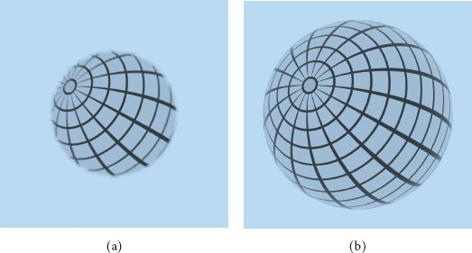

</details>

One might ask why not simply use `DifferenceOfProducts()` for the discriminant. Because $a$, $b$, and $c$ already carry rounding error, a result computed from inaccurate inputs is inaccurate too—particularly $c$, a difference of two positive values susceptible to cancellation. A similar derivation gives a more accurate cylinder discriminant:

**〈Compute cylinder quadratic discriminant discrim〉 ≡ 288**

```rust
let f = b / (2.0 * a);
let vx = oi.x - f * di.x;
let vy = oi.y - f * di.y;
let length = (vx.sqr() + vy.sqr()).sqrt();
let discrim = 4.0 * a * (Interval::from(self.radius) + length)
                       * (Interval::from(self.radius) - length);
if discrim.lower_bound() < 0.0 { return None; }
```

<details>
<summary>Reference / notes</summary>

`DifferenceOfProducts()` 1044 · `Interval` 1057 · `Interval::LowerBound()` 1059 · `Interval::Sqr()` 1060 · `Interval::Sqrt()` 1060 · `Length()` 88 · `Vector3fi` 1060

</details>

### 6.8.4 Robust Triangle Intersections

The ray–triangle algorithm of Section 6.5.3 was carefully designed to avoid rays passing through an edge or vertex shared by two triangles without registering a hit. Such an algorithm is *watertight*. Transforming vertices into the ray coordinate system introduces round-off, but the same transformation applies to all triangles, so it does not affect watertightness (and the error is small enough not to significantly affect intersection points). The three edge functions of Equation (6.5) are evaluated at $(0,0)$ via Equation (6.6). The key to robustness is that with floating point their evaluations have the correct sign. In general,

$$e = (a\otimes b)\ominus(c\otimes d)$$

has the same sign as the exact $ab-cd$.

First, if $ab=cd$, Equation (6.26) evaluates to exactly zero even in floating point, so we only need to show that if $ab>cd$ then $(a\otimes b)\ominus(c\otimes d)$ is never negative. If $ab>cd$, then $a\otimes b\ge c\otimes d$ (both operations round to the nearest representable float), so their difference is $\ge0$. If the edge function is zero, we cannot tell whether it is exactly zero or a small positive/negative value rounded to zero. The fragment `〈Fall back to double-precision test at triangle edges〉` reevaluates in double precision; doubling the precision suffices to distinguish the cases given 32-bit inputs. The overhead is minimal: in a benchmark of 88 million ray-intersection tests the double-precision fallback was used in less than 0.0000023% of cases.

### 6.8.5 Bounding Intersection Point Error

We can apply the machinery of this section to derive conservative bounds on the absolute error in computed ray–shape intersection points, constructing boxes guaranteed to contain a point on the actual surface (Figure 6.43). These boxes underpin the spawned-ray-origin algorithm of Section 6.8.6.

It is illuminating to first examine conventional computation. Ray tracers commonly solve $\mathbf o+t\mathbf d$ for $t_{\mathrm{hit}}$ and then compute $\mathbf p=\mathbf o+t_{\mathrm{hit}}\mathbf d$. If $t_{\mathrm{hit}}$ carries error $\delta t$, then for the $x$ coordinate,

$$\begin{aligned} x &= o_x\oplus(t_{\mathrm{hit}}\pm\delta t)\otimes d_x\\ &\in o_x\oplus(t_{\mathrm{hit}}\pm\delta t)d_x(1\pm\gamma_1)\\ &\subset o_x(1\pm\gamma_1)+(t_{\mathrm{hit}}\pm\delta t)d_x(1\pm\gamma_2)\\ &= o_x+t_{\mathrm{hit}}d_x+\big[\pm o_x\gamma_1\pm\delta t\,d_x \pm t_{\mathrm{hit}}d_x\gamma_2\pm\delta t\,d_x\gamma_2\big]. \end{aligned} \quad\text{(6.27)}$$

The error term in brackets is bounded by

$$\gamma_1|o_x|+\delta_t|d_x|+\gamma_2|t_{\mathrm{hit}}d_x| +\gamma_2\delta_t|d_x|.$$

Two things follow from Equation (6.27). First, the magnitudes of the contributing terms ($o_x$, $d_x$, $t_{\mathrm{hit}}d_x$) may differ greatly from the magnitude of the intersection point itself, risking catastrophic cancellation. Second, intersection algorithms perform tens of floating-point operations to find $t$, so $\delta t$ is at least of magnitude $\gamma_n t$ with $n$ in the tens (and possibly much more with cancellation).

*Figure 6.43: A shape intersection algorithm computes a point (filled circle) with absolute errors bounded by $\delta x$ and $\delta y$. Because the bounds are conservative, the actual surface point (open circle) must lie somewhere within the box.*

```mermaid
flowchart LR
    P["Computed intersection point"] --> B["Error box: +/- delta_x, +/- delta_y"]
    B --> S["True surface point lies<br/>inside the box"]
```

Each of these terms can introduce significant error; we introduce better approaches next.

**Reprojection: Quadrics.** We would like intersection points with only a few ulps of error rather than the orders-of-magnitude errors possible from the ray equation. Woo et al. (1996) suggested using a first intersection point as the start of a second ray–plane intersection. From Equation (6.27), the second ray's $t$ is near zero, so its absolute error is small and the parametric equation gives a point close to the surface (Figure 6.44); the ray origin and intersection point have similar magnitudes, so $\gamma_1|o_x|$ adds little error. The point still carries some tangential offset from the first intersection, but being close to the surface is generally much better than being above or below it.

Rather than a full reintersection (costly, and still with error in $t$), we can *reproject* computed points onto the surface, often with remarkably small error bounds. (These reprojection bounds do not capture tangential errors present in the original intersection—the focus is detecting errors that might put the reprojected point below the surface.)

*Figure 6.44: Reintersection to Improve Accuracy. An initial point computed with the ray equation (filled circle) can be the origin of a second ray–shape intersection; the resulting point (open circle) is much closer to the surface, though possibly shifted from the true intersection.*

```mermaid
flowchart LR
    R["Ray and surface"] --> P0["Initial point via ray equation<br/>(filled circle)"]
    P0 --> P1["Second intersection<br/>(open circle, near surface)"]
    P1 --> N["Alternative: reproject directly<br/>onto the surface"]
```

Consider a ray–sphere intersection with computed point $\mathbf p$ and a sphere of radius $r$ at the origin. Reprojection scales the point by the ratio of the radius to its distance from the origin:

$$\mathbf p'=\frac{r}{\|\mathbf p\|}\,\mathbf p.$$

Because $x'^2+y'^2+z'^2=r^2$, the terms in the square root share one $\gamma$ term, giving absolute error bounded by $\gamma_5|x'|$ in each coordinate—at most 2.5 ulps from a point on the sphere.

**〈Refine sphere intersection point〉 ≡ 275**

```rust
p_hit *= self.radius / distance(p_hit, Point3f::ZERO);
```

**〈Compute error bounds for sphere intersection〉 ≡ 276**

```rust
let p_error = gamma(5) * Vector3f::from(p_hit).abs();
```

Cylinder reprojection is similar: only $x$ and $y$ are projected, with error bounds $\gamma_3$ times their magnitudes.

**〈Refine cylinder intersection point〉 ≡ 289**

```rust
let hit_rad = (p_hit.x.sqr() + p_hit.y.sqr()).sqrt();
p_hit.x *= self.radius / hit_rad;
p_hit.y *= self.radius / hit_rad;
```

**〈Compute error bounds for cylinder intersection〉 ≡ 290**

```rust
let p_error = gamma(3) * Vector3f::new(p_hit.x, p_hit.y, 0.0).abs();
```

<details>
<summary>Reference / notes</summary>

`Cylinder::radius` 287 · `Disk::height` 293 · `Distance()` 93 · `Float` 23 · `gamma()` 368 · `Point3f` 92 · `Sphere` 271 · `Sphere::radius` 272 · `Sqr()` 1034 · `Tuple3::Abs()` 85 · `Vector3f` 86

</details>

For a disk we simply set $z$ to the disk's plane, giving a point with zero error exactly on the surface:

**〈Refine disk intersection point〉 ≡ 295**

```rust
p_hit.z = self.height;
```

**〈Compute error bounds for disk intersection〉 ≡ 295**

```rust
let p_error = Vector3f::ZERO;
```

The quadrics' `Sample()` methods also use reprojection. `Sphere::Sample()` uses `SampleUniformSphere()` with `sin()`/`cos()`, so error bounds on `pObj` would depend on them; reprojecting lets us reuse the $\gamma_5$ bounds from Equation (6.28):

**〈Reproject pObj to sphere surface and compute pObjError〉 ≡ 280**

```rust
p_obj *= self.radius / distance(p_obj, Point3f::ZERO);
let p_obj_error = gamma(5) * Vector3f::from(p_obj).abs();
```

The same applies to cylinder sampling:

**〈Reproject pObj to cylinder surface and compute pObjError〉 ≡ 291**

```rust
let hit_rad = (p_obj.x.sqr() + p_obj.y.sqr()).sqrt();
p_obj.x *= self.radius / hit_rad;
p_obj.y *= self.radius / hit_rad;
let p_obj_error = gamma(3) * Vector3f::new(p_obj.x, p_obj.y, 0.0).abs();
```

**Parametric Evaluation: Triangles.** Another effective approach uses the shape's parametric representation. The triangle algorithm computes edge functions $e_0,e_1,e_2$; the barycentric coordinates are $b_i=e_i/(e_0+e_1+e_2)$, and vertex attributes $\mathbf v_i$ (including positions) interpolate as $\mathbf v'=b_0\mathbf v_0+b_1\mathbf v_1+b_2\mathbf v_2$.

We precompute the reciprocal of the sum of $e_i$:

```rust
let d = 1.0 / (e0 + e1 + e2);
```

Because all $e_i$ have the same sign when there is a hit, their error can be collected into a conservative bound on $d$. For the $x$ coordinate,

$$x'=\big((e_0\otimes x_0)\oplus(e_1\otimes x_1)\oplus(e_2\otimes x_2)\big)\otimes d.$$

Tracking the $\varepsilon_m$ factors and using the bound on $d$ gives the absolute error in $x'$ as $\pm b_0x_0\gamma_7\pm b_1x_1\gamma_7\pm b_2x_2\gamma_7$, bounded by

$$\gamma_7\big(|b_0x_0|+|b_1x_1|+|b_2x_2|\big). \quad\text{(6.29)}$$

(The $b_2x_2$ term could use $\gamma_6$, but the difference is tiny and the simpler expression is preferable.) Equivalent bounds hold for $y'$ and $z'$. Equation (6.29) bounds the error in the point computed by `Triangle::Intersect()`.

**〈Compute error bounds pError for triangle intersection〉 ≡ 312**

```rust
let p_abs_sum = (ti.b0 * p0).abs() + (ti.b1 * p1).abs() + (ti.b2 * p2).abs();
let p_error = gamma(7) * Vector3f::from(p_abs_sum);
```

A sampled triangle point is handled similarly:

**〈Compute error bounds pError for sampled point on triangle〉 ≡ 313, 317**

```rust
let p_abs_sum = (b[0] * p0).abs() + (b[1] * p1).abs()
              + ((1.0 - b[0] - b[1]) * p2).abs();
let p_error = Vector3f::from(gamma(6) * p_abs_sum);
```

**Parametric Evaluation: Bilinear Patches.** Patch intersection points come from evaluating Equation (6.11). Considering only $x$, the error is bounded by

$$\gamma_6|(1-u)(1-v)x_{0,0}|+\gamma_5|(1-u)v x_{0,1}| +\gamma_5|u(1-v)x_{1,0}|+\gamma_4|uv x_{1,1}|.$$

Since $u,v\in[0,1]$ we use the looser but cheaper bound

$$\gamma_6\big(|x_{0,0}|+|x_{0,1}|+|x_{1,0}|+|x_{1,1}|\big).$$

**〈Initialize bilinear patch intersection point error pError〉 ≡ 335**

```rust
let p_abs_sum = p00.abs() + p01.abs() + p10.abs() + p11.abs();
let p_error = gamma(6) * Vector3f::from(p_abs_sum);
```

The same bounds apply for sampled points:

**〈Compute pError for sampled bilinear patch (u, v)〉 ≡ 341**

```rust
let p_abs_sum = p00.abs() + p01.abs() + p10.abs() + p11.abs();
let p_error = gamma(6) * Vector3f::from(p_abs_sum);
```

<details>
<summary>Reference / notes</summary>

`BilinearPatch::Sample()` 338 · `gamma()` 368 · `Point3f` 92 · `Triangle::Intersect()` 309 · `TriangleIntersection::b0` 309 · `TriangleIntersection::b1` 309 · `Tuple3::Abs()` 85 · `Vector3f` 86

</details>

**Parametric Evaluation: Curves.** Because the `Curve` shape orients itself to face incident rays, rays leaving it must be offset by the curve's width to avoid incorrectly reintersecting it after reorientation. For wide curves this bound is significant and may cause visible errors; in that case the curve should probably be replaced with one or more bilinear patches.

**〈Compute error bounds for curve intersection〉 ≡ 356**

```rust
let p_error = Vector3f::new(hit_width, hit_width, hit_width);
```

**Effect of Transformations.** Finally we must account for error introduced by transformations. Quadrics transform rendering-space rays to object space and hit points back; both steps add rounding error that must be bounded to maintain robust rendering-space boxes. Where possible it is best to avoid such transformations: transforming triangle vertices to rendering space and intersecting rendering-space rays is better than transforming rays to object space and points back.[^14] Transformations remain useful for quadrics and instancing, so we show how to bound their error, in the context of `Transform`'s `operator()` for `Point3fi` (a `Point3` using an `Interval` per coordinate).

**〈Transform Public Methods〉 +≡ 120**

```rust
fn apply_point_fi(&self, p: Point3fi) -> Point3fi {
    let x = p.x.to_float();
    let y = p.y.to_float();
    let z = p.z.to_float();
    // 〈Compute transformed coordinates from point (x, y, z)〉
    // 〈Compute absolute error for transformed point, pError 379〉
    if self.wp == 1.0 {
        Point3fi::new(Point3f::new(xp, yp, zp), p_error)
    } else {
        Point3fi::new(Point3f::new(xp, yp, zp), p_error) / wp
    }
}
```

The method first transforms the midpoint $(x,y,z)$ of each interval using the usual matrix/point multiplication (Section 3.10); that fragment is omitted.

<details>
<summary>Reference / notes</summary>

`Curve` 346 · `Float` 23 · `Interval` 1057 · `Point3` 92 · `Point3f` 92 · `Point3fi` 1061 · `Transform` 120 · `Vector3f` 86

</details>

Next come error bounds accounting both for rounding in the transformation and for non-empty intervals in $\mathbf p$:

**〈Compute absolute error for transformed point, pError〉 ≡ 378**

```rust
let p_error;
if p.is_exact() {
    // 〈Compute error for transformed exact p 379〉
} else {
    // 〈Compute error for transformed approximate p〉
}
```

If $(x,y,z)$ has no accumulated error, a 4×4 non-projective matrix with elements $m_{i,j}$ gives

$$\begin{aligned} x'&=\big((m_{0,0}\otimes x)\oplus(m_{0,1}\otimes y)\big) \oplus\big((m_{0,2}\otimes z)\oplus m_{0,3}\big)\\ &\subset (m_{0,0}x+m_{0,1}y+m_{0,2}z+m_{0,3}) \pm\gamma_3\big(|m_{0,0}x|+|m_{0,1}y|+|m_{0,2}z|+|m_{0,3}|\big). \end{aligned} \quad\text{(6.30)}$$

Thus the absolute error in the result is bounded by

$$\gamma_3\big(|m_{0,0}x|+|m_{0,1}y|+|m_{0,2}z|+|m_{0,3}|\big),$$

with analogous bounds for $y'$ and $z'$:

**〈Compute error for transformed exact p〉 ≡ 379**

```rust
p_error.x = gamma(3) * (abs(m[0][0]*x) + abs(m[0][1]*y)
                      + abs(m[0][2]*z) + abs(m[0][3]));
p_error.y = gamma(3) * (abs(m[1][0]*x) + abs(m[1][1]*y)
                      + abs(m[1][2]*z) + abs(m[1][3]));
p_error.z = gamma(3) * (abs(m[2][0]*x) + abs(m[2][1]*y)
                      + abs(m[2][2]*z) + abs(m[2][3]));
```

Now suppose $\mathbf p$ has errors bounded by $\delta x,\delta y,\delta z$. The transformed $x$ coordinate is

$$x'=\big(m_{0,0}\otimes(x\pm\delta x)\oplus m_{0,1}\otimes(y\pm\delta y)\big) \oplus\big(m_{0,2}\otimes(z\pm\delta z)\oplus m_{0,3}\big),$$

and applying the definitions of floating-point addition and multiplication gives

$$x'=m_{0,0}(x\pm\delta x)(1\pm\varepsilon_m)^3 +m_{0,1}(y\pm\delta y)(1\pm\varepsilon_m)^3 +m_{0,2}(z\pm\delta z)(1\pm\varepsilon_m)^3 +m_{0,3}(1\pm\varepsilon_m)^2.$$

Switching to $\gamma$, the absolute error is bounded by

$$\gamma_3\sum_{i=0}^{2}\big(|m_{0,i}|\,|p_i|+|m_{0,i}|\,\delta_{p_i}\big) +|m_{0,3}|\,\gamma_2. \quad\text{(6.31)}$$

We omit `〈Compute error for transformed approximate p〉`, which is nearly 20 lines of direct translation of Equation (6.31).

<details>
<summary>Reference / notes</summary>

`gamma()` 368 · `Interval` 1057 · `Point3fi::IsExact()` 1061 · `Vector3f` 86

</details>

It would have been much easier to use `Interval` to compute these bounds automatically, but that approach gives bounds generally 3–6× wider and runs six times slower. Since transformations are frequent during rendering, deriving tighter bounds is worthwhile.

*Figure 6.45: Given a computed intersection point (filled circle) with normal (arrow) and error bounds (rectangle), compute two planes offset along the normal just far enough not to intersect the error bounds. The points where the normal through the computed point meets those planes give the spawned-ray origins (open circles); the ray direction selects the one that avoids the error box. Such rays cannot incorrectly reintersect the surface (thick line).*

```mermaid
flowchart LR
    P["Computed point + error box"] --> N["Normal direction"]
    N --> D["d = |n_x| delta_x + |n_y| delta_y + |n_z| delta_z"]
    D --> PL["Two planes at +/- d<br/>outside the error box"]
    PL --> O["Spawn origins along normal<br/>chosen by ray direction"]
```

Note that the error-bound code is buggy if the matrix is projective and the projected point's homogeneous $w\ne1$; this is not currently a problem for pbrt's usage. The `Transform` class also provides vector and ray transforms returning resulting errors; their derivations and implementations are very similar to those for points and are omitted.

### 6.8.6 Robust Spawned Ray Origins

Computed intersection points and their error bounds give a small 3D box that must contain the true point, so the surface passes through the box. We can position spawned-ray origins so they are always on the correct side and never incorrectly reintersect the surface (recall Figure 6.43). We move far enough along the normal that the plane perpendicular to it lies outside the error box.

Consider a computed point at the origin with plane equation $f(x,y,z)=n_xx+n_yy+n_zz$, implicitly $f=0$ with normal $(n_x,n_y,n_z)$. For a point off the plane, $f$ gives the normal offset of a plane through that point. We seek the maximum of $f$ over the box's eight corners; offsetting the plane by plus and minus that value gives two planes that do not intersect the box and lie locally on opposite sides of the surface (Figure 6.45).

For corners $(\pm\delta_x,\pm\delta_y,\pm\delta_z)$,

$$d=|n_x|\delta_x+|n_y|\delta_y+|n_z|\delta_z.$$

Offsetting along the normal has advantages: assuming local planarity (reasonable at the tiny error scale), it crosses the surface with the shortest possible move, and minimizing ray-origin displacement preserves shadow and reflection detail. `OffsetRayOrigin()` implements this.

**〈Ray Inline Functions〉 ≡**

```rust
fn offset_ray_origin(pi: Point3fi, n: Normal3f, w: Vector3f) -> Point3f {
    // 〈Find vector offset to corner of error bounds and compute initial po 381〉
    // 〈Round offset point po away from p 382〉
    po
}
```

**〈Find vector offset to corner of error bounds and compute initial po〉 ≡ 381**

```rust
let d = dot(n.abs(), pi.error());
let mut offset = d * Vector3f::from(n);
if dot(w, n) < 0.0 { offset = -offset; }
let mut po = Point3f::from(pi) + offset;
```

When `offset` is added to $\mathbf p$, the result must generally be rounded to the nearest float and may be rounded *toward* $\mathbf p$, landing inside the error box (Figure 6.46). We therefore round the offset point away from $\mathbf p$ explicitly.

*Figure 6.46: The rounded value of `p + offset` may fall inside the error box rather than on its boundary, risking self-intersection if it is on the wrong side. Advancing each coordinate one floating-point value away from $\mathbf p$ guarantees it is outside the box.*

```mermaid
flowchart LR
    P["p + offset"] --> R{"Rounded inside<br/>error box?"}
    R -- yes --> U["Advance each coordinate<br/>one ulp away from p"]
    R -- no --> OK["Origin outside box"]
    U --> OK
```

<details>
<summary>Reference / notes</summary>

`Dot()` 89 · `Float` 23 · `Normal3f` 94 · `OffsetRayOrigin()` 381 · `Point3f` 92 · `Point3fi` 1061 · `Point3fi::Error()` 1061 · `Tuple3::Abs()` 85 · `Vector3f` 86

</details>

Alternatively the rounding mode could be set toward $\pm\infty$, but changing modes is expensive on many processors; shifting one ulp suffices.[^15] This sometimes moves a value already outside the box slightly farther, but the spacing is so small that this is harmless in practice.

**〈Round offset point po away from p〉 ≡ 381**

```rust
for i in 0..3 {
    if offset[i] > 0.0 { po[i] = next_float_up(po[i]); }
    else if offset[i] < 0.0 { po[i] = next_float_down(po[i]); }
}
```

For convenience, `Interaction` provides two variants using its stored position and normal. The first takes a ray direction like the stand-alone function:

**〈Interaction Public Methods〉 +≡ 136**

```rust
fn offset_ray_origin(&self, w: Vector3f) -> Point3f {
    pbrt::offset_ray_origin(self.pi, self.n, w)
}
```

The second takes a destination point, computing the direction $\mathbf w$ for the first:

**〈Interaction Public Methods〉 +≡ 136**

```rust
fn offset_ray_origin_to(&self, pt: Point3f) -> Point3f {
    self.offset_ray_origin(pt - self.p())
}
```

Helper functions in `Ray` generate rays leaving intersection points with these offsets:

**〈Ray Inline Functions〉 ≡**

```rust
fn spawn_ray(pi: Point3fi, n: Normal3f, time: Float, d: Vector3f) -> Ray {
    Ray::new(offset_ray_origin(pi, n, d), d, time)
}

fn spawn_ray_to(p_from: Point3fi, n: Normal3f, time: Float, p_to: Point3f) -> Ray {
    let d = p_to - Point3f::from(p_from);
    spawn_ray(p_from, n, time, d)
}
```

A ray between two points needs offsets at both endpoints before computing the vector between them:

**〈Ray Inline Functions〉 +≡**

```rust
fn spawn_ray_to_both(
    p_from: Point3fi, n_from: Normal3f, time: Float,
    p_to: Point3fi, n_to: Normal3f,
) -> Ray {
    let pf = offset_ray_origin(p_from, n_from, Point3f::from(p_to) - Point3f::from(p_from));
    let pt = offset_ray_origin(p_to, n_to, pf - Point3f::from(p_to));
    Ray::new(pf, pt - pf, time)
}
```

We can also implement `Interaction` methods generating rays from intersection points:

**〈Interaction Public Methods〉 +≡ 136**

```rust
fn spawn_ray(&self, d: Vector3f) -> RayDifferential {
    RayDifferential::new(self.offset_ray_origin(d), d, self.time, self.get_medium(d))
}

fn spawn_ray_to(&self, p2: Point3f) -> Ray {
    let mut r = pbrt::spawn_ray_to(self.pi, self.n, self.time, p2);
    r.medium = self.get_medium(r.d);
    r
}
```

A variant of `Interaction::SpawnRayTo()` taking an `Interaction` is similar and omitted. `ShapeSampleContext` provides corresponding `OffsetRayOrigin()` and `SpawnRay()` methods; their implementations are essentially the same and omitted.

<details>
<summary>Reference / notes</summary>

`Float` 23 · `Interaction` 136 · `Interaction::n` 137 · `Interaction::OffsetRayOrigin()` 382 · `Interaction::p()` 137 · `Interaction::pi` 137 · `NextFloatDown()` 366 · `NextFloatUp()` 365 · `Normal3f` 94 · `OffsetRayOrigin()` 381 · `Point3f` 92 · `Point3fi` 1061 · `Ray` 95 · `SpawnRay()` 382 · `Vector3f` 86

</details>

The approach addresses floating-point error at spawned-ray origins. A related issue for shadow rays to area lights: we want intersections with shapes close to the light that really occlude it, while avoiding false hits on the light surface. Our implementation does not address this, so shadow-ray `tMax` is set just under one, stopping before light surfaces:

**〈Mathematical Constants〉 ≡**

```rust
const SHADOW_EPSILON: Float = 0.0001;
```

One last issue: error introduced by transformations. A ray origin carefully placed on the correct side of a surface may move to the wrong side when the ray is transformed. Therefore, whenever a ray is transformed by `Transform`'s ray `operator()` (Section 3.10.4), its origin is advanced to the edge of the transformation's error bounds, conservatively keeping it on the correct side.

**〈Offset ray origin to edge of error bounds and compute tMax〉 ≡ 132**

```rust
if length_squared(d) > 0.0 {
    let dt = dot(d.abs(), o.error()) / length_squared(d);
    o += d * dt;
    if let Some(t) = t_max { *t -= dt; }
}
```

<details>
<summary>Reference / notes</summary>

`Dot()` 89 · `Float` 23 · `Interaction` 136 · `Interaction::GetMedium()` 716 · `Interaction::OffsetRayOrigin()` 382 · `LengthSquared()` 87 · `Point3f` 92 · `Point3fi::Error()` 1061 · `Ray` 95 · `Ray::d` 95 · `RayDifferential` 96 · `ShapeSampleContext` 268 · `SpawnRayTo()` 382 · `Tuple3::Abs()` 85 · `Vector3f` 86

</details>

### 6.8.7 Avoiding Intersections Behind Ray Origins

Bounding intersection-point error lets us place ray origins so a ray with infinite precision would not reintersect its surface. A second error source remains: error in computed parametric $t$ values. Round-off can produce $t>0$ for an intersection whose true $t$ is negative (and should be ignored).

Some algorithms always return a $t$ with the correct sign, which is the best case. Consider the ray–slab computation $t=(x\ominus o_x)\oslash d_x$. IEEE guarantees that if $a>b$ then $a\ominus b\ge0$ (and if $a<b$ then $a\ominus b\le0$): the real $a-b>0$ must round to zero or a positive float. Division also preserves sign, so the computed $t$'s sign is correct (or $t=0$, which is fine since our test is $t>0$). For shape routines using `Interval`, the final $t$ carries an error bound, so no further work is needed—see `〈Check quadric shape t0 and t1 for nearest intersection〉` in Section 6.2.2.

**Triangles.** `Interval` has overhead we prefer to avoid for common shapes. For triangles the final $t$ comes from three edge functions $e_i$ and a barycentric-weighted sum of transformed vertex $z$ coordinates,

$$t=\frac{e_0z_0+e_1z_1+e_2z_2}{e_0+e_1+e_2}.$$

Bounding the error successively in these terms lets us conservatively check positivity.

**〈Ensure that computed triangle t is conservatively greater than zero〉 ≡ 303**

```rust
// 〈Compute deltaZ term for triangle t error bounds 384〉
// 〈Compute deltaX and deltaY terms for triangle t error bounds 385〉
// 〈Compute deltaE term for triangle t error bounds 385〉
// 〈Compute deltaT term for triangle t error bounds and check t 385〉
```

For a ray with origin $\mathbf o$, direction $\mathbf d$, and vertex $\mathbf p$, the projected $z$ coordinate is

$$z=(1\oslash d_z)\otimes(p_z\ominus o_z).$$

The maximum error in each $z_i$ is bounded by $\gamma_3|z_i|$, so a conservative bound takes the maximum over the three vertices:

**〈Compute deltaZ term for triangle t error bounds〉 ≡ 384**

```rust
let max_z_t = max_component_value(
    Vector3f::new(p0t.z, p1t.z, p2t.z).abs());
let delta_z = gamma(3) * max_z_t;
```

<details>
<summary>Reference / notes</summary>

`Float` 23 · `Tuple3::Abs()` 85 · `Tuple3::MaxComponentValue()` 85 · `Vector3f` 86

</details>

The edge functions are differences of products of transformed $x$ and $y$ positions:

$$e_0=(x_1\otimes y_2)\ominus(y_1\otimes x_2),\quad e_1=(x_2\otimes y_0)\ominus(y_2\otimes x_0),\quad e_2=(x_0\otimes y_1)\ominus(y_0\otimes x_1).$$

**〈Compute deltaX and deltaY terms for triangle t error bounds〉 ≡ 384**

```rust
let max_x_t = max_component_value(Vector3f::new(p0t.x, p1t.x, p2t.x).abs());
let max_y_t = max_component_value(Vector3f::new(p0t.y, p1t.y, p2t.y).abs());
let delta_x = gamma(5) * (max_x_t + max_z_t);
let delta_y = gamma(5) * (max_y_t + max_z_t);
```

Taking the maximum error over all vertices, the $x_i\otimes y_j$ products have an absolute error bound of $\gamma_2|x_i y_j|+\delta_x|y_j|+\delta_y|x_i|$; dropping negligible higher-order products of $\gamma$ and $\delta$ terms, the error bound for the difference of two such terms is

**〈Compute deltaE term for triangle t error bounds〉 ≡ 384**

```rust
let delta_e = 2.0 * (gamma(2) * max_x_t * max_y_t
                   + delta_y * max_x_t
                   + delta_x * max_y_t);
```

Bounding by the maximum over all $e_i$, the error in the numerator of $t$ (before dividing by $\sum e_i$) is bounded below by the following; the computed $t$ must exceed it to be accepted as definitely positive:

**〈Compute deltaT term for triangle t error bounds and check t〉 ≡ 384**

```rust
let max_e = max_component_value(Vector3f::new(e0, e1, e2).abs());
let delta_t = 3.0 * (gamma(3) * max_e * max_z_t
                   + delta_e * max_z_t
                   + delta_z * max_e) * inv_det.abs();
if t <= delta_t { return None; }
```

Although these bounds are deliberately looser, in practice they are tiny: for a scene within roughly $\pm10$ in each dimension, $t$ error bounds near ray origins are around $10^{-7}$.

**Bilinear Patches.** For patches, $t$ comes from a 3×3 determinant, and deriving bounds is unwieldy because many operations are involved. Instead we compute an epsilon based on the magnitudes of all inputs to the computation of $t$:

**〈Find epsilon eps to ensure that candidate t is greater than zero〉 ≡ 332**

```rust
let eps = gamma(10) * (
    max_component_value(ray.o.abs())
  + max_component_value(ray.d.abs())
  + max_component_value(p00.abs())
  + max_component_value(p10.abs())
  + max_component_value(p01.abs())
  + max_component_value(p11.abs()));
```

<details>
<summary>Reference / notes</summary>

`Float` 23 · `gamma()` 368 · `Tuple3::Abs()` 85 · `Tuple3::MaxComponentValue()` 85

</details>

### 6.8.8 Discussion

Minimizing and bounding numerical error in other geometric computations—partial derivatives of surface positions, interpolated texture coordinates, and so on—is much less important than for ray intersection positions. Similarly, color and light computations in physically based rendering generally do not suffer from round-off: they are sums of products of positive numbers with reasonably close magnitudes, so catastrophic cancellation is uncommon, and their few terms mean accumulated error is dwarfed by the inherent variance of the Monte Carlo algorithms.

Interestingly, replacing pbrt's previous ad hoc method for avoiding self-intersections with the method of this section increased overall ray-tracing time by roughly 20% (compared with about 30% for rendering in double precision). Profiling showed very little of that time came from computing error bounds—most are just scaled sums of absolute values of already-computed terms. Most of the slowdown came from an *increase in ray–object intersection tests*. Wächter (2008, p. 30) first identified the reason: when ray origins are very close to surfaces, more nodes of intersection acceleration hierarchies must be visited for spawned rays than with overly loose offsets, so more intersection tests occur near the origin. The cost is a direct consequence of greater accuracy—the price of resolving valid nearby intersections more precisely.

## Further Reading

*An Introduction to Ray Tracing* has an extensive survey of algorithms for ray–shape intersection (Glassner 1989a). Goldstein and Nagel (1971) discussed ray–quadric intersections, and Heckbert (1984) discussed the mathematics of quadrics for graphics applications in detail, with many citations to the mathematics literature. Hanrahan (1983) described a system automating the derivation of a ray-intersection routine for surfaces defined by implicit polynomials; it emits C source code performing the intersection test and normal computation for a surface described by a given equation. Mitchell (1990) showed that interval arithmetic could be applied to robustly compute intersections with implicit surfaces that cannot be described by polynomials and are therefore harder to compute accurately (more recent work in this area is by Knoll et al. 2009). Other notable early papers include Kajiya's (1983) work on surfaces of revolution and procedurally generated fractal terrains. Fournier et al. (1982) on procedural stochastic models and Hart et al. (1989) on finding intersections with fractals illustrate the broad range of representations usable with ray tracing.

The ray–triangle intersection test in Section 6.5 was developed by Woop et al. (2013); see Möller and Trumbore (1997) for another widely used algorithm. Lagae and Dutré (2005) developed a ray–quadrilateral routine. Kensler and Shirley (2006) implemented a program searching the space of mathematically equivalent ray–triangle tests, automatically generating and benchmarking software variations, and found a more efficient routine than had been used previously. Kajiya (1982) developed the first algorithm for intersections with parametric patches; subsequent work on direct ray intersection with patches includes Stürzlinger (1998), Martin et al. (2000), Roth et al. (2001), and Benthin et al. (2006), who also provide additional references. Ogaki and Tokuyoshi (2011) directly intersect smooth surfaces generated from triangle meshes with per-vertex normals. Ramsey et al. (2004) described an algorithm for bilinear patches but required double precision for robust results; Reshetov (2019) derived a more efficient single-precision algorithm, which is used by pbrt's `BilinearPatch` implementation. See Akenine-Möller et al. (2018) for explanations of the algorithms used in its implementation that relate to the distance between lines.

Phong and Crow (1975) introduced interpolating per-vertex shading normals to make polygonal meshes appear smooth. Shading normals may put reflected rays on the wrong side of the true surface; Reshetov et al. (2010) described a normal interpolation technique avoiding this problem. Triangle mesh layout in memory can measurably affect performance: triangles close in 3D space should be close in memory to improve cache hit rates (Yoon et al. 2005; Yoon and Lindstrom 2006). Reducing mesh storage can also improve performance and allow more complex scenes (e.g., Lauterbach et al. 2008).

Subdivision surfaces are a widely used smooth-surface representation, invented by Doo and Sabin (1978) and Catmull and Clark (1978); Warren (2002) is a good introduction. Müller et al. (2003) refine a subdivision surface on demand for the rays being tested, and Benthin et al. (2007, 2015) described a related approach. Tejima et al. (2015) converted subdivision surfaces to Bézier patches and intersected rays with those, saving memory. Previous editions of this book included a section on subdivision-surface implementation that may also be of interest. The curve intersection algorithm of Section 6.7 is based on Nakamaru and Ohno (2002). Earlier methods for ray intersections with generalized cylinders also apply to curves but are much less efficient (Bronsvoort and Klok 1985; de Voogt et al. 2000). Binder and Keller (2018) improved recursive culling for curve intersections using cylinders rather than axis-aligned boxes; their approach suits GPUs better than the current `Curve` implementation because it uses a compact bit field to record pending work instead of recursion.

More efficient curve intersection algorithms have been developed by Reshetov (2017) and Reshetov and Luebke (2018). Related is the tube primitive of Han et al. (2019), a polyline with a radius at each vertex and an efficient intersection routine. A challenge with thin geometry such as hair and fur is the many pixel samples needed to resolve it; Qin et al. (2014) used cone tracing for fur, tracing narrow cones and considering all curves intersecting a cone, obtaining high quality with few cones per pixel. An excellent introduction to differential geometry is Gray (1993); Section 14.3 of his book presents the Weingarten equations.

**Intersection Accuracy.** Higham's (2002) book on floating-point computation is excellent and develops the $\gamma_n$ notation used in Section 6.8; other good references are Wilkinson (1994) and Goldberg (1991). While we derived error bounds manually, the Gappa system (Daumas and Melquiond 2010) automatically derives forward error bounds. Herbgrind (Sanchez-Stern et al. 2018) automatically finds floating-point computations suffering excessive error during a program's execution. The incorrect self-intersection problem has long been known to ray-tracing practitioners (Haines 1989; Amanatides and Mitchell 1990). Besides epsilon offsets, suggested approaches include ignoring intersections with the previously intersected object, "root polishing" (Haines 1989; Woo et al. 1996), and higher-precision floats.

Kalra and Barr (1989) and Dammertz and Keller (2006) developed robust intersections by recursively subdividing object bounding boxes, discarding boxes that do not contain the surface or are missed by the ray; both are much less efficient than traditional intersection algorithms or the techniques of Section 6.8. Ize (2013) showed how to perform numerically robust ray–box intersections; his approach is implemented in Section 6.8.2 (with a more careful derivation he showed the scale factor can be $2\gamma_2$ rather than our $2\gamma_3$). Wächter (2008) discussed self-intersection issues in his thesis, suggesting root polishing and offsets along the normal by a fixed small fraction of the intersection point's magnitude. The method here uses his normal-offset idea but with conservative bounds based on numerical error—generally tighter than Wächter's offsets while provably conservative. The accurate discriminant of Section 6.8.3 is due to Hearn and Baker (2004), via Haines et al. (2019). Geometric accuracy has received far more attention in computational geometry than in rendering: Salesin et al. (1989) derived robust geometric primitives accounting for round-off, and Shewchuk (1997) applied adaptive-precision arithmetic to geometric predicates using just enough precision for a correct result. The precision requirements of ray tracing have implications beyond implementation: Reif et al. (1994) constructed Turing machines entirely from ray tracing and geometric optics, implying ray tracing is undecidable in the complexity-theoretic sense. In practice optical computing systems can be built, though they cannot solve undecidable problems; Blakey (2012) showed this is explained by the exponential growth of such machines' precision requirements.

**Sampling Shapes.** Turk (1990) described two approaches to uniformly sampling triangle area. The approach in `SampleUniformTriangle()`—more efficient and better at preserving stratification than Turk's algorithms—is due to Talbot (2011) and Heitz (2019). Shirley et al. (1996) derived methods for sampling several other shapes, and Arvo and Novins (2007) showed how to sample convex quadrilaterals. These approaches warp samples from the unit square to the shape's surface; Basu and Owen (2015, 2017) instead recursively decompose triangles and disks to generate low-discrepancy points directly on their surfaces. Marques et al. (2013) generated low-discrepancy samples on the unit sphere; see also Christensen (2018), who showed error reduction from imposing structure on multiple sample points on disk lights. Uniformly sampling a shape's visible area from a reference point improves direct lighting. Gardner et al. (1987) and Zimmerman (1995) derived methods for cylinders; Wang et al. (2006) found an algorithm for cones. (For planar shapes such as triangles the visible area is trivially the whole area.)

Uniform solid-angle sampling has also received attention. Wang (1992) introduced solid-angle sampling of spheres. Arvo (1995b) showed how to sample a triangle's projection on the sphere of directions from a reference point; his approach is implemented in `SampleSphericalTriangle()` (a more efficient approach was recently developed by Peters 2021b, Section 5). Ureña et al. (2013) and Pekelis and Hery (2014) developed analogous techniques for quadrilateral lights; Ureña et al.'s method is used in `SampleSphericalRectangle()`. Donnay (1945) provides helpful background in spherical trigonometry. The cone-angle-to-sphere-point conversion of Section 6.2.4 was derived by Akalin (2015). The inversion of the spherical triangle sampler in `InvertSphericalTriangleSample()` is due to Arvo (2001b). Gamito (2016) uniformly samples disk and cylindrical lights by bounding their subtended solid angle with a quadrilateral sampled using Ureña et al.'s method (2013), rejecting samples off the light. Tsai et al. (2006) approximated shapes with triangle collections sampled by solid angle; Guillén et al. (2017) subsequently developed direct solid-angle disk sampling without rejection. Spheres are the only shapes for which we know of direct projected-solid-angle sampling algorithms: Ureña and Georgiev (2018) presented one, Peters and Dachsbacher (2019) developed a more efficient approach, and Peters (2019) described computing the associated PDF for multiple importance sampling. A variety of additional projected-solid-angle techniques exist: Arvo (2001a) gave a general framework requiring numeric inversion of the associated CDF, Ureña (2000) approximated projected solid-angle triangle sampling by progressive decomposition, and Hart et al. (2020) described a related approach. Peters (2021b) recently showed how to perform projected solid-angle sampling of polygons efficiently and accurately.

## Exercises

Difficulty: ➊ straightforward, ➋ moderate, ➌ challenging.

**➋ 6.1** One nice property of mesh-based shapes such as triangle meshes and subdivision surfaces is that their vertices can be transformed into rendering space, so rays need not be transformed into object space before intersection. Interestingly, the same can be done for ray–quadric intersections.

The implicit forms of the quadrics in this chapter all have the form

$$ax^2+bxy+cxz+dy^2+eyz+fz^2+g=0,$$

where some constants $a\ldots g$ are zero. More generally, define quadric surfaces by

$$ax^2+by^2+cz^2+2dxy+2eyz+2fxz+2gx+2hy+2iz+j=0,$$

where most parameters $a\ldots j$ do not correspond directly to the earlier $a\ldots g$. In this form a quadric is represented by a 4×4 symmetric matrix $Q$:

$$Q=\begin{pmatrix} a & d & f & g\\ d & b & e & h\\ f & e & c & i\\ g & h & i & j \end{pmatrix}, \qquad \mathbf p^T Q\,\mathbf p=0.$$

First show that the matrix $Q'$ representing a quadric transformed by $M$ is

$$Q'=(M^T)^{-1} Q\, M^{-1}.$$

To do so, show that for any point $\mathbf p$ with $\mathbf p^TQ\mathbf p=0$, applying $M$ gives $\mathbf p'=M\mathbf p$ and we want $(\mathbf p')^TQ'\mathbf p'=0$. Next, substitute the ray equation into the general quadric equation to compute coefficients of the quadratic equation in terms of entries of $Q$, to pass to `Quadratic()`.

Now implement this approach in pbrt and use it in place of the original quadric intersection routines. Note that you will still need to transform rendering-space hit points to object space to test against $\theta_{\max}$ if it is not $2\pi$, and so on. How does performance compare with the original scheme?

**➋ 6.2** Transforming a quadric's object-space bounding box to rendering space need not give an optimal bounding box. However, the matrix form of Exercise 6.1 can also be used to compute optimal bounds. Read Barnes (2014) on this topic and implement the approach. How much are bounding boxes improved? Measure the effect on rendering performance for a scene with many transformed quadrics.

**➊ 6.3** Improve the object-space bounding-box routines for the quadrics to properly account for $\phi_{\max}<3\pi/2$, computing tighter bounds where possible. How much does this improve performance when rendering partial quadrics?

**➋ 6.4** There is room to optimize the quadric primitives. For complete spheres, some tests relating to partial spheres are unnecessary; some quadrics call trigonometric functions that could become simpler expressions using geometric insight. Investigate speedups and measure the improvement in overall run time for scenes with quadrics.

**➊ 6.5** Fix the buggy `Sphere::Sample()` and `Disk::Sample()` methods, which do not properly account for partial spheres and disks when sampling points on the surface. Create a scene demonstrating the error and clearly showing your solution's improvement.

**➋ 6.6** Derive a sampling method for cylinder area lights choosing only points over the visible area as seen from the receiving point, analogous to the improved sphere sampling in this chapter (Gardner et al. 1987; Zimmerman 1995). Write a new `Cylinder::Sample()` implementing it. Verify pbrt still generates correct images, and measure variance reduction for a fixed number of samples and the resulting efficiency improvement. How do you explain any discrepancy between variance reduction and efficiency improvement?

<details>
<summary>Reference / notes</summary>

`Cylinder::Sample()` 291 · `Disk::Sample()` 295 · `Quadratic()` 1045 · `Sphere::Sample()` 280

</details>

**➋ 6.7** Implement one of the approaches for sampling spheres according to projected solid angle in their visible region (Ureña and Georgiev 2018; Peters and Dachsbacher 2019). Measure the change in execution time and discuss the results. Then measure the MSE of pbrt's current approach and your approach for a few scenes with spherical lights, using an image rendered with thousands of samples per pixel as reference. How do the results differ when the light is always unoccluded versus sometimes partially occluded? How does the BSDF of scene surfaces affect the results?

**➊ 6.8** Currently pbrt recomputes $\partial\mathbf p/\partial u$ and $\partial\mathbf p/\partial v$ for triangles whenever needed, though they are constant per triangle. Precompute these vectors and analyze the speed/storage trade-off, especially for large meshes. How do scene depth complexity and triangle size in the image affect the trade-off?

**➋ 6.9** Implement a general polygon primitive supporting arbitrary vertex counts and convex or concave polygons as a new `Shape` in pbrt. You may assume a valid, planar polygon has been provided, though a warning for nonplanarity is desirable.

An efficient ray–polygon test finds the polygon's plane equation from its normal and a point, intersects the ray with that plane, and projects the hit point and polygon vertices to 2D. Then apply a 2D point-in-polygon test: effectively do 2D ray tracing, intersecting a ray with each edge segment and counting crossings—an odd count means the point is inside and there is an intersection. Figure 6.47 illustrates this idea.

*Figure 6.47: A ray–polygon test finds where the ray meets the polygon's plane, projects the hit point and vertices onto an axis-aligned plane, and performs a 2D point-in-polygon test there.*

```mermaid
flowchart LR
    R["3D ray"] --> P["Intersect polygon plane"]
    P --> Q["Project hit and vertices<br/>to 2D"]
    Q --> C["Count edge crossings<br/>odd = inside = hit"]
```

Haines (1994) surveys efficient point-in-polygon tests, and Section 13.3.3 of Schneider and Eberly (2003) discusses corner cases such as a 2D ray aligning with an edge or passing through a vertex.

**➋ 6.10** Constructive solid geometry (CSG) builds complex shapes from unions, intersections, and differences of simpler ones. For example, a sphere can create pits in a cylinder by subtracting partially overlapping spheres (Hoffmann 1989). Add CSG support to pbrt and render images demonstrating interesting shapes. See Roth (1982), the first description of ray tracing CSG models, and Amanatides and Mitchell (1990) for accuracy issues in CSG ray tracing.

**➋ 6.11** Procedurally described parametric surfaces: write a `Shape` taking a general expression $f(u,v)\to(x,y,z)$ describing a parametric surface. Evaluate it at a grid of $(u,v)$ positions, create a bilinear patch mesh approximating it, and render images of interesting shapes with your new `Shape`.

**➋ 6.12** Adaptive curve refinement: adjust the number of recursive refinement levels for `Curve` intersection based on on-screen area. One approach uses `RayDifferential`, which represents the image-space area of a ray—but currently only `Ray`, not `RayDifferential`, is passed to `Shape::Intersect()`, so other parts of the system must be modified. Alternatively, modify the camera to provide the projected length of rendering-space vectors on the image plane and make it available during curve intersection. Render images showing the benefit when the camera is close to curves, and measure performance while varying camera-to-curve distance. Does performance improve when the camera is far? How does it change when close?

**➋ 6.13** Implement one of the more efficient ray–curve algorithms of Reshetov (2017) or Reshetov and Luebke (2018). Measure pbrt's current `Curve` implementation and your new one, and discuss the results. Do rendered images match? Can you find differences in returned intersections that change images, especially when the camera is close to a curve? Explain your findings.

**➌ 6.14** Ray-tracing point-sampled geometry: extending methods for rendering complex models as point samples (Levoy and Whitted 1985; Pfister et al. 2000; Rusinkiewicz and Levoy 2000), Schaufler and Jensen (2000) described intersecting rays with oriented point samples. Their algorithm probabilistically declares a hit when a ray passes near a sufficient local density of samples and computes a normal by weighted averaging. Read their paper and add a point-sampled geometry shape to pbrt. Do any basic interfaces need extending or generalizing to support such a shape?

<details>
<summary>Reference / notes</summary>

`Curve` 346 · `Ray` 95 · `RayDifferential` 96 · `Shape` 261 · `Shape::Intersect()` 265 · `TransformedPrimitive` 403

</details>

**➌ 6.15** Deformation motion blur: `TransformedPrimitive` in Section 7.1.2 supports animated shapes through time-varying transformations, but cannot represent a mesh whose vertices have separate start- and end-of-frame positions (e.g., a running character with different body parts moving differently). Implement a more general `Triangle` or `BilinearPatch` shape accepting vertex positions at frame start and end and interpolating by the ray time passed to the intersection methods. Update the bounding routines accordingly. Meshes with large motion may perform poorly because triangles or patches sweep large bounding boxes and cause many useless intersection tests. Can you devise approaches to reduce this problem's impact?

**➌ 6.16** Implicit functions: just as implicit quadric definitions are a useful starting point for ray-intersection algorithms, more complex implicit functions define interesting shapes—organic forms and water drops in particular. Blinn (1982a) introduced direct rendering of implicit surfaces; Wyvill and Wyvill (1989) gave a basis function with several advantages over Blinn's. Implement ray intersections with implicit surfaces and add them to pbrt. You may wish to read Kalra and Barr (1989), Hart (1996), and Sabbadin and Droske (2021). Mitchell's interval-arithmetic algorithm for robust implicit-surface intersections (Mitchell 1990) is another effective method, refined by Knoll et al. (2009) and possibly easier to implement. See Moore (1966) for interval arithmetic reference.

**➌ 6.17** L-systems: Alvy Ray Smith (1984) introduced Lindenmayer systems to graphics for procedurally modeling plants as branching structures. Prusinkiewicz and collaborators generalized the approach to a wide variety of plants and appearance effects (Prusinkiewicz 1986; Prusinkiewicz, James, and Mech 1994; Deussen et al. 1998; Prusinkiewicz et al. 2001). L-systems describe branching structure via a grammar, which can be evaluated into expressions describing a topological representation, then translated into geometry. Add an L-system primitive to pbrt that takes a grammar and evaluates it to create the shape it describes.

**➊ 6.18** Given an arbitrary point $(x,y,z)$, what bound on the error from applying a scale transformation of $(2,1,4)$ is given by Equation (6.30)? How much error is actually introduced?

<details>
<summary>Reference / notes</summary>

`Interval` 1057

</details>

**➋ 6.19** The quadric shapes all use `Interval` in their intersection tests to bound computed $t$ error so intersections behind the ray origin are not reported. First measure the performance difference when using regular `Float` for one or more quadrics in a scene containing them. Next, manually derive conservative error bounds for $t$ computed by those shapes, as was done for triangles in Section 6.8.7, and implement your method. You may find `Interval` useful for empirically testing your derivation's correctness. Measure the performance difference with your implementation.

**➋ 6.20** One detail thwarts the watertightness of the current `Triangle` implementation: translating and shearing triangle vertices introduces round-off error that must be accounted for in the extent of triangle bounding boxes; see Section 3.3 of Woop et al. (2013) for discussion and a solution. Modify pbrt to incorporate a solution. Can you find scenes where small image errors are eliminated by your fix?

<details>
<summary>Reference / notes</summary>

`Triangle` 301

</details>

## Footnotes

[^1]: This assumes an architecture supporting IEEE floating-point arithmetic, universal on modern systems. The relevant properties are that for all $v>0$, $v/0=\infty$ and for all $w<0$, $w/0=-\infty$, where $\infty$ is a special value such that any positive number times $\infty$ gives $\infty$ and any negative number times $\infty$ gives $-\infty$, and so on. See Section 6.8.1.

[^2]: Some ray tracers require normalized ray directions, meaning $a=1$. This can lead to subtle errors if the caller forgets to normalize. Normalizing in the ray constructor avoids them but wastes effort when the direction is already normalized. To avoid this complexity pbrt never insists on normalized directions in intersection routines, which also reduces the work of transforming rays to object space because no normalization is needed there.

[^3]: This computation implicitly assumes counterclockwise vertex ordering.

[^4]: Note that these are coefficients of $au^2+bu+c=0$, not the $a,b,c$ plane coefficients.

[^5]: Note the abuse of terminology: a curve is a 1D mathematical entity, but a `Curve` shape represents a 2D surface. In the following we generally call the `Shape` a curve; the 1D entity is called a "Bézier curve" when the distinction matters.

[^6]: The word *mantissa* is often used in place of *significand*, though floating-point purists note that mantissa has a different meaning in logarithms and therefore prefer significand. We follow the latter usage.

[^7]: Denormalized numbers are also known as subnormal numbers.

[^8]: This is one of a few places where compilers must not perform seemingly obvious and safe algebraic simplifications on floating-point expressions—this comparison must not be simplified to false. Enabling compiler "fast math" or "unsafe math optimizations" flags may allow such optimizations and introduce buggy behavior in pbrt.

[^9]: IEEE float allows the user to select among rounding modes, but we assume the default—round to nearest even—here.

[^10]: The C and C++ standards define machine epsilon as the magnitude of one ulp above 1. For a 32-bit float this is $2^{-23}$, twice the machine epsilon as generally used in numerical analysis.

[^11]: This bound assumes no overflow or underflow in the computation; these can be handled (Higham 2002, p. 56) but are not generally important here.

[^12]: These functions are equivalent to `std::nextafter(v, Infinity)` and `std::nextafter(v, -Infinity)` but are more efficient because they do not handle NaN values or signaling floating-point exceptions.

[^13]: Some numerical analysts use the rule of thumb that the number of ulps of error in practice is often close to the square root of the bound's number of ulps, thanks to cancellation of error in intermediate results.

[^14]: Although rounding error is introduced when transforming triangle vertices to rendering space, that error does not add error needing handling when computing intersection points. Put differently, the transformed vertices are a perturbed representation of the scene, but the most accurate representation available given the transformation.

[^15]: The observant reader may wonder about rounding error when computing the error bounds passed into this function. Indeed those bounds should also be computed with rounding toward positive infinity. We ignore the issue under the expectation that the extra one-ulp offset here will cover it.

---

[↑ Back to top](#contents)

