# Chapter 7: Primitives and Intersection Acceleration

## BVH Traversal (wgpu)

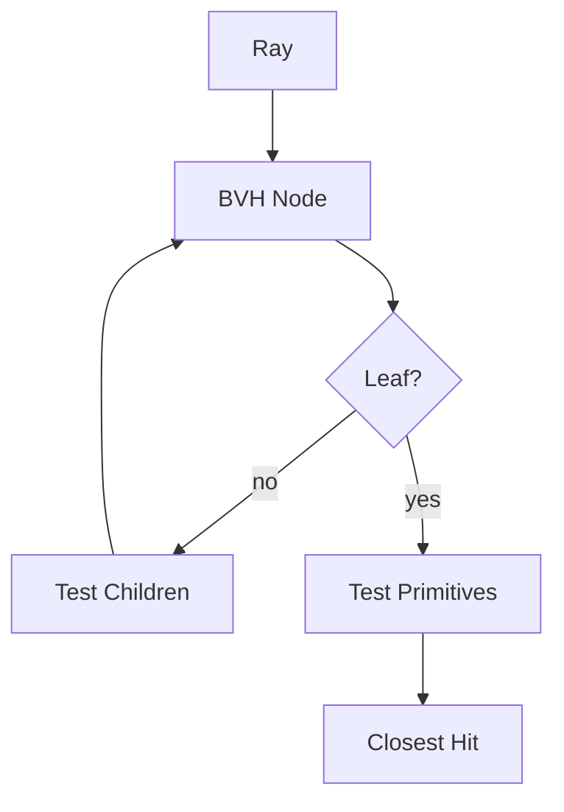


The classes described in the last chapter focus exclusively on representing geometric properties of 3D objects. Although the Shape interface provides a convenient abstraction for geometric operations such as intersection and bounding, it is not sufficiently expressive to fully describe an object in a scene. For example, it is necessary to bind material properties to each shape in order to specify its appearance.

pbrt’s CPU and GPU rendering paths diverge in how they address this issue. The classes in this chapter implement the approach used on the CPU. On the GPU, some of the details of how properties such as materials are associated with shapes are handled by the GPU’s ray-tracing APIs and so a different representation is used there; the equivalents for the GPU are discussed in Section 15.3.6.

For the CPU, this chapter introduces the Primitive interface and provides a number of implementations that allow various properties of primitives to be specified. It then presents an additional Primitive implementation that acts as an aggregate—a container that can hold many primitives. This allows us to implement an acceleration structure—a data structure that helps reduce the otherwise O(n) complexity of testing a ray for intersection with all n objects in a scene.

The acceleration structure, BVHAggregate, is based on building a hierarchy of bounding boxes around objects in the scene. The online edition of this book also includes the implementation of a second acceleration structure, KdTreeAggregate, which is based on adaptive recursive spatial subdivision. While many other acceleration structures have been proposed, almost all ray tracers today use one of these two. The “Further Reading” section at the end of this chapter has extensive references to other possibilities. Because construction and use of intersection acceleration structures is an integral part of GPU ray-tracing APIs, the acceleration structures in this chapter are only used on the CPU.

```text
    BVHAggregate 407
    KdTreeAggregate 406
    Shape 261
```

## 7.1 PRIMITIVE INTERFACE AND GEOMETRIC PRIMITIVES

The Primitive class defines the Primitive interface. It and the Primitive implementations that are described in this section are defined in the files cpu/primitive.rs and cpu/primitive.rs.

〈Primitive Definition〉 ≡

```rust
   struct Primitive
        : public TaggedPointer<SimplePrimitive, GeometricPrimitive,
                                  TransformedPrimitive, AnimatedPrimitive,
                                  BVHAggregate, KdTreeAggregate> {
      public:
        〈Primitive Interface 398〉
   };
```

The Primitive interface is composed of only three methods, each of which corresponds to a Shape method. The first, Bounds(), returns a bounding box that encloses the primitive’s geometry in rendering space. There are many uses for such a bound; one of the most important is to place the Primitive in the acceleration data structures.

〈Primitive Interface〉 ≡ 398

```rust
   Bounds3f Bounds() const;
```

The other two methods provide the two types of ray intersection tests.

〈Primitive Interface〉 +≡ 398

```rust
   Option<ShapeIntersection> Intersect(const Ray &r,
                                            Float tMax = Infinity) const;
   bool IntersectP(const Ray &r, Float tMax = Infinity) const;
```

Upon finding an intersection, a Primitive’s Intersect() method is also responsible for initializing a few member variables in the SurfaceInteraction in the ShapeIntersection that it returns. The first two are representations of the shape’s material and its emissive properties, if it is itself an emitter. For convenience, SurfaceInteraction provides a method to set these, which reduces the risk of inadvertently not setting all of them. The second two are related to medium scattering properties and the fragment that initializes them will be described later, in Section 11.4.

```text
    AnimatedPrimitive 405
    Bounds3f 97
    BVHAggregate 407
    Float 23
    GeometricPrimitive 399
    Infinity 361
    KdTreeAggregate 406
    Light 740
    Material 674
    Medium 714
    MediumInterface 715
    Primitive 398
    Ray 95
```

```text
    Shape 261
    ShapeIntersection 266
    SimplePrimitive 402
    SurfaceInteraction 138
    TaggedPointer 1073
    TransformedPrimitive 403
```

〈SurfaceInteraction Public Methods〉 +≡ 138

void SetIntersectionProperties(Material mtl, Light area, const MediumInterface *primMediumInterface, Medium rayMedium) { material = mtl; areaLight = area; 〈Set medium properties at surface intersection 716〉 } 〈SurfaceInteraction Public Members〉 +≡ 138

```rust
   Material material;
   Light areaLight;
```

### 7.1.1 GEOMETRIC PRIMITIVES

The GeometricPrimitive class provides a basic implementation of the Primitive interface that stores a variety of properties that may be associated with a shape.

〈GeometricPrimitive Definition〉 ≡ class GeometricPrimitive { public: 〈GeometricPrimitive Public Methods〉 private: 〈GeometricPrimitive Private Members 399〉 };

Each GeometricPrimitive holds a Shape with a description of its appearance properties, including its material, its emissive properties if it is a light source, the participating media on each side of its surface, and an optional alpha texture, which can be used to make some parts of a shape’s surface disappear.

〈GeometricPrimitive Private Members〉 ≡ 399

```rust
   Shape shape;
   Material material;
   Light areaLight;
   MediumInterface mediumInterface;
   FloatTexture alpha;
```

The GeometricPrimitive constructor initializes these variables from the parameters passed to it. It is straightforward, so we do not include it here.

Most of the methods of the Primitive interface start out with a call to the corresponding Shape method. For example, its Bounds() method directly returns the bounds from the Shape.

〈GeometricPrimitive Method Definitions〉 ≡ Bounds3f GeometricPrimitive::Bounds() const { return shape.Bounds(); }

GeometricPrimitive::Intersect() calls the Intersect() method of its Shape to do the actual intersection test and to initialize a ShapeIntersection to describe the intersection, if any. If an intersection is found, then additional processing specific to the GeometricPrimitive is performed.

〈GeometricPrimitive Method Definitions〉 +≡ pstd::optional<ShapeIntersection> GeometricPrimitive::Intersect(const Ray &r, Float tMax) const { pstd::optional<ShapeIntersection> si = shape.Intersect(r, tMax); if (!si) return {}; 〈Test intersection against alpha texture, if present 400〉 〈Initialize SurfaceInteraction after Shape intersection 401〉 return si; }

```text
    Bounds3f 97
    Float 23
    FloatTexture 656
    GeometricPrimitive 399
    GeometricPrimitive::Intersect() 399
    GeometricPrimitive::shape 399
    Light 740
    Material 674
    MediumInterface 715
    Primitive 398
    Ray 95
    Shape 261
    Shape::Bounds() 262
    Shape::Intersect() 265
    ShapeIntersection 266
```

If an alpha texture is associated with the shape, then the intersection point is tested against the alpha texture before a successful intersection is reported. (The definition of the texture interface and a number of implementations are in Chapter 10.) The alpha texture can be thought of as a scalar

function over the shape’s surface that indicates whether the surface is actually present at each point. An alpha value of 0 indicates that it is not, and 1 that it is. Alpha textures are useful for representing objects like leaves: a leaf might be modeled as a single triangle or bilinear patch, with an alpha texture cutting out the edges so that a detailed outline of a leaf remains.

〈Test intersection against alpha texture, if present〉 ≡ 399

```rust
   if (alpha) {
          if (Float a = alpha.Evaluate(si->intr); a < 1) {
              〈Possibly ignore intersection based on stochastic alpha test 400〉
       }
   }
```

If the alpha texture has a value of 0 or 1 at the intersection point, then it is easy to decide whether or not the intersection reported by the shape is valid. For intermediate alpha values, the correct answer is less clear.

One possibility would be to use a fixed threshold—for example, accepting all intersections with an alpha of 1 and ignoring them otherwise. However, this approach leads to hard transitions at the resulting boundary. Another option would be to return the alpha from the intersection method and leave calling code to handle it, effectively treating the surface as partially transparent at such points. However, that approach would not only make the Primitive intersection interfaces more complex, but it would place a new burden on integrators, requiring them to compute the shading at such intersection points as well as to trace an additional ray to find what was visible behind them.

A stochastic alpha test addresses these issues. With it, intersections with the shape are randomly reported with probability proportional to the value of the alpha texture. This approach is easy to implement, gives the expected results for an alpha of 0 or 1, and with a sufficient number of samples gives a better result than using a fixed threshold. Figure 7.1 compares the approaches.

One challenge in performing the stochastic alpha test is generating a uniform random number to apply it. For a given ray and shape, we would like this number to be the same across multiple runs of the system; doing so is a part of making the set of computations performed by pbrt be deterministic, which is a great help for debugging. If a different random number was used on different runs of the system, then we might hit a runtime error on some runs but not others. However, it is important that different random numbers be used for different rays; otherwise, the approach could devolve into the same as using a fixed threshold.

The HashFloat() utility function provides a solution to this problem. Here it is used to compute a random floating-point value between 0 and 1 for the alpha test; this value is determined by the ray’s origin and direction.

〈Possibly ignore intersection based on stochastic alpha test〉 ≡ 400

```rust
   Float u = (a <= 0) ? 1.f : HashFloat(r.o, r.d);
   if (u > a) {
         〈Ignore this intersection and trace a new ray 401〉
   }
```

```text
    Float 23
    FloatTexture::Evaluate() 656
    GeometricPrimitive::alpha 399
    HashFloat() 1042
    Ray::d 95
    Ray::o 95
    ShapeIntersection::intr 266
```

If the alpha test indicates that the intersection should be ignored, then another intersection test is performed with the current GeometricPrimitive, with a recursive call to Intersect(). This additional test is important for shapes like spheres, where we may reject the closest intersection but then intersect the shape again further along the ray. This recursive call requires adjustment of the tMax value passed to it to account for the distance along the ray to the initial alpha tested intersection point. Then, if it reports an intersection, the reported tHit value should account for that segment as well.

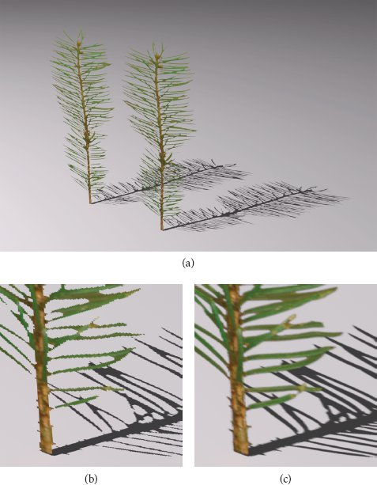

*Figure 7.1: Comparison of Stochastic Alpha Testing to Using a Fixed Threshold. (a) Example scene: the two fir branches are modeled using a single quadrilateral with an alpha texture. (b) If a fixed threshold is used for the alpha test, the shape is not faithfully reproduced. Here a threshold of 1 was used, leading to shrinkage and jagged edges. (c) If a stochastic alpha test is used, the result is a smoother and more realistic transition.*

GeometricPrimitive::areaLight 399 GeometricPrimitive::Intersect() 399 GeometricPrimitive::material 399

```text
    GeometricPrimitive:: mediumInterface 399
    Ray 95
    Ray::d 95
    Ray::medium 95
    ShapeIntersection 266
    ShapeIntersection::intr 266
    ShapeIntersection::tHit 266
    SurfaceInteraction 138
    SurfaceInteraction:: SetIntersectionProperties() 398
    SurfaceInteraction:: SpawnRay() 645
```

〈Ignore this intersection and trace a new ray〉 ≡ 400

```rust
   Ray rNext = si->intr.SpawnRay(r.d);
   Option<ShapeIntersection> siNext = Intersect(rNext, tMax - si->tHit);
   if (siNext)
         siNext->tHit += si->tHit;
   return siNext;
```

Given a valid intersection, the GeometricPrimitive can go ahead and finalize the Surface Interaction’s representation of the intersection.

〈Initialize SurfaceInteraction after Shape intersection〉 ≡ 399

```rust
   si->intr.SetIntersectionProperties(material, areaLight, &mediumInterface,
                                          r.medium);
```

The IntersectP() method must also handle the case of the GeometricPrimitive having an alpha texture associated with it. In that case, it may be necessary to consider all the intersections of the ray with the shape in order to determine if there is a valid intersection. Because IntersectP() implementations in shapes return early when they find any intersection and because they do not return the geometric information associated with an intersection, a full intersection test is performed in this case. In the more common case of no alpha texture, Shape::IntersectP() can be called directly.

〈GeometricPrimitive Method Definitions〉 +≡ bool GeometricPrimitive::IntersectP(const Ray &r, Float tMax) const { if (alpha) return Intersect(r, tMax).has_value();

```rust
         else
            return shape.IntersectP(r, tMax);
   }
```

Most objects in a scene are neither emissive nor have alpha textures. Further, only a few of them typically represent the boundary between two different types of participating media. It is wasteful to store nullptr values for the corresponding member variables of GeometricPrimitive in that common case. Therefore, pbrt also provides SimplePrimitive, which also implements the Primitive interface but does not store those values. The code that converts the parsed scene representation into the scene for rendering uses a SimplePrimitive in place of a GeometricPrimitive when it is possible to do so.

〈SimplePrimitive Definition〉 ≡ class SimplePrimitive { public: 〈SimplePrimitive Public Methods〉 private: 〈SimplePrimitive Private Members 402〉 };

Because SimplePrimitive only stores a shape and a material, it saves 32 bytes of memory. For scenes with millions of primitives, the overall savings can be meaningful.

〈SimplePrimitive Private Members〉 ≡ 402

```rust
   Shape shape;
   Material material;
```

We will not include the remainder of the SimplePrimitive implementation here; it is effectively a simplified subset of GeometricPrimitive’s.

```text
    Float 23
    GeometricPrimitive 399
    GeometricPrimitive::alpha 399
    GeometricPrimitive:: Intersect() 399
    GeometricPrimitive::shape 399
    Material 674
    Ray 95
    Shape 261
    Shape::IntersectP() 266
    SimplePrimitive 402
```

### 7.1.2 OBJECT INSTANCING AND PRIMITIVES IN MOTION

Object instancing is a classic technique in rendering that reuses transformed copies of a single collection of geometry at multiple positions in a scene. For example, in a model of a concert hall with thousands of identical seats, the scene description can be compressed substantially if all the seats refer to a shared geometric representation of a single seat. The ecosystem scene in Figure 7.2 has 23,241 individual plants of various types, although only 31 unique plant models. Because each plant model is instanced multiple times with a different transformation for each instance, the complete scene has a total of 3.1 billion triangles. However, only 24 million triangles are stored in memory thanks to primitive reuse through object instancing. pbrt uses just over 4 GB of memory when rendering this scene with object instancing (1.7 GB for BVHs, 707 MB for Primitives, 877 MB for triangle meshes, and 846 MB for texture images), but would need upward of 516 GB to render it without instancing.1

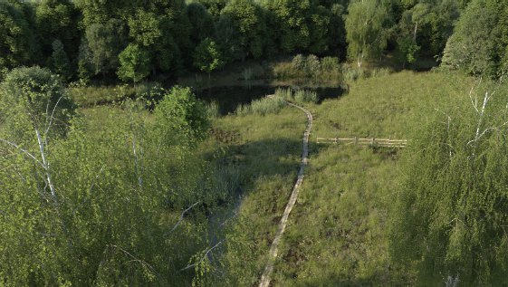

*Figure 7.2: This outdoor scene makes heavy use of instancing as a mechanism for compressing the scene’s description. There are only 24 million unique triangles in the scene, although, thanks to object reuse through instancing, the total geometric complexity is 3.1 billion triangles. (Scene courtesy of Laubwerk.)*

The TransformedPrimitive implementation of the Primitive interface makes object instancing possible in pbrt. Rather than holding a shape, it stores a single Primitive as well as a Transform that is injected in between the underlying primitive and its representation in the scene. This extra transformation enables object instancing.

Recall that the Shapes of Chapter 6 themselves had rendering from object space transformations applied to them to place them in the scene. If a shape is held by a TransformedPrimitive, then the shape’s notion of rendering space is not the actual scene rendering space—only after the TransformedPrimitive’s transformation is also applied is the shape actually in rendering space. For this application here, it makes sense for the shape to not be at all aware of the additional transformation being applied. For instanced primitives, letting Shapes know all the instance transforms is of limited utility: we would not want the TriangleMesh to make a copy of its vertex

positions for each instance transformation and transform them all the way to rendering space, since this would negate the memory savings of object instancing.

〈TransformedPrimitive Definition〉 ≡ class TransformedPrimitive { public: 〈TransformedPrimitive Public Methods 404〉 private: 〈TransformedPrimitive Private Members 404〉 };

```text
    Primitive 398
    Shape 261
    Transform 120
    TransformedPrimitive 403
    TriangleMesh 297
```

The TransformedPrimitive constructor takes a Primitive that represents the model and the transformation that places it in the scene. If the instanced geometry is described by multiple Primitives, the calling code is responsible for placing them in an aggregate so that only a single Primitive needs to be stored here.

〈TransformedPrimitive Public Methods〉 ≡ 403

TransformedPrimitive(Primitive primitive, const Transform *renderFromPrimitive) : primitive(primitive), renderFromPrimitive(renderFromPrimitive) { } 〈TransformedPrimitive Private Members〉 ≡ 403

```rust
   Primitive primitive;
   const Transform *renderFromPrimitive;
```

The key task of TransformedPrimitive is to bridge between the Primitive interface that it implements and the Primitive that it holds, accounting for the effects of the rendering from primitive space transformation. If the primitive member has its own transformation, that should be interpreted as the transformation from object space to the TransformedPrimitive’s coordinate system. The complete transformation to rendering space requires both of these transformations together.

〈TransformedPrimitive Public Methods〉 +≡ 403

```rust
   Bounds3f Bounds() const {
        return (*renderFromPrimitive)(primitive.Bounds());
   }
```

The Intersect() method also must account for the transformation, both for the ray passed to the held primitive and for any intersection information it returns.

〈TransformedPrimitive Method Definitions〉 ≡ pstd::optional<ShapeIntersection> TransformedPrimitive::Intersect(const Ray &r, Float tMax) const { 〈Transform ray to primitive-space and intersect with primitive 404〉 〈Return transformed instance’s intersection information 404〉 }

```text
    Bounds3f 97
    Float 23
    Primitive 398
    Primitive::Bounds() 398
    Primitive::Intersect() 398
    Ray 95
    ShapeIntersection 266
    ShapeIntersection::intr 266
    ShapeIntersection::tHit 266
    SurfaceInteraction 138
    Transform 120
    Transform::ApplyInverse() 130
    TransformedPrimitive 403
    TransformedPrimitive:: primitive 404
    TransformedPrimitive:: renderFromPrimitive 404
```

The method first transforms the given ray to the primitive’s coordinate system and passes the transformed ray to its Intersect() routine.

〈Transform ray to primitive-space and intersect with primitive〉 ≡ Ray ray = renderFromPrimitive->ApplyInverse(r, &tMax); pstd::optional<ShapeIntersection> si = primitive.Intersect(ray, tMax); if (!si) return {};

Given an intersection, the SurfaceInteraction needs to be transformed to rendering space; the primitive’s intersection method will already have transformed the SurfaceInteraction to its notion of rendering space, so here we only need to apply the effect of the additional transformation held by TransformedPrimitive.

Note that any returned ShapeIntersection::tHit value from the primitive can be returned to the caller as is; recall the discussion of intersection coordinate spaces and ray t values in Section 6.1.4.

〈Return transformed instance’s intersection information〉 ≡ 404

```rust
   si->intr = (*renderFromPrimitive)(si->intr);
```

```rust
    return si;
```

The IntersectP() method is similar and is therefore elided.

The AnimatedPrimitive class uses an AnimatedTransform in place of the Transform stored by TransformedPrimitives. It thus enables rigid-body animation of primitives in the scene. See Figure 3.30 for an image that exhibits motion blur due to animated transformations.

〈AnimatedPrimitive Definition〉 ≡ class AnimatedPrimitive { public: 〈AnimatedPrimitive Public Methods 405〉 private: 〈AnimatedPrimitive Private Members 405〉 };

The AnimatedTransform class uses substantially more memory than Transform. On the system used to develop pbrt, the former uses 696 bytes of memory, while the latter uses 128. Thus, just as was the case with GeometricPrimitive and SimplePrimitive, it is worthwhile to only use AnimatedPrimitive for shapes that actually are animated. Making this distinction is the task of the code that constructs the scene specification used for rendering.

〈AnimatedPrimitive Private Members〉 ≡ 405

```rust
   Primitive primitive;
   AnimatedTransform renderFromPrimitive;
```

A bounding box of the primitive over the frame’s time range is found via the Animated Transform::MotionBounds() method.

〈AnimatedPrimitive Public Methods〉 ≡ 405

```rust
   Bounds3f Bounds() const {
       return renderFromPrimitive.MotionBounds(primitive.Bounds());
   }
```

We will also skip past the rest of the implementations of the AnimatedPrimitive intersection methods; they parallel those of TransformedPrimitive, just using an AnimatedTransform.

## 7.2 AGGREGATES

Ray intersection acceleration structures are one of the components at the heart of any ray tracer. Without algorithms to reduce the number of unnecessary ray intersection tests, tracing a single ray through a scene would take time linear in the number of primitives in the scene, since the ray would need to be tested against each primitive to find the closest intersection. However, doing so is extremely wasteful in most scenes, since the ray passes nowhere near the vast majority of primitives.

The goals of acceleration structures are to allow the quick, simultaneous rejection of groups of primitives and to order the search process so that nearby intersections are likely to be found first and farther away ones can potentially be ignored.

```text
    AnimatedPrimitive 405
    AnimatedPrimitive:: renderFromPrimitive 405
    AnimatedTransform 135
    AnimatedTransform:: MotionBounds() 136
    Bounds3f 97
    GeometricPrimitive 399
    Primitive 398
    Primitive::Bounds() 398
    SimplePrimitive 402
    Transform 120
    TransformedPrimitive 403
```

Because ray–object intersections can account for the bulk of execution time in ray tracers, there has been a substantial amount of research into algorithms for ray intersection acceleration. We will not try to explore all of this work here but refer the interested reader to references in the “Further Reading” section at the end of this chapter.

Broadly speaking, there are two main approaches to this problem: spatial subdivision and object subdivision. Spatial subdivision algorithms decompose 3D space into regions (e.g., by superimposing a grid of axis-aligned boxes on the scene) and record which primitives overlap which regions. In some algorithms, the regions may also be adaptively subdivided based on the number of primitives that overlap them. When a ray intersection needs to be found, the sequence of these regions that the ray passes through is computed and only the primitives in the overlapping regions are tested for intersection.

In contrast, object subdivision is based on progressively breaking the objects in the scene down into smaller groups of nearby objects. For example, a model of a room might be broken down into four walls, a ceiling, and a chair. If a ray does not intersect the room’s bounding volume, then all of its primitives can be culled. Otherwise, the ray is tested against each of them. If it hits the chair’s bounding volume, for example, then it might be tested against each of its legs, the seat, and the back. Otherwise, the chair is culled.

Both of these approaches have been quite successful at solving the general problem of ray intersection computational requirements; there is no fundamental reason to prefer one over the other. The BVHAggregate is based on object subdivision and the KdTreeAggregate (which is described in the online edition of this book) is based on spatial subdivision. Both are defined in the files cpu/aggregates.rs and cpu/aggregates.rs.

As with the TransformedPrimitive and AnimatedPrimitive classes, the intersection methods for aggregates are not responsible for setting the material, area light, and medium information at the intersection point: those are all set by the actually intersected primitive and should be left unchanged by the aggregate.

## 7.3 BOUNDING VOLUME HIERARCHIES

Bounding volume hierarchies (BVHs) are an approach for ray intersection acceleration based on primitive subdivision, where the primitives are partitioned into a hierarchy of disjoint sets. (In contrast, spatial subdivision generally partitions space into a hierarchy of disjoint sets.) Figure 7.3 shows a bounding volume hierarchy for a simple scene. Primitives are stored in the leaves, and each node stores a bounding box of the primitives in the nodes beneath it. Thus, as a ray traverses through the tree, any time it does not intersect a node’s bounds, the subtree beneath that node can be skipped.

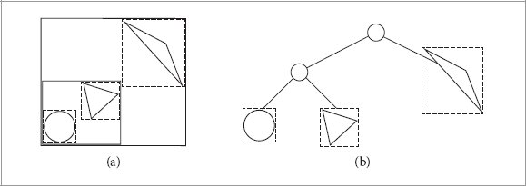

*Figure 7.3: Bounding Volume Hierarchy for a Simple Scene. (a) A small collection of primitives, with bounding boxes shown by dashed lines. The primitives are aggregated based on proximity; here, the sphere and the equilateral triangle are bounded by another bounding box before being bounded by a bounding box that encompasses the entire scene (both shown in solid lines). (b) The corresponding bounding volume hierarchy. The root node holds the bounds of the entire scene. Here, it has two children, one storing a bounding box that encompasses the sphere and equilateral triangle (that in turn has those primitives as its children) and the other storing the bounding box that holds the skinny triangle.*

```text
    AnimatedPrimitive 405
    BVHAggregate 407
    KdTreeAggregate 406
    TransformedPrimitive 403
```

One property of primitive subdivision is that each primitive appears in the hierarchy only once. In contrast, a primitive may overlap multiple spatial regions with spatial subdivision and thus may be tested for intersection multiple times as the ray passes through them.2 Another implication of this property is that the amount of memory needed to represent the primitive subdivision hierarchy is bounded. For a binary BVH that stores a single primitive in each leaf, the total number of nodes is 2n – 1, where n is the number of primitives. (There are n leaf nodes and n – 1 interior nodes.) If leaves store multiple primitives, fewer nodes are needed.

BVHs are more efficient to build than kd-trees, and are generally more numerically robust and less prone to missed intersections due to round-off errors than kd-trees are. The BVH aggregate, BVHAggregate, is therefore the default acceleration structure in pbrt.

〈BVHAggregate Definition〉 ≡ class BVHAggregate { public: 〈BVHAggregate Public Types 407〉 〈BVHAggregate Public Methods〉 private: 〈BVHAggregate Private Methods〉 〈BVHAggregate Private Members 407〉 };

Its constructor takes an enumerator value that describes which of four algorithms to use when partitioning primitives to build the tree. The default, SAH, indicates that an algorithm based on the “surface area heuristic,” discussed in Section 7.3.2, should be used. An alternative, HLBVH, which is discussed in Section 7.3.3, can be constructed more efficiently (and more easily parallelized), but it does not build trees that are as effective as SAH. The remaining two approaches use even less computation but create fairly low-quality trees. They are mostly useful for illuminating the superiority of the first two approaches.

〈BVHAggregate Public Types〉 ≡ 407

```rust
   enum SplitMethod { SAH, HLBVH, Middle, EqualCounts };
```

In addition to the enumerator, the constructor takes the primitives themselves and the maximum number of primitives that can be in any leaf node.

〈BVHAggregate Method Definitions〉 ≡ BVHAggregate::BVHAggregate(std::vector<Primitive> prims, int maxPrimsInNode, SplitMethod splitMethod) : maxPrimsInNode(std::min(255, maxPrimsInNode)), primitives(std::move(prims)), splitMethod(splitMethod) { 〈Build BVH from primitives 408〉 }

〈BVHAggregate Private Members〉 ≡ 407

```rust
   int maxPrimsInNode;
   Vec<Primitive> primitives;
   SplitMethod splitMethod;
```

```text
    BVHAggregate 407
    BVHAggregate::maxPrimsInNode 407
    BVHAggregate::primitives 407
    BVHAggregate::splitMethod 407
    Primitive 398
    SplitMethod 407
```

### 7.3.1 BVH CONSTRUCTION

There are three stages to BVH construction in the implementation here. First, bounding information about each primitive is computed and stored in an array that will be used during tree construction. Next, the tree is built using the algorithm choice encoded in splitMethod. The result is a binary tree where each interior node holds pointers to its children and each leaf node holds references to one or more primitives. Finally, this tree is converted to a more compact (and thus more efficient) pointerless representation for use during rendering. (The implementation is easier with this approach, versus computing the pointerless representation directly during tree construction, which is also possible.)

〈Build BVH from primitives〉≡ 407

```rust
   〈Initialize bvhPrimitives array for primitives 408〉
   〈Build BVH for primitives using bvhPrimitives 408〉
   〈Convert BVH into compact representation in nodes array 429〉
```

For each primitive to be stored in the BVH, an instance of the BVHPrimitive structure stores its complete bounding box and its index in the primitives array.

〈Initialize bvhPrimitives array for primitives〉 ≡ 408

```rust
   Vec<BVHPrimitive> bvhPrimitives(primitives.size());
   for (size_t i = 0; i < primitives.size(); ++i)
          bvhPrimitives[i] = BVHPrimitive(i, primitives[i].Bounds());
```

〈BVHPrimitive Definition〉 ≡ struct BVHPrimitive { BVHPrimitive(size_t primitiveIndex, const Bounds3f &bounds) : primitiveIndex(primitiveIndex), bounds(bounds) {} size_t primitiveIndex; Bounds3f bounds; 〈BVHPrimitive Public Methods 408〉 };

A simple method makes the centroid of the bounding box available.

〈BVHPrimitive Public Methods〉 ≡ 408

```rust
   Point3f Centroid() const { return .5f * bounds.pMin + .5f * bounds.pMax; }
```

Hierarchy construction can now begin. In addition to initializing the pointer to the root note of the BVH, root, an important side effect of the tree construction process is that a new array of Primitives is stored in orderedPrims; this array stores the primitives ordered so that the primitives in each leaf node occupy a contiguous range in the array. It is swapped with the original primitives array after tree construction.

〈Build BVH for primitives using bvhPrimitives〉≡ 408

```rust
    〈Declare Allocators used for BVH construction 409〉
    Vec<Primitive> orderedPrims(primitives.size());
    BVHBuildNode *root;
    〈Build BVH according to selected splitMethod 409〉
```

```text
    Allocator 40
    Bounds3::pMax 98
    Bounds3::pMin 98
    Bounds3f 97
    BVHAggregate::primitives 407
    BVHBuildNode 409
    BVHPrimitive 408
    Point3f 92
    Primitive 398
    Primitive::Bounds() 398
```

Memory for the initial BVH is allocated using the following Allocators. Note that all are based on the Rust standard library’s pmr::monotonic_buffer_resource, which efficiently allocates memory from larger buffers. This approach is not only more computationally efficient than using a general-purpose allocator, but also uses less memory in total due to keeping less bookkeeping information with each allocation. We have found that using the default memory allocation algorithms in the place of these uses approximately 10% more memory and takes approximately 10% longer for complex scenes.

Because the pmr::monotonic_buffer_resource class cannot be used concurrently by multiple threads without mutual exclusion, in the parts of BVH construction that execute in parallel each thread uses per-thread allocation of them with help from the ThreadLocal class. Nonparallel code can use alloc directly.

〈Declare Allocators used for BVH construction〉 ≡ 408

```rust
   pstd::pmr::monotonic_buffer_resource resource;
   Allocator alloc(&resource);
   using Resource = pstd::pmr::monotonic_buffer_resource;
   Vec<Box<Resource>> threadBufferResources;
   ThreadLocal<Allocator> threadAllocators([&threadBufferResources]() {
        threadBufferResources.push_back(std::make_unique<Resource>());
        auto ptr = threadBufferResources.back().get();
        return Allocator(ptr);
   });
```

If the HLBVH construction algorithm has been selected, buildHLBVH() is called to build the tree. The other three construction algorithms are all handled by buildRecursive(). The initial calls to these functions are passed all the primitives to be stored. Each returns a pointer to the root of a BVH for the

primitives they are given, which is represented with the BVHBuildNode structure and the total number of nodes created, which is stored in totalNodes. This value is represented by a std::atomic variable so that it can be modified correctly by multiple threads executing in parallel.

〈Build BVH according to selected splitMethod〉 ≡ 408

```rust
   Atomic<int> totalNodes{0};
   if (splitMethod == SplitMethod::HLBVH) {
        root = buildHLBVH(alloc, bvhPrimitives, &totalNodes, orderedPrims);
   } else {
        Atomic<int> orderedPrimsOffset{0};
        root = buildRecursive(threadAllocators,
                                    pstd::span<BVHPrimitive>(bvhPrimitives),
                     &totalNodes, &orderedPrimsOffset, orderedPrims);
   }
   primitives.swap(orderedPrims);
```

Each BVHBuildNode represents a node of the BVH. All nodes store a Bounds3f that represents the bounds of all the children beneath the node. Each interior node stores pointers to its two children in children. Interior nodes also record the coordinate axis along which primitives were partitioned for distribution to their two children; this information is used to improve the performance of the traversal algorithm. Leaf nodes record which primitive or primitives are stored in them; the elements of the BVHAggregate::primitives array from the offset firstPrimOffset up to but not including firstPrimOffset + nPrimitives are the primitives in the leaf. (This is why the primitives array needs to be reordered—so that this representation can be used, rather than, for example, storing a variable-sized array of primitive indices at each leaf node.) Allocator 40 Bounds3f 97 BVHAggregate::buildHLBVH() 422 BVHAggregate:: buildRecursive() 410 BVHAggregate::primitives 407 BVHAggregate::splitMethod 407 BVHBuildNode 409 BVHPrimitive 408 SplitMethod::HLBVH 407 ThreadLocal 1112

〈BVHBuildNode Definition〉 ≡ struct BVHBuildNode { 〈BVHBuildNode Public Methods 410〉 Bounds3f bounds;

BVHBuildNode *children[2]; int splitAxis, firstPrimOffset, nPrimitives; };

We will distinguish between leaf and interior nodes by whether their child pointers have the value nullptr or not, respectively. 〈BVHBuildNode Public Methods〉 ≡ 409

void InitLeaf(int first, int n, const Bounds3f &b) { firstPrimOffset = first; nPrimitives = n; bounds = b; children[0] = children[1] = nullptr; }

The InitInterior() method requires that the two child nodes already have been created, so that their pointers can be passed in. This requirement makes it easy to compute the bounds of the interior node, since the children bounds are immediately available. 〈BVHBuildNode Public Methods〉 +≡ 409

void InitInterior(int axis, BVHBuildNode *c0, BVHBuildNode *c1) { children[0] = c0; children[1] = c1; bounds = Union(c0->bounds, c1->bounds); splitAxis = axis; nPrimitives = 0; }

In addition to the allocators used for BVH nodes and the array of BVHPrimitive structures, buildRecursive() takes a pointer totalNodes that is used to track the total number of BVH nodes that have been created; this value makes it possible to allocate exactly the right number of the more compact LinearBVHNodes later.

The orderedPrims array is used to store primitive references as primitives are stored in leaf nodes of the tree. It is initially allocated with enough entries to store all the primitives, though all entries are nullptr. When a leaf node is created, buildRecursive() claims enough entries in the array for its primitives; orderedPrimsOffset starts at 0 and keeps track of where

the next free entry is. It, too, is an atomic variable so that multiple threads can allocate space from the array concurrently. Recall that when tree construction is finished, BVHAggregate::primitives is replaced with the ordered primitives array created here.

```text
   Allocator 40
   Bounds3::Union() 99
   Bounds3f 97
   BVHAggregate::primitives 407
   BVHBuildNode 409
   BVHBuildNode::bounds 409
   BVHBuildNode::children 409
   BVHBuildNode::firstPrimOffset 409
   BVHBuildNode::nPrimitives 409
   BVHBuildNode::splitAxis 409
   BVHPrimitive 408
   LinearBVHNode 429
   Primitive 398
   std::pmr:: polymorphic_allocator:: new_object() 41
   ThreadLocal 1112
   ThreadLocal::Get() 1112
```

〈BVHAggregate Method Definitions〉 +≡ BVHBuildNode *BVHAggregate::buildRecursive( ThreadLocal<Allocator> &threadAllocators, pstd::span<BVHPrimitive> bvhPrimitives, std::atomic<int> *totalNodes, std::atomic<int> *orderedPrimsOffset, std::vector<Primitive> &orderedPrims) { Allocator alloc = threadAllocators.Get(); BVHBuildNode *node = alloc.new_object<BVHBuildNode>(); 〈Initialize BVHBuildNode for primitive range 411〉 return node; }

If bvhPrimitives has only a single primitive, then the recursion has bottomed out and a leaf node is created. Otherwise, this method partitions its elements using one of the partitioning algorithms and reorders the array elements so that they represent the partitioned subsets. If the partitioning is

successful, these two primitive sets are in turn passed to recursive calls that will themselves return pointers to nodes for the two children of the current node. 〈Initialize BVHBuildNode for primitive range〉 ≡ 410

```rust
   ++*totalNodes;
   〈Compute bounds of all primitives in BVH node 411〉
   if (bounds.SurfaceArea() == 0 || bvhPrimitives.size() == 1) {
         〈Create leaf BVHBuildNode 411〉
   } else {
         〈Compute bound of primitive centroids and choose split dimension dim 412〉
         〈Partition primitives into two sets and build children 412〉
   }
```

The primitive bounds will be needed regardless of whether an interior or leaf node is created, so they are computed before that determination is made. 〈Compute bounds of all primitives in BVH node〉 ≡ 411

Bounds3f bounds; for (const auto &prim : bvhPrimitives) bounds = Union(bounds, prim.bounds);

At leaf nodes, the primitives overlapping the leaf are appended to the orderedPrims array and a leaf node object is initialized. Because orderedPrimsOffset is a std::atomic variable and fetch_add() is an atomic operation, multiple threads can safely perform this operation concurrently without further synchronization: each one is able to allocate its own span of the orderedPrimitives array that it can then safely write to. 〈Create leaf BVHBuildNode〉 ≡ 411, 412,

int firstPrimOffset = orderedPrimsOffset->fetch_add(bvhPrimitives.size()); for (size_t i = 0; i < bvhPrimitives.size(); ++i) { int index = bvhPrimitives[i].primitiveIndex; orderedPrims[firstPrimOffset + i] = primitives[index]; } node->InitLeaf(firstPrimOffset, bvhPrimitives.size(), bounds); return node;

For interior nodes, the collection of primitives must be partitioned between the two children’s subtrees. Given n primitives, there are in general 2n–1 – 2 possible ways to partition them into two non-empty groups. In practice when building BVHs, one generally considers partitions along a coordinate axis, meaning that there are about 3n candidate partitions. (Along each axis, each primitive may be put into the first partition or the second partition.) Here, we choose just one of the three coordinate axes to use in partitioning the primitives. We select the axis with the largest extent of bounding box centroids for the primitives in bvhPrimitives. (An alternative would be to try partitioning the primitives along all three axes and select the one that gave the best result, but in practice this approach works well.) This approach gives good partitions in many scenes; Figure 7.4 illustrates the strategy.

```text
   Bounds3::SurfaceArea() 102
   Bounds3::Union() 99
   Bounds3f 97
   BVHBuildNode::InitLeaf() 410
   BVHPrimitive::bounds 408
   BVHPrimitive::primitiveIndex 408
```

The general goal is to select a partition of primitives that does not have too much overlap of the bounding boxes of the two resulting primitive sets—if there is substantial overlap, then it will more frequently be necessary to traverse both children’s subtrees when traversing the tree, requiring more computation than if it had been possible to more effectively prune away collections of primitives. This idea of finding effective primitive partitions will be made more rigorous shortly, in the discussion of the surface area heuristic.

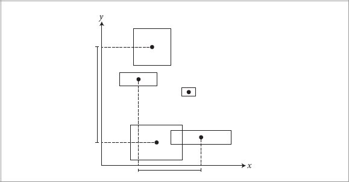

*Figure 7.4: Choosing the Axis along which to Partition Primitives. The BVHAggregate chooses an axis along which to partition the primitives based on which axis has the largest range of the centroids of the primitives’ bounding boxes. Here, in two dimensions, their extent is largest along the y axis (filled points on the axes), so the primitives will be partitioned in y.*

〈Compute bound of primitive centroids and choose split dimension dim〉 ≡ 411

Bounds3f centroidBounds; for (const auto &prim : bvhPrimitives) centroidBounds = Union(centroidBounds, prim.Centroid()); int dim = centroidBounds.MaxDimension();

If all the centroid points are at the same position (i.e., the centroid bounds have zero volume), then recursion stops and a leaf node is created with the primitives; none of the splitting methods here is effective in that (unusual) case. The primitives are otherwise partitioned using the chosen method and passed to two recursive calls to buildRecursive(). 〈Partition primitives into two sets and build children〉 ≡ 411

if (centroidBounds.pMax[dim] == centroidBounds.pMin[dim]) { 〈Create leaf BVHBuildNode 411〉 } else { int mid = bvhPrimitives.size() / 2; 〈Partition primitives based on splitMethod〉 BVHBuildNode *children[2]; 〈Recursively build BVHs for children 412〉

```rust
        node->InitInterior(dim, children[0], children[1]);
   }
```

The two recursive calls access independent data, other than when they allocate space in the orderedPrims array by incrementing orderedPrimsOffset, which we already have seen is thread safe. Therefore, when there are a reasonably large number of active primitives, those calls can be performed in parallel, which improves the performance of BVH construction.

```text
   Bounds3::MaxDimension() 102
   Bounds3::pMax 98
   Bounds3::pMin 98
   Bounds3::Union() 99
   Bounds3f 97
   BVHBuildNode 409
   BVHBuildNode::InitInterior() 410
   BVHPrimitive::Centroid() 408
```

〈Recursively build BVHs for children〉 ≡ 412

if (bvhPrimitives.size() > 128 * 1024) { 〈Recursively build child BVHs in parallel 413〉 } else { 〈Recursively build child BVHs sequentially〉 }

A parallel for loop over two items is sufficient to expose the available parallelism. With pbrt’s implementation of ParallelFor(), the current thread will end up handling the first recursive call, while another thread, if available, can take the second. ParallelFor() does not return until all the loop iterations have completed, so we can safely proceed, knowing that both children are fully initialized when it does. 〈Recursively build child BVHs in parallel〉 ≡ 412

ParallelFor(0, 2, [&](int i) { if (i == 0) children[0] = buildRecursive(threadAllocators, bvhPrimitives.subspan(0, mid), totalNodes, orderedPrimsOffset, orderedPrims);

```rust
         else
            children[1] =
                buildRecursive(threadAllocators, bvhPrimitives.subspan(mid),
                              totalNodes, orderedPrimsOffset, orderedPrims);
   });
```

The code for the non-parallel case, 〈Recursively build child BVHs sequentially〉, is equivalent, just without the parallel for loop. We have therefore not included it here. We also will not include the code fragment 〈Partition primitives based on splitMethod〉here; it just uses the value of BVHAggregate::splitMethod to determine which primitive partitioning scheme to use. These three schemes will be described in the following few pages. A simple splitMethod is Middle, which first computes the midpoint of the primitives’ centroids along the splitting axis. This method is implemented in the fragment 〈Partition primitives through node’s midpoint〉. The primitives are classified into the two sets, depending on whether their centroids are above or below the midpoint. This partitioning is easily done with the std::partition() Rust standard library function, which takes a range of elements in an array and a comparison function and orders the elements in the array so that all the elements that return true for the given predicate function appear in the range before those that return false for it. std::partition() returns a pointer to the first element that had a false value for the predicate. Figure 7.5 illustrates this approach, including cases where it does and does not work well. If the primitives all have large overlapping bounding boxes, this splitting method may fail to separate the primitives into two groups. In that case, execution falls through to the SplitMethod::EqualCounts approach to try again. 〈Partition primitives through node’s midpoint〉 ≡ Float pmid = (centroidBounds.pMin[dim] + centroidBounds.pMax[dim]) / 2; auto midIter =

std::partition(bvhPrimitives.begin(), bvhPrimitives.end(), [dim, pmid](const BVHPrimitive &pi) { return pi.Centroid()[dim] < pmid; }); mid = midIter - bvhPrimitives.begin(); if (midIter != bvhPrimitives.begin() && midIter != bvhPrimitives.end()) break;

```text
   Bounds3::pMax 98
   Bounds3::pMin 98
   BVHAggregate:: buildRecursive() 410
   BVHAggregate::splitMethod 407
   BVHPrimitive 408
   BVHPrimitive::Centroid() 408
   Float 23
   ParallelFor() 1107
```

When splitMethod is SplitMethod::EqualCounts, the 〈Partition primitives into equally sized subsets〉 fragment runs. It partitions the primitives into two equal-sized subsets such that the first half of the n of them are the n/2 with smallest centroid coordinate values along the chosen axis, and the second half are the ones with the largest centroid coordinate values.

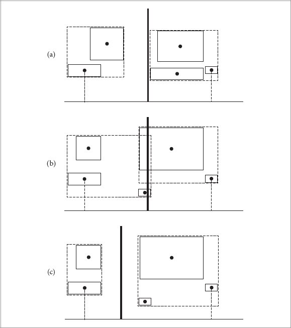

*Figure 7.5: Splitting Primitives Based on the Midpoint of Centroids on an Axis. (a) For some distributions of primitives, such as the one shown here, splitting based on the midpoint of the centroids along the chosen axis (thick vertical line) works well. (The bounding boxes of the two resulting primitive groups are shown with dashed lines.) (b) For distributions like this one, the midpoint is a suboptimal choice; the two resulting bounding boxes overlap substantially. (c) If the same group of primitives from (b) is instead split along the line shown here, the resulting bounding boxes are smaller and do not overlap at all, leading to better performance when rendering.*

While this approach can sometimes work well, the case in Figure 7.5(b) is one where this method also fares poorly.

This scheme is also easily implemented with a standard library call, std::nth_element(). It takes a start, middle, and ending iterator as well as a comparison function. It orders the array so that the element at the middle iterator is the one that would be there if the array was fully sorted, and such that all the elements before the middle one compare to less than the middle element and all the elements after it compare to greater than it. This ordering can be done in O(n) time, with n the number of elements, which is more efficient than the O(n log n) cost of completely sorting the array. 〈Partition primitives into equally sized subsets〉 ≡ 416

mid = bvhPrimitives.size() / 2; std::nth_element(bvhPrimitives.begin(), bvhPrimitives.begin() + mid, bvhPrimitives.end(), [dim](const BVHPrimitive &a, const BVHPrimitive &b) { return a.Centroid()[dim] < b.Centroid()[dim]; });

### 7.3.2 THE SURFACE AREA HEURISTIC

The two primitive partitioning approaches described so far can work well for some distributions of primitives, but they often choose partitions that perform poorly in practice, leading to more nodes of the tree being visited by rays and hence unnecessarily inefficient ray–primitive intersection computations at rendering time. Most of the best current algorithms for building acceleration structures for ray tracing are based on the “surface area heuristic” (SAH), which provides a well-grounded cost model for answering questions like “which of a number of partitions of primitives will lead to a better BVH for ray–primitive intersection tests?” or “which of a number of possible positions to split space in a spatial subdivision scheme will lead to a better acceleration structure?” The SAH model estimates the computational expense of performing ray intersection tests, including the time spent traversing nodes of the tree and the time spent on ray–primitive intersection tests for a particular partitioning of primitives. Algorithms for building acceleration structures can then follow the goal of minimizing total cost. Typically, a greedy algorithm is used that minimizes the cost for each single node of the hierarchy being built individually.

The ideas behind the SAH cost model are straightforward: at any point in building an adaptive acceleration structure (primitive subdivision or spatial subdivision), we could just create a leaf node for the current region and geometry. In that case, any ray that passes through this region will be tested

against all the overlapping primitives and will incur a cost of where n is the number of primitives and tisect(i) is the time to compute a ray–object intersection with the ith primitive. The other option is to split the region. In that case, rays will incur the cost

where ttrav is the time it takes to traverse the interior node and determine which of the children the ray passes through, pA and pB are the probabilities that the ray passes through each of the child nodes (assuming binary subdivision), ai and bi are the indices of primitives in the two child nodes, and nA and nB are the number of primitives that overlap the regions of the two child nodes, respectively. The choice of how primitives are partitioned affects the values of the two probabilities as well as the set of primitives on each side of the split. In pbrt, we will make the simplifying assumption that tisect(i) is the same for all the primitives; this assumption is probably not too far from reality, and any error that it introduces does not seem to affect the performance of accelerators very much. Another possibility would be to add a method to Primitive that returned an estimate of the number of processing cycles that its intersection test requires.

```text
   BVHPrimitive 408
   BVHPrimitive::Centroid() 408
   Primitive 398
```

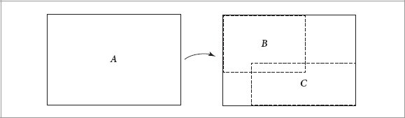

*Figure 7.6: If a node of the bounding hierarchy with surface area sA is split into two children with surface areas sB and sC, the probabilities that a ray passing through A also passes through B and C are given by sB/sA and sC/sA, respectively.*

The probabilities pA and pB can be computed using ideas from geometric probability. It can be shown that for a convex volume A contained in another convex volume B, the conditional probability that a uniformly distributed random ray passing through B will also pass through A is the ratio of their surface areas, sA and sB: Because we are interested in the cost for rays passing through the node, we can use this result directly. Thus, if we are considering refining a region of space A such that there are two new subregions with bounds B and C (Figure 7.6), the probability that a ray passing through A will also pass through either of the subregions is easily computed. When splitMethod has the value SplitMethod::SAH, the SAH is used for building the BVH; a partition of the primitives along the chosen axis that gives a minimal SAH cost estimate is found by considering a number of candidate partitions. (This is the default SplitMethod, and it creates the most efficient hierarchies of the partitioning options.) However, once it has refined down to two primitives, the implementation switches over to directly partitioning them in half. The incremental computational cost for applying the SAH at that point is not beneficial. 〈Partition primitives using approximate SAH〉 ≡ if (bvhPrimitives.size() <= 2) { 〈Partition primitives into equally sized subsets 415〉

} else { 〈Allocate BVHSplitBucket for SAH partition buckets 417〉 〈Initialize BVHSplitBucket for SAH partition buckets 417〉 〈Compute costs for splitting after each bucket 418〉 〈Find bucket to split at that minimizes SAH metric 419〉 〈Either create leaf or split primitives at selected SAH bucket 419〉 }

Rather than exhaustively considering all 2n possible partitions along the axis, computing the SAH for each to select the best, the implementation here instead divides the range along the axis into a small number of buckets of equal extent. It then only considers partitions at bucket boundaries. This approach is more efficient than considering all partitions while usually still producing partitions that are nearly as effective. This idea is illustrated in Figure 7.7.

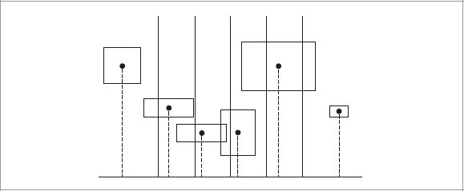

*Figure 7.7: Choosing a Splitting Plane with the Surface Area Heuristic for BVHs. The projected extent of primitive bounds centroids is projected onto the chosen split axis. Each primitive is placed in a bucket along the axis based on the centroid of its bounds. The implementation then estimates the cost for splitting the primitives using the planes at each of the bucket boundaries (solid vertical lines); whichever one gives the minimum cost per the surface area heuristic is selected.*

〈BVHSplitBucket Definition〉 ≡ struct BVHSplitBucket { int count = 0;

Bounds3f bounds; };

We have found that 12 buckets usually work well in practice. An improvement may be to increase this value when there are many primitives and to decrease it when there are few. 〈Allocate BVHSplitBucket for SAH partition buckets〉 ≡ 416

constexpr int nBuckets = 12; BVHSplitBucket buckets[nBuckets];

For each primitive, the following fragment determines the bucket that its centroid lies in and updates the bucket’s bounds to include the primitive’s bounds. 〈Initialize BVHSplitBucket for SAH partition buckets〉 ≡ 416

```rust
   for (const auto &prim : bvhPrimitives) {
         int b = nBuckets * centroidBounds.Offset(prim.Centroid())[dim];
         if (b == nBuckets) b = nBuckets - 1;
         buckets[b].count++;
         buckets[b].bounds = Union(buckets[b].bounds, prim.bounds);
   }
```

For each bucket, we now have a count of the number of primitives and the bounds of all of their respective bounding boxes. We want to use the SAH to estimate the cost of splitting at each of the bucket boundaries. The fragment below loops over all the buckets and initializes the cost[i] array to store the estimated SAH cost for splitting after the ith bucket. (It does not consider a split after the last bucket, which by definition would not split the primitives.) Bounds3::Offset() 102 Bounds3::Union() 99 Bounds3f 97 BVHPrimitive::bounds 408 BVHPrimitive::Centroid() 408 BVHSplitBucket 417 BVHSplitBucket::bounds 417

BVHSplitBucket::count 417 We arbitrarily set the estimated intersection cost to 1, and then set the estimated traversal cost to 1/2. (One of the two of them can always be set to 1 since it is the relative, rather than absolute, magnitudes of the estimated traversal and intersection costs that determine their effect.) However, not only is the absolute amount of computation necessary for node traversal—a ray–bounding box intersection—much less than the amount of computation needed to intersect a ray with a shape, the full cost of a shape intersection test is even higher. It includes the overhead of at least two instances of dynamic dispatch (one or more via Primitives and one via a Shape), the cost of computing all the geometric information needed to initialize a SurfaceInteraction if an intersection is found, and any resulting costs from possibly applying additional transformations and interpolating animated transformations. We have intentionally underestimated the performance ratio between these two costs because the raw amount of computation each performs does not measure their full expense. With a lower traversal cost, the resulting BVHs would be deeper and require more nodes. For complex scenes, this additional memory use may be undesirable. Even for simpler scenes, visiting more nodes when a ray is traced will generally incur the cost of cache misses, which not only may reduce performance for that ray, but may harm future performance from displacing other useful data from the cache. We have found the 2 : 1 ratio that we have used here to make a reasonable trade-off between all of these issues. In order to be able to choose a split in linear time, the implementation first performs a forward scan over the buckets and then a backward scan over the buckets that incrementally compute each bucket’s cost.3 There is one fewer candidate split than the number of buckets, since all splits are between pairs of buckets. 〈Compute costs for splitting after each bucket〉 ≡ 416

constexpr int nSplits = nBuckets - 1; Float costs[nSplits] = { }; 〈Partially initialize costs using a forward scan over splits 418〉 〈Finish initializing costs using a backward scan over splits 418〉

The loop invariant is that countBelow stores the number of primitives that are below the corresponding candidate split, and boundsBelow stores their bounds. With these values in hand, the value of the first sum in Equation (7.1) can be evaluated for each split. 〈Partially initialize costs using a forward scan over splits〉 ≡ 418

int countBelow = 0; Bounds3f boundBelow; for (int i = 0; i < nSplits; ++i) { boundBelow = Union(boundBelow, buckets[i].bounds); countBelow += buckets[i].count; costs[i] += countBelow * boundBelow.SurfaceArea(); }

A similar backward scan over the buckets finishes initializing the costs array. 〈Finish initializing costs using a backward scan over splits〉 ≡ 418

int countAbove = 0; Bounds3f boundAbove; for (int i = nSplits; i >= 1; --i) { boundAbove = Union(boundAbove, buckets[i].bounds); countAbove += buckets[i].count; costs[i - 1] += countAbove * boundAbove.SurfaceArea(); }

```text
   Bounds3::SurfaceArea() 102
   Bounds3::Union() 99
   Bounds3f 97
   Float 23
   Primitive 398
   SurfaceInteraction 138
```

Given all the costs, a linear search over the potential splits finds the partition with minimum cost. 〈Find bucket to split at that minimizes SAH metric〉 ≡ 416

int minCostSplitBucket = -1; Float minCost = Infinity; for (int i = 0; i < nSplits; ++i) { 〈Compute cost for candidate split and update minimum if necessary 419〉 }

```rust
   〈Compute leaf cost and SAH split cost for chosen split 419〉
```

To find the best split, we evaluate a simplified version of Equation (7.1), neglecting the traversal cost and the division by the surface area of the bounding box of all the primitives to compute the probabilities pA and pB; these have no effect on the choice of the best split. That cost is precisely what is stored in costs, so the split with minimum cost is easily found.

〈Compute cost for candidate split and update minimum if necessary〉 ≡ 419

if (costs[i] < minCost) { minCost = costs[i]; minCostSplitBucket = i; }

To compute the final SAH cost for a split, we need to divide by the surface area of the overall bounding box to compute the probabilities pA and pB before adding the estimated traversal cost, 1/2. Because we set the estimated intersection cost to 1 previously, the estimated cost for just creating a leaf node is equal to the number of primitives. 〈Compute leaf cost and SAH split cost for chosen split〉 ≡ 419

Float leafCost = bvhPrimitives.size(); minCost = 1.f / 2.f + minCost / bounds.SurfaceArea();

If the chosen bucket boundary for partitioning has a lower estimated cost than building a node with the existing primitives or if more than the maximum number of primitives allowed in a node is present, the std::partition() function is used to do the work of reordering nodes in the bvhPrimitives array. Recall from its use earlier that it ensures that all elements of the array that return true from the given predicate appear before those that return false and that it returns a pointer to the first element where the predicate returns false.

〈Either create leaf or split primitives at selected SAH bucket〉 ≡ 416

if (bvhPrimitives.size() > maxPrimsInNode || minCost < leafCost) { auto midIter = std::partition(bvhPrimitives.begin(), bvhPrimitives.end(), [=](const BVHPrimitive &bp) { int b = nBuckets * centroidBounds.Offset(bp.Centroid())[dim]; if (b == nBuckets) b = nBuckets - 1;

```rust
                   return b <= minCostSplitBucket;
          });
       mid = midIter - bvhPrimitives.begin();
   } else {
       〈Create leaf BVHBuildNode 411〉
   }
```

```text
    Bounds3::Offset() 102
    Bounds3::SurfaceArea() 102
    BVHAggregate::maxPrimsInNode 407
    BVHPrimitive 408
    BVHPrimitive::Centroid() 408
    Float 23
    Infinity 361
```

### 7.3.3 LINEAR BOUNDING VOLUME HIERARCHIES

While building bounding volume hierarchies using the surface area heuristic gives very good results, that approach does have two disadvantages: first, many passes are taken over the scene primitives to compute the SAH costs at all the levels of the tree. Second, top-down BVH construction is difficult to parallelize well: the approach used in buildRecursive()—performing parallel construction of independent subtrees—suffers from limited independent work until the top few levels of the tree have been built, which in turn inhibits parallel scalability. (This second issue is particularly an issue on GPUs, which perform poorly if massive parallelism is not available.) Linear bounding volume hierarchies (LBVHs) were developed to address these issues. With LBVHs, the tree is built with a small number of lightweight passes over the primitives; tree construction time is linear in the number of primitives. Further, the algorithm quickly partitions the primitives into clusters that can be processed independently. This processing can be fairly easily parallelized and is well suited to GPU implementation. The key idea behind LBVHs is to turn BVH construction into a sorting problem. Because there is no single ordering function for sorting multidimensional data, LBVHs are based on Morton codes, which map nearby points in n dimensions to nearby points along the 1D line, where there is an obvious ordering function. After the primitives have been sorted,

spatially nearby clusters of primitives are in contiguous segments of the sorted array. Morton codes are based on a simple transformation: given n-dimensional integer coordinate values, their Morton-coded representation is found by interleaving the bits of the coordinates in base 2. For example, consider a 2D coordinate (x, y) where the bits of x and y are denoted by xi and yi. The corresponding Morton-coded value is ⋯ y3 x3 y2 x2 y1 x1 y0 x0. Figure 7.8 shows a plot of the 2D points in Morton order—note that they are visited along a path that follows a reversed “z” shape. (The Morton path is sometimes called “z-order” for this reason.) We can see that points with coordinates that are close together in 2D are generally close together along the Morton curve.4 A Morton-encoded value also encodes useful information about the position of the point that it represents. Consider the case of 4-bit coordinate values in 2D: the x and y coordinates are integers in [0, 15] and the Morton code has 8 bits: y3 x3 y2 x2 y1 x1 y0 x0. Many interesting properties follow from the encoding; a few examples include: For a Morton-encoded 8-bit value where the high bit y3 is set, we then know that the high bit of its underlying y coordinate is set and thus y ≥ 8 (Figure 7.9(a)). The next bit value, x3, splits the x axis in the middle (Figure 7.9(b)). If y3 is set and x3 is off, for example, then the corresponding point must lie in the shaded area of Figure 7.9(c). In general, points with a number of matching high bits lie in a power-of-two sized and axis-aligned region of space determined by the matching bit values. The value of y2 splits the y axis into four regions (Figure 7.9(d)).

Another way to interpret these bit-based properties is in terms of Morton-coded values. For example, Figure 7.9(a) corresponds to the index being in the range [8, 15], and Figure 7.9(c) corresponds to [8, 11]. Thus, given a set of sorted Morton indices, we could find the range of points corresponding to an area like Figure 7.9(c) by performing a binary search to find each endpoint in the array.

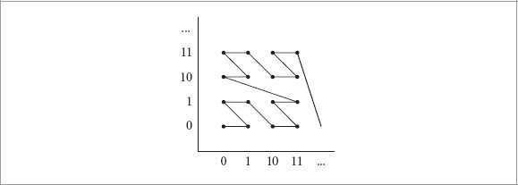

*Figure 7.8: The Order That Points Are Visited along the Morton Curve. Coordinate values along the x and y axes are shown in binary. If we connect the integer coordinate points in the order of their Morton indices, we see that the Morton curve visits the points along a hierarchical “z”-shaped path.*

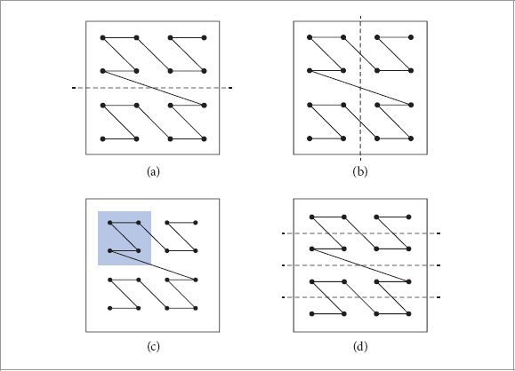

*Figure 7.9: Implications of the Morton Encoding. The values of various bits in the Morton value indicate the region of space that the corresponding coordinate lies in. (a) In 2D, the high bit of the Morton-coded value of a point’s coordinates defines a splitting plane along the middle of the y axis. If the high bit is set, the point is above the plane. (b) Similarly, the second-highest bit of the Morton value splits the x axis in the middle. (c) If the high y bit is 1 and the high x bit is 0, then the point must lie in the shaded region. (d) The second-from-highest y bit splits the y axis into four regions.*

LBVHs are BVHs built by partitioning primitives using splitting planes that are at the midpoint of each region of space (i.e., equivalent to the SplitMethod::Middle path defined earlier). Partitioning is extremely efficient, as it takes advantage of properties of the Morton encoding described above. Just reimplementing Middle in a different manner is not particularly interesting, so in the implementation here, we will build a hierarchical linear bounding volume hierarchy (HLBVH). With this approach, Morton-curve-based clustering is used to first build trees for the lower levels of the hierarchy (referred to as “treelets” in the following), and the top levels of the tree are then created using the surface area heuristic. The buildHLBVH()

method implements this approach and returns the root node of the resulting tree. 〈BVHAggregate Method Definitions +≡ BVHBuildNode *BVHAggregate::buildHLBVH( Allocator alloc, const std::vector<BVHPrimitive> &bvhPrimitives, std::atomic<int> *totalNodes, std::vector<Primitive> &orderedPrims) { 〈Compute bounding box of all primitive centroids 422〉 〈Compute Morton indices of primitives 422〉 〈Radix sort primitive Morton indices 423〉 〈Create LBVH treelets at bottom of BVH 424〉 〈Create and return SAH BVH from LBVH treelets 428〉 }

The BVH is built using only the centroids of primitive bounding boxes to sort them—it does not account for the actual spatial extent of each primitive. This simplification is critical to the performance that HLBVHs offer, but it also means that for scenes with primitives that span a wide range of sizes, the tree that is built will not account for this variation as an SAH-based tree would. Because the Morton encoding operates on integer coordinates, we first need to bound the centroids of all the primitives so that we can quantize centroid positions with respect to the overall bounds. 〈Compute bounding box of all primitive centroids〉 ≡ 422

Bounds3f bounds; for (const BVHPrimitive &prim : bvhPrimitives) bounds = Union(bounds, prim.Centroid());

Given the overall bounds, we can now compute the Morton code for each primitive. This is a fairly lightweight calculation, but given that there may be millions of primitives, it is worth parallelizing. 〈Compute Morton indices of primitives〉 ≡ 422

std::vector<MortonPrimitive> mortonPrims(bvhPrimitives.size());

```rust
   ParallelFor(0, bvhPrimitives.size(), [&](int64_t i) {
       〈Initialize mortonPrims[i] for ith primitive 423〉
   });
```

A MortonPrimitive instance is created for each primitive; it stores the index of the primitive, as well as its Morton code, in the bvhPrimitives array.

```text
   Allocator 40
   Bounds3::Union() 99
   Bounds3f 97
   BVHBuildNode 409
   BVHPrimitive 408
   BVHPrimitive::Centroid() 408
   MortonPrimitive 422
   ParallelFor() 1107
   Primitive 398
```

〈MortonPrimitive Definition〉 ≡ struct MortonPrimitive { int primitiveIndex; uint32_t mortonCode; };

We use 10 bits for each of the x, y, and z dimensions, giving a total of 30 bits for the Morton code. This granularity allows the values to fit into a single 32-bit variable. Floating-point centroid offsets inside the bounding box are in [0, 1], so we scale them by 210 to get integer coordinates that fit in 10 bits. The EncodeMorton3() function, which is defined with other bitwise utility functions in Section B.2.7, returns the 3D Morton code for the given integer values. 〈Initialize mortonPrims[i] for ith primitive〉 ≡ 422

```rust
   constexpr int mortonBits = 10;
   constexpr int mortonScale = 1 << mortonBits;
   mortonPrims[i].primitiveIndex = bvhPrimitives[i].primitiveIndex;
   Vector3f centroidOffset = bounds.Offset(bvhPrimitives[i].Centroid());
   Vector3f offset = centroidOffset * mortonScale;
   mortonPrims[i].mortonCode = EncodeMorton3(offset.x, offset.y, offset.z);
```

Once the Morton indices have been computed, we will sort the mortonPrims by Morton index value using a radix sort. We have found that for BVH construction, our radix sort implementation is noticeably faster than using std::sort() from our system’s standard library (which is a mixture of a quicksort and an insertion sort). 〈Radix sort primitive Morton indices〉 ≡ 422

RadixSort(&mortonPrims);

Recall that a radix sort differs from most sorting algorithms in that it is not based on comparing pairs of values but rather is based on bucketing items based on some key. Radix sort can be used to sort integer values by sorting them one digit at a time, going from the rightmost digit to the leftmost. Especially with binary values, it is worth sorting multiple digits at a time; doing so reduces the total number of passes taken over the data. In the implementation here, bitsPerPass sets the number of bits processed per pass; with the value 6, we have 5 passes to sort the 30 bits. 〈BVHAggregate Utility Functions〉 ≡ static void RadixSort(std::vector<MortonPrimitive> *v) { std::vector<MortonPrimitive> tempVector(v->size()); constexpr int bitsPerPass = 6; constexpr int nBits = 30; constexpr int nPasses = nBits / bitsPerPass; for (int pass = 0; pass < nPasses; ++pass) { 〈Perform one pass of radix sort, sorting bitsPerPass bits 423〉 } 〈Copy final result from tempVector, if needed 424〉 }

Each pass sorts bitsPerPass bits, starting at lowBit.

```text
   Bounds3::Offset() 102
   BVHPrimitive::Centroid() 408
   BVHPrimitive::primitiveIndex 408
   EncodeMorton3() 1041
   MortonPrimitive 422
   MortonPrimitive:: primitiveIndex 422
```

```text
   RadixSort() 423
   Vector3f 86
```

〈Perform one pass of radix sort, sorting bitsPerPass bits〉 ≡ 423

int lowBit = pass * bitsPerPass; 〈Set in and out vector references for radix sort pass 424〉 〈Count number of zero bits in array for current radix sort bit 424〉 〈Compute starting index in output array for each bucket 424〉 〈Store sorted values in output array 424〉

The in and out references correspond to the vector to be sorted and the vector to store the sorted values in, respectively. Each pass through the loop alternates between the input vector *v and the temporary vector for each of them. 〈Set in and out vector references for radix sort pass〉 ≡ 423

std::vector<MortonPrimitive> &in = (pass & 1) ? tempVector : *v; std::vector<MortonPrimitive> &out = (pass & 1) ? *v : tempVector;

If we are sorting n bits per pass, then there are 2n buckets that each value may land in. We first count how many values will land in each bucket; this will let us determine where to store sorted values in the output array. To compute the bucket index for the current value, the implementation shifts the index so that the bit at index lowBit is at bit 0 and then masks off the low bitsPerPass bits.

〈Count number of zero bits in array for current radix sort bit〉 ≡ 423

constexpr int nBuckets = 1 << bitsPerPass; int bucketCount[nBuckets] = { 0 }; constexpr int bitMask = (1 << bitsPerPass) - 1; for (const MortonPrimitive &mp : in) { int bucket = (mp.mortonCode >> lowBit) & bitMask; ++bucketCount[bucket]; }

Given the count of how many values land in each bucket, we can compute the offset in the output array where each bucket’s values start; this is just the sum of how many values land in the preceding buckets. 〈Compute starting index in output array for each bucket〉 ≡ 423

int outIndex[nBuckets];

```rust
   outIndex[0] = 0;
   for (int i = 1; i < nBuckets; ++i)
       outIndex[i] = outIndex[i - 1] + bucketCount[i - 1];
```

Now that we know where to start storing values for each bucket, we can take another pass over the primitives to recompute the bucket that each one lands in and to store their MortonPrimitives in the output array. This completes the sorting pass for the current group of bits. 〈Store sorted values in output array〉 ≡ 423

```rust
   for (const MortonPrimitive &mp : in) {
        int bucket = (mp.mortonCode >> lowBit) & bitMask;
        out[outIndex[bucket]++] = mp;
   }
```

When sorting is done, if an odd number of radix sort passes were performed, then the final sorted values need to be copied from the temporary vector to the output vector that was originally passed to RadixSort().

〈Copy final result from tempVector, if needed〉 ≡ 423

if (nPasses & 1) std::swap(*v, tempVector);

Given the sorted array of primitives, we can now find clusters of primitives with nearby centroids and then create an LBVH over the primitives in each cluster. This step is a good one to parallelize as there are generally many clusters and each cluster can be processed independently. 〈Create LBVH treelets at bottom of BVH〉 ≡ 422

〈Find intervals of primitives for each treelet 425〉 〈Create LBVHs for treelets in parallel 426〉

```text
   MortonPrimitive 422
   MortonPrimitive::mortonCode 422
```

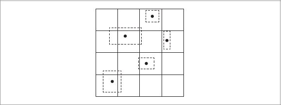

*Figure 7.10: Primitive Clusters for LBVH Treelets. Primitive centroids are clustered in a uniform grid over their bounds. An LBVH is created for each cluster of primitives within a cell that are in contiguous sections of the sorted Morton index values.*

Each primitive cluster is represented by an LBVHTreelet. It encodes the index in the morton Prims array of the first primitive in the cluster as well as the number of following primitives. (See Figure 7.10.) 〈LBVHTreelet Definition〉 ≡ struct LBVHTreelet { size_t startIndex, nPrimitives; BVHBuildNode *buildNodes; };

Recall from Figure 7.9 that a set of points with Morton codes that match in their high bit values lie in a power-of-two aligned and sized subset of the original volume. Because we have already sorted the mortonPrims array by Morton-coded value, primitives with matching high bit values are already together in contiguous sections of the array. Here we will find sets of primitives that have the same values for the high 12 bits of their 30-bit Morton codes. Clusters are found by taking a linear pass through the mortonPrims array and finding the offsets where any of the high 12 bits changes. This corresponds to clustering primitives in a regular grid of 212 = 4096 total grid cells with 24 = 16 cells in each dimension. In practice, many of the grid cells will be empty, though we will still expect to find many independent clusters here.

〈Find intervals of primitives for each treelet〉 ≡ 424

std::vector<LBVHTreelet> treeletsToBuild; for (size_t start = 0, end = 1; end <= mortonPrims.size(); ++end) { uint32_t mask = 0b00111111111111000000000000000000; if (end == (int)mortonPrims.size() || ((mortonPrims[start].mortonCode & mask) != (mortonPrims[end].mortonCode & mask))) { 〈Add entry to treeletsToBuild for this treelet 426〉 start = end; } }

```text
   BVHBuildNode 409
   LBVHTreelet 425
   MortonPrimitive::mortonCode 422
```

When a cluster of primitives has been found for a treelet, BVHBuildNodes are immediately allocated for it. (Recall that the number of nodes in a BVH is bounded by twice the number of leaf nodes, which in turn is bounded by the number of primitives.) It is simpler to preallocate this memory now in a serial phase of execution than during parallel construction of LBVHs. 〈Add entry to treeletsToBuild for this treelet〉 ≡ 425

size_t nPrimitives = end - start; int maxBVHNodes = 2 * nPrimitives - 1; BVHBuildNode *nodes = alloc.allocate_object<BVHBuildNode>(maxBVHNodes); treeletsToBuild.push_back({start, nPrimitives, nodes});

Once the primitives for each treelet have been identified, we can create LBVHs for them in parallel. When construction is finished, the buildNodes pointer for each LBVHTreelet will point to the root of the corresponding LBVH. There are two places where the worker threads building LBVHs must coordinate with each other. First, the total number of nodes in all the LBVHs needs to be computed and returned via the totalNodes pointer passed to buildHLBVH(). Second, when leaf nodes are created for the LBVHs, a contiguous segment of the orderedPrims array is needed to record the indices of the primitives in the leaf node. Our implementation uses atomic variables for both.

〈Create LBVHs for treelets in parallel〉 ≡ 424

std::atomic<int> orderedPrimsOffset(0); ParallelFor(0, treeletsToBuild.size(), [&](int i) { 〈Generate ith LBVH treelet 426〉 });

The work of building the treelet is performed by emitLBVH(), which takes primitives with centroids in some region of space and successively partitions them with splitting planes that divide the current region of space into two halves along the center of the region along one of the three axes. Note that instead of taking a pointer to the atomic variable totalNodes to count the number of nodes created, emitLBVH() updates a non-atomic local variable. The fragment here then only updates totalNodes once per treelet when each treelet is done. This approach gives measurably better performance than the alternative—having the worker threads frequently modify totalNodes over the course of their execution. (To understand why this is so, see the discussion of the overhead of multi-core memory coherence models in Appendix B.6.3.) 〈Generate ith LBVH treelet〉 ≡ 426

int nodesCreated = 0; const int firstBitIndex = 29 - 12; LBVHTreelet &tr = treeletsToBuild[i]; tr.buildNodes = emitLBVH(tr.buildNodes, bvhPrimitives, &mortonPrims[tr.startIndex], tr.nPrimitives, &nodesCreated, orderedPrims, &orderedPrimsOffset, firstBitIndex); *totalNodes += nodesCreated;

```text
   BVHAggregate::emitLBVH() 427
   BVHBuildNode 409
   LBVHTreelet 425
   LBVHTreelet::buildNodes 425
   LBVHTreelet::nPrimitives 425
   LBVHTreelet::startIndex 425
   ParallelFor() 1107
   std::pmr:: polymorphic_allocator:: allocate_object() 41
```

Thanks to the Morton encoding, the current region of space does not need to be explicitly represented in emitLBVH(): the sorted MortonPrims passed

in have some number of matching high bits, which in turn corresponds to a spatial bound. For each of the remaining bits in the Morton codes, this function tries to split the primitives along the plane corresponding to the bitIndex bit (recall Figure 7.9(d)) and then calls itself recursively. The index of the next bit to try splitting with is passed as the last argument to the function: initially it is 29 – 12, since 29 is the index of the 30th bit with zero-based indexing, and we previously used the high 12 bits of the Morton-coded value to cluster the primitives; thus, we know that those bits must all match for the cluster. 〈BVHAggregate Method Definitions〉 +≡ BVHBuildNode *BVHAggregate::emitLBVH(BVHBuildNode *&buildNodes, const std::vector<BVHPrimitive> &bvhPrimitives, MortonPrimitive *mortonPrims, int nPrimitives, int *totalNodes, std::vector<Primitive> &orderedPrims, std::atomic<int> *orderedPrimsOffset, int bitIndex) { if (bitIndex == -1 || nPrimitives < maxPrimsInNode) { 〈Create and return leaf node of LBVH treelet 427〉 } else { int mask = 1 << bitIndex; 〈Advance to next subtree level if there is no LBVH split for this bit 427〉 〈Find LBVH split point for this dimension 428〉 〈Create and return interior LBVH node 428〉 } }

After emitLBVH() has partitioned the primitives with the final low bit, no more splitting is possible and a leaf node is created. Alternatively, it also stops and makes a leaf node if it is down to a small number of primitives. Recall that orderedPrimsOffset is the offset to the next available element in the ordered Prims array. Here, the call to fetch_add() atomically adds the value of nPrimitives to orderedPrimsOffset and returns its old

value before the addition. Given space in the array, leaf construction is similar to the approach implemented earlier in 〈Create leaf BVHBuildNode〉.

〈Create and return leaf node of LBVH treelet〉 ≡ 427

++*totalNodes; BVHBuildNode *node = buildNodes++; Bounds3f bounds; int firstPrimOffset = orderedPrimsOffset->fetch_add(nPrimitives); for (int i = 0; i < nPrimitives; ++i) { int primitiveIndex = mortonPrims[i].primitiveIndex; orderedPrims[firstPrimOffset + i] = primitives[primitiveIndex]; bounds = Union(bounds, bvhPrimitives[primitiveIndex].bounds); } node->InitLeaf(firstPrimOffset, nPrimitives, bounds); return node;

```text
   Bounds3::Union() 99
   Bounds3f 97
   BVHAggregate::emitLBVH() 427
   BVHAggregate::maxPrimsInNode 407
   BVHBuildNode 409
   BVHBuildNode::InitLeaf() 410
   BVHPrimitive 408
   BVHPrimitive::bounds 408
   MortonPrimitive 422
   MortonPrimitive::mortonCode 422
   MortonPrimitive:: primitiveIndex 422
   Primitive 398
```

It may be the case that all the primitives lie on the same side of the splitting plane; since the primitives are sorted by their Morton index, this case can be efficiently checked by seeing if the first and last primitive in the range both have the same bit value for this plane. In this case, emitLBVH() proceeds to the next bit without unnecessarily creating a node. 〈Advance to next subtree level if there is no LBVH split for this bit〉 ≡ 427

if ((mortonPrims[0].mortonCode & mask) == (mortonPrims[nPrimitives - 1].mortonCode & mask)) return emitLBVH(buildNodes, bvhPrimitives, mortonPrims, nPrimitives, totalNodes, orderedPrims, orderedPrimsOffset, bitIndex - 1);

If there are primitives on both sides of the splitting plane, then a binary search efficiently finds the dividing point where the bitIndexth bit goes from 0 to 1 in the current set of primitives. 〈Find LBVH split point for this dimension〉 ≡ 427

int splitOffset = FindInterval(nPrimitives, [&](int index) { return ((mortonPrims[0].mortonCode & mask) == (mortonPrims[index].mortonCode & mask)); }); ++splitOffset;

Given the split offset, the method can now claim a node to use as an interior node and recursively build LBVHs for both partitioned sets of primitives. Note a further efficiency benefit from Morton encoding: entries in the mortonPrims array do not need to be copied or reordered for the partition: because they are all sorted by their Morton code value and because it is processing bits from high to low, the two spans of primitives are already on the correct sides of the partition plane. 〈Create and return interior LBVH node〉 ≡ 427

(*totalNodes)++; BVHBuildNode *node = buildNodes++; BVHBuildNode *lbvh[2] = { emitLBVH(buildNodes, bvhPrimitives, mortonPrims, splitOffset, totalNodes, orderedPrims, orderedPrimsOffset, bitIndex - 1), emitLBVH(buildNodes, bvhPrimitives, &mortonPrims[splitOffset], nPrimitives - splitOffset, totalNodes, orderedPrims, orderedPrimsOffset, bitIndex - 1) }; int axis = bitIndex % 3; node->InitInterior(axis, lbvh[0], lbvh[1]); return node;

Once all the LBVH treelets have been created, buildUpperSAH() creates a BVH of all the treelets. Since there are generally tens or hundreds of them (and in any case, no more than 4096), this step takes very little time. 〈Create and return SAH BVH from LBVH treelets〉 ≡ 422

std::vector<BVHBuildNode *> finishedTreelets; for (LBVHTreelet &treelet : treeletsToBuild) finishedTreelets.push_back(treelet.buildNodes);

```rust
   return buildUpperSAH(alloc, finishedTreelets, 0,
                       finishedTreelets.size(), totalNodes);
```

The implementation of buildUpperSAH() is not included here, as it follows the same approach as fully SAH-based BVH construction, just over treelet root nodes rather than scene primitives.

```text
    BVHAggregate::emitLBVH() 427
    BVHBuildNode 409
    BVHBuildNode::InitInterior() 410
    FindInterval() 1039
    LBVHTreelet 425
    LBVHTreelet::buildNodes 425
```

### 7.3.4 COMPACT BVH FOR TRAVERSAL

Once the BVH is built, the last step is to convert it into a compact representation—doing so improves cache, memory, and thus overall system performance. The final BVH is stored in a linear array in memory. The nodes of the original tree are laid out in depth-first order, which means that the first child of each interior node is immediately after the node in memory. In this case, only the offset to the second child of each interior node must be stored explicitly.


*Figure 7.11: Linear Layout of a BVH in Memory. The nodes of the BVH (left) are stored in memory in depth-first order (right). Therefore, for any interior node of the tree (A and B in this example), the first child is found immediately after the parent node in memory. The second child is found via an offset pointer, represented here by lines with arrows. Leaf nodes of the tree (D, E, and C) have no children.*

See Figure 7.11 for an illustration of the relationship between tree topology and node order in memory.

The LinearBVHNode structure stores the information needed to traverse the BVH. In addition to the bounding box for each node, for leaf nodes it stores the offset and primitive count for the primitives in the node. For interior nodes, it stores the offset to the second child as well as which of the coordinate axes the primitives were partitioned along when the hierarchy was built; this information is used in the traversal routine below to try to visit nodes in front-toback order along the ray. The structure is declared to require 32-byte alignment in memory. It could otherwise be allocated at an alignment that was sufficient to satisfy the first member variable, which would be 4 bytes for the Float-valued Bounds3f::pMin::x member variable. Because modern processor caches are organized into cache lines of a size that is a multiple of 32, a more stringent alignment constraint ensures that no LinearBVHNode straddles two cache lines. In turn, no more than a single cache miss will be incurred when one is accessed, which improves performance. 〈LinearBVHNode Definition〉 ≡ struct alignas(32) LinearBVHNode { Bounds3f bounds; union { int primitivesOffset; // leaf int secondChildOffset; // interior }; uint16_t nPrimitives; // 0 -> interior node uint8_t axis; // interior node: xyz };

The built tree is transformed to the LinearBVHNode representation by the flattenBVH() method, which performs a depth-first traversal and stores the nodes in memory in linear order. It is helpful to release the memory in the bvhPrimitives array before doing so, since that may be a significant amount of storage for complex scenes and is no longer needed at this point. This is handled by the resize(0) call.

```text
   Bounds3f 97
   BVHAggregate::flattenBVH() 430
```

```text
   LinearBVHNode 429
```

〈Convert BVH into compact representation in nodes array〉 ≡ 408

bvhPrimitives.resize(0); nodes = new LinearBVHNode[totalNodes]; int offset = 0; flattenBVH(root, &offset);

The pointer to the array of LinearBVHNodes is stored as a BVHAggregate member variable. 〈BVHAggregate Private Members〉 +≡ 407

LinearBVHNode *nodes = nullptr;

Flattening the tree to the linear representation is straightforward; the *offset parameter tracks the current offset into the BVHAggregate::nodes array. Note that the current node is added to the array before any recursive calls to process its children. 〈BVHAggregate Method Definitions〉 +≡ int BVHAggregate::flattenBVH(BVHBuildNode *node, int *offset) { LinearBVHNode *linearNode = &nodes[*offset]; linearNode->bounds = node->bounds; int nodeOffset = (*offset)++; if (node->nPrimitives > 0) { linearNode->primitivesOffset = node->firstPrimOffset; linearNode->nPrimitives = node->nPrimitives; } else { 〈Create interior flattened BVH node 430〉 } return nodeOffset; }

At interior nodes, recursive calls are made to flatten the two subtrees. The first one ends up immediately after the current node in the array, as desired,

and the offset of the second one, returned by its recursive flattenBVH() call, is stored in this node’s secondChildOffset member.

〈Create interior flattened BVH node〉 ≡ 430

linearNode->axis = node->splitAxis; linearNode->nPrimitives = 0; flattenBVH(node->children[0], offset); linearNode->secondChildOffset = flattenBVH(node->children[1], offset);

```text
    Bounds3f 97
    BVHAggregate 407
    BVHAggregate::flattenBVH() 430
    BVHAggregate::nodes 430
    BVHBuildNode 409
    BVHBuildNode::bounds 409
    BVHBuildNode::children 409
    BVHBuildNode::firstPrimOffset 409
    BVHBuildNode::nPrimitives 409
    BVHBuildNode::splitAxis 409
    LinearBVHNode 429
    LinearBVHNode::axis 429
    LinearBVHNode::bounds 429
    LinearBVHNode::nPrimitives 429
    LinearBVHNode:: primitivesOffset 429
    LinearBVHNode:: secondChildOffset 429
```

### 7.3.5 BOUNDING AND INTERSECTION TESTS

Given a built BVH, the implementation of the Bounds() method is easy: by definition, the root node’s bounds are the bounds of all the primitives in the tree, so those can be returned directly. 〈BVHAggregate Method Definitions〉 +≡ Bounds3f BVHAggregate::Bounds() const { return nodes[0].bounds; }

The BVH traversal code is quite simple—there are no recursive function calls and a small amount of data to maintain about the current state of the traversal. The Intersect() method starts by precomputing a few values related to the ray that will be used repeatedly.

〈BVHAggregate Method Definitions〉 +≡ pstd::optional<ShapeIntersection> BVHAggregate::Intersect(const Ray &ray, Float tMax) const { pstd::optional<ShapeIntersection> si; Vector3f invDir(1 / ray.d.x, 1 / ray.d.y, 1 / ray.d.z); int dirIsNeg[3] = {int(invDir.x < 0), int(invDir.y < 0), int(invDir.z < 0)}; 〈Follow ray through BVH nodes to find primitive intersections 431〉 return si; }

Each time the following while loop starts an iteration, currentNodeIndex holds the offset into the nodes array of the node to be visited. It starts with a value of 0, representing the root of the tree. The nodes that still need to be visited are stored in the nodesToVisit[] array, which acts as a stack; toVisitOffset holds the offset to the next free element in the stack. With the following traversal algorithm, the number of nodes in the stack is never more than the maximum tree depth. A statically allocated stack of 64 entries is sufficient in practice. 〈Follow ray through BVH nodes to find primitive intersections〉 ≡ 431

int toVisitOffset = 0, currentNodeIndex = 0; int nodesToVisit[64]; while (true) { const LinearBVHNode *node = &nodes[currentNodeIndex]; 〈Check ray against BVH node 431〉 }

At each node, the first step is to check if the ray intersects the node’s bounding box (or starts inside of it). The node is visited if so, with its primitives tested for intersection if it is a leaf node or its children are visited if it is an interior node. If no intersection is found, then the offset of the next node to be visited is retrieved from nodesToVisit[] (or traversal is complete if the stack is empty). See Figures 7.12 and 7.13 for visualizations

of how many nodes are visited and how many intersection tests are performed at each pixel for two complex scenes. 〈Check ray against BVH node〉 ≡ 431

if (node->bounds.IntersectP(ray.o, ray.d, tMax, invDir, dirIsNeg)) { if (node->nPrimitives > 0) { 〈Intersect ray with primitives in leaf BVH node 433〉 } else { 〈Put far BVH node on nodesToVisit stack, advance to near node 434〉 } } else { if (toVisitOffset == 0) break; currentNodeIndex = nodesToVisit[--toVisitOffset]; }

```text
   Bounds3::IntersectP() 262
   BVHAggregate::nodes 430
   Float 23
   LinearBVHNode 429
   LinearBVHNode::bounds 429
   LinearBVHNode::nPrimitives 429
   Ray 95
   Ray::d 95
   Ray::o 95
   ShapeIntersection 266
   Vector3f 86
```

If the current node is a leaf, then the ray must be tested for intersection with the primitives inside it. The next node to visit is then found from the nodesToVisit stack; even if an intersection is found in the current node, the remaining nodes must be visited in case one of them yields a closer intersection.

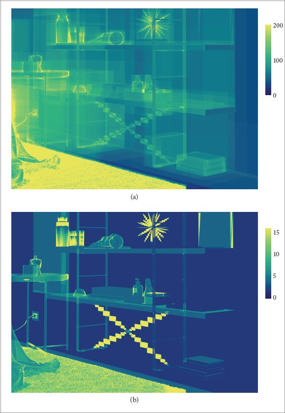

*Figure 7.12: Visualization of BVH Performance with the Kroken Scene. (a) Number of BVH nodes visited when tracing the camera ray at each pixel for the scene shown in Figure 1.1. Not only are more nodes visited in geometrically complex regions of the scene such as the rug, but objects that are not accurately bounded by axis-aligned bounding boxes such as the support under the bottom shelf lead to many nodes being visited. (b) Number of ray–triangle intersection tests performed for the camera ray at each pixel. The BVH is effective at limiting the number of intersection tests even in highly complex regions of the scene like the rug. However, objects that are poorly fit by axis-aligned bounding boxes lead to many intersection tests for rays in their vicinity. (Kroken scene courtesy of Angelo Ferretti.)*

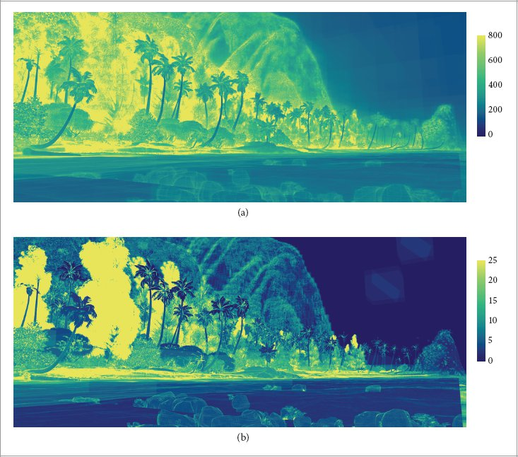

*Figure 7.13: Visualization of BVH Performance with the Moana Island Scene. (a) Number of BVH nodes visited when tracing the camera ray at each pixel for the scene shown in Figure 1.4. As with the Kroken scene, silhouette edges and regions where the ray passes by many objects before finding an intersection see the most nodes visited. (b) Number of ray–triangle intersection tests performed for the camera ray at each pixel. The most geometrically complex trees and the detailed ground cover on the beach require the most intersection tests. (Scene courtesy of Walt Disney Animation Studios.)*

〈Intersect ray with primitives in leaf BVH node〉 ≡ 431

```rust
   for (int i = 0; i < node->nPrimitives; ++i) {
        〈Check for intersection with primitive in BVH node 434〉
   }
   if (toVisitOffset == 0) break;
   currentNodeIndex = nodesToVisit[--toVisitOffset];
```

If an intersection is found, the tMax value can be updated to the intersection’s parametric distance along the ray; this makes it possible to

efficiently discard any remaining nodes that are farther away than the intersection.

```text
   LinearBVHNode::nPrimitives 429
```

〈Check for intersection with primitive in BVH node〉 ≡ 433

pstd::optional<ShapeIntersection> primSi = primitives[node->primitivesOffset + i].Intersect(ray, tMax); if (primSi) { si = primSi; tMax = si->tHit; }

For an interior node that the ray hits, it is necessary to visit both of its children. As described above, it is desirable to visit the first child that the ray passes through before visiting the second one in case the ray intersects a primitive in the first one. If so, the ray’s tMax value can be updated, thus reducing the ray’s extent and thus the number of node bounding boxes it intersects. An efficient way to perform a front-to-back traversal without incurring the expense of intersecting the ray with both child nodes and comparing the distances is to use the sign of the ray’s direction vector for the coordinate axis along which primitives were partitioned for the current node: if the sign is negative, we should visit the second child before the first child, since the primitives that went into the second child’s subtree were on the upper side of the partition point. (And conversely for a positive-signed direction.) Doing this is straightforward: the offset for the node to be visited first is copied to currentNodeIndex, and the offset for the other node is added to the nodesToVisit stack. (Recall that the first child is immediately after the current node due to the depth-first layout of nodes in memory.) 〈Put far BVH node on nodesToVisit stack, advance to near node〉 ≡ 431

if (dirIsNeg[node->axis]) { nodesToVisit[toVisitOffset++] = currentNodeIndex + 1; currentNodeIndex = node->secondChildOffset; } else { nodesToVisit[toVisitOffset++] = node->secondChildOffset; currentNodeIndex = currentNodeIndex + 1; }

The BVHAggregate::IntersectP() method is essentially the same as the regular intersection method, with the two differences that Primitive’s IntersectP() methods are called rather than Intersect(), and traversal stops immediately when any intersection is found. It is thus not included here.

## FURTHER READING

The stochastic alpha test implemented in Section 7.1.1 builds on ideas introduced in Enderton et al.’s stochastic approach for transparency (2010) and Wyman and McGuire’s hashed alpha testing algorithm (2017), both of which were focused on rasterization-based rendering.

```text
   BVHAggregate::primitives 407
   LinearBVHNode:: primitivesOffset 429
   LinearBVHNode:: secondChildOffset 429
   Primitive 398
   Primitive::Intersect() 398
   ShapeIntersection 266
   ShapeIntersection::tHit 266
```

After the introduction of the ray-tracing algorithm, an enormous amount of research was done to try to find effective ways to speed it up, primarily by developing improved ray-tracing acceleration structures. Arvo and Kirk’s chapter in An Introduction to Ray Tracing (Glassner 1989a) summarizes the state of the art as of 1989 and still provides an excellent taxonomy for categorizing different approaches to ray intersection acceleration. Kirk and Arvo (1988) introduced the unifying principle of meta-hierarchies. They showed that by implementing acceleration data structures to conform to the same interface as is used for primitives in the scene, it is easy to mix and match different intersection acceleration schemes. pbrt follows this model.

Grids Fujimoto, Tanaka, and Iwata (1986) introduced uniform grids, a spatial subdivision approach where the scene bounds are decomposed into equally sized grid cells. More efficient grid-traversal methods were described by Amanatides and Woo (1987) and Cleary and Wyvill (1988). Snyder and

Barr (1987) described a number of key improvements to this approach and showed the use of grids for rendering extremely complex scenes. Hierarchical grids, where grid cells with many primitives in them are themselves refined into grids, were introduced by Jevans and Wyvill (1989). More sophisticated techniques for hierarchical grids were developed by Cazals, Drettakis, and Puech (1995) and Klimaszewski and Sederberg (1997). Ize et al. (2006) developed an efficient algorithm for parallel construction of grids. One of their interesting findings was that grid construction performance quickly became limited by memory bandwidth as the number of cores used increased. Choosing an optimal grid resolution is important for getting good performance from grids. A good paper on this topic is by Ize et al. (2007), who provided a solid foundation for automatically selecting the resolution and for deciding when to refine into subgrids when using hierarchical grids. They derived theoretical results using a number of simplifying assumptions and then showed the applicability of the results to rendering real-world scenes. Their paper also includes a good selection of pointers to previous work in this area. Lagae and Dutré (2008a) described an innovative representation for uniform grids based on hashing that has the desirable properties that not only does each primitive have a single index into a grid cell, but also each cell has only a single primitive index. They showed that this representation has very low memory usage and is still quite efficient. Hunt and Mark (2008a) showed that building grids in perspective space, where the center of projection is the camera or a light source, can make tracing rays from the camera or light substantially more efficient. Although this approach requires multiple acceleration structures, the performance benefits from multiple specialized structures for different classes of rays can be substantial. Their approach is also notable in that it is in some ways a middle ground between rasterization and ray tracing.

Bounding Volume Hierarchies

Clark (1976) first suggested using bounding volumes to cull collections of objects for standard visible-surface determination algorithms. Building on this work, Rubin and Whitted (1980) developed the first hierarchical data structures for scene representation for fast ray tracing, although their method depended on the user to define the hierarchy. Kay and Kajiya (1986) implemented one of the first practical object subdivision approaches based on bounding objects with collections of slabs. Goldsmith and Salmon (1987) described the first algorithm for automatically computing bounding volume hierarchies. Although their algorithm was based on estimating the probability of a ray intersecting a bounding volume using the volume’s surface area, it was much less effective than modern SAH BVH approaches. The first use of the SAH for BVH construction was described by Müller and Fellner (1999); another early application is due to Massó and López (2003). The BVHAggregate implementation in this chapter is based on the construction algorithm described by Wald (2007) and Günther et al. (2007). The bounding box test is the one introduced by Williams et al. (2005). An even more efficient bounding box test that does additional precomputation in exchange for higher performance when the same ray is tested for intersection against many bounding boxes was developed by Eisemann et al. (2007); we leave implementing their method for an exercise. Ize’s robust ray–bounding box intersection algorithm ensures that the BVH is watertight and that valid intersections are not missed due to numeric error (Ize 2013). The BVH traversal algorithm used in pbrt was concurrently developed by a number of researchers; see the notes by Boulos and Haines (2006) for more details and background. Another option for tree traversal is that of Kay and Kajiya (1986); they maintained a heap of nodes ordered by ray distance. On GPUs, which have relatively limited amounts of onchip memory, maintaining a stack of to-be-visited nodes for each ray may have a prohibitive memory cost. Foley and Sugerman (2005) introduced a “stackless” kd-tree traversal algorithm that periodically backtracks and searches starting from the tree root to find the next node to visit, rather than storing all nodes to visit explicitly. Laine (2010) made a number of improvements to this approach, reducing the frequency of re-traversals from the tree root and applying the approach to BVHs. See also Binder and

Keller (2016), who applied perfect hashing to finding subsequent nodes to visit with the stackless approach. An innovative approach to BVH traversal is described by Hendrich et al. (2019), who created a spatio-directional 5D data structure that records a set of BVH nodes that are used to seed the traversal stack for sets of rays. Given a particular ray, traversal starts immediately with an appropriate stack, which in turn improves performance by entirely skipping processing of BVH nodes that are either certain to be intersected or certain not to be intersected for rays in a particular set. A number of researchers have developed techniques for improving the quality of BVHs after construction. Yoon et al. (2007) and Kensler (2008) presented algorithms that make local adjustments to the BVH. See also Bittner et al. (2013, 2014), Karras and Aila (2013), and Meister and Bittner (2018a) for further work in this area. An interesting approach was described by Gu et al. (2015), who constructed a BVH, traced a relatively small number of representative rays, and gathered statistics about how frequently each bounding box was intersected, and then tuned the BVH to be more efficient for rays with similar statistics. Most current methods for building BVHs are based on top-down construction of the tree, first creating the root node and then partitioning the primitives into children and continuing recursively. An alternative approach was demonstrated by Walter et al. (2008), who showed that bottom-up construction, where the leaves are created first and then agglomerated into parent nodes, is a viable option. Gu et al. (2013b) developed a much more efficient implementation of this approach and showed its suitability for parallel implementation, and Meister and Bittner (2018b) described a bottom-up approach that is suitable for GPU implementation. One shortcoming of BVHs is that even a small number of relatively large primitives that have overlapping bounding boxes can substantially reduce the efficiency of the BVH: many of the nodes of the tree will be overlapping, solely due to the overlapping bounding boxes of geometry down at the leaves. Ernst and Greiner (2007) proposed “split clipping” as a solution; the restriction that each primitive only appears once in the tree is

lifted, and the bounding boxes of large input primitives are subdivided into a set of tighter subbounds that are then used for tree construction.

```text
   BVHAggregate 407
```

Dammertz and Keller (2008a) observed that the problematic primitives are the ones with a large amount of empty space in their bounding box relative to their surface area, so they subdivided the most egregious triangles and reported substantial performance improvements. Stich et al. (2009) developed an approach that splits primitives during BVH construction, making it possible to only split primitives when an SAH cost reduction was found. See also Popov et al.’s paper (2009) on a theoretically optimal BVH partitioning algorithm and its relationship to previous approaches, and Karras and Aila (2013) for improved criteria for deciding when to split triangles. Woop et al. (2014) developed an approach to building BVHs for long, thin geometry like hair and fur; because this sort of geometry is quite thin with respect to the volume of its bounding boxes, it normally has poor performance with most acceleration structures. Ganestam and Doggett (2016) have proposed a splitting approach that has benefits to both BVH construction and traversal efficiency. The memory requirements for BVHs can be significant. In our implementation, each node is 32 bytes. With up to 2 BVH nodes needed per primitive in the scene, the total overhead may be as high as 64 bytes per primitive. Cline et al. (2006) suggested a more compact representation for BVH nodes, at some expense of efficiency. First, they quantized the bounding box stored in each node using 8 or 16 bytes to encode its position with respect to the node’s parent’s bounding box. Second, they used implicit indexing, where the node i’s children are at positions 2i and 2i + 1 in the node array (assuming a 2× branching factor). They showed substantial memory savings, with moderate performance impact. Bauszat et al. (2010) developed another space-efficient BVH representation. See also Segovia and Ernst (2010), who developed compact representations of both BVH nodes and triangle meshes. A BVH specialized for space-efficient storage of parametric surfaces was described by Selgrad et al. (2017) and an adoption of this approach for displaced subdivision surfaces was presented by Lier et al. (2018a).

Other work in the area of space-efficient BVHs includes that of Vaidyanathan et al. (2016), who introduced a reduced-precision representation of the BVH that still guarantees conservative intersection tests with respect to the original BVH. Liktor and Vaidyanathan (2016) introduced a BVH node representation based on clustering nodes that improves cache performance and reduces storage requirements for child node pointers. Ylitie et al. (2017) showed how to optimally convert binary BVHs into wider BVHs with more children at each node, from which they derived a compressed BVH representation that shows a substantial bandwidth reduction with incoherent rays. Vaidyanathan et al. (2019) developed an algorithm for efficiently traversing such wide BVHs using a small stack. Benthin et al. (2018) focused on compressing sets of adjacent leaf nodes of BVHs under the principle that most of the memory is used at the leaves, and Lin et al. (2019) described an approach that saves both computation and storage by taking advantage of shared planes among the bounds of the children of a BVH node. Yoon and Manocha (2006) described algorithms for cache-efficient layout of BVHs and kdtrees and demonstrated performance improvements from using them. See also Ericson’s book (2004) for extensive discussion of this topic. The linear BVH was introduced by Lauterbach et al. (2009); Morton codes were first described in a report by Morton (1966). Pantaleoni and Luebke (2010) developed the HLBVH generalization, using the SAH at the upper levels of the tree. They also noted that the upper bits of the Morton-coded values can be used to efficiently find clusters of primitives—both of these ideas are used in our HLBVH implementation. Garanzha et al. (2011) introduced further improvements to the HLBVH, most of them targeting GPU implementations. Vinkler et al. (2017) described improved techniques for mapping values to the Morton index coordinates that lead to higher-quality BVHs, especially for scenes with a range of primitive sizes. Wald (2012) described an approach for high-performance parallel BVH construction on CPUs that uses the SAH throughout. More recently, Benthin et al. (2017) have described a two-level BVH construction

technique based on building high-quality second-level BVHs for collections of objects in a scene, collecting them into a single BVH, and then iteratively refining the overall tree, including moving subtrees from one of the initial BVHs to another. Hendrich et al. (2017) described a related technique, quickly building an initial LBVH and then progressively building a higher-quality BVH based on it. A comprehensive survey of work in bounding volume hierarchies, spanning construction, representation, traversal, and hardware acceleration, was recently published by Meister et al. (2021).

kd-trees Glassner (1984) introduced the use of octrees for ray intersection acceleration. Use of the kdtree for ray tracing was first described by Kaplan (1985). Kaplan’s tree construction algorithm always split nodes down their middle; MacDonald and Booth (1990) introduced the SAH approach, estimating ray–node traversal probabilities using relative surface areas. Naylor (1993) has also written on general issues of constructing good kd-trees. Havran and Bittner (2002) revisited many of these issues and introduced useful improvements. Adding a bonus factor to the SAH for tree nodes that are completely empty was suggested by Hurley et al. (2002). See Havran’s Ph.D. thesis (2000) for an excellent overview of high-performance kdconstruction and traversal algorithms. Jansen (1986) first developed the efficient ray-traversal algorithm for kd-trees. Arvo (1988) also investigated this problem and discussed it in a note in Ray Tracing News. Sung and Shirley (1992) described a ray-traversal algorithm’s implementation for a BSP-tree accelerator; our KdTreeAggregate traversal code (included in the online edition) is loosely based on theirs. The asymptotic complexity of the kd-tree construction algorithm in pbrt is O(n log2 n). Wald and Havran (2006) showed that it is possible to build kd-trees in O(n log n) time with some additional implementation complexity; they reported a 2 to 3× speedup in construction time for typical scenes. The best kd-trees for ray tracing are built using “perfect splits,” where the primitive being inserted into the tree is clipped to the bounds of the current

node at each step. This eliminates the issue that, for example, an object’s bounding box may intersect a node’s bounding box and thus be stored in it, even though the object itself does not intersect the node’s bounding box. This approach was introduced by Havran and Bittner (2002) and discussed further by Hurley et al. (2002), Wald and Havran (2006), and Soupikov et al. (2008). Even with perfect splits, large primitives may still be stored in many kd-tree leaves; Choi et al. (2013) suggested storing some primitives in interior nodes to address this issue. kd-tree construction tends to be much slower than BVH construction (especially if “perfect splits” are used), so parallel construction algorithms are of particular interest. Work in this area includes that of Shevtsov et al. (2007b) and Choi et al. (2010), who presented efficient parallel kd-tree construction algorithms with good scalability to multiple processors.

The Surface Area Heuristic

```text
   KdTreeAggregate 406
```

A number of researchers have investigated improvements to the SAH since its introduction to ray tracing by MacDonald and Booth (1990). Fabianowski et al. (2009) derived a version that replaces the assumption that rays are uniformly distributed throughout space with the assumption that ray origins are uniformly distributed inside the scene’s bounding box. Hunt and Mark (2008b) introduced a modified SAH that accounts for the fact that rays generally are not uniformly distributed but rather that many of them originate from a single point or a set of nearby points (cameras and light sources, respectively). Hunt (2008) showed how the SAH should be modified when the “mailboxing” optimization is being used, and Vinkler et al. (2012) used assumptions about the visibility of primitives to adjust their SAH cost. Ize and Hansen (2011) derived a “ray termination surface area heuristic” (RTSAH), which they used to adjust BVH traversal order for shadow rays in order to more quickly find intersections with occluders. See also Moulin et al. (2015), who adapted the SAH to account for shadow rays being occluded during kd-tree traversal. While the SAH has led to very effective kd-trees and BVHs, a number of researchers have noted that it is not unusual to encounter cases where a kd-

tree or BVH with a higher SAH-estimated cost gives better performance than one with lower estimated cost. Aila et al. (2013) surveyed some of these results and proposed two additional heuristics that help address them; one accounts for the fact that most rays start on surfaces—ray origins are not actually randomly distributed throughout the scene—and another accounts for SIMD divergence when multiple rays traverse the hierarchy together. While these new heuristics are effective at explaining why a given tree delivers the performance that it does, it is not yet clear how to incorporate them into tree construction algorithms. Evaluating the SAH can be costly, particularly when many different splits or primitive partitions are being considered. One solution to this problem is to only compute it at a subset of the candidate points—for example, along the lines of the bucketing approach used in the BVHAggregate in pbrt. Hurley et al. (2002) suggested this approach for building kd-trees, and Popov et al. (2006) discussed it in detail. Shevtsov et al. (2007b) introduced the improvement of binning the full extents of triangles, not just their centroids. Wodniok and Goesele constructed BVHs where the SAH cost estimate is not based on primitive counts and primitive bounds but is instead found by actually building BVHs for various partitions and computing their SAH cost (Wodniok and Goesele 2016). They showed a meaningful improvement in ray intersection performance, though at a cost of impractically long BVH construction times. Hunt et al. (2006) noted that if you only have to evaluate the SAH at one point, for example, you do not need to sort the primitives but only need to do a linear scan over them to compute primitive counts and bounding boxes at the point. pbrt’s implementation follows that approach. They also showed that approximating the SAH with a piecewise quadratic based on evaluating it at a number of individual positions, and using that to choose a good split, leads to effective trees. A similar approximation was used by Popov et al. (2006).

Other Topics in Acceleration Structures Weghorst, Hooper, and Greenberg (1984) discussed the trade-offs of using various shapes for bounding volumes and suggested projecting objects to

the screen and using a z-buffer rendering to accelerate finding intersections for camera rays.

```text
   BVHAggregate 407
```

A number of researchers have investigated the applicability of general BSP trees, where the splitting planes are not necessarily axis aligned, as they are with kd-trees. Kammaje and Mora (2007) built BSP trees using a preselected set of candidate splitting planes. Budge et al. (2008) developed a number of improvements to their approach, though their results only approached kd-tree performance in practice due to a slower construction stage and slower traversal than kd-trees. Ize et al. (2008) showed a BSP implementation that renders scenes faster than kd-trees but at the cost of extremely long construction times. There are many techniques for traversing a collection of rays through the acceleration structure together, rather than just one at a time. This approach (“packet tracing”) is an important component of many high-performance ray tracing approaches; it is discussed in more detail in Section 16.2.3. Animated primitives present two challenges to ray tracers: first, renderers that try to reuse acceleration structures over multiple frames of an animation must update the acceleration structures if objects are moving. Lauterbach et al. (2006) and Wald et al. (2007a) showed how to incrementally update BVHs in this case, and Kopta et al. (2012) reused BVHs over multiple frames of an animation, maintaining their quality by updating the parts that bound moving objects. Garanzha (2009) suggested creating clusters of nearby primitives and then building BVHs of those clusters (thus lightening the load on the BVH construction algorithm). A second challenge from animated primitives is that for primitives that are moving quickly, the bounding boxes of their full motion over the frame time may be quite large, leading to many unnecessary ray–primitive intersection tests. Notable work on this issue includes Glassner (1988), who generalized ray tracing (and an octree for acceleration) to four dimensions, adding time. More recently, Grünschloß et al. (2011) developed improvements to BVHs for moving primitives. See also Wald et al.’s (2007b) survey paper on ray tracing animated scenes. Woop et al. (2017)

described a generalization of BVHs that also allows nodes to split in time, with child nodes of such a split accounting for different time ranges. An innovative approach to acceleration structures was suggested by Arvo and Kirk (1987), who introduced a 5D data structure that subdivided based on both 3D spatial and 2D ray directions. Another interesting approach for scenes described with triangle meshes was developed by Lagae and Dutré (2008b): they computed a constrained tetrahedralization, where all triangle faces of the model are represented in the tetrahedralization. Rays are then stepped through tetrahedra until they intersect a triangle from the scene description. This approach is still a few times slower than the state of the art in kd-trees and BVHs but is an interesting new way to think about the problem. There is a middle ground between kd-trees and BVHs, where the tree node holds a splitting plane for each child rather than just a single splitting plane. This refinement makes it possible to do object subdivision in a kd-tree-like acceleration structure, putting each primitive in just one subtree and allowing the subtrees to overlap, while still preserving many of the benefits of efficient kd-tree traversal. Ooi et al. (1987) first introduced this refinement to kd-trees for storing spatial data, naming it the “spatial kd-tree” (skd-tree). Skd-trees have been applied to ray tracing by a number of researchers, including Zachmann (2002), Woop et al. (2006), Wächter and Keller (2006), Havran et al. (2006), and Zuniga and Uhlmann (2006). When spatial subdivision approaches like grids or kd-trees are used, primitives may overlap multiple nodes of the structure and a ray may be tested for intersection with the same primitive multiple times as it passes through the structure. Arnaldi, Priol, and Bouatouch (1987) and Amanatides and Woo (1987) developed the “mailboxing” technique to address this issue: each ray is given a unique integer identifier, and each primitive records the id of the last ray that was tested against it. If the ids match, then the intersection test is unnecessary and can be skipped. While effective, mailboxing does not work well with a multi-threaded ray tracer. To address this issue, Benthin (2006) suggested storing a small per-ray hash table to record ids of recently intersected primitives. Shevtsov et al. (2007a) maintained a small array of the last n intersected primitive ids

and searched it linearly before performing intersection tests. Although some primitives may still be checked multiple times with both of these approaches, they usually eliminate most redundant tests. EXERCISES

➋ 7.1 What kinds of scenes are worst-case scenarios for the two acceleration structures in pbrt? (Consider specific geometric configurations that the approaches will respectively be unable to handle well.) Construct scenes with these characteristics, and measure the performance of pbrt as you add more primitives. How does the worst case for one behave when rendered with the other? ➋ 7.2 Implement a hierarchical grid accelerator where cells that have an excessive number of primitives overlapping them are refined to instead hold a finer subgrid to store its geometry. (See, for example, Jevans and Wyvill (1989) for one approach to this problem and Ize et al. (2007) for effective methods for deciding when refinement is worthwhile.) Compare both accelerator construction performance and rendering performance to a non-hierarchical grid as well as to pbrt’s built-in accelerators. ➋ 7.3 Implement “split clipping” in pbrt’s BVH implementation. Read one or more papers on this topic, including ones by Ernst and Greiner (2007), Dammertz and Keller (2008a), Stich et al. (2009), Karras and Aila (2013), and Ganestam and Doggett (2016), and implement one of their approaches to subdivide primitives with large bounding boxes relative to their surface area into multiple subprimitives for tree construction. (Doing so will probably require modification to the Shape interface; you will probably want to design a new interface that allows some shapes to indicate that they are unable to subdivide themselves, so that you only need to implement this method for triangles, for example.) Measure the improvement for rendering actual scenes; a compelling way to gather this data is to do the experiment that Dammertz and Keller did, where a scene is rotated around an axis over progressive frames of an animation. Typically, many triangles that are originally axis aligned will have very loose bounding boxes as they rotate more, leading to a substantial performance degradation if split clipping is not used. ➋ 7.4 The 30-bit Morton codes used for the HLBVH construction algorithm in the BVHAggregate may be insufficient for scenes with large spatial extents because they can only represent 210 = 1024 steps in each dimension. Modify the BVHAggregate to use 64-bit integers with 63-bit Morton codes for HLBVHs. Compare the performance of your approach to the original one with a variety of scenes. Are there scenes where performance is substantially improved? Are there any where there is a loss of performance? ➋ 7.5 Investigate alternative SAH cost functions for building BVHs or kd-trees. How much can a poor cost function hurt its performance? How much improvement can be had compared to the current one? (See the discussion in the “Further Reading” section for ideas about how the SAH may be improved.) BVHAggregate 407 Shape 261 ➌ 7.6 The idea of using spatial data structures for ray intersection acceleration can be generalized to include spatial data structures that themselves hold other spatial data structures rather than just primitives. Not only could we have a grid that has subgrids inside the grid cells that have many primitives in them, but we could also have the scene organized into a hierarchical bounding volume where the leaf nodes are grids that hold

smaller collections of spatially nearby primitives. Such hybrid techniques can bring the best of a variety of spatial data structure–based ray intersection acceleration methods. In pbrt, because both geometric primitives and intersection accelerators implement the Primitive interface and thus provide the same interface, it is easy to mix and match in this way.

Modify pbrt to build hybrid acceleration structures—for example, using a BVH to coarsely partition the scene geometry and then uniform grids at the leaves of the tree to manage dense, spatially local collections of geometry. Measure the running time and memory use for rendering scenes with this method compared to the current aggregates. ➋ 7.7 Eisemann et al. (2007) described an even more efficient ray–box intersection test than is used in the BVHAggregate. It does more computation at the start for each ray but makes up for this work with fewer computations to do tests for individual bounding boxes. Implement their method in pbrt, and measure the change in rendering time for a variety of scenes. Are there simple scenes where the additional upfront work does not pay off? How does the improvement for highly complex scenes compare to the improvement for simpler scenes? ➋ 7.8 Although the intersection algorithm implemented in the IntersectTriangle() function is watertight, a source of inaccuracy in ray–triangle intersections computed in pbrt remains: because the triangle intersection algorithm shears the vertices of the triangle, it may no longer lie in its original bounding box. In turn, the BVH traversal algorithm must be modified to account for this error so that valid intersections are not missed. Read the discussion of this issue in Woop et al.’s paper (2013) and modify pbrt to fix this issue. What is the performance impact of your fix? Can you find any scenes where the image changes as a result of it? ➋ 7.9 Read the paper by Segovia and Ernst (2010) on memory-efficient BVHs, and implement their approach in pbrt. How does memory usage with their approach compare to that for the BVHAggregate? Compare rendering performance with your approach to pbrt’s current performance. Discuss how your results compare to the results reported in their paper. ➋ 7.10 Consider a scene with an animated camera that is tracking a moving object such that there is no relative motion between the two. For such a scene, it may be more efficient to represent it with the camera and object being static and with a corresponding relative animated transformation applied to the rest of the scene. In this way, ray intersections with the tracked object will be more efficient since its bounding box is not expanded by its motion.

Construct such a scene and then measure the performance of rendering it with both ways of representing the motion by making corresponding changes to the scene description file. How is performance affected by the size of the tracked object in the image? Next, modify pbrt to automatically perform this optimization when this situation occurs. Can you find a way to have these benefits when the motion of the camera and some objects in the scene are close but not exactly the same?

```text
             BVHAggregate 407
             IntersectTriangle() 303
             Primitive 398
```

➌ 7.11 It is often possible to introduce some approximation into the computation of shadows from very complex geometry (consider, e.g., the branches and leaves of a tree casting a shadow). Lacewell et al. (2008) suggested augmenting the acceleration structure with a prefiltered directionally varying representation of occlusion for regions of space. As shadow rays pass through these regions, an approximate visibility probability can be returned rather than a binary result, and the cost of tree traversal and object intersection tests is reduced. Implement such an approach in pbrt, and compare its performance to the current implementation. Do you see any changes in rendered images?

_________________ 1 The previous version of pbrt used 7 GB of memory when rendering this scene, with most of that difference due to less memory-efficient Primitive representations, virtual function pointers stored with each Shape and each Primitive, and the use of 32-bit floats for image texture pixels even for textures that were originally stored with 8-bit values. 2 The mailboxing technique can be used to avoid these multiple intersections for accelerators that use spatial subdivision, though its implementation can be tricky in the presence of multi-threading. More information on mailboxing is available in the “Further Reading” section. 3 Previous versions of pbrt instead computed these values from scratch for each candidate split, which resulted in O(n2) performance. Even with the small n here, we have found that this implementation speeds up BVH construction by approximately 2×. 4 Many GPUs store texture images in memory using a Morton layout. One advantage of doing so is that when performing bilinear interpolation between four texel values, the values are much more likely to be close together in memory than if the texture is laid out in scanline order. In turn, texture cache performance benefits.
