# Chapter 8: Sampling and Reconstruction

## Sampling and Reconstruction (wgpu)


Although the final output of a renderer is generally a 2D grid of colored pixels, incident radiance is actually a continuous function defined over the film plane. The manner in which the discrete pixel values are computed from this continuous function can noticeably affect the quality of the final image generated by the renderer; if this process is not performed carefully, artifacts will be present. Conversely, if it is performed well, a relatively small amount of additional computation to this end can substantially improve the quality of the rendered images. We have thus far approached this topic from the perspective of Monte Carlo integration, though other viewpoints can also give useful insight.

This chapter starts by introducing sampling theory—the theory of taking discrete sample values from functions defined over continuous domains and then using those samples to reconstruct new functions that are similar to the original. In pbrt, integration is more often the goal than reconstruction is, though we will see that Fourier analysis—the foundation of sampling theory—also provides insight about error in Monte Carlo integration. We discuss those connections as well as other approaches for evaluating the quality of sampling algorithms in the second section of this chapter.

With these ideas in hand, the implementations of six Samplers make up the bulk of this chapter. They span a wide variety of approaches to the sampling problem. The chapter concludes with the Filter class, which determines how multiple samples near each pixel are blended together to compute the final pixel value. Both of pbrt’s Film implementations use these filters to accumulate image sample contributions into pixels of images.

## 8.1 SAMPLING THEORY

```text
    Filter 515
```

A digital image is represented as a set of pixel values, typically aligned on a rectangular grid. When a digital image is displayed on a physical device, these values are used to determine the spectral power emitted by pixels on the display. When thinking about digital images, it is important to differentiate between image pixels, which represent the value of a function at a particular sample location, and display pixels, which are physical objects that emit light with some spatial and directional distribution. (For example, in an LCD display, the color and brightness may change substantially when the display is viewed at oblique angles.) Displays use the image pixel values to construct a new image function over the display surface. This function is defined at all points on the display, not just the infinitesimal points of the digital image’s pixels. This process of taking a collection of sample values and converting them back to a continuous function is called reconstruction.

In order to compute the discrete pixel values in the digital image, it is necessary to sample the original continuously defined image function. In pbrt, like most other ray-tracing renderers, the only way to get information about the image function is to sample it by tracing rays. For example, there is no general method that can compute bounds on the variation of the image function between two points on the film plane. While an image could be generated by just sampling the function precisely at the pixel positions, a better result can be obtained by taking more samples at different positions and incorporating this additional information about the image function into the final pixel values. Indeed, for the best quality result, the pixel values should be computed such that the reconstructed image on the display device is as close as possible to the original image of the scene on the virtual camera’s film plane. Note that this is a subtly different goal from expecting the display’s pixels to take on the image function’s actual value at their positions. Handling this difference is the main goal of the algorithms implemented in this chapter.1

Because the sampling and reconstruction process involves approximation, it introduces error known as aliasing, which can manifest itself in many ways, including jagged edges or flickering in animations. These errors occur because the sampling process is not able to capture all the information from the continuously defined image function.

As an example of these ideas, consider a 1D function (which we will interchangeably refer to as a signal), given by f (x), where we can evaluate f (x′) at any desired location x′ in the function’s domain. Each such x′ is called a sample position, and the value of f (x′) is the sample value. Figure 8.1 shows a set of samples of a smooth 1D function, along with a reconstructed signal that approximates the original function f. In this example, is a piecewise linear function that approximates f by linearly interpolating neighboring sample values (readers already familiar with sampling theory will recognize this as reconstruction with a hat function). Because the only information available about f comes from the sample values at the positions x′, is unlikely to match f perfectly since there is no information about f’s behavior between the samples.

Fourier analysis can be used to evaluate the quality of the match between the reconstructed function and the original. This section will introduce the main ideas of Fourier analysis with enough detail to work through some parts of the sampling and reconstruction processes but will omit proofs of many properties and skip details that are not directly relevant to the sampling algorithms used in pbrt. The “Further Reading” section of this chapter has pointers to more detailed information about these topics.

### 8.1.1 THE FREQUENCY DOMAIN AND THE FOURIER TRANSFORM

One of the foundations of Fourier analysis is the Fourier transform, which represents a function in the frequency domain. (We will say that functions are normally expressed in the spatial domain.) Consider the two functions graphed in Figure 8.2. The function in Figure 8.2(a) varies relatively slowly as a function of x, while the function in Figure 8.2(b) varies much more rapidly. The more slowly varying function is said to have lower-frequency content.

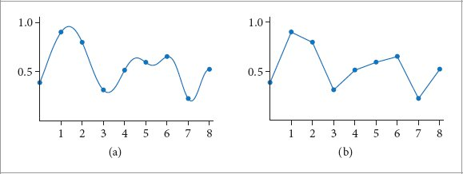

*Figure 8.1: (a) By taking a set of point samples of f (x) (indicated by dots), we determine the value of the function at those positions. (b) The sample values can be used to reconstruct a function that is an approximation to f (x). The sampling theorem, introduced in Section 8.1.3, makes a precise statement about the conditions on f (x), the number of samples taken, and the reconstruction technique used under which is exactly the same as f (x). The fact that the original function can sometimes be reconstructed exactly from point samples alone is remarkable.*

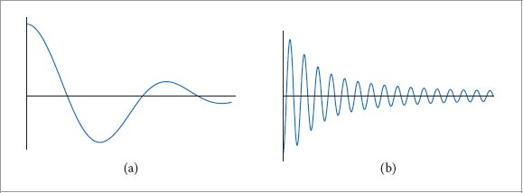

*Figure 8.2: (a) Low-frequency function and (b) high-frequency function. Roughly speaking, the higher frequency a function is, the more quickly it varies over a given region.*

*Figure 8.3 shows the frequency space representations of these two functions; the lower-frequency function’s representation goes to 0 more quickly than does the higher-frequency function.*

Most functions can be decomposed into a weighted sum of shifted sinusoids. This remarkable fact was first described by Joseph Fourier, and the Fourier transform converts a function into this representation. This frequency space representation of a function gives insight into some of its characteristics—the distribution of frequencies in the sine functions corresponds to the distribution of frequencies in the original function. Using this form, it is possible to use Fourier analysis to gain

insight into the error that is introduced by the sampling and reconstruction process and how to reduce the perceptual impact of this error.

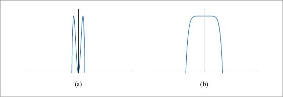

*Figure 8.3: Frequency Space Representations of the Functions in Figure 8.2. The graphs show the contribution of each frequency ω to each of the functions in the spatial domain.*

The Fourier transform of a 1D function f (x) is2

(Recall that eix = cos x + i sin x, where .) For simplicity, here we will consider only even functions where f (−x) = f (x), in which case the Fourier transform of f has no imaginary terms. The new function F is a function of frequency, ω.3 We will denote the Fourier transform operator by F, such that F{f (x)} = F (ω). F is clearly a linear operator—that is, F{af (x)} = aF{f (x)} for any scalar a, and F{f (x) + g(x)} = F{f (x)} + F{g(x)}. The Fourier transform has a straightforward generalization to multidimensional functions where ω is a corresponding multidimensional value, though we will generally stick to the 1D case for notational simplicity.

Equation (8.1) is called the Fourier analysis equation, or sometimes just the Fourier transform. We can also transform from the frequency domain back to the spatial domain using the Fourier synthesis equation, or the inverse Fourier transform:

*Table 8.1 shows a number of important functions and their frequency space representations. A number of these functions are based on the Dirac delta distribution, which is defined such that ∫ δ(x) dx = 1, and for all x ≠ 0, δ(x) = 0. An important consequence of these properties is that*

The delta distribution cannot be expressed as a standard mathematical function, but instead is generally thought of as the limit of a unit area box function centered at the origin with width approaching 0.

*Table 8.1: Fourier Pairs. Functions in the spatial domain and their frequency space representations. Because of the symmetry properties of the Fourier transform, if the left column is instead considered to be frequency space, then the right column is the spatial equivalent of those functions as well.*

```rust
   Spatial Domain                                        Frequency Space Representation
   Box: f (x) = 1 if |x| < 1/2, 0 otherwise              Sinc: f (ω) = sinc(ω) = sin(πω)/(πω)
   Gaussian:                                             Gaussian:
   Constant: f (x) = 1                                   Delta: f (ω) = δ(ω)
   Sinusoid: f (x) = cos x                               Translated delta: f (ω) = π(δ(1 − 2πω) + δ(1 + 2πω))
   Shah:                                                 Shah:
```

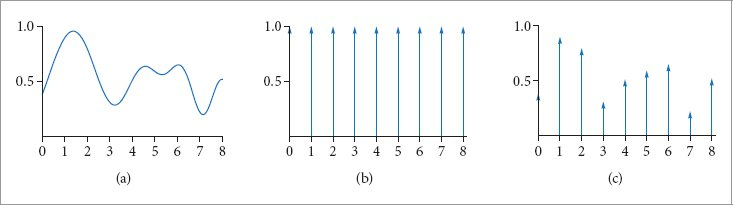

*Figure 8.4: Formalizing the Sampling Process. (a) The function f (x) is multiplied by (b) the shah function , giving (c) an infinite sequence of scaled delta functions that represent its value at each sample point.*

### 8.1.2 IDEAL SAMPLING AND RECONSTRUCTION

Using frequency space analysis, we can now formally investigate the properties of sampling. Recall that the sampling process requires us to choose a set of equally spaced sample positions and compute the function’s value at those positions. Formally, this corresponds to multiplying the function by a “shah,” or “impulse train,” function, an infinite sum of equally spaced delta functions. The shah

is defined as where T defines the period, or sampling rate. This formal definition of sampling is illustrated in Figure 8.4. The multiplication yields an infinite sequence of values of the function at equally spaced points:

These sample values can be used to define a reconstructed function by choosing a reconstruction filter function r(x) and computing the convolution

where the convolution operation ⊗ is defined as

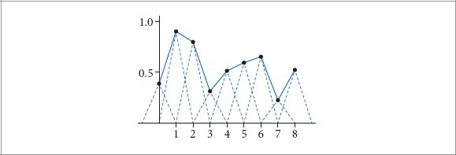

*Figure 8.5: The sum of instances of the triangle reconstruction filter, shown with dashed lines, gives the reconstructed approximation to the original function, shown with a solid line.*

For reconstruction, convolution gives a weighted sum of scaled instances of the reconstruction filter centered at the sample points:

For example, in Figure 8.1, the triangle reconstruction filter, r(x) = max(0, 1 − |x|), was used. Figure 8.5 shows the scaled triangle functions used for that example.

We have gone through a process that may seem gratuitously complex in order to end up at an intuitive result: the reconstructed function can be obtained by interpolating among the samples in some manner. By setting up this background carefully, however, we can now apply Fourier analysis to the process more easily.

We can gain a deeper understanding of the sampling process by analyzing the sampled function in the frequency domain. In particular, we will be able to determine the conditions under which the original function can be exactly recovered from its values at the sample locations—a very powerful result. For the discussion here, we will assume for now that the function f (x) is band limited—there exists some frequency ω0 such that f (x) contains no frequencies greater than ω0. By definition, band-limited functions have frequency space representations with compact support, such that F (ω) = 0 for all |ω| > ω0. Both of the spectra in Figure 8.3 are band limited.

An important idea used in Fourier analysis is the fact that the Fourier transform of the product of two functions F{f (x)g(x)} can be shown to be the convolution of their individual Fourier transforms F (ω) and G (ω): It is similarly the case that convolution in the spatial domain is equivalent to multiplication in the frequency domain:

These properties are derived in the standard references on Fourier analysis. Using these ideas, the original sampling step in the spatial domain, where the product of the shah function and the original function f (x) is found, can be equivalently described by the convolution of F (ω) with another shah function in frequency space.

We also know the spectrum of the shah function from Table 8.1; the Fourier transform of a shah function with period T is another shah function with period 1/T. This reciprocal relationship between periods is important to keep in mind: it means that if the samples are farther apart in the spatial domain, they are closer together in the frequency domain.

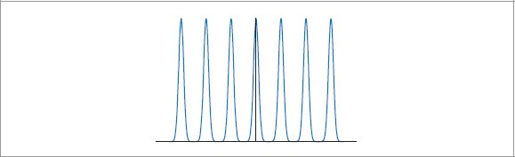

*Figure 8.6: The Convolution of F (ω) and the Shah Function. The result is infinitely many copies of F.*

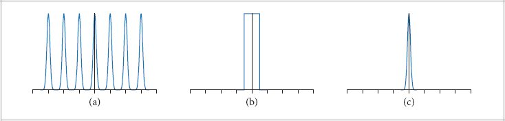

*Figure 8.7: Multiplying (a) a series of copies of F (ω) by (b) the appropriate box function yields (c) the original spectrum.*

Thus, the frequency domain representation of the sampled signal is given by the convolution of F (ω) and this new shah function. Convolving a function with a delta function just yields a copy of the function, so convolving with a shah function yields an infinite sequence of copies of the original function, with spacing equal to the period of the shah (Figure 8.6). This is the frequency space representation of the series of samples.

Now that we have this infinite set of copies of the function’s spectrum, how do we reconstruct the original function? Looking at Figure 8.6, the answer is obvious: just discard all of the spectrum copies except the one centered at the origin, giving the original F (ω).

In order to throw away all but the center copy of the spectrum, we multiply by a box function of the appropriate width (Figure 8.7). The box function ΠT (x) of width T is defined as

This multiplication step corresponds to convolution with the reconstruction filter in the spatial domain. This is the ideal sampling and reconstruction process. To summarize:

This is a remarkable result: we have been able to determine the exact frequency space representation of f (x), purely by sampling it at a set of regularly spaced points. Other than knowing that the function was band limited, no additional information about the composition of the function was used.

Applying the equivalent process in the spatial domain will likewise recover f (x) exactly. Because the inverse Fourier transform of the box function is the sinc function, ideal reconstruction in the spatial domain is where sincT (x) = sinc(T x), and thus

Unfortunately, because the sinc function has infinite extent, it is necessary to use all the sample values f (T i) to compute any particular value of in the spatial domain. Filters with finite spatial extent are preferable for practical implementations even though they do not reconstruct the original function perfectly.

A commonly used alternative in graphics is to use the box function for reconstruction, effectively averaging all the sample values within some region around x. This is a poor choice, as can be seen by considering the box filter’s behavior in the frequency domain: This technique attempts to isolate the central copy of the function’s spectrum by multiplying by a sinc, which not only does a bad job of selecting the central copy of the function’s spectrum but includes high-frequency contributions from the infinite series of other copies of it as well.

### 8.1.3 ALIASING

Beyond the issue of the sinc function’s infinite extent, one of the most serious practical problems with the ideal sampling and reconstruction approach is the assumption that the signal is band limited. For

signals that are not band limited, or signals that are not sampled at a sufficiently high sampling rate for their frequency content, the process described earlier will reconstruct a function that is different from the original signal. Both the underlying problem and mitigation strategies for it can be understood using Fourier analysis.

The key to successful reconstruction is the ability to exactly recover the original spectrum F (ω) by multiplying the sampled spectrum with a box function of the appropriate width. Notice that in Figure 8.6, the copies of the signal’s spectrum are separated by empty space, so perfect reconstruction is possible. Consider what happens, however, if the original function was sampled with a lower sampling rate. Recall that the Fourier transform of a shah function with period T is a new shah function with period 1/T. This means that if the spacing between samples increases in the spatial domain, the sample spacing decreases in the frequency domain, pushing the copies of the spectrum F (ω) closer together. If the copies get too close together, they start to overlap.

Because the copies are added together, the resulting spectrum no longer looks like many copies of the original (Figure 8.8). When this new spectrum is multiplied by a box function, the result is a spectrum that is similar but not equal to the original F (ω): high-frequency details in the original signal leak into lower-frequency regions of the spectrum of the reconstructed signal. These new low-frequency artifacts are called aliases (because high frequencies are “masquerading” as low frequencies), and the resulting signal is said to be aliased. It is sometimes useful to distinguish between artifacts due to sampling and those due to reconstruction; when we wish to be precise we will call sampling artifacts prealiasing and reconstruction artifacts postaliasing. Any attempt to fix these errors is broadly classified as antialiasing.

*Figure 8.9 shows the effects of aliasing from undersampling and then reconstructing the 1D function f (x) = 1 + cos(4πx2).*

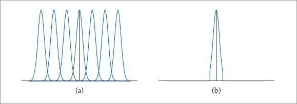

*Figure 8.8: (a) When the sampling rate is too low, the copies of the function’s spectrum overlap, resulting in (b) aliasing when reconstruction is performed.*

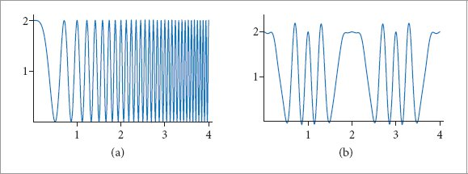

*Figure 8.9: Aliasing from Point Sampling the Function 1 + cos(4πx2). (a) The function. (b) The reconstructed function from sampling it with samples spaced 0.125 units apart and performing perfect reconstruction with the sinc filter. Aliasing causes the high-frequency information in the original function to be lost and to reappear as lower-frequency error.*

A possible solution to the problem of overlapping spectra is to simply increase the sampling rate until the copies of the spectrum are sufficiently far apart not to overlap, thereby eliminating aliasing completely. The sampling theorem tells us exactly what rate is required. This theorem says that as long as the frequency of uniformly spaced sample points ωs is greater than twice the maximum frequency present in the signal ω0, it is possible to reconstruct the original signal perfectly from the samples. This minimum sampling frequency is called the Nyquist frequency.

However, increasing the sampling rate is expensive in a ray tracer: the time to render an image is directly proportional to the number of samples taken. Furthermore, for signals that are not band limited (ω0 = ∞), it is impossible to sample at a high enough rate to perform perfect reconstruction. Non-band-limited signals have spectra with infinite support, so no matter how far apart the copies of their spectra are (i.e., how high a sampling rate we use), there will always be overlap.

Unfortunately, few of the interesting functions in computer graphics are band limited. In particular, any function containing a discontinuity cannot be band limited, and therefore we cannot perfectly sample and reconstruct it. This makes sense because the function’s discontinuity will always fall between two samples and the samples provide no information about the location of the discontinuity. Thus, it is necessary to apply different methods besides just increasing the sampling rate in order to counteract the error that aliasing can introduce to the renderer’s results.

### 8.1.4 UNDERSTANDING PIXELS

With this understanding of sampling and reconstruction in mind, it is worthwhile to establish some terminology and conventions related to pixels.

The word “pixel” is used to refer to two different things: physical elements that either emit or measure light (as used in displays and digital cameras) and regular samples of an image function (as used for

image textures, for example). Although the pixels in an image may be measured by the pixels in a camera’s sensor, and although the pixels in an image may be used to set the emission from pixels in a display, it is important to be attentive to the differences between them.

The pixels that constitute an image are defined to be point samples of an image function at discrete points on the image plane; there is no “area” associated with an image pixel. As Alvy Ray Smith (1995) has emphatically pointed out, thinking of the pixels in an image as small squares with finite area is an incorrect mental model that leads to a series of errors. We may filter the continuously defined image function over an area to compute an image pixel value, though we will maintain the distinction in that case that a pixel represents a point sample of a filtered function.

A related issue is that the pixels in an image are naturally defined at discrete integer (x, y) coordinates on a pixel grid, but it will often be useful to consider an image as a continuous function of (x, y) positions. The natural way to map between these two domains is to round continuous coordinates to the nearest discrete coordinate; doing so is appealing since it maps continuous coordinates that happen to have the same value as discrete coordinates to that discrete coordinate. However, the result is that given a set of discrete coordinates spanning a range [x0, x1], the set of continuous coordinates that covers that range is [x0 − 1/2, x1 + 1/2). Thus, any code that generates continuous sample positions for a given discrete pixel range is littered with 1/2 offsets. It is easy to forget some of these, leading to subtle errors.

A better convention is to truncate continuous coordinates c to discrete coordinates d by

```text
                                                         d = ⌊c⌋,
```

and convert from discrete to continuous by

```text
                                                       c = d + 1/2.
```

In this case, the range of continuous coordinates for the discrete range [x0, x1] is naturally [x0, x1 + 1), and the resulting code is much simpler (Heckbert 1990a). This convention, which we have adopted in pbrt, is shown graphically in Figure 8.10.

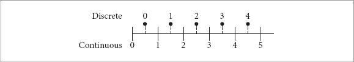

*Figure 8.10: Pixels in an image can be addressed with either discrete or continuous coordinates. A discrete image five pixels wide covers the continuous pixel range [0, 5). A particular discrete pixel d’s coordinate in the continuous representation is d + 1/2.*

### 8.1.5 SAMPLING AND ALIASING IN RENDERING

The application of the principles of sampling theory to the 2D case of sampling and reconstructing images of rendered scenes is straightforward: we have an image, which we can think of as a function of 2D (x, y) image locations to radiance values L: It is useful to generalize the definition of the scene function to a higher-dimensional function that also depends on the time t and (u, v) lens position at which it is sampled. Because the rays from the camera are based on these five quantities, varying any of them gives a different ray and thus a potentially different value of f. For a particular image position, the radiance at that point will generally vary across both time (if there are moving objects in the scene) and position on the lens (if the camera has a finite-aperture lens).

Even more generally, because the integrators defined in Chapters 13 through 15 use Monte Carlo integration to estimate the radiance along a given ray, they may return a different radiance value when repeatedly given the same ray. If we further extend the scene radiance function to include sample values used by the integrator (e.g., values used to choose points on area light sources for illumination computations), we have an even higher-dimensional image function

Sampling all of these dimensions well is an important part of generating high-quality imagery efficiently. For example, if we ensure that nearby (x, y) positions on the image tend to have dissimilar (u, v) positions on the lens, the resulting rendered images will have less error because each sample is more likely to account for information about the scene that its neighboring samples do not. The Sampler class implementations later in this chapter will address the issue of sampling all of these dimensions effectively.

Sources of Aliasing

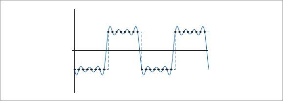

*Figure 8.11: Illustration of the Gibbs Phenomenon. When a function has not been sampled at the Nyquist rate and the set of aliased samples is reconstructed with the sinc filter, the reconstructed function will have “ringing” artifacts, where it oscillates around the true function. Here a 1D step function (dashed line) has been sampled with a sample spacing of 0.125. When reconstructed with the sinc, the ringing appears (solid line).*

```text
    Sampler 469
```

Geometry is one of the most common causes of aliasing in rendered images. When projected onto the image plane, an object’s boundary introduces a step function—the image function’s value instantaneously jumps from one value to another. Not only do step functions have infinite frequency content as mentioned earlier, but, even worse, the perfect reconstruction filter causes artifacts when applied to aliased samples: ringing artifacts appear in the reconstructed function, an effect known as the Gibbs phenomenon. Figure 8.11 shows an example of this effect for a 1D function. Choosing an effective reconstruction filter in the face of aliasing requires a mix of science, artistry, and personal taste, as we will see later in this chapter.

Very small objects in the scene can also cause geometric aliasing. If the geometry is small enough that it falls between samples on the image plane, it can unpredictably disappear and reappear over multiple frames of an animation.

Another source of aliasing can come from the texture and materials on an object. Shading aliasing can be caused by textures that have not been filtered correctly (addressing this problem is the topic of much of Chapter 10) or from small highlights on shiny surfaces. If the sampling rate is not high enough to sample these features adequately, aliasing will result. Furthermore, a sharp shadow cast by an object introduces another step function in the final image. While it is possible to identify the position of step functions from geometric edges on the image plane, detecting step functions from shadow boundaries is more difficult.

The inescapable conclusion about aliasing in rendered images is that we can never remove all of its sources, so we must develop techniques to mitigate its impact on the quality of the final image.

Adaptive Sampling One approach that has been applied to combat aliasing is adaptive supersampling: if we can identify the regions of the signal with frequencies higher than the Nyquist limit, we can take additional samples in those regions without needing to incur the computational expense of increasing the sampling frequency everywhere. It can be difficult to get this approach to work well in practice, because finding all the places where supersampling is needed is difficult. Most techniques for doing so are based on examining adjacent sample values and finding places where there is a significant change in value between the two; the assumption is that the signal has high frequencies in that region.

In general, adjacent sample values cannot tell us with certainty what is really happening between them: even if the values are the same, the functions may have huge variation between them. Alternatively, adjacent samples may have substantially different values without any aliasing actually being present. For example, the texture-filtering algorithms in Chapter 10 work hard to eliminate aliasing due to image maps and procedural textures on surfaces in the scene; we would not want an adaptive sampling routine to needlessly take extra samples in an area where texture values are changing quickly but no excessively high frequencies are actually present.

Prefiltering Another approach to eliminating aliasing that sampling theory offers is to filter (i.e., blur) the original function so that no high frequencies remain that cannot be captured accurately at the sampling rate being used. This approach is applied in the texture functions of Chapter 10. While this technique changes the character of the function being sampled by removing information from it, blurring is generally less objectionable than aliasing.

Recall that we would like to multiply the original function’s spectrum with a box filter with width chosen so that frequencies above the Nyquist limit are removed. In the spatial domain, this corresponds to convolving the original function with a sinc filter, f (x) ⊗ sinc(2ωsx). In practice, we can use a filter with finite extent that works well. The frequency space representation of this filter can help clarify how well it approximates the behavior of the ideal sinc filter.

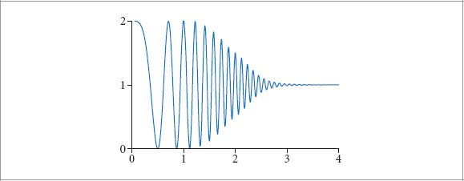

*Figure 8.12: Graph of the function 1 + cos(4πx2) convolved with a filter that removes frequencies beyond the Nyquist limit for a sampling rate of T = 0.125. High-frequency detail has been removed from the function, so that the new function can at least be sampled and reconstructed without aliasing.*

*Figure 8.12 shows the function 1 + cos(4πx2) convolved with a variant of the sinc with finite extent that will be introduced in Section 8.8. Note that the high-frequency details have been eliminated; this function can be sampled and reconstructed at the sampling rate used in Figure 8.9 without aliasing.*

### 8.1.6 SPECTRAL ANALYSIS OF SAMPLING PATTERNS

Given a fixed sampling rate, the remaining option to improve image quality is to consider how the distribution of sample positions affects the result. We can understand the behavior of deterministic sampling patterns like the shah function in frequency space by considering the convolution of its frequency space representation with a function’s frequency space representation. However, we will find it worthwhile to consider stochastic sampling methods where the sample positions are specified by one or more random variables. In that case, we will distinguish between the statistical properties of all the sets of samples that the algorithm may generate and a single set of points generated by it (which we will call a sample pattern); the former gives much more insight about an algorithm’s behavior.

A concept known as the power spectral density (PSD) is helpful for this task. For a function f (x) that is represented by F (ω) in the Fourier basis, the PSD is defined as: Pf (ω) = F (ω)F (ω), where F (ω) is the complex conjugate of F (ω). (Under the assumption of an even function f (x), Pf (ω) = F (ω)2.) Because the PSD discards information about the phase of the signal, the original Fourier coefficients cannot be recovered from it.

A useful property of the PSD is that the PSD of the product of two functions f and g in the spatial domain is given by the convolution of their PSDs in the Fourier domain: Pfg(ω) = Pf(ω) ⊗ Pg(ω). This property follows directly from Equation (8.3). Therefore, if we have a point-sampling technique represented by a function s(x) that is defined as a sum of Dirac delta distributions (as the shah function was), then the frequency content from sampling a function f is given by the convolution of Pf and Ps.

In some cases, the PSD of a sampling pattern can be derived analytically: doing so is easy for uniform random sampling, for example. For stochastic sampling patterns without an analytic PSD, the PSD can be computed numerically by averaging over random instances of the sample points. Because each sample point is represented as a Dirac delta distribution, their Fourier transform, Equation (8.1), ends up as a sum over the sample points.4

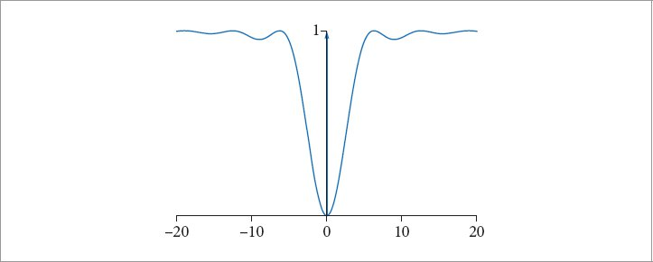

*Figure 8.13: Graph of the PSD of jittered samples with T = 1, as given by Equation (8.7).*

The ideal sampling pattern’s PSD would have a single delta distribution spike at the origin and be zero everywhere else: in that case, sampling would exactly replicate Pf. Unfortunately, such a sampling pattern would require an infinite sampling density. (This can be understood by considering the inverse Fourier transform of S(ω) = δ(ω), which is a constant function.) The PSD makes it possible to analyze the effects of stochastic sampling. One way to do so is through jittering, which adds uniform random offsets to regularly spaced sample points. With a uniform random number ξ between 0 and 1, a random set of samples based on the impulse train is

It is possible to derive the expectation of the analytic PSD of this sampling strategy,5

This function is graphed in Figure 8.13. Note that there is a spike at the origin, that its value is otherwise close to 0 in the low frequencies, and that it settles in to an increasingly narrow range around 1 at the higher frequencies.

We can use the PSD to compare the effect of undersampling a function in two different ways: using regularly spaced samples and using jittered samples. Figure 8.14(a) shows the frequency space representation of a function with energy in frequencies |ω| > 1/2, which is the maximum frequency content that can be perfectly reconstructed with regular sampling with T = 1. Figure 8.14(b) then shows the result of convolving the function’s PSD with regular samples and Figure 8.14(c) shows the result with jittered samples.

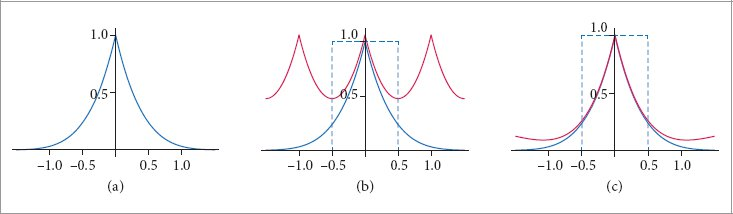

*Figure 8.14: The Effect of Jittered Sampling on Aliasing. (a) The power spectral density of a function that cannot be perfectly reconstructed with regularly spaced samples at a rate T = 1. (b) The PSD from sampling the function with a shah function with T = 1 (red), which is given by the convolution of their PSDs. The original function is shown in blue and the extent of the ideal reconstruction filter is shown with dashed lines. (c) The PSD from jittered sampling (red), which is given by convolving Pf with Equation (8.7). (The original function is again in blue and the perfect reconstruction filter is indicated by the dashed box.)*

In general, aliasing is reduced most effectively if there is minimal energy in the PSD of the sampling function at low frequencies. This characteristic prevents higher frequencies in the function being sampled from appearing as aliases at lower frequencies. (It is implicit in this assumption that the function f ’s energy is concentrated in the lower frequencies. This is the case for most natural images, though if this is not the case, then the behavior of the sampling function’s PSD at the lower frequencies does not matter as much.) While the shah function is effective by this measure, the uniformity of its sampling rate can lead to structured error, as was shown in Figure 8.14. With jittered sampling, the copies of the sampled signal end up being randomly shifted, so that when reconstruction is performed the result is random error rather than coherent aliasing. Because jittered sampling has roughly the same amount of energy in all the higher frequencies of its PSD, it spreads high-frequency energy in the function being sampled over many frequencies, converting aliasing into high-frequency noise, which is more visually pleasing to human observers than lower-frequency aliasing.

PSDs are sometimes described in terms of their color. For example, a white noise distribution has equal power at all frequencies, just as white light has (more or less) equal power at all visible frequencies. Blue noise corresponds to a distribution with its power concentrated at the higher

frequencies and less power at low frequencies, again corresponding to the relationship between power and frequency exhibited by blue light.

We will occasionally find precomputed 2D tables of values that have blue noise characteristics to be useful; pbrt includes a number of such tables that are made available through the following function. Tables are reused once the provided tableIndex value goes past their number.

〈Blue noise lookup functions〉 ≡ float BlueNoise(int tableIndex, Point2i p);

*Figure 8.15 shows one such table along with a white noise image. With a blue noise distribution, the values at nearby pixels differ, corresponding to higher-frequency variation. Because the white noise image does not have this characteristic, there are visible clumps of pixels with similar values.*

```text
    Point2i 92
```

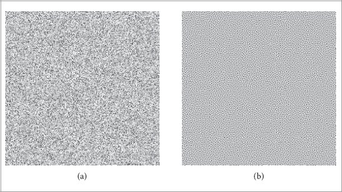

*Figure 8.15: 256 × 256 pixels with (a) values distributed with white noise characteristics, and (b) with blue noise. (Blue noise table courtesy of Christoph Peters.)*

## 8.2 SAMPLING AND INTEGRATION

The lighting integration algorithms used throughout pbrt are based on Monte Carlo integration, yet the focus of Section 8.1 was on sampling and reconstruction. That topic is an important one for understanding aliasing and the use of filters for image reconstruction, but it is a different one than minimizing Monte Carlo integration error. There are a number of connections between Monte Carlo

and both Fourier analysis and other approaches to analyzing point-sampling algorithms, however. For example, jittered sampling is a form of stratified sampling, a variance reduction technique that was introduced in Section 2.2.1. Thus, we can see that jittered sampling is advantageous from both perspectives.

Given multiple perspectives on the problem, one might ask, what is the best sampling approach to use for Monte Carlo integration? There is no easy answer to this question, which is reflected by the fact that this chapter presents a total of 6 classes that implement the upcoming Sampler interface to generate sample points, though a number of them offer a few variations of an underlying sampling approach, giving a total of 17 different techniques.

Although some of this variety is for pedagogy, it is largely due to the fact that the question of which sampling technique is best is not easily answered. Not only do the various mathematical approaches to analyzing sampling techniques often disagree, but another difficulty comes from the human visual system: rendered images are generally for human consumption and most mathematical approaches for evaluating sampling patterns do not account for this fact. Later in this chapter, we will see that sampling patterns that lead to errors in the image having blue noise characteristics are visually preferable, yet may not have any lower numeric error than those that do not. Thus, pbrt provides a variety of options, allowing the user to make their own choice among them.

⋆ 8.2.1 FOURIER ANALYSIS OF VARIANCE

```text
    Sampler 469
```

Fourier analysis can also be applied to evaluate sampling patterns in the context of Monte Carlo integration, leading to insights about both variance and the convergence rates of various sampling algorithms. We will make three simplifications in our treatment of this topic here. There are more general forms of the theory that do not require these, though they are more complex. (As always, see the “Further Reading” section for more information.) We assume that:

1. The sample points are uniformly distributed and equally weighted (i.e., importance
   sampling is not being used).
2. The Monte Carlo estimator used is unbiased.
3. The properties of the sample points are homogeneous with respect to toroidal translation
   over the sampling domain. (If they are not, the analysis is effectively over all possible
   random translations of the sample points.)

Excluding importance sampling has obvious implications, though we note that the last assumption, homogeneity, is also significant. Many of the sampling approaches later in this chapter are based on decomposing the [0, 1)n sampling domain into strata and placing a single sample in each one. Homogenizing such algorithms causes some of those regions to wrap around the boundaries of the domain, which harms their effectiveness. Equivalently, homogenization can be seen as toroidally translating the function being integrated, which can introduce discontinuities that were not previously present. Nevertheless, we will see that there is still much useful insight to be had about the behavior of sampling patterns in spite of these simplifications.

Our first step is to introduce the Fourier series representation of functions, which we will use as the basis for analysis of sampling patterns for the remainder of this section. The Fourier transform assumes that the function f (x) has infinite extent, while for rendering we are generally operating over the [0, 1)n domain or on mappings from there to other finite domains such as the unit hemisphere. While it is tempting to apply the Fourier transform as is, defining f (x) to be zero outside the domain of interest, doing so introduces a discontinuity in the function at the boundaries that leads to error due to the Gibbs phenomenon in the Fourier coefficients. Fourier series are defined over a specific finite domain and so do not suffer from this problem.

The Fourier series represents a function using an infinite set of coefficients fj for all integer-valued j ≥ 0. (We use j to index coefficients in order to avoid confusion with the use of i for the unit imaginary number.) For the [0, 1) domain, the coefficients are given by6

(Domains other than [0, 1) can be handled using a straightforward reparameterization.)

Expressed using the Fourier series coefficients, the original function is

It can be shown that the continuous Fourier transform corresponds to the limit of taking the Fourier series with an infinite extent.

The PSD of a function in the Fourier series basis is given by the product of each coefficient with its complex conjugate,

In order to analyze Monte Carlo integration in frequency space, we will start by defining the sampling function s(x) for a set of sample points xi as the averaged sum of n samples, each represented by a

delta distribution, Given the sampling function, it is possible to rewrite the Monte Carlo estimator as an integral:

It may seem like we are moving backward: after all, the point of Monte Carlo integration is to transform integrals into sums. However, this transformation is key to being able to apply the Fourier

machinery to the problem.

If we substitute the Fourier series expansion of Equation (8.9) into Equation (8.10), we can find that

From the definition of the Fourier series coefficients, we know that f0 = f0 = ∫ f (x) dx. Furthermore, s0 = 1 from the definition of s(x) and the assumption of uniform and unweighted samples. Therefore, the error in the Monte Carlo estimate is given by

where ℤ∗ denotes the set of all integers except for zero.

Equation (8.11) is the key result that gives us insight about integration error. It is worth taking the time to understand and to consider the implications of it. For example, if f is band limited, then fj = 0 for all j after some value jmax. In that case, if s’s sampling rate is at least equal to f’s highest frequency, then sj = 0 for all 0 < j < jmax and a zero variance estimator is the result. Only half the sampling rate is necessary for perfect integration compared to what is needed for perfect reconstruction!

Using Equation (8.11) with the definition of variance, it can be shown that the variance of the estimator is given by the sum of products of f (x)’s and s(x)’s PSDs:

This gives a clear direction about how to reduce variance: it is best if the power spectrum of the sampling pattern is low where the function’s power spectrum is high. In rendering, the function is generally not available analytically, let alone in the Fourier series basis, so we follow the usual expectation that the function has most of its frequency content in lower frequencies. This assumption argues for a sampling pattern with its energy concentrated in higher frequencies and minimal energy in the lower frequencies—precisely the same blue noise criterion that we earlier saw was effective for antialiasing.

An insight that directly follows from Equation (8.12) is that with uniform random sampling (i.e., white noise), Ps is the constant 1/n, which leads to the variance of

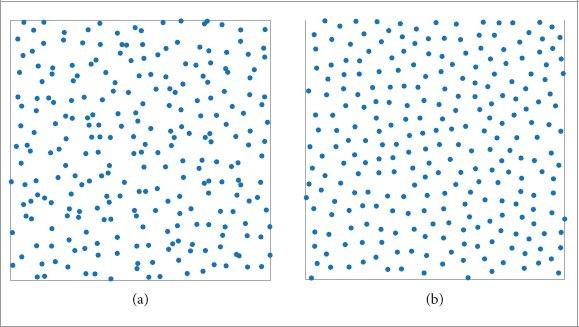

*Figure 8.16: 256 sample points distributed using (a) a jittered distribution, and (b) a Poisson disk distribution. Poisson disk point sets combine some randomness in the locations of the points with some structure from no two of them being too close together.*

which is the same variance of the Monte Carlo estimator that was derived earlier using different means in Section 2.1.4. More generally, if the PSD for a sampling technique can be asymptotically bounded, it can be shown that the technique exhibits a higher rate of variance reduction given a suitable function being integrated. One example is that in 2D, a jittered sampling pattern can achieve O(n−2) variance, given a smooth integrand.

Fourier analysis has also revealed that Poisson disk sampling patterns have unexpectedly bad asymptotic convergence. Poisson disk point sets are constructed such that no two points can be closer than some minimum distance d (see Figure 8.16). For many years, they were believed to be superior to jittered patterns. The Poisson disk criterion is an appealing one, as it prohibits multiple samples from clumping close together, as is possible with adjacent jittered samples.

Part of the appeal of Poisson disk patterns is that initially they seem to have superior blue noise characters to jittered patterns, with a much larger range of frequencies around the origin where the PSD is low. Figure 8.17 shows the PSDs of 2D jittered and Poisson disk sample points. Both feature a spike at the origin, a ring of low energy around it, and then a transition to fairly equal-energy noise at higher frequencies.

Radially averaged plots of the distribution of energy in these PSDs, however, makes their behavior in the low frequencies more clear; see Figure 8.18.7 We can see that although the Poisson disk pattern has low energy for a larger range of frequencies than the jittered pattern, its PSD retains a small amount of energy all the way until 0, while the jittered pattern does not.

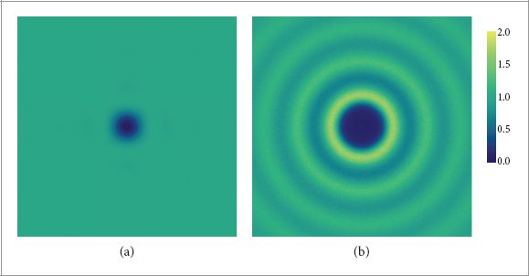

*Figure 8.17: PSDs of (a) jittered and (b) Poisson disk–distributed sample points. The origin with the central spike is at the center of each image.*

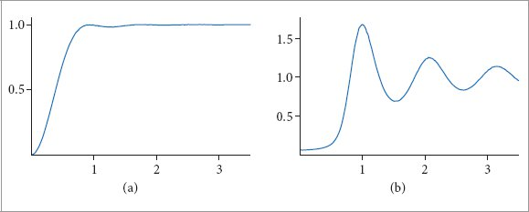

*Figure 8.18: Radially averaged PSDs of (a) jittered and (b) Poisson disk–distributed sample points.*

Using Fourier analysis of variance, it can be shown that due to this lingering energy, the variance when using Poisson disk sampling is never any better than O(n−1)—worse than jittered points for some integrands. (Though remember that these are asymptotic bounds, and that for small n, Poisson disk–distributed points may give lower variance.) Nevertheless, the poor asymptotic convergence for what seems like it should be an effective sampling approach was a surprise, and points to the value of this form of analysis.

### 8.2.2 LOW DISCREPANCY AND QUASI MONTE CARLO

Outside of Fourier analysis, another useful approach for evaluating the quality of sample points is based on a concept called discrepancy. Well-distributed sampling patterns have low discrepancy, and thus the sample pattern generation problem can be considered to be one of finding a suitable pattern of points with low discrepancy.

In discussing the discrepancy of sample points, we will draw a distinction between sample sets, which are a specific number of points, and sample sequences, which are defined by an algorithm that can generate an arbitrary number of points. For a fixed number of samples, it is generally possible to distribute points in a sample set slightly better than the same number of points in a sample sequence. However, sequences can be especially useful with adaptive sampling algorithms, thanks to their flexibility in the number of points they generate.

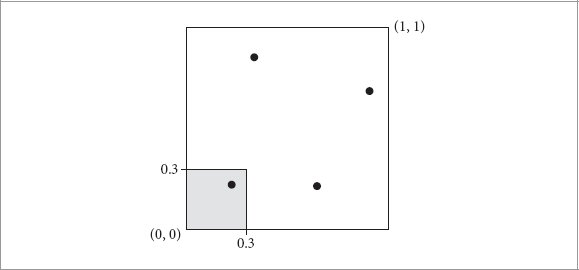

*Figure 8.19: The discrepancy of a box (shaded) given a set of 2D sample points in [0, 1)2. One of the four sample points is inside the box, so this set of points would estimate the box’s area to be 1/4. The true area of the box is 0.3 × 0.3 = .09, so the discrepancy for this particular box is .25 − .09 = .16. In general, we are interested in finding the maximum discrepancy of all possible boxes (or some other shape).*

The basic idea of discrepancy is that the quality of a set of points in a d-dimensional space [0, 1)d can be evaluated by looking at regions of the domain [0, 1)d, counting the number of points inside each region, and comparing the volume of each region to the number of sample points inside. In general, a given fraction of the volume should have roughly the same fraction of the total number of sample

points inside of it. While it is not possible for this always to be the case, we can still try to use patterns that minimize the maximum difference between the actual volume and the volume estimated by the points (the discrepancy). Figure 8.19 shows an example of the idea in two dimensions.

To compute the discrepancy of a set of points, we first pick a family of shapes B that are subsets of [0, 1)d. For example, boxes with one corner at the origin are often used. This corresponds to

where 0 ≤ vi < 1. Given a set of n sample points P = {x1, …, xn}, the discrepancy of P with respect to B is8

where #{xi ∊ b} is the number of points in b and V (b) is the volume of b.

The intuition for why Equation (8.13) is a reasonable measure of quality is that the value #{xi ∊ b}/n is an approximation of the volume of the box b given by the particular points P. Therefore, the discrepancy is the worst error over all possible boxes from this way of approximating the volume. When the set of shapes B is the set of boxes with a corner at the origin, this value is called the star discrepancy, . Another popular option for B is the set of all axis-aligned boxes, where the restriction that one corner be at the origin has been removed.

For some point sets, the discrepancy can be computed analytically. For example, consider the set of points in one dimension

We can see that the star discrepancy of xi is

For example, take the interval b = [0, 1/n). Then V (b) = 1/n, but #{xi ∊ b} = 0. This interval (and the intervals [0, 2/n), etc.) is the interval where the largest differences between volume and fraction of points inside the volume are seen.

The star discrepancy of this point set can be improved by modifying it slightly:

Then

The bounds for the star discrepancy of a sequence of points in one dimension have been shown to be

Thus, the earlier set from Equation (8.14) has the lowest possible discrepancy for a sequence in 1D. In general, it is much easier to analyze and compute bounds for the discrepancy of sequences in 1D than for those in higher dimensions. When it is not possible to derive the discrepancy of a sampling technique analytically, it can be estimated numerically by constructing a large number of shapes b, computing their discrepancy, and reporting the maximum value found.

The astute reader will notice that according to the discrepancy measure, the uniform sequence in 1D is optimal, but Fourier analysis indicated that jittering was superior to uniform sampling. Fortunately, low-discrepancy patterns in higher dimensions are much less uniform than they are in one dimension and thus usually work reasonably well as sample patterns in practice. Nevertheless, their underlying uniformity means that low-discrepancy patterns can be more prone to visually objectionable aliasing than patterns with pseudo-random variation.

A d-dimensional sequence of points is said to have low discrepancy if its discrepancy is of the order

These bounds are the best that are known for arbitrary d.

Low-discrepancy point sets and sequences are often generated using deterministic algorithms; we will see a number of such algorithms in Sections 8.6 and 8.7. Using such points to sample functions for integration brings us to quasi–Monte Carlo (QMC) methods. Many of the techniques used in regular Monte Carlo algorithms can be shown to work equally well with such quasi-random sample points.

The Koksma–Hlawka inequality relates the discrepancy of a set of points used for integration to the error of an estimate of the integral of a function f. It is:

where Vf is the total variation of the function f being integrated. It is defined as

over all partitions of the [0, 1) domain at points yi. In essence, the total variation represents how quickly the function’s value ever changes between points, and the discrepancy represents how effective the points used for integration are at catching the function’s variation.

Given the definition of low discrepancy from Equation (8.15), we can see from the Koksma–Hlawka inequality that as the dimensionality d of the integrand increases, the integration error with low discrepancy approaches O(n−1), which is asymptotically much better than the O(n−1/2) error from Monte Carlo integration (Section 2.1.4). Note also that these error bounds are asymptotic; in practice, QMC usually has an even better rate of convergence.

However, because QMC integration is deterministic, it is not possible to use variance as a measure of an estimator’s quality, though of course one can still compute the mean squared error. Alternatively, the sample points can be randomized using approaches that are carefully designed not to harm their discrepancy. We will see later in the chapter that randomization can even lead to improved rates of convergence. Such approaches are randomized quasi–Monte Carlo (RQMC) methods and again allow the use of variance. RQMC is the foundation of most of pbrt’s Monte Carlo integration algorithms.

In most of this text, we have glossed over the differences between Monte Carlo, QMC, and RQMC, and have localized the choice among them in the Samplers in this chapter. Doing so introduces the possibility of subtle errors if a Sampler generates quasi-random sample points that an Integrator then improperly uses as part of an implementation of an algorithm that is not suitable for quasi Monte Carlo, though none of the integrators described in the text do so.

## 8.3 SAMPLING INTERFACE

```text
    Integrator 22
    Sampler 469
```

pbrt’s Sampler interface makes it possible to use a variety of sample generation algorithms for rendering. The sample points that they provide are used by pbrt’s Integrators in a multitude of ways, ranging from determining points on the image plane from which camera rays originate to selecting which light source to trace a shadow ray to and at which point on it the shadow ray should terminate.

As we will see in the following sections, the benefits of carefully crafted sampling patterns are not just theoretical; they can substantially improve the quality of rendered images. The runtime expense for using good sampling algorithms is relatively small; because evaluating the radiance for each image sample is much more expensive than computing the sample’s component values, doing this work pays dividends (Figure 8.20).

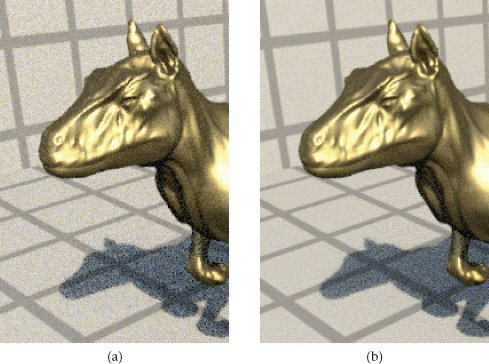

*Figure 8.20: Scene rendered with (a) a relatively ineffective sampler and (b) a carefully designed sampler, using the same number of samples for each. The improvement in image quality, ranging from the shadow on the floor to the quality of the glossy reflections, is noticeable. Both images are rendered with 8 samples per pixel. (Killeroo model courtesy of headus/Rezard.)*

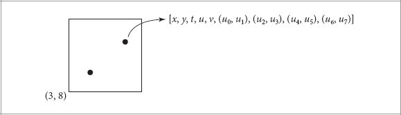

*Figure 8.21: Samplers generate a d-dimensional sample point for each of the image samples taken to generate the final image. Here, the pixel (3, 8) is being sampled, and there are two image samples in the pixel area. The first two dimensions of the sample give the (x, y) offset of the sample within the pixel, and the next three dimensions determine the time and lens position of the corresponding camera ray. Subsequent dimensions are used by the Monte Carlo light transport algorithms implemented in pbrt’s Integrators.*

The task of a Sampler is to generate uniform d-dimensional sample points, where each coordinate’s value is in the range [0, 1). The total number of dimensions in each point is not set ahead of time; Samplers must generate additional dimensions on demand, depending on the number of dimensions required for the calculations performed by the light transport algorithms. (See Figure 8.21.) While this design makes implementing a Sampler slightly more complex than if its task was to generate all the dimensions of each sample point up front, it is more convenient for integrators, which end up needing a different number of dimensions depending on the particular path they follow through the scene.

〈Sampler Definition〉 ≡ class Sampler : public TaggedPointer< 〈Sampler Types 469〉 > { public: 〈Sampler Interface 469〉 };

All the samplers save for MLTSampler are defined in this chapter; that one is used solely by the MLTIntegrator, which is described in the online version of the book.

〈Sampler Types〉 ≡ 469

```text
   IndependentSampler, StratifiedSampler, HaltonSampler, PaddedSobolSampler,
   SobolSampler, ZSobolSampler, MLTSampler
```

Sampler implementations specify the number of samples to be taken in each pixel and return this value via SamplesPerPixel(). Most samplers already store this value as a member variable and return it directly in their implementations of this method. We will usually not include the straightforward implementations of this method in the text.

〈Sampler Interface〉 ≡ 469

```rust
   int SamplesPerPixel() const;
```

When an Integrator is ready to start work on a given pixel sample, it starts by calling StartPixelSample(), providing the coordinates of the pixel in the image and the index of the sample within the pixel. (The index should be greater than or equal to zero and less than the value returned by SamplesPerPixel().) The Integrator may also provide a starting dimension at which sample generation should begin.

This method serves two purposes. First, some Sampler implementations use the knowledge of which pixel is being sampled to improve the overall distribution of the samples that they generate—for example, by ensuring that adjacent pixels do not take two samples that are close together. Attending to this detail, while it may seem minor, can substantially improve image quality.

Second, this method allows samplers to put themselves in a deterministic state before generating each sample point. Doing so is an important part of making pbrt’s operation deterministic, which in turn is crucial for debugging. It is expected that all samplers will be implemented so that they generate precisely the same sample coordinate values for a given pixel and sample index across multiple runs of

the renderer. This way, for example, if pbrt crashes in the middle of a lengthy run, debugging can proceed starting at the specific pixel and pixel sample index where the renderer crashed. With a deterministic renderer, the crash will reoccur without taking the time to perform all the preceding rendering work.

〈Sampler Interface〉 +≡ 469

```rust
   void StartPixelSample(Point2i p, int sampleIndex, int dimension = 0);
```

Integrators can request dimensions of the d-dimensional sample point one or two at a time, via the Get1D() and Get2D() methods. While a 2D sample value could be constructed by using values returned by a pair of calls to Get1D(), some samplers can generate better point distributions if they know that two dimensions will be used together. However, the interface does not support requests for 3D or higher-dimensional sample values from samplers because these are generally not needed for the types of rendering algorithms implemented here. In that case, multiple values from lower-dimensional components can be used to construct higher-dimensional sample points.

```text
    HaltonSampler 485
    IndependentSampler 471
    PaddedSobolSampler 503
    Point2i 92
    SobolSampler 499
    StratifiedSampler 474
    TaggedPointer 1073
    ZSobolSampler 505
```

〈Sampler Interface〉 +≡ 469

```rust
   Float Get1D();
   Point2f Get2D();
```

A separate method, GetPixel2D(), is called to retrieve the 2D sample used to determine the point on the film plane that is sampled. Some of the following Sampler implementations handle those dimensions of the sample differently from the way they handle 2D samples in other dimensions; other Samplers implement this method by calling their Get2D() methods.

〈Sampler Interface〉 +≡ 469

```rust
   Point2f GetPixel2D();
```

Because each sample coordinate must be strictly less than 1, it is useful to define a constant, OneMinusEpsilon, that represents the largest representable floating-point value that is less than 1. Later, the Sampler implementations will sometimes clamp sample values to be no larger than this.

〈Floating-point Constants〉 +≡ static constexpr double DoubleOneMinusEpsilon = 0x1.fffffffffffffp-1; static constexpr float FloatOneMinusEpsilon = 0x1.fffffep-1;

```rust
   #ifdef PBRT_FLOAT_AS_DOUBLE
   static constexpr double OneMinusEpsilon = DoubleOneMinusEpsilon;
   #else
   static constexpr float OneMinusEpsilon = FloatOneMinusEpsilon;
   #endif
```

A sharp edge of these interfaces is that code that uses sample values must be carefully written so that it always requests sample dimensions in the same order. Consider the following code: sampler->StartPixelSample(pPixel, sampleIndex); Float v = a(sampler->Get1D()); if (v > 0) v += b(sampler->Get1D()); v += c(sampler->Get1D()); In this case, the first dimension of the sample will always be passed to the function a(); when the code path that calls b() is executed, b() will receive the second dimension. However, if the if test is not always true or false, then c() will sometimes receive a sample value from the second dimension of the sample and otherwise receive a sample value from the third dimension. This will thus thwart efforts by the sampler to provide well-distributed sample points in each dimension being evaluated. Code that uses Samplers should therefore be carefully written so that it consistently consumes sample dimensions, to avoid this issue. Clone(), the final method required by the interface, returns a copy of the Sampler. Because Sampler implementations store a variety of state about the current sample—which pixel is being sampled, how many dimensions of the sample have been used, and so forth—it is unsafe for a single Sampler to be used concurrently by multiple threads. Therefore, Integrators call Clone() to make copies of an initial Sampler so that each thread has its own. The implementations of the various Clone() methods are not generally interesting, so they will not be included in the text here. 〈Sampler Interface〉 +≡ 469

Sampler Clone(Allocator alloc = {});

```text
    Allocator 40
    DoubleOneMinusEpsilon 470
    Float 23
    FloatOneMinusEpsilon 470
```

```text
   OneMinusEpsilon 470
   Point2f 92
   Sampler 469
```

## 8.4 INDEPENDENT SAMPLER

The IndependentSampler is perhaps the simplest possible (correct) implementation of the Sampler interface. It returns independent uniform sample values for each sample request without making any further effort to ensure the quality of the distribution of samples. The IndependentSampler should never be used for rendering if image quality is a concern, but it is useful for setting a baseline to compare against better samplers. 〈IndependentSampler Definition〉 ≡ class IndependentSampler { public: 〈IndependentSampler Public Methods 471〉 private: 〈IndependentSampler Private Members 471〉 };

Like many of the following samplers, IndependentSampler takes a seed to use when initializing the pseudo-random number generator with which it produces sample values. Setting different seeds makes it possible to generate independent sets of samples across multiple runs of the renderer, which can be useful when measuring the convergence of various sampling algorithms. 〈IndependentSampler Public Methods〉 ≡ 471

```rust
   IndependentSampler(int samplesPerPixel, int seed = 0)
       : samplesPerPixel(samplesPerPixel), seed(seed) {}
```

An instance of the RNG class is used to generate sample coordinate values.

〈IndependentSampler Private Members〉 ≡ 471

```rust
   int samplesPerPixel, seed;
   RNG rng;
```

So that the IndependentSampler always gives the same sample value for a given pixel sample, it is important to reset the RNG to a deterministic state rather than, for example, leaving it in whatever state it was at the end of the last pixel sample it was used for. To do so, we take advantage of the fact that the RNG in pbrt allows not only for specifying one of 264 sequences of pseudo-random values but also for specifying an offset in that sequence. The implementation below chooses a sequence deterministically, based on the pixel coordinates and seed value. Then, an initial offset into the sequence is found based on the index of the sample, so that different samples in a pixel will start far apart in the sequence. If a nonzero starting dimension is specified, it gives an additional offset into the sequence that skips over earlier dimensions. 〈IndependentSampler Public Methods〉 +≡ 471

```rust
   void StartPixelSample(Point2i p, int sampleIndex, int dimension) {
       rng.SetSequence(Hash(p, seed));
       rng.Advance(sampleIndex * 65536ull + dimension);
   }
```

Given a seeded RNG, the implementations of the methods that return 1D and 2D samples are trivial. Note that Get2D() uses C++’s uniform initialization syntax, which ensures that the two calls to Uniform() happen in a well-defined order, which in turn gives consistent results across different compilers.

```text
   Hash() 1042
   IndependentSampler 471
   IndependentSampler::rng 471
   Point2i 92
   RNG 1054
   RNG::Advance() 1057
   RNG::SetSequence() 1055
```

〈IndependentSampler Public Methods〉 +≡ 471

```rust
   Float Get1D() { return rng.Uniform<Float>(); }
   Point2f Get2D() { return {rng.Uniform<Float>(), rng.Uniform<Float>()}; }
   Point2f GetPixel2D() { return Get2D(); }
```

All the methods for analyzing sampling patterns from Section 8.2 are in agreement about the IndependentSampler: it is a terrible sampler.

Independent uniform samples contain all frequencies equally (they are the definition of white noise), so they do not push aliasing out to higher frequencies. Further, the discrepancy of uniform random samples is 1—the worst possible. (To see why, consider the case of all sample dimensions either having the value 0 or 1.) This sampler’s only saving grace comes in the case of integrating a function with a significant amount of energy in its high frequencies (with respect to the sampling rate). In that case, it does about as well as any of the more sophisticated samplers. 8.5 STRATIFIED SAMPLER

The IndependentSampler’s weakness is that it makes no effort to ensure that its sample points have good coverage of the sampling domain. All the subsequent Samplers in this chapter are based on various ways of ensuring that. As we saw in Section 2.2.1, stratification is one such approach. The StratifiedSampler applies this technique, subdividing the [0, 1)d sampling domain into regions and generating a single sample inside each one. Because a sample is taken in each region, it is less likely that important features in the integrand will be missed, since the samples are guaranteed not to all be close together. The StratifiedSampler places each sample at a random point inside each stratum by jittering the center point of the stratum by a uniform random amount so that all points inside the stratum are sampled with equal probability. The nonuniformity that results from this jittering helps turn aliasing into noise, as discussed in Section 8.1.6. The sampler also offers an unjittered mode, which gives uniform sampling in the strata; this mode is mostly useful for comparisons between different sampling techniques rather than for rendering high-quality images. Direct application of stratification to high-dimensional sampling quickly leads to an intractable number of samples. For example, if we divided the 5D image, lens, and time sample space into four strata in each dimension, the total number of samples per pixel would be 45 = 1024. We could reduce this impact by taking fewer samples in some dimensions (or not stratifying some dimensions, effectively using a single stratum), but we would then lose the benefit of having well-stratified samples in those dimensions. This problem with stratification is known as the curse of dimensionality.

We can reap most of the benefits of stratification without paying the price in excessive total sampling by computing lower-dimensional stratified patterns for subsets of the domain’s dimensions and then randomly associating samples from each set of dimensions. (This process is sometimes called padding.) Figure 8.22 shows the basic idea: we might want to take just four samples per pixel but still require the samples to be stratified over all dimensions. We independently generate four 2D stratified image samples, four 1D stratified time samples, and four 2D stratified lens samples. Then we randomly associate a time and lens sample value with each image sample. The result is that each pixel has samples that together have good coverage of the sample space.

```text
   Float 23
   IndependentSampler 471
   IndependentSampler::Get2D() 472
   IndependentSampler::rng 471
   Point2f 92
   RNG::Uniform<Float>() 1056
   StratifiedSampler 474
```

Rendering a scene without complex lighting but including defocus blur due to a finite aperture is useful for understanding the behavior of sampling patterns. This is a case where the integral is over four dimensions—more than just the two of the image plane, but not the full high-dimensional integral when complex light transport is sampled. Figure 8.23 shows the improvement in image quality from using stratified lens and image samples versus using unstratified independent samples when rendering such a scene.

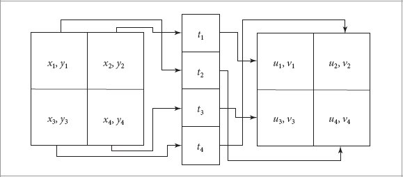

*Figure 8.22: We can generate a good sample pattern that reaps the benefits of stratification without requiring all the sampling dimensions to be stratified simultaneously. Here, we have split (x, y) image position, time t, and (u, v) lens position into independent strata with four regions each. Each is sampled independently, and then a time sample and a lens sample are randomly associated with each image sample. We retain the benefits of stratification in each stratification domain without having to exponentially increase the total number of samples.*

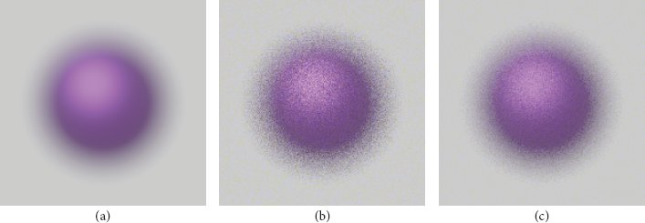

*Figure 8.23: Effect of Sampling Patterns in Rendering a Purple Sphere with Defocus Blur. (a) A high-quality reference image of a blurry sphere. (b) An image generated with independent random sampling without stratification. (c) An image generated with the same number of samples, but with the StratifiedSampler, which stratified both the image and, more importantly for this image, the lens samples. Stratification gives a substantial improvement and a 3× reduction in mean squared error.*

*Figure 8.24 shows a comparison of a few sampling patterns. The first is an independent uniform random pattern generated by the*

IndependentSampler. The result is terrible; some regions have few samples and other areas have clumps of many samples. The second is an unjittered stratified pattern. In the last, the uniform pattern has been jittered, with a random offset added to each sample’s location, keeping it inside its cell. This gives a better overall distribution than the purely random pattern while preserving the benefits of stratification, though there are still some clumps of samples and some regions that are undersampled.

```text
   IndependentSampler 471
   StratifiedSampler 474
```

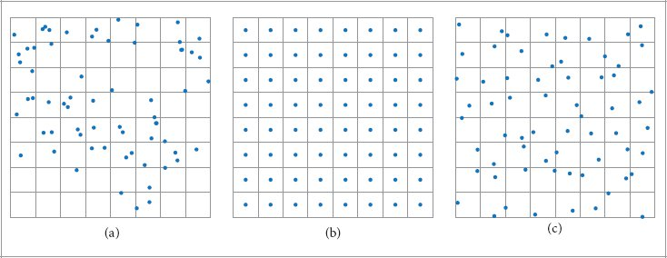

*Figure 8.24: Three 2D Sampling Patterns. (a) The independent uniform pattern is an ineffective pattern, with many clumps of samples that leave large sections of the image poorly sampled. (b) An unjittered pattern is better distributed but can exacerbate aliasing artifacts. (c) A stratified jittered pattern turns aliasing from the unjittered pattern into high-frequency noise while generally maintaining the benefits of stratification. (See Figure 8.26 for a danger of jittering, however.)*

*Figure 8.25 shows images rendered using the StratifiedSampler and shows how jittered sample positions turn aliasing artifacts into less objectionable noise. 〈StratifiedSampler Definition〉 ≡ class StratifiedSampler { public: 〈StratifiedSampler Public Methods 474〉 private:*

〈StratifiedSampler Private Members 474〉 };

The StratifiedSampler constructor takes a specification of how many 2D strata should be used via specification of x and y sample counts. Parameters that specify whether jittering is enabled and a seed for the random number generator can also be provided to the constructor. 〈StratifiedSampler Public Methods〉 ≡ 474

```rust
   StratifiedSampler(int xPixelSamples, int yPixelSamples, bool jitter,
                          int seed = 0)
         : xPixelSamples(xPixelSamples), yPixelSamples(yPixelSamples),
           seed(seed), jitter(jitter) {}
```

〈StratifiedSampler Private Members〉 ≡ 474

```rust
   int xPixelSamples, yPixelSamples, seed;
   bool jitter;
   RNG rng;
```

The total number of samples in each pixel is the product of the two dimensions’ sample counts. 〈StratifiedSampler Public Methods〉 +≡ 474

```rust
   int SamplesPerPixel() const { return xPixelSamples * yPixelSamples; }
```

```text
   RNG 1054
   StratifiedSampler 474
   StratifiedSampler::jitter 474
   StratifiedSampler::seed 474
   StratifiedSampler::xPixelSamples 474
   StratifiedSampler::yPixelSamples 474
```

This sampler needs to keep track of the current pixel, sample index, and dimension for use in the sample generation methods. After recording them in member variables, the RNG is seeded so that deterministic values are returned for the sample point, following the same approach as was used in IndependentSampler::StartPixelSample().

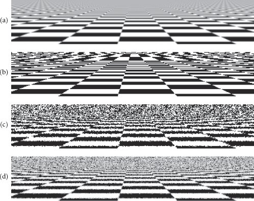

*Figure 8.25: Comparison of Image Sampling Methods with a Checkerboard Texture. This is a difficult image to render well, since the checkerboard’s frequency with respect to the pixel spacing tends toward infinity as we approach the horizon. (a) A reference image, rendered with 256 samples per pixel, showing something close to an ideal result. (b) An image rendered with one sample per pixel, with no jittering. Note the jaggy artifacts at the edges of checks in the foreground. Notice also the artifacts in the distance where the checker function goes through many cycles between samples; as expected from the signal processing theory presented earlier, that detail reappears incorrectly as lower-frequency aliasing. (c) The result of jittering the image samples, still with just one sample per pixel. The regular aliasing of the second image has been replaced by less objectionable noise artifacts. (d) The result of four jittered samples per pixel is still inferior to the reference image but is substantially better than the previous result.*

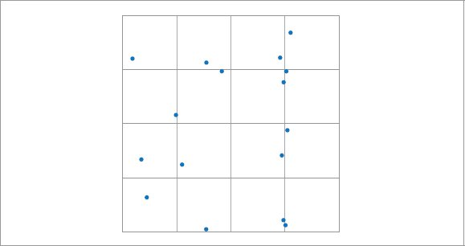

*Figure 8.26: A Worst-Case Situation for Stratified Sampling. In an n × n 2D pattern, up to 2n of the points may project to essentially the same point on one of the axes. When “unlucky” patterns like this are generated, the quality of the results computed with them usually suffers. (Here, 8 of the samples have nearly the same x value.)*

〈StratifiedSampler Public Methods〉 +≡ 474

```rust
   void StartPixelSample(Point2i p, int index, int dim) {
         pixel = p;
         sampleIndex = index;
         dimension = dim;
         rng.SetSequence(Hash(p, seed));
         rng.Advance(sampleIndex * 65536ull + dimension);
   }
```

〈StratifiedSampler Private Members〉 +≡ 474

```rust
   Point2i pixel;
   int sampleIndex = 0, dimension = 0;
```

The StratifiedSampler’s implementation is made more complex by the fact that its task is not to generate a full set of sample points for all of the pixel samples at once. If that was the task of the sampler, then the following code suggests how 1D stratified samples for some dimension might be generated: each array element is first initialized with a random point in its corresponding stratum and then the array is randomly shuffled.

This shuffling operation is necessary for padding, so that there is no correlation between the pixel sample index and which stratum its sample comes from. If this shuffling was not done, then the sample dimensions’ values would be correlated in a way that would lead to errors in images— for example, the first 2D sample used to choose the film location, as well as the first 2D lens sample, would always each be in the lower left stratum adjacent to the origin. constexpr int n = …; std::array<Float, n> samples; for (int i = 0; i < n; ++i) samples[i] = (i + rng.Uniform<Float>()) / n; std::shuffle(samples.begin(), samples.end(), rng);

In the context of pbrt’s sampling interface, we would like to perform this random sample shuffling without explicitly representing all the dimension’s sample values. The Stratified Sampler therefore uses a random permutation of the sample index to determine which stratum to sample. Given the stratum index, generating a 1D sample is easy. 〈StratifiedSampler Public Methods〉 +≡ 474

```rust
   Float Get1D() {
         〈Compute stratum index for current pixel and dimension 477〉
         ++dimension;
         Float delta = jitter ? rng.Uniform<Float>() : 0.5f;
         return (stratum + delta) / SamplesPerPixel();
   }
```

It is possible to perform the sample index permutation without representing the permutation explicitly thanks to the PermutationElement() routine, which is defined in Section B.2.8. It takes an index, a total permutation size, and a random seed, and returns the element that the given index is mapped to, doing so in such a way that a valid permutation is returned across all indices up to the permutation size. Thus, we just need to compute a consistent seed value that is the same whenever a particular dimension is sampled at a particular pixel. Hash() takes care of this, though note that sampleIndex must not be included in the hashed values, as doing so would lead to different permutations for different samples in a pixel.

```text
   Float 23
   Hash() 1042
   IndependentSampler::StartPixelSample() 471
   PermutationElement() 1043
   Point2i 92
   RNG::Advance() 1057
   RNG::SetSequence() 1055
   RNG::Uniform<Float>() 1056
   StratifiedSampler::dimension 476
   StratifiedSampler::jitter 474
   StratifiedSampler::pixel 476
   StratifiedSampler::rng 474
   StratifiedSampler::sampleIndex 476
   StratifiedSampler::SamplesPerPixel() 474
   StratifiedSampler::seed 474
```

〈Compute stratum index for current pixel and dimension〉 ≡ 476, 477

uint64_t hash = Hash(pixel, dimension, seed); int stratum = PermutationElement(sampleIndex, SamplesPerPixel(), hash);

Generating a 2D sample follows a similar approach, though the stratum index has to be mapped into separate x and y stratum coordinates. Given these, the remainder of the sampling operation is straightforward. 〈StratifiedSampler Public Methods〉 +≡ 474

```rust
   Point2f Get2D() {
         〈Compute stratum index for current pixel and dimension 477
         dimension += 2;
         int x = stratum % xPixelSamples, y = stratum / xPixelSamples;
         Float dx = jitter ? rng.Uniform<Float>() : 0.5f;
         Float dy = jitter ? rng.Uniform<Float>() : 0.5f;
         return {(x + dx) / xPixelSamples, (y + dy) / yPixelSamples};
   }
```

The pixel sample is not handled differently than other 2D samples with this sampler, so the GetPixel2D() method just calls Get2D().

〈StratifiedSampler Public Methods〉 +≡ 474

```rust
   Point2f GetPixel2D() { return Get2D(); }
```

With a d-dimensional stratification, the star discrepancy of jittered points has been shown to be

which means that stratified samples do not qualify as having low discrepancy. The PSD of 2D stratified samples was plotted earlier, in Figure 8.17(a). Other than the central spike at the origin (at the center of the image), power is low at low frequencies and settles in to be fairly constant at higher frequencies, which means that this sampling approach is effective at transforming aliasing into high-frequency noise.

⋆ 8.6 HALTON SAMPLER

The underlying goal of the StratifiedSampler is to generate a well-distributed but randomized set of sample points, with no two sample points too close together and no excessively large regions of the sample space that have no samples. As Figure 8.24 showed, a jittered stratified pattern is better at this than an independent uniform random pattern, although its quality can suffer when samples in adjacent strata happen to be close to the shared boundary of their two strata. This section introduces the HaltonSampler, which is based on algorithms that directly generate low-discrepancy sample points that are simultaneously well distributed over all the dimensions of the sample—not just one or two dimensions at a time, as the StratifiedSampler did.

### 8.6.1 HAMMERSLEY AND HALTON POINTS

```text
    Float 23
    Hash() 1042
    PermutationElement() 1043
    Point2f 92
    RNG::Uniform<Float>() 1056
    StratifiedSampler 474
    StratifiedSampler::dimension 476
    StratifiedSampler::Get2D() 477
    StratifiedSampler::jitter 474
    StratifiedSampler::pixel 476
    StratifiedSampler::rng 474
```

```text
   StratifiedSampler::SamplesPerPixel() 474
   StratifiedSampler::seed 474
   StratifiedSampler::xPixelSamples 474
   StratifiedSampler::yPixelSamples 474
```

Hammersley and Halton points are two closely related types of low-discrepancy points that are constructed using the radical inverse. The radical inverse is based on the fact that a positive integer value a can be expressed in a base b with a sequence of digits dm(a) … d2(a)d1(a) uniquely

determined by where all digits di(a) are between 0 and b − 1.

The radical inverse function Φb in base b converts a nonnegative integer a to a fractional value in [0, 1) by reflecting these digits about the radix point:

One of the simplest low-discrepancy sequences is the van der Corput sequence, which is a 1D sequence given by the radical inverse function in base 2: xa = Φ2(a),

with a = 0, 1, …. Note that van der Corput points are a point sequence because an arbitrary number of them can be generated in succession; the total number need not be specified in advance. (However, if the number of points n is not a power of 2, then the gaps between points will be of different sizes.) Table 8.2 shows the first few values of the van der Corput sequence. Notice how it recursively splits the intervals of the 1D line in half, generating a sample point at the center of each interval. The discrepancy of this sequence is

which is optimal.

The d-dimensional Halton sequence is defined using the radical inverse base b, with a different base for each dimension. The bases used must all be relatively prime to each other, so a natural choice is to use the first d prime numbers (p1, …, pd): Table 8.2: The radical inverse Φ2(a) of the first few nonnegative integers, computed in base 2. Notice how successive values of Φ2(a) are not close to any of the previous values of Φ2(a). As more and more values of the sequence are generated, samples are necessarily closer to previous samples, although with a minimum distance that is guaranteed to be reasonably good.

         a                          Base 2                                                 Φ2(a)

0 0 0

1 1 0.1 = 1/2

2 10 0.01 = 1/4

3 11 0.11 = 3/4

4 100 0.001 = 1/8

5 101 0.101 = 5/8 ⋮

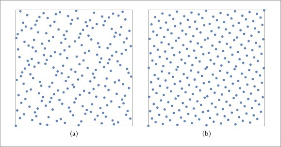

*Figure 8.27: The First Points of Two Low-Discrepancy Sequences in 2D. (a) Halton (216 points), (b) Hammersley (256 points).*

Like the van der Corput sequence, the Halton sequence can be used even if the total number of samples needed is not known in advance; all prefixes of the sequence are well distributed, so as additional samples are added to the sequence, low discrepancy will be maintained. (However, its distribution is best when the total number of samples is the product of powers of the bases for integer ki.) The discrepancy of a d-dimensional Halton sequence is

which is asymptotically optimal. If the number of samples n is fixed, the Hammersley point set can be used, giving slightly lower discrepancy. Hammersley point sets are defined by

again with a = 0, 1, …, where n is the total number of samples to be taken, and as before all the bases bi are relatively prime. Figure 8.27(a) shows a plot of the first 216 points of the 2D Halton sequence and Figure 8.27(b)

shows a set of 256 Hammersley points. (216 Halton points were used in this figure, since they are based on the radical inverses in base 2 and 3, and 2333 = 216.) The RadicalInverse() function computes the radical inverse for a given number a using the baseIndexth prime number as the base. (It and related functions are defined in the files util/lowdiscrepancy.rs and util/lowdiscrepancy.rs.) It does so by computing the digits di starting with d1 and then computing a series vi where v1 = d1, v2 = bd1 + d2, such that (For example, with base 10, it would convert the value 1234 to 4321.) The value of vn can be found entirely using integer arithmetic, without accumulating any round-off error.

```text
   RadicalInverse() 480
```

The final value of the radical inverse is then found by converting to floating-point and multiplying by 1/bm, where m is the number of digits in the value, to get the value in Equation (8.19). The factor for this multiplication is built up in invBaseM as the digits are processed.

〈Low Discrepancy Inline Functions〉 ≡ Float RadicalInverse(int baseIndex, uint64_t a) { int base = Primes[baseIndex]; Float invBase = (Float)1 / (Float)base, invBaseM = 1; uint64_t reversedDigits = 0; while (a) { 〈Extract least significant digit from a and update reversedDigits 480〉 } return std::min(reversedDigits * invBaseM, OneMinusEpsilon); }

The value of a for the next loop iteration is found by dividing by the base; the remainder is the least significant digit of the current value of a. 〈Extract least significant digit from a and update reversedDigits〉 ≡ 480

```rust
   uint64_t next = a / base;
   uint64_t digit = a - next * base;
   reversedDigits = reversedDigits * base + digit;
   invBaseM *= invBase;
   a = next;
```

It will also be useful to be able to compute the inverse of the radical inverse function; the InverseRadicalInverse() function takes the reversed integer digits in a given base, corresponding to the final value of reversedDigits in the RadicalInverse() function, and returns the index a that corresponds to them. Note that in order to be able to compute the inverse correctly, the total number of digits in the original value must be provided: for example, both 1234 and 123400 are converted to 4321 after the integer-only part of the radical inverse algorithm; trailing zeros become leading zeros, which are lost. 〈Low Discrepancy Inline Functions〉 +≡ uint64_t InverseRadicalInverse(uint64_t inverse, int base, int nDigits) { uint64_t index = 0; for (int i = 0; i < nDigits; ++i) { uint64_t digit = inverse % base; inverse /= base; index = index * base + digit; } return index; }

### 8.6.2 RANDOMIZATION VIA SCRAMBLING

One disadvantage of the fact that the Hammersley set and Halton sequence are both fully deterministic is that it is not possible to estimate variance by computing multiple independent estimates of an integral with them. Furthermore, they both have the shortcoming that as the base b increases, lower-dimensional projections of sample values can exhibit regular patterns (see Figure 8.28(a)). Because, for example, 2D projections of these points

are used for sampling points on light sources, these patterns can lead to visible error in rendered images.

```text
   Float 23
   OneMinusEpsilon 470
   Primes 1032
   RadicalInverse() 480
```

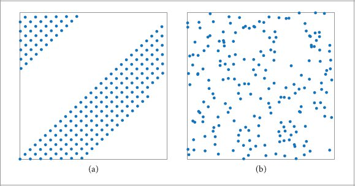

*Figure 8.28: Plot of Halton Sample Values with and without Scrambling. (a) In higher dimensions, projections of sample values start to exhibit regular structure. Here, points from the dimensions (Φ29(a), Φ31(a)) are shown. (b) Scrambled sequences based on Equation (8.20) break up this structure by permuting the digits of sample indices.*

These issues can be addressed using techniques that randomize the points that are generated by these algorithms while still maintaining low discrepancy. A family of such techniques are based on randomizing the digits of each sample coordinate with random permutations. Over all permutations, each coordinate value is then uniformly distributed over [0, 1), unlike as with the original point. These techniques are often referred to as scrambling. Scrambling can be performed by defining a set of permutations πi for each base b, where each digit has a distinct permutation of {0, 1, …, b − 1} associated with it. (In the following, we will consider scrambling a single

dimension of a d-dimensional sample point and thus drop the base b from our notation, leaving it implicit. In practice, all dimensions are independently scrambled.) Given such a set of permutations, we can define the scrambled radical inverse where a corresponding permutation is applied to each digit:

Note that the same permutations πi must be used for generating all the sample points for a given base. There are a few subtleties related to the permutations. First, with the regular radical inverse, computation of a sample dimension’s value can stop once the remaining digits di are 0, as they will have no effect on the final result. With the scrambled radical inverse, the zero digits must continue to be processed. If they are not, then scrambling only corresponds to a permutation of the unscrambled sample values in each dimension, which does not give a uniform distribution over [0, 1). (In practice, it is only necessary to consider enough digits so that any more digits make no difference to the result given the limits of floating-point precision.) Second, it is important that each digit has its own permutation. One way to see why this is important is to consider the trailing 0 digits: if the same permutation is used for all of them, then all scrambled values will have the same digit value repeating infinitely at their end. Once again, [0, 1) would not be sampled uniformly. The choice of permutations can affect the quality of the resulting points. In the following implementation, we will use random permutations. That alone is enough to break up the structure of the points, as shown in Figure 8.28(b). However, carefully constructed deterministic permutations have been shown to reduce error for some integration problems. See the “Further Reading” section for more information. The DigitPermutation utility class manages allocation and initialization of a set of digit permutations for a single base b. 〈DigitPermutation Definition〉 ≡ class DigitPermutation {

public: 〈DigitPermutation Public Methods 482〉 private: 〈DigitPermutation Private Members 482〉 };

All the permutations are stored in a single flat array: the first base elements of it are the permutation for the first digit, the next base elements are the second digit’s permutation, and so forth. The DigitPermutation constructor’s two tasks are to determine how many digits must be handled and then to generate a permutation for each one. 〈DigitPermutation Public Methods〉 ≡ 482

DigitPermutation(int base, uint32_t seed, Allocator alloc) : base(base) { 〈Compute number of digits needed for base 482〉 permutations = alloc.allocate_object<uint16_t>(nDigits * base); 〈Compute random permutations for all digits 483〉 }

To save a bit of storage, unsigned 16-bit integers are used for the digit values. As such, the maximum base allowed is 216. pbrt only supports up to 1,000 dimensions for Halton points, which corresponds to a maximum base of 7,919, the 1,000th prime number, which is comfortably below that limit. 〈DigitPermutation Private Members〉 ≡ 482

int base, nDigits; uint16_t *permutations;

The trailing zero-valued digits must be processed until the digit dm is reached where b−m is small enough that if the product of b−m with the largest digit is subtracted from 1 using floating-point arithmetic, the result is still 1. At this point, no subsequent digits matter, regardless of the permutation. The DigitPermutation constructor performs this check using precisely the same logic as the (soon to be described) ScrambledRadicalInverse() function does, to be sure that they are in agreement about how many digits need to be handled.

〈Compute number of digits needed for base〉 ≡ 482

nDigits = 0; Float invBase = (Float)1 / (Float)base, invBaseM = 1; while (1 - (base - 1) * invBaseM < 1) { ++nDigits; invBaseM *= invBase; }

```text
   Allocator 40
   DigitPermutation 482
   DigitPermutation::base 482
   DigitPermutation::nDigits 482
   DigitPermutation::permutations 482
   Float 23
   ScrambledRadicalInverse() 483
   std::pmr::polymorphic_allocator::allocate_object() 41
```

The permutations are computed using PermutationElement(), which is provided with a different seed for each digit index so that the permutations are independent. 〈Compute random permutations for all digits〉 ≡ 482

for (int digitIndex = 0; digitIndex < nDigits; ++digitIndex) { uint64_t dseed = Hash(base, digitIndex, seed); for (int digitValue = 0; digitValue < base; ++digitValue) { int index = digitIndex * base + digitValue; permutations[index] = PermutationElement(digitValue, base, dseed); } }

The Permute() method takes care of indexing into the permutations array to return the permuted digit value for a given digit index and the unpermuted value of the digit. 〈DigitPermutation Public Methods〉 +≡ 482

int Permute(int digitIndex, int digitValue) const { return permutations[digitIndex * base + digitValue]; }

Finally, the ComputeRadicalInversePermutations() utility function returns a vector of Digit Permutations, one for each base up to the maximum.

〈Low Discrepancy Function Definitions〉 ≡ pstd::vector<DigitPermutation> * ComputeRadicalInversePermutations(uint32_t seed, Allocator alloc) { pstd::vector<DigitPermutation> *perms = alloc.new_object<pstd::vector<DigitPermutation>> (alloc); perms->resize(PrimeTableSize); for (int i = 0; i < PrimeTableSize; ++i) (*perms)[i] = DigitPermutation(Primes[i], seed, alloc); return perms; }

With DigitPermutations available, we can implement the ScrambledRadicalInverse() function. Its structure is generally the same as RadicalInverse(), though here we can see that it uses a different termination criterion, as was discussed with the implementation of Compute number of digits needed for base above.

〈Low Discrepancy Inline Functions〉 +≡ Float ScrambledRadicalInverse(int baseIndex, uint64_t a, const DigitPermutation &perm) { int base = Primes[baseIndex]; Float invBase = (Float)1 / (Float)base, invBaseM = 1; uint64_t reversedDigits = 0; int digitIndex = 0; while (1 - (base - 1) * invBaseM < 1) { 〈Permute least significant digit from a and update reversedDigits 484〉 } return std::min(invBaseM * reversedDigits, OneMinusEpsilon); }

Each digit is handled the same way as in RadicalInverse(), with the only change being that it is permuted using the provided DigitPermutation.

```text
   Allocator 40
   DigitPermutation 482
   DigitPermutation::base 482
   DigitPermutation::nDigits 482
   DigitPermutation::permutations 482
   Float 23
   Hash() 1042
   OneMinusEpsilon 470
   PermutationElement() 1043
   Primes 1032
   PrimeTableSize 1032
   RadicalInverse() 480
   std::pmr::polymorphic_allocator::new_object() 41
```

〈Permute least significant digit from a and update reversedDigits〉 ≡ 483

uint64_t next = a / base; int digitValue = a - next * base; reversedDigits = reversedDigits * base + perm.Permute(digitIndex, digitValue); invBaseM *= invBase; ++digitIndex; a = next;

An even more effective scrambling approach defines digit permutations that not only depend on the index of the current digit i, but that also depend on the values of the previous digits d1d2 … di−1. This approach is known as Owen scrambling, after its inventor. Remarkably, it can be shown that for a class of smooth functions, the integration error with this scrambling technique decreases at a rate which is a substantial improvement over the O(n−1/2) error rate for regular Monte Carlo. The reason for this benefit can be understood in terms of Owen scrambling being more effective at breaking up structure in the sample values while still maintaining their low discrepancy. Its effect is easiest to see when considering the trailing zero digits that are present in all sample values: if they are all permuted with the same permutation at each digit, they will end

up with the same values, which effectively means that there is some structure shared among all the samples. Owen scrambling eliminates this regularity, to the benefit of integration error. (It also benefits the earlier digits in a similar manner, though the connection is less immediately intuitive.) The challenge with Owen scrambling is that it is infeasible to explicitly store all the permutations, as the number of them that are required grows exponentially with the number of digits. In this case, we can once again take advantage of the PermutationElement() function and its capability of permuting without explicitly representing the full permutation. 〈Low Discrepancy Inline Functions〉 +≡ Float OwenScrambledRadicalInverse(int baseIndex, uint64_t a, uint32_t hash) { int base = Primes[baseIndex]; Float invBase = (Float)1 / (Float)base, invBaseM = 1; uint64_t reversedDigits = 0; int digitIndex = 0; while (1 - invBaseM < 1) { 〈Compute Owen-scrambled digit for digitIndex 485〉 } return std::min(invBaseM * reversedDigits, OneMinusEpsilon); }

```text
   DigitPermutation::Permute() 483
   Float 23
   OneMinusEpsilon 470
   PermutationElement() 1043
   Primes 1032
```

The computation for each digit is similar to the two previous radical inverse functions; only the third and fourth lines of code in the following fragment are different. At the third line, the values of the previous digits are available in reversedDigits, so hashing them to get a seed for the random permutation suffices to implement Owen scrambling.9 (Here we have used

MixBits() rather than Hash(), as it takes a 64-bit value (which we have at hand) and is more efficient, which is important here since the hashing operation is performed for each digit.) A call to PermutationElement() then gives the corresponding permuted digit value, which is then processed as before. 〈Compute Owen-scrambled digit for digitIndex〉 ≡ 484

uint64_t next = a / base; int digitValue = a - next * base; uint32_t digitHash = MixBits(hash ^ reversedDigits); digitValue = PermutationElement(digitValue, base, digitHash); reversedDigits = reversedDigits * base + digitValue; invBaseM *= invBase; ++digitIndex; a = next;

### 8.6.3 HALTON SAMPLER IMPLEMENTATION

Given all the capabilities introduced so far in this section, it is not too hard to implement the HaltonSampler, which generates samples using the Halton sequence. 〈HaltonSampler Definition〉 ≡ class HaltonSampler { public: 〈HaltonSampler Public Methods 488〉 private: 〈HaltonSampler Private Methods 488〉 〈HaltonSampler Private Members 486〉 };

For the pixel samples, the HaltonSampler scales the domain of the first two dimensions of the Halton sequence from [0, 1)2 so that it covers an integral number of pixels in each dimension.10 In doing so, it ensures that the pixel samples for adjacent pixels are well distributed with respect to each other. (This is a useful property that the stratified sampler does not guarantee.) Its constructor takes the full image resolution, even if only a subwindow of it is being rendered. This allows it to always produce the

same sample values at each pixel, regardless of whether only some of the pixels are being rendered. This is another place where we have tried to ensure that the renderer’s operation is deterministic: rendering a small crop window of an image when debugging does not affect the sample values generated at those pixels if the HaltonSampler is being used. 〈HaltonSampler Method Definitions〉 ≡ HaltonSampler::HaltonSampler(int samplesPerPixel, Point2i fullRes, RandomizeStrategy randomize, int seed, Allocator alloc) : samplesPerPixel(samplesPerPixel), randomize(randomize) { if (randomize == RandomizeStrategy::PermuteDigits) digitPermutations = ComputeRadicalInversePermutations(seed, alloc); 〈Find radical inverse base scales and exponents that cover sampling area 487〉 〈Compute multiplicative inverses for baseScales〉 }

```text
   Allocator 40
   ComputeRadicalInverse Permutations() 483
   HaltonSampler 485
   HaltonSampler::digitPermutations 486
   HaltonSampler::randomize 486
   HaltonSampler::samplesPerPixel 486
   MixBits() 1042
   PermutationElement() 1043
   Point2i 92
   RandomizeStrategy 486
   RandomizeStrategy::PermuteDigits 486
```

HaltonSampler Private Members〉 ≡ 485

```rust
   int samplesPerPixel;
   RandomizeStrategy randomize;
   pstd::vector<DigitPermutation> *digitPermutations = nullptr;
```

For this and the following samplers that allow the user to select a randomization strategy, it will be helpful to have an enumeration that encodes them. (Note that the FastOwen option is not supported by the HaltonSampler.) 〈RandomizeStrategy Definition〉 ≡ enum class RandomizeStrategy { None, PermuteDigits, FastOwen, Owen }; Some sample generation approaches are naturally pixel-based and fit in easily to the Sampler interface as it has been presented so far. For example, the StratifiedSampler can easily start generating samples in a new pixel after its StartPixelSample() method has been called—it just needs to set RNG state so that it is consistent over all the samples in the pixel.

Others, like the HaltonSampler, naturally generate consecutive samples that are spread across the entire image, visiting completely different pixels if the samples are generated in succession. (Many such samplers are effectively placing each additional sample such that it fills the largest hole in the n-dimensional sample space, which leads to subsequent samples being inside different pixels.) These sampling algorithms are somewhat problematic with the Sampler interface as described so far: the StartPixelSample() method must be able to set the sampler’s state so that it is able to generate samples for any requested pixel. Table 8.3 illustrates the issue for Halton samples. The second column shows 2D Halton sample values in [0, 1)2, which are then multiplied by the image resolution in each dimension to get sample positions in the image plane (here we are considering a 2 × 3 image for simplicity). Note that here, each pixel is visited by each sixth sample. If we are rendering an image with three samples per pixel, then to generate all the samples for the pixel (0, 0), we need to generate the samples with indices 0, 6, and 12. Table 8.3: The HaltonSampler generates the coordinates in the middle column for the first two dimensions, which are scaled by 2 in the first dimension and 3 in the second dimension so that they cover a 2 × 3 pixel image. To fulfill the Sampler interface, it is necessary to be able to work backward from a given pixel and sample number within that pixel to find the corresponding sample index in the full Halton sequence.

Sample index [0, 1)2 sample coordinates Pixel sample coordinates (0.000000, 0.000000) (0.000000, 0.000000) 0

1 (0.500000, 0.333333) (1.000000, 1.000000)

2 (0.250000, 0.666667) (0.500000, 2.000000)

3 (0.750000, 0.111111) (1.500000, 0.333333)

4 (0.125000, 0.444444) (0.250000, 1.333333)

5 (0.625000, 0.777778) (1.250000, 2.333333)

6 (0.375000, 0.222222) (0.750000, 0.666667)

7 (0.875000, 0.555556) (1.750000, 1.666667)

8 (0.062500, 0.888889) (0.125000, 2.666667)

9 (0.562500, 0.037037) (1.125000, 0.111111)

10 (0.312500, 0.370370) (0.625000, 1.111111)

11 (0.812500, 0.703704) (1.625000, 2.111111)

12 (0.187500, 0.148148) (0.375000, 0.444444)

⋮

```text
   DigitPermutation 482
   HaltonSampler 485
   RandomizeStrategy 486
   Sampler::StartPixelSample() 469
   StratifiedSampler 474
```

To map the first two dimensions of samples from [0, 1)2 to pixel coordinates, the Halton Sampler finds the smallest scale factor (2j, 3k) that is larger than the lower of either the image resolution or MaxHaltonResolution in each dimension. (We will explain shortly how this specific choice of scales makes it easy to see which pixel a sample lands in.) After scaling, any samples outside the image extent will be simply ignored. For images with resolution greater than MaxHaltonResolution in one or both dimensions, a tile of Halton points is repeated across the image. This resolution limit helps maintain sufficient floating-point precision in the computed sample values. 〈Find radical inverse base scales and exponents that cover sampling area〉 ≡ 485

for (int i = 0; i < 2; ++i) { int base = (i == 0) ? 2 : 3; int scale = 1, exp = 0; while (scale < std::min(fullRes[i], MaxHaltonResolution)) { scale *= base; ++exp; } baseScales[i] = scale; baseExponents[i] = exp; }

For each dimension, baseScales holds the scale factor, 2j or 3k, and baseExponents holds the exponents j and k. 〈HaltonSampler Private Members〉 +≡ 485

static constexpr int MaxHaltonResolution = 128; Point2i baseScales, baseExponents;

To see why the HaltonSampler uses this scheme to map samples to pixel coordinates, consider the effect of scaling a value computed with the radical inverse base b by a factor bm. If the digits of a expressed in base b are di(a), then recall that the radical inverse is the value 0.d1(a)d2(a) … in base b. If we multiply this value by b2, for example, we have d1(a)d2(a).d3(a) …; the first two digits have moved to the left of the radix point, and the fractional component of the value starts with d3(a).

This operation—scaling by bm—forms the core of being able to determine which sample indices land in which pixels. Considering the first two digits in the above example, we can see that the integer component of the scaled value ranges from 0 to b2 − 1and that as a increases, its last two digits in base b take on any particular value after each b2 sample index values.

Given a value x, 0 ≤ x ≤ b2 − 1, we can find the first value a that gives the value x in the integer components. By definition, the digits of x in base b are d2(x)d1(x). Thus, if d1(a) = d2(x) and d2(a) = d1(x), then the scaled value of a’s radical inverse will have an integer component equal to x. Computing the index of the first sample in a given pixel (x, y) where the samples have been scaled by (2j, 3k) involves computing the inverse radical inverse of the last j digits of x in base 2, which we will denote by xr, and of the last k digits of y in base 3, yr. This gives us a system of equations

where the index i that satisfies these equations is the index of a sample that lies within the given pixel, after scaling.

```text
   HaltonSampler:: MaxHaltonResolution 487
   Point2i 92
```

Given this insight, we can now finally implement the StartPixelSample() method. The code that solves Equation (8.21) for i is in the 〈Compute Halton sample index for first sample in pixel p〉, which is not included here in the book; see Grünschloß et al. (2012) for details of the algorithm.

Given the index into the Halton sequence that corresponds to the first sample for the pixel, we need to find the index for the requested sample, sampleIndex. Because the bases b = 2 and b = 3 used in the HaltonSampler for pixel samples are relatively prime, it follows that if the sample values are scaled by some (2j, 3k), then any particular pixel in the range (0, 0) → (2j − 1, 3k − 1) will be visited once every 2j3k samples. That product is stored in sampleStride and the final Halton index is found by adding the product of that and the current sampleIndex. 〈HaltonSampler Public Methods〉 ≡ 485

void StartPixelSample(Point2i p, int sampleIndex, int dim) { haltonIndex = 0; int sampleStride = baseScales[0] * baseScales[1]; 〈Compute Halton sample index for first sample in pixel p〉 haltonIndex += sampleIndex * sampleStride; dimension = std::max(2, dim); }

〈HaltonSampler Private Members〉 +≡ 485

int64_t haltonIndex = 0; int dimension = 0;

The methods that generate Halton sample dimensions are straightforward; they just increment the dimension member variable based on how many dimensions they have consumed and call the appropriate radical inverse function. In the unlikely case that the maximum supported number of dimensions have been used, the implementation wraps around to the start and then skips over the first two dimensions, which are used solely for pixel samples. 〈HaltonSampler Public Methods〉 +≡ 485

Float Get1D() { if (dimension >= PrimeTableSize) dimension = 2; return SampleDimension(dimension++); }

The SampleDimension() method takes care of calling the appropriate radical inverse function for the current sample in the current dimension according to the selected randomization strategy.

〈HaltonSampler Private Methods〉 ≡ 485

Float SampleDimension(int dimension) const { if (randomize == RandomizeStrategy::None) return RadicalInverse(dimension, haltonIndex); else if (randomize == RandomizeStrategy::PermuteDigits) return ScrambledRadicalInverse(dimension, haltonIndex, (*digitPermutations)[dimension]); else return OwenScrambledRadicalInverse(dimension, haltonIndex, MixBits(1 + (dimension << 4))); }

```text
   Float 23
   HaltonSampler::baseScales 487
   HaltonSampler::digitPermutations 486
   HaltonSampler::dimension 488
   HaltonSampler::haltonIndex 488
   HaltonSampler::randomize 486
   HaltonSampler::SampleDimension() 488
   MixBits() 1042
   OwenScrambledRadicalInverse() 484
   Point2i 92
   PrimeTableSize 1032
   RadicalInverse() 480
   RandomizeStrategy::None 486
   RandomizeStrategy::PermuteDigits 486
   ScrambledRadicalInverse() 483
```

The Get2D() method is easily implemented using SampleDimension(). 〈HaltonSampler Public Methods〉 +≡ 485

Point2f Get2D() { if (dimension + 1 >= PrimeTableSize) dimension = 2; int dim = dimension; dimension += 2; return {SampleDimension(dim), SampleDimension(dim + 1)}; }

GetPixel2D() has to account for two important details in the rest of the HaltonSampler implementation. First, because the computation of the sample index, haltonIndex, in StartPixel Sample() does not account

for random digit permutations, those must not be included in the samples returned for the first two dimensions: a call to RadicalInverse() is always used here. Second, because the first baseExponents[i] digits of the first two dimensions’ radical inverses are used to select which pixel is sampled, these digits must be discarded before computing the radical inverse for the first two dimensions of the sample, since the GetPixel2D() method is supposed to return the fractional offset in [0, 1)2 within the pixel being sampled. This is most easily done by removing the trailing digits of the sample index before computing the radical inverse. Because the first dimension is base 2, this can efficiently be done using a shift, though a divide is necessary for base 3 in the second dimension. 〈HaltonSampler Public Methods〉 +≡ 485

Point2f GetPixel2D() { return {RadicalInverse(0, haltonIndex >> baseExponents[0]), RadicalInverse(1, haltonIndex / baseScales[1])}; }

### 8.6.4 EVALUATION

*Figure 8.29 shows plots of the power spectra for the HaltonSampler with each of the three randomization strategies. The frequency space perspective is revealing. First, note that all three strategies have low energy along the two axes: this indicates that they all do well with functions that mostly vary in only one dimension. This behavior can be understood from their construction: because each dimension uses an independent radical inverse, 1D projections of the sample points are stratified. (Consider in comparison the jittered sampling pattern’s PSD, which had a radially symmetric distribution around the origin. Given n 2D stratified samples, only are guaranteed to be stratified along either of the dimensions, whereas with the Halton sampler, all n are.) HaltonSampler 485 HaltonSampler::baseExponents 487 HaltonSampler::baseScales 487 HaltonSampler::dimension 488*

HaltonSampler::haltonIndex 488 HaltonSampler::SampleDimension() 488 Point2f 92 PrimeTableSize 1032 RadicalInverse() 480 However, the non-randomized Halton sampler has wide variation in its PSD at higher frequencies. Ideally, those frequencies would all have roughly unit energy, but in this case, some frequencies have over a hundred times more and others a hundred times less. Results will be poor if the frequencies of the function match the ones with high power in the PSD. This issue can be seen in rendered images; Figure 8.30 compares the visual results from sampling a checkerboard texture using a Halton-based sampler to using the stratified sampler from the previous section. Note the unpleasant pattern along edges in the foreground and toward the horizon. Returning to the power spectra in Figure 8.29, we can see that random digit permutations give a substantial improvement in the power spectrum, though there is still clear structure, with some frequencies having very low power and others still having high power. The benefit of Owen scrambling in this case is striking: it gives a uniform power spectrum at higher frequencies while maintaining low power along the axes.

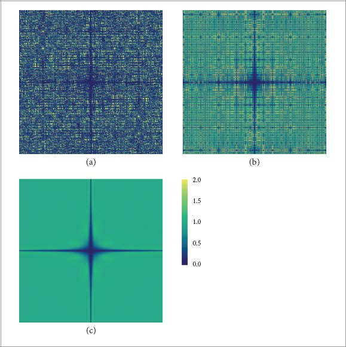

*Figure 8.29: Power Spectra of Points Generated by the HaltonSampler. (a) Using no randomization, with substantial variation in power at the higher frequencies. (b) Using random digit scrambling, which improves the regularity of the PSD but still contains some spikes. (c) Using Owen scrambling, which gives near unit power at the higher frequencies, making it especially effective for antialiasing and integration.*

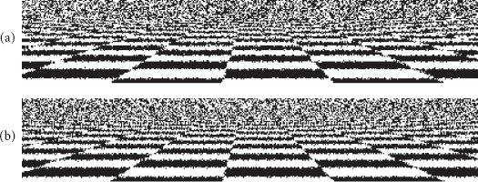

*Figure 8.30: Comparison of the Stratified Sampler to a Low-Discrepancy Sampler Based on Halton Points on the Image Plane. (a) The stratified sampler with a single sample per pixel and (b) the Halton sampler with a single sample per pixel and no scrambling. Note that although the Halton pattern is able to reproduce the checker pattern farther toward the horizon than the stratified pattern, there is a regular structure to the error that is visually distracting; it does not turn aliasing into less objectionable noise as well as jittering does.*

HaltonSampler 485

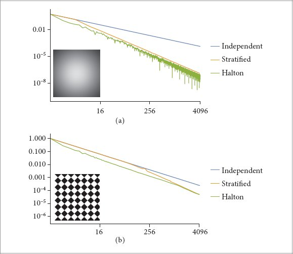

*Figure 8.31: Mean Squared Error When Integrating Two Simple 2D Functions. Both are plotted using a log–log scale so that the asymptotic convergence rate can be seen from the slopes of the lines. For the stratified sampler, only square n × n stratifications are plotted. (a) With the smooth Gaussian function shown, the Halton sampler has a higher asymptotic rate of convergence than both stratified and independent sampling. Its performance is particularly good for sample counts of 2i3i for integer i. (b) With the rotated checkerboard, stratified sampling is initially no better than independent sampling since the strata are not aligned with the checks. However, once the strata start to become smaller than the checks (around 256 samples), its asymptotic rate of convergence improves.*

It can also be illuminating to measure the performance of samplers with simple functions that can be integrated analytically.11 Figure 8.31 shows plots of mean squared error (MSE) for using the independent, stratified, and Halton samplers for integrating a Gaussian and a checkerboard function (shown in the plots). In this case, using a log–log scale has the effect of causing convergence rates of the form O(nc) to appear as lines with slope c, which makes it easier to compare asymptotic convergence of various

techniques. For both functions, both stratified and Halton sampling have a higher rate of convergence than the O(1/n) of independent sampling, as can be seen by the steeper slopes of their error curves. The Halton sampler does especially well with the Gaussian, achieving nearly two thousand times lower MSE than independent sampling at 4,096 samples.

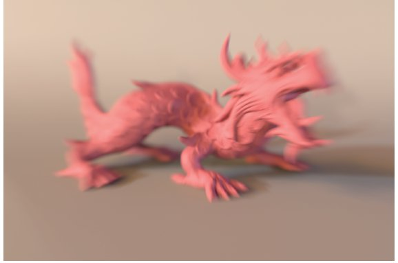

*Figure 8.32: Test Scene for Sampler Evaluation. This scene requires integrating a function of tens of dimensions, including defocus blur, a moving camera, and multiply scattered illumination from an environment map light source. (Dragon model courtesy of the Stanford Computer Graphics Laboratory.)*

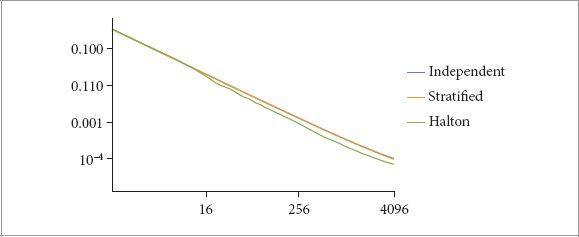

*Figure 8.33: Log–Log Plot of MSE versus Number of Samples for the Scene in Figure 8.32. The Halton sampler gives consistently lower error than both the independent and stratified samplers and converges at a slightly higher rate.*

*Figure 8.32 shows the image of a test scene that we will use for comparing samplers. It features a moving camera, defocus blur, illumination from an environment map light source, and multiply scattered light from sources to give an integral with tens of dimensions. Figure 8.33 is a log–log plot of MSE versus number of samples for these samplers with this scene. With a more complex integrand than the simple ones in Figure 8.31, the Halton sampler does not have the enormous benefit it did there. Nevertheless, it makes a significant improvement to error—for example, MSE is 1.09× lower than independent sampling at 4,096 samples per pixel.*

⋆ 8.7 SOBOL′ SAMPLERS While the Halton sequence is effective for Monte Carlo integration, each radical inverse computation requires one integer division for each digit. The integer division instruction is one of the slowest ones on most processors, which can affect overall rendering performance, especially in highly optimized renderers. Therefore, in this section we will describe three Samplers that are based on the Sobol′ sequence, a low-discrepancy sequence that is defined entirely in base 2, which leads to efficient implementations.

The base-2 radical inverse can be computed more efficiently than the way that the base-agnostic RadicalInverse() function computes it. The key is to take advantage of the fact that numbers are already represented in base 2 on digital computers. If a is a 64-bit value, then from Equation (8.18),

where di(a) are its bits. First, consider reversing its bits, still represented as an integer value, which

gives If we then divide this value by 264, we have

which equals Φ2(a) (recall Equation (8.19)). Thus, the base-2 radical inverse can equivalently be computed using a bit reverse and a power-of-two division. The division can be replaced with multiplication by the corresponding inverse power-of-two, which gives the same result with IEEE floating point. Some processors provide a native instruction that directly reverses the bits in a register; otherwise it can be done in O(log2 n) operations, where n is the number of bits. (See the implementation of ReverseBits32() in Section B.2.7.) While the implementation of a function that generates Halton points could be optimized by taking advantage of this for the first dimension where b = 2, performance would not improve for any of the remaining dimensions, so the overall benefit would be low. The Sobol′ sequence uses b = 2 for all dimensions, which allows it to benefit in all cases from computers’ use of base 2 internally. So that each dimension has a different set of sample values, it uses a different generator matrix for each dimension, where the generator matrices are carefully chosen so that the resulting sequence has low discrepancy.

To see how generator matrices are used, consider an n-digit number a in base b, where the ith digit of a is di(a) and where we have an n × n generator matrix C. Then the corresponding sample point xa ∊

[0, 1) is defined by

```text
    RadicalInverse() 480
    ReverseBits32() 1040
```

where all arithmetic is performed in the ring ℤb (in other words, when all operations are performed modulo b). This construction gives a total of bn points as a ranges from 0 to bn − 1. If the generator matrix is the identity matrix, then this definition corresponds to the regular radical inverse, base b. (It is worth pausing to make sure you see this connection between Equations (8.19) and (8.22) before continuing.) In this section, we will exclusively use b = 2 and n = 32. While introducing a 32 × 32 matrix to each dimension of the sample generation algorithm may not seem like a step toward better performance, we will see that in the end the sampling code can be mapped to an implementation that uses a small number of bit operations that perform this computation in an extremely efficient manner.

The first step toward high performance comes from the fact that we are working in base 2; as such, all entries of C are either 0 or 1 and thus we can represent either each row or each column of the matrix with a single unsigned 32-bit integer. We will choose to represent columns of the matrix as uint32_ts; this choice leads to an efficient algorithm for multiplying the di column vector by C.

Now consider the task of computing the C[di(a)]T matrix-vector product; using the definition of matrix-vector multiplication, we have:

In other words, for each digit of di that has a value of 1, the corresponding column of C should be summed. This addition can in turn be performed efficiently in ℤ2: in that setting, addition corresponds to the bitwise exclusive OR operation. (Consider the combinations of the two possible operand values—0 and 1—and the result of adding them mod 2, and compare to the values computed by exclusive OR with the same operand values.) Thus, the multiplication C[di(a)]T is just a matter of exclusive ORing together the columns i of C where di(a)’s bit is 1. This computation is implemented in the MultiplyGenerator() function.

〈Low Discrepancy Inline Functions〉 +≡ uint32_t MultiplyGenerator(pstd::span<const uint32_t> C, uint32_t a) { uint32_t v = 0; for (int i = 0; a != 0; ++i, a >>= 1) if (a & 1) v ^= C[i];

```rust
        return v;
   }
```

Going back to Equation (8.22), if we denote the column vector from the product v = C[di(a)]T, then

consider the vector product Applying the same ideas as we did before to derive an efficient base-2 radical inverse algorithm, this value can also be computed by reversing the bits of v and dividing by 232. To save the small cost of reversing the bits, we can equivalently reverse the bits in all the columns of the generator matrix before passing it to MultiplyGenerator(). We will use that convention in what follows.

```text
    MultiplyGenerator() 494
```

We will not discuss how the Sobol′ matrices are derived in a way that leads to a low-discrepancy sequence; the “Further Reading” section has pointers to more details. However, the first few Sobol′ generator matrices are shown in Figure 8.34. Note that the first is the identity, corresponding to the van der Corput sequence. Subsequent dimensions have various fractal-like structures to their entries.

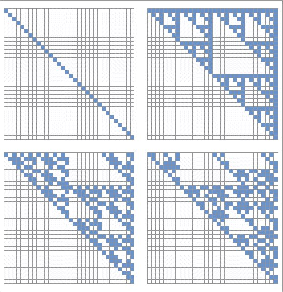

*Figure 8.34: Generator matrices for the first four dimensions of the Sobol′ sequence. Note their regular structure.*

### 8.7.1 STRATIFICATION OVER ELEMENTARY INTERVALS

The first two dimensions of the Sobol′ sequence are stratified in a very general way that makes them particularly effective in integration. For example, the first 16 samples satisfy the stratification constraint from stratified sampling in Section 8.5, meaning there is just one sample in each of the boxes of extent ( , ). However, they are also stratified over all the boxes of extent ( , 1) and (1, ). Furthermore, there is only one sample in each of the boxes of extent ( , ) and ( , ). Figure 8.35

shows all the possibilities for dividing the domain into regions where the first 16 Sobol′ samples satisfy these stratification properties.

Not only are corresponding stratification constraints obeyed by any power-of-2 set of samples starting from the beginning of the sequence, but subsequent power-of-2-sized sets of samples fulfill them as well. More formally, any sequence of length (where li is a non-negative integer) satisfies this general stratification constraint. The set of elementary intervals in two dimensions, base 2, is defined as

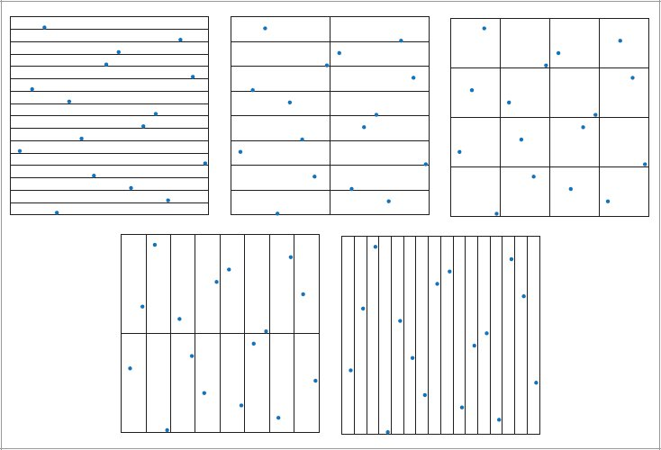

*Figure 8.35: A sampling pattern that has a single sample in all the base-2 elementary intervals.*

where the integer . One sample from each of the first values in the sequence will be in each of the elementary intervals. Furthermore, the same property is true for each subsequent set of values. Such a sequence is called a (0, 2)-sequence.

### 8.7.2 RANDOMIZATION AND SCRAMBLING

For the same reasons as were discussed in Section 8.6.2 in the context of the Halton sequence, it is also useful to be able to scramble the Sobol′ sequence. We will now define a few small classes that scramble a given sample value using various approaches. As with the generation of Sobol′ samples, scrambling algorithms for them can also take advantage of their base-2 representation to improve their efficiency.

All the following randomization classes take an unsigned 32-bit integer that they should interpret as a fixed-point number with 0 digits before and 32 digits after the radix point. Put another way, after randomization, this value will be divided by 232 to yield the final sample value in [0, 1).

The simplest approach is not to randomize the sample at all. In that case, the value is returned unchanged; this is implemented by NoRandomizer.

〈NoRandomizer Definition〉 ≡ struct NoRandomizer { uint32_t operator()(uint32_t v) const { return v; } };

Alternatively, random permutations can be applied to the digits, such as was done using the DigitPermutation class with the Halton sampler. In base 2, however, a random permutation of {0, 1} can be represented with a single bit, as there are only two unique permutations. If the permutation {1, 0} is denoted by a bit with value 1 and the permutation {0, 1} is denoted by 0, then the permutation can be applied by computing the exclusive OR of the permutation bit with a digit’s bit. Therefore, the permutation for all 32 bits can be represented by a 32-bit integer and all of the permutations can be applied in a single operation by computing the exclusive OR of the provided value with the permutation.

〈BinaryPermuteScrambler Definition〉 ≡ struct BinaryPermuteScrambler { BinaryPermuteScrambler(uint32_t perm) : permutation(perm) {} uint32_t operator()(uint32_t v) const { return permutation ^ v; } uint32_t permutation; };

Owen scrambling is also effective with Sobol′ points. pbrt provides two implementations of it, both of which take advantage of their base-2 representation. FastOwenScrambler implements a highly efficient approach, though the spectral properties of the resulting points are not quite as good as a true Owen scramble.

〈FastOwenScrambler Definition〉 ≡ struct FastOwenScrambler { FastOwenScrambler(uint32_t seed) : seed(seed) {} 〈FastOwenScrambler Public Methods 498〉 uint32_t seed; };

Its implementation builds on the fact that in base 2, if a number is multiplied by an even value, then the value of any particular bit in it only affects the bits above it in the result. Equivalently, for any bit in the result, it is only affected by the bits below it and the even multiplicand. One way to see why this is so is to consider long multiplication (as taught in grade school) applied to binary numbers. Given two n-digit binary numbers a and b where di(b) is the ith digit of b, then using Equation (8.18), we have

Thus, for any digit i > 1 where di(b) is one, the value of a is shifted i − 1 bits to the left and added to the final result and so any digit of the result only depends on lower digits of a.

The bits in the value provided to the randomization class must be reversed so that the low bit corresponds to 1/2 in the final sample value. Then, the properties illustrated in Equation (8.25) can be applied: the product of an even value with the sample value v can be interpreted as a bitwise permutation as was done in the BinaryPermuteScrambler, allowing the use of an exclusive OR to permute all the bits. After a few rounds of this and a few operations to mix the seed value in, the bits are reversed again before being returned.

```text
    BinaryPermuteScrambler 497
    BinaryPermuteScrambler::permutation 497
    DigitPermutation 482
    FastOwenScrambler 497
```

〈FastOwenScrambler Public Methods〉 ≡ 497

```rust
   uint32_t operator()(uint32_t v) const {
       v = ReverseBits32(v);
       v ^= v * 0x3d20adea;
       v += seed;
       v *= (seed >> 16) | 1;
       v ^= v * 0x05526c56;
       v ^= v * 0x53a22864;
       return ReverseBits32(v);
   }
```

The OwenScrambler class implements a full Owen scramble, operating on each bit in turn.

〈OwenScrambler Definition〉 ≡ struct OwenScrambler { OwenScrambler(uint32_t seed) : seed(seed) {} 〈OwenScrambler Public Methods 498〉 uint32_t seed; };

The first bit (corresponding to 1/2 in the final sample value) is handled specially, since there are no bits that precede it to affect its randomization. It is randomly flipped according to the seed value provided to the constructor.

〈OwenScrambler Public Methods〉 ≡ 498

uint32_t operator()(uint32_t v) const { if (seed & 1) v ^= 1u << 31; for (int b = 1; b < 32; ++b) { 〈Apply Owen scrambling to binary digit b in v 498〉 } return v; }

For all the following bits, a bit mask is computed such that the bitwise AND of the mask with the value gives the bits above b—the values of which should determine the permutation that is used for the current bit. Those are run through MixBits() to get a hashed value that is then used to determine whether or not to flip the current bit.

〈Apply Owen scrambling to binary digit b in v〉 ≡ 498

```rust
   uint32_t mask = (~0u) << (32 - b);
   if ((uint32_t)MixBits((v & mask) ^ seed) & (1u << b))
        v ^= 1u << (31 - b);
```

### 8.7.3 SOBOL′ SAMPLE GENERATION

We now have the pieces needed to implement functions that generate Sobol′ samples. The SobolSample() function performs this task for a given sample index a and dimension, applying the provided randomizer to the sample before returning it.

Because this function is templated on the type of the randomizer, a specialized instance of it will be compiled using the provided randomizer, leading to the randomization algorithm being expanded inline in the function. For pbrt’s purposes, there is no need for a more general mechanism for sample randomization, so the small performance benefit is worth taking in this implementation approach.

```text
    FastOwenScrambler::seed 497
    MixBits() 1042
    OwenScrambler 498
    OwenScrambler::seed 498
    ReverseBits32() 1040
```

```rust
    〈Low Discrepancy Inline Functions〉 +≡
        template <typename R>
```

```rust
        Float SobolSample(int64_t a, int dimension, R randomizer) {
             〈Compute initial Sobol′ sample v using generator matrices 499〉
              〈Randomize Sobol′ sample and return floating-point value 499〉
        }
```

Samples are computed using the Sobol′ generator matrices, following the approach described by Equation (8.23). All the generator matrices are stored consecutively in the Sobol Matrices32 array. Each one has SobolMatrixSize columns, so scaling the dimension by SobolMatrixSize brings us to the first column of the matrix for the given dimension.

〈Compute initial Sobol′ sample v using generator matrices〉 ≡

```rust
   uint32_t v = 0;
   for (int i = dimension * SobolMatrixSize; a != 0; a >>= 1, i++)
       if (a & 1)
           v ^= SobolMatrices32[i];
```

〈Sobol Matrix Declarations〉 ≡ static constexpr int NSobolDimensions = 1024; static constexpr int SobolMatrixSize = 52; PBRT_CONST uint32_t SobolMatrices32[NSobolDimensions * SobolMatrixSize];

The value is then randomized with the given randomizer before being rescaled to [0, 1). (The constant 0x1p-32 is 2−32, expressed as a hexadecimal floating-point number.)

〈Randomize Sobol′ sample and return floating-point value〉 ≡

```rust
   v = randomizer(v);
   return std::min(v * 0x1p-32f, FloatOneMinusEpsilon);
```

### 8.7.4 GLOBAL SOBOL′ SAMPLER

The SobolSampler generates samples by direct evaluation of the d-dimensional Sobol′ sequence. Like the HaltonSampler, it scales the first two dimensions of the sequence to cover a range of image pixels. Thus, in a similar fashion, nearby pixels have well-distributed ddimensional sample points not just individually but also with respect to nearby pixels.

〈SobolSampler Definition〉 ≡ class SobolSampler { public: 〈SobolSampler Public Methods 500〉 private: 〈SobolSampler Private Methods 501〉

```rust
        〈SobolSampler Private Members 500〉
   };
```

The SobolSampler uniformly scales the first two dimensions by the smallest power of 2 that causes the [0, 1)2 sample domain to cover the image area to be sampled. As with the HaltonSampler, this specific scaling scheme is chosen in order to make it easier to compute the reverse mapping from pixel coordinates to the sample indices that land in each pixel.

```text
    Float 23
    FloatOneMinusEpsilon 470
    HaltonSampler 485
    NSobolDimensions 499
    PBRT_CONST 929
    SobolMatrices32 499
    SobolMatrixSize 499
```

〈SobolSampler Public Methods〉 ≡ 499

```rust
   SobolSampler(int samplesPerPixel, Point2i fullResolution,
                  RandomizeStrategy randomize, int seed = 0)
        : samplesPerPixel(samplesPerPixel), seed(seed), randomize(randomize) {
        scale = RoundUpPow2(std::max(fullResolution.x, fullResolution.y));
   }
```

All four of the randomization approaches from Section 8.7.2 are supported by the Sobol Sampler; randomize encodes which one to apply.

〈SobolSampler Private Members〉 ≡ 499

```rust
   int samplesPerPixel, scale, seed;
   RandomizeStrategy randomize;
```

The sampler needs to record the current pixel for use in its GetPixel2D() method and, like other samplers, tracks the current dimension in its dimension member variable.

〈SobolSampler Public Methods〉 +≡ 499

```rust
   void StartPixelSample(Point2i p, int sampleIndex, int dim) {
        pixel = p;
        dimension = std::max(2, dim);
        sobolIndex = SobolIntervalToIndex(Log2Int(scale), sampleIndex, pixel);
   }
```

〈SobolSampler Private Members〉 +≡ 499

```rust
   Point2i pixel;
```

```rust
    int dimension;
    int64_t sobolIndex;
```

The SobolIntervalToIndex() function returns the index of the sampleIndexth sample in the pixel p, if the [0, 1)2 sampling domain has been scaled by 2log2Scale to cover the pixel sampling area.

〈Low Discrepancy Declarations〉 ≡ uint64_t SobolIntervalToIndex(uint32_t log2Scale, uint64_t sampleIndex, Point2i p);

The general approach used to derive the algorithm it implements is similar to that used by the Halton sampler in its StartPixelSample() method. Here, scaling by a power of two means that the base-2 logarithm of the scale gives the number of digits of the C[di(a)]T product that form the scaled sample’s integer component. To find the values of a that give a particular integer value after scaling, we can compute the inverse of C: given

then equivalently

We will not include the implementation of this function here.

Sample generation is now straightforward. There is the usual management of the dimension value, again with the first two dimensions reserved for the pixel sample, and then a call to SampleDimension() gives the sample for a single Sobol′ dimension.

```text
    Point2i 92
    RandomizeStrategy 486
    RoundUpPow2() 1039
    SobolIntervalToIndex() 500
    SobolSampler 499
    SobolSampler::dimension 500
    SobolSampler::pixel 500
    SobolSampler::randomize 500
    SobolSampler::samplesPerPixel 500
    SobolSampler::scale 500
    SobolSampler::seed 500
    SobolSampler::sobolIndex 500
```

〈SobolSampler Public Methods〉 +≡ 499

```rust
   Float Get1D() {
        if (dimension >= NSobolDimensions)
            dimension = 2;
        return SampleDimension(dimension++);
   }
```

The SampleDimension() method takes care of calling SobolSample() for the current sample index and specified dimension using the appropriate randomizer.

〈SobolSampler Private Methods〉 ≡ 499

```rust
   Float SampleDimension(int dimension) const {
        〈Return un-randomized Sobol′ sample if appropriate〉
         〈Return randomized Sobol′ sample using randomize 501〉
   }
```

〈Return un-randomized Sobol′ sample if appropriate〉 ≡ if (randomize == RandomizeStrategy::None) return SobolSample(sobolIndex, dimension, NoRandomizer());

If a randomizer is being used, a seed value must be computed for it. Note that the hash value passed to each randomizer is based solely on the current dimension and user-provided seed, if any. It must not be based on the current pixel or the current sample index within the pixel, since the same randomization should be used at all the pixels and all the samples within them.

〈Return randomized Sobol′ sample using randomize〉 ≡

```rust
   uint32_t hash = Hash(dimension, seed);
   if (randomize == RandomizeStrategy::PermuteDigits)
        return                     SobolSample(sobolIndex,           dimension,
        BinaryPermuteScrambler(hash));
   else if (randomize == RandomizeStrategy::FastOwen)
        return SobolSample(sobolIndex, dimension, FastOwenScrambler(hash));
```

```rust
   else
          return SobolSample(sobolIndex, dimension, OwenScrambler(hash));
```

2D sample generation is easily implemented using SampleDimension(). If all sample dimensions have been consumed, Get2D() goes back to the start and skips the first two dimensions, as was done in the HaltonSampler.

〈SobolSampler Public Methods〉 +≡ 499

```rust
   Point2f Get2D() {
        if (dimension + 1 >= NSobolDimensions)
            dimension = 2;
        Point2f u(SampleDimension(dimension), SampleDimension(dimension + 1));
        dimension += 2;
        return u;
   }
```

```text
    BinaryPermuteScrambler 497
    FastOwenScrambler 497
    Float 23
    Hash() 1042
    NoRandomizer 497
    NSobolDimensions 499
    OwenScrambler 498
    Point2f 92
    RandomizeStrategy::FastOwen 486
    RandomizeStrategy::None 486
    RandomizeStrategy::PermuteDigits 486
    SobolIntervalToIndex() 500
    SobolSample() 499
    SobolSampler::dimension 500
    SobolSampler::randomize 500
    SobolSampler::SampleDimension() 501
    SobolSampler::seed 500
    SobolSampler::sobolIndex 500
```

Pixel samples are generated using the first two dimensions of the Sobol′ sample. Sobol IntervalToIndex() does not account for randomization, so the NoRandomizer is always used for the pixel sample, regardless of the value of randomize.

〈SobolSampler Public Methods〉 +≡ 499

```rust
   Point2f GetPixel2D() {
        Point2f u(SobolSample(sobolIndex, 0, NoRandomizer()),
```

```rust
                    SobolSample(sobolIndex, 1, NoRandomizer()));
         〈Remap Sobol′ dimensions used for pixel samples 502〉
         return u;
    }
```

The samples returned for the pixel position need to be adjusted so that they are offsets within the current pixel. Similar to what was done in the HaltonSampler, the sample value is scaled so that the pixel coordinates are in the integer component of the result. The remaining fractional component gives the offset within the pixel that the sampler returns.

〈Remap Sobol′ dimensions used for pixel samples〉 ≡

```rust
   for (int dim = 0; dim < 2; ++dim)
       u[dim] = Clamp(u[dim] * scale - pixel[dim], 0, OneMinusEpsilon);
```

### 8.7.5 PADDED SOBOL′ SAMPLER

The SobolSampler generates sample points that have low discrepancy over all of their d dimensions. However, the distribution of samples in two-dimensional slices of the d-dimensional space is not necessarily particularly good. Figure 8.36 shows an example.

For rendering, this state of affairs means that, for example, the samples taken over the surface of a light source at a given pixel may not be well distributed. It is of only slight solace to know that the full set of d-dimensional samples are well distributed in return. Figure 8.37 shows this problem in practice with the SobolSampler: 2D projections of the form shown in Figure 8.36 end up generating a characteristic checkerboard pattern in the image at low sampling rates.

```text
    Clamp() 1033
    HaltonSampler 485
    NoRandomizer 497
    OneMinusEpsilon 470
    Point2f 92
    SobolSample() 499
    SobolSampler 499
    SobolSampler::pixel 500
    SobolSampler::scale 500
    SobolSampler::sobolIndex 500
```

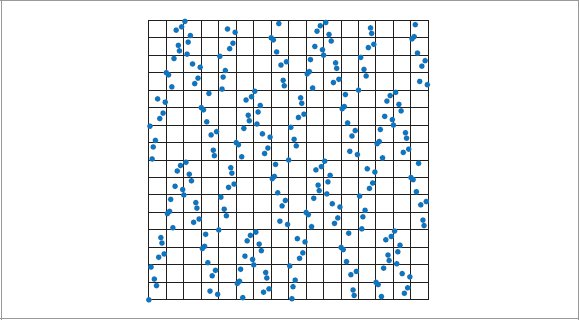

*Figure 8.36: Plot of the first 256 points from dimensions 4 and 5 of the Sobol′ sequence. The 2D projection of these two dimensions is not well distributed and is not stratified over elementary intervals.*

Therefore, the PaddedSobolSampler generates samples from the Sobol′ sequence in a way that focuses on returning good distributions for the dimensions used by each 1D and 2D sample independently. It does so via padding samples, similarly to the StratifiedSampler, but here using Sobol′ samples rather than jittered samples.

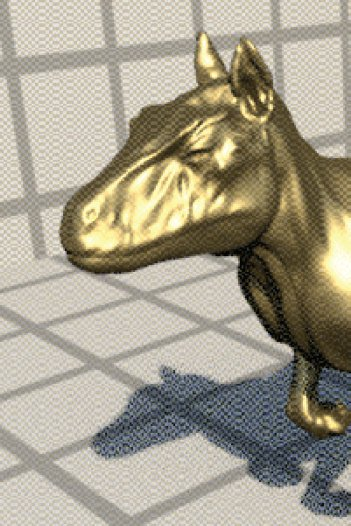

*Figure 8.37: Scene Rendered Using the SobolSampler at a Low Sampling Rate. With that sampler, these sorts of checkerboard patterns can result due to structure in the lower-dimensional projections of the form shown in Figure 8.36. (Killeroo model courtesy of headus/Rezard.)*

〈PaddedSobolSampler Definition〉 ≡ class PaddedSobolSampler { public: 〈PaddedSobolSampler Public Methods 504〉 private: 〈PaddedSobolSampler Private Methods 504〉 〈PaddedSobolSampler Private Members 503〉 };

The constructor, not included here, initializes the following member variables from provided values. As with the SobolSampler, using a pixel sample count that is not a power of 2 will give suboptimal results; a warning is issued in this case.

〈PaddedSobolSampler Private Members〉 ≡ 503

```rust
   int samplesPerPixel, seed;
   RandomizeStrategy randomize;
```

```text
    RandomizeStrategy 486
    SobolSampler 499
    StratifiedSampler 474
```

StartPixelSample(), also not included here, just records the specified pixel, sample index, and dimension.

〈PaddedSobolSampler Private Members〉 +≡ 503

```rust
   Point2i pixel;
   int sampleIndex, dimension;
```

1D samples are generated by randomly shuffling a randomized van der Corput sequence.

〈PaddedSobolSampler Public Methods〉 ≡ 503

```rust
   Float Get1D() {
       〈Get permuted index for current pixel sample 504〉
       int dim = dimension++;
       〈Return randomized 1D van der Corput sample for dimension dim 504〉
   }
```

Here, the permutation used for padding is based on the current pixel and dimension. It must not be based on the sample index, as the same permutation should be applied to all sample indices of a given dimension in a given pixel.

〈Get permuted index for current pixel sample〉 ≡ 504, 505

```rust
   uint64_t hash = Hash(pixel, dimension, seed);
   int index = PermutationElement(sampleIndex, samplesPerPixel, hash);
```

Given the permuted sample index value index, a separate method, SampleDimension(), takes care of generating the corresponding Sobol′ sample. The high bits of the hash value are reused for the sample’s randomization; doing so should be safe, since PermutationElement() uses the hash it is passed in an entirely different way than any of the sample randomization schemes do.

〈Return randomized 1D van der Corput sample for dimension dim〉 ≡ 504

```rust
   return SampleDimension(0, index, hash >> 32);
```

SampleDimension() follows the same approach as the corresponding method in SobolSampler, creating the appropriate randomizer before calling SobolSample().

〈PaddedSobolSampler Private Methods〉 ≡ 503

```rust
   Float SampleDimension(int dimension, uint32_t a, uint32_t hash) const {
       if (randomize == RandomizeStrategy::None)
            return SobolSample(a, dimension, NoRandomizer());
       else if (randomize == RandomizeStrategy::PermuteDigits)
            return SobolSample(a, dimension, BinaryPermuteScrambler(hash));
       else if (randomize == RandomizeStrategy::FastOwen)
            return SobolSample(a, dimension, FastOwenScrambler(hash));
```

```rust
         else
             return SobolSample(a, dimension, OwenScrambler(hash));
   }
```

```text
    BinaryPermuteScrambler 497
    FastOwenScrambler 497
    Float 23
    Hash() 1042
    NoRandomizer 497
    OwenScrambler 498
    PaddedSobolSampler::dimension 504
    PaddedSobolSampler::pixel 504
    PaddedSobolSampler::randomize 503
    PaddedSobolSampler::SampleDimension() 504
    PaddedSobolSampler::sampleIndex 504
    PaddedSobolSampler::samplesPerPixel 503
    PaddedSobolSampler::seed 503
    PermutationElement() 1043
    Point2i 92
    RandomizeStrategy::FastOwen 486
    RandomizeStrategy::None 486
    RandomizeStrategy::PermuteDigits 486
    SobolSample() 499
    SobolSampler 499
```

Padded 2D samples are generated starting with a similar permutation of sample indices.

〈PaddedSobolSampler Public Methods〉 +≡ 503

```rust
   Point2f Get2D() {
       〈Get permuted index for current pixel sample 504〉
       int dim = dimension;
       dimension += 2;
       〈Return randomized 2D Sobol′ sample 505〉
   }
```

Randomization also parallels the 1D case; again, bits from hash are used both for the random permutation of sample indices and for sample randomization.

〈Return randomized 2D Sobol′ sample〉 ≡

```rust
   return Point2f(SampleDimension(0, index, uint32_t(hash)),
                     SampleDimension(1, index, hash >> 32));
```

For this sampler, pixel samples are generated in the same manner as all other 2D samples, so the sample generation request is forwarded on to Get2D().

〈PaddedSobolSampler Public Methods〉 +≡ 503

```rust
   Point2f GetPixel2D() { return Get2D(); }
```

### 8.7.6 BLUE NOISE SOBOL′ SAMPLER

ZSobolSampler is a third sampler based on the Sobol′ sequence. It is also based on padding 1D and 2D Sobol′ samples, but uses sample indices in a way that leads to a blue noise distribution of sample values. This tends to push error to higher frequencies, which in turn makes it appear more visually pleasing. Figure 8.38 compares a scene rendered with the PaddedSobolSampler and the ZSobolSampler; both have essentially the same MSE, but the one rendered using ZSobolSampler looks better to most human observers. This Sampler is the default one used by pbrt if no sampler is specified in the scene description.

〈ZSobolSampler Definition〉 ≡ class ZSobolSampler { public: 〈ZSobolSampler Public Methods 508〉 private: 〈ZSobolSampler Private Members 508〉 };

This sampler generates blue noise samples by taking advantage of the properties of (0, 2)-sequences. To understand the idea behind its implementation, first consider rendering a two-pixel image using 16 samples per pixel where a set of 2D samples are used for area light source sampling in each pixel. If the first 16 samples from a (0, 2)-sequence are used for the first pixel and the next 16 for the second, then not only will each pixel individually use well-stratified samples, but the set of all 32 samples will collectively be well stratified thanks to the stratification of (0, 2)-sequences over elementary intervals (Section 8.7.1). Consequently, the samples used in each pixel will generally be in different locations than in the other pixel, which is precisely the sample decorrelation exhibited by blue noise. (See Figure 8.39.) PaddedSobolSampler 503 PaddedSobolSampler::dimension 504 PaddedSobolSampler::Get2D() 505 PaddedSobolSampler::SampleDimension() 504 Point2f 92 Sampler 469 ZSobolSampler 505 More generally, if all the pixels in an image take different power-of-2 aligned and sized segments of samples from a single large set of Sobol′

samples in a way that nearby pixels generally take adjacent segments, then the distribution of samples across the entire image will be such that pixels generally use different sample values than their neighbors. Allocating segments of samples in scanline order would give good distributions along scanlines, but it would not do much from scanline to scanline. The Morton curve, which was introduced earlier in Section 7.3.3 in the context of linear bounding volume hierarchies, gives a better mechanism for this task: if we compute the Morton code for each pixel (x, y) and then use that to determine the pixel’s starting index into the full set of Sobol′ samples, then nearby pixels—those that are nearby in both x and y—will tend to use nearby segments of the samples. This idea is illustrated in Figure 8.40.

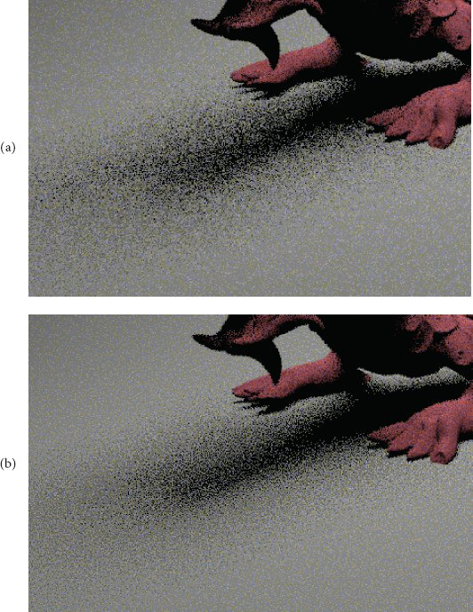

*Figure 8.38: The Benefit of Blue Noise with Padded Sobol′ Points. (a) Rendered using the PaddedSobol Sampler. (b) Rendered with the ZSobolSampler. Both images are rendered using 1 sample per pixel and have the same overall error, but the second image looks much better thanks to a blue noise distribution of error. (Dragon model courtesy of the Stanford Computer Graphics Laboratory.)*

```text
   PaddedSobolSampler 503
   ZSobolSampler 505
```

Used directly in this manner, the Morton curve can lead to visible structure in the image; see Figure 8.41, where samples were allocated in that way. This issue can be addressed with a random permutation of the Morton indices interpreted as base-4 numbers, which effectively groups pairs of one bit from x and one bit from y in the Morton index into single base-4 digits. Randomly permuting these digits still maintains much of the spatial coherence of the Morton curve; see Figure 8.42 for an illustration of the permutation approach. Figure 8.38(b) shows the resulting improvement in a rendered image.

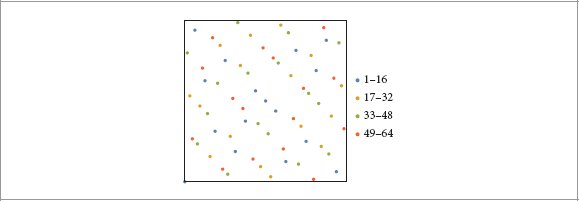

*Figure 8.39: The First 64 2D Sobol′ Points, Colored in Sets of 16. If four adjacent pixels each use one of these sets for sampling, then each would not only have well-distributed points individually, but the points collectively would be decorrelated due to being from a (0, 2)-sequence.*

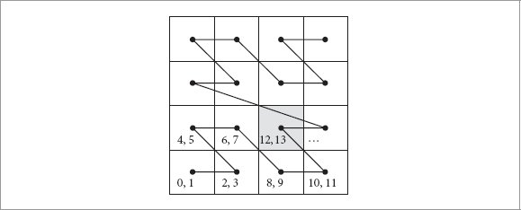

*Figure 8.40: Allocating Sobol′ Samples in Morton Curve Order. With a 4 × 4 pixel image rendered using 2 samples per pixel, we can take the full set of 2 × 4 × 4 Sobol′ samples and then allocate segments of samples to pixels according to their Morton indices. For example, pixel (2, 1) has Morton index 6, so it uses samples with indices 12 and 13.*

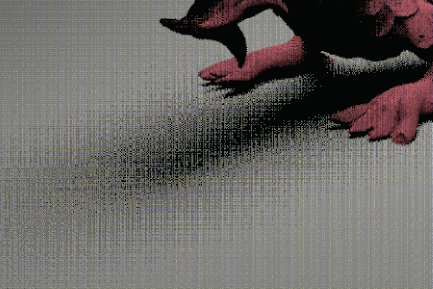

*Figure 8.41: If a regular Morton curve without permutations is used to allocate Sobol′ indices in pixels, visible structure will be present in the rendered image. (Compare with Figure 8.38(b) where such a permutation is used.) (Dragon model courtesy of the Stanford Computer Graphics Laboratory.)*

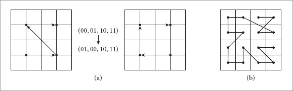

*Figure 8.42: If pixels’ Morton indices are interpreted as base-4 numbers and their digits are randomly permuted, the resulting curve is still spatially coherent. (a) Applying the permutation shown to the first base-4 digit for a 4 × 4 pixel image causes the 2 × 2 blocks of pixels to be visited in a different order than the usual Morton curve. (b) If the second base-4 digit is also permuted (here with different permutations for each 2 × 2 block, not shown), then the pixels within each block are also visited in different orders.*

A second problem with the approach as described so far is that it does not randomize the order of sample indices within a pixel, as is necessary for padding samples across different dimensions. This shortcoming can be addressed by appending the bits of the sample index within a pixel to the pixel’s Morton code and then including those in the index randomization as well. In addition to the usual configuration parameters, the ZSobolSampler constructor also stores the base-2 logarithm of the number of samples per pixel as well as the number of base-4 digits in the full extended Morton index that includes the sample index. 〈ZSobolSampler Public Methods〉 ≡ 505

ZSobolSampler(int samplesPerPixel, Point2i fullResolution, RandomizeStrategy randomize, int seed = 0) : randomize(randomize), seed(seed) { log2SamplesPerPixel = Log2Int(samplesPerPixel); int res = RoundUpPow2(std::max(fullResolution.x, fullResolution.y)); int log4SamplesPerPixel = (log2SamplesPerPixel + 1) / 2; nBase4Digits = Log2Int(res) + log4SamplesPerPixel; }

〈ZSobolSampler Private Members〉 ≡ 505

RandomizeStrategy randomize;

int seed, log2SamplesPerPixel, nBase4Digits;

The StartPixelSample() method’s main task is to construct the initial unpermuted sample index by computing the pixel’s Morton code and then appending the sample index, using a left shift to make space for it. This value is stored in mortonIndex. 〈ZSobolSampler Public Methods〉 +≡ 505

void StartPixelSample(Point2i p, int index, int dim) { dimension = dim; mortonIndex = (EncodeMorton2(p.x, p.y) << log2SamplesPerPixel) | index; }

```text
   EncodeMorton2() 1042
   Log2Int() 1036
   Point2i 92
   RandomizeStrategy 486
   RoundUpPow2() 1039
   ZSobolSampler 505
   ZSobolSampler::dimension 509
   ZSobolSampler::log2SamplesPerPixel 508
   ZSobolSampler::mortonIndex 509
   ZSobolSampler::nBase4Digits 508
   ZSobolSampler::randomize 508
   ZSobolSampler::seed 508
```

〈ZSobolSampler Private Members〉 +≡ 505

uint64_t mortonIndex; int dimension;

Sample generation is similar to the PaddedSobolSampler with the exception that the index of the sample is found with a call to the GetSampleIndex() method (shown next), which randomizes mortonIndex. The Generate 1D Sobol′ sample at sampleIndex fragment then calls SobolSample() to generate the sampleIndexth sample using the appropriate randomizer. It is otherwise effectively the same as the PaddedSobolSampler::SampleDimension() method, so its implementation is not included here. 〈ZSobolSampler Public Methods〉 +≡ 505

Float Get1D() { uint64_t sampleIndex = GetSampleIndex();

```rust
        ++dimension;
        〈Generate 1D Sobol′ sample at sampleIndex〉
   }
```

2D samples are generated in a similar manner, using the first two Sobol′ sequence dimensions and a sample index returned by GetSampleIndex(). Here as well, the fragment that dispatches calls to SobolSample() corresponding to the chosen randomization scheme is not included. 〈ZSobolSampler Public Methods〉 +≡ 505

Point2f Get2D() { uint64_t sampleIndex = GetSampleIndex(); dimension += 2; 〈Generate 2D Sobol′ sample at sampleIndex〉 }

Pixel samples are generated the same way as other 2D sample distributions. 〈ZSobolSampler Public Methods〉 +≡ 505

Point2f GetPixel2D() { return Get2D(); }

The GetSampleIndex() method is where most of the complexity of this sampler lies. It computes a random permutation of the digits of mortonIndex, including handling the case where the number of samples per pixel is only a power of 2 but not a power of 4; that case needs special treatment since the total number of bits in the index is odd, which means that only one of the two bits needed for the last base-4 digit is available. 〈ZSobolSampler Public Methods〉 +≡ 505

uint64_t GetSampleIndex() const { 〈Define the full set of 4-way permutations in permutations 510〉 uint64_t sampleIndex = 0; 〈Apply random permutations to full base-4 digits 510〉 〈Handle power-of-2 (but not 4) sample count 510〉 return sampleIndex; }

```text
   Float 23
   PaddedSobolSampler 503
   PaddedSobolSampler::SampleDimension() 504
   Point2f 92
```

```text
   SobolSample() 499
   ZSobolSampler::dimension 509
   ZSobolSampler::Get2D() 509
   ZSobolSampler::GetSampleIndex() 509
```

We will find it useful to have all of the 4! = 24 permutations of four elements explicitly enumerated; they are stored in the permutations array. 〈Define the full set of 4-way permutations in permutations〉 ≡ 509

static const uint8_t permutations[24][4] = { {0, 1, 2, 3}, {0, 1, 3, 2}, {0, 2, 1, 3}, {0, 2, 3, 1}, 〈Define remaining 20 4-way permutations〉 };

The digits are randomized from most significant to least significant. In the case of the number of samples only being a power of 2, the loop terminates before the last bit, which is handled specially since it is not a full base-4 digit. 〈Apply random permutations to full base-4 digits〉 ≡ 509

bool pow2Samples = log2SamplesPerPixel & 1; int lastDigit = pow2Samples ? 1 : 0; for (int i = nBase4Digits - 1; i >= lastDigit; --i) { 〈Randomly permute ith base-4 digit in mortonIndex 510〉 }

After the current digit is extracted from mortonIndex, it is permuted using the selected permutation before being shifted back into place to be added to sampleIndex. 〈Randomly permute ith base-4 digit in mortonIndex〉 ≡ 510

int digitShift = 2 * i - (pow2Samples ? 1 : 0); int digit = (mortonIndex >> digitShift) & 3; 〈Choose permutation p to use for digit 510〉 digit = permutations[p][digit]; sampleIndex |= uint64_t(digit) << digitShift;

Which permutation to use is determined by hashing both the higher-order digits and the current sample dimension. In this way, the index is hashed differently for different dimensions, which randomizes the association of samples in different dimensions for padding. The use of the higher-order digits in this way means that this approach bears some resemblance to

Owen scrambling, though here it is applied to sample indices rather than sample values. The result is a top-down hierarchical randomization of the Morton curve. 〈Choose permutation p to use for digit〉 ≡ 510

uint64_t higherDigits = mortonIndex >> (digitShift + 2); int p = (MixBits(higherDigits ^ (0x55555555u * dimension)) >> 24) % 24;

In the case of a power-of-2 sample count, the single remaining bit in mortonIndex is handled specially, though following the same approach as the other digits: the higher-order bits and dimension are hashed to choose a permutation. In this case, there are only two possible permutations, and as with the BinaryPermuteScrambler, an exclusive OR is sufficient to apply whichever of them was selected. 〈Handle power-of-2 (but not 4) sample count〉 ≡ 509

if (pow2Samples) { int digit = mortonIndex & 1; sampleIndex |= digit ^ (MixBits((mortonIndex >> 1) ^ (0x55555555u * dimension)) & 1); }

### 8.7.7 EVALUATION

```text
    BinaryPermuteScrambler 497
    MixBits() 1042
    Sampler 469
    ZSobolSampler::dimension 509
    ZSobolSampler::log2SamplesPerPixel 508
    ZSobolSampler::mortonIndex 509
    ZSobolSampler::nBase4Digits 508
```

In this section we have defined three Samplers, each of which supports four randomization algorithms, giving a total of 12 different ways of generating samples. All are effective samplers, though their characteristics vary. In the interest of space, we will not include evaluations of every one of them here but will focus on the most significant differences among them.

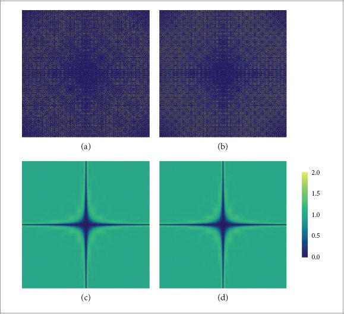

*Figure 8.43: Power Spectral Density of the Sobol′ Point Set. (a) Unscrambled, (b) scrambled using random digit permutations, (c) scrambled using the FastOwenScrambler, (d) scrambled using hashed Owen scrambling. The unscrambled Sobol′ points have a remarkably bad power spectral density (PSD) and random digit permutations are of only slight benefit. Owen scrambling greatly improves the PSD.*

*Figure 8.43(a) shows the PSD of the unscrambled 2D Sobol′ point set; it is an especially bad power spectrum. Like the Halton points, the 2D Sobol′ points have low energy along the two axes thanks to well-distributed 1D projections, but there is significant structured variation at higher off-axis frequencies, including regions with very high PSD values. As seen in Figure 8.43(b), randomizing the Sobol′ points with random digit permutations only slightly improves the power spectrum. Only with the Owen scrambling algorithms does the power spectrum start to become*

uniform at higher frequencies, though some structure still remains (Figures 8.43(c) and (d)). These well-distributed 1D projections are one reason why low-discrepancy sequences are generally more effective than stratified patterns: they are more robust with respect to preserving their good distribution properties after being transformed to other domains. Figure 8.44 shows what happens when a set of 16 sample points are transformed to be points on a skinny quadrilateral by scaling them to cover its surface; samples from the Sobol′ sequence remain well distributed, but samples from a stratified pattern fare worse.

```text
   FastOwenScrambler 497
```

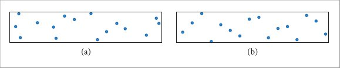

*Figure 8.44: (a) Transforming a 4 × 4 stratified sampling pattern to points on a long and thin quadrilateral light source effectively gives fewer than 16 well-distributed samples; stratification in the vertical direction is not helpful. (b) Samples from the Sobol′ sequence remain well distributed even after this transformation.*

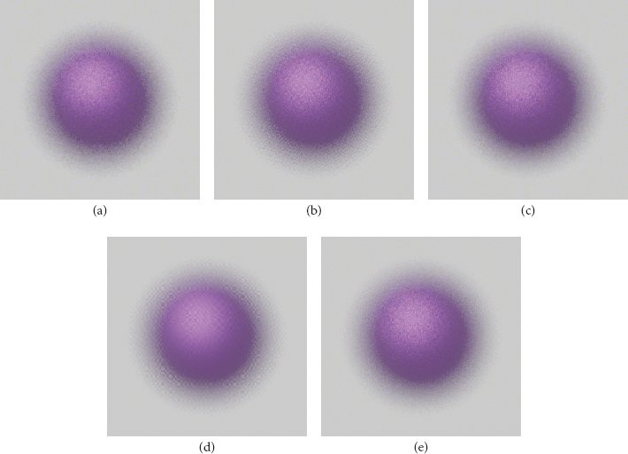

*Figure 8.45: Comparisons of the Halton and Various Sobol′ Samplers for Rendering Depth of Field. Mean squared error is reported normalized to that of the stratified sampler. (a) An image rendered using the StratifiedSampler (normalized MSE 1), (b) an image rendered using the HaltonSampler (normalized MSE 1.44), (c) an image rendered using the PaddedSobolSampler (normalized MSE 0.96), (d) an image rendered using the SobolSampler (normalized MSE 0.64), and (e) an image rendered using the ZSobolSampler (normalized MSE 0.84). All the low-discrepancy samplers use hashed Owen scrambling for randomization and 16 samples per pixel.*

```text
   HaltonSampler 485
   PaddedSobolSampler 503
   SobolSampler 499
   StratifiedSampler 474
   ZSobolSampler 505
```

Returning to the simple scene with defocus blur that was used in Figure 8.23, Figure 8.45 compares using the Halton sampler to the three Sobol′ samplers for rendering that scene. We can see that the Halton sampler has higher error than the StratifiedSampler, which is due to its 2D projections (as are used for sampling the lens) not necessarily being well

distributed. The PaddedSobolSampler gives little benefit over the stratified sampler, since for sampling a lens, the 4 × 4 stratification is the most important one and both fulfill that. The SobolSampler has remarkably low error, even though the rendered image shows the characteristic structure of 2D projections of the Sobol′ sequence. The ZSobolSampler combines reasonably low error with the visual benefit of distributing its error with blue noise.

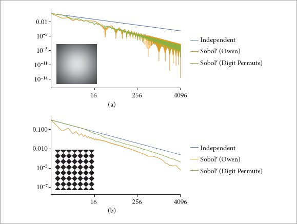

*Figure 8.46: Error When Integrating Simple 2D Functions with Sobol′ Samples. (a) Sobol′ sampling exhibits lower error and a faster asymptotic rate of convergence than independent sampling does. For a smooth function like the Gaussian, Owen scrambling the sample points gives an even better rate of convergence, especially at power-of-two numbers of sample points. (b) Using Sobol′ points is also effective for the rotated checkerboard function. Owen scrambling gives a further benefit, though without the substantial improvement in rate of convergence that was seen with the Gaussian.*

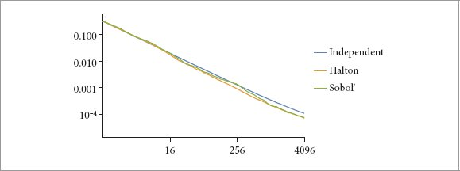

*Figure 8.47: Log–Log Plot of MSE When Rendering the Scene in Figure 8.32 with Low-Discrepancy Samplers. For this scene, both the Halton and Sobol′ samplers are similarly effective.*

*Figure 8.46 shows the performance of Sobol′ sample points with the two test functions. It does well with both, but especially so with Owen scrambled points and the smooth Gaussian function, where it has an asymptotically faster rate of convergence. Figure 8.47 graphs MSE versus the sample count for the blurry dragon test scene from Figure 8.32. Both the Halton and Sobol′ samplers have roughly 10% lower MSE than independent sampling at equivalent sample counts.*

```text
   ZSobolSampler 505
```

## 8.8 IMAGE RECONSTRUCTION

As discussed in Section 5.4.3, each pixel in the Film computes an estimate of the integral of the product of a filter function with samples taken from the image function. In Section 8.1, we saw that sampling theory provides a mathematical foundation for how this filtering operation should be performed in order to achieve an antialiased result. We should, in principle: 1. Reconstruct a continuous image function from the set of image samples. 2. Prefilter that function to remove any frequencies past the Nyquist limit for the pixel spacing.

3. Sample the prefiltered function at the pixel locations to compute the final pixel values. Because we know that we will be resampling the function at only the pixel locations, it is not necessary to construct an explicit representation of the function. Instead, we can combine the first two steps using a single filter function. Recall that if the original function had been uniformly sampled at a frequency greater than the Nyquist frequency and reconstructed with the sinc filter, then the reconstructed function in the first step would match the original image function perfectly—quite a feat since we only have point samples. But because the image function almost always will have higher frequencies than could be accounted for by the sampling rate (due to edges, etc.), we chose to sample it nonuniformly, trading off noise for aliasing. The theory behind ideal reconstruction depends on the samples being uniformly spaced. While a number of attempts have been made to extend the theory to nonuniform sampling, there is not yet an accepted approach to this problem. Furthermore, because the sampling rate is known to be insufficient to capture the function, perfect reconstruction is not possible. Recent research in the field of sampling theory has revisited the issue of reconstruction with the explicit acknowledgment that perfect reconstruction is not generally attainable in practice. This slight shift in perspective has led to powerful new reconstruction techniques. In particular, the goal of research in reconstruction theory has shifted from perfect reconstruction to developing reconstruction techniques that can be shown to minimize error between the reconstructed function and the original function, regardless of whether the original was band limited. The sinc filter is not an appropriate choice here: recall that the ideal sinc filter is prone to ringing when the underlying function has frequencies beyond the Nyquist limit, meaning edges in the image have faint replicated copies of the edge in nearby pixels (the Gibbs phenomenon; see Section 8.1.5). Furthermore, the sinc filter has infinite support: it does not fall off to zero at a finite distance from its center, so all the image samples would need to be filtered for each output pixel. In practice, there is no single best filter function. Choosing the best one for a particular scene takes a mixture of

quantitative evaluation and qualitative judgment. pbrt therefore provides a variety of choices. Figure 8.48 shows comparisons of zoomed-in regions of images rendered using a variety of the filters from this section to reconstruct pixel values.

### 8.8.1 FILTER INTERFACE

The Filter class defines the interface for pixel reconstruction filters in pbrt. It is defined in the file base/filter.rs.

```text
    Film 244
```

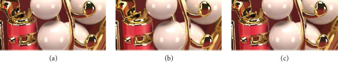

*Figure 8.48: The pixel reconstruction filter used to convert the image samples into pixel values can have a noticeable effect on the character of the final image. Here, we see enlargements of a region of the imperial crown model, filtered with (a) the box filter, (b) Gaussian filter, and (c) Mitchell–Netravali filter. Note that the Mitchell filter gives the sharpest image, while the Gaussian blurs it. The box filter is the least desirable, since it allows high-frequency aliasing to leak into the final image. (Note the stair-step pattern along bright gold edges, for example.) (Crown model courtesy of Martin Lubich.)*

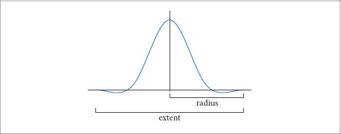

*Figure 8.49: The extent of filters in pbrt is specified in terms of each one’s radius from the origin to its cutoff point. The support of a filter is its total nonzero extent, here equal to twice its radius.*

〈Filter Definition〉 ≡ class Filter : public TaggedPointer<BoxFilter, GaussianFilter, MitchellFilter, LanczosSincFilter, TriangleFilter> { public: 〈Filter Interface 515〉 };

All filters are 2D functions that are centered at the origin and define a radius beyond which they have a value of 0. The radii are different in the x and y directions but are assumed to be symmetric in each. A filter provides its radius via the Radius() method. The filter’s overall extent in each direction (its support) is twice the value of its corresponding radius (Figure 8.49). 〈Filter Interface〉 ≡ 515

Vector2f Radius() const;

```text
   BoxFilter 520
   GaussianFilter 522
```

```text
   LanczosSincFilter 526
   MitchellFilter 523
   TaggedPointer 1073
   TriangleFilter 520
   Vector2f 86
```

Filter implementations must also provide a method that evaluates their filter function. This function may be called with points that are outside of the filter’s radius; in this case it is the responsibility of the implementation to detect this case and return the value 0. It is not required for the filter values returned by Evaluate() to integrate to 1 since the estimator used to compute pixel values, Equation (5.13), is self-normalizing. 〈Filter Interface〉 +≡ 515

Float Evaluate(Point2f p) const;

Filters also must be able to return their integral. Most are able to compute this value in closed form. Thus, if calling code requires a normalized filter function, it is easy enough to find it by dividing values returned by Evaluate() by the integral.

〈Filter Interface〉 +≡ 515

Float Integral() const;

Filters must also provide an importance sampling method, Sample, which takes a random sample u in [0, 1)2. 〈Filter Interface〉 +≡ 515

FilterSample Sample(Point2f u) const;

The returned FilterSample structure stores both the sampled position p and a weight, which is the ratio of the value of the filter function at p to the value of the PDF used for sampling there. Because some filters are able to exactly sample from their distribution, returning this ratio directly allows them to save the trouble of evaluating those two values and instead to always return a weight of 1. 〈FilterSample Definition〉 ≡ struct FilterSample { Point2f p;

Float weight; };

Given the specification of this interface, we can now implement the GetCameraSample() function that most integrators use to compute the CameraSamples that they pass to the Camera::GenerateRay() methods.

〈Sampler Inline Functions〉 ≡ template <typename S> CameraSample GetCameraSample(S sampler, Point2i pPixel, Filter filter) { FilterSample fs = filter.Sample(sampler.GetPixel2D()); CameraSample cs; 〈Initialize CameraSample member variables 517〉 return cs; }

One subtlety in the definition of this function is that it is templated based on the type of the sampler passed to it. If a value of type Sampler is passed to this method, then it proceeds using pbrt’s usual dynamic dispatch mechanism to call the corresponding methods of the Sampler implementation. However, if a concrete sampler type (e.g., HaltonSampler) is passed to it, then the corresponding methods can be called directly (and are generally expanded inline in the function). This capability is used to improve performance in pbrt’s GPU rendering path; see Section 15.3.3. After the filter’s Sample() method has returned a FilterSample, the image sample position can be found by adding the filter’s sampled offset to the pixel coordinate before a shift of 0.5 in each dimension accounts for the mapping from discrete to continuous pixel coordinates (recall Section 8.1.4). The filter’s weight is passed along in the CameraSample so that it is available to the Film when its AddSample() method is called.

```text
   Camera::GenerateRay() 206
   CameraSample 206
   Film 244
```

```text
    Film::AddSample() 244
    Filter 515
    Filter::Sample() 516
    FilterSample 516
    Float 23
    Point2f 92
    Point2i 92
    Sampler 469
    Sampler::GetPixel2D() 470
```

〈Initialize CameraSample member variables〉 ≡ 516

```rust
   cs.pFilm = pPixel + fs.p + Vector2f(0.5f, 0.5f);
   cs.time = sampler.Get1D();
   cs.pLens = sampler.Get2D();
   cs.filterWeight = fs.weight;
```

### 8.8.2 FilterSampler

Not all Filters are able to easily sample from the distributions of their filter functions. Therefore, pbrt provides a FilterSampler class that wraps up the details of sampling based on a tabularized representation of the filter. 〈FilterSampler Definition〉 ≡ class FilterSampler { public: 〈FilterSampler Public Methods 518〉 private: 〈FilterSampler Private Members 517〉 };

Only the Filter and an allocator are provided to the constructor. We have not found it particularly useful to allow the caller to specify the rate at which the filter function is sampled to construct the table used for sampling, so instead hardcode a sampling rate of 32 times per unit filter extent in each dimension. 〈FilterSampler Method Definitions〉 ≡ FilterSampler::FilterSampler(Filter filter, Allocator alloc)

: domain(Point2f(-filter.Radius()), Point2f(filter.Radius())), f(int(32 * filter.Radius().x), int(32 * filter.Radius().y), alloc), distrib(alloc) { 〈Tabularize unnormalized filter function in f 517〉 〈Compute sampling distribution for filter 518〉 }

domain gives the bounds of the filter and f stores tabularized filter function values. 〈FilterSampler Private Members〉 ≡ 517

Bounds2f domain; Array2D<Float> f;

All the filters currently implemented in pbrt are symmetric about the origin, which means that they could be tabularized over a single xy quadrant. Further, they are all separable into the product of two 1D functions. Either of these properties could be exploited to reduce the amount of storage required for the tables used for sampling. However, to allow full flexibility with the definition of additional filter functions, the FilterSampler simply evaluates the filter at equally spaced positions over its entire domain to initialize the f array.

〈Tabularize unnormalized filter function in f〉 ≡ 517

for (int y = 0; y < f.YSize(); ++y) for (int x = 0; x < f.XSize(); ++x) { Point2f p = domain.Lerp(Point2f((x + 0.5f) / f.XSize(), (y + 0.5f) / f.YSize())); f(x, y) = filter.Evaluate(p); }

```text
   Allocator 40
   Array2D 1069
   Array2D::XSize() 1070
   Array2D::YSize() 1070
   Bounds2::Lerp() 102
   Bounds2f 97
   CameraSample::filterWeight 206
```

```text
   CameraSample::pFilm 206
   CameraSample::pLens 206
   CameraSample::time 206
   Filter 515
   Filter::Evaluate() 516
   Filter::Radius() 515
   FilterSample::p 516
   FilterSample::weight 516
   FilterSampler 517
   FilterSampler::domain 517
   FilterSampler::f 517
   Float 23
   Point2f 92
   Sampler::Get1D() 470
   Sampler::Get2D() 470
   Vector2f 86
```

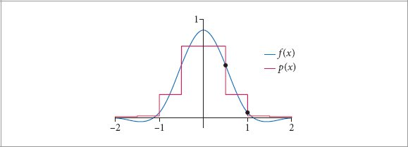

*Figure 8.50: Filter function f (x) and a piecewise-constant sampling distribution p(x) found by evaluating it at the center of each cell, as is done by the FilterSampler. If filter positions are found by sampling from p(x) and contributions are weighted using the ratio f (x)/p(x), then different samples may have very different contributions. For example, the two points shown have a 10× difference in their f (x)/p(x) values. This variation in filter weights can lead to variance in images and therefore the FilterSampler uses the same piecewise-constant approximation of f (x) for evaluation as is used for sampling.*

Given a tabularized function, it is easy to initialize the sampling distribution. 〈Compute sampling distribution for filter〉 ≡ 517

distrib = PiecewiseConstant2D(f, domain, alloc);

〈FilterSampler Private Members〉 +≡ 517

PiecewiseConstant2D distrib;

There are two important details in the implementation of its Sample() method. First, the implementation does not use Filter::Evaluate() to evaluate the filter function but instead uses the tabularized version of it in f. By using the piecewise constant approximation of the filter function, it ensures that the returned weight f (p′)/p(p′) for a sampled point p′ is always ±c for a constant c. If it did not do this, there would be variation in the returned weight for non-constant filter functions, due to the sampling distribution not being exactly proportional to the filter function—see Figure 8.50, which illustrates the issue. A second important detail is that the integer coordinates of the sample returned by Piecewise Constant2D::Sample() are used to index into f for filter function evaluation. If instead the point p was scaled up by the size of the f array in each dimension and converted to an integer, the result would occasionally differ from the integer coordinates computed during sampling by PiecewiseConstant2D due to floating-point round-off error. (Using the notation of Section 6.8.1, the issue is that with floating-point arithmetic, (a ⊘ b) ⊗ b ≠ (a/b)b = a.) Again, variance would result, as the ratio f (x)/p(x) might not be ±c. 〈FilterSampler Public Methods〉 ≡ 517

FilterSample Sample(Point2f u) const { Float pdf; Point2i pi; Point2f p = distrib.Sample(u, &pdf, &pi); return FilterSample{p, f[pi] / pdf}; }

### 8.8.3 BOX FILTER

```text
    Filter::Evaluate() 516
    FilterSample 516
    FilterSampler 517
    FilterSampler::distrib 518
    FilterSampler::domain 517
    FilterSampler::f 517
    Float 23
    PiecewiseConstant2D 1019
    PiecewiseConstant2D::Sample() 1020
    Point2f 92
```

```text
   Point2i 92
```

One of the most commonly used filters in graphics is the box filter (and, in fact, when filtering and reconstruction are not addressed explicitly, the box filter is the de facto result). The box filter equally weights all samples within a square region of the image. Although computationally efficient, it is just about the worst filter possible. Recall from the discussion in Section 8.1.2 that the box filter allows high-frequency sample data to leak into the reconstructed values. This causes postaliasing—even if the original sample values were at a high enough frequency to avoid aliasing, errors are introduced by poor filtering.


*Figure 8.51: Graphs of the (a) box filter and (b) triangle filter. Although neither of these is a particularly good filter, they are both computationally efficient, easy to implement, and good baselines for evaluating other filters.*


*Figure 8.52: The box filter reconstructing (a) a step function and (b) a sinusoidal function with increasing frequency as x increases. This filter does well with the step function, as expected, but does an extremely poor job with the sinusoidal function.*

*Figure 8.51(a) shows a graph of the box filter, and Figure 8.52 shows the result of using the box filter to reconstruct two 1D functions. For the step function we used previously to illustrate the Gibbs phenomenon, the box does reasonably well. However, the results are much worse for a sinusoidal function that has increasing frequency along the x axis. Not only does the box filter do a poor job of reconstructing the function when the frequency is low, giving a discontinuous result even though the original function was smooth, but it also does an extremely poor job of reconstruction as the function’s frequency approaches and passes the Nyquist limit. 〈BoxFilter Definition〉 ≡*

```rust
   class BoxFilter {
     public:
       〈BoxFilter Public Methods 520〉
     private:
       Vector2f radius;
   };
```

For this filter and all the following ones, we will not include the rudimentary constructors and Radius() method implementations. Evaluating the box filter requires checking that the given point is inside the box. 〈BoxFilter Public Methods〉 ≡ 520

Float Evaluate(Point2f p) const { return (std::abs(p.x) <= radius.x && std::abs(p.y) <= radius.y) ? 1 : 0; }

Sampling is also easy: the random sample u is used to linearly interpolate within the filter’s extent. Since sampling is exact and the filter function is positive, the weight is always 1. 〈BoxFilter Public Methods〉 +≡ 520

FilterSample Sample(Point2f u) const { Point2f p(Lerp(u[0], -radius.x, radius.x), Lerp(u[1], -radius.y, radius.y)); return {p, Float(1)}; }

Finally, the integral is equal to the filter’s area. 〈BoxFilter Public Methods〉 +≡ 520

Float Integral() const { return 2 * radius.x * 2 * radius.y; }

### 8.8.4 TRIANGLE FILTER

The triangle filter gives slightly better results than the box: the weight falls off linearly from the filter center over the square extent of the filter. See Figure 8.51(b) for a graph of the triangle filter.

〈TriangleFilter Definition〉 ≡ class TriangleFilter { public: 〈TriangleFilter Public Methods 521〉 private: Vector2f radius; };

```text
   BoxFilter::radius 520
   FilterSample 516
   Float 23
   Lerp() 72
   Point2f 92
   Vector2f 86
```

Evaluating the triangle filter is simple: it is the product of two linear functions that go to 0 after the width of the filter in both the x and y directions. Here we have defined the filter to have a slope of ±1, though the filter could alternatively have been defined to have a value of 1 at the origin and a slope that depends on the radius. 〈TriangleFilter Public Methods〉 ≡ 520

Float Evaluate(Point2f p) const { return std::max<Float>(0, radius.x - std::abs(p.x)) * std::max<Float>(0, radius.y - std::abs(p.y)); }

Because the filter is separable, its PDF is as well, and so each dimension can be sampled independently. The sampling method uses a separate SampleTent() utility function that is defined in Section A.4.1. Once again, the weight returned in the FilterSample is always 1 because the filter is positive and sampling is exact. 〈TriangleFilter Public Methods〉 +≡ 520

FilterSample Sample(Point2f u) const { return {Point2f(SampleTent(u[0], radius.x), SampleTent(u[1], radius.y)), Float(1)}; }

Finally, the triangle filter is easily integrated.

〈TriangleFilter Public Methods〉 +≡ 520

Float Integral() const { return Sqr(radius.x) * Sqr(radius.y); }

### 8.8.5 GAUSSIAN FILTER

Unlike the box and triangle filters, the Gaussian filter gives a reasonably good result in practice. This filter applies a Gaussian bump that is centered at the pixel and radially symmetric around it. Figure 8.53 compares plots of the Gaussian filter and the Mitchell filter (described in Section 8.8.6). The Gaussian does tend to cause slight blurring of the final image compared to some of the other filters, but this blurring can help mask any remaining aliasing. This filter is the default one used in pbrt.

```text
    FilterSample 516
    Float 23
    Point2f 92
    SampleTent() 1002
    Sqr() 1034
    TriangleFilter::radius 520
```


*Figure 8.53: Graphs of (a) the Gaussian filter and (b) the Mitchell filter with and , each with a width of 2. The Gaussian gives images that tend to be a bit blurry, while the negative lobes of the Mitchell filter help to accentuate and sharpen edges in final images.*

〈GaussianFilter Definition〉 ≡ class GaussianFilter {

public: 〈GaussianFilter Public Methods 522〉 private: 〈GaussianFilter Private Members 522〉 };

The Gaussian function is parameterized by the position of the peak μ and the standard deviation σ:

Larger values of σ cause a slower falloff, which leads to a blurrier image when the Gaussian is used as a filter. The GaussianFilter is centered at the origin, so μ = 0. Further, the filter function subtracts the value of the Gaussian at the end of its extent r from the filter value in order to make the filter go to 0 at its limit:

For efficiency, the constructor precomputes the constant term for g(r, 0, σ) in each direction. 〈GaussianFilter Public Methods〉 ≡ 522

GaussianFilter(Vector2f radius, Float sigma = 0.5f, Allocator alloc = {}) : radius(radius), sigma(sigma), expX(Gaussian(radius.x, 0, sigma)), expY(Gaussian(radius.y, 0, sigma)), sampler(this, alloc) {}

〈GaussianFilter Private Members〉 ≡ 522

Vector2f radius; Float sigma, expX, expY; FilterSampler sampler;

The product of the two 1D Gaussian functions gives the overall filter value according to Equation (8.26). The calls to std::max() ensure that the value of 0 is returned for points outside of the filter’s extent. 〈GaussianFilter Public Methods〉 +≡ 522

Float Evaluate(Point2f p) const { return (std::max<Float>(0, Gaussian(p.x, 0, sigma) - expX) *

```rust
                     std::max<Float>(0, Gaussian(p.y, 0, sigma) - expY));
   }
```

The integral of the Gaussian is

where erf is the error function. GaussianIntegral() evaluates its value over a given range. The filter function’s integral can be computed by evaluating the Gaussian’s integral over the filter’s range and subtracting the integral of the offset that takes the filter to zero at the end of its extent.

```text
   Allocator 40
   FilterSampler 517
   Float 23
   Gaussian() 1037
   GaussianFilter 522
   GaussianFilter::expX 522
   GaussianFilter::expY 522
   GaussianFilter::sigma 522
   GaussianIntegral() 1038
   Point2f 92
   Vector2f 86
```

〈GaussianFilter Public Methods〉 +≡ 522

Float Integral() const { return ((GaussianIntegral(-radius.x, radius.x, 0, sigma) -2 * radius.x * expX) * (GaussianIntegral(-radius.y, radius.y, 0, sigma) -2 * radius.y * expY)); }

It is possible to sample from the Gaussian function using a polynomial approximation to the inverse error function, though that is not sufficient in this case, given the presence of the second term of the filter function in Equation (8.26). pbrt’s GaussianFilter implementation therefore uses a FilterSampler for sampling.

〈GaussianFilter Public Methods〉 +≡ 522

FilterSample Sample(Point2f u) const { return sampler.Sample(u); }

### 8.8.6 MITCHELL FILTER

Filter design is notoriously difficult, mixing mathematical analysis and perceptual experiments. Mitchell and Netravali (1988) developed a family of parameterized filter functions in order to be able to explore this space in a systematic manner. After analyzing test subjects’ subjective responses to images filtered with a variety of parameter values, they developed a filter that tends to do a good job of trading off between ringing (phantom edges next to actual edges in the image) and blurring (excessively blurred results) —two common artifacts from poor reconstruction filters. Note from the graph in Figure 8.53(b) that this filter function takes on negative values out by its edges; it has negative lobes. In practice these negative regions improve the sharpness of edges, giving crisper images (reduced blurring). If they become too large, however, ringing tends to start to enter the image. Furthermore, because the final pixel values can become negative, they will eventually need to be clamped to a legal output range. Figure 8.54 shows this filter reconstructing the two test functions. It does extremely well with both of them: there is minimal ringing with the step function, and it does a good job with the sinusoidal function, up until the point where the sampling rate is not sufficient to capture the function’s detail. 〈MitchellFilter Definition〉 ≡ class MitchellFilter { public: 〈MitchellFilter Public Methods 524〉 private: 〈MitchellFilter Private Methods〉 〈MitchellFilter Private Members 523〉 };

The Mitchell filter has two parameters called b and c. Although any values can be used for these parameters, Mitchell and Netravali recommend that they lie along the line b + 2c = 1. 〈MitchellFilter Private Members〉 ≡ 523

Vector2f radius;

Float b, c; FilterSampler sampler;

FilterSample 516 FilterSampler 517 FilterSampler::Sample() 518 Float 23 GaussianFilter::expX 522 GaussianFilter::expY 522 GaussianFilter::radius 522 GaussianFilter::sampler 522 GaussianFilter::sigma 522 GaussianIntegral() 1038 Point2f 92 Vector2f 86


*Figure 8.54: The Mitchell–Netravali Filter Used to Reconstruct the Example Functions. It does a good job with both of these functions, (a) introducing minimal ringing with the step function and (b) accurately representing the sinusoid until aliasing from undersampling starts to dominate.*

The Mitchell–Netravali filter is the product of 1D filter functions in the x and y directions and is therefore separable. 〈MitchellFilter Public Methods〉 ≡ 523

Float Evaluate(Point2f p) const { return Mitchell1D(2 * p.x / radius.x) * Mitchell1D(2 * p.y / radius.y); }

The 1D function used in the Mitchell filter is an even function defined over the range [−2, 2]. This function is made by joining a cubic polynomial defined over [0, 1] with another cubic polynomial defined over [1, 2]. This combined polynomial is also reflected around the x = 0 plane to give the complete function. These polynomials are controlled by the b and c

parameters and are chosen carefully to guarantee C0 and C1 continuity at x = 0, x = 1, and x = 2. The polynomials are

Mitchell1D() evaluates this function. Its implementation is straightforward and is not included here.

```text
   Float 23
   MitchellFilter::Mitchell1D() 524
   MitchellFilter::radius 523
   Point2f 92
```


*Figure 8.55: Graphs of the Sinc Filter. (a) The sinc function, truncated after three cycles (blue line) and the Lanczos windowing function (red line). (b) The product of these two functions, as implemented in the LanczosSincFilter.*

As a cubic polynomial, sampling this filter function directly would require inverting a quartic. Therefore, the MitchellFilter uses the FilterSampler for sampling.

〈MitchellFilter Public Methods〉 +≡ 523

FilterSample Sample(Point2f u) const { return sampler.Sample(u); }

However, the function is easily integrated. The result is independent of the values of b and c.

〈MitchellFilter Public Methods〉 +≡ 523

Float Integral() const { return radius.x * radius.y / 4; }

### 8.8.7 WINDOWED SINC FILTER

Finally, the LanczosSincFilter class implements a filter based on the sinc function. In practice, the sinc filter is often multiplied by another function that goes to 0 after some distance. This gives a filter function with finite extent. An additional parameter τ controls how many cycles the sinc function passes through before it is clamped to a value of 0. Figure 8.55 shows a graph of three cycles of the sinc function, along with a graph of the windowing function we use, which was developed by Lanczos. The Lanczos window is just the central lobe of the sinc function, scaled to cover

the τ cycles: Figure 8.55 also shows the filter that we will implement here, which is the product of the sinc function and the windowing function. It is evaluated by the WindowedSinc() utility function. 〈Math Inline Functions〉 +≡ Float WindowedSinc(Float x, Float radius, Float tau) { if (std::abs(x) > radius) return 0; return Sinc(x) * Sinc(x / tau); }

Its implementation uses the Sinc() function, which in turn is implemented using the numerically robust SinXOverX() function. 〈Math Inline Functions〉 +≡ Float Sinc(Float x) { return SinXOverX(Pi * x); }

```text
    FilterSample 516
    FilterSampler 517
    FilterSampler::Sample() 518
    Float 23
    LanczosSincFilter 526
    MitchellFilter::radius 523
    MitchellFilter::sampler 523
```

```text
   Pi 1033
   Point2f 92
   Sinc() 525
   SinXOverX() 1035
```


*Figure 8.56: Results of Using the Windowed Sinc Filter to Reconstruct the Example Functions. Here, τ = 3. (a) Like the infinite sinc, it suffers from ringing with the step function, although there is much less ringing in the windowed version. (b) The filter does quite well with the sinusoid, however.*

*Figure 8.56 shows the windowed sinc’s reconstruction results for uniform 1D samples. Thanks to the windowing, the reconstructed step function exhibits far less ringing than the reconstruction using the infinite-extent sinc function (compare to Figure 8.11). The windowed sinc filter also does extremely well at reconstructing the sinusoidal function until prealiasing begins. 〈LanczosSincFilter Definition〉 ≡*

class LanczosSincFilter { public: 〈LanczosSincFilter Public Methods 527〉 private: 〈LanczosSincFilter Private Members 526〉 };

〈LanczosSincFilter Private Members〉 ≡ 526

Vector2f radius; Float tau; FilterSampler sampler;

```text
   FilterSampler 517
   Float 23
   Vector2f 86
```

The evaluation method is easily implemented in terms of the WindowedSinc() function.

〈LanczosSincFilter Public Methods〉 ≡ 526

Float Evaluate(Point2f p) const { return WindowedSinc(p.x, radius.x, tau) * WindowedSinc(p.y, radius.y, tau); }

There is no convenient closed-form approach for sampling from the windowed sinc function’s distribution, so a FilterSampler is used here as well. 〈LanczosSincFilter Public Methods〉 +≡ 526

FilterSample Sample(Point2f u) const { return sampler.Sample(u); }

There is no closed-form expression of the filter’s integral, so its Integral() method, not included in the text, approximates it using a Riemann sum. 〈LanczosSincFilter Public Methods〉 +≡ 526

Float Integral() const;

## FURTHER READING

Heckbert (1990a) wrote an article that explains possible pitfalls when using floating-point coordinates for pixels and develops the conventions that are introduced in Section 8.1.4.

Sampling Theory and Aliasing One of the best books on signal processing, sampling, reconstruction, and the Fourier transform is Bracewell’s The Fourier Transform and Its Applications (2000). Glassner’s Principles of Digital Image Synthesis (1995) has a series of chapters on the theory and application of uniform and nonuniform sampling and reconstruction to computer graphics. For an extensive survey of the history of and techniques for interpolation of sampled data, including the sampling theorem, see Meijering (2002). Unser (2000) also surveyed developments in sampling and reconstruction theory, including the move away from focusing purely on band-limited functions. For more recent work in this area, see Eldar and Michaeli (2009). Crow (1977) was the first to identify aliasing as a major source of artifacts in computer-generated images. Using nonuniform sampling to turn aliasing into noise was introduced by Cook (1986) and Dippé and Wold (1985); their work was based on experiments by Yellot (1983), who investigated the distribution of photoreceptors in the eyes of monkeys. Dippé and Wold also first introduced the pixel filtering equation to graphics and developed a Poisson sample pattern with a minimum distance between samples. Mitchell (1987, 1991) extensively investigated sampling patterns for ray tracing. His papers on this topic have many key insights, especially on the importance of blue noise distributions for sampling patterns. See also Ulichney (1988), who demonstrated the effectiveness of blue noise in the context of dithering. Compressed sensing is an alternative approach to sampling where the required sampling rate depends on the sparsity of the signal, not its frequency content. Sen and Darabi (2011) applied compressed sensing to rendering, allowing them to generate high-quality images at very low sampling rates.

```text
   FilterSample 516
   FilterSampler 517
   FilterSampler::Sample() 518
```

```text
   Float 23
   LanczosSincFilter::radius 526
   LanczosSincFilter::sampler 526
   LanczosSincFilter::tau 526
   Point2f 92
   WindowedSinc() 525
```

Lessig et al. (2014) proposed a general framework for constructing quadrature rules tailored to specific integration problems such as stochastic ray tracing, spherical harmonics projection, and scattering by surfaces. When targeting band-limited functions, their approach subsumes the frequency space approach presented in this chapter. An excellent tutorial about the underlying theory of reproducing kernel bases is provided in the article’s supplemental material.

Analysis of Monte Carlo Integration Starting with Ramamoorthi and Hanrahan’s (2004) and Durand et al.’s foundational work (2005), a number of researchers have analyzed light transport and Monte Carlo integration using Fourier analysis. Singh et al.’s survey (2019a) has comprehensive coverage of work in this area. Durand (2011) was the first to express variance using Fourier analysis, converting the Monte Carlo estimator to the continuous form (our Equation (8.10)) in order to demonstrate that the sampling rate only has to equal the function’s highest frequency in order to achieve zero variance. He further derived the variance in terms of the integral of the product of the function’s and sampling pattern’s power spectra. Subr and Kautz (2013) subsequently expressed variance in terms of a product of the variance of the sampling pattern and the function being integrated in frequency space. Pilleboue et al. (2015) applied homogenization to sampling patterns in order to express variance in terms of the power spectra in a more general setting than Durand (2011) and extended the analysis to functions on the sphere. They further derived asymptotic convergence rates for various sampling techniques and showed that they matched empirical measurements. These results not only provided a theoretical basis to explain earlier measurements made by Mitchell (1996) but included the surprising result that Poisson disk patterns have asymptotically worse convergence rates than simple jittered patterns.

Öztireli (2016) applied point process statistics to study stochastic sampling patterns for integration, deriving closed-form expressions for bias and variance of a number of approaches and analyzing integrands with discontinuities due to visibility. Singh and Jarosz (2017) analyzed the variance of anisotropic sampling patterns (of which jittered sampling is a notable example), and Singh et al. (2017) investigated the variance of sampling with line segments rather than points. The use of Fourier series to analyze sampling patterns was introduced by Singh et al. (2019b), which allowed the analysis of nonhomogeneous sampling patterns and also made it possible to incorporate the effect of importance sampling. Öztireli (2020) provided a comprehensive review of work in blue noise sampling for rendering through 2019 and then applied the theory of stochastic point processes to derive the expected error spectrum from sampling a function with a given sampling technique in terms of the associated power spectra. This result makes clear why having minimal power in the low frequencies and as close to uniform unit power as possible at higher frequencies is best for antialiasing.

Sample Generation Algorithms After the introduction of jittered sampling, Mitchell (1987) introduced an approach to generate sampling patterns with good blue noise characteristics using error diffusion and later developed an algorithm for generating sampling patterns that were also optimized for sampling motion blur and depth of field (Mitchell 1991). A key observation in the second paper was that a d-dimensional Poisson disk distribution is not the ideal one for general integration problems in graphics; while it is useful for the projection of the first two dimensions on the image plane to have the Poisson-disk property, it is important that the other dimensions be more widely distributed than the Poisson-disk quality alone guarantees. The utility of such approaches was recently understood more widely after work by Georgiev and Fajardo (2016), who also described a method to generate tables of samples where nearby points are decorrelated for such applications. Heitz and Belcour (2019) developed a technique that permutes random seeds across nearby pixels in order to decorrelate the error in the image, rather than just the sample values themselves.

The blue noise points provided via the BlueNoise() function are thanks to Peters (2016) and were generated using Ulichney’s “void and cluster” algorithm (1993). Chiu, Shirley, and Wang (1994) suggested a multi-jittered 2D sampling technique based on randomly shuffling the x and y coordinates of a canonical jittered pattern that combines the properties of stratified and Latin hypercube sampling patterns. More recently, Kensler (2013) showed that using the same permutation for both dimensions with their method gives much better results than independent permutations; he showed that this approach gives lower discrepancy than the Sobol′ pattern while also maintaining the perceptual advantages of turning aliasing into noise due to using jittered samples. Christensen et al. further improved this approach (2018), generating point sets that were also stratified with respect to the elementary intervals and had good blue noise properties. Pharr (2019) proposed a more efficient algorithm to generate these points, though Grünschloß et al. (2008) had earlier developed an efficient elementary interval test that is similar to the one described there. Lagae and Dutré (2008c) surveyed the state of the art in generating Poisson disk sample patterns and compared the quality of the point sets that various algorithms generated. Reinert et al. (2015) proposed a construction for d-dimensional Poisson disk samples that retain their characteristic sample separation under projection onto lower-dimensional subsets, which ensures good performance if the variation in the function is focused along only some of the dimensions. Jarosz et al. (2019) applied orthogonal array sampling to generating multidimensional sample points that retain good distribution across lower-dimensional projections and showed that this approach gives much better results than randomly padding lower-dimensional samples as pbrt does in the PaddedSobolSampler, for example.

The error analysis framework derived in Öztireli’s paper (2020) further makes it possible to express the desired properties of a point set in a form that is suitable to solve as an optimization problem. This made it possible to generate point sets with superior antialiasing capabilities to previous

approaches. (That paper also includes an extensive review of the state of the art in blue noise and Poisson disk sample point generation.)

Low-Discrepancy Sampling and QMC Shirley (1991) first introduced the use of discrepancy to evaluate the quality of sample patterns in computer graphics. This work was built upon by Mitchell (1992), Dobkin and Mitchell (1993), and Dobkin, Eppstein, and Mitchell (1996). One important observation in Dobkin et al.’s paper is that the box discrepancy measure used in this chapter and in other work that applies discrepancy to pixel sampling patterns is not particularly appropriate for measuring a sampling pattern’s accuracy at randomly oriented edges through a pixel and that a discrepancy measure based on random edges should be used instead. Mitchell’s first paper on discrepancy introduced the idea of using deterministic low-discrepancy sequences for sampling, removing all randomness in the interest of lower discrepancy (Mitchell 1992). The seminal book on quasi-random sampling and algorithms for generating low-discrepancy patterns was written by Niederreiter (1992). For a more recent treatment, see Dick and Pillichshammer’s excellent book (2010).

```text
   BlueNoise() 459
   PaddedSobolSampler 503
```

Keller and collaborators have investigated quasi-random sampling patterns for a variety of applications in graphics (Keller 1996, 1997, 2001, Kollig and Keller 2000). Keller’s “Quasi-Monte Carlo image synthesis in a nutshell” (2012) is a good introduction to quasi–Monte Carlo for rendering. Friedel and Keller (2002) described an approach for efficient evaluation of the radical inverse based on reusing some values across multiple sample points. Both the sampling approach based on (0, 2)-sequences that is used in the PaddedSobolSampler and the algorithm implemented in the BinaryPermuteScrambler are described in a paper by Kollig and Keller (2002). Basu and Owen (2016) analyzed the effect of the distortion from warping uniform samples in the context of quasi–Monte Carlo. The discrepancy bounds for jittered sampling in Equation (8.17) are due to Pausinger and Steinerberger (2016).

(0, 2)-sequences are one instance of a general type of low-discrepancy sequence known as (t, s)-sequences and (t, m, s)-nets. These were discussed further by Niederreiter (1992) and Dick and Pillichshammer (2010).

Sobol′ (1967) introduced the family of generator matrices used in Section 8.7. Antonov and Saleev (1979) showed that enumerating Sobol′ sample points in Gray code order leads to a highly efficient implementation; see also Bratley and Fox (1988) and Wächter’s Ph.D. dissertation (2008) for further discussion of high-performance implementation of base-2 generator matrix operations. The Sobol′ generator matrices our implementation uses are enhanced versions derived by Joe and Kuo (2008) that improve the 2D projections of sample points. Grünschloß and collaborators found generator matrices for 2D sampling that satisfy the base-2 elementary intervals and are also optimized to improve the sampling pattern’s blue noise properties (Grünschloß et al. 2008, Grünschloß and Keller 2009). Braaten and Weller introduced the idea of using digit permutations to improve Halton sample points (1979); they used a single permutation for all the digits in a given base, but determined permutations incrementally in order to optimize the d-dimensional distribution of points. Better results can be had by using per-digit permutations (as is done in the DigitPermutation class) and by using carefully constructed deterministic permutations (as is not). Faure (1992) described a deterministic approach for computing permutations for scrambled radical inverses; more recently, Faure and Lemieux (2009) surveyed a variety of approaches for doing so and proposed a new approach that ensures that the 1- and 2-dimensional projections of scrambled sample points are well distributed. The nested uniform digit scrambling that has become known as Owen scrambling was introduced by Owen (1995), though in its original form it had high storage requirements for the permutations. Tan and Boyle (2000) proposed switching to a fixed permutation after some number of digits, and Friedel and Keller (2002) cached lazily generated permutations. Owen (2003) proposed the hash-based permutation approach that is implemented in both OwenScrambledRadicalInverse() and the OwenScrambler class. Laine and Karras (2011) noted that in base 2, nested uniform digit scrambling could be implemented in parallel across all the digits. The specific function used to do so in the FastOwenScrambler is due to

Vegdahl (2021). See also Burley (2020) for further discussion of this approach. The algorithms used for computing sample indices within given pixels in Sections 8.6.3 and 8.7.4 were introduced by Grünschloß et al. (2012). Rank-1 lattices are a deterministic approach for constructing well-distributed point sets. They were introduced to graphics by Keller (2004) and Dammertz and Keller (2008b). More recently, Liu et al. (2021) extended them to high-dimensional integration problems in rendering.

```text
   BinaryPermuteScrambler 497
   DigitPermutation 482
   FastOwenScrambler 497
   OwenScrambledRadicalInverse() 484
   OwenScrambler 498
   PaddedSobolSampler 503
```

As the effectiveness of both low-discrepancy sampling and blue noise has become better understood, a number of researchers have developed sampling techniques that target both metrics. Examples include Ahmed et al. (2016), who rearranged low-discrepancy sample points to improve blue noise properties, and Perrier et al. (2018), who found Owen scrambling permutations that led to good blue noise characteristics. Heitz et al. (2019) started with an Owen-scrambled point set and then improved its blue noise characteristics by solving an optimization problem that sets per-pixel seeds for randomization of the points in a way that decorrelates the error in integrating a set of test functions at nearby pixels. The approach implemented in the ZSobolSampler based on permuted Morton indices to achieve blue noise was introduced by Ahmed and Wonka (2020). An exciting recent development in this area is the recent paper by Ahmed and Wonka (2021) that presents algorithms to directly enumerate all the valid digital (0, m, 2)-nets. In turn, it is possible to apply various optimization algorithms to the generated point sets (e.g., to improve their blue noise characteristics). See also recent work by Helmer et al. (2021) for algorithms that incrementally generate sequences of Owen-scrambled Halton, Sobol′, and Faure points, allowing both optimization of the distribution of the points and highly efficient point generation.

Filtering and Reconstruction Cook (1986) first introduced the Gaussian filter to graphics. Mitchell and Netravali (1988) investigated a family of filters using experiments with human observers to find the most effective ones; the MitchellFilter in this chapter is the one they chose as the best. Kajiya and Ullner (1981) investigated image filtering methods that account for the effect of the reconstruction characteristics of Gaussian falloff from pixels in CRTs. Betrisey et al. (2000) described Microsoft’s ClearType technology for display of text on LCDs. Alim (2013) applied reconstruction techniques that attempt to minimize the error between the reconstructed image and the original continuous image, even in the presence of discontinuities. There has been quite a bit of research into reconstruction filters for image resampling applications. Although this application is not the same as reconstructing nonuniform samples for image synthesis, much of this experience is applicable. Turkowski (1990a) reported that the Lanczos windowed sinc filter gives the best results among a number of filters for image resampling. Meijering et al. (1999) tested a variety of filters for image resampling by applying a series of transformations to images such that if perfect resampling had been done, the final image would be the same as the original. They also found that the Lanczos window performed well (as did a few others) and that truncating the sinc without a window gave some of the worst results. Other work in this area includes papers by Möller et al. (1997) and Machiraju and Yagel (1996).

Adaptive Sampling and Reconstruction pbrt does not include samplers that perform adaptive sampling. Though adaptive sampling has been an active area of research, our own experience with the resulting algorithms has been that while most work well in some cases, few are robust across a wide range of scenes. (Adaptive sampling further introduces a coupling between the Sampler and the Film that we prefer to avoid.) Early work on adaptive sampling includes that of Lee, Redner, and Uselton (1985), who developed a technique for adaptive sampling based on statistical tests that made it possible to compute images to a given error tolerance; Mitchell (1987), who investigated the use of contrast differences for adaptive sampling; and Purgathofer (1987), who

applied statistical tests. Kajiya applied adaptive sampling to the Monte Carlo light transport integral (1986).

```text
   Film 244
   MitchellFilter 523
   Sampler 469
   ZSobolSampler 505
```

Mitchell (1987) observed that standard image reconstruction techniques fail in the presence of adaptive sampling: the contribution of a dense clump of samples in part of the filter’s extent may incorrectly have a large effect on the final value purely due to the number of samples taken in that region. He described a multi-stage box filter that addresses this issue. Kirk and Arvo (1991) identified a subtle problem with adaptive sampling algorithms: in short, if a set of samples is not only used to decide if more samples should be taken but is also added to the image, bias is introduced. Zwicker et al.’s survey article (2015) includes a thorough summary of work in adaptive sampling through 2015. More recently, Ahmed et al. (2017) described an approach for generating adaptive samples that maintains good blue noise properties. Vogels et al. (2018), Kuznetsov et al. (2018), and Hasselgren et al. (2020) have all trained neural nets to determine where additional samples should be taken in a noisy image. Much recent work on adaptive sampling has been based on the foundation of Durand et al.’s (2005) frequency analysis of light transport. Much of it not only adapts sampling based on frequency space insights but also applies filters that are tailored to the frequency content of the functions being sampled. Shinya (1993) and Egan et al. (2009) developed adaptive sampling and reconstruction methods focused on rendering motion blur. Belcour et al. (2013) computed 5D covariance of image, time, and lens defocus and applied adaptive sampling and high-quality reconstruction. While most earlier work focused on single effects—soft shadows, motion blur, etc.—Wu et al. (2017) showed how to efficiently filter according to multiple such effects at once. EXERCISES

```text
   CameraSample 206
```

```text
     Sampler 469
```

➋ 8.1 The third through fifth dimensions of every sample are currently consumed for time and lens samples in pbrt, even though not all scenes need these sample values. For some sample generation algorithms, lower dimensions in the sample are better distributed than higher ones and so this can cause an unnecessary reduction in image quality.

Modify pbrt so that the camera can report its sample requirements and then use this information when samples are requested to initialize CameraSamples. Render images and compare results to the current implementation. Do you see an improvement? How do results differ with different samplers? How do you explain any differences you see across samplers? ➋ 8.2 Keller (2004) and Dammertz and Keller (2008b) described the application of rank-1 lattices to image synthesis. Rank-1 lattices are another way of efficiently generating high-quality low-discrepancy sets of sample points. Read their papers and implement a Sampler based on this approach. Compare results to the other samplers in pbrt. ➋ 8.3 Implement a Sampler based on orthogonal array sampling, as described by Jarosz et al. (2019). Compare both MSE and Monte Carlo efficiency of this sampler to pbrt’s current samplers. ➌ 8.4 Mitchell and Netravali (1988) noted that there is a family of reconstruction filters that use both the value of a function and its derivative at the point to do substantially better reconstruction than if just the value of the function is known. Furthermore, they report that they have derived closed-form expressions for the screen space derivatives of Lambertian and Phong reflection models, although they do not include these expressions in their paper. Investigate derivative-based reconstruction, and extend pbrt to support this technique. If you decide to shy away from deriving expressions for the screen space derivatives for general shapes and BSDF models, you may want to investigate approximations based on finite differencing and the ideas behind the ray differentials of Section 10.1. ➌ 8.5 Read some of the papers on adaptive sampling and reconstruction techniques from the “Further Reading” section and implement one of these techniques in pbrt. Note that you will likely need to both write a new Sampler and add additional Film functionality. Measure the effectiveness of the approach you have implemented using Monte Carlo efficiency in order to account for any increased computational cost. How well does your implementation perform compared to non-adaptive samplers?

```text
     Film 244
     Sampler 469
```

_________________ 1 In this book, we will ignore issues related to the characteristics of physical display pixels and will work under the assumption that the display performs the ideal reconstruction process described later in this section. This assumption is patently at odds with how actual displays work, but it avoids unnecessary complication of the analysis here. Chapter 3 of Glassner (1995) has a good treatment of nonidealized display devices and their impact on the image sampling and reconstruction process. 2 The reader should be warned that the constants in front of these integrals are not always the same in different fields. For example, some authors (including many in the physics community) prefer to multiply both integrals by . 3 In this chapter, we will use the ω symbol to denote frequency. Throughout the rest of the book, ω denotes normalized direction vectors. This overloading of notation should never be confusing, given the contexts where these symbols are used. Similarly, when we refer to a function’s “spectrum” in this chapter, we are referring to its distribution of frequencies in its frequency space representation.

4 The pspec program, found in the file cmd/pspec.rs in the pbrt distribution, efficiently computes high-quality visualizations of various sampling patterns’ power spectra, using the GPU when one is available. 5 In the following, when we speak of the PSD of a stochastic sampling method, we mean the expectation of its PSD, but we will often omit that qualifier. 6 We will continue to stick with 1D for Fourier analysis, though as before, all concepts extend naturally to multiple dimensions. 7 Some of the sampling patterns that we will see later in the chapter have anisotropic PSDs, in which case a radial average loses some information about their behavior, though these two patterns are both isotropic and thus radially symmetric. 8 The sup operator, also referred to as the least upper bound, gives the tightest-possible upper bound of the value of the function over its domain. 9 Randomly permuting the current digit based on either the previous digits or their permuted values is equivalent in terms of Owen scrambling. 10 The following implementation scales by no more than 128, so multiple instances are usually required to cover the full image. Some of the samples may fall outside the image; they are simply not considered. 11 The data for these plots was gathered using pbrt’s FunctionIntegrator, which is not discussed further in the text. It is a simple Integrator that can evaluate integrals of a handful of simple 2D functions with the specified sampler.
