# Chapter 9: Reflection Models

<!-- interactive-nav -->
## Contents

- [BRDF / BSDF (wgpu)](#brdf--bsdf-wgpu)
- [9.1 BSDF REPRESENTATION](#91-bsdf-representation)
- [9.2 DIFFUSE REFLECTION](#92-diffuse-reflection)
- [9.3 SPECULAR REFLECTION AND TRANSMISSION](#93-specular-reflection-and-transmission)
- [9.4 CONDUCTOR BRDF](#94-conductor-brdf)
- [9.5 DIELECTRIC BSDF](#95-dielectric-bsdf)
- [9.6 ROUGHNESS USING MICROFACET THEORY](#96-roughness-using-microfacet-theory)
- [9.7 ROUGH DIELECTRIC BSDF](#97-rough-dielectric-bsdf)
- [9.8 MEASURED BSDFs](#98-measured-bsdfs)
- [9.9 SCATTERING FROM HAIR](#99-scattering-from-hair)
- [FURTHER READING](#further-reading)
- [EXERCISES](#exercises)

---

## BRDF / BSDF (wgpu)

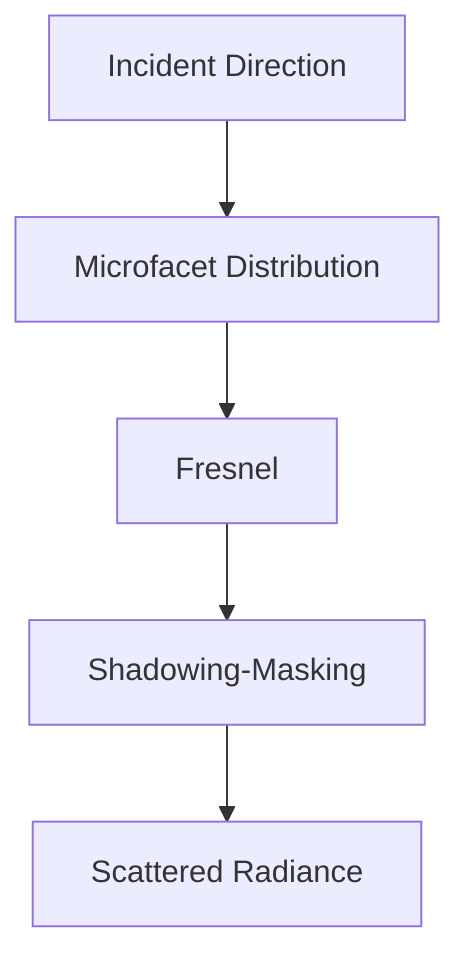

> **Reading the code in this chapter.** The `rust` listings are Rust-flavored pseudocode that uses
> pbrt-style aliases (`Float = f32`, `Vector3f`/`Normal3f`/`Point2f` = `glam` vectors,
> `SampledSpectrum` for spectral samples). Where a GPU implementation is useful, the equivalent
> `wgsl` snippet is given alongside it. The `〈...〉` markers are pbrt's literate-programming
> cross-references to other fragments in the book; they are kept for traceability.

This chapter defines a set of classes for describing the way that light scatters at surfaces. Recall that in Section 4.3.1 we introduced the bidirectional reflectance distribution function (BRDF) abstraction to describe light reflection at a surface, the bidirectional transmittance distribution function (BTDF) to describe transmission at a surface, and the bidirectional scattering distribution function (BSDF) to encompass both of these effects. In this chapter, we will start by defining a generic interface to these surface reflection and transmission functions.

Surface reflection models come from a number of sources:

- **Measured data:** Reflection distribution properties of many real-world surfaces have been measured in laboratories. Such data may be used directly in tabular form or to compute coefficients for a set of basis functions.

- **Phenomenological models:** Equations that attempt to describe the qualitative properties of real-world surfaces can be remarkably effective at mimicking them. These types of BSDFs can be particularly easy to use, since they tend to have intuitive parameters that modify their behavior (e.g., “roughness”).

- **Simulation:** Sometimes, low-level information is known about the composition of a surface. For example, we might know that a paint is comprised of colored particles of some average size suspended in a medium or that a particular fabric is comprised of two types of threads with known reflectance properties. In this case, a preprocess could simulate the behavior of light within the microstructure to fit an approximate BSDF. Alternatively, simulation could occur when rendering.

- **Physical (wave) optics:** Some reflection models have been derived using a detailed model of light, treating it as a wave and computing the solution to Maxwell’s equations to find how it scatters from a surface with known properties. They are mainly of use when the scene contains geometric detail at the micrometer level that makes wave-optical behavior readily apparent, such as with thin films, coatings, and periodic structures as found on digital optical data storage formats like CDs and DVDs.

- **Geometric optics:** As with simulation approaches, if the surface’s low-level scattering and geometric properties are known, then closed-form reflection models can sometimes be derived directly from these descriptions. Geometric optics makes modeling light’s interaction with the surface more tractable, since complex wave effects like diffraction can be ignored.

<details>
<summary>Figure 9.1 — Reflection from a surface can be generally categorized by the distr…</summary>

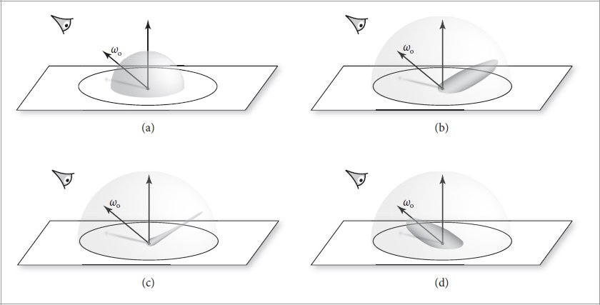

*Figure 9.1: Reflection from a surface can be generally categorized by the distribution of reflected light from an incident direction (heavy lines): (a) diffuse, (b) glossy specular, (c) nearly perfect specular, and (d) retroreflective distributions.*

</details>

This chapter discusses the implementation of a number of such models along with the associated theory. See also Section 14.3, which introduces a reflection model based on the simulation of light scattering in layered materials. The “Further Reading” section at the end of this chapter gives pointers to a wide variety of additional reflection models.

An important component of surface appearance is the spatial variation of reflection and transmission properties over the surface. The texture and material classes of Chapter 10 will address that problem, while the abstractions presented here will only consider scattering at a single point on a surface. Further, BRDFs and BTDFs explicitly only model scattering from light that enters and exits a surface at a single point. For surfaces that exhibit meaningful subsurface light transport, a more complete simulation of light scattering inside the material is necessary—for example, by applying the volumetric light transport algorithms of Chapter 14.

**Basic Terminology.**  We now introduce basic terminology for describing reflection from surfaces. To compare the resulting visual appearance, we will classify reflection into the following four broad categories: diffuse, glossy specular, perfect specular, and retroreflective (Figure 9.1). Most real surfaces exhibit a mixture of these four behaviors. Diffuse surfaces scatter light equally in all directions. Although a perfectly diffuse surface is not physically realizable, examples of near-diffuse surfaces include dull chalkboards and matte paint. Glossy specular surfaces such as plastic or high-gloss paint scatter light preferentially in a set of reflected directions—they show blurry reflections of other objects. Perfect specular surfaces scatter incident light in a single outgoing direction. Mirrors and glass are examples of perfect specular surfaces. Finally, retroreflective surfaces like velvet or the Earth’s moon scatter light primarily back

along the incident direction. Images throughout this chapter will show the differences between these various behaviors in rendered scenes.

Given a particular category of reflection, the reflectance distribution function may be isotropic or anisotropic. With an isotropic material, if you choose a point on the surface and rotate it around its normal axis at that point, the distribution of light reflected at that point does not change. Diffuse materials like paper or wall paint are usually isotropic due to the directionally random arrangement of wood fibers or paint particles.

In contrast, anisotropic materials reflect different amounts of light as you rotate them in this way. Examples of anisotropic materials include hair and many types of cloth. Industrial processes such as milling, rolling, extrusion, and 3D printing also tend to produce highly anisotropic surfaces, an extreme example being brushed metal.

## 9.1 BSDF REPRESENTATION

There are two components of pbrt’s representation of BSDFs: the BxDF interface and its implementations (described in Section 9.1.2) and the BSDF class (described in Section 9.1.5). The former models specific types of scattering at surfaces, while the latter provides a convenient wrapper around a pointer to a specific BxDF implementation. The BSDF class also centralizes general functionality so that BxDF implementations do not individually need to handle it, and it records information about the local geometric properties of the surface.

### 9.1.1 GEOMETRIC SETTING AND CONVENTIONS

Reflection computations in pbrt are performed in a reflection coordinate system where the two tangent vectors and the normal vector at the point being shaded are aligned with the x, y, and z axes, respectively (Figure 9.2). All direction vectors passed to and returned from the BxDF evaluation and sampling routines will be defined with respect to this coordinate system. It is important to understand this coordinate system in order to understand the BxDF implementations in this chapter.

Section 3.8 introduced a range of utility functions—like SinTheta(), CosPhi(), etc.—that efficiently evaluate trigonometric functions of unit vectors expressed in Cartesian coordinates matching the convention used here. They will be used extensively in this chapter, as quantities like the cosine of the elevation angle play a central role in most reflectance models.

We will frequently find it useful to check whether two direction vectors lie in the same hemisphere with respect to the surface normal in the BSDF coordinate system; the `SameHemisphere()` function performs this check.

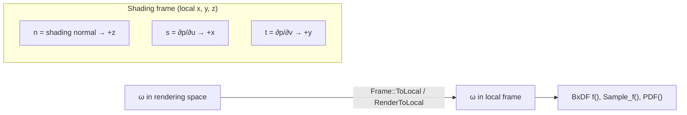

*Figure 9.2 (redrawn as Mermaid). The Basic BSDF Coordinate Setting. The shading coordinate system is defined by the orthonormal basis vectors (s, t, n). We will orient these vectors such that they lie along the x, y, and z axes in this coordinate system. Direction vectors ω in rendering space are transformed into the shading coordinate system before any of the BRDF or BTDF methods are called.*

```text
    BSDF 544
    CosPhi() 108
    SinTheta() 108
```

〈Spherical Geometry Inline Functions〉 +≡ bool SameHemisphere(Vector3f w, Vector3f wp) { return w.z * wp.z > 0; }

There are some additional conventions that are important to keep in mind when reading the code in this chapter and when adding BRDFs and BTDFs to pbrt:

The incident light direction ωi and the outgoing viewing direction ωo will both be normalized and outward facing after being transformed into the local coordinate system at the surface. In other words, the directions will not model the physical propagation of light, which is helpful in bidirectional rendering algorithms that generate light paths in reverse order.

In pbrt, the surface normal n always points to the “outside” of the object, which makes it easy to determine if light is entering or exiting transmissive objects: if the incident light direction ωi is in the same hemisphere as n, then light is entering; otherwise, it is exiting. Therefore, the normal may be on the opposite side of the surface than one or both of the ωi and ωo direction vectors. Unlike many other renderers, pbrt does not flip the normal to lie on the same side as ωo.

The local coordinate system used for shading may not be exactly the same as the coordinate system returned by the `Shape::Intersect()` routines from Chapter 6; it may have been modified between intersection and shading to achieve effects like bump mapping. See Chapter 10 for examples of this kind of modification.

### 9.1.2 BxDF INTERFACE

The interface for the individual BRDF and BTDF functions is defined by `BxDF`, which is in the file `base/bxdf.h`.

〈BxDF Definition〉 ≡

```rust
// pbrt uses TaggedPointer<...>; the Rust equivalent is a tagged enum.
enum BxDF {
    Diffuse(DiffuseBxDF),
    CoatedDiffuse(CoatedDiffuseBxDF),
    CoatedConductor(CoatedConductorBxDF),
    Dielectric(DielectricBxDF),
    ThinDielectric(ThinDielectricBxDF),
    Hair(HairBxDF),
    Measured(MeasuredBxDF),
    Conductor(ConductorBxDF),
    NormalizedFresnel(NormalizedFresnelBxDF),
    // 〈BxDF Interface 538〉
}
```

The `BxDF` interface provides a method to query the material type following the earlier categorization, which some light transport algorithms in Chapters 13 through 15 use to specialize their behavior.

〈BxDF Interface〉 ≡ 538

```rust
   BxDFFlags Flags();
```

<details>
<summary>Reference / notes: BxDF 538…</summary>

```text
    BxDF 538
    BxDFFlags 539
    CoatedConductorBxDF 909
    CoatedDiffuseBxDF 909
    ConductorBxDF 560
    DielectricBxDF 563
    DiffuseBxDF 546
    HairBxDF 606
    MeasuredBxDF 592
    Shape::Intersect() 265
    TaggedPointer 1073
    ThinDielectricBxDF 567
    Vector3f 86
```

</details>

The `BxDFFlags` enumeration lists the previously mentioned categories and also distinguishes reflection from transmission. Note that retroreflection is treated as glossy reflection in this list.

〈BxDFFlags Definition〉 ≡ enum BxDFFlags { Unset = 0, Reflection = 1 << 0, Transmission = 1 << 1, Diffuse = 1 << 2, Glossy = 1 << 3, Specular = 1 << 4, 〈Composite BxDFFlags definitions 539〉 };

These constants can also be combined via a binary OR operation to characterize materials that simultaneously exhibit multiple traits. A number of commonly used combinations are provided with their own names for convenience:

〈Composite BxDFFlags definitions〉 ≡ 539

```text
   DiffuseReflection = Diffuse | Reflection,
   DiffuseTransmission = Diffuse | Transmission,
   GlossyReflection = Glossy | Reflection,
   GlossyTransmission = Glossy | Transmission,
   SpecularReflection = Specular | Reflection,
   SpecularTransmission = Specular | Transmission,
   All = Diffuse | Glossy | Specular | Reflection | Transmission
```

A few utility functions encapsulate the logic for testing various flag characteristics.

〈BxDFFlags Inline Functions〉 ≡ bool IsReflective(BxDFFlags f) { return f & BxDFFlags::Reflection; } bool IsTransmissive(BxDFFlags f) { return f & BxDFFlags::Transmission; } bool IsDiffuse(BxDFFlags f) { return f & BxDFFlags::Diffuse; } bool IsGlossy(BxDFFlags f) { return f & BxDFFlags::Glossy; } bool IsSpecular(BxDFFlags f) { return f & BxDFFlags::Specular; } bool IsNonSpecular(BxDFFlags f) { return f & (BxDFFlags::Diffuse | BxDFFlags::Glossy); }

The key method that `BxDF`s provide is `f()`, which returns the value of the distribution function for the given pair of directions. The provided directions must be expressed in the local reflection coordinate system introduced in the previous section.

This interface implicitly assumes that light in different wavelengths is decoupled—energy at one wavelength will not be reflected at a different wavelength. In this case, the effect of reflection can be described by a per-wavelength factor returned in the form of a `SampledSpectrum`. Fluorescent materials that redistribute energy between wavelengths would require that this method return an n × n matrix to encode the transfer between the n spectral samples of `SampledSpectrum`.

<details>
<summary>Reference / notes: BxDF 538…</summary>

```text
    BxDF 538
    BxDFFlags 539
    BxDFFlags::Diffuse 539
    BxDFFlags::Glossy 539
    BxDFFlags::Reflection 539
    BxDFFlags::Specular 539
    BxDFFlags::Transmission 539
    SampledSpectrum 171
    TransportMode 571
    Vector3f 86
```

</details>

Neither constructors nor methods of `BxDF` implementations will generally be informed about the specific wavelengths associated with `SampledSpectrum` entries, since they do not require this information.

〈BxDF Interface〉 +≡ 538

```rust
   SampledSpectrum f(Vector3f wo, Vector3f wi, TransportMode
   mode);
```

The function also takes a TransportMode enumerator that indicates whether the outgoing direction is toward the camera or toward a light source (and the corresponding opposite for the incident direction). This is necessary to handle cases where scattering is non-symmetric; this subtle aspect is discussed further in Section 9.5.2.

BxDFs must also provide a method that uses importance sampling to draw a direction from a distribution that approximately matches the scattering function’s shape. Not only is this operation crucial for efficient Monte Carlo integration of the light transport equation (1.1), it is the only way to evaluate some BSDFs. For example, perfect specular objects like a mirror, glass, or water only scatter light from a single incident direction into a single outgoing direction. Such BxDFs are best described with Dirac delta distributions (covered in more detail in Section 9.1.4) that are zero except for the single direction where light is scattered. Their `f()` and `PDF()` methods always return zero.

Implementations of the `Sample_f()` method should determine the direction of incident light ωi given an outgoing direction ωo and return the value of the BxDF for the pair of directions. They take three uniform samples in the range [0, 1)2 via the `uc` and `u` parameters. Implementations can use these however they wish, though it is generally best if they use the 1D sample `uc` to choose between different types of scattering (e.g., reflection or transmission) and the 2D sample to choose a specific direction. Using `uc` and `u[0]` to choose a direction, for example, would likely give inferior results to using `u[0]` and `u[1]`, since `uc` and `u[0]` are not necessarily jointly well distributed. Not all the sample values need be used, and BxDFs that need additional sample values must generate them themselves. (The `LayeredBxDF` described in Section 14.3 is one such example.) Note the potentially counterintuitive direction convention: the outgoing direction ωo is given, and the implementation then samples an incident direction ωi. The Monte Carlo methods in this book construct light paths in reverse order—that is, counter to the propagation direction of the transported quantity (radiance or importance)—motivating this choice.

Callers of this method must be prepared for the possibility that sampling fails, in which case an unset optional value will be returned.

〈BxDF Interface〉 +≡ 538

```rust
   Option<BSDFSample>
   Sample_f(Vector3f wo, Float uc, Point2f u,
               TransportMode mode = TransportMode::Radiance,
               BxDFReflTransFlags           sampleFlags                           =
               BxDFReflTransFlags::All);
```

The sample generation can optionally be restricted to the reflection or transmission component via the `sampleFlags` parameter. A sampling failure will occur in invalid cases—for example, if the caller requests a transmission sample on an opaque surface.

〈BxDFReflTransFlags Definition〉 ≡ enum BxDFReflTransFlags { Unset = 0, Reflection = 1 << 0, Transmission = 1 << 1, All = Reflection | Transmission };

```text
    BSDFSample 541
    BxDF 538
    BxDFFlags 539
    BxDFReflTransFlags 540
    Float 23
    LayeredBxDF 895
    Point2f 92
    TransportMode 571
    Vector3f 86
```

If sampling succeeds, the method returns a `BSDFSample` that includes the value of the BSDF f, the sampled direction `wi`, its probability density function (PDF) measured with respect to solid angle, and a `BxDFFlags` instance that describes the characteristics of the particular sample. `BxDF`s should specify the direction `wi` with respect to the local reflection coordinate system, though `BSDF::Sample_f()` will transform this direction to rendering space before returning it.

Some BxDF implementations (notably, the `LayeredBxDF` described in Section 14.3) generate samples via simulation, following a random light path. The distribution of paths that escape is the BxDF’s exact (probabilistic) distribution, but the returned `f` and `pdf` are only proportional to their true values. (Fortunately, by the same proportion!) This case needs special handling in light transport algorithms, and is indicated by the `pdfIsProportional` field. For all the BxDFs in this chapter, it can be left set to its default false value.

〈BSDFSample Definition〉 ≡ struct BSDFSample { 〈BSDFSample Public Methods 541〉 SampledSpectrum f; Vector3f wi; Float pdf = 0; BxDFFlags flags; Float eta = 1;

bool pdfIsProportional = false; }; 〈BSDFSample Public Methods〉 ≡ 541

```rust
   BSDFSample(SampledSpectrum f, Vector3f wi, Float pdf,
   BxDFFlags flags,
              Float eta = 1, bool pdfIsProportional = false)
       : f(f), wi(wi), pdf(pdf), flags(flags), eta(eta),
         pdfIsProportional(pdfIsProportional) {}
```

Several convenience methods can be used to query characteristics of the sample using previously defined functions like `BxDFFlags::IsReflective()`, etc.

〈BSDFSample Public Methods〉 +≡ 541

```rust
   bool IsReflection() { return pbrt::IsReflective(flags);
   }
   bool       IsTransmission()       {        return
   pbrt::IsTransmissive(flags); }
   bool IsDiffuse() { return pbrt::IsDiffuse(flags); }
   bool IsGlossy() { return pbrt::IsGlossy(flags); }
   bool IsSpecular() { return pbrt::IsSpecular(flags); }
```

<details>
<summary>Reference / notes: BSDF::Sample_f() 545…</summary>

```text
    BSDF::Sample_f() 545
    BSDFSample 541
    BxDF 538
    BxDF::rho() 542
    BxDFFlags 539
    BxDFFlags::IsDiffuse() 539
    BxDFFlags::IsGlossy() 539
    BxDFFlags::IsReflective() 539
    BxDFFlags::IsSpecular() 539
    BxDFFlags::IsTransmissive() 539
    BxDFReflTransFlags 540
    Float 23
    LayeredBxDF 895
    SampledSpectrum 171
    TransportMode 571
    Vector3f 86
```

</details>

The `PDF()` method returns the value of the PDF for a given pair of directions, which is useful for techniques like multiple importance sampling that compare probabilities of multiple strategies for obtaining a given sample.

〈BxDF Interface〉 +≡ Float PDF(Vector3f wo, Vector3f wi, TransportMode mode, BxDFReflTransFlags sampleFlags = BxDFReflTransFlags::All) const;

### 9.1.3 HEMISPHERICAL REFLECTANCE

With the `BxDF` methods described so far, it is possible to implement methods that compute the reflectance of a BxDF by applying the Monte Carlo estimator to the definitions of reflectance from Equations (4.12) and (4.13).

A first variant of `BxDF::rho()` computes the reflectance function ρhd. Its caller is responsible for determining how many samples should be taken and for providing the uniform sample values to be used in computing the estimate. Thus, depending on the context, callers have control over sampling and the quality of the returned estimate.

〈BxDF Method Definitions〉 ≡ SampledSpectrum BxDF::rho(Vector3f wo, &[f32] uc, &[Point2f] u2) const { SampledSpectrum r(0.); for i in 0..uc.len() { 〈Compute estimate of ρhd 542〉 } return r / uc.len(); }

Each term of the estimator

$$\rho_{hd}(\omega_o)=\int_{H^2} f_r(\omega_o,\omega_i)\,|\cos\theta_i|\,\mathrm{d}\omega_i \;\approx\;\frac{1}{N}\sum_{i=1}^{N}\frac{f_r(\omega_o,\omega_i)\,|\cos\theta_i|}{p(\omega_i)}.$$

is easily evaluated.

〈Compute estimate of ρhd〉 ≡ 542

```rust
    Option<BSDFSample> bs = Sample_f(wo, uc[i], u2[i]);
    if (bs)
        r += bs.f * AbsCosTheta(bs.wi) / bs.pdf;
```

The hemispherical-hemispherical reflectance is found in the second `BxDF::rho()` method that evaluates Equation (4.13). As with the first `rho()` method, the caller is responsible for passing in uniform sample values—in this case, five dimensions’ worth of them.

〈BxDF Method Definitions〉 +≡ SampledSpectrum BxDF::rho(&[Point2f] u1, &[f32] uc, &[Point2f] u2) const { SampledSpectrum r(0.f); for i in 0..uc.len() { 〈Compute estimate of ρhh 542〉 } return r / (Pi * uc.len()); }

Our implementation samples the first direction wo uniformly over the hemisphere. Given this, the second direction can be sampled using `BxDF::Sample_f()`.1

〈Compute estimate of ρhh〉 ≡ 542

```rust
    Vector3f wo = SampleUniformHemisphere(u1[i]);
    if (wo.z == 0)
        continue;
    Float pdfo = UniformHemispherePDF();
    Option<BSDFSample> bs = Sample_f(wo, uc[i], u2[i]);
    if (bs)
        r += bs.f * AbsCosTheta(bs.wi) * AbsCosTheta(wo) /
        (pdfo * bs.pdf);
```

```text
    AbsCosTheta() 107
    BSDFSample 541
```

<details>
<summary>Reference / notes: BSDFSample::f 541…</summary>

```text
    BSDFSample::f 541
    BSDFSample::pdf 541
    BSDFSample::wi 541
    BxDF 538
    BxDF::Sample_f() 540
    Float 23
    Pi 1033
    Point2f 92
    SampledSpectrum 171
    SampleUniformHemisphere() 1015
    UniformHemispherePDF() 1015
    Vector3f 86
```

</details>

### 9.1.4 DELTA DISTRIBUTIONS IN BSDFs

Several BSDF models in this chapter make use of Dirac delta distributions to represent interactions with perfect specular materials like smooth metal or glass surfaces. They represent a curious corner case in implementations, and we therefore establish a few important conventions.

Recall from Section 8.1.1 that the Dirac delta distribution is defined such that

$$\delta(x)=0\quad\text{for all }x\neq0$$

and

According to these equations, δ can be interpreted as a normalized density function that is zero for all x ≠ 0. Generating a sample from such a distribution is trivial, since there is only one value that it can take. In this sense, the forthcoming implementations of `Sample_f()` involving delta functions naturally fit into the Monte Carlo sampling framework.

However, sampling alone is not enough: two methods (`Sample_f()` and `PDF`) also provide sampling densities, and it is considerably less clear what values should be returned here. Strictly speaking, the delta distribution is not a true function but constitutes the limit of a sequence of functions—for example, one describing a box of unit area whose width approaches 0; see Chapter 5 of Bracewell (2000) for details. In the limit, the value of δ(0) must then necessarily tend toward infinity. This important theoretical realization does not easily translate into Rust code: certainly, returning an infinite or very large PDF value is not going to lead to correct results from the renderer.

To resolve this conflict, BSDFs may only contain matched pairs of delta functions in their `fr` function and `PDF`. For example, suppose that the PDF factors into a remainder term and a delta function involving a particular direction ω′: p(ωi) = prem(ωi) δ(ω′ − ωi). If the same holds true for fr, then a Monte Carlo estimator that divides fr by the PDF will never require evaluation of the delta function:

$$\int f(x)\,\mathrm{d}x=\int\frac{f(x)}{p(x)}\,p(x)\,\mathrm{d}x \;\approx\;\frac{1}{N}\sum_{i=1}^{N}\frac{f(x_i)}{p(x_i)}, \qquad \frac{f_{\mathrm{pre}}(x)\,\delta(\omega^{\prime}-\omega_i)}{p_{\mathrm{pre}}(x)\,\delta(\omega^{\prime}-\omega_i)} =\frac{f_{\mathrm{pre}}(x)}{p_{\mathrm{pre}}(x)}.$$

Implementations of perfect specular materials will thus return a constant PDF of 1 when `Sample_f()` generates a direction associated with a delta function, with the understanding that the delta function will cancel in the estimator.

In contrast, the respective `PDF()` methods should return 0 for all directions, since there is zero probability that another sampling method will randomly find the direction from a delta distribution.2

```text
      BxDF 538
```

### 9.1.5 BSDFs

`BxDF` class implementations perform all computation in a local shading coordinate system that is most appropriate for this task. In contrast, rendering algorithms operate in rendering space (Section 5.1.1); hence a transformation between these two spaces must be performed somewhere. The BSDF is a small wrapper around a `BxDF` that handles this transformation.

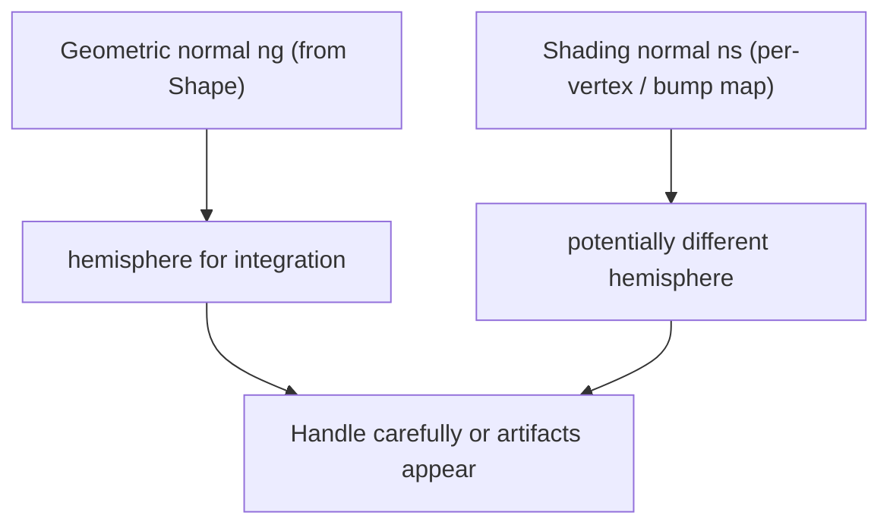

*Figure 9.3 (redrawn as Mermaid). The geometric normal, ng, defined by the surface geometry, and the shading normal, ns, given by per-vertex normals and/or bump mapping, will generally define different hemispheres for integrating incident illumination to compute surface reflection. It is important to handle this inconsistency carefully since it can otherwise lead to artifacts in images.*

〈BSDF Definition〉 ≡ struct BSDF { 〈BSDF Public Methods 544〉  〈BSDF Private Members 544〉 };

In addition to an encapsulated `BxDF`, the `BSDF` holds a shading frame based on the `Frame` class.

〈BSDF Private Members〉 ≡ 544

```rust
   BxDF bxdf;
   Frame shadingFrame;
```

The constructor initializes the latter from the shading normal ns and ∂p/∂u using the shading coordinate system convention (Figure 9.3).

〈BSDF Public Methods〉 ≡ 544

```rust
   BSDF() = default;
   BSDF(Normal3f ns, Vector3f dpdus, BxDF bxdf)
       : bxdf(bxdf),
         shadingFrame(Frame::FromXZ(Normalize(dpdus),
         Vector3f(ns))) {}
```

The default constructor creates a BSDF with a `None`-valued `bxdf`, which is useful to represent transitions between different media that do not themselves scatter light. An `operator bool()` method checks whether the BSDF represents a real material interaction, in which case the `Flags()` method provides further information about its high-level properties.

〈BSDF Public Methods〉 +≡ 544

```rust
fn is_some(&self) -> bool { self.bxdf.is_some() }
   fn flags(&self) -> BxDFFlags { self.bxdf.flags() }
```

```text
    BSDF 544
    BSDF::bxdf 544
    BxDF 538
    BxDFFlags 539
    Frame 133
    Frame::FromXZ() 134
    Normal3f 94
    Normalize() 88
    Vector3f 86
```

The BSDF provides methods that perform transformations to and from the reflection coordinate system used by `BxDF`s.

〈BSDF Public Methods〉 +≡ 544

```rust
   Vector3f     RenderToLocal(Vector3f  v)                {    return
   shadingFrame.ToLocal(v); }
   Vector3f LocalToRender(Vector3f v) {
       return shadingFrame.FromLocal(v);
   }
```

The `f()` function performs the required coordinate frame conversion and then queries the `BxDF`. The rare case in which the `wo` direction lies exactly in the surface’s tangent plane often leads to not-a-number (NaN) values in BxDF implementations that further propagate and may eventually contaminate the rendered image. The `BSDF` avoids this case by immediately returning a zero-valued `SampledSpectrum`.

〈BSDF Public Methods〉 +≡ 544

```rust
   SampledSpectrum f(Vector3f woRender, Vector3f wiRender,
                     TransportMode mode = TransportMode::Radiance) {
       Vector3f wi = RenderToLocal(wiRender), wo = RenderToLocal(woRender);
       if (wo.z == 0) return {};
       return bxdf.f(wo, wi, mode);
   }
```

The BSDF also provides a second templated `f()` method that can be parameterized by the underlying BxDF. If the caller knows the specific type of `BSDF::bxdf`, it can call this variant directly without involving the dynamic method dispatch used in the method above. This approach is used by pbrt’s wavefront rendering path, which groups evaluations based on the underlying BxDF to benefit from vectorized execution on the GPU. The implementation of this specialized version simply casts the `BxDF` to the provided type before invoking its `f()` method.

〈BSDF Public Methods〉 +≡ 544

```rust
fn f<T: BxDFInterface>(&self, wo_render: Vector3f, wi_render: Vector3f,
                         mode: TransportMode) -> SampledSpectrum {
       let wi = self.render_to_local(wi_render);
       let wo = self.render_to_local(wo_render);
       if wo.z == 0.0 { return SampledSpectrum::ZERO; }
       let specific_bxdf: &T = self.bxdf.cast_or_null::<T>().unwrap();
       specific_bxdf.f(wo, wi, mode)
   }
```

<details>
<summary>Reference / notes: BSDF::bxdf 544…</summary>

```text
    BSDF::bxdf 544
    BSDF::RenderToLocal() 545
    BSDF::Sample_f() 545
    BSDF::shadingFrame 544
    BSDFSample 541
    BxDF 538
    BxDF::f() 539
    BxDF::Flags() 538
    BxDFReflTransFlags 540
    BxDFReflTransFlags::All 540
    Float 23
    Frame::FromLocal() 134
    Frame::ToLocal() 134
    Point2f 92
    SampledSpectrum 171
    TaggedPointer::CastOrNullptr() 1075
    TransportMode 571
    TransportMode::Radiance 571
    Vector3f 86
```

</details>

The `BSDF::Sample_f()` method similarly forwards the sampling request on to the `BxDF` after transforming the ωo direction to the local coordinate system.

〈BSDF Public Methods〉 +≡ 544

```rust
   Option<BSDFSample> Sample_f(
            Vector3f woRender, Float u, Point2f u2,
            TransportMode mode = TransportMode::Radiance,
            BxDFReflTransFlags                 sampleFlags     =
            BxDFReflTransFlags::All) {
       Vector3f wo = RenderToLocal(woRender);
       if (wo.z == 0 ||!(bxdf.Flags() & sampleFlags)) return {};
       〈Sample bxdf and return BSDFSample 546〉
   }
```

If the `BxDF` implementation returns a sample that has a zero-valued `BSDF` or `PDF` or an incident direction in the tangent plane, this method nevertheless returns an unset sample value. This allows calling code to proceed without needing to check those cases.

〈Sample bxdf and return BSDFSample〉 ≡ 545

```rust
   Option<BSDFSample> bs = bxdf.Sample_f(wo,                  u,   u2,
   mode, sampleFlags);
   if (!bs || !bs.f || bs.pdf == 0 || bs.wi.z == 0)
        return {};
   bs.wi = LocalToRender(bs.wi);
   return bs;
```

`BSDF::PDF()` follows the same pattern.

〈BSDF Public Methods〉 +≡ 544

```rust
   Float PDF(Vector3f woRender, Vector3f wiRender,
               TransportMode mode = TransportMode::Radiance,
               BxDFReflTransFlags          sampleFlags                       =
               BxDFReflTransFlags::All) {
       Vector3f      wo   =    RenderToLocal(woRender),    wi                =
       RenderToLocal(wiRender);
       if (wo.z == 0) return 0;
       return bxdf.PDF(wo, wi, mode, sampleFlags);
   }
```

We have omitted the definitions of additional templated `Sample_f()` and `PDF()` variants that are parameterized by the `BxDF` type.

Finally, `BSDF` provides `rho()` methods to compute the reflectance that forward the call on to its underlying `bxdf`. They are trivial and therefore not included here.

## 9.2 DIFFUSE REFLECTION

One of the simplest BRDFs is the Lambertian model, which describes a perfect diffuse surface that scatters incident illumination equally in all directions. It is a reasonable approximation to many real-world surfaces such as paper or matte paint. The Lambertian model captures the behavior of such diffuse materials relatively well, though the approximation tends to perform worse for light arriving at a grazing angle, where specular reflection causes a noticeable deviation from uniformity. (Microfacet models such as those presented in Section 9.6 can account for such effects.) It is interesting to note that surfaces created from polytetrafluoroethylene (PTFE) powder are known to be particularly good Lambertian reflectors. They are commonly used to calibrate laboratory equipment for this reason.

〈DiffuseBxDF Definition〉 ≡ struct DiffuseBxDF { 〈DiffuseBxDF Public Methods 546〉  SampledSpectrum R; };

The constructor takes a reflectance spectrum R with values in the range [0, 1] that specify the fraction of incident light that is scattered.

〈DiffuseBxDF Public Methods〉 ≡ 546

```rust
   DiffuseBxDF(SampledSpectrum R) : R(R) {}
```

<details>
<summary>Reference / notes: BSDF 544…</summary>

```text
    BSDF 544
    BSDF::bxdf 544
    BSDF::LocalToRender() 545
    BSDF::RenderToLocal() 545
    BSDFSample 541
    BSDFSample::f 541
    BSDFSample::pdf 541
    BSDFSample::wi 541
    BxDF::PDF() 541
    BxDF::Sample_f() 540
    BxDFReflTransFlags 540
    DiffuseBxDF 546
    DiffuseBxDF::R 546
    Float 23
    SampledSpectrum 171
    TransportMode 571
    Vector3f 86
```

</details>

The reflection distribution function is just a constant, though it requires a normalization factor equal to $1/\pi$ so that the total integrated reflectance equals $R$:

$$f_r(\omega_o,\omega_i)=\frac{R}{\pi}.$$

With this correction, the `f()` implementation is given by

〈DiffuseBxDF Public Methods〉 +≡ 546

```rust
   SampledSpectrum f(Vector3f wo, Vector3f wi, TransportMode
   mode) {
        if (!SameHemisphere(wo, wi))
            return SampledSpectrum(0.f);
        return R * InvPi;
   }
```

The same Lambertian BRDF maps directly to a wgpu shader. A uniform sample set is cosine-weighted on the GPU as well:

```wgsl
// Lambertian (diffuse) BSDF evaluation and cosine-weighted sampling.
fn lambertian_f(R: vec3f, wo: vec3f, wi: vec3f) -> vec3f {
    if (wo.z * wi.z <= 0.0) { return vec3f(0.0); }   // same hemisphere
    return R * (1.0 / PI);                          // fr = R / pi
}

fn cosine_hemisphere(u: vec2f) -> vec3f {
    let r = sqrt(u.x);
    let phi = 2.0 * PI * u.y;
    return vec3f(r * cos(phi), r * sin(phi), sqrt(max(0.0, 1.0 - u.x)));
}

fn lambertian_sample(R: vec3f, wo: vec3f, u: vec2f) -> BSDFSample {
    var bs: BSDFSample;
    bs.wi = cosine_hemisphere(u);
    bs.wi.z = select(bs.wi.z, -bs.wi.z, wo.z < 0.0);
    bs.f = lambertian_f(R, wo, bs.wi);
    bs.pdf = abs(bs.wi.z) / PI;                     // cosine-weighted PDF
    bs.flags = BSDF_FLAG_DIFFUSE | BSDF_FLAG_REFLECTION;
    return bs;
}
```

The sampling function returns an invalid sample if the caller specified that reflection components of the BSDF should not be sampled. Otherwise, it draws a direction from a suitable distribution and returns all the sample-related information via a `BSDFSample` instance.

〈DiffuseBxDF Public Methods〉 +≡ 546

```rust
   Option<BSDFSample> Sample_f(
            Vector3f wo, Float uc, Point2f u, TransportMode mode,
            BxDFReflTransFlags                   sampleFlags             =
            BxDFReflTransFlags::All) {
        if (!(sampleFlags & BxDFReflTransFlags::Reflection))
            return {};
        〈Sample cosine-weighted hemisphere to compute wi and pdf 547〉
        return       BSDFSample(R        *        InvPi,      wi,     pdf,
        BxDFFlags::DiffuseReflection);
   }
```

Working in a canonical reflection coordinate system greatly simplifies the central sampling step: in particular, a direction generated by `SampleCosineHemisphere()` can be directly used, and we must only pay attention that `wo` and `wi` lie in the same hemisphere, as indicated by `wo.z` and `wi.z`.

Although the Lambertian BRDF is uniform over the hemisphere, BSDFs are sampled in the context of the light transport equation, (1.1), where the BSDF is multiplied by the incident radiance and a cosine factor. It is worthwhile for `BxDF`s to include the cosine factor in their sampling distribution if possible; see Figure 9.4, which compares uniform and cosine-weighted hemisphere sampling for the `DiffuseBxDF`.

〈Sample cosine-weighted hemisphere to compute wi and pdf〉 ≡ Vector3f wi = SampleCosineHemisphere(u); if (wo.z < 0) wi.z *= -1; Float pdf = CosineHemispherePDF(AbsCosTheta(wi));

<details>
<summary>Reference / notes: AbsCosTheta() 107…</summary>

```text
    AbsCosTheta() 107
    BSDFSample 541
    BxDFFlags::DiffuseReflection 539
    BxDFReflTransFlags 540
    BxDFReflTransFlags::All 540
    BxDFReflTransFlags::Reflection 540
    CosineHemispherePDF() 1017
    DiffuseBxDF::R 546
    Float 23
    InvPi 1033
    Point2f 92
    SameHemisphere() 538
    SampleCosineHemisphere() 1017
    SampledSpectrum 171
    TransportMode 571
    Vector3f 86
```

</details>

The `PDF()` method just needs to ensure that the caller has included reflection in the types of scattering that it is interested in and that the two directions both lie in the same hemisphere.

〈DiffuseBxDF Public Methods〉 +≡ 546

```rust
   Float PDF(Vector3f wo, Vector3f wi, TransportMode mode,
               BxDFReflTransFlags          sampleFlags                           =
               BxDFReflTransFlags::All) {
        if (!(sampleFlags & BxDFReflTransFlags::Reflection) ||
            !SameHemisphere(wo, wi))
            return 0;
        return CosineHemispherePDF(AbsCosTheta(wi));
   }
```

<details>
<summary>Figure 9.4 — Comparison of Sampling Methods for a Lambertian BSDF. Both images a…</summary>

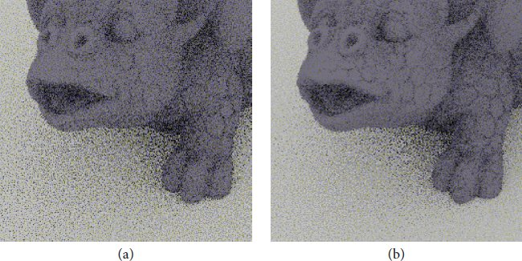

*Figure 9.4: Comparison of Sampling Methods for a Lambertian BSDF. Both images are rendered using 4 samples per pixel. (a) Uniform hemisphere sampling. (b) Cosine-weighted hemisphere sampling. By incorporating the cosine factor in the light transport equation’s integrand, cosine-weighted hemisphere sampling improves mean squared error (MSE) by a factor of 2.34 for this test scene, without additional computational cost.*

</details>

## 9.3 SPECULAR REFLECTION AND TRANSMISSION

Following the discussion of diffuse surfaces with their perfectly uniform reflectance, we now turn to the opposite extreme: specular materials that only reflect light into a discrete set of directions. Following a review of the physical principles underlying such materials in this section, we will introduce concrete `BxDF` implementations in Sections 9.4 and 9.5.

Our initial focus is on perfect specular surfaces. However, many real-world materials are fairly rough at a microscopic scale, and this can have a profound influence on their reflection behavior. Sections 9.6 and 9.7 will generalize our understanding of the perfect specular case to such rough surface microstructures.

### 9.3.1 PHYSICAL PRINCIPLES

For the most part, this book is concerned with geometric optics, which describes the scattering and transport of radiance along rays. This is an approximation of the wave nature of light, albeit an excellent one: visible light waves occur at scales that are negligible compared to the size of objects rendered in pbrt (~ millimeters to meters), and hence wave-like phenomena normally do not manifest in rendered images.

Yet, to understand and model what happens when light strikes a surface, it is helpful to briefly turn toward this deeper understanding of light in terms of waves. Using wave-optical results within an overall geometric simulation is often possible and has become a common design pattern in computer graphics.

The theory of electromagnetism describes light as an oscillation of the electric and magnetic fields. What does this mean? These terms refer to vector fields, which are convenient mathematical abstractions that assign a 3D vector to every point in space. These vectors describe the force that a small charged particle would feel due to such a light wave passing around it. For our purposes, only the electric field is interesting, and the charged particle that will be influenced by this force is an electron surrounding the nucleus of an atom.

When a beam of light arrives at a surface, it stimulates the electrons of the atoms comprising the material, causing them to begin to oscillate rapidly. These moving electric charges induce secondary oscillations in the electric field, whose superposition is then subject to constructive and destructive interference. This constitutes the main mechanism in which atoms reflect light, though the specifics of this process can vary significantly based on the type of atom and the way in which it is bound to other atoms. The electromagnetic theory of light distinguishes the following three major classes of behaviors.

The large class of dielectrics includes any substance (whether gaseous, liquid, or solid) that acts as an electric insulator, including glass, water, mineral oil, and air. In such materials, the oscillating electrons are firmly bound to their atoms. Note that a liquid like water can be made electrically conductive by adding ions (e.g., table salt), but that is irrelevant in this classification of purely atomic properties.

The second class of electric conductors includes metals and metal alloys, but also semi-metals like graphite. Some of the electrons can freely move within their atomic lattice; hence an oscillation induced by an incident electromagnetic wave can move electrons over larger distances. At the same time, migration through the lattice dissipates some of the incident energy in the form of heat, causing rapid absorption of the light wave as it travels deeper into the material. Total absorption typically occurs within the top 0.1 μm of the material; hence only extremely thin metal films are capable of transmitting appreciable amounts of light. We ignore this effect in pbrt and treat metallic surfaces as opaque.

A third class of semiconductors, such as silicon or germanium, exhibits properties of both dielectrics and conductors. For example, silicon appears metallic in the visible spectrum. At the same time, its transparency in the infrared range makes it an excellent material for optical elements in IR cameras. We do not explicitly consider semiconductors in pbrt, though adding a suitable `BxDF` to handle them would be relatively easy.

### 9.3.2 THE INDEX OF REFRACTION

When an incident light wave stimulates an electron, the oscillation induces its own electromagnetic oscillation. The oscillation of this re-emitted light incurs a small delay compared to the original wave. The compound effect of many such delays within a solid material causes the light wave to travel at a slower velocity compared to the original speed of light.

The speed reduction is commonly summarized using the index of refraction (IOR). For example, a material with an IOR of 2 propagates light at half the speed of light. For common materials, the value is in the range 1.0–2.5 and furthermore varies with the wavelength of light. We will use the Greek letter η, pronounced “eta,” to denote this quantity.

Light waves undergo significant reflection when they encounter boundaries with a sudden change in the IOR value. For example, an air–diamond interface with a comparably high IOR difference of 2.42 will appear more reflective than an air–glass surface with a difference around 1.5. In this sense, the IOR provides the main mathematical explanation of why we perceive objects around us: it is because their IOR differs from the surrounding medium (e.g., air). The specific value of η controls the appearance of surfaces; hence a good estimate of this value is important for physically based rendering.

*Table 9.1: Indices of refraction for a variety of objects, giving the ratio of the speed of light in a vacuum to the speed of light in the medium. These are generally wavelength-dependent quantities; these values are averages over the visible wavelengths.*

```text
          Medium                                                              Index of refraction η
          Vacuum                                                              1.0
          Air at sea level                                                    1.00029
          Ice                                                                 1.31
          Water (20°C)                                                        1.333
          Fused quartz                                                        1.46
          Glass                                                               1.5–1.6
          Sapphire                                                            1.77
          Diamond                                                             2.42
```

<details>
<summary>Figure 9.5 — Plots of the Wavelength-Dependent Index of Refraction for Various M…</summary>

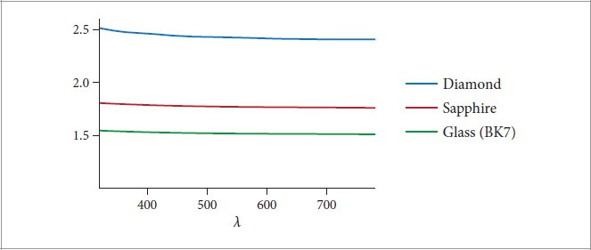

*Figure 9.5: Plots of the Wavelength-Dependent Index of Refraction for Various Materials. All have only a few percent variation in index of refraction over the range of visible wavelengths, though even that is sufficient to be visible in rendered images.*

</details>

*Table 9.1 provides IOR values for a number of dielectric materials and Figure 9.5 shows plots of the wavelength-dependent IOR for a few materials. pbrt also includes wavelength-dependent IORs for various materials that can be referred to by name in scene description files; see the file format documentation for more information.*

In the following, we assume that the IOR on both sides of the surface in question is known. We first review in which direction(s) light travels following an interaction, which is described by the law of specular reflection and Snell’s law. Subsequently, we discuss how much of the scattered light travels in those directions, which is given by the Fresnel equations.

### 9.3.3 THE LAW OF SPECULAR REFLECTION

Given incident light from a direction (θi, ϕi), the single reflected direction (θr, ϕr) following an interaction with a perfect specular surface is easy to characterize: it makes the same angle with the normal as the incoming direction and is rotated around it by 180°—that is, θr = θi and ϕr = ϕi + π.

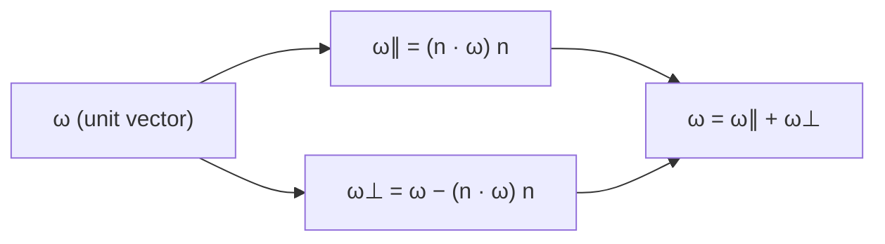

*Figure 9.6 (redrawn as Mermaid). The parallel projection of a vector ω on to the normal n is given by ω‖ = (cos θ)n = (n · ω)n. The perpendicular component is given by ω⊥ = (sin θ)n but is more easily computed by ω⊥ = ω − ω‖.*

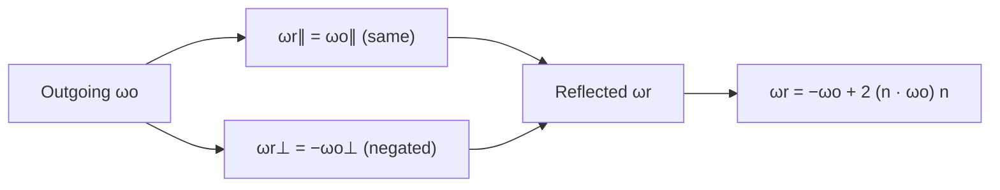

*Figure 9.7 (redrawn as Mermaid). Because the angles θo and θr are equal, the parallel component of the perfect reflection direction ωr‖ is the same as the incident direction’s: ωr‖ = ωo‖. Its perpendicular component is just the incident direction’s perpendicular component, negated.*

This direction can also be computed using vectorial arithmetic instead of angles, which is more convenient in subsequent implementation. For this, note that surface normal, incident, and outgoing directions all lie in the same plane.

We can decompose vectors ω that lie in a plane into a sum of two components: one parallel to n, which we will denote by ω‖, and one perpendicular to it, denoted ω⊥. These vectors are easily computed: if n and ω are normalized, then ω‖ is (cos θ)n = (n · ω)n (Figure 9.6). Because ω‖ + ω⊥ = ω, ω⊥ = ω − ω‖ = ω − (n · ω)n. Figure 9.7 shows the setting for computing the reflected direction ωr. We can see that both vectors have the same ω‖ component, and the value of ωr⊥ is the negation of ωo⊥. Therefore, we have

$$\boldsymbol\omega_r=\operatorname{Reflect}(\boldsymbol\omega_o,\mathbf n) =-\boldsymbol\omega_o+2\,(\mathbf n\cdot\boldsymbol\omega_o)\,\mathbf n. \quad\text{(9.1)}$$

The `Reflect()` function implements this computation.

〈Scattering Inline Functions〉 ≡ Vector3f Reflect(Vector3f wo, Vector3f n) { return -wo + 2 * Dot(wo, n) * n; }

### 9.3.4 SNELL’S LAW

At a specular interface, incident light with direction (θi, ϕi) about the surface normal refracts into a single transmitted direction (θt, ϕt) located on the opposite side of the interface. The specifics of this process are described by Snell’s law, which depends on the directions and IOR values ηi and ηt on both sides of the interface.

Snell’s law states that

$$\eta_i\,\sin\theta_i=\eta_t\,\sin\theta_t. \quad\text{(9.2)}$$

If the target medium is optically denser (i.e., ηt > ηi), this means that the refracted light bends toward the surface normal. Snell’s law can be derived using Fermat’s principle, which is the subject of one of the exercises at the end of this chapter. Figure 9.8 shows the effect of perfect specular reflection and transmission.

The index of refraction normally varies with respect to wavelength; hence light consisting of multiple wavelengths will split into multiple transmitted directions at the boundary between two different media—an effect known as dispersion. This effect can be seen when a prism splits incident white light into its spectral components. See Figure 9.9 for a rendered image that includes dispersion.

One useful observation about Snell’s law is that it technically does not depend on the precise values of ηi and ηt, but rather on their ratio. In other words, the law can be rewritten as

$$\sin\theta_i=\eta\,\sin\theta_t,\qquad \eta=\frac{\eta_t}{\eta_i}. \quad\text{(9.3)}$$

where the relative index of refraction specifies the proportional slowdown incurred when light passes through the interface. We will generally follow the convention that relevant laws and implementations are based on this relative quantity.

As with the law of specular reflection, we shall now derive a more convenient vectorial form of this relationship, illustrated in Figure 9.10.

<details>
<summary>Figure 9.8 — Dragon model rendered with (a) perfect specular reflection and (b) …</summary>

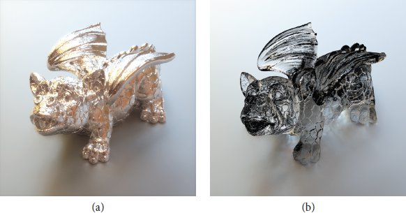

*Figure 9.8: Dragon model rendered with (a) perfect specular reflection and (b) perfect specular transmission. Image (b) excludes the effects of external and internal reflection; the resulting energy loss produces conspicuous dark regions. (Model courtesy of Christian Schüller.)*

</details>

*Index: `Dot()` 89, `Vector3f` 86.*

<details>
<summary>Figure 9.9 — The Effect of Dispersion When Rendering Glass. (a) Rendered using a…</summary>

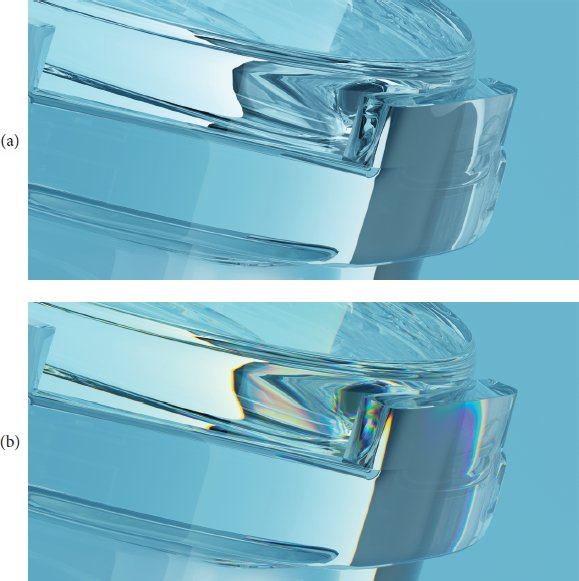

*Figure 9.9: The Effect of Dispersion When Rendering Glass. (a) Rendered using a constant index of refraction, and (b) rendered using a wavelength-dependent index of refraction based on measurements of glass, which causes different wavelengths of light to be scattered in different directions. As a result, white colors are separated, making their individual wavelengths of light distinct. (Scene courtesy of Beeple.)*

</details>

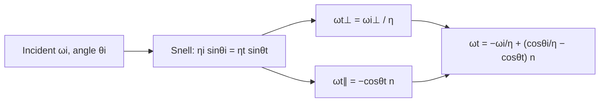

*Figure 9.10 (redrawn as Mermaid). The Geometry of Specular Transmission. Given an incident direction ωi and surface normal n with angle θi between them, the specularly transmitted direction makes an angle θt with the surface normal. This direction, ωt, can be computed by using Snell’s law to find its perpendicular component ωt⊥ and then computing the ωt‖ that gives a normalized result ωt.*

The trigonometric expressions above are closely related to the parallel and perpendicular components of the incident and transmitted directions. For example, the magnitudes of the perpendicular components equal the sines of the corresponding elevation angles. Since these directions all lie in a

common reflection plane, Equation (9.3) can be rewritten as

$$\sin\theta_t=\frac{\sin\theta_i}{\eta},\qquad \boldsymbol\omega_{t\perp}=\frac{\boldsymbol\omega_{i\perp}}{\eta}.$$

 Equivalently, because $\boldsymbol\omega_\perp=\boldsymbol\omega-\boldsymbol\omega_\parallel$,

The parallel component points into the direction $-\mathbf n$, and its magnitude is given by $\cos\theta_t$—that is,

$$\boldsymbol\omega_{t\parallel}=-\cos\theta_t\,\mathbf n.$$

Putting all the above together, then, the vector $\boldsymbol\omega_t$ equals

$$\boldsymbol\omega_t=-\frac{\boldsymbol\omega_i}{\eta} +\left(\frac{\cos\theta_i}{\eta}-\cos\theta_t\right)\mathbf n. \quad\text{(9.4)}$$

The function `Refract()` computes the refracted direction wt via Equation (9.4) given an incident direction wi, surface normal n in the same hemisphere as wi, and the relative index of refraction `eta`. An adjusted relative IOR may be returned via `*etap`—we will discuss this detail shortly. The function returns a Boolean variable to indicate if the refracted direction was computed successfully.

〈Scattering Inline Functions〉 +≡ bool Refract(Vector3f wi, Normal3f n, Float eta, Float *etap, Vector3f *wt) { Float cosTheta_i = Dot(n, wi); 〈Potentially flip interface orientation for Snell’s law 555〉 〈Compute cos θt using Snell’s law 555〉 *wt = -wi / eta + (cosTheta_i / eta - cosTheta_t) * Vector3f(n); 〈Provide relative IOR along ray to caller 555〉 return true; }

The function’s convention for the relative index of refraction `eta` slightly differs from the previous definition: it specifies the IOR ratio of the object interior relative to the outside, as indicated by the surface normal n that anchors the spherical coordinate system of quantities like θi and θt.

When the incident ray lies within the object, this convention is no longer compatible with our previous use of Snell’s law, assuming positive angle cosines and a relative IOR relating the incident and transmitted rays. We detect this case and, if needed, flip the interface by inverting the sign of n and `cosTheta_i` and swapping the IOR values, which is equivalent to taking the reciprocal of the relative IOR. Figure 9.11 illustrates this special case. Including this logic directly in `Refract()` facilitates its usage in rendering algorithms.

```text
    Dot() 89
    Float 23
    Normal3f 94
    Vector3f 86
```

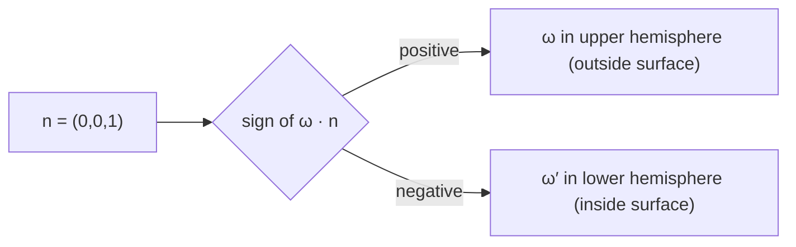

*Figure 9.11 (redrawn as Mermaid). The cosine of the angle θ between a direction ω and the geometric surface normal indicates whether the direction is pointing outside the surface (in the same hemisphere as the normal) or inside the surface. In the standard reflection coordinate system, this test just requires checking the z component of the direction vector. Here, ω is in the upper hemisphere, with a positive-valued cosine, while ω′ is in the lower hemisphere.*

〈Potentially flip interface orientation for Snell’s law〉 ≡ 554

```rust
   if (cosTheta_i < 0) {
         eta = 1 / eta;
         cosTheta_i = -cosTheta_i;
         n = -n;
   }
```

It is sometimes useful for the caller of `Refract()` to know the relative IOR along the ray, while handling the case when the ray arrives from the object’s interior. To make this accessible, we store the updated `eta` value into the `etap` pointer if provided.

〈Provide relative IOR along ray to caller〉 ≡ 554

```rust
   if (etap)
        *etap = eta;
```

We have not yet explained how the cosine of the transmitted angle θt should be computed. It can be derived from Equation (9.3) and the identity sin2 θ + cos2 θ = 1, which yields

$$\cos\theta_t=\sqrt{1-\sin^2\theta_t} =\sqrt{1-\frac{\sin^2\theta_i}{\eta^2}}. \quad\text{(9.5)}$$

The following fragment implements this computation.

〈Compute cos θt using Snell’s law〉 ≡ 554

```rust
    Float sin2Theta_i = max<Float>(0, 1 - Sqr(cosTheta_i));
    Float sin2Theta_t = sin2Theta_i / Sqr(eta);
    〈Handle total internal reflection case 556〉
    Float cosTheta_t = SafeSqrt(1 - sin2Theta_t);
```

```text
    Float 23
    SafeSqrt() 1034
    Sqr() 1034
```

We must deal with one potential complication: when light travels into a medium that is less optically dense (i.e., ηt < ηi), the interface turns into an ideal reflector at certain angles so that no light is transmitted. This special case denoted total internal reflection arises when θi is greater than critical angle θc = sin−1(1/η), at which point the argument of the square root function in Equation (9.5) turns negative. This occurs at roughly 42° in the case of an air–glass interface. Total internal reflection is easy to experience personally inside a swimming pool: observing the air–water interface from below reveals a striking circular pattern that separates a refracted view of the outside from a pure reflection of the pool’s interior, and this circle exactly corresponds to a viewing angle of θc.

In the case of total internal reflection, the refracted direction *wt is undefined, and the function returns false to indicate this.

〈Handle total internal reflection case〉 ≡ 555

if (sin2Theta_t >= 1) return false;

### 9.3.5 THE FRESNEL EQUATIONS

The previous two subsections focused on where light travels following an interaction with a specular material. We now turn to the question of how much?

Light is normally both reflected and transmitted at the boundary between two materials with a different index of refraction, though the transmission rapidly decays in the case of conductors. For physically accurate rendering, we must account for the fraction of reflected and transmitted light, which is directionally dependent and therefore cannot be captured by a fixed per-surface scaling constant. The Fresnel equations, which are the solution to Maxwell’s equations at smooth surfaces, specify the precise proportion of reflected light.

Recall the conscious decision to ignore polarization effects in Section 4.1. In spite of that, we must briefly expand on how polarization is represented to express the Fresnel equations in their natural form that emerges within the framework of electromagnetism.

At surfaces, it is convenient to distinguish between waves, whose polarization is perpendicular (“⊥”) or parallel (“‖”) to the place of incidence containing the incident direction and surface normal. There is no loss of generality, since the polarization state of any incident wave can be modeled as a superposition of two such orthogonal oscillations.

The Fresnel equations relate the amplitudes of the reflected wave (Er) given an incident wave with a known amplitude (Ei). The ratio of these amplitudes depends on the properties of the specular interface specified in terms of the IOR values ηi and ηt, and the angle θi of the incident ray. Furthermore, parallel and perpendicularly polarized waves have different amounts of reflectance, which is the reason there are two equations:

$$r_\parallel=\frac{\eta_t\cos\theta_i-\eta_i\cos\theta_t}{\eta_t\cos\theta_i+\eta_i\cos\theta_t}, \qquad r_\perp=\frac{\eta_i\cos\theta_i-\eta_t\cos\theta_t}{\eta_i\cos\theta_i+\eta_t\cos\theta_t}.$$

(The elevation angle of the transmitted light θt is determined by Snell’s law.)

As with Snell’s law, only the relative index of refraction matters, and we therefore prefer the equivalent expressions

$$r_\parallel=\frac{\eta\cos\theta_i-\cos\theta_t}{\eta\cos\theta_i+\cos\theta_t}, \qquad r_\perp=\frac{\cos\theta_i-\eta\cos\theta_t}{\cos\theta_i+\eta\cos\theta_t}.$$

In the wave-optics framework, the quantities of interest are the amplitude and phase of the reflected wave. In contrast, pbrt simulates light geometrically, and we care about the overall power carried by the wave, which is given by the square of the amplitude.

Combining this transformation together with the assumption of unpolarized light leads to the Fresnel reflectance, expressing an average of the parallel and perpendicular oscillations:

$$F=\frac{\left|r_\parallel\right|^2+\left|r_\perp\right|^2}{2}. \quad\text{(9.6)}$$

Dielectrics, conductors, and semiconductors are all governed by the same Fresnel equations. In the common dielectric case, there are additional simplification opportunities; hence it makes sense to first define specialized dielectric evaluation routines. We discuss the more general case in Section 9.3.6.

The function `FrDielectric()` computes the unpolarized Fresnel reflection of a dielectric interface given its relative IOR η and angle cosine cos θi provided via parameters `cosTheta_i` and `eta`.

〈Fresnel Inline Functions〉 ≡

```rust
   Float FrDielectric(Float cosTheta_i, Float eta) {
       cosTheta_i = Clamp(cosTheta_i, -1, 1);
       〈Potentially flip interface orientation for Fresnel equations 557〉
       〈Compute cos θt for Fresnel equations using Snell’s law〉
       Float r_parl = (eta * cosTheta_i - cosTheta_t) /
                      (eta * cosTheta_i + cosTheta_t);
       Float r_perp = (cosTheta_i - eta * cosTheta_t) /
                      (cosTheta_i + eta * cosTheta_t);
       return (Sqr(r_parl) + Sqr(r_perp)) / 2;
   }
```

The dielectric Fresnel term is cheap to evaluate in a WGSL fragment or compute shader:

```wgsl
// Unpolarized Fresnel reflectance for a dielectric interface (eta = eta_t / eta_i).
fn fr_dielectric(cos_theta_i: f32, eta: f32) -> f32 {
    var ci = clamp(cos_theta_i, -1.0, 1.0);
    var e = eta;
    if (ci < 0.0) { e = 1.0 / e; ci = -ci; }   // flip interface orientation
    let sin2_i = max(0.0, 1.0 - ci * ci);
    let sin2_t = sin2_i / (e * e);
    if (sin2_t >= 1.0) { return 1.0; }         // total internal reflection
    let ct = sqrt(1.0 - sin2_t);
    let r_parl = (e * ci - ct) / (e * ci + ct);
    let r_perp = (ci - e * ct) / (ci + e * ct);
    return 0.5 * (r_parl * r_parl + r_perp * r_perp);
}
```

Recall that our numerical implementation of Snell’s law included a fragment 〈Potentially flip interface orientation for Snell’s law〉 to implement the convention that `eta` always specifies a relative IOR relating the inside to the outside of an object, as determined by the surface normal. We include a similar step in FrDielectric() so that these two functions are consistent with each other.

〈Potentially flip interface orientation for Fresnel equations〉 ≡ 557

```rust
   if (cosTheta_i < 0) {
         eta = 1 / eta;
         cosTheta_i = -cosTheta_i;
   }
```

The omitted fragment 〈Compute cos θt for Fresnel equations using Snell’s law〉 matches the previously explained fragment 〈Compute cos θt using Snell’s law〉 except for one small difference: in the case of total internal reflection, the previous fragment returned a failure to compute a refracted direction. Here, we must instead return a reflectance value of 1 to indicate that all scattering takes place via the reflection component.

### 9.3.6 THE FRESNEL EQUATIONS FOR CONDUCTORS

Characterizing the reflection behavior of conductors involves an additional twist: the IOR turns into a complex number! Its real component describes the decrease in the speed of light as before. The newly added imaginary component models the decay of light as it travels deeper into the material. This decay occurs so rapidly that it also has a significant effect on the reflection component; hence it is important that we account for it even if the transmitted portion of light is of no interest.

```text
    Clamp() 1033
    Float 23
    FrDielectric() 557
    Sqr() 1034
```

The emergence of complex numbers may appear counterintuitive at this stage. They are best thought of as a convenient mathematical tool employed in derivations based on electromagnetism; they exploit the property that imaginary exponentiation produces complex values with sinusoidal components: eix = cos x + i sin x. Incident and outgoing light is normally modeled using plane waves describing an oscillatory electric field that varies with respect to both time and distance z along the wave’s direction of travel. For example, the spatial variation in the amplitude of such a wave can be expressed using an exponential

function $E(z)=e^{-i\alpha\eta z}$ containing the imaginary unit $i$ in the exponent. The value α denotes the spatial frequency, and η is the index of refraction. Only the real component of this field matters, which equals $\Re[E(z)]=\cos(\alpha\eta z)$. In other words, the plane wave describes a sinusoidal oscillation that propagates unimpeded through the material, which is the expected behavior in a transparent dielectric.

Note, however, what happens when a negative imaginary component is added. By standard convention, the complex index of refraction is defined as $\eta-ik$, where $\eta$ retains the former meaning and the $k>0$ term now leads to an exponential decay with increasing depth $z$ inside the medium—that is, $\Re[E(z)]=e^{-\alpha z k}\cos(\alpha\eta z)$. For this reason, k is referred to as the absorption coefficient. Although it superficially resembles the volumetric absorption coefficient defined in Section 11.1, those two processes occur at vastly different scales and should not be confused.

*Figure 9.12 shows a plot of the index of refraction and absorption coefficient for gold; both of these are wavelength-dependent quantities. Figure 9.13 shows a model rendered with a metal material.*

A wondrous aspect of the Fresnel equations is that these two deceptively simple formulae span all major classes of material behavior including dielectrics, conductors, and semiconductors. In the latter two cases, one must simply evaluate these equations using complex arithmetic. The `FrComplex()` function realizes this change. It takes the angle cosine of the incident direction and a relative index of

refraction obtained using complex division.

<details>
<summary>Figure 9.12 — Absorption Coefficient and Index of Refraction of Gold. This plot s…</summary>

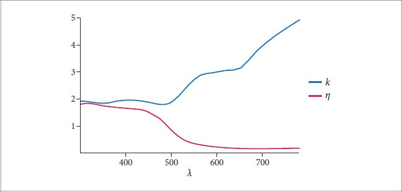

*Figure 9.12: Absorption Coefficient and Index of Refraction of Gold. This plot shows the spectrally varying values of the absorption coefficient k and the index of refraction η for gold, where the horizontal axis is wavelength in nm.*

</details>

<details>
<summary>Figure 9.13 — Killeroo with a Gold Surface. The killeroo model is rendered here u…</summary>

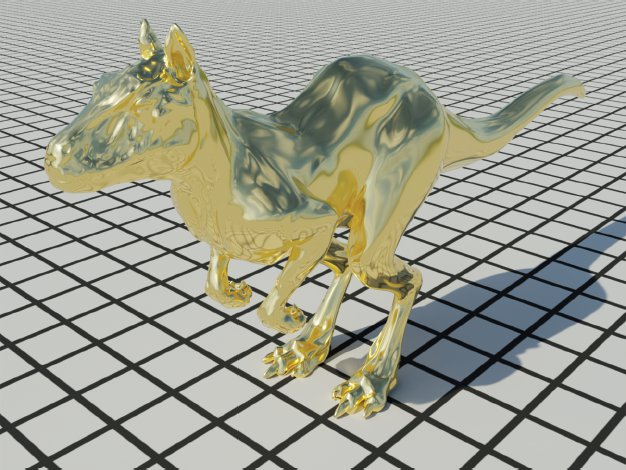

*Figure 9.13: Killeroo with a Gold Surface. The killeroo model is rendered here using the ConductorBxDF. See Figure 9.12 for a plot of the associated absorption coefficient and index of refraction that lead to its appearance. (Killeroo model courtesy of headus/Rezard.)*

</details>

〈Fresnel Inline Functions〉 +≡ Float FrComplex(Float cosTheta_i, Complex eta) { using Complex = Complex; cosTheta_i = Clamp(cosTheta_i, 0, 1); 〈Compute complex cos θt for Fresnel equations using Snell’s law 559〉 Complex r_parl = (eta * cosTheta_i - cosTheta_t) / (eta * cosTheta_i + cosTheta_t); Complex r_perp = (cosTheta_i - eta * cosTheta_t) / (cosTheta_i + eta * cosTheta_t); return (norm(r_parl) + norm(r_perp)) / 2; }

Compared to `FrDielectric()`, the main change in the implementation is the type replacement of `Float` by `Complex`. The function `norm(x)` computes the squared magnitude—

that is, the square of the distance from the origin of the complex plane to the point x.

Computation of cos θt using Snell’s law reveals another curious difference: due to the dependence on η, this value now generally has an imaginary component, losing its original meaning as the cosine of the transmitted angle.

〈Compute complex cos θt for Fresnel equations using Snell’s law〉 ≡ 559

```rust
    Float sin2Theta_i = 1 - Sqr(cosTheta_i);
    Complex sin2Theta_t = sin2Theta_i / Sqr(eta);
    Complex cosTheta_t = psqrt(1 - sin2Theta_t);
```

```text
    Clamp() 1033
    ConductorBxDF 560
    Float 23
    FrDielectric() 557
    Sqr() 1034
```

This is expected in the case of the Fresnel equations—computation of the actual transmitted angle in absorbing materials is more involved, and we sidestep this case in pbrt (recall that conductors were assumed to be opaque).

Complex numbers play a larger role within the Fresnel equations when polarization is modeled: recall how we detected the total internal reflection when a number under a square root became negative, which is nonsensical in real arithmetic. With complex arithmetic, this imaginary square root can be computed successfully. The angles of the resulting complex numbers r‖ and r⊥ relative to the origin of the complex plane encode a delay (also known as the phase) that influences the polarization state of the reflected superposition of parallel and perpendicularly polarized waves. It is also worth noting that a number of different sign conventions exist—for example, depending on the definition of a plane wave, the imaginary IOR component k of conductors is either positive or negative. Some sources also flip the sign of the r‖ component. Such subtle details are a common source of bugs in renderers that account for polarization, but they are of no concern for pbrt since it only requires the amplitude of the reflected wave.

Before turning to `BxDF`s using the helper functions defined in the last subsections, we define a convenient wrapper around `FrComplex()` that takes a spectrally varying complex IOR split into the `eta` and `k`, evaluating it `NSpectrumSamples` times.

〈Fresnel Inline Functions〉 +≡

```rust
   SampledSpectrum FrComplex(Float cosTheta_i, SampledSpectrum eta,
                             SampledSpectrum k) {
       SampledSpectrum result;
       for i in 0..NSpectrumSamples
           result[i] = FrComplex(cosTheta_i, pcomplex<Float>(eta[i], k[i]));
       return result;
   }
```

## 9.4 CONDUCTOR BRDF

Having described the relevant physical principles, we now turn to the implementation of a BRDF that models specular reflection from an interface between a dielectric (e.g., air or water) and a conductor (e.g., a polished metal surface). We initially focus on the smooth case, and later generalize the implementation to rough interfaces in Section 9.6.

〈ConductorBxDF Definition〉 ≡ struct ConductorBxDF { 〈ConductorBxDF Public Methods 561〉  〈ConductorBxDF Private Members 561〉 };

The internal state of the `ConductorBxDF` consists of the real (`eta`) and imaginary (`k`) component of the index of refraction. Furthermore, the implementation requires a microfacet distribution that statistically describes its roughness. The `TrowbridgeReitzDistribution` class handles the details here. The constructor, not included here, takes these fields as input and stores them in the `ConductorBxDF` instance.

```text
    BxDF 538
    Float 23
    FrComplex() 559
    NSpectrumSamples 171
    SampledSpectrum 171
    TrowbridgeReitzDistribution 575
```

〈ConductorBxDF Private Members〉 ≡ 560

```rust
   TrowbridgeReitzDistribution mfDistrib;
   SampledSpectrum eta, k;
```

We will sidestep all discussion of microfacets for the time being and only cover the effectively smooth case in this section, where the surface is either perfectly smooth or so close to it that it can be modeled as such. The `TrowbridgeReitzDistribution` provides an `EffectivelySmooth()` method that indicates this case, in which the microfacet distribution plays no further role. The `ConductorBxDF::Flags()` method returns `BxDFFlags` accordingly.

〈ConductorBxDF Public Methods〉 ≡ 560

```rust
    BxDFFlags Flags() {
        return           mfDistrib.EffectivelySmooth()                             ?
        BxDFFlags::SpecularReflection :
            BxDFFlags::GlossyReflection;
    }
```

The conductor BRDF builds on two physical ideas: the law of specular reflection assigns a specific reflected direction to each ray, and the Fresnel equations determine the portion of reflected light. Any remaining light refracts into the conductor, where it is rapidly absorbed and converted into heat.

Let Fr(ω) denote the unpolarized Fresnel reflectance of a given direction ω (which only depends on the angle θ that this direction makes with the surface normal n). Because the law of specular reflection states that θr = θo, we have Fr(ωr) = Fr(ωo). We thus require a BRDF fr such that

$$\int_{H^2} f_r(\boldsymbol\omega_o,\boldsymbol\omega_i)\,\cos\theta_i\,\mathrm{d}\omega_i=F_r(\boldsymbol\omega_o). \quad\text{(9.7)}$$

where ωr = R(ωo, n) is the specular reflection vector for ωo reflected about the surface normal n. Such a BRDF can be constructed using the Dirac delta distribution that represents an infinitely peaked signal. Recall from Section 8.1 that the delta distribution has the useful property that

$$\int f(x)\,\delta(x-x_0)\,\mathrm{d}x=f(x_0).$$

A first guess might be to use delta functions to restrict the incident direction to the specular reflection direction ωr. This would yield a BRDF of fr(ωo, ωi) = δ(ωi − ωr) Fr(ωi). Although this seems appealing, plugging it into the scattering equation, Equation (4.14), reveals a problem:

```text
    BxDFFlags 539
    BxDFFlags::GlossyReflection 539
    BxDFFlags::SpecularReflection 539
    ConductorBxDF 560
    SampledSpectrum 171
    TrowbridgeReitzDistribution 575
    TrowbridgeReitzDistribution::EffectivelySmooth() 575
```

This is not correct because it contains an extra factor of cos θr. However, we can divide out this factor to find the correct BRDF for perfect specular reflection:

$$f_r(\boldsymbol\omega_o,\boldsymbol\omega_i) =\frac{F_r(\boldsymbol\omega_i)\,\delta(\boldsymbol\omega_i-\boldsymbol\omega_r)}{\cos\theta_i}. \quad\text{(9.9)}$$

The `Sample_f()` method of the `ConductorBxDF` method implements Equation (9.9).

〈ConductorBxDF Public Methods〉 +≡ 560

```rust
   Option<BSDFSample>
   Sample_f(Vector3f wo, Float uc, Point2f u, TransportMode
   mode,
             BxDFReflTransFlags                  sampleFlags =
             BxDFReflTransFlags::All) {
       if (!(sampleFlags & BxDFReflTransFlags::Reflection))
       return {};
       if (mfDistrib.EffectivelySmooth()) {
           〈Sample perfect specular conductor BRDF 562〉
       }
       〈Sample rough conductor BRDF 585〉
   }
```

Note that Dirac delta distributions require special handling compared to standard functions. In particular, the probability of successfully drawing a point on the peak is zero, unless the sampling probability is also a delta distribution. In other words, the distribution must be used to determine the sample location.

Because the surface normal ng is (0, 0, 1) in the reflection coordinate system, the equation for the perfect specular reflection direction, (9.1), simplifies substantially; the x and y components only need to be negated to compute this direction and there is no need to call `Reflect()` (the rough case will require this function, however).

〈Sample perfect specular conductor BRDF〉 ≡ 562

```rust
   Vector3f wi(-wo.x, -wo.y, wo.z);
   SampledSpectrum f = FrComplex(AbsCosTheta(wi), eta, k) /
   AbsCosTheta(wi);
   return BSDFSample(f, wi, 1, BxDFFlags::SpecularReflection);
```

The PDF value in the returned `BSDFSample` is set to one, as per the discussion of delta distribution BSDFs in Section 9.1.2. Following the other conventions outlined in that section, BRDF evaluation always returns zero in the smooth case, since the specular peak is considered unreachable by other sampling methods.

〈ConductorBxDF Public Methods〉 +≡ 560

```rust
   SampledSpectrum f(Vector3f wo, Vector3f wi, TransportMode mode) {
       if (!SameHemisphere(wo, wi)) return {};
       if (mfDistrib.EffectivelySmooth()) return {};
       〈Evaluate rough conductor BRDF 585〉
   }
```

<details>
<summary>Reference / notes: AbsCosTheta() 107…</summary>

```text
    AbsCosTheta() 107
    BSDFSample 541
    BxDFFlags::SpecularReflection 539
    BxDFReflTransFlags 540
    BxDFReflTransFlags::All 540
    BxDFReflTransFlags::Reflection 540
    ConductorBxDF::mfDistrib 561
    Float 23
    FrComplex() 559
    Point2f 92
    Reflect() 552
    SameHemisphere() 538
    SampledSpectrum 171
    TransportMode 571
    TrowbridgeReitzDistribution::EffectivelySmooth() 575
    Vector3f 86
```

</details>

The same convention also applies to the `PDF()` method.

〈ConductorBxDF Public Methods〉 +≡ 560

```rust
   Float PDF(Vector3f wo, Vector3f wi, TransportMode mode,
               BxDFReflTransFlags sampleFlags) {
       if (!(sampleFlags & BxDFReflTransFlags::Reflection))
       return 0;
       if (!SameHemisphere(wo, wi)) return 0;
       if (mfDistrib.EffectivelySmooth()) return 0;
       〈Evaluate sampling PDF of rough conductor BRDF 584〉
   }
```

The missing three fragments—〈Sample rough conductor BRDF〉, 〈Evaluate rough conductor BRDF〉, and 〈Evaluate sampling PDF of rough conductor BRDF〉—will be presented in Section 9.6.

<details>
<summary>Figure 9.14 — When the BRDF for specular reflection and the BTDF for specular tra…</summary>

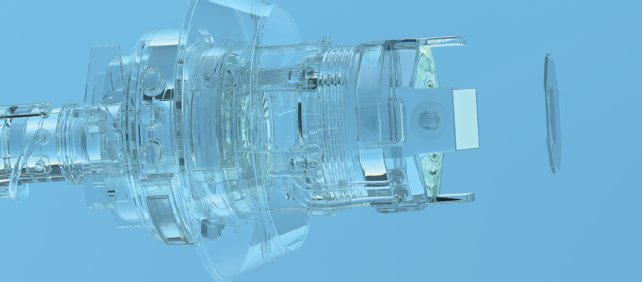

*Figure 9.14: When the BRDF for specular reflection and the BTDF for specular transmission are modulated with the Fresnel formula for dielectrics, the realistic angle-dependent variation of the amount of reflection and transmission gives a visually accurate representation of the glass. (Scene courtesy of Beeple.)*

</details>

## 9.5 DIELECTRIC BSDF

In the dielectric case, the relative index of refraction is real-valued, and specular transmission must be considered in addition to reflection. The `DielectricBxDF` handles this scenario for smooth and rough interfaces.

*Figure 9.14 shows an image of an abstract model using this BxDF to model a glass material.*

〈DielectricBxDF Definition〉 ≡ struct DielectricBxDF { 〈DielectricBxDF Public Methods 563〉  〈DielectricBxDF Private Members 563〉 };

The constructor takes a single `Float`-valued `eta` parameter and a microfacet distribution `mfDistrib`. Spectrally varying IORs that disperse light into different directions are handled by randomly sampling a single wavelength to follow and then instantiating a corresponding `DielectricBxDF`. Section 10.5.1 discusses this topic in more detail.

〈DielectricBxDF Public Methods〉 ≡ 563

DielectricBxDF(Float eta, TrowbridgeReitzDistribution mfDistrib) : eta(eta), mfDistrib(mfDistrib) {} 〈DielectricBxDF Private Members〉 ≡ 563

```rust
   Float eta;
   TrowbridgeReitzDistribution mfDistrib;
```

The `Flags()` method handles three different cases. The first is when the dielectric interface is index-matched—that is, with an equal IOR on both sides (in which case η = 1)—and light is only transmitted. Otherwise, in the other two cases, the BSDF has both reflected and transmitted components. In both of these cases, the `TrowbridgeReitzDistribution`’s `EffectivelySmooth()` method differentiates between specular and glossy scattering.

```text
    DielectricBxDF 563
    DielectricBxDF::eta 563
    DielectricBxDF::mfDistrib 563
    Float 23
    TrowbridgeReitzDistribution 575
```

〈DielectricBxDF Public Methods〉 +≡ 563

```rust
   BxDFFlags Flags() {
         BxDFFlags flags = (eta == 1) ? BxDFFlags::Transmission :
                              (BxDFFlags::Reflection                         |
                              BxDFFlags::Transmission);
         return flags | (mfDistrib.EffectivelySmooth() ? BxDFFlags::Specular
                                                          :
                                                          BxDFFlags::Glossy);
   }
```

The `Sample_f()` method must choose between sampling perfect specular reflection or transmission. As before, we postpone handling of rough surfaces and only discuss the perfect specular case for now.

〈DielectricBxDF Method Definitions〉 ≡ Option<BSDFSample> DielectricBxDF::Sample_f(Vector3f wo, Float uc, Point2f u, TransportMode mode, BxDFReflTransFlags sampleFlags) const { if (eta == 1 || mfDistrib.EffectivelySmooth()) { 〈Sample perfect specular dielectric BSDF 564〉 } else { 〈Sample rough dielectric BSDF 590〉 } }

Since dielectrics are characterized by both reflection and transmission, the sampling scheme must randomly choose between these two components, which influences the density function. While any discrete distribution is in principle admissible, an efficient approach from a Monte Carlo variance standpoint is to sample according to the contribution that these two components make—in other words, proportional to the Fresnel reflectance R and the complementary transmittance 1-R. Figure 9.15 shows the benefit of sampling in this way compared to an equal split between reflection and transmission.

〈Sample perfect specular dielectric BSDF〉 ≡ 564

```rust
   Float R = FrDielectric(CosTheta(wo), eta), T = 1 - R;
   〈Compute probabilities pr and pt for sampling reflection and transmission 564〉
   if (uc < pr / (pr + pt)) {
        〈Sample perfect specular dielectric BRDF 565〉
   } else {
        〈Sample perfect specular dielectric BTDF 566〉
   }
```

<details>
<summary>Reference / notes: BSDFSample 541…</summary>

```text
    BSDFSample 541
    BxDFFlags 539
    BxDFFlags::Glossy 539
    BxDFFlags::Reflection 539
    BxDFFlags::Specular 539
    BxDFFlags::Transmission 539
    BxDFReflTransFlags 540
    BxDFReflTransFlags::Transmission 540
    CosTheta() 107
    DielectricBxDF::eta 563
    DielectricBxDF::mfDistrib 563
    Float 23
    FrDielectric() 557
    Point2f 92
    TransportMode 571
    TrowbridgeReitzDistribution::EffectivelySmooth() 575
    Vector3f 86
```

</details>

Because BSDF components can be selectively enabled or disabled via the `sampleFlags` argument, the component choice is based on adjusted probabilities `pr` and `pt` that take this into account.

〈Compute probabilities pr and pt for sampling reflection and transmission〉 ≡ 564, 568, 587, 590

```rust
   Float pr = R, pt = T;
   if (!(sampleFlags & BxDFReflTransFlags::Reflection)) pr = 0;
   if (!(sampleFlags & BxDFReflTransFlags::Transmission)) pt = 0;
   if (pr == 0 && pt == 0)
       return {};
```

In the most common case where both reflection and transmission are sampled, the BSDF value and sample probability contain the common factor F or T, which cancels when their ratio is taken. Thus, all sampled rays end up making the same contribution, and the Fresnel factor manifests in the relative proportion of reflected and transmitted rays.

<details>
<summary>Figure 9.15 — Glass Object Rendered Using the DielectricBxDF. (a) Choosing betwee…</summary>

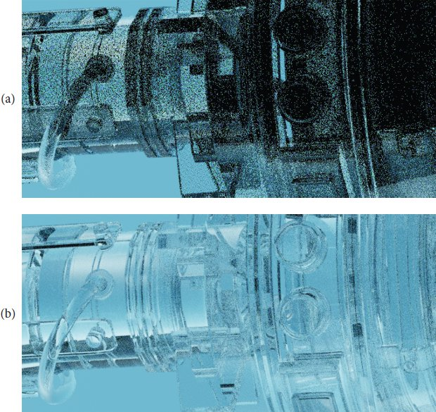

*Figure 9.15: Glass Object Rendered Using the DielectricBxDF. (a) Choosing between specular reflection and transmission with equal probability at each scattering event. (b) Choosing with probability based on the value of the Fresnel equations, as is implemented in the Sample_f() method. Choosing between scattering modes with probability proportional to their contribution significantly reduces error by following fewer paths with low contributions.*

</details>

Putting all of this together, the only change in the following code compared to the analogous fragment 〈Sample perfect specular conductor BRDF〉 is the incorporation of the discrete probability of the sample.

〈Sample perfect specular dielectric BRDF〉 ≡ 564, 568

```rust
   Vector3f wi(-wo.x, -wo.y, wo.z);
   SampledSpectrum fr(R / AbsCosTheta(wi));
   return       BSDFSample(fr,         wi,  pr /              (pr      +     pt),
   BxDFFlags::SpecularReflection);
```

```text
    AbsCosTheta() 107
    BSDFSample 541
    BxDFFlags::SpecularReflection 539
    DielectricBxDF 563
    SampledSpectrum 171
    Vector3f 86
```

Specular transmission is handled along similar lines, though using the refracted ray direction for wi. The equation for the corresponding BTDF is similar to the case for perfect specular reflection, Equation (9.9), though there is an additional subtle technical detail: depending on the IOR η, refraction either compresses or expands radiance in the angular domain, and the implementation must scale `ft` to account for this. This correction does not change the amount of radiant power in the scene—rather, it models how the same power is contained in a different solid angle. The details of this step differ depending on the direction of propagation in bidirectional rendering algorithms, and we therefore defer the corresponding fragment Account for non-symmetry with transmission to different medium to Section 9.5.2.

〈Sample perfect specular dielectric BTDF〉 ≡ 564

```rust
   〈Compute ray direction for specular transmission 566〉
   SampledSpectrum ft(T / AbsCosTheta(wi));
   〈Account for non-symmetry with transmission to different medium 571〉
   return BSDFSample(ft, wi, pt / (pr + pt),
                            BxDFFlags::SpecularTransmission, etap);
```

The function `Refract()` computes the refracted direction `wi` via Snell’s law, which fails in the case of total internal reflection. In principle, this should never happen: the transmission case is sampled with probability T, which is zero in the case of total internal reflection. However, due to floating-point rounding errors, inconsistencies can occasionally arise here. We handle this corner case by returning an invalid sample.

〈Compute ray direction for specular transmission〉 ≡ 566

```rust
   Vector3f wi;
   Float etap;
   bool valid = Refract(wo, Normal3f(0, 0, 1), eta, &etap, &wi);
   if (!valid) return {};
```

As with the `ConductorBxDF`, zero is returned from the `f()` method if the interface is smooth and all scattering is perfect specular.

〈DielectricBxDF Method Definitions〉 +≡ SampledSpectrum DielectricBxDF::f(Vector3f wo, Vector3f wi, TransportMode mode) const { if (eta == 1 || mfDistrib.EffectivelySmooth()) return SampledSpectrum(0.f); 〈Evaluate rough dielectric BSDF 589〉 }

Also, a PDF value of zero is returned if the BSDF is represented using delta distributions.

〈DielectricBxDF Method Definitions〉 +≡ Float DielectricBxDF::PDF(Vector3f wo, Vector3f wi, TransportMode mode, BxDFReflTransFlags sampleFlags) const { if (eta == 1 || mfDistrib.EffectivelySmooth()) return 0; 〈Evaluate sampling PDF of rough dielectric BSDF 587〉 }

The missing three fragments—〈Sample rough dielectric BSDF〉, 〈Evaluate rough dielectric BSDF〉, and 〈Evaluate sampling PDF of rough dielectric BSDF〉—will be presented in Section 9.7.

<details>
<summary>Reference / notes: AbsCosTheta() 107…</summary>

```text
    AbsCosTheta() 107
    BSDFSample 541
    BxDFFlags::SpecularTransmission 539
    BxDFReflTransFlags 540
    ConductorBxDF 560
    DielectricBxDF::eta 563
    DielectricBxDF::mfDistrib 563
    Float 23
    Normal3f 94
    Refract() 554
    SampledSpectrum 171
    TransportMode 571
    TrowbridgeReitzDistribution::EffectivelySmooth() 575
    Vector3f 86
```

</details>

### 9.5.1 THIN DIELECTRIC BSDF

Dielectric interfaces rarely occur in isolation: a particularly common configuration involves two nearby index of refraction changes that are smooth, locally parallel, and mutually reciprocal—that is,

$$\eta_{\text{out}\to\text{in}}=\eta \quad\text{together with}\quad \eta_{\text{in}\to\text{out}}=\frac{1}{\eta}.$$

with relative IOR η and a corresponding interface with the inverse 1/η. Examples include plate- and acrylic glass in windows or plastic foil used to seal and preserve food.

This important special case is referred to as a thin dielectric due to the spatial proximity of the two interfaces compared to the larger lateral dimensions. When incident light splits into a reflected and a transmitted component with two separate interfaces, it is scattered in a recursive process that traps some of the light within the two interfaces (though this amount progressively decays as it undergoes an increasing number of reflections).

While the internal scattering process within a general dielectric may be daunting, simple analytic solutions can fully describe what happens inside such a thin dielectric—that is, an interface pair satisfying the above simplifying conditions. pbrt provides a specialized BSDF named `ThinDielectricBxDF` that exploits these insights to efficiently represent an infinite number of internal interactions. It further allows such surfaces to be represented with a single interface, saving the ray intersection expense of tracing ray paths between the two surfaces.

〈ThinDielectricBxDF Definition〉 ≡ struct ThinDielectricBxDF { 〈ThinDielectricBxDF Public Methods 567〉  Float eta; };

The only parameter to this `BxDF` is the relative index of refraction of the interior medium.

〈ThinDielectricBxDF Public Methods〉 ≡ 567

```rust
   ThinDielectricBxDF(Float eta) : eta(eta) {}
```

Since this BxDF models only perfect specular scattering, both its `f()` and `PDF()` methods just return zero and are therefore not included here.

The theory of the thin dielectric BSDF goes back to seminal work by Stokes (1860), who investigated light propagation in stacks of glass plates. Figure 9.16 illustrates the most common case involving only a single glass plate: an incident light ray (red) reflects and transmits in proportions R and T = 1 − R. When the transmitted ray encounters the bottom interface, reciprocity causes it to reflect and transmit according to the same proportions. This process repeats in perpetuity.

Of course, rays beyond the first interaction are displaced relative to the entrance point. Due to the assumption of a thin dielectric, this spatial shift is considered to be negligible; only the total amount of reflected or transmitted light matters. By making this simplification, it is possible to aggregate the effect of the infinite number of scattering events into a simple modification of the reflectance and transmittance factors.

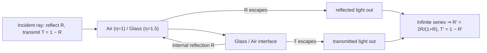

*Figure 9.16 (redrawn as Mermaid). Light Paths in a Thin Plane-Parallel Dielectric Medium. An incident light ray (red) gives rise to an infinite internal scattering process that occurs within the glass plate (blue). At each scattering event, some fraction of the light manages to escape, causing a successive decay of the trapped energy.*

```text
    Float 23
    ThinDielectricBxDF 567
```

Consider the paths that are reflected out from the top layer. Their aggregate reflectance R is given by a geometric series that can be converted into an explicit form:

$$R^{\prime}=R+\frac{(1-R)^2R}{1-R^2}=\frac{2R}{1+R},\qquad T^{\prime}=1-R^{\prime}. \quad\text{(9.10)}$$

<details>
<summary>Figure 9.17 — Reflectance of a Fresnel Interface and a Thin Dielectric. This plot…</summary>

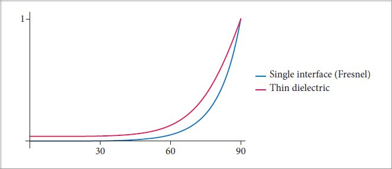

*Figure 9.17: Reflectance of a Fresnel Interface and a Thin Dielectric. This plot compares the reflectance of a single dielectric interface with η = 1.5 as determined by the Fresnel equations (9.6) to that of a matching thin dielectric according to Equation (9.10).*

</details>

A similar series gives how much light is transmitted, but it can be just as easily computed as T′ = 1 − R′, due to energy conservation. Figure 9.17 plots R′ and R as a function of incident angle θ. The second interface has the effect of increasing the overall amount of reflection compared to a single Fresnel interaction.

The `Sample_f()` method computes the R′ and T′ coefficients and then computes probabilities for sampling reflection and transmission, just as the `DielectricBxDF` did, reusing the corresponding code fragment.

〈ThinDielectricBxDF Public Methods〉 +≡ 567

```rust
   Option<BSDFSample>
   Sample_f(Vector3f wo, Float uc, Point2f u, TransportMode
   mode,
               BxDFReflTransFlags sampleFlags) {
        Float R = FrDielectric(AbsCosTheta(wo), eta), T = 1 - R;
        〈Compute R and T accounting for scattering between interfaces 568〉
        〈Compute probabilities pr and pt for sampling reflection and
        transmission 564〉
        if (uc < pr / (pr + pt)) {
              〈Sample perfect specular dielectric BRDF 565〉
        } else {
              〈Sample perfect specular transmission at thin dielectric interface 569〉
        }
   }
```

<details>
<summary>Reference / notes: AbsCosTheta() 107…</summary>

```text
    AbsCosTheta() 107
    BSDFSample 541
    BxDFReflTransFlags 540
    DielectricBxDF 563
    Float 23
    FrDielectric() 557
    Point2f 92
    Sqr() 1034
    TransportMode 571
    Vector3f 86
```

</details>

The updated reflection and transmission coefficients are easily computed using Equation (9.10), though care must be taken to avoid a division by zero in the case of R = 1.

〈Compute R and T accounting for scattering between interfaces〉 ≡ 568

```rust
   if (R < 1) {
       R += Sqr(T) * R / (1 - Sqr(R));
       T = 1 - R;
   }
```

The `DielectricBxDF` fragment that samples perfect specular reflection is also reused in this method’s implementation, inheriting the computed R value. The transmission case slightly deviates from the DielectricBxDF, as the transmitted direction is simply the negation of wo.

〈Sample perfect specular transmission at thin dielectric interface〉 ≡ 568

```rust
   Vector3f wi = -wo;
   SampledSpectrum ft(T / AbsCosTheta(wi));
   return       BSDFSample(ft,         wi,       pt       /     (pr     +   pt),
   BxDFFlags::SpecularTransmission);
```

### 9.5.2 NON-SYMMETRIC SCATTERING AND REFRACTION

*⋆ Optional section.*

All physically based BRDFs are symmetric: the incident and outgoing directions can be interchanged without changing the function’s value. However, the same is not generally true for BTDFs. Non-symmetry with BTDFs is due to the fact that when light refracts into a material with a higher index of refraction than the incident medium’s index of refraction, energy is compressed into a smaller set of angles (and vice versa, when going in the opposite direction). This effect is easy to see yourself, for instance, by looking at the sky from underwater in a quiet outdoor swimming pool. Because no light can be refracted above the critical angle (~ 48.6° for water), the incident hemisphere of light is squeezed into a considerably smaller subset of the hemisphere, which covers the remaining set of angles (Figure 9.18). Radiance along rays that do refract therefore must increase so that energy is preserved when light passes through the interface.

More formally, consider incident radiance arriving at the boundary between two media, with indices of refraction ηi and ηo (Figure 9.19). Assuming for now that all the incident light is transmitted, the amount of transmitted differential flux is then d2Φo = d2Φi. If we use the definition of radiance, Equation (4.3), we equivalently have

$$L_o\cos\theta_o\,\mathrm{d}A\,\mathrm{d}\omega_o =L_i\cos\theta_i\,\mathrm{d}A\,\mathrm{d}\omega_i. \quad\text{(9.11)}$$

<details>
<summary>Figure 9.18 — Snell’s Window. If one looks upward when underwater in a swimming p…</summary>

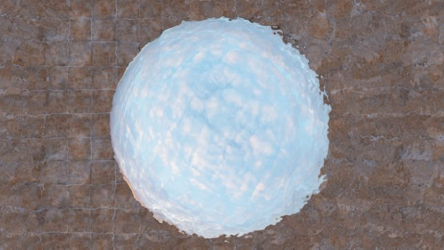

*Figure 9.18: Snell’s Window. If one looks upward when underwater in a swimming pool, the sky is only visible through a circular window because no light is refracted beyond the critical angle. Outside of the window, only the reflection of the pool bottom is seen.*

</details>

*Index: `AbsCosTheta()` 107, `BSDFSample` 541, `BxDFFlags::SpecularTransmission` 539, `DielectricBxDF` 563, `SampledSpectrum` 171, `Vector3f` 86.*

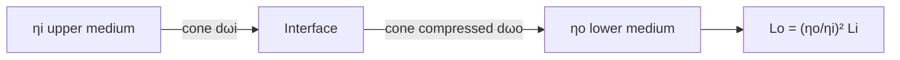

*Figure 9.19 (redrawn as Mermaid). The amount of transmitted radiance at the boundary between media with different indices of refraction is scaled by the squared ratio of the two indices of refraction. Intuitively, this can be understood as the result of the radiance’s differential solid angle being compressed or expanded as a result of transmission.*

Expanding the solid angles to spherical angles gives

Differentiating Snell’s law, Equation (9.2), with respect to θ gives the useful relation

$$\eta_o\cos\theta_o\,\mathrm{d}\theta_o=\eta_i\cos\theta_i\,\mathrm{d}\theta_i,$$

or

Substituting both Snell’s law and this relationship into Equation (9.11) and then simplifying, we have

$$L_o=\left(\frac{\eta_o}{\eta_i}\right)^{2}L_i. \quad\text{(9.12)}$$

Finally, dϕi = dϕo, which gives the final relationship between incident and transmitted radiance:

The symmetry relationship satisfied by a BTDF is thus

$$\eta_o^{2}\,f_t(\mathbf p,\boldsymbol\omega_o,\boldsymbol\omega_i) =\eta_i^{2}\,f_t(\mathbf p,\boldsymbol\omega_i,\boldsymbol\omega_o). \quad\text{(9.13)}$$

Non-symmetric scattering can be particularly problematic for bidirectional light transport algorithms that sample light paths starting both from the camera and from the lights. If non-symmetry is not accounted for, then such algorithms may produce incorrect results, since the design of such algorithms is fundamentally based on the principle of symmetry.3

We will say that light paths sampled starting from the lights carry importance while paths starting from the camera carry radiance. These terms correspond to the quantity that is recorded at a path’s starting point. With importance transport, the incident and outgoing direction arguments of the BSDFs will be (incorrectly) reversed unless special precautions are taken.

We thus define the adjoint BSDF f*, whose only role is to evaluate the original BSDF with swapped arguments:

$$f^{*}(\mathbf p,\boldsymbol\omega_o,\boldsymbol\omega_i) =f(\mathbf p,\boldsymbol\omega_i,\boldsymbol\omega_o).$$

All sampling steps based on importance transport use the adjoint form of the BSDF rather than its original version. Most BSDFs in pbrt are symmetric so that there is no actual difference between f and f*. However, non-symmetric cases require additional attention.

The `TransportMode` enumeration is used to inform such non-symmetric BSDFs about the transported quantity so that they can correctly switch between the adjoint and non-adjoint forms.

〈TransportMode Definition〉 ≡ enum TransportMode { Radiance, Importance };

The adjoint BTDF is then

$$f_t^{*}(\mathbf p,\boldsymbol\omega_o,\boldsymbol\omega_i) =f_t(\mathbf p,\boldsymbol\omega_i,\boldsymbol\omega_o) =\left(\frac{\eta_o}{\eta_i}\right)^{2}f_t(\mathbf p,\boldsymbol\omega_o,\boldsymbol\omega_i). \quad\text{(9.14)}$$

which effectively cancels out the scale factor in Equation (9.12).

With these equations, we can now define the remaining missing piece in the implementation of the `DielectricBxDF` evaluation and sampling methods. Whenever radiance is transported over a refractive boundary, we apply the scale factor from Equation (9.12). For importance transport, we use the adjoint BTDF, which lacks the scaling factor due to the combination of Equations (9.12) and (9.13).

〈Account for non-symmetry with transmission to different medium〉 ≡ 566, 590, 591

```rust
   if (mode == TransportMode::Radiance)
        ft /= Sqr(etap);
```

## 9.6 ROUGHNESS USING MICROFACET THEORY

The preceding discussion of the `ConductorBxDF` and `DielectricBxDF` only considered the perfect specular case, where the interface between materials was assumed to be ideally smooth and devoid of any roughness or other surface imperfections. However, many real-world materials are rough at a microscopic scale, which affects the way in which they reflect or transmit light.

The anatomy of a microfacet BSDF is summarized below; the same composition is used by the
conductor, rough dielectric, and measured BSDFs later in this chapter.

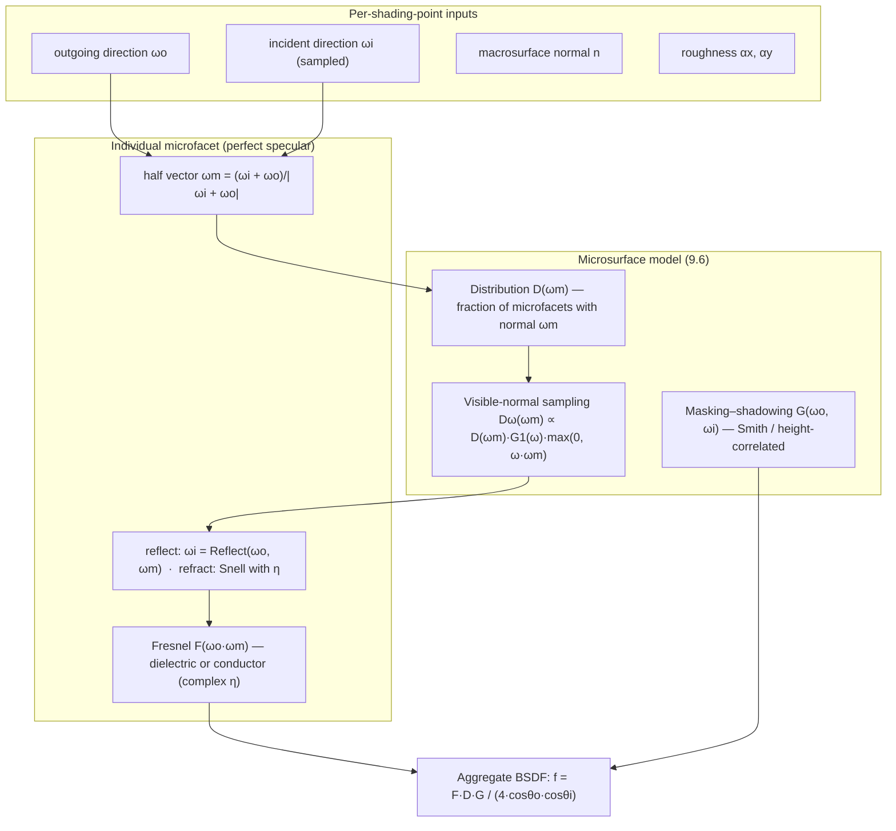

We will now turn to a generalization of these BxDFs using microfacet theory, which models rough surfaces as a collection of small surface patches denoted as microfacets. These microfacets are assumed to be individually very small so that they cannot be resolved by the camera. Yet, despite their small size, they can have a profound impact on the angular distribution of scattered light. Figure 9.20 shows cross sections of a relatively rough surface and a much smoother microfacet surface. We will use the term macrosurface to describe the original coarse surface (e.g., as represented by a `Shape`) and microsurface to describe the fine-scale geometry based on microfacets.

```text
    ConductorBxDF 560
    DielectricBxDF 563
    Sqr() 1034
    TransportMode 571
    TransportMode::Radiance 571
```

It is worth noting that pbrt can in principle already render rough surfaces without resorting to microfacet theory: users could simply create extremely high-resolution triangular meshes containing such micro-scale surface variations and render them using perfect specular BxDFs. There are two fundamental problems with such an approach:

- **Storage and ray tracing efficiency:** Representing micro-scale roughness using triangular geometry would require staggeringly large triangle budgets. The overheads to store and ray trace such large scenes are prohibitive.

- **Monte Carlo sampling efficiency:** A fundamental issue with perfect specular scattering distributions is that they contain Dirac delta terms, which preclude BSDF evaluation (their `f()` method returns zero, making BSDF sampling the only supported operation). This aspect disables light sampling strategies (Section 12.1), which are crucial for efficiency in Monte Carlo rendering.

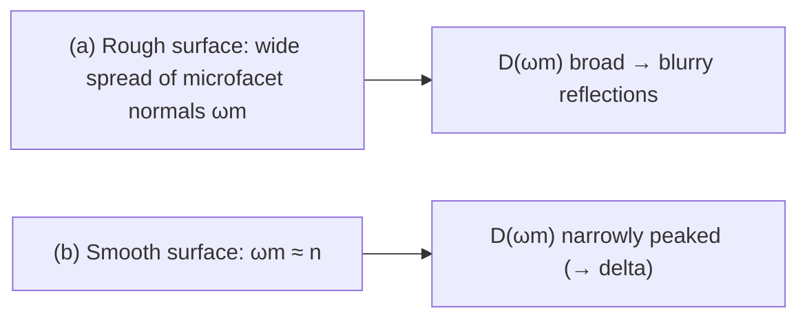

*Figure 9.20 (redrawn as Mermaid). Microfacet surface models are often described by a function that gives the distribution of microfacet normals ωm with respect to the surface normal n. (a) The greater the variation of microfacet normals, the rougher the surface is. (b) Smooth surfaces have relatively little variation of microfacet normals.*

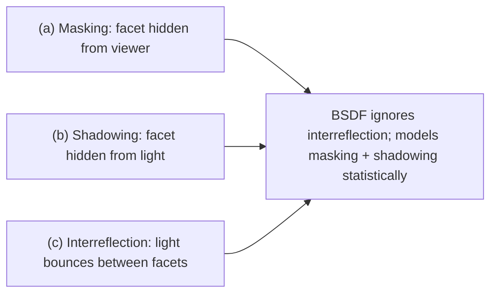

*Figure 9.21 (redrawn as Mermaid). Three Important Geometric Effects to Consider with Microfacet Reflection Models. (a) Masking: the microfacet of interest is not visible to the viewer due to occlusion by another microfacet. (b) Shadowing: analogously, light does not reach the microfacet. (c) Interreflection: light bounces among the microfacets before reaching the viewer.*

A key insight of microfacet theory is that large numbers of microfacets can be efficiently modeled statistically, since it is only their aggregate behavior that determines the observed scattering. (A

similar statistical physics approach is used to avoid the costly storage of vast numbers of small particles comprising participating media in Chapter 11.) This approach addresses both of the above issues: BSDF models based on microfacet theory do not require explicit storage of the microgeometry, and they replace the infinitely peaked Dirac delta terms with smooth distributions that enable more efficient Monte Carlo sampling.

Several factors related to the geometry of the microfacets affect how they scatter light (Figure 9.21): for example, a microfacet may be occluded (“masked”) or lie in the shadow of a neighboring microfacet, and incident light may interreflect among microfacets. Widely used microfacet BSDFs ignore interreflection and model the remaining masking and shadowing effects using statistical approximations with efficient evaluation procedures.

The two main components of microfacet models are a representation of the statistical distribution of facets and a BSDF that describes how light scatters from an individual microfacet. For the latter part, pbrt supports perfect specular conductors and dielectrics, though other choices are in principle also possible. Given these two ingredients, the aggregate BSDF arising from the microsurface can be determined.

### 9.6.1 THE MICROFACET DISTRIBUTION

Microgeometry principally affects scattering via variation of the surface normal, which is a consequence of the central role of the surface normal in Snell’s law and the law of specular reflection. Under the assumption that the light source and observer are distant with respect to the scale of the microfacets, the precise surface profile has a lesser effect on masking and shadowing that we will study in Section 9.6.2. For now, our focus is on the microfacet distribution, which represents roughness in terms of its effect on the surface normal.

Let us denote a small region of a macrosurface as dA. The corresponding microsurface dAμ is obtained by displacing the macrosurface along its normal n, which means that perpendicular projection of the microsurface exactly covers the macrosurface:

$$\mathrm{d}A=\int_{H^2(\mathbf n)}(\boldsymbol\omega_m\cdot\mathbf n)\,D(\boldsymbol\omega_m)\,\mathrm{d}\omega_m\,\mathrm{d}A \quad\Longleftrightarrow\quad \int_{H^2(\mathbf n)} D(\boldsymbol\omega_m)\cos\theta_m\,\mathrm{d}\omega_m=1. \quad\text{(9.15)}$$

where ωm(p) specifies the microfacet normal at p. However, tracking the orientation of vast numbers of microfacets would be impractical as previously discussed.

We therefore turn to a statistical approach: the microfacet distribution function D(ωm) gives the relative differential area of microfacets with the surface normal ωm. For example, a perfectly smooth surface has a Dirac delta peak in the direction of the original surface normal—that is, $D(\boldsymbol\omega_m)=\delta(\boldsymbol\omega_m-\mathbf n)$. The function is generally expressed in the standard reflection coordinate system with n = (0, 0, 1).

Cast into the directional domain, Equation (9.14) provides a useful normalization condition ensuring that a particular microfacet distribution is physically plausible, as illustrated in Figure 9.22.

The most common type of microfacet distribution is isotropic, which also leads to an isotropic aggregate BSDF. Recall that the local scattering behavior of an isotropic BSDF does not change when the surface is rotated about the macroscopic surface normal. In the isotropic case, a spherical coordinate parameterization ωm = (θm, ϕm) yields a distribution that only depends on the elevation angle θm.

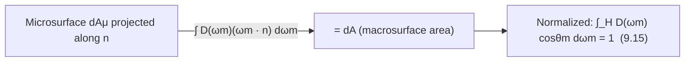

*Figure 9.22 (redrawn as Mermaid). Given a differential area on a surface dA, the microfacet normal distribution function D(ωm) must be normalized such that the projected surface area of the microfacets above the area is equal to dA.*

<details>
<summary>Figure 9.23 — Beckmann–Spizzichino vs Trowbridge–Reitz distribution</summary>

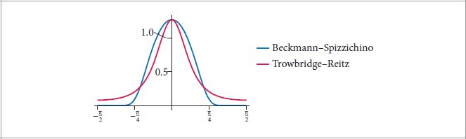

*Figure 9.23: Graphs of isotropic Beckmann–Spizzichino and Trowbridge–Reitz microfacet distribution functions as a function of θ for α = 0.5. Note that Trowbridge–Reitz has higher tails at larger values of θ.*

</details>

In contrast, an anisotropic microfacet distribution also depends on the azimuth ϕm to capture directional variation in the surface roughness. Many real-world materials are anisotropic: for example, rolled or milled steel surfaces feature grooves that are aligned with the direction of extrusion. Rotating a flat sheet of such material about the surface normal results in noticeable variation—for example, in the reflection profile of indirectly observed light sources. Brushed metal is an extreme case: its microfacet distribution varies from almost a single direction to almost uniform over the hemisphere.

Many functional representations of microfacet distributions have been proposed over the years. Geometric analysis of a truncated ellipsoid leads to one of the most widely used distributions proposed by Trowbridge and Reitz (1975), in which the conceptual microsurface is composed of vast

numbers of ellipsoidal bumps.4 Scaled along its different semi-axes, an ellipsoid can take on a variety of configurations including sphere-, pancake-, and cigar-shaped surfaces. It is enough to study the density of surface normals on a single representative ellipsoid, which has an analytic solution:

$$D(\boldsymbol\omega_m)=\frac{1}{\pi\alpha_x\alpha_y\cos^4\theta_m\left(1+\tan^2\theta_m\left(\frac{\cos^2\phi_m}{\alpha_x^2}+\frac{\sin^2\phi_m}{\alpha_y^2}\right)\right)^2}. \quad\text{(9.16)}$$

This equation assumes that the semi-axes of the ellipsoid are aligned with the shading frame, and the reciprocals of the two variables 1/αx, 1/αy > 0 encode a scale transformation applied along the two tangential axes. When αx, αy ≈ 0, the ellipsoid has been stretched to such a degree that it essentially collapses into a flat surface, and the aggregate BSDF approximates a perfect specular material. For larger values (e.g., αx, αy ≈ 0.3), the ellipsoidal bumps introduce significant normal variation that blurs the directional distribution of reflected and transmitted light. When αx = αy, the azimuth dependence drops out, and the model becomes isotropic.

A characteristic feature of the Trowbridge–Reitz model compared to other microfacet distributions is its long tails: the density of microfacets decays comparably slowly as ωm approaches grazing configurations (θm → 90°). This matches the properties of many real-world surfaces well. See Figure 9.23 for a graph of it and another commonly used microfacet distribution function.

The `TrowbridgeReitzDistribution` class encapsulates the state and functionality needed to use this microfacet distribution in a Monte Carlo renderer.

〈TrowbridgeReitzDistribution Definition〉 ≡ struct TrowbridgeReitzDistribution { 〈TrowbridgeReitzDistribution Public Methods 575〉  〈TrowbridgeReitzDistribution Private Members 575〉 }; 〈TrowbridgeReitzDistribution Public Methods〉 ≡ 575

TrowbridgeReitzDistribution(Float alpha_x, Float alpha_y) : alpha_x(alpha_x), alpha_y(alpha_y) {} 〈TrowbridgeReitzDistribution Private Members〉 ≡ 575

```rust
   Float alpha_x, alpha_y;
```

The `D()` method is a fairly direct transcription of Equation (9.16) with some additional handling of numerical edge cases.

〈TrowbridgeReitzDistribution Public Methods〉 +≡ 575

```rust
   Float D(Vector3f wm) {
       Float tan2Theta = Tan2Theta(wm);
       if (IsInf(tan2Theta)) return 0;
       Float cos4Theta = Sqr(Cos2Theta(wm));
       Float e = tan2Theta * (Sqr(CosPhi(wm) / alpha_x) +
                              Sqr(SinPhi(wm) / alpha_y));
       return 1 / (Pi * alpha_x * alpha_y * cos4Theta * Sqr(1 + e));
   }
```

The same Trowbridge–Reitz (GGX) distribution and masking terms are inexpensive on the GPU:

```wgsl
// Trowbridge–Reitz / GGX microfacet distribution D(wm) and Smith masking G.
fn ggx_D(wm: vec3f, ax: f32, ay: f32) -> f32 {
    let t2 = tan2_theta(wm);
    if (is_inf(t2)) { return 0.0; }
    let c4 = cos2_theta(wm) * cos2_theta(wm);
    let e = t2 * (pow2(cos_phi(wm) / ax) + pow2(sin_phi(wm) / ay));
    return 1.0 / (PI * ax * ay * c4 * pow2(1.0 + e));
}

fn ggx_lambda(w: vec3f, ax: f32, ay: f32) -> f32 {
    let t2 = tan2_theta(w);
    if (is_inf(t2)) { return 0.0; }
    let a2 = pow2(cos_phi(w) * ax) + pow2(sin_phi(w) * ay);
    return (sqrt(1.0 + a2 * t2) - 1.0) * 0.5;
}

fn ggx_G(wo: vec3f, wi: vec3f, ax: f32, ay: f32) -> f32 {
    return 1.0 / (1.0 + ggx_lambda(wo, ax, ay) + ggx_lambda(wi, ax, ay));
}

// Torrance–Sparrow BRDF: f = F * D * G / (4 cosθi cosθo).
fn microfacet_brdf(F: vec3f, D: f32, G: f32, cti: f32, cto: f32) -> vec3f {
    return F * (D * G / max(4.0 * cti * cto, 1e-6));
}
```

Even with those precautions, numerical issues involving infinite or not-a-number values tend to arise at very low roughnesses. It is better to treat such surfaces as perfectly smooth and fall back to the previously discussed specialized implementations. The `EffectivelySmooth()` method tests the α values for this case.

〈TrowbridgeReitzDistribution Public Methods〉 +≡ 575

```rust
   bool EffectivelySmooth() {
        return max(alpha_x, alpha_y) < 1e-3f;
   }
```

<details>
<summary>Reference / notes: Cos2Theta() 107…</summary>

```text
    Cos2Theta() 107
    Float 23
    IsInf() 363
    Pi 1033
    Sqr() 1034
    Tan2Theta() 108
    TrowbridgeReitzDistribution 575
    TrowbridgeReitzDistribution::alpha_x 575
    TrowbridgeReitzDistribution::alpha_y 575
    Vector3f 86
```

</details>

### 9.6.2 THE MASKING FUNCTION

A microfacet distribution alone is not enough to construct a valid energy-conserving BSDF. Observed from a specific direction, only a subset of microfacets is visible, which must be considered to avoid non-physical energy gains. In particular, microfacets may be masked because they are backfacing, or due to occlusion by other microfacets. Our approach is once more to capture this effect in a statistically averaged manner instead of tracking the properties of an actual microsurface.

Recall Equation (9.15), which stated that the micro- and macrosurfaces occupy the same area under perpendicular projection along the surface normal n. The masking function G1(ω, ωm) enables a generalization of this statement to other projection directions ω. We will shortly discuss how G1 is derived and simply postulate its existence for now. The function specifies the fraction of microfacets with normal ωm that are visible from direction ω, and it therefore satisfies 0 ≤ G1 (ω, ωm) ≤ 1 for all arguments.

$$\int_{H^2(\mathbf n)} D(\boldsymbol\omega_m)\,G_1(\boldsymbol\omega,\boldsymbol\omega_m)\,\max(0,\boldsymbol\omega\cdot\boldsymbol\omega_m)\,\mathrm{d}\omega_m=\cos\theta. \quad\text{(9.17)}$$

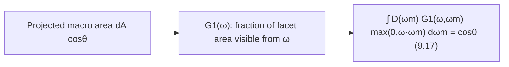

*Figure 9.24 (redrawn as Mermaid). As seen from a viewer or a light source, a differential area on the surface has area dA cos θ, where cos θ is the angle of the incident direction with the surface normal. The projected surface area of visible microfacets (thick lines) must be equal to dA cos θ as well; the masking function G1 gives the fraction of the total microfacet area over dA that is visible in the given direction.*

*Figure 9.24 illustrates the oblique generalization of Equation (9.15), whose left hand side integrates over microfacets and computes the area of their perpendicular projection along ω. A maximum is taken to ignore backfacing microfacets, and G1 accounts for masking by other facets. The right hand side captures the relative size of the macrosurface, which shrinks by a factor of cos θ.*

We expect that physically plausible combinations of microfacet distribution D(ωm) (the Trowbridge– Reitz distribution in our case) and masking function G1(ω, ωm) should satisfy this equation. Unfortunately, the microfacet distribution alone does not impose enough conditions to imply a specific G1(ω, ωm); an infinite family of functions could fulfill the constraint in Equation (9.17). More information about the specific surface height profile is necessary to narrow down this large set of possibilities.

At this point, an approximation is often taken: if the height and normals of different points on the surface are assumed to be statistically independent, the material conceptually turns from a connected surface into an opaque soup of little surface fragments that float in space (hence the name “microfacets”). A consequence of this simplification is that masking becomes independent of the microsurface normal ωm, except for the constraint that backfacing facets are ignored (ω · ωm > 0). The masking term can then be moved out of the integral of Equation (9.17):

$$G_1(\boldsymbol\omega)\int D(\boldsymbol\omega_m)\max(0,\boldsymbol\omega\cdot\boldsymbol\omega_m)\,\mathrm{d}\omega_m=\cos\theta. \quad\text{(9.18)}$$

which can be rearranged to solve for G1(ω):

$$G_1(\boldsymbol\omega)=\frac{\cos\theta}{\int D(\boldsymbol\omega_m)\max(0,\boldsymbol\omega\cdot\boldsymbol\omega_m)\,\mathrm{d}\omega_m}.$$

This is Smith’s approximation. Despite the rather severe simplification, it has been found to be in good agreement with both brute-force simulation of scattering on randomly generated surface microstructures and real-world measurements.

The integral in Equation (9.18) has analytic solutions for various common choices of micro-facet distributions D(ωm), including the Trowbridge–Reitz model. In practice, the masking function is often expressed in terms of an auxiliary function ∧(ω) that arises naturally when the derivation of masking is conducted in the slope domain. This has some benefits that we shall see shortly, and we therefore adopt the same approach that relates G1 and ∧ as follows:

$$G_1(\boldsymbol\omega)=\frac{1}{1+\Lambda(\boldsymbol\omega)}. \quad\text{(9.19)}$$

The `Lambda()` method computes this function.

〈TrowbridgeReitzDistribution Public Methods〉 +≡ 575

```rust
   Float G1(Vector3f w) { return 1 / (1 + Lambda(w)); }
```

Under the uncorrelated height assumption, ∧(ω) has the following analytic solution for the Trowbridge–Reitz distribution:

$$\Lambda(\boldsymbol\omega)=\frac{\sqrt{1+\alpha^2\tan^2\theta}-1}{2}. \quad\text{(9.20)}$$

where α denotes the isotropic surface roughness. An anisotropic generalization follows from the observation that anisotropy implies tangential scaling of the microsurface based on 1/αx and 1/αy. A 1-dimensional ray ω that is not aligned with the x- or y-axis will observe a different scaling amount that lies between these extremes. The associated interpolated roughness is given by

$$\alpha(\boldsymbol\omega)=\sqrt{\cos^2\phi\,\alpha_x^2+\sin^2\phi\,\alpha_y^2}. \quad\text{(9.21)}$$

Anisotropic masking reuses the isotropic ∧ with this definition of α. The “Further Reading” section at the end of this chapter provides more details on these steps. The `Lambda()` function implements Equation (9.20) in the general case.

〈TrowbridgeReitzDistribution Public Methods〉 +≡ 575

```rust
   Float Lambda(Vector3f w) {
       Float tan2Theta = Tan2Theta(w);
       if (IsInf(tan2Theta)) return 0;
       Float alpha2 = Sqr(CosPhi(w) * alpha_x) + Sqr(SinPhi(w) * alpha_y);
       return (sqrt(1 + alpha2 * tan2Theta) - 1) / 2;
   }
```

*Figure 9.25 compares the appearance of two spheres with an isotropic and an anisotropic microfacet model lit by a light source simulating a distant environment.*

<details>
<summary>Reference / notes: CosPhi() 108…</summary>

```text
    CosPhi() 108
    Float 23
    IsInf() 363
    SinPhi() 108
    Sqr() 1034
    Tan2Theta() 108
    TrowbridgeReitzDistribution::alpha_x 575
    TrowbridgeReitzDistribution::alpha_y 575
    TrowbridgeReitzDistribution::Lambda() 577
    Vector3f 86
```

</details>

<details>
<summary>Figure 9.25 — Spheres rendered with (left) an anisotropic microfacet distribution…</summary>

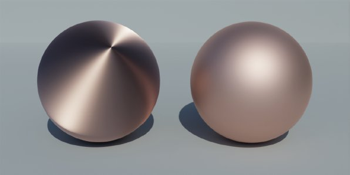

*Figure 9.25: Spheres rendered with (left) an anisotropic microfacet distribution and (right) an isotropic distribution. Note the different specular highlight shapes from the anisotropic model. We have used spheres here instead of the dragon, since anisotropic models like these depend on a globally consistent set of tangent vectors over the surface to orient the direction of anisotropy in a reasonable way.*

</details>

<details>
<summary>Figure 9.26 — The Masking Function G1(ω) for the Trowbridge–Reitz Distribution. I…</summary>

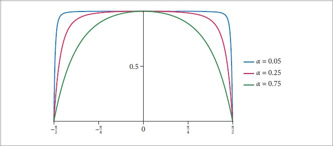

*Figure 9.26: The Masking Function G1(ω) for the Trowbridge–Reitz Distribution. Increasing surface roughness (higher α values) causes the function to fall off to zero more quickly.*

</details>

*Figure 9.26 shows a plot of the Trowbridge–Reitz G1(ω) function for a few values of α. Observe how the function is close to one over much of the domain but falls to zero at grazing angles, where masking becomes dominant. Increasing the surface roughness (i.e., higher values of α) causes the function to fall off more quickly.*

### 9.6.3 THE MASKING-SHADOWING FUNCTION

The BSDF is a function of two directional arguments, and each is subject to occlusion effects caused by the surface microstructure. For viewing and lighting directions, these are respectively denoted as masking and shadowing. To handle both cases, the masking function G1 must be generalized into a masking-shadowing function G that gives the fraction of micro-facets in a differential area that are simultaneously visible from both directions ωo and ωi.

We know that G1(ωo) gives the fraction of microfacets that are visible from the direction ωo, and G1(ωi) gives the fraction for ωi. If we assume that masking and shadowing are statistically independent events, then these probabilities can simply be multiplied together: G(ωo, ωi) = G1(ωo) G1(ωi). However, this independence assumption is a rather severe approximation that tends to overestimate the amount of shadowing and masking. This can produce undesirable dark regions in rendered images.

We instead rely on an approximation that accounts for the property that a microfacet with a higher amount of elevation relative to the macrosurface is more likely to be observed from both ωi and ωo. If the heights of microfacets are normally distributed, a less conservative model for G taking height-

based correlation into account can be derived:

$$G(\boldsymbol\omega_o,\boldsymbol\omega_i)=\frac{1}{1+\Lambda(\boldsymbol\omega_o)+\Lambda(\boldsymbol\omega_i)}. \quad\text{(9.22)}$$

The bidirectional form of G implements this equation based on the previously defined `Lambda()` function.

〈TrowbridgeReitzDistribution Public Methods〉 +≡ 575

```rust
   Float G(Vector3f wo, Vector3f wi) {
        return 1 / (1 + Lambda(wo) + Lambda(wi));
   }
```

```text
    Float 23
    TrowbridgeReitzDistribution::Lambda() 577
    Vector3f 86
```

### 9.6.4 SAMPLING THE DISTRIBUTION OF VISIBLE NORMALS

Efficient rendering using microfacet theory hinges on our ability to determine the micro-facet encountered by a particular incident ray—in essence, this operation must emulate the process of finding an intersection with the surface microstructure. Thanks to its stochastic definition, an actual ray tracing operation is fortunately not needed: the intersected micro-facet follows a known statistical distribution that depends on the roughness and the direction of the incident ray.

Recall the normalization criterion from Equation (9.17), which stated that the set of visible microfacets (left hand side) occupy the same area as the underlying macrosurface (right hand side) when observed from given direction ω with elevation angle θ:

$$\int D(\boldsymbol\omega_m)\,G_1(\boldsymbol\omega,\boldsymbol\omega_m)\,\max(0,\boldsymbol\omega\cdot\boldsymbol\omega_m)\,\mathrm{d}\omega_m=\cos\theta. \quad\text{(9.17)}$$

The probability of a ray interacting with a particular microfacet is directly proportional to its visible area; hence this equation can be seen to encapsulate the distribution that should be used. Following division of both sides by cos θ, the integral on the left hand side equals one—in other words, it turns into a normalized density Dω(ωm) that we shall refer to as the distribution of visible normals:

$$D_{\boldsymbol\omega}(\boldsymbol\omega_m)=\frac{G_1(\boldsymbol\omega)}{\cos\theta}\,D(\boldsymbol\omega_m)\,\max(0,\boldsymbol\omega\cdot\boldsymbol\omega_m). \quad\text{(9.23)}$$

It describes the projected area of forward-facing normals, where the first term involving the masking function specifies an ω-dependent normalization factor. The method `D()` evaluates this density function.

〈TrowbridgeReitzDistribution Public Methods〉 +≡ 575

```rust
   Float D(Vector3f w, Vector3f wm) {
        return G1(w) / AbsCosTheta(w) * D(wm) * AbsDot(w, wm);
   }
```

Two upcoming microfacet BSDFs will rely on the ability to sample microfacet normals ωm according to this density. At this point, one would ordinarily apply the inversion method (Section 2.3) to Equation (9.23) to build a sampling algorithm, but this leads to a relatively complex and approximate method: part of the problem is that the central inversion step lacks an analytic solution. We instead follow a simple geometric approach that exploits the definition of the microsurface in terms of an arrangement of many identical truncated spheres or ellipsoids.

Before implementing the sampling routine, we will quickly take care of the method that returns the associated `PDF`, which is simply another name for the `D()` method.

〈TrowbridgeReitzDistribution Public Methods〉 +≡ 575

```rust
   Float PDF(Vector3f w, Vector3f wm) { return D(w, wm); }
```

*Figure 9.27 illustrates the high-level idea: it suffices to focus on a single ellipsoidal or spherical bump and perpendicularly project parallel rays from an incident direction ω onto its surface. The resulting normal directions ωm will then be distributed according to the density function Dω(ωm).*

```text
    AbsCosTheta() 107
    AbsDot() 90
    Float 23
    TrowbridgeReitzDistribution::D() 575
    TrowbridgeReitzDistribution::G1() 577
    Vector3f 86
```

An observation illustrated in Figure 9.28 can be used to further simplify this task: by applying the inverse of the ellipsoid’s scaling transformation, the problem reduces to the simpler isotropic case. For this, we must transform the incident direction ω to the hemispherical configuration, perform a hemispherical sampling step, and then re-transform the resulting points back to the ellipsoidal state. The `Sample_wm()` method realizes this sequence of steps.


*Figure 9.27 (redrawn as Mermaid). Sampling the distribution of visible normals Dω(ωm) is equivalent to casting rays against the surface microstructure that is composed of many truncated spherical or ellipsoidal bumps. It suffices to consider a single bump in this process.*

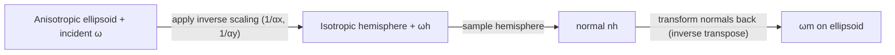

*Figure 9.28 (redrawn as Mermaid). Sampling the anisotropic variant of the Trowbridge–Reitz distribution entails perpendicular projection of uniformly distributed points onto a truncated ellipsoid. Applying the inverse of the ellipsoid’s scaling transformation to all parts of this problem (ellipsoid and incident ray) reduces this problem to the easier hemispherical/isotropic case.*

〈TrowbridgeReitzDistribution Public Methods〉 +≡ 575

```rust
   Vector3f Sample_wm(Vector3f w, Point2f u) {
       〈Transform w to hemispherical configuration 580〉
       〈Find orthonormal basis for visible normal sampling 581〉
       〈Generate uniformly distributed points on the unit disk 581〉
       〈Warp hemispherical projection for visible normal sampling 581〉
       〈Reproject to hemisphere and transform normal to ellipsoid configuration 582〉
   }
```

The first transformation to the hemispherical configuration is accomplished by applying the component-wise scaling factors αx and αy to the incident direction ω and renormalizing. By convention, microfacet normals point into the upper hemisphere, and we potentially flip the incident direction so that both directions are consistently oriented.

〈Transform w to hemispherical configuration〉 ≡ 580

```rust
   Vector3f wh =
   Normalize(Vector3f(alpha_x * w.x, alpha_y * w.y, w.z));
   if (wh.z < 0)
        wh = -wh;
```

```text
    Normalize() 88
    Point2f 92
    TrowbridgeReitzDistribution::alpha_x 575
    TrowbridgeReitzDistribution::alpha_y 575
    Vector3f 86
```

Next, we complete the unit vector wh to an orthonormal basis (T1, T2, wh). The particular construction below satisfies the additional constraint that T1 is perpendicular to the macroscopic normal (0, 0, 1).

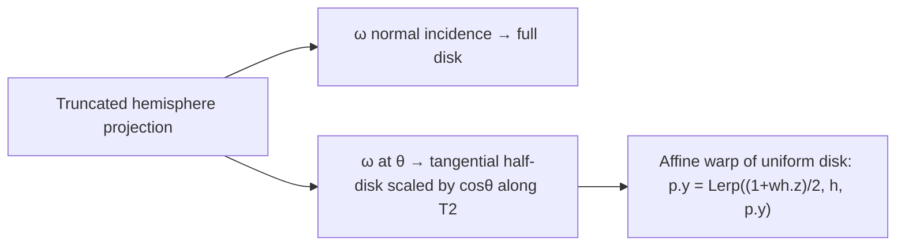

*Figure 9.29 (redrawn as Mermaid). The perpendicular projection of a truncated hemisphere can be decomposed into the projection of two half-disks highlighted in red and blue. The size and shape of the projected tangential half-disk (blue) depends on the incident direction ω and vanishes at grazing incidence.*

〈Find orthonormal basis for visible normal sampling〉 ≡ 580

```rust
   Vector3f T1 = (wh.z < 0.99999f) ? Normalize(Cross(Vector3f(0,
   0, 1), wh))
                                              : Vector3f(1, 0, 0);
   Vector3f T2 = Cross(wh, T1);
```

*Figure 9.29 illustrates the geometry of the projection. When ω is perpendicularly incident (first column), the hemisphere projects onto a disk. Non-perpendicular incidence (columns 2–4) reveals more interesting behavior: the bottom half that corresponds to the perpendicular projection of the tangential half-disk (blue) undergoes a scaling given by cos θ = ω · n along the vertical axis (i.e., the T2 axis). Because the transformation is uniform, we can sample this set using a vertical affine transformation of uniform points on the disk.*

〈Generate uniformly distributed points on the unit disk〉 ≡ 580

```rust
   Point2f p = SampleUniformDiskPolar(u);
```

Let p = (x, y) denote a point on the unit disk. For a given x ∈ [−1, 1], the y-component lies on the interval [−h, h], where specifies the maximum height. Due to non-perpendicular projection, this interval must now be reduced to [−h cos θ, h], which requires an affine transformation

with scale and offset . The following fragment efficiently performs this transformation using the `Lerp()` function.

〈Warp hemispherical projection for visible normal sampling〉 ≡ 580

Float h = f32::sqrt(1 - Sqr(p.x)); p.y = Lerp((1 + wh.z) / 2, h, p.y);

```text
    Cross() 91
    Float 23
    Lerp() 72
    Normalize() 88
    Point2f 92
    SampleUniformDiskPolar() 1013
    Sqr() 1034
    Vector3f 86
```

The last step projects the computed position onto the hemisphere and computes its 3D coordinates. Finally, it reapplies the ellipsoidal transformation and returns the result.

〈Reproject to hemisphere and transform normal to ellipsoid configuration〉 ≡ 580

```rust
   Float        pz      =      sqrt(max<Float>(0,              1  -
   LengthSquared(Vector2f(p))));
   Vector3f nh = p.x * T1 + p.y * T2 + pz * wh;
   return Normalize(Vector3f(alpha_x * nh.x, alpha_y * nh.y,
                                      max<Float>(1e-6f, nh.z)));
```

Note that it may seem that we should divide instead of multiplying by αx and αy to realize the inverse of the transformation from the fragment 〈Transform w to hemispherical configuration〉. This ostensible blunder is explained by the property that normals transform according to the inverse transpose of linear transformations (Section 3.10.3).

### 9.6.5 THE TORRANCE–SPARROW MODEL

We can finally explain how the `ConductorBxDF` handles rough microstructures via a BRDF model due to Torrance and Sparrow (1967). Instead of directly deriving their approach from first principles, we will instead explain how this model is sampled in pbrt, and then reverse-engineer the implied BRDF.

Combined with the visible normal sampling approach, the sampling routine of this model consists of three physically intuitive steps:

1. Given a viewing ray from direction ωo, a microfacet normal ωm is sampled from the visible normal distribution. This step encapsulates the process of intersecting the viewing ray with the random microstructure.
2. Reflection from the sampled microfacet is modeled using the law of specular reflection and the Fresnel equations, which yields the incident direction ωi and a reflection coefficient that attenuates the light carried by the path.
3. The scattered light is finally scaled by G1(ωi) to account for the effect of masking by other microfacets.

Our goal will be to determine the BRDF that represents this sequence of steps. For this, we must first find the probability density of the sampled incident direction ωi. Although visible normal sampling was involved, it is important to note that ωi is not distributed according to the visible normal distribution—to find its density, we must consider the sequence of steps that were used to obtain ωi from ωm.

Taking stock of the available information, we know that the probability density of ωm is given by

$$p(\boldsymbol\omega_m)=D_{\boldsymbol\omega_o}(\boldsymbol\omega_m).$$

, and that ωi is obtained from ωm and ωo using the law of specular reflection—that is,

$$\boldsymbol\omega_i=\operatorname{Reflect}(\boldsymbol\omega_o,\boldsymbol\omega_m). \quad\text{(9.24)}$$

This reflection mapping also has an inverse: the normal responsible for a specific reflection can be determined via

which is known as the half-angle or half-direction transform

 
, as it gives the unique direction vector that lies halfway between ωi and ωo.

$$\boldsymbol\omega_m=\frac{\boldsymbol\omega_i+\boldsymbol\omega_o}{\|\boldsymbol\omega_i+\boldsymbol\omega_o\|}. \quad\text{(9.25)}$$

```text
    ConductorBxDF 560
    Float 23
    LengthSquared() 87
    TrowbridgeReitzDistribution::alpha_x 575
    TrowbridgeReitzDistribution::alpha_y 575
    Vector2f 86
    Vector3f 86
```

**The Half-Direction Transform.**  Transitioning between half- and incident directions is effectively a change of variables, and the Jacobian determinant dωi/dωm of the associated mapping enables the conversion of probability densities between these two spaces. The determinant is simple to find in flatland, as shown in Figure 9.30(a). In the two-dimensional setting, the half-direction mapping simplifies to

$$\theta_m=\frac{\theta_i}{2}\qquad\text{(flatland)}. \quad\text{(9.26)}$$

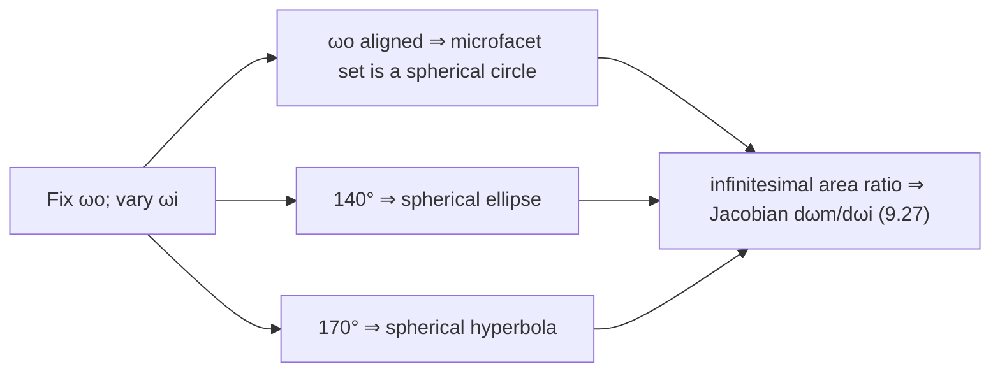

*Figure 9.30 (redrawn as Mermaid). Microfacet normals, incident directions, and outgoing directions satisfy an interesting geometric relationship. We hold the outgoing direction ωo fixed and visualize the set of microfacets (shaded in blue) that will yield a valid reflection from an arc/cone of directions around the incident direction (shaded in green). In the flatland setting shown in (a), the set of admissible microfacets is simply a smaller arc. The 3D case is more complex and involves spherical conic sections. In (b), with the center of the ωi cone aligned with ωo, the admissible microfacets form a spherical circle. (c) With a 140° angle between ωo and the central ωi direction, the microfacets form a spherical ellipse. (d) A spherical hyperbola is the result with a 170° angle. The Torrance–Sparrow model depends on the ratio of the surface area of these shaded sets, which has a succinct analytic solution in the infinitesimally small case.*

A slight perturbation of the incident angle θi (shaded green region) while keeping θo fixed requires a corresponding change to the microfacet angle θm (shaded blue region) to ensure that the law of specular reflection continues to hold. However, this perturbation to θm is smaller—half as small, to be precise—which directly follows from Equation (9.26). Indeed, the derivative of Equation (9.26) yields dθm/dθi = 1/2 for the 2D case.

The 3D case initially appears challenging due to the varied behavior shown in Figure 9.30(b–d). Fortunately, working with infinitesimal sets leads to a simple analytic expression that can be derived by expressing differential solid angles around ωm and ωr using spherical coordinates:

$$\frac{\mathrm{d}\omega_m}{\mathrm{d}\omega_i}=\frac{1}{4\,(\boldsymbol\omega_i\cdot\boldsymbol\omega_m)}=\frac{1}{4\cos\theta_m}. \quad\text{(9.27)}$$

The expression can be simplified by noting that the law of specular reflection implies θi = 2θm and ϕi = ϕm in a spherical coordinate system oriented around ωo:

The resulting Jacobian determinant can be thus conveniently expressed in terms of the microfacet normal and either ωi or ωo.

**Torrance–Sparrow PDF.**  With the relationship of Equation (9.27) at hand, we are now able to evaluate the probability per unit solid angle of the sampled incident directions ωi obtained through the combination of visible normal sampling and the reflection mapping:

$$p(\boldsymbol\omega_i)=\frac{D_{\boldsymbol\omega_o}(\boldsymbol\omega_m)}{4\,(\boldsymbol\omega_o\cdot\boldsymbol\omega_m)}. \quad\text{(9.28)}$$

where ωm depends on ωi via the half-direction transform in Equation (9.25). The following previously undefined fragment incorporates these observations into `ConductorBxDF::PDF()`.

〈Evaluate sampling PDF of rough conductor BRDF〉 ≡ 562

```rust
   Vector3f wm = wo + wi;
   if (LengthSquared(wm) == 0) return 0;
   wm = FaceForward(Normalize(wm), Normal3f(0, 0, 1));
   return mfDistrib.PDF(wo, wm) / (4 * AbsDot(wo, wm));
```

The sign-related differences between equation and implementation ensure correct operation when the incident ray lies below the surface.

**Torrance–Sparrow BRDF.** The sampling routine of any BRDF model encodes a local strategy for importance sampling the scattering equation, (4.14). Here, we are dealing with an opaque surface, so the integral is only over the hemisphere. The single-sample Monte Carlo estimator is then

$$\langle I\rangle=\frac{f_r(\boldsymbol\omega_o,\boldsymbol\omega_i)\cos\theta_i}{p(\boldsymbol\omega_i)}. \quad\text{(9.29)}$$

where p(ωi) denotes the sample’s probability per unit solid angle.

Recall our earlier introduction of the Torrance–Sparrow sampling routine as a composition of physically intuitive steps: intersecting a ray against the random microstructure via visible normal sampling, computation of ωi via the law of reflection, and attenuation of the incident radiance by the Fresnel and masking factors. The radiance computed in this way should agree with the Monte Carlo estimate from Equation (9.29), which means that fr must satisfy the identity

$$\frac{f_r(\boldsymbol\omega_o,\boldsymbol\omega_i)\cos\theta_i}{p(\boldsymbol\omega_i)}=F(\boldsymbol\omega_i)\,G_1(\boldsymbol\omega_i) \;\Longrightarrow\; f_r=\frac{p(\boldsymbol\omega_i)\,F(\boldsymbol\omega_i)\,G_1(\boldsymbol\omega_i)}{\cos\theta_i}. \quad\text{(9.30)}$$

We will simply solve this equation to obtain fr(p, ωo, ωi). Further substituting the PDF of the Torrance–Sparrow model from Equation (9.28) yields the BRDF

$$f_r(\boldsymbol\omega_o,\boldsymbol\omega_i)=\frac{F(\boldsymbol\omega_i)\,D(\boldsymbol\omega_m)\,G_1(\boldsymbol\omega_o)\,G_1(\boldsymbol\omega_i)}{4\cos\theta_o\cos\theta_i}. \quad\text{(9.31)}$$

```text
    AbsDot() 90
    ConductorBxDF::mfDistrib 561
    ConductorBxDF::PDF() 562
    FaceForward() 94
    LengthSquared() 87
    Normal3f 94
    Normalize() 88
    TrowbridgeReitzDistribution::PDF() 579
    Vector3f 86
```

Inserting the definition of the visible normal distribution from Equation (9.23) and assuming directions in the positive hemisphere results in the common form of the Torrance–Sparrow BRDF:

We will, however, make a small adjustment to the above expression: Section 9.6.3 introduced a more accurate bidirectional masking-shadowing factor G that accounts for height correlations on the microstructure. We use it to replace the product of unidirectional G1 factors:

$$f_r(\boldsymbol\omega_o,\boldsymbol\omega_i)=\frac{F(\boldsymbol\omega_i)\,D(\boldsymbol\omega_m)\,G(\boldsymbol\omega_o,\boldsymbol\omega_i)}{4\cos\theta_o\cos\theta_i}. \quad\text{(9.33)}$$

One of the nice things about the Torrance–Sparrow model is that the derivation does not depend on the particular microfacet distribution being used. Furthermore, it does not depend on a particular Fresnel function and can be used for both conductors and dielectrics. However, the relationship between dωm and dωo used in the derivation does depend on the assumption of specular reflection from microfacets, and the refractive variant of this model will require suitable modifications.

Evaluating the terms of the Torrance–Sparrow BRDF is straightforward.

〈Evaluate rough conductor BRDF〉 ≡ 562

```rust
   〈Compute cosines and ωm for conductor BRDF 585〉
   〈Evaluate Fresnel factor F for conductor BRDF 585〉
   return mfDistrib.D(wm) * F * mfDistrib.G(wo, wi) /
            (4 * cosTheta_i * cosTheta_o);
```

Incident and outgoing directions at glancing angles need to be handled explicitly to avoid the generation of NaN values:

〈Compute cosines and ωm for conductor BRDF〉 ≡ 585

```rust
   Float cosTheta_o = AbsCosTheta(wo), cosTheta_i = AbsCosTheta(wi);
   if (cosTheta_i == 0 || cosTheta_o == 0) return {};
   Vector3f wm = wi + wo;
   if (LengthSquared(wm) == 0) return {};
   wm = Normalize(wm);
```

Note that the Fresnel term is based on the angle of incidence relative to the microfacet (i.e., ωo · ωm) rather than the macrosurface.

〈Evaluate Fresnel factor F for conductor BRDF〉 ≡ 585

```rust
   SampledSpectrum F = FrComplex(AbsDot(wo, wm), eta, k);
```

**Torrance–Sparrow Sampling.**  The sampling procedure follows the sequence of steps outlined at the beginning of this subsection. It first uses `Sample_wm()` to find a microfacet orientation and reflects the outgoing direction about the microfacet’s normal to find ωi before evaluating the BRDF and density function.

〈Sample rough conductor BRDF〉 ≡ 562

```rust
   〈Sample microfacet normal ωm and reflected direction ωi 586〉
    〈Compute PDF of wi for microfacet reflection〉
    Float     cosTheta_o          =    AbsCosTheta(wo),  cosTheta_i =
    AbsCosTheta(wi);
    〈Evaluate Fresnel factor F for conductor BRDF 585〉
    SampledSpectrum f = mfDistrib.D(wm) * F * mfDistrib.G(wo, wi)
    /
                              (4 * cosTheta_i * cosTheta_o);
    return BSDFSample(f, wi, pdf, BxDFFlags::GlossyReflection);
```

<details>
<summary>Reference / notes: AbsCosTheta() 107…</summary>

```text
    AbsCosTheta() 107
    AbsDot() 90
    BSDFSample 541
    BxDFFlags::GlossyReflection 539
    ConductorBxDF::mfDistrib 561
    Float 23
    FrComplex() 559
    LengthSquared() 87
    Normalize() 88
    SampledSpectrum 171
    TrowbridgeReitzDistribution::D() 575
    TrowbridgeReitzDistribution::G() 578
    Vector3f 86
```

</details>

A curious situation arises when the sampled microfacet normal leads to a computed direction that lies below the macroscopic surface. In a real microstructure, this would mean that light travels deeper into a crevice, to be scattered a second or third time. However, the presented ConductorBxDF only simulates a single interaction and thus marks such samples as invalid. This reveals one of the main flaws of the presented model: objects with significant roughness may appear too dark due to this lack of multiple scattering. Addressing issues related to energy loss is an active topic of research; see the “Further Reading” section for more information.

〈Sample microfacet normal ωm and reflected direction ωi〉 ≡ 585

```rust
    Vector3f wm = mfDistrib.Sample_wm(wo, u);
    Vector3f wi = Reflect(wo, wm);
    if (!SameHemisphere(wo, wi)) return {};
```

We omit the fragment 〈Compute PDF of wi for microfacet reflection〉 that follows `ConductorBxDF::PDF()`.

Visible normal sampling is still a relatively new development: for several decades, microfacet models relied on sampling ωm directly proportional to the microfacet distribution, which tends to produce noisier renderings since some terms of the BRDF are not sampled exactly. Figure 9.31 compares this classical approach to what is now implemented in pbrt.

<details>
<summary>Figure 9.31 — Comparison of Microfacet Sampling Techniques. The ground plane unde…</summary>

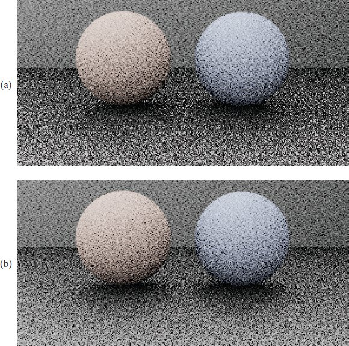

*Figure 9.31: Comparison of Microfacet Sampling Techniques. The ground plane under the spheres has a metal material modeled using the Torrance–Sparrow BRDF with a roughness of α = 0.01. Even with this relatively smooth microsurface, (a) sampling the full microfacet distribution D(ωm) gives visibly higher error from unusable samples taken from backfacing microfacets than (b) directly sampling the visible microfacet distribution .*

</details>

*Index: `ConductorBxDF::mfDistrib` 561, `ConductorBxDF::PDF()` 562, `Reflect()` 552, `SameHemisphere()` 538, `TrowbridgeReitzDistribution::Sample_wm()` 580, `Vector3f` 86.*

<details>
<summary>Figure 9.32 — Dragon models rendered with the Torrance–Sparrow microfacet model f…</summary>

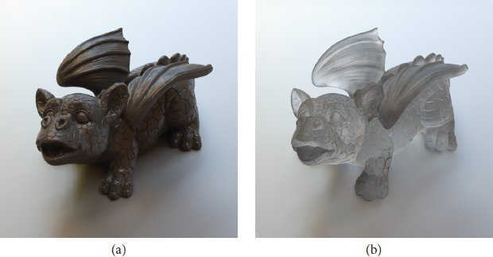

*Figure 9.32: Dragon models rendered with the Torrance–Sparrow microfacet model featuring both reflection (a) and transmission (b). (Model courtesy of Christian Schüller.)*

</details>

## 9.7 ROUGH DIELECTRIC BSDF

We will now extend the microfacet approach from Section 9.6 to the case of rough dielectrics. This involves two notable changes: since dielectrics are characterized by both reflection and transmission, the model must be aware of these two separate components. In the case of transmission, Snell’s law will furthermore replace the law of reflection in the computation that determines the incident direction.

*Figure 9.32 shows the dragon rendered with the Torrance–Sparrow model and both reflection and transmission.*

As before, we will begin by characterizing the probability density of generated samples. The implied BSDF then directly follows from this density and the sequence of events encapsulated by a scattering interaction: visible normal sampling, reflection or refraction, and attenuation by the Fresnel and masking terms.

**Rough Dielectric PDF.** The density evaluation occurs in the following fragment that we previously omitted during the discussion of the smooth dielectric case.

〈Evaluate sampling PDF of rough dielectric BSDF〉 ≡ 566

```text
   〈Compute generalized half vector wm 588〉
   〈Discard backfacing microfacets 588〉
   〈Determine Fresnel reflectance of rough dielectric boundary 588〉
   〈Compute probabilities pr and pt for sampling reflection and transmission 564〉
   〈Return PDF for rough dielectric 589〉
```

We now turn to the generalized half-direction vector, whose discussion requires a closer look at Snell’s law (Equation (9.2)) relating the elevation and azimuth of the incident and outgoing directions at a refractive interface: ηo sin θo = ηi sin θi and ϕo = ϕi + π. Since the refraction takes place at the level of the microgeometry, all of these angles are to be understood within a coordinate frame aligned with the microfacet normal ωm. Recall also that the sines in the first equation refer to the length of the tangential component of ωi and ωo perpendicular to ωm.

A generalized half-direction vector builds on this observation by scaling and adding these directions to cancel out the tangential components, which yields the surface normal responsible for a particular refraction after normalization. It is defined as

where η = ηi/ηo

$$\boldsymbol\omega_m=\frac{\eta_i\boldsymbol\omega_i+\eta_o\boldsymbol\omega_o}{\|\eta_i\boldsymbol\omega_i+\eta_o\boldsymbol\omega_o\|}=\frac{\eta\,\boldsymbol\omega_i+\boldsymbol\omega_o}{\|\eta\,\boldsymbol\omega_i+\boldsymbol\omega_o\|}. \quad\text{(9.34)}$$

is the relative index of refraction toward the sampled direction ωi. The reflective case is trivially subsumed, since ηi = ηo when no refraction takes place. The next fragment implements this

computation, including handling of invalid configurations (e.g., perfectly grazing incidence) where both the BSDF and its sampling density evaluate to zero.

〈Compute generalized half vector wm〉 ≡ 587, 589

```rust
   Float cosTheta_o = CosTheta(wo), cosTheta_i = CosTheta(wi);
   bool reflect = cosTheta_i * cosTheta_o > 0;
   float etap = 1;
   if (!reflect)
       etap = cosTheta_o > 0 ? eta : (1 / eta);
   Vector3f wm = wi * etap + wo;
   if (cosTheta_i == 0 || cosTheta_o == 0 || LengthSquared(wm)
   == 0) return {};
   wm = FaceForward(Normalize(wm), Normal3f(0, 0, 1));
```

The last line reflects an important implementation detail: with the previous definition in Equation (9.34), ωm always points toward the denser medium, whereas pbrt uses the convention that micro-and macro-normal are consistently oriented (i.e., ωm · n > 0). In practice, we therefore compute the following modified half-direction vector, where n = (0, 0, 1) in local coordinates:

$$\boldsymbol\omega_m\leftarrow\operatorname{FaceForward}(\boldsymbol\omega_m,\mathbf n)\quad\text{so that}\quad\boldsymbol\omega_m\cdot\mathbf n>0.$$

Next, microfacets that are backfacing with respect to either the incident or outgoing direction do not contribute and must be discarded.

〈Discard backfacing microfacets〉 ≡ 587, 589

```rust
   if (Dot(wm, wi) * cosTheta_i < 0 || Dot(wm, wo) * cosTheta_o
   < 0)
        return {};
```

Given ωm, we can evaluate the Fresnel reflection and transmission terms using the specialized dielectric evaluation of the Fresnel equations.

〈Determine Fresnel reflectance of rough dielectric boundary〉 ≡ 587

```rust
   Float R = FrDielectric(Dot(wo, wm), eta);
   Float T = 1 - R;
```

```text
    CosTheta() 107
    DielectricBxDF::eta 563
    Dot() 89
    FaceForward() 94
    Float 23
    FrDielectric() 557
    LengthSquared() 87
    Normal3f 94
```

```text
    Normalize() 88
    Vector3f 86
```

We now have the values necessary to compute the PDF for ωi, which depends on whether it reflects or transmits at the surface.

〈Return PDF for rough dielectric〉 ≡ 587

```rust
   Float pdf;
   if (reflect) {
        〈Compute PDF of rough dielectric reflection 589〉
   } else {
        〈Compute PDF of rough dielectric transmission 589〉
   }
   return pdf;
```

As before, the bijective mapping between ωm and ωi provides a change of variables whose Jacobian determinant is crucial so that we can correctly deduce the probability density of sampled directions ωi. The derivation is more involved in the refractive case; see the “Further Reading” section for pointers to its derivation. The final determinant is given by

$$\frac{\mathrm{d}\omega_m}{\mathrm{d}\omega_i}=\frac{|\boldsymbol\omega_i\cdot\boldsymbol\omega_m|}{\left(\boldsymbol\omega_i\cdot\boldsymbol\omega_m+\dfrac{\boldsymbol\omega_o\cdot\boldsymbol\omega_m}{\eta}\right)^2}. \quad\text{(9.35)}$$

Once more, this relationship makes it possible to evaluate the probability per unit solid angle of the sampled incident directions ωi obtained through the combination of visible normal sampling and

scattering: The following fragment implements this computation, while additionally accounting for the discrete probability pt / (pr + pt) of sampling the transmission component.

$$p(\boldsymbol\omega_i)=D_{\boldsymbol\omega_o}(\boldsymbol\omega_m)\,\frac{|\boldsymbol\omega_i\cdot\boldsymbol\omega_m|}{\left(\boldsymbol\omega_i\cdot\boldsymbol\omega_m+\frac{\boldsymbol\omega_o\cdot\boldsymbol\omega_m}{\eta}\right)^2}. \quad\text{(9.36)}$$

$$p(\boldsymbol\omega_i)=D_{\boldsymbol\omega_o}(\boldsymbol\omega_m)\,\frac{|\boldsymbol\omega_i\cdot\boldsymbol\omega_m|}{\left(\boldsymbol\omega_i\cdot\boldsymbol\omega_m+\frac{\boldsymbol\omega_o\cdot\boldsymbol\omega_m}{\eta}\right)^2}\,\frac{p_t}{p_r+p_t}. \quad\text{(9.37)}$$

〈Compute PDF of rough dielectric transmission〉 ≡ 589, 591

```rust
   Float denom = Sqr(Dot(wi, wm) + Dot(wo, wm) / etap);
   Float dwm_dwi = AbsDot(wi, wm) / denom;
   pdf = mfDistrib.PDF(wo, wm) * dwm_dwi * pt / (pr + pt);
```

Finally, the density of the reflection component agrees with the model used for conductors but for the additional discrete probability pr / (pr + pt) of choosing the reflection component.

〈Compute PDF of rough dielectric reflection〉 ≡ 589, 591

```rust
   pdf = mfDistrib.PDF(wo, wm) / (4 * AbsDot(wo, wm)) * pr / (pr
   + pt);
```

**Rough Dielectric BSDF.** BSDF evaluation is similarly split into reflective and transmissive components.

〈Evaluate rough dielectric BSDF〉 ≡ 566

```rust
   〈Compute generalized half vector wm 588〉
   〈Discard backfacing microfacets 588〉
   Float F = FrDielectric(Dot(wo, wm), eta);
   if (reflect) {
        〈Compute reflection at rough dielectric interface 590〉
   } else {
        〈Compute transmission at rough dielectric interface 590〉
   }
```

```text
    AbsDot() 90
    DielectricBxDF::eta 563
    DielectricBxDF::mfDistrib 563
    Dot() 89
    Float 23
    FrDielectric() 557
    Sqr() 1034
    TrowbridgeReitzDistribution::PDF() 579
```

The reflection component follows the approach used for conductors in the fragment 〈Evaluate rough conductor BRDF〉:

〈Compute reflection at rough dielectric interface〉 ≡ 589

```rust
   return SampledSpectrum(mfDistrib.D(wm) * mfDistrib.G(wo, wi)
   * F /
                                   abs(4        * cosTheta_i *
                                   cosTheta_o));
```

For the transmission component, we can again derive the effective scattering distribution by equating a single-sample Monte Carlo estimate of the rendering equation with the product of Fresnel transmission, masking, and the incident radiance. This results in the equation

$$\frac{f_t(\boldsymbol\omega_o,\boldsymbol\omega_i)\cos\theta_i}{p(\boldsymbol\omega_i)}=(1-F)\,T\,G_1(\boldsymbol\omega_i)\,L_i\qquad\text{(single-sample estimate)}.$$

Substituting the PDF from Equation (9.37) and solving for the BTDF ft(p, ωo, ωi) results in

Finally, inserting

$$f_t(\boldsymbol\omega_o,\boldsymbol\omega_i)=\frac{(1-F)\,D(\boldsymbol\omega_m)\,G_1(\boldsymbol\omega_o)\,|\boldsymbol\omega_i\cdot\boldsymbol\omega_m\,\boldsymbol\omega_o\cdot\boldsymbol\omega_m|}{\cos\theta_i\cos\theta_o\left(\boldsymbol\omega_i\cdot\boldsymbol\omega_m+\frac{\boldsymbol\omega_o\cdot\boldsymbol\omega_m}{\eta}\right)^2}. \quad\text{(9.39)}$$

the definition of the visible normal distribution from Equation (9.23) and switching to the more accurate bidirectional masking-shadowing factor G yields

$$f_t(\boldsymbol\omega_o,\boldsymbol\omega_i)=\frac{(1-F)\,D(\boldsymbol\omega_m)\,G(\boldsymbol\omega_o,\boldsymbol\omega_i)\,|\boldsymbol\omega_i\cdot\boldsymbol\omega_m\,\boldsymbol\omega_o\cdot\boldsymbol\omega_m|}{\cos\theta_i\cos\theta_o\left(\boldsymbol\omega_i\cdot\boldsymbol\omega_m+\frac{\boldsymbol\omega_o\cdot\boldsymbol\omega_m}{\eta}\right)^2}. \quad\text{(9.40)}$$

The next fragment implements this expression. It also incorporates the earlier orientation test and handling of non-symmetric scattering that was previously encountered in the perfect specular case (Section 9.5.2).

〈Compute transmission at rough dielectric interface〉 ≡ 589

```rust
   Float denom = Sqr(Dot(wi, wm) + Dot(wo, wm)/etap) *
   cosTheta_i * cosTheta_o;
   Float ft = mfDistrib.D(wm) * (1 - F) * mfDistrib.G(wo, wi) *
                 abs(Dot(wi, wm) * Dot(wo, wm) / denom);
   〈Account for non-symmetry with transmission to different medium 571〉
   return SampledSpectrum(ft);
```

**Rough Dielectric Sampling.** Sampling proceeds by drawing a microfacet normal from the visible normal distribution, computing the Fresnel term, and stochastically selecting between reflection and transmission.

〈Sample rough dielectric BSDF〉 ≡ 564

```rust
   Vector3f wm = mfDistrib.Sample_wm(wo, u);
   Float R = FrDielectric(Dot(wo, wm), eta);
   Float T = 1 - R;
   〈Compute probabilities pr and pt for sampling reflection and transmission 564〉
   Float pdf;
   if (uc < pr / (pr + pt)) {
        〈Sample reflection at rough dielectric interface 591〉
   } else {
        〈Sample transmission at rough dielectric interface 591〉
   }
```

Once again, handling of the reflection component is straightforward and mostly matches the case for conductors except for extra factors that arise due to the discrete choice between reflection and transmission components.

```text
    DielectricBxDF::mfDistrib 563
    Dot() 89
    Float 23
    FrDielectric() 557
    SampledSpectrum 171
    Sqr() 1034
```

```text
    TrowbridgeReitzDistribution::D() 575
    TrowbridgeReitzDistribution::G() 578
    TrowbridgeReitzDistribution::Sample_wm() 580
    Vector3f 86
```

〈Sample reflection at rough dielectric interface〉 ≡ 590

```rust
   Vector3f wi = Reflect(wo, wm);
   if (!SameHemisphere(wo, wi)) return {};
   〈Compute PDF of rough dielectric reflection 589〉
   SampledSpectrum f(mfDistrib.D(wm) * mfDistrib.G(wo, wi) * R /
                            (4 * CosTheta(wi) * CosTheta(wo)));
   return BSDFSample(f, wi, pdf, BxDFFlags::GlossyReflection);
```

The transmission case invokes Refract() to determine wi. A subsequent test excludes inconsistencies that can rarely arise due to the approximate nature of floating-point arithmetic. For example, Refract() may sometimes indicate a total internal reflection configuration, which is inconsistent as the transmission component should not have been sampled in this case.

〈Sample transmission at rough dielectric interface〉 ≡ 590

```rust
   Float etap;
   Vector3f wi;
   bool tir = !Refract(wo, (Normal3f)wm, eta, &etap, &wi);
   if (SameHemisphere(wo, wi) || wi.z == 0 || tir)
        return {};
   〈Compute PDF of rough dielectric transmission 589〉
   〈Evaluate BRDF and return BSDFSample for rough transmission 591〉
```

The last step evaluates the BTDF from Equation (9.40) and packs the sample information into a BSDFSample.

〈Evaluate BRDF and return BSDFSample for rough transmission〉 ≡ 591

```rust
   SampledSpectrum ft(T * mfDistrib.D(wm) * mfDistrib.G(wo, wi)
   *
        abs(Dot(wi, wm) * Dot(wo, wm) /
        (CosTheta(wi) * CosTheta(wo) * denom)));
   〈Account for non-symmetry with transmission to different medium 571〉
   return BSDFSample(ft, wi, pdf, BxDFFlags::GlossyTransmission,
   etap);
```

## 9.8 MEASURED BSDFs

The reflection models introduced up to this point represent index of refraction changes at smooth and rough boundaries, which constitute the basic building blocks of surface appearance. More complex materials (e.g., paint on primer, metal under a layer of enamel) can sometimes be approximated using multiple interfaces with participating media between them; the layered material model presented in Section 14.3 is based on that approach.

However, many real-world materials are beyond the scope of even such layered models. Examples include:

- Materials characterized by wave-optical phenomena that produce striking directionally varying coloration. Examples include iridescent paints, insect wings, and holographic paper.

- Materials with rough interfaces. In pbrt, we have chosen to model such surfaces using microfacet theory and the Trowbridge–Reitz distribution. However, it is important to remember that both of these are models that generally do not match real-world behavior perfectly.

- Surfaces with non-standard microstructure. For example, a woven fabric composed of two different yarns looks like a surface from a distance, but its directional intensity and color variation are not well-described by any standard BRDF model due to the distinct reflectance properties of fiber-based microgeometry.

<details>
<summary>Reference / notes: BSDFSample 541…</summary>

```text
    BSDFSample 541
    BxDFFlags::GlossyReflection 539
    BxDFFlags::GlossyTransmission 539
    CosTheta() 107
    DielectricBxDF::mfDistrib 563
    Dot() 89
    Float 23
    Normal3f 94
    Reflect() 552
    Refract() 554
    SameHemisphere() 538
    SampledSpectrum 171
    TrowbridgeReitzDistribution::D() 575
    TrowbridgeReitzDistribution::G() 578
    Vector3f 86
```

</details>

Instead of developing numerous additional specialized BxDFs, we will now pursue another way of reproducing such challenging materials in a renderer: by interpolating measurements of real-world material samples to create a data-driven reflectance model. The resulting `MeasuredBxDF` only models surface reflection, though the approach can in principle generalize to transmission as well.

〈MeasuredBxDF Definition〉 ≡

```rust
struct MeasuredBxDF {
       // 〈MeasuredBxDF Public Methods〉
       // 〈MeasuredBxDF Private Methods 601〉
       // 〈MeasuredBxDF Private Members 600〉
   }
```

Measuring reflection in a way that is practical while producing information in a form that is convenient for rendering is a challenging problem. We begin by explaining these challenges for motivation.

Consider the task of measuring the BRDF of a sheet of brushed aluminum: we could illuminate a

sample of the material from a set of n incident directions with k = 1, … , n and use some kind of sensor (e.g., a photodiode) to record the reflected light scattered along a set of m outgoing directions with l = 1, … , m. These n × m measurements could be stored on disk and interpolated at runtime to approximate the BRDF at intermediate configurations (θi, ϕi, θo, ϕo). However, closer scrutiny of such an approach reveals several problems:

BSDFs of polished materials are highly directionally peaked. Perturbing the incident or outgoing direction by as little as 1 degree can change the measured reflectance by orders of magnitude. This implies that the set of incident and outgoing directions must be sampled fairly densely.

Accurate positioning in spherical coordinates is difficult to perform by hand and generally requires mechanical aids. For this reason, such measurements are normally performed using a motorized gantry known as a goniophotometer or gonioreflectometer. Figure 9.33 shows two examples of such machines. Light stages consisting of a rigid assembly of hundreds of LEDs around a sample are sometimes used to accelerate measurement, though at the cost of reduced directional resolution.

Sampling each direction using a 1 degree spacing in spherical coordinates requires roughly one billion sample points. Storing gigabytes of measurement data is possible but undesirable, yet the time that would be spent for a full measurement is even more problematic: assuming that the goniophotometer can reach a configuration (θi, ϕi, θo, ϕo) within 1 second (a reasonable estimate for the devices shown in Figure 9.33), over 34 years of sustained operation would be needed to measure a single material.

In sum, the combination of high-frequency signals, the 4D domain of the BRDF, and the curse of dimensionality conspire to make standard measurement approaches all but impractical.

```text
    BxDF 538
    MeasuredBxDF 592
```

While there is no general antidote against the curse of dimensionality, the previous example involving a dense discretization of the 4D domain is clearly excessive. For example, peaked BSDFs that concentrate most of their energy into a small set of angles tend to be relatively smooth away from the peak. Figure 9.34 shows how a more specialized sample placement that is informed by the principles

of specular reflection can drastically reduce the number of sample points that are needed to obtain a desired level of accuracy. Figure 9.35 shows how the roughness of the surface affects the desired distribution of samples—for example, smooth surfaces allow sparse sampling outside of the specular lobe.

<details>
<summary>Figure 9.33 — Specialized Hardware for BSDF Acquisition. The term goniophotometer…</summary>

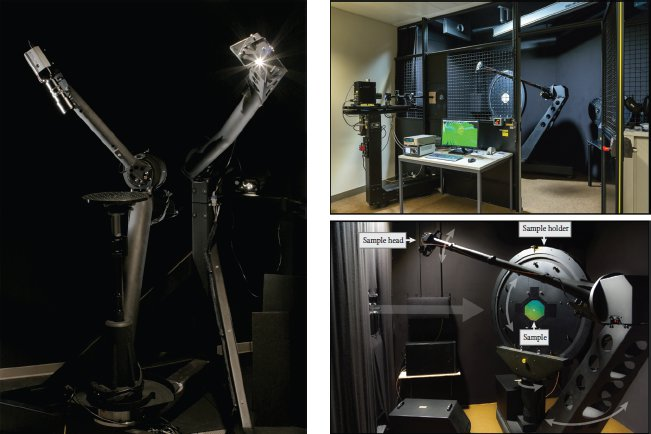

*Figure 9.33: Specialized Hardware for BSDF Acquisition. The term goniophotometer (or gonioreflectometer) refers to a typically motorized platform that can simultaneously illuminate and observe a material sample from arbitrary pairs of directions. The device on the left (at Cornell University, built by Cyberware Inc., image courtesy of Steve Marschner) rotates camera (2 degrees of freedom) and light arms (1 degree of freedom) around a centered sample pedestal that can also rotate about its vertical axis. The device on the right (at EPFL, built by pab advanced technologies Ltd) instead uses a static light source and a rotating sensor arm (2 degrees of freedom). The vertical material sample holder then provides 2 rotational degrees of freedom to cover the full 4D domain of the BSDF.*

</details>

<details>
<summary>Figure 9.34 — Adaptive BRDF Sample Placement. (a) Regular sampling of the inciden…</summary>

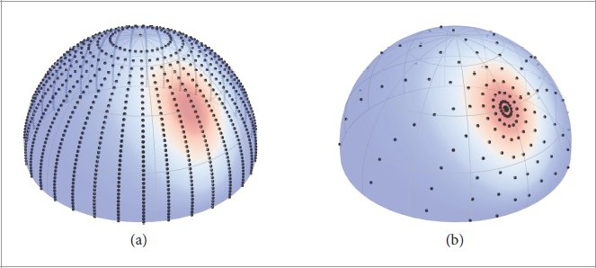

*Figure 9.34: Adaptive BRDF Sample Placement. (a) Regular sampling of the incident and outgoing directions is a prohibitively expensive way of measuring and storing BRDFs due to the curse of dimensionality (here, only 2 of the 4 dimensions are shown). (b) A smaller number of samples can yield a more accurate interpolant if their placement is informed by the material’s reflectance behavior.*

</details>

<details>
<summary>Figure 9.35 — The Effect of Surface Roughness on Adaptive BRDF Sample Placement. …</summary>

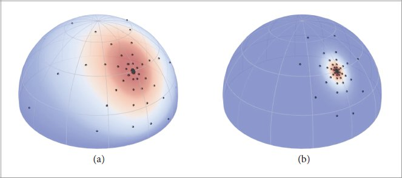

*Figure 9.35: The Effect of Surface Roughness on Adaptive BRDF Sample Placement. The two plots visualize BRDF values of two materials with different roughnesses for varying directions ωi and fixed ωo. Circles indicate adaptively chosen measurement locations, which are used to create the interpolant implemented in the MeasuredBxDF class. (a) The measurement locations broadly cover the hemisphere given a relatively rough material. (b) For a more specular material the samples are concentrated in the region around the specular peak. Changing the outgoing direction moves the specular peak; hence the sample locations must depend on ωo.*

</details>

The MeasuredBxDF therefore builds on microfacet theory and the distribution of visible normals to create a more efficient physically informed sampling pattern. The rationale underlying this choice is that while microfacet theory may not perfectly predict the reflectance of a specific material, it can at least approximately represent how energy is (re-)distributed throughout the 4D domain. Applying it enables the use of a relatively coarse set of measurement locations that suffice to capture the function’s behavior.

Concretely, the method works by transforming regular grid points using visible normal sampling (Section 9.6.4) and performing a measurement at each sampled position. If the microfacet sampling routine is given by a function R : S2 × [0, 1]2 → S2 and u(k) with k = 1, … , n denotes input samples arranged on a grid covering the 2D unit square, then we have a sequence of measurements M(k):

$$M^{(k)}=f_r\!\left(\boldsymbol\omega_o,\boldsymbol\omega_i^{(k)}\right),\qquad \boldsymbol\omega_i^{(k)}=R(\boldsymbol\omega_o,\mathbf u^{(k)}). \quad\text{(9.41)}$$

where fr(ωo, ωi) refers to the real-world BRDF of a material sample, as measured by a goniophotometer (or similar device) in directions ωo and ωi = R(ωo, u(k)). This process must be repeated for different values of ωo to also capture variation in the other direction argument. Evaluating the BRDF requires the inverse R−1 of the transformation, which yields a position on [0, 1]2 that can be used to interpolate the measurements M(k). Figure 9.36 illustrates both directions of this mapping.

This procedure raises several questions: first, the non-random use of a method designed for Monte Carlo sampling may be unexpected. To see why this works, remember that the inversion method (Section 2.3) evaluates the inverse of a distribution’s cumulative distribution function (CDF). Besides being convenient for sampling, this inverse CDF can also be interpreted as a parameterization of the target domain from the unit square. This parameterization smoothly warps the domain so that regions with a high contribution occupy a correspondingly large amount of the unit square. The MeasuredBxDF then simply measures and stores BRDF values in these “improved” coordinates. Note that the material does not have to agree with microfacet theory for this warping to be valid, though the sampling pattern is much less efficient and requires a denser discretization when the material’s behavior deviates significantly.

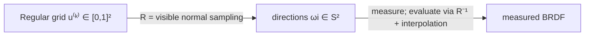

*Figure 9.36 (redrawn as Mermaid). Visible Normal Sampling as a Parameterization. The MeasuredBxDF leverages visible normal sampling as a parameterization R of the unit sphere. Here, it is used in a deterministic fashion to transform a set of grid points u(k) with k = 1, … , n into spherical directions to be measured. Evaluating the resulting BRDF representation requires the inverse R−1 followed by linear interpolation within the regular grid of measurements.*

Another challenge is that parameterization guiding the measurement requires a microfacet approximation of the material, but such an approximation would normally be derived from an existing measurement. We will shortly show how to resolve this chicken-and-egg problem and assume for now that a suitable model is available.

**Measurement Through a Parameterization.** A flaw of the reparameterized measurement sequence in Equation (9.41) is that the values M(k) may differ by many orders of magnitude, which means that simple linear interpolation between neighboring data points is unlikely to give satisfactory results. We instead use the following representation that transforms measurements prior to storage in an effort to reduce this variation:

$$M^{(k)}=\frac{f_r(\boldsymbol\omega_o,\boldsymbol\omega_i^{(k)})}{p(\boldsymbol\omega_i^{(k)})}. \quad\text{(9.42)}$$

where ωi(k) = R(ωo, u(k)), and p(ωi(k)) denotes the density of direction ωi(k) according to visible normal sampling.

If fr was an analytic BRDF (e.g., a microfacet model) and u(k) a 2D uniform variate, then Equation (9.42) would simply be the weight of a Monte Carlo importance sampling strategy, typically with a carefully designed mapping R and density p that make this weight near-constant to reduce variance.

In the present context, fr represents real-world data, while p and R encapsulate a microfacet approximation of the material under consideration. We therefore expect M(k) to take on near-constant values when the material is well-described by a microfacet model, and more marked

deviations otherwise. This can roughly be interpreted as measuring the difference (in a multiplicative sense) between the real world and the microfacet simplification. Figure 9.37 visualizes the effect of the transformation in Equation (9.42).

<details>
<summary>Figure 9.37 — Reparameterized BRDF Visualization. This figure illustrates the rep…</summary>

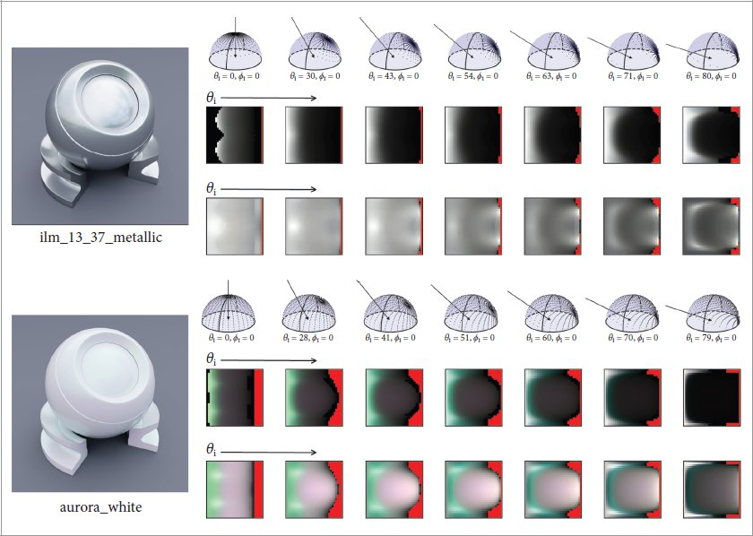

*Figure 9.37: Reparameterized BRDF Visualization. This figure illustrates the representation of two material samples: a metallic sample swatch from the L3-37 robot in the film Solo: A Star Wars Story (Walt Disney Studios Motion Pictures) and a pearlescent vehicle vinyl wrap (TeckWrap International Inc.). Each column represents a measurement of a separate outgoing direction ωo. For both materials, the first row visualizes the measured directions ωi(k). The subsequent row plots the “raw” reparameterized BRDF of Equation (9.41), where each pixel represents one of the grid points u(k) ∈ [0, 1]2 identified with ωi(k). The final row shows transformed measurements corresponding to Equation (9.42) that are more uniform and easier to interpolate. Note that these samples are both isotropic, which is why a few measurements for different elevation angles suffice. In the anisotropic case, the (θo, ϕo) domain must be covered more densely.*

</details>

**BRDF Evaluation.** Evaluating the data-driven BRDF requires the inverse of these steps. Suppose that M(·) implements an interpolation based on the grid of measurement points M(k). Furthermore, suppose that we have access to the inverse R−1(ωo, ωi) that returns the “random numbers” u that would cause visible normal sampling to generate a particular incident direction (i.e., R(ωo, u) = ωi). Accessing M(·) through R−1 then provides a spherical interpolation of the measurement data.

We must additionally multiply by the density p(ωi), and divide by the cosine factor5 to undo corresponding transformations introduced in Equation (9.42), which yields the final form of the data-driven BRDF:

$$f_r(\boldsymbol\omega_o,\boldsymbol\omega_i)=\frac{M\!\left(R^{-1}(\boldsymbol\omega_o,\boldsymbol\omega_i)\right)\,p(\boldsymbol\omega_i)}{|\cos\theta_i|}. \quad\text{(9.43)}$$

**Generalized Microfacet Model.** A major difference between the microfacet model underlying the ConductorBxDF and the approximation used here is that we replace the Trowbridge–Reitz model with an arbitrary data-driven microfacet distribution. This improves the model’s ability to approximate the material being measured. At the same time, it implies that previously used simplifications and analytic solutions are no longer available and must be revisited.

We begin with the Torrance–Sparrow sampling density from Equation (9.28),

$$p(\boldsymbol\omega_i)=\frac{D_{\boldsymbol\omega_o}(\boldsymbol\omega_m)}{4(\boldsymbol\omega_o\cdot\boldsymbol\omega_m)}.$$

which references the visible normal sampling density Dω(ωm) from Equation (9.23). Substituting the

definition of the masking function from Equation (9.18) into and rearranging terms yields

$$D_{\boldsymbol\omega_o}(\boldsymbol\omega_m)=\frac{D(\boldsymbol\omega_m)\max(0,\boldsymbol\omega_o\cdot\boldsymbol\omega_m)}{\sigma(\boldsymbol\omega_o)}.$$

where

provides a direction-dependent normalization of the visible normal distribution.

$$\sigma(\boldsymbol\omega_o)=\int_{H^2} D(\boldsymbol\omega_m)\max(0,\boldsymbol\omega_o\cdot\boldsymbol\omega_m)\,\mathrm{d}\omega_m.$$

For valid reflection directions (ωo · ωm > 0), the PDF of generated samples then simplifies to

$$p(\boldsymbol\omega_i)=\frac{D(\boldsymbol\omega_m)}{4\,\sigma(\boldsymbol\omega_o)}. \quad\text{(9.44)}$$

Substituting this density into the BRDF from Equation (9.43) produces

$$f_r(\boldsymbol\omega_o,\boldsymbol\omega_i)=\frac{M\!\left(R^{-1}(\boldsymbol\omega_o,\boldsymbol\omega_i)\right)\,D(\boldsymbol\omega_m)}{4\,\sigma(\boldsymbol\omega_o)\,|\cos\theta_i|}. \quad\text{(9.45)}$$

The MeasuredBxDF implements this expression using data-driven representations of D(·) and σ(·).

**Finding the Initial Microfacet Model.** We finally revisit the chicken-and-egg problem from before: practical measurement using the presented approach requires a suitable microfacet model—specifically, a microfacet distribution D(ωm). Yet it remains unclear how this distribution could be obtained without access to an already existing BRDF measurement.

The key idea to resolve this conundrum is that the microfacet distribution D(ωm) is a 2D quantity, which means that it remains mostly unaffected by the curse of dimensionality. Acquiring this function is therefore substantially cheaper than a measurement of the full 4D BRDF.

Suppose that the material being measured perfectly matches microfacet theory in the sense that it is described by the Torrance–Sparrow BRDF from Equation (9.33). Then we can measure the material’s retroreflection (i.e., ωi = ωo = ω), which is given by

$$f_r(\boldsymbol\omega,\boldsymbol\omega)=\frac{F(\boldsymbol\omega)\,D(\boldsymbol\omega)\,G_1(\boldsymbol\omega)}{4\cos^2\theta}.$$

```text
    ConductorBxDF 560
```

The last step of the above equation removes constant terms including the Fresnel reflectance and introduces the reasonable assumption that shadowing/masking is perfectly correlated given ωi = ωo and thus occurs only once. Substituting the definition of G1 from Equation (9.18) and rearranging yields the following relationship of proportionality:

$$D(\boldsymbol\omega)\;\propto\;f_r(\boldsymbol\omega,\boldsymbol\omega)\,\cos^2\theta\,\left(1+\Lambda(\boldsymbol\omega)\right). \quad\text{(9.46)}$$

This integral equation can be solved by measuring fr(p, ωj, ωj) for n directions ωj and using those measurements for initial guesses of D(ωj). A more accurate estimate of D can then be found using an iterative solution procedure where the estimated values of D are used to estimate the integrals on the right hand side of Equation (9.46) for all of the ωjs. This process quickly converges within a few iterations.

### 9.8.1 BASIC DATA STRUCTURES

`MeasuredBxDFData` holds data pertaining to reflectance measurements and the underlying parameterization. Because the data for an isotropic BRDF is typically a few megabytes and the data for an anisotropic BRDF may be over 100, each measured BRDF that is used in the scene is stored in memory only once. As instances of `MeasuredBxDF` are created at surface intersections during rendering, they can then store just a pointer to the appropriate MeasuredBxDFData. Code not included here adds the ability to initialize instances of this type from binary `.bsdf` files containing existing measurements.6

〈MeasuredBxDFData Definition〉 ≡ struct MeasuredBxDFData { 〈MeasuredBxDFData Public Members 598〉 };

Measured BRDFs are represented by spectral measurements at a set of discrete wavelengths that are stored in `wavelengths`. The actual measurements are stored in `spectra`.

〈MeasuredBxDFData Public Members〉 ≡ 598

Vec<f32> wavelengths; PiecewiseLinear2D<3> spectra;

The template class `PiecewiseLinear2D` represents a piecewise-linear interpolant on the 2D unit square with samples arranged on a regular grid. The details of its implementation are relatively technical and reminiscent of other interpolants in this book; hence we only provide an overview of its capabilities and do not include its full implementation here.

The class is parameterized by a `Dimension` template parameter that extends the 2D interpolant to higher dimensions—for example, `PiecewiseLinear2D<1>` stores a 3D grid of values, and `PiecewiseLinear2D<3>` used above for spectra is a 5D quantity. The class provides three key methods: struct PiecewiseLinear2D<const DIM: usize> { Float Evaluate(Point2f pos, Float… params); PLSample Sample(Point2f u, Float… params); PLSample Invert(Point2f p, Float… params); };

<details>
<summary>Figure 9.38 — Three Measured BRDFs. (a) TeckWrap Amber Citrine vinyl wrapping fil…</summary>

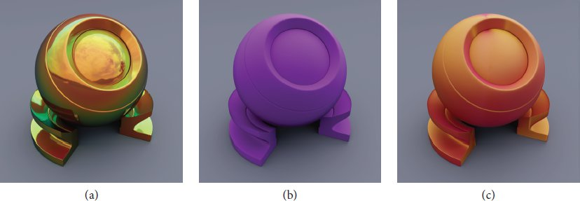

*Figure 9.38: Three Measured BRDFs. (a) TeckWrap Amber Citrine vinyl wrapping film. (b) Purple acrylic felt. (c) Silk from an Indian sari with two colors of yarn.*

</details>

where `PLSample` is defined as struct PLSample { Point2f p; Float pdf; };

`Evaluate()` takes a position `pos` ∈ [0, 1]2 and then additional `Float` parameters to perform a lookup using multidimensional linear interpolation according to the value of `Dimension`.

`Sample()` warps `u` ∈ [0, 1]2 via inverse transform sampling (i.e., proportional to the stored linear interpolant), returning both the sampled position on [0, 1]2 and the associated density as a `PLSample`. The additional parameters passed via `params` are used as conditional variables that restrict sampling to a 2D slice of a higher-dimensional function. For example, invoking the method `PiecewiseLinear2D<3>::Sample()` with a uniform 2D variate and parameters 0.1, 0.2, and 0.3 would importance sample the 2D slice I(0.1, 0.2, 0.3, ., .) of a pentalinear interpolant I. Finally, `Invert()` implements the exact inverse of Sample(). Invoking it with the position computed by Sample() will recover the input u value up to rounding error. Additional `PiecewiseLinear1D` instances are used to (redundantly) store the normal distribution D(ωm) in `ndf`, the visible normal distribution parameterized by ωo = (θo, ϕo) in `vndf`, and the normalization

constant σ(ωo) in `sigma`. The data structure also records whether the material is isotropic, in which case the dimensionality of some of the piecewise-linear interpolants can be reduced. 〈MeasuredBxDFData Public Members〉 +≡ 598

PiecewiseLinear2D<0> ndf; PiecewiseLinear2D<2> vndf; PiecewiseLinear2D<0> sigma; bool isotropic;

### 9.8.2 EVALUATION

Following these preliminaries, we can now turn to evaluating the measured BRDF for a pair of directions. See Figure 9.38 for examples of the variety of types of reflection that the measured representation can reproduce.

```text
    PiecewiseLinear2D 598
```

The only information that must be stored as MeasuredBxDF member variables in order to implement the BxDF interface methods is a pointer to the BRDF measurement data and the set of wavelengths at which the BRDF is to be evaluated. 〈MeasuredBxDF Private Members〉 ≡ 592

const MeasuredBxDFData *brdf; SampledWavelengths lambda;

BRDF evaluation then follows the approach described in Equation (9.45).

〈MeasuredBxDF Method Definitions〉 ≡

```rust
   SampledSpectrum MeasuredBxDF::f(Vector3f wo, Vector3f wi,
                                   TransportMode mode) const {
       〈Check for valid reflection configurations 600〉
       〈Determine half-direction vector ωm 600〉
       〈Map ωo and ωm to the unit square [0, 1]2〉
       〈Evaluate inverse parameterization R−1 601〉
       〈Evaluate spectral 5D interpolant 601〉
       〈Return measured BRDF value 601〉
   }
```

Zero reflection is returned if the specified directions correspond to transmission through the surface. Otherwise, the directions ωi and ωo are mirrored onto the positive hemisphere if necessary. 〈Check for valid reflection configurations〉 ≡ 600

if (!SameHemisphere(wo, wi)) return SampledSpectrum(0); if (wo.z < 0) { wo = -wo; wi = -wi; }

The next code fragment determines the associated microfacet normal and handles an edge case that occurs in near-grazing configurations. 〈Determine half-direction vector ωm〉 ≡ 600

```rust
   Vector3f wm = wi + wo;
   if (LengthSquared(wm) == 0)
       return SampledSpectrum(0);
   wm = Normalize(wm);
```

A later step requires that ωo and ωm are mapped onto the unit square [0, 1]2, which we do in two steps: first, by converting the directions to spherical coordinates, which are then further transformed by helper methods `theta2u()` and `phi2u()`.

In the isotropic case, the mapping used for ωm subtracts ϕo from ϕm, which allows the stored tables to be invariant to rotation about the surface normal. This may cause the second dimension of `u_wm` to fall out of the [0, 1] interval; a subsequent correction fixes this using the periodicity of the azimuth parameter.

```text
   LengthSquared() 87
   MeasuredBxDFData 598
   Normalize() 88
   SameHemisphere() 538
   SampledSpectrum 171
   SampledWavelengths 173
   TransportMode 571
```

```text
   Vector3f 86
```

〈Map ωo and ωm to the unit square [0, 1]2〉 ≡ Float theta_o = SphericalTheta(wo), phi_o = f32::atan2(wo.y, wo.x); Float theta_m = SphericalTheta(wm), phi_m = f32::atan2(wm.y, wm.x); Point2f u_wo(theta2u(theta_o), phi2u(phi_o)); Point2f u_wm(theta2u(theta_m), phi2u(brdf.isotropic ? (phi_m - phi_o) : phi_m)) ; u_wm[1] = u_wm[1] - f32::floor(u_wm[1]);

The two helper functions encapsulate an implementation detail of the storage representation. The function `phi2u()` uniformly maps [−π, π] onto [0, 1], while `theta2u()` uses a nonlinear transformation that places more resolution near θ ≈ 0 to facilitate storing the microfacet distribution of highly specular materials. 〈MeasuredBxDF Private Methods〉 ≡ 592

static Float theta2u(Float theta) { return f32::sqrt(theta * (2 / Pi)); } static Float phi2u(Float phi) { return phi * (1 / (2 * Pi)) + .5f; }

With this information at hand, we can now evaluate the inverse parameterization to determine the sample values ui.p that would cause visible normal sampling to generate the current incident direction (i.e., R(ωo, u) = ωi).

〈Evaluate inverse parameterization R−1〉 ≡

PLSample ui = brdf.vndf.Invert(u_wm, phi_o, theta_o);

This position is then used to evaluate a 5D linear interpolant parameterized by the fractional 2D position ui.p ∈ [0, 1]2 on the reparameterized incident

hemisphere, ϕo, θo, and the wavelength in nanometers. The interpolant must be evaluated once per sample of SampledSpectrum. 〈Evaluate spectral 5D interpolant〉 ≡ 600

SampledSpectrum fr; for i in 0..NSpectrumSamples fr[i] = f32::max(0, brdf.spectra.Evaluate(ui.p, phi_o, theta_o, lambda[i]));

<details>
<summary>Reference / notes: CosTheta() 107…</summary>

```text
   CosTheta() 107
   Float 23
   MeasuredBxDF::brdf 600
   MeasuredBxDF::lambda 600
   MeasuredBxDF::phi2u() 601
   MeasuredBxDF::theta2u() 601
   MeasuredBxDFData::isotropic 599
   MeasuredBxDFData::ndf 599
   MeasuredBxDFData::sigma 599
   MeasuredBxDFData::spectra 598
   MeasuredBxDFData::vndf 599
   NSpectrumSamples 171
   Pi 1033
   PiecewiseLinear2D::Evaluate() 599
   PiecewiseLinear2D::Invert() 599
   PLSample 598
   Point2f 92
   SampledSpectrum 171
   SphericalTheta() 107
```

</details>

Finally, fr must be scaled to undo the transformations that were applied to the data to improve the quality of the interpolation and to reduce the required measurement density, giving the computation that corresponds to Equation (9.45). 〈Return measured BRDF value〉 ≡ 600

return fr * brdf.ndf.Evaluate(u_wm) / (4 * brdf.sigma.Evaluate(u_wo) * CosTheta(wi));

In principle, implementing the `Sample_f()` and `PDF()` methods required by the `BxDF` interface is straightforward: the `Sample_f()` method could evaluate the forward mapping R to perform visible normal sampling based

on the measured microfacet distribution using PiecewiseLinear2D::Sample(), and PDF() could evaluate the associated sampling density from Equation (9.44). However, a flaw of such a basic sampling scheme is that the transformed BRDF measurements from Equation (9.42) are generally nonuniform on [0, 1]2, which can inject unwanted variance into the rendering process. The implementation therefore uses yet another reparameterization based on a luminance tensor that stores the product integral of the spectral dimension of `MeasuredBxDFData::spectra` and the CIE Y color matching curve.

〈MeasuredBxDFData Public Members〉 +≡ 598

PiecewiseLinear2D<2> luminance;

The actual BRDF sampling routine then consists of two steps. First it converts a uniformly distributed sample on [0, 1]2 into another sample u ∈ [0, 1]2 that is distributed according to the luminance of the reparameterized BRDF. Following this, visible normal sampling transforms u into a sampled direction ωi and a sampling weight that will have near-constant luminance. Apart from this step, the implementations of `Sample_f()` and `PDF()` are similar to the evaluation method and therefore not included here.

## 9.9 SCATTERING FROM HAIR

*⋆ Optional section.*

Human hair and animal fur can be modeled with a rough dielectric interface surrounding a pigmented translucent core. Reflectance at the interface is generally the same for all wavelengths and it is therefore wavelength-variation in the amount of light that is absorbed inside the hair that determines its color. While these scattering effects could be modeled using a combination of the `DielectricBxDF` and the volumetric scattering models from Chapters 11 and 14, not only would doing so be computationally expensive, requiring ray tracing within the hair geometry, but importance sampling the resulting model would be difficult. Therefore, this section introduces a specialized BSDF for hair and fur that encapsulates these lower-level scattering processes into a model that can be efficiently evaluated and sampled. See Figure 9.39 for an example of the visual complexity of scattering in hair and a comparison to rendering using a conventional BRDF model with

hair geometry.

<details>
<summary>Figure 9.39 — Comparison of a BSDF that Models Hair to a Coated Diffuse BSDF. (a)…</summary>

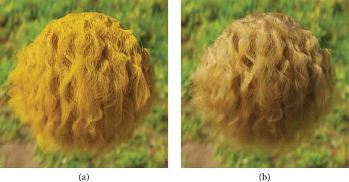

*Figure 9.39: Comparison of a BSDF that Models Hair to a Coated Diffuse BSDF. (a) Geometric model of hair rendered using a BSDF based on a diffuse base layer with a rough dielectric interface above it (Section 14.3.3). (b) Model rendered using the `HairBxDF` from this section. Because the HairBxDF is based on an accurate model of the hair microgeometry and also models light transmission through hair, it gives a much more realistic appearance. (Hair geometry courtesy of Cem Yuksel.)*

</details>

```text
    Curve 346
    DielectricBxDF 563
    HairBxDF 606
    PiecewiseLinear2D 598
```

### 9.9.1 GEOMETRY

Before discussing the mechanisms of light scattering from hair, we will start by defining a few ways of measuring incident and outgoing directions at ray intersection points on hair. In doing so, we will assume that the hair BSDF is used with the `Curve` shape from Section 6.7, which allows us to make assumptions about the parameterization of the hair geometry. For the geometric discussion in this section, we will assume that the `Curve` variant corresponding to a flat ribbon that is always facing the incident ray is being used. However, in the BSDF model, we will interpret intersection points as if they were on the surface of the corresponding swept cylinder. If there is no interpenetration between hairs and if the hair’s width is not much larger

than a pixel’s width, there is no harm in switching between these interpretations.


*Figure 9.40 (redrawn as Mermaid). At any parametric point along a Curve shape, the cross-section of the curve is defined by a circle. All of the circle’s surface normals (arrows) lie in a plane (dashed lines), dubbed the “normal plane.”*

```mermaid
flowchart LR
    W["direction ω at curve point"] --> TH["θ: angle from normal plane (x = ∂p/∂u)"]
    W --> PH["ϕ: angle in normal plane from +y (= ∂p/∂v)"]
```

*Figure 9.41 (redrawn as Mermaid). (a) Given a direction ω at a point on a curve, the longitudinal angle θ is defined by the angle between ω and the normal plane at the point (thick line). The curve’s tangent vector at the point is aligned with the x axis in the BSDF coordinate system. (b) For a direction ω, the azimuthal angle ϕ is found by projecting the direction into the normal plane and computing its angle with the y axis, which corresponds to the curve’s ∂p/∂v in the BSDF coordinate system.*

Throughout the implementation of this scattering model, we will find it useful to separately consider scattering in the longitudinal plane, effectively using a side view of the curve, and scattering in the azimuthal plane,

considering the curve head-on at a particular point along it. To understand these parameterizations, first recall that `Curve`s are parameterized such that the u direction is along the length of the curve and v spans its width. At a given u, all the possible surface normals of the curve are given by the surface normals of the circular cross-section at that point. All of these normals lie in a plane that is called the normal plane (Figure 9.40). We will find it useful to represent directions at a ray–curve intersection point with respect to coordinates (θ, ϕ) that are defined with respect to the normal plane at the u position where the ray intersected the curve. The angle θ is the longitudinal angle, which is the offset of the ray with respect to the normal plane (Figure 9.41(a)); θ ranges from −π/2 to π/2, where π/2 corresponds to a direction aligned with ∂p/∂u and −π/2 corresponds to −∂p/ ∂u. As explained in Section 9.1.1, in pbrt’s regular BSDF coordinate system, ∂p/∂u is aligned with the +x axis, so given a direction in the BSDF coordinate system, we have sin θ = ωx, since the normal plane is perpendicular to ∂p/∂u.

```mermaid
flowchart LR
    H["h = −1 + 2v ∈ [−1,1] across curve width"] --> GAMMA["sin γ = h, where γ is angle from surface normal"]
```

*Figure 9.42 (redrawn as Mermaid). Given an incident direction ω of a ray that intersected a Curve projected to the normal plane, we can parameterize the curve’s width with h ∈ [−1, 1]. Given the h for a ray that has intersected the curve, trigonometry shows how to compute the angle γ between ω and the surface normal on the curve’s surface at the intersection point. The two angles γ are equal, and because the circle’s radius is 1, sin γ = h.*

In the BSDF coordinate system, the normal plane is spanned by the y and z coordinate axes. (y corresponds to ∂p/∂v for curves, which is always perpendicular to the curve’s ∂p/∂u, and z is aligned with the ribbon normal.)

The azimuthal angle ϕ is found by projecting a direction ω into the normal plane and computing its angle with the y axis. It thus ranges from 0 to 2π (Figure 9.41(b)). One more measurement with respect to the curve will be useful in the following. Consider incident rays with some direction ω: at any given parametric u value, all such rays that intersect the curve can only possibly intersect one half of the circle swept along the curve (Figure 9.42). We will parameterize the circle’s diameter with the variable h, where h = ±1 corresponds to the ray grazing the edge of the circle, and h = 0 corresponds to hitting it edge-on. Because pbrt parameterizes curves with v ∈ [0, 1] across the curve, we can compute h = −1 + 2v. Given the h for a ray intersection, we can compute the angle between the surface normal of the inferred swept cylinder (which is by definition in the normal plane) and the direction ω, which we will denote by γ. (Note: this is unrelated to the γn notation used for floating-point error bounds in Section 6.8.) See Figure 9.42, which shows that sin γ = h.

### 9.9.2 SCATTERING FROM HAIR

Geometric setting in hand, we will now turn to discuss the general scattering behaviors that give hair its distinctive appearance and some of the assumptions that we will make in the following.

```text
    Curve 346
```

Hair and fur have three main components: Cuticle: The outer layer, which forms the boundary with air. The cuticle’s surface is a nested series of scales at a slight angle to the hair surface. Cortex: The next layer inside the cuticle. The cortex generally accounts for around 90% of hair’s volume but less for fur. It is typically colored with pigments that mostly absorb light. Medulla: The center core at the middle of the cortex. It is larger and more significant in thicker hair and fur. The medulla is also

pigmented. Scattering from the medulla is much more significant than scattering from the medium in the cortex. For the following scattering model, we will make a few assumptions. (Approaches for relaxing some of them are discussed in the exercises at the end of this chapter.) First, we assume that the cuticle can be modeled as a rough dielectric cylinder with scales that are all angled at the same angle α (effectively giving a nested series of cones; see Figure 9.43). We also treat the hair interior as a homogeneous medium that only absorbs light— scattering inside the hair is not modeled directly. (Chapters 11 and 14 have detailed discussion of light transport in participating media.) We will also make the assumption that scattering can be modeled accurately by a `BSDF` —we model light as entering and exiting the hair at the same place. (A `BSSRDF` could certainly be used instead; the “Further Reading” section has pointers to work that has investigated that alternative.) Note that this assumption requires that the hair’s diameter be fairly small with respect to how quickly illumination changes over the surface; this assumption is generally fine in practice at typical viewing distances.

```mermaid
flowchart LR
    CYL["Ideal cylinder"] --> SCALES["Nested scales tilted by α ≈ 2–4°"]
    SCALES --> CONES["Equivalent to a nested series of cones"]
```

*Figure 9.43 (redrawn as Mermaid). The surface of hair is formed by scales that deviate by a small angle α from the ideal cylinder. (α is generally around 2 − 4°; the angle shown here is larger for illustrative purposes.)*

```mermaid
flowchart LR
    P0["p=0: R — reflect at cuticle"]
    P1["p=1: TT — transmit through and out the other side"]
    P2["p=2: TRT — transmit, reflect inside, transmit"]
    P3["p=3: TRRT — and so forth"]
```

*Figure 9.44 (redrawn as Mermaid). Incident light arriving at a hair can be scattered in a variety of ways. p = 0 corresponds to light reflected from the surface of the cuticle. Light may also be transmitted through the hair and leave the other side: p = 1. It may be transmitted into the hair and reflected back into it again before being transmitted back out: p = 2, and so forth.*

Incident light arriving at a hair may be scattered one or more times before leaving the hair; Figure 9.44 shows a few of the possible cases. We will use p to denote the number of path segments it follows inside the hair before being scattered back out to air. We will sometimes refer to terms with a shorthand that describes the corresponding scattering events at the boundary: p = 0 corresponds to R, for reflection, p = 1 is T T, for two transmissions p = 2 is TRT, p = 3 is TRRT, and so forth. In the following, we will find it useful to consider these scattering modes separately and so will write the hair BSDF as a sum over terms p:

$$f(\boldsymbol\omega_o,\boldsymbol\omega_i)=\sum_{p=0}^{\infty}f_p(\boldsymbol\omega_o,\boldsymbol\omega_i). \quad\text{(9.47)}$$

To make the scattering model evaluation and sampling easier, many hair scattering models factor f into terms where one depends only on the angles θ and another on ϕ, the difference between ϕo and ϕi. This semi-separable model is given by:

$$f_p(\boldsymbol\omega_o,\boldsymbol\omega_i)=\frac{M_p(\theta_i,\theta_o)\,N_p(\phi)\,A_p}{|\cos\theta_i|}. \quad\text{(9.48)}$$

where we have a longitudinal scattering function `Mp`, an attenuation function `Ap`, and an azimuthal scattering function `Np`.7 The division by |cos θi| cancels out the corresponding factor in the reflection equation.

In the following implementation, we will evaluate the first few terms of the sum in Equation (9.47) and then represent all higher-order terms with a single one. The `pMax` constant controls how many are evaluated before the switch-over. 〈HairBxDF Constants〉 ≡ 606

static constexpr int pMax = 3;

The model implemented in the `HairBxDF` is parameterized by six values:

h: the [−1, 1] offset along the curve width where the ray intersected the oriented ribbon. eta: the index of refraction of the interior of the hair (typically, 1.55). sigma_a: the absorption coefficient of the hair interior, where distance is measured with respect to the hair cylinder’s diameter. (The absorption coefficient is introduced in Section 11.1.1.) beta_m: the longitudinal roughness of the hair, mapped to the range [0, 1]. beta_n: the azimuthal roughness, also mapped to [0, 1]. alpha: the angle at which the small scales on the surface of hair are offset from the base cylinder, expressed in degrees (typically, 2). 〈HairBxDF Definition〉 ≡ struct HairBxDF { 〈HairBxDF Public Methods〉  〈HairBxDF Constants 606〉 〈HairBxDF Private Methods 608〉 〈HairBxDF Private Members 607〉 };

Beyond initializing corresponding member variables, the HairBxDF constructor performs some additional precomputation of values that will be useful for sampling and evaluation of the scattering model. The corresponding code will be added to the 〈HairBxDF constructor implementation〉 fragment in the following, closer to where the corresponding values are defined and used. Note that alpha is not stored in a member variable; it is used to compute a few derived quantities that will be, however. 〈HairBxDF Private Members〉 ≡ 606

Float h, eta; SampledSpectrum sigma_a; Float beta_m, beta_n;

We will start with the method that evaluates the BSDF. 〈HairBxDF Method Definitions〉 ≡ SampledSpectrum HairBxDF::f(Vector3f wo, Vector3f wi, TransportMode mode) const { 〈Compute hair coordinate system terms related to wo 607〉 〈Compute hair coordinate system terms related to wi 607〉 〈Compute cos θt for refracted ray 610〉 〈Compute γt for refracted ray 610〉 〈Compute the transmittance T of a single path through the cylinder 611〉

〈Evaluate hair BSDF 616〉 }

There are a few quantities related to the directions ωo and ωi that are needed for evaluating the hair scattering model—specifically, the sine and cosine of the angle θ that each direction makes with the plane perpendicular to the curve, and the angle ϕ in the azimuthal coordinate system. As explained in Section 9.9.1, sin θo is given by the x component of ωo in the BSDF coordinate system. Given sin θo, because θo ∈ [−π/2, π/2], we know that cos θo must be positive, and so we can compute cos θo using the

identity sin2 θ + cos2 θ = 1. The angle ϕo in the perpendicular plane can be computed with `f32::atan()`. 〈Compute hair coordinate system terms related to wo〉 ≡ 607, 619

Float sinTheta_o = wo.x; Float cosTheta_o = SafeSqrt(1 - Sqr(sinTheta_o)); Float phi_o = f32::atan2(wo.z, wo.y); Float gamma_o = SafeASin(h);

Equivalent code computes these values for wi.

〈Compute hair coordinate system terms related to wi〉 ≡ 607

Float sinTheta_i = wi.x; Float cosTheta_i = SafeSqrt(1 - Sqr(sinTheta_i)); Float phi_i = f32::atan2(wi.z, wi.y);

```text
    Float 23
    SafeASin() 1035
    SafeSqrt() 1034
    SampledSpectrum 171
    Sqr() 1034
    TransportMode 571
    Vector3f 86
```

With these values available, we will consider in turn the factors of the `BSDF` model—`Mp`, `Ap`, and `Np`—before returning to the completion of the `f()` method.

### 9.9.3 LONGITUDINAL SCATTERING

`Mp` defines the component of scattering related to the angles θ— longitudinal scattering. Longitudinal scattering is responsible for the specular lobe along the length of hair and the longitudinal roughness βm controls the size of this highlight. Figure 9.45 shows hair geometry rendered with three different longitudinal scattering roughnesses.

<details>
<summary>Figure 9.45 — The Effect of Varying the Longitudinal Roughness βm. Hair model ill…</summary>

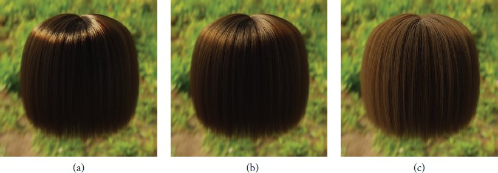

*Figure 9.45: The Effect of Varying the Longitudinal Roughness βm. Hair model illuminated by a skylight environment map rendered with varying longitudinal roughness. (a) With a very low roughness, βm = 0.1, the hair appears too shiny—almost metallic. (b) With βm = 0.25, the highlight is similar to typical human hair. (c) At high roughness, βm = 0.7, the hair is unrealistically flat and diffuse. (Hair geometry courtesy of Cem Yuksel.)*

</details>

The mathematical details of the derivation of the scattering model are complex, so we will not include them here; as always, the “Further Reading” section has references to the details. The design goals of the model implemented here were that it be normalized (ensuring both energy conservation and no energy loss) and that it could be sampled directly. Although this model is not directly based on a physical model of how hair scatters light, it matches measured data well and has parametric control of roughness v.8 The model is:

$$M_p(\theta_i,\theta_o)=\frac{\exp\!\left(-\frac{\sin\theta_i\sin\theta_o}{v}\right)\,I_0\!\left(\frac{\cos\theta_i\cos\theta_o}{v}\right)}{2v\,\sinh(1/v)}. \quad\text{(9.49)}$$

where `I0` is the modified Bessel function of the first kind and `v` is the roughness variance. Figure 9.46 shows plots of Mp.

This model is not numerically stable for low roughness variance values, so our implementation uses a different approach for that case that operates on the logarithm of I0 before taking an exponent at the end. The `v <= .1` test in the implementation below selects between the two formulations.

〈HairBxDF Private Methods〉 ≡ 606

Float Mp(Float cosTheta_i, Float cosTheta_o, Float sinTheta_i, Float sinTheta_o, Float v) { Float a = cosTheta_i * cosTheta_o / v, b = sinTheta_i * sinTheta_o / v; Float mp = (v <= .1) ? (FastExp(LogI0(a) - b - 1 / v + 0.6931f + f32::ln(1 / (2 * v)))) : (FastExp(-b) * I0(a)) / (f32::sinh(1 / v) * 2 * v); return mp; }

```text
   FastExp() 1036
   Float 23
   I0() 1038
   LogI0() 1038
```

<details>
<summary>Figure 9.46 — Plots of the Longitudinal Scattering Function. The shape of Mp as a…</summary>

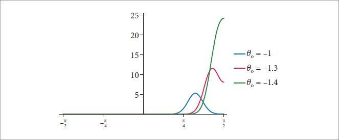

*Figure 9.46: Plots of the Longitudinal Scattering Function. The shape of Mp as a function of θi for three values of θo. In all cases a roughness variance of v = 0.02 was used. The peaks are slightly shifted from the perfect specular reflection directions (at θi = 1, 1.3, and 1.4, respectively). (After d’Eon et al. (2011), Figure 4.)*

</details>

One challenge with this model is choosing a roughness v to achieve a desired look. Here we have implemented a perceptually uniform mapping from roughness βm ∈ [0, 1] to v where a roughness of 0 is nearly perfectly smooth and 1 is extremely rough. Different roughness values are used for

different values of p. For p = 1, roughness is reduced by an empirical factor that models the focusing of light due to refraction through the circular boundary of the hair. It is then increased for p = 2 and subsequent terms, which models the effect of light spreading out after multiple reflections at the rough cylinder boundary in the interior of the hair. 〈HairBxDF constructor implementation〉 ≡ v[0] = Sqr(0.726f * beta_m + 0.812f * Sqr(beta_m) + 3.7f * Pow<20>(beta_m)); v[1] = .25 * v[0]; v[2] = 4 * v[0]; for (int p = 3; p <= pMax; p += 1) v[p] = v[2]; 〈HairBxDF Private Members〉 +≡ 606

Float v[pMax + 1];

### 9.9.4 ABSORPTION IN FIBERS

The `Ap` factor describes how the incident light is affected by each of the scattering modes p. It incorporates two effects: Fresnel reflection and transmission at the hair–air boundary and absorption of light that passes through the hair (for p > 0). Figure 9.47 has rendered images of hair with varying absorption coefficients, showing the effect of absorption. The `Ap` function that we have implemented models all reflection and transmission at the hair boundary as perfect specular—a very different assumption than `Mp` and `Np` (to come), which model glossy reflection and transmission. This assumption simplifies the implementation and gives reasonable results in practice (presumably in that the specular paths are, in a sense, averages over all the possible glossy paths). We will start by finding the fraction of incident light that remains after a path of a single transmitted segment through the hair. To do so, we need to find the distance the ray travels until it exits the cylinder; the easiest way to do this is to compute the distances in the longitudinal and azimuthal projections separately.

```text
    Float 23
    HairBxDF::beta_m 607
    HairBxDF::pMax 606
    Pow() 1034
```

```text
   Sqr() 1034
```

<details>
<summary>Figure 9.47 — Hair Rendered with Various Absorption Coefficients. In all cases, β…</summary>

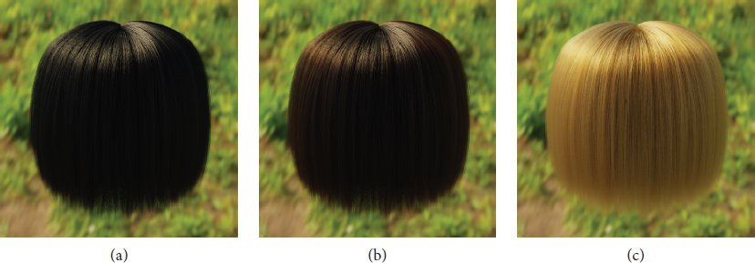

*Figure 9.47: Hair Rendered with Various Absorption Coefficients. In all cases, βm = 0.25 and βn = 0.3. (a) σa = (3.35, 5.58, 10.96) (RGB coefficients): in black hair, almost all transmitted light is absorbed. The white specular highlight from the p = 0 term is the main visual feature. (b) σa = (0.84, 1.39, 2.74), giving brown hair, where the p > 1 terms all introduce color to the hair. (c) With a very low absorption coefficient of σa = (0.06, 0.10, 0.20), we have blonde hair. (Hair geometry courtesy of Cem Yuksel.)*

</details>

To compute these distances, we need the transmitted angles of the ray ωo, in the longitudinal and azimuthal planes, which we will denote by θt and γt, respectively. Application of Snell’s law using the hair’s index of refraction η allows us to compute sin θt and cos θt.

〈Compute cos θt for refracted ray〉 ≡ 607, 618

```rust
   Float sinTheta_t = sinTheta_o / eta;
   Float cosTheta_t = SafeSqrt(1 - Sqr(sinTheta_t));
```

For γt, although we could compute the transmitted direction ωt from ωo and then project ωt into the normal plane, it is possible to compute γt directly using a modified index of refraction that accounts for the effect of the longitudinal angle on the refracted direction in the normal plane. The

modified index of refraction is given by Given η′, we can compute

$$\eta^{\prime}=\frac{\sqrt{\eta^2-\sin^2\theta_o}}{\cos\theta_o}.$$

the refracted direction γt directly in the normal plane.9 Since h = sin γo, we can apply Snell’s law to compute γt.

〈Compute γt for refracted ray〉 ≡ 607, 618, 619

```rust
   Float etap = SafeSqrt(Sqr(eta) - Sqr(sinTheta_o)) /
   cosTheta_o;
   Float sinGamma_t = h / etap;
   Float cosGamma_t = SafeSqrt(1 - Sqr(sinGamma_t));
   Float gamma_t = SafeASin(sinGamma_t);
```

If we consider the azimuthal projection of the transmitted ray in the normal plane, we can see that the segment makes the same angle γt with the circle normal at both of its endpoints (Figure 9.48). If we denote the total length of the segment by la, then basic trigonometry tells us that la/2 = cos γt, assuming a unit radius circle.

```text
   Float 23
   HairBxDF::eta 607
   HairBxDF::h 607
   SafeASin() 1035
   SafeSqrt() 1034
   Sqr() 1034
```

```mermaid
flowchart LR
    G["Transmitted segment at angle γt to circle normal"] --> L["la / 2 = cos γt (unit radius)"]
    L --> TOT["la = 2 cos γt"]
```

*Figure 9.48 (redrawn as Mermaid). Computing the Transmitted Segment’s Distance. For a transmitted ray with angle γt with respect to the circle’s surface normal, half of the total distance la is given by cos γ, assuming a unit radius. Because γt is the same at both halves of the segment, la = 2 cos γt.*

```mermaid
flowchart LR
    THETA["Longitudinal angle θt"] --> STRETCH["segment length scaled by 1 / cos θt"]
    STRETCH --> TRANS["T = exp(−σa · 2 cosγt / cosθt)"]
```

*Figure 9.49 (redrawn as Mermaid). The Effect of θt on the Transmitted Segment’s Length. The length of the transmitted segment through the cylinder is increased by a factor of 1/ cos θt versus a direct vertical path.*

Now considering the longitudinal projection, we can see that the distance that a transmitted ray travels before exiting is scaled by a factor of 1/ cos θt as it passes through the cylinder (Figure 9.49). Putting these together, the

total segment length in terms of the hair diameter is Given the segment length and the medium’s absorption coefficient, the fraction of light transmitted can be computed using Beer’s law, which is introduced in Section 11.2. Because the HairBxDF defined σa to be measured with respect to the hair diameter (so that adjusting the hair geometry’s width does not completely change its color), we do not consider the hair cylinder diameter when we apply Beer’s law, and the fraction of light remaining at the end of the segment is given by

$$T=\exp\!\left(-\boldsymbol\sigma_a\,\frac{2\cos\gamma_t}{\cos\theta_t}\right).$$

〈Compute the transmittance T of a single path through the cylinder〉 ≡ 607, 618

SampledSpectrum T = Exp(-sigma_a * (2 * cosGamma_t / cosTheta_t));

Given a single segment’s transmittance, we can now describe the function that evaluates the full `Ap` function. `Ap()` returns an array with the values of Ap up to `pmax` and a final value that is the sum of attenuations for all the higher-order scattering terms.

```text
   HairBxDF::sigma_a 607
   SampledSpectrum 171
```

```text
   SampledSpectrum::Exp() 172
```

〈HairBxDF Private Methods〉 +≡ 606

[SampledSpectrum; pMax + 1] Ap(Float cosTheta_o, Float eta, Float h, SampledSpectrum T) { [SampledSpectrum; pMax + 1] ap; 〈Compute p = 0 attenuation at initial cylinder intersection 612〉 〈Compute p = 1 attenuation term 612〉 〈Compute attenuation terms up to p = pMax 613〉 〈Compute attenuation term accounting for remaining orders of scattering 613〉 return ap; }

For the A0 term, corresponding to light that reflects at the cuticle, the Fresnel reflectance at the air–hair boundary gives the fraction of light that is reflected. We can find the cosine of the angle between the surface normal and the direction vector with angles θo and γo in the hair coordinate system by cos θo cos γo.

〈Compute p = 0 attenuation at initial cylinder intersection〉 ≡ 612

Float cosGamma_o = SafeSqrt(1 - Sqr(h)); Float cosTheta = cosTheta_o * cosGamma_o; Float f = FrDielectric(cosTheta, eta); ap[0] = SampledSpectrum(f);

For the T T term, p = 1, we have two 1 − f factors, accounting for transmission into and out of the cuticle boundary, and a single T factor for one transmission path through the hair. 〈Compute p = 1 attenuation term〉 ≡ 612

ap[1] = Sqr(1 - f) * T;

The p = 2 term has one more reflection event, reflecting light back into the hair, and then a second transmission term. Since we assume perfect specular reflection at the cuticle boundary, both segments inside the hair make the same angle γt with the circle’s normal (Figure 9.50). From this, we can see that both segments must have the same length (and so forth for subsequent segments). In general, for p > 0, Ap = Ap−1T f = (1 − f )2Tp f p−1.

```text
   Float 23
   FrDielectric() 557
   HairBxDF::eta 607
   HairBxDF::h 607
   HairBxDF::pMax 606
   SafeSqrt() 1034
   SampledSpectrum 171
   Sqr() 1034
```

```mermaid
flowchart LR
    S1["Segment 1 at angle γt"] --> REF["specular internal reflection preserves γt"]
    REF --> S2["all internal segments have equal length"]
```

*Figure 9.50 (redrawn as Mermaid). When a transmitted ray undergoes specular reflection at the interior of the hair cylinder, it makes the same angle γt with the circle’s surface normal as the original transmitted ray did. From this, it follows that the lengths of all ray segments for a path inside the cylinder must be equal.*

〈Compute attenuation terms up to p = pMax〉 ≡ 612

for p in 2..pMax ap[p] = ap[p - 1] * T * f;

After pMax, a final term accounts for all further orders of scattering. The sum of the infinite series of remaining terms can fortunately be found in closed form, since both T < 1 and f < 1:

$$A_{p_{\max}}=\frac{A_{p_{\max}-1}\,f\,T}{1-f\,T}.$$

〈Compute attenuation term accounting for remaining orders of scattering〉 ≡ 612

if (1 - T * f) ap[pMax] = ap[pMax - 1] * f * T / (1 - T * f);

### 9.9.5 AZIMUTHAL SCATTERING

Finally, we will model the component of scattering dependent on the angle ϕ. We will do this work entirely in the normal plane. The azimuthal scattering model is based on first computing a new azimuthal direction assuming perfect specular reflection and transmission and then defining a distribution of directions around this central direction, where increasing roughness gives a wider distribution. Therefore, we will first consider how an incident ray is deflected by specular reflection and transmission in the normal plane; Figure 9.51 illustrates the cases for the first two values of p. Following the reasoning from Figure 9.51, we can derive the function Φ, which gives the net change in azimuthal direction: Φ(p, h) = 2pγt − 2γo + pπ.

```mermaid
flowchart LR
    P0["p=0: Δϕ = −2γo"]
    P1["p=1: Δϕ = 2γt − 2γo + π"]
    GEN["General: Φ(p,h) = 2pγt − 2γo + pπ"]
```

*Figure 9.51 (redrawn as Mermaid). For specular reflection, with p = 0, the incident and reflected directions make the same angle γo with the surface normal. The net change in angle is thus −2γo. For p = 1, the ray is deflected from γo to γt when it enters the cylinder and then correspondingly on the way out. We can also see that when the ray is transmitted again out of the circle, it makes an angle γo with the surface normal there. Adding up the angles, the net deflection is 2γt − 2γo + π.*

```text
    HairBxDF::pMax 606
```

<details>
<summary>Figure 9.52 — Plot of Φ(p, h) for p = 1. As h varies from −1 to 1, we can see tha…</summary>

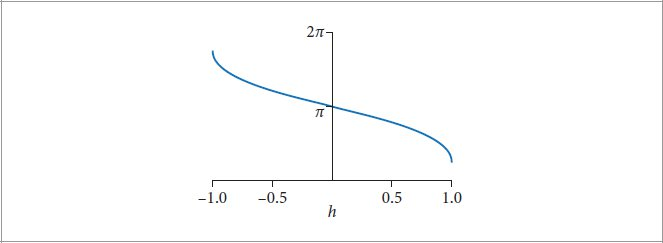

*Figure 9.52: Plot of Φ(p, h) for p = 1. As h varies from −1 to 1, we can see that the range of orientations ϕ for the specularly transmitted ray varies rapidly. By examining the range of ϕ values, we can see that the possible transmitted directions cover roughly 2/3 of all possible directions on the circle.*

</details>

<details>
<summary>Figure 9.53 — Plots of the Trimmed Logistic Function over ±π. The curve for s = 0…</summary>

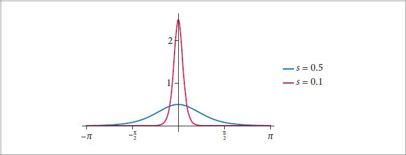

*Figure 9.53: Plots of the Trimmed Logistic Function over ±π. The curve for s = 0.5 (blue line) is broad and flat, while at s = 0.1 (red line), the curve is peaked. Because the function is normalized, the peak at 0 generally does not have the value 1, unlike the Gaussian.*

</details>

(Recall that γo and γt are derived from h.) Figure 9.52 shows a plot of this function for p = 1. 〈HairBxDF Private Methods〉 +≡ 606

Float Phi(int p, Float gamma_o, Float gamma_t) { return 2 * p * gamma_t - 2 * gamma_o + p * Pi; }

Now that we know how to compute new angles in the normal plane after specular transmission and reflection, we need a way to represent surface roughness, so that a range of directions centered around the specular direction can contribute to scattering. The logistic distribution provides a good option: it is a generally useful one for rendering, since it has a similar shape to the Gaussian, while also being normalized and integrable in closed form (unlike the Gaussian); see Section B.2.5 for more information. In the following, we will find it useful to define a normalized logistic function over a range [a, b]; we will call this the trimmed logistic, lt.

$$l(x;m,s)=\frac{e^{-(x-m)/s}}{s\left(1+e^{-(x-m)/s}\right)^2},\qquad l_t(x;m,s,a,b)=\frac{l(x;m,s)}{L\!\left(\frac{b-m}{s}\right)-L\!\left(\frac{a-m}{s}\right)},\quad L(u)=\frac{1}{1+e^{-u}}.$$

```text
   Float 23
   Pi 1033
```

*Figure 9.53 shows plots of the trimmed logistic distribution for a few values of s. Now we have the pieces to be able to implement the azimuthal scattering distribution. The Np() function computes the Np term, finding the angular difference between ϕ and Φ(p, h) and evaluating the azimuthal distribution with that angle. 〈HairBxDF Private Methods〉 +≡ 606*

Float Np(Float phi, int p, Float s, Float gamma_o, Float gamma_t) { Float dphi = phi - Phi(p, gamma_o, gamma_t); 〈Remap dphi to [−π, π] 615〉 return TrimmedLogistic(dphi, s, -Pi, Pi); }

The difference between ϕ and Φ(p, h) may be outside the range we have defined the logistic over, [−π, π], so we rotate around the circle as needed to get the value to the right range. Because dphi never gets too far out of range for the small p used here, we use the simple approach of adding or subtracting 2π as needed.

〈Remap dphi to [−π, π]〉 ≡ 615

while (dphi > Pi) dphi -= 2 * Pi; while (dphi < -Pi) dphi += 2 * Pi;

As with the longitudinal roughness, it is helpful to have a roughly perceptually linear mapping from azimuthal roughness βn ∈ [0, 1] to the logistic scale factor s. 〈HairBxDF constructor implementation〉 +≡ static const Float SqrtPiOver8 = 0.626657069f; s = SqrtPiOver8 * (0.265f * beta_n + 1.194f * Sqr(beta_n) + 5.372f * Pow<22>(beta_n)); 〈HairBxDF Private Members〉 +≡ 606

Float s;

*Figure 9.54 shows polar plots of azimuthal scattering for the T T term, p = 1, with a fairly low roughness. The scattering distributions for the two different points on the curve’s width are quite different. Because we expect the hair width to be roughly pixel-sized, many rays per pixel are needed to resolve this variation well.*

<details>
<summary>Figure 9.54 — Polar plots of Np for p = 1, θo aligned with the −x axis, and with …</summary>

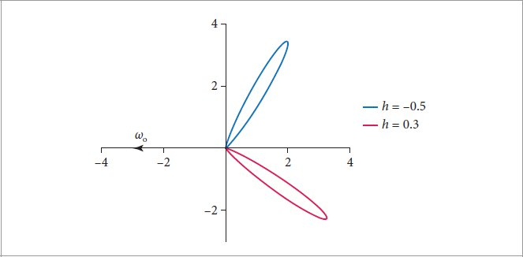

*Figure 9.54: Polar plots of Np for p = 1, θo aligned with the −x axis, and with a low roughness, βn = 0.1, for (blue) h = −0.5 and (red) h = 0.3. We can see that Np varies rapidly over the width of the hair.*

</details>

```text
   Float 23
```

```text
    HairBxDF::beta_n 607
    HairBxDF::Phi() 614
    Pi 1033
    Pow() 1034
    Sqr() 1034
    TrimmedLogistic() 1038
```

### 9.9.6 SCATTERING MODEL EVALUATION

We now have almost all the pieces we need to be able to evaluate the model. The last detail is to account for the effect of scales on the hair surface (recall Figure 9.43). Suitable adjustments to θo work well to model this characteristic of hair. For the R term, adding the angle 2α to θo can model the effect of evaluating the hair scattering model with respect to the surface normal of a scale. We can then go ahead and evaluate M0 with this modification to θo. For T T, we have to account for two transmission events through scales. Rotating by α in the opposite direction approximately compensates. (Because the refraction angle is nonlinear with respect to changes in normal orientation, there is some error in this approximation, though the error is low for the typical case of small values of α.) TRT has a reflection term inside the hair; a rotation by −4α compensates for the overall effect. The effects of these shifts are that the primary reflection lobe R is offset to be above the perfect specular direction and the secondary TRT lobe is shifted below it. Together, these lead to two distinct specular highlights of different colors, since R is not affected by the hair’s color, while TRT picks up the hair color due to absorption. This effect can be seen in human hair and is evident in the images in Figure 9.45, for example. Because we only need the sine and cosine of the angle θi to evaluate Mp, we can use the trigonometric identities sin(θo ± α) = sin θo cos α ± cos θo sin α

```text
                           cos(θo ± α) = cos θo cos α ∓ sin θo sin α
```

to efficiently compute the rotated angles without needing to evaluate any additional trigonometric functions. The `HairBxDF` constructor therefore precomputes sin(2kα) and cos(2kα) for k = 0, 1, 2. These values can be

computed particularly efficiently using trigonometric double angle identities: cos 2θ = cos2 θ − sin2 θ and sin 2θ = 2 cos θ sin θ. 〈HairBxDF constructor implementation〉 +≡ sin2kAlpha[0] = f32::sin(Radians(alpha)); cos2kAlpha[0] = SafeSqrt(1 - Sqr(sin2kAlpha[0])); for i in 1..pMax { sin2kAlpha[i] = 2 * cos2kAlpha[i - 1] * sin2kAlpha[i -1]; cos2kAlpha[i] = Sqr(cos2kAlpha[i - 1]) - Sqr(sin2kAlpha[i - 1]); } 〈HairBxDF Private Members〉 +≡ 606

Float sin2kAlpha[pMax], cos2kAlpha[pMax];

<details>
<summary>Reference / notes: AbsCosTheta() 107…</summary>

```text
   AbsCosTheta() 107
   Float 23
   HairBxDF 606
   HairBxDF::Ap() 612
   HairBxDF::eta 607
   HairBxDF::h 607
   HairBxDF::Mp() 608
   HairBxDF::Np() 615
   HairBxDF::pMax 606
   HairBxDF::v 609
   Radians() 1033
   SafeSqrt() 1034
   SampledSpectrum 171
   Sqr() 1034
```

</details>

Evaluating the model is now mostly just a matter of calling functions that have already been defined and summing the individual terms fp.

〈Evaluate hair BSDF〉 ≡ 607

```rust
   Float phi = phi_i - phi_o;
   [SampledSpectrum; pMax + 1] ap = Ap(cosTheta_o, eta, h, T);
   SampledSpectrum fsum(0.);
   for p in 0..pMax {
       〈Compute sin θo and cos θo terms accounting for scales 617〉
       fsum += Mp(cosTheta_i, cosThetap_o, sinTheta_i, sinThetap_o, v[p]) *
               ap[p] * Np(phi, p, s, gamma_o, gamma_t);
   }
   〈Compute contribution of remaining terms after pMax 617〉
   if (AbsCosTheta(wi) > 0)
       fsum /= AbsCosTheta(wi);
   return fsum;
```

The rotations that account for the effect of scales are implemented using the trigonometric identities listed above. Here is the code for the p = 0 case, where θo is rotated by 2α. The remaining cases follow the same structure. (The rotation is by −α for p = 1 and by −4α for p = 2.) 〈Compute sin θo and cos θo terms accounting for scales〉 ≡ 616, 619, 620

```rust
   Float sinThetap_o, cosThetap_o;
   if (p == 0) {
       sinThetap_o = sinTheta_o * cos2kAlpha[1] - cosTheta_o *
       sin2kAlpha[1];
       cosThetap_o = cosTheta_o * cos2kAlpha[1] + sinTheta_o *
       sin2kAlpha[1];
   }
   〈Handle remainder of p values for hair scale tilt〉
   〈Handle out-of-range cos θo from scale adjustment 617〉
```

When ωi is nearly parallel with the hair, the scale adjustment may give a slightly negative value for cos θi—effectively, in this case, it represents a θi that is slightly greater than π/2, the maximum expected value of θ in the hair coordinate system. This angle is equivalent to π − θi, and cos(π − θi) = |cos θi|, so we can easily handle that here.

〈Handle out-of-range cos θo from scale adjustment〉 ≡ 617, 620

```rust
   cosThetap_o = abs(cosThetap_o);
```

A final term accounts for all higher-order scattering inside the hair. We just use a uniform distribution N(ϕ) = 1/(2π) for the azimuthal distribution; this is a reasonable choice, as the direction offsets from Φ(p, h) for p ≥ pmax generally have wide variation and the final Ap term generally represents less than 15% of the overall scattering, so little error is introduced in the final result. 〈Compute contribution of remaining terms after pMax〉 ≡ 616

```rust
   fsum += Mp(cosTheta_i, cosTheta_o, sinTheta_i, sinTheta_o,
   v[pMax]) *
           ap[pMax] / (2 * Pi);
```

**A Note on Reciprocity.**  Although we included reciprocity in the properties of physically valid BRDFs in Section 4.3.1, the model we have implemented in this section is, unfortunately, not reciprocal. An immediate issue is that the rotation for hair scales is applied only to θi. However, there are more problems: first, all terms p > 0 that involve transmission are not reciprocal since the transmission terms use values based on ωt, which itself only depends on ωo. Thus, if ωo and ωi are interchanged, a completely different ωt is computed, which in turn leads to different cos θt and γt values, which in turn give different values from the Ap and Np functions. In practice, however, we have not observed artifacts in images from these shortcomings.

```text
    AbsCosTheta() 107
    Float 23
    HairBxDF::cos2kAlpha 616
    HairBxDF::Mp() 608
    HairBxDF::sin2kAlpha 616
    Pi 1033
```

### 9.9.7 SAMPLING

Being able to generate sampled directions and compute the PDF for sampling a given direction according to a distribution that is similar to the overall BSDF is critical for efficient rendering, especially at low roughnesses, where the hair BSDF varies rapidly as a function of direction. In the approach implemented here, samples are generated with a two-step process: first we choose a p term to sample according to a probability based on each term’s `Ap` function value, which gives its contribution to the overall scattering function. Then, we find a direction by sampling the corresponding Mp and Np terms.10 Fortunately, both the `Mp` and `Np` terms of the hair `BSDF` can be sampled perfectly, leaving us with a sampling scheme that exactly matches the PDF of the full BSDF.

We will first define the `ApPDF()` method, which returns a discrete PDF with probabilities for sampling each term `Ap` according to its contribution relative to all the Ap terms, given θo.

〈HairBxDF Method Definitions〉 +≡ [f32; pMax + 1] HairBxDF::ApPDF(Float cosTheta_o) const { 〈Initialize array of Ap values for cosTheta_o 618〉 〈Compute Ap PDF from individual Ap terms 618〉 return apPDF; }

The method starts by computing the values of Ap for cosTheta_o. We are able to reuse some previously defined fragments to make this task easier. 〈Initialize array of Ap values for cosTheta_o〉 ≡ 618

```rust
   Float sinTheta_o = SafeSqrt(1 - Sqr(cosTheta_o));
   〈Compute cos θt for refracted ray 610〉
   〈Compute γt for refracted ray 610〉
   〈Compute the transmittance T of a single path through the cylinder 611〉
   parray<SampledSpectrum, pMax + 1> ap = Ap(cosTheta_o,
   eta, h, T);
```

Next, the spectral Ap values are converted to scalars using their luminance and these values are normalized to make a proper PDF. 〈Compute Ap PDF from individual Ap terms〉 ≡ 618

```rust
   parray<Float, pMax + 1> apPDF;
   Float sumY = 0;
   for (const SampledSpectrum &as : ap)
       sumY += as.Average();
   for (int i = 0; i <= pMax; i += 1)
       apPDF[i] = ap[i].Average() / sumY;
```

With these preliminaries out of the way, we can now implement the Sample_f() method.

```text
   Float 23
```

```text
   HairBxDF::Ap() 612
   HairBxDF::h 607
   HairBxDF::pMax 606
   SafeSqrt() 1034
   SampledSpectrum 171
   SampledSpectrum::Average() 172
   Sqr() 1034
```

〈HairBxDF Method Definitions〉 +≡ Option<BSDFSample> HairBxDF::Sample_f(Vector3f wo, Float uc, Point2f u, TransportMode mode, BxDFReflTransFlags sampleFlags) const { 〈Compute hair coordinate system terms related to wo 607〉 〈Determine which term p to sample for hair scattering 619〉 〈Compute sin θo and cos θo terms accounting for scales 617〉 〈Sample Mp to compute θi 619〉 〈Sample Np to compute Δϕ 619〉 〈Compute wi from sampled hair scattering angles 620〉 〈Compute PDF for sampled hair scattering direction wi 620〉 return BSDFSample(f(wo, wi, mode), wi, pdf, Flags()); }

Given the PDF over `Ap` terms, a call to `SampleDiscrete()` takes care of choosing one. Because we only need to generate one sample from the PDF’s distribution, the work to compute an explicit CDF array (for example, by using `PiecewiseConstant1D`) is not worthwhile. Note that we take advantage of `SampleDiscrete()`’s optional capability of returning a fresh uniform random sample, overwriting the value in `uc`. This sample value will be used shortly for sampling Np.

〈Determine which term p to sample for hair scattering〉 ≡ 619

[f32; pMax + 1] apPDF = ApPDF(cosTheta_o); int p = SampleDiscrete(apPDF, uc, None, &uc);

We can now sample the corresponding `Mp` term given θo to find θi. The derivation of this sampling method is fairly involved, so we will include

neither the derivation nor the implementation here. This fragment, 〈Sample Mp to compute θi〉, consumes both of the sample values `u[0]` and `u[1]` and initializes variables `sinTheta_i` and `cosTheta_i` according to the sampled direction. 〈Sample Mp to compute θi〉 ≡ 619

```rust
   Float cosTheta = 1 + v[p] * log(max<Float>(u[0],
   1e-5) +
                                           (1 - u[0]) *
                                           FastExp(-2 / v[p]));
   Float sinTheta = SafeSqrt(1 - Sqr(cosTheta));
   Float cosPhi = cos(2 * Pi * u[1]);
   Float sinTheta_i = -cosTheta * sinThetap_o +
                        sinTheta * cosPhi * cosThetap_o;
   Float cosTheta_i = SafeSqrt(1 - Sqr(sinTheta_i));
```

<details>
<summary>Reference / notes: BSDFSample 541…</summary>

```text
   BSDFSample 541
   BxDF::Flags() 538
   BxDFReflTransFlags 540
   FastExp() 1036
   Float 23
   HairBxDF::ApPDF() 618
   HairBxDF::f() 607
   HairBxDF::Phi() 614
   HairBxDF::pMax 606
   HairBxDF::v 609
   Pi 1033
   PiecewiseConstant1D 1009
   Point2f 92
   SafeSqrt() 1034
   SampleDiscrete() 70
   SampleTrimmedLogistic() 1006
   SphericalDirection() 106
   Sqr() 1034
   TransportMode 571
   Vector3f 86
```

</details>

Next we will sample the azimuthal distribution `Np`. For terms up to `pmax`, we take a sample from the logistic distribution centered around the exit direction given by Φ(p, h). For the last term, we sample from a uniform distribution.

〈Sample Np to compute Δϕ〉 ≡

```rust
   〈Compute γt for refracted ray 610〉
   Float dphi;
   if (p < pMax)
       dphi = Phi(p, gamma_o, gamma_t) + SampleTrimmedLogistic(uc, s, -Pi, Pi);
   else
       dphi = 2 * Pi * uc;
```

Given θi and ϕi, we can compute the sampled direction wi. The math is similar to that used in the `SphericalDirection()` function, but with two important differences. First, because here θ is measured with respect to the plane perpendicular to the cylinder rather than the cylinder axis, we need to compute cos(π/2 − θ) = sin θ for the coordinate with respect to the cylinder axis instead of cos θ. Second, because the hair shading coordinate system’s (θ, ϕ) coordinates are oriented with respect to the +x axis, the order of dimensions passed to the `Vector3f` constructor is adjusted correspondingly, since the direction returned from `Sample_f()` should be in the BSDF coordinate system. 〈Compute wi from sampled hair scattering angles〉 ≡ 619

Float phi_i = phi_o + dphi; Vector3f wi(sinTheta_i, cosTheta_i * f32::cos(phi_i), cosTheta_i * f32::sin(phi_i));

Because we could sample directly from the Mp and Np distributions, the overall PDF is

$$p(\boldsymbol\omega_i)=\sum_{p=0}^{p_{\max}}\tilde A_p\,\frac{M_p(\theta_i,\theta_o)\,N_p(\phi)}{|\cos\theta_i|},$$

 with $N_{p_{\max}}(\phi)=1/(2\pi)$.

where Ãp are the normalized PDF terms. Note that θo must be shifted to account for hair scales when evaluating the PDF; this is done in the same way (and with the same code fragment) as with BSDF evaluation.

〈Compute PDF for sampled hair scattering direction wi〉 ≡ 619

```rust
   Float pdf = 0;
   for p in 0..pMax {
       〈Compute sin θo and cos θo terms accounting for scales 617〉
       〈Handle out-of-range cos θo from scale adjustment 617〉
       pdf += Mp(cosTheta_i, cosThetap_o, sinTheta_i, sinThetap_o, v[p]) *
              apPDF[p] * Np(dphi, p, s, gamma_o, gamma_t);
   }
   pdf += Mp(cosTheta_i, cosTheta_o, sinTheta_i, sinTheta_o, v[pMax]) *
          apPDF[pMax] * (1 / (2 * Pi));
```

The `HairBxDF::PDF()` method performs the same computation and therefore the implementation is not included here.

### 9.9.8 HAIR ABSORPTION COEFFICIENTS

The color of hair is determined by how pigments in the cortex absorb light, which in turn is described by the normalized absorption coefficient where distance is measured in terms of the hair diameter. If a specific hair color is desired, there is a non-obvious relationship between the normalized absorption coefficient and the color of hair in a rendered image. Not only does changing the spectral values of the absorption coefficient have an unpredictable connection to the appearance of a single hair, but multiple scattering between collections of many hairs has a significant effect on each one’s apparent color. Therefore, pbrt provides implementations of two more intuitive ways to specify hair color. The first is based on the fact that the color of human hair is determined by the concentration of two pigments. The concentration of eumelanin is the primary factor that causes the difference between black, brown, and blonde hair. (Black hair has the most eumelanin and blonde hair has the least. White hair has none.) The second pigment, pheomelanin, causes hair to be orange or red. The `HairBxDF` class provides a convenience method that computes an absorption coefficient using the product of user-supplied pigment concentrations and absorption coefficients of the pigments.

```text
    Float 23
    HairBxDF::Mp() 608
    HairBxDF::Np() 615
    HairBxDF::pMax 606
    HairBxDF::v 609
    Pi 1033
    Vector3f 86
```

<details>
<summary>Figure 9.55 — The Importance of Multiple Scattering in Blonde Hair. (a) Blonde ha…</summary>

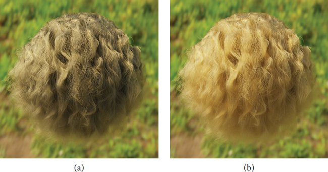

*Figure 9.55: The Importance of Multiple Scattering in Blonde Hair. (a) Blonde hair rendered with up to three bounces of light inside the hair. (b) Rendered with up to fifty bounces of light. In light-colored hair, light that has been scattered many times makes an important contribution to its visual appearance. Accurately rendering very blonde or white hair is consequently more computationally intensive than rendering dark hair. (Hair geometry courtesy of Cem Yuksel.)*

</details>

〈HairBxDF Method Definitions〉 +≡ RGBUnboundedSpectrum HairBxDF::SigmaAFromConcentration(Float ce, Float cp) { RGB eumelaninSigma_a(0.419f, 0.697f, 1.37f); RGB pheomelaninSigma_a(0.187f, 0.4f, 1.05f); RGB sigma_a = ce * eumelaninSigma_a + cp * pheomelaninSigma_a; return RGBUnboundedSpectrum(*RGBColorSpace::sRGB, sigma_a); }

Eumelanin concentrations of roughly 8, 1.3, and 0.3 give reasonable representations of black, brown, and blonde hair, respectively. Accurately rendering light-colored hair requires simulating many interreflections of light, however; see Figure 9.55.

It is also sometimes useful to specify the desired hair color directly; the `SigmaAFromReflectance()` method, not included here, is based on a precomputed fit of absorption coefficients to scattered hair color.

## FURTHER READING

Hall’s (1989) book collected and described the state of the art in physically based surface reflection models for graphics; it remains a seminal reference. It discusses the physics of surface reflection in detail, with many pointers to the original literature.

**Microfacet Models.**  Phong (1975) developed an early empirical reflection model for glossy surfaces in computer graphics. Although neither reciprocal nor energy conserving, it was a cornerstone of the first synthetic images of non-Lambertian objects. The Torrance–Sparrow microfacet model was described by Torrance and Sparrow (1967); it was first introduced to graphics by Blinn (1977), and a variant of it was used by Cook and Torrance (1981, 1982).

```text
   Float 23
   RGB 182
   RGBColorSpace::sRGB 186
   RGBUnboundedSpectrum 198
```

The papers by Beckmann and Spizzichino (1963) and Trowbridge and Reitz (1975) introduced two widely used microfacet distribution functions. Kurt et al. (2010) introduced an anisotropic variant of the Beckmann– Spizzichino distribution function; see Heitz (2014) for anisotropic variants of many other microfacet distribution functions. (Early anisotropic BRDF models for computer graphics were developed by Kajiya (1985) and Poulin and Fournier (1990).) Ribardière et al. (2017) applied Student’s t-distribution to model microfacet distributions; it provides an additional degree of freedom, which they showed allows a better fit to measured data while subsuming both the Beckmann–Spizzichino and Trowbridge–Reitz distributions. Ribardière et al. (2019) investigated the connection between normal distribution functions (NDFs) and microfacet distributions and also

showed how to generate surfaces with distributions described by their model. The microfacet masking-shadowing function was introduced by Smith (1967), building on the assumption that heights of nearby points on the microfacet surface are uncorrelated. Smith also first derived the normalization constraint in Equation (9.17). Heitz’s paper on microfacet masking-shadowing functions (2014) provides a very well-written introduction to microfacet BSDF models in general, with many useful figures and explanations about details of the topic. The more accurate G(ωi, ωo) function for Gaussian microfacet surfaces that better accounts for the effects of correlation between the two directions that we have implemented is due to Ross et al. (2005). Our derivation of the ∧(ω) function, Equation (9.19), follows Heitz (2015). For many decades, Monte Carlo rendering of microfacet models involved generating samples proportional to the microfacet distribution D(ωh). Heitz and d’Eon (2014) were the first to demonstrate that it was possible to reduce variance by restricting this sampling process to only consider visible microfacets. Our microfacet sampling implementation in Section 9.6 follows Heitz’s improved approach (2018), which showed that sampling the visible area of the Trowbridge–Reitz microfacet distribution corresponds to sampling the projection of a truncated ellipsoid, which in turn can be performed using an approach developed by Walter et al. (2015). See also Heitz (2014) for an overview of traditional techniques that directly sample the microfacet distribution D(ωh) without considering visibility.

When dealing with refraction through rough dielectrics, a modified change of variables term is needed to account for the mapping from half vectors to outgoing direction. A model based on this approach was originally developed by Stam (2001); Walter et al. (2007) proposed improvements and provided an elegant geometric justification of the half vector mapping of Equation (9.36). The generalized half-direction vector for refraction used in these models and in Equation (9.34) is due to Sommerfeld and Runge (1911).

One issue with the specular term of the Torrance–Sparrow BRDF presented in Section 9.6.5 is that it only models a single scattering interaction with the microfacet surface, causing a growing portion of the energy to be lost as the roughness increases. In scenes where many subsequent interactions are crucial (e.g., a complex 3D object made from a translucent rough dielectric material), this energy loss can become so conspicuous that standard microfacet models become effectively unusable. The original model by Torrance and Sparrow (1967) included a diffuse component to simulate light having scattered multiple times. However, a simple diffuse correction is generally unsatisfactory, since the precise amount of energy loss will depend both on the surface roughness and the angle of incidence. Kelemen and Szirmay-Kalos (2001) proposed an improved diffuse-like term that accounts for this dependence. Jakob et al. (2014a) generalized their approach to rough dielectric boundaries in the context of layered structures, where energy losses can be particularly undesirable. In all of these cases, light is treated as essentially diffuse following scattering by multiple facets. Building on Smith’s uncorrelated height assumption, Heitz et al. (2016b) cast a microfacet BRDF model into a volumetric analogue composed of microflakes—that is, a distribution of mirror facets suspended in a 3D space. With this new interpretation, they are able to simulate an arbitrary number of volumetric scattering interactions to evaluate an effective BRDF that is free of energy loss and arguably closer to physical reality. Analytic solutions may sometimes obviate the need for a stochastic simulation of interreflection. For example, Lee et al. (2018) and Xie and Hanrahan (2018) both derived analytic models for multiple scattering under the assumption of microfacets with a v-groove shape. Efficient approximate models for multiple scattering among microfacets were presented by Kulla and Conty Estevez (2017) and by Turquin (2019). Microfacet models have provided a foundation for a variety of additional reflection models. Simonot (2009) has developed a model that spans Oren– Nayar’s diffuse microfacet model (1994) and Torrance–Sparrow: microfacets are modeled as Lambertian reflectors with a layer above them

that ranges from perfectly transmissive to a perfect specular reflector. Conty Estevez and Kulla (2017) have developed a model for cloth. The halo of a softer and wider secondary highlight is often visible with rough surfaces. Barla et al. (2018) described a model for such surfaces with a focus on perceptually meaningful parameters for it. Weyrich et al. (2009) have developed methods to infer a microfacet distribution that matches a measured or desired reflection distribution. Remarkably, they showed that it is possible to manufacture actual physical surfaces that match a desired reflection distribution fairly accurately.

**Layered Materials.** Many materials are naturally composed of multiple layers—for example, a metal base surface tarnished with patina, or wood with a varnish coating. Using a specialized BRDF to represent such structures can be vastly more efficient than resolving internal reflections using standard light transport methods. Hanrahan and Krueger (1993) modeled the layers of skin, accounting for just a single scattering event in each layer, and Dorsey and Hanrahan (1996) rendered layered materials using the Kubelka–Munk theory, which accounts for multiple scattering within layers but assumes that radiance distribution does not vary as a function of direction. Pharr and Hanrahan (2000) showed that Monte Carlo integration could be used to solve the adding equations to efficiently compute BSDFs for layered materials without needing either of these simplifications. The adding equations are integral equations that accurately describe the effect of multiple scattering in layered media; they were derived by van de Hulst (1980) and Twomey et al. (1966). Weidlich and Wilkie (2007) rendered layered materials more efficiently by making a number of simplifying assumptions. Guo et al. (2018) showed that both unidirectional and bidirectional Monte Carlo random walks through layers led to efficient algorithms for evaluation, sampling, and PDF evaluation. (Their unidirectional approach is implemented in pbrt’s `LayeredBxDF` in Section 14.3.) Xia et al. (2020a) described an improved importance sampling for this approach and Gamboa et al. (2020) showed

that bidirectional sampling was unnecessary and described a more efficient approach for multiple layers.

```text
   LayeredBxDF 895
```

Another approach for layered materials is to represent the aggregate scattering behavior of a layered surface using a parametric representation. Examples include Jakob et al. (2014a) and Zeltner and Jakob (2018), who applied the adding equations to discretized scattering matrices describing volumetric layers and rough interfaces. Guo et al. (2017) modeled coated surfaces using a modified microfacet scattering model. Belcour (2018) characterized individual layers’ scattering statistically, computed aggregate scattering using the adding equations, and then mapped the result to sums of lobes based on the Trowbridge–Reitz microfacet distribution function. Weier and Belcour (2020) generalized this approach to handle anisotropic reflection from the layer interfaces and Randrianandrasana et al. (2021) further generalized the model to improve accuracy and ensure energy conservation. It is possible to apply similar approaches to aggregate scattering at other scales. For example, Blumer et al. precomputed the effect of multiple scattering in complex geometry like trees and stored the result in a form that allows for efficient evaluation and sampling (Blumer et al. 2016).

**BSDF (Re-)Parameterization and Acquisition.** Improvements in data-acquisition technology have led to increasing amounts of detailed real-world BRDF data, even including BRDFs that are spatially varying (sometimes called “bidirectional texture functions,” BTFs) (Dana et al. 1999). See Müller et al. (2005) for a survey of work in BRDF measurement until the year 2005 and Guarnera et al. (2016) for a survey through the following decade. Fitting measured BRDF data to parametric reflection models is a difficult problem. Rusinkiewicz (1998) made the influential observation that reparameterizing the measured data can make it substantially easier to compress or fit to models. The topic of BRDF parameterizations has also been investigated by Stark et al. (2005) and in Marscher’s Ph.D. dissertation (1998).

Building on Rusinkiewicz’s parameterization, Matusik et al. (2003a, 2003b) designed a BRDF representation and an efficient measurement device that repeatedly photographs a spherical sample to simultaneously acquire BRDF evaluations for many directions. They used this device to assemble a collection of isotropic material measurements that is now known as the MERL BRDF database. Baek et al. (2020) extended this approach with additional optics to capture polarimetric BRDFs, whose evaluation yields 4 × 4 Mueller matrices that characterize how reflection changes the polarization state of light. Nielsen et al. (2015) analyzed the manifold of MERL BRDFs to show that as few as 10–20 carefully chosen measurements can produce high-quality BRDF approximations. Dupuy et al. (2015) developed a simple iterative procedure for fitting standard microfacet distributions to measured BRDFs. Dupuy and Jakob (2018) generalized this procedure to arbitrary data-driven microfacet distributions and used the resulting approximation to perform a measurement in reparameterized coordinates, which is the approach underlying the `MeasuredBxDF`. They then used a motorized goniophotometer to spectroscopically acquire a collection of isotropic and anisotropic material samples that can be loaded into pbrt. While the high-dimensional nature of reflectance functions can pose a serious impediment in any acquisition procedure, the resulting data can often be approximated much more compactly. Bagher et al. (2016) decomposed the MERL database into a set of 1D factors requiring 3.2 KiB per material. Vávra and Filip (2016) showed how lower-dimensional slices can inform a sparse measurement procedure for anisotropic materials.

```text
   MeasuredBxDF 592
```

**Hair, Fur, and Fibers.** Kajiya and Kay (1989) were the first to develop a reflectance model for hair fibers, observing the characteristic behavior of the underlying cylindrical reflectance geometry. For example, a thin and ideally specular cylinder under parallel illumination will reflect light into a 1D cone of angles. Reflection from a rough cylinder tends to concentrate around the specular 1D cone and decay with increasing angular distance. Kajiya and Kay

proposed a phenomenological model combining diffuse and specular terms sharing these properties. For related work, see also the paper by Banks (1994), which discusses basic shading models for 1D primitives like hair. Goldman (1997) developed a probabilistic shading model that models reflection from collections of short hairs. Ward et al.’s survey (2007) has extensive coverage of early research in modeling, animating, and rendering hair. Marschner et al. (2003) investigated the processes underlying scattering from hair and performed a variety of measurements of scattering from actual hair. They introduced the longitudinal/azimuthal decomposition and the use of the modified index of refraction to hair rendering. They then developed a scattering model where the longitudinal component was derived by first considering perfect specular paths and then allowing roughness by centering a Gaussian around them, and their azimuthal model assumed perfect specular reflections. They showed that this model agreed reasonably well with their measurements. Hery and Ramamoorthi (2012) showed how to sample the first term of this model and Pekelis et al. (2015) developed a more efficient approach to sampling all of its terms. Zinke and Weber (2007) formalized different ways of modeling scattering from hair and clarified the assumptions underlying each of them. Starting with the bidirectional fiber scattering distribution function (BFSDF), which describes reflected differential radiance at a point on a hair as a fraction of incident differential power at another, they showed how assuming homogeneous scattering properties and a far-away viewer and illumination made it possible to simplify the eight-dimensional BFSDF to a four-dimensional bidirectional curve scattering distribution function (BCSDF). (Our implementation of the `HairBxDF` has glossed over some of these subtleties and opted for the simplicity of considering the scattering model as a BSDF.) Sadeghi et al. (2010) developed a hair scattering model with artist-friendly controls; Ou et al. (2012) showed how to sample from its distribution. Ogaki et al. (2010) created a tabularized model by explicitly modeling hair microgeometry and following random walks through it. D’Eon et al. (2011, 2013) made a number of improvements to Marschner et al.’s model. They showed that their Mp term was not actually energy conserving and derived a new one that was; this is the model from Equation

(9.49) that our implementation uses. (See also d’Eon (2013) for a more numerically stable formulation of Mp for low roughness, as well as Jakob (2012) for notes related to sampling their `Mp` term in a numerically stable way.) They also introduced a Gaussian to the azimuthal term, allowing for varying azimuthal roughness. A 1D quadrature method was used to integrate the model across the width of the hair h. The RGB values used for the hair pigments in `HairBxDF::SigmaAFromConcentration()` were computed by d’Eon et al. (2011), based on a model by Donner and Jensen (2006). The function implemented in the `HairBxDF::SigmaAFromReflectance()` method is due to Chiang et al. (2016a), who created a cube of hair and rendered it with a variety of absorption coefficients and roughnesses while it was illuminated with a uniform white dome. They then fit a function that mapped from the hair’s azimuthal roughness and average color at the center of the front face of the cube to an absorption coefficient.

```text
   HairBxDF 606
   HairBxDF::SigmaAFromConcentration() 621
   HairBxDF::SigmaAFromReflectance() 621
```

D’Eon et al. (2014) performed extensive Monte Carlo simulations of scattering from dielectric cylinders with explicitly modeled scales and glossy scattering at the boundary based on a Beckmann microfacet distribution. They showed that separable models did not model all the observed effects and that in particular the specular term modeled by Mp varies over the surface of the cylinder and also depends on ϕ. They developed a non-separable scattering model, where both α and βm vary as a function of h, and showed that it fit their simulations very accurately. All the scattering models we have described so far have been BCSDFs— they represent the overall scattering across the entire width of the hair in a single model. Such “far field” models assume both that the viewer is far away and that incident illumination is uniform across the hair’s width. In practice, both of these assumptions are invalid if one is using path tracing to model multiple scattering inside hair. Two recent models have considered

scattering at a single point along the hair’s width, making them more suitable for accurately modeling “near field” scattering. Yan et al. (2015) generalized d’Eon et al.’s model to account for scattering in the medulla, modeling a scattering cylinder in the interior of fur, and validated their model with a variety of measurements of actual animal fur. Subsequent work developed an efficient model that allows both near- and far-field evaluation (Yan et al. 2017a). Chiang et al. (2016a) showed that eliminating the integral over width from d’Eon et al.’s model works well in practice and that the sampling rates necessary for path tracing also worked well to integrate scattering over the curve width, giving a much more efficient implementation. They also developed the perceptually uniform parameterization of βm and βn that we have implemented in the `HairBxDF` as well as the inverse mapping from reflectance to σa used in our `HairBxDF::SigmaAFromReflectance()` method. Further recent advances in hair and fur rendering include work by Khungurn and Marschner (2017), who developed a scattering model from elliptical fibers and showed that modeling fibers as elliptical rather than cylindrical gives a closer match to measured data. Benamira and Pattanaik (2021) recently proposed a model that accounts for both elliptical fibers and diffraction effects, which are significant at the scale of human hair. Modeling and rendering the individual fibers of fabric is closely related to doing so for hair and fur. Recent work includes Zhao et al. (2016), who fit a procedural yarn model to CT-scanned yarn, and Aliaga et al. (2017), who demonstrated the complexity of scattering from a variety of cloth fibers and developed tabularized scattering functions for them using a precomputed simulation.

**Glints and Microstructure.** The microfacet reflection models in this chapter are all based on the assumption that so many microfacets are visible in a pixel that they can be accurately described by their aggregate statistical behavior. This assumption is not true for many real-world surfaces, where a relatively small number of microfacets may be visible in each pixel; examples of such surfaces include

glittery car paint and plastics. Additionally, many types of rough surfaces that aren’t considered glittery (e.g., bead-blasted plastic) are characterized by bright high-frequency glints under directionally peaked illumination (e.g., the sun). A common characteristic of many glint-rendering techniques is that they replace point evaluations of reflectance functions with a directional and/or spatial average covering a small region (e.g., a ray differential). With such an approach, a single sample suffices to find all glints visible within one pixel, which dramatically accelerates the rendering process.

```text
   HairBxDF 606
   HairBxDF::SigmaAFromReflectance() 621
```

One approach to rendering glints was introduced by Jakob et al. (2014b), who developed a temporally consistent stochastic process that samples glint positions on the fly during evaluation of a spatio-directional average. Wang et al. (2018) showed that the performance of this method could be improved by a separable approximation of the spatial and directional dimensions. These stochastic methods are compact but also very limited in terms of the glint distributions that can be modeled. In production rendering systems, fine surface details are often modeled using bump- or normal maps. Glinty surface appearance tends to result when such surfaces have high-resolution detail as well as a specular BRDF, and when they are furthermore subject to sharp (e.g., point or directional) illumination. At the same time, such configurations produce an extremely challenging Monte Carlo integration problem that has motivated numerous specialized methods for rendering normal-mapped specular surfaces. Yan et al. (2014) proposed a method that organizes the normal maps into a 4D spatiodirectional data structure that can be queried to find reflecting surface regions. Yan et al. (2016) drastically reduced the cost of reflectance queries by converting the normal map into a large superposition of 4D Gaussian functions termed a position-normal distribution. Though image fidelity is excellent, the overheads of these methods can be significant: slow rendering in the former case, and lengthy preprocessing and storage requirements in the second case. Zhu et al. (2019) addressed both of these

issues via clustering and runtime synthesis of normal map detail. Wang et al. (2020a) substantially reduced the storage requirements by using a semi-procedural model that matches the statistics of an input texture. Zeltner et al. (2020) proposed a Newton-like equation-solving iteration that stochastically finds glints within texels of a normal map. Atanasov et al. (2021) developed a multi-level data structure for finding glints around a given half vector. Other work in this area includes Raymond et al. (2016), who developed methods for rendering scratched surfaces, and Kuznetsov et al., who trained generative adversarial networks to represent microgeometry (Kuznetsov et al. 2019). Chermain et al. (2019) incorporated the effect of multiple scattering among the microstructure facets in such models, and Chermain et al. (2021) proposed a visible normal sampling technique for glint NDF. Loubet et al. recently developed a technique for sampling specular paths that is applicable to rendering caustics as well as rendering glints (2020).

**Wave Optics.** Essentially all physically based renderers are based on laws that approximate wave-optical behavior geometrically. At a high level, these approximations are sound given the large scale of depicted objects compared to the wavelength of light. At the same time, wave-optical properties tend to make themselves noticeable whenever geometric features occur at scales resembling the wavelength of light, and such features may indeed be present even on objects that are themselves drastically larger. For example, consider a thin film of oil on a puddle, a tiny scratch on an otherwise smooth metallic surface, or an object with micron-scale surface microstructure. These cases can feature striking structural coloration caused by the interference of light, which a purely geometric simulation would not be able to reproduce. It may be tempting to switch to a full wave-optical simulation of light in such cases, though this line of thought quickly runs into fundamental limits: for example, using the Finite Difference Time Domain (FDTD) method, the simulation domain would need to be discretized at resolutions of < 100 nm and simulated using sub-femtosecond timesteps. This can still work when studying local behavior at the micron scale, but it is practically infeasible for scenes measured in centimeters or even meters. These challenges have motivated numerous specialized

methods that reintroduce such wave-optical effects within an otherwise geometric simulation. Moravec (1981) was the first to apply a wave optics model to computer graphics. Other early work in this area includes Bahar and Chakrabarti (1987) and Stam (1999), who modeled diffraction effects from random and periodic structures. Cuypers et al. (2012) modeled multiple diffraction phenomena using signed BSDFs based on Wigner Distribution Functions. Musbach et al. (2013) applied the FDTD to obtain a BRDF of the iridescent microstructure of a Morpho butterfly. Their paper provides extensive references to previous work on this topic. Dhillon et al. (2014) developed a model of diffraction from small-scale biological features such as are present in snake skin. Belcour and Barla (2017) modeled thin film iridescence on a rough microfacet surface and showed the importance of this effect for materials such as leather and how the resulting spectral variation can be efficiently calculated in an RGB-based simulation. Werner et al. (2017) developed a model for rendering surfaces with iridescent scratches. Yan et al. (2018) presented a surface microstructure model that integrates over a coherence area to produce iridescent glints, revealing substantial differences between geometric and wave-based modeling. Toisoul and Ghosh (2017) presented a method for capturing and reproducing the appearance of periodic grating-like structures. Xia et al. (2020b) showed that diffraction and interference are meaningful at the scale of fibers and developed a wave optics-based model for scattering from fibers that they validated with measured data. In contrast to the above applications that reproduce dramatic goniochromatic effects, several works have studied how wave-based modeling can improve modeling of common materials (e.g., rough plastic or conductive surfaces). Löw et al. (2012) proposed and compared geometric and wave-based BRDF models in fits to materials to the MERL database. Dong et al. (2015) measured the surface microstructure of metal samples using a profilometer and used it to construct geometric and wave-based models that they then compared to goniophotometric measurements. Holzschuch and Pacanowski (2017) integrated diffraction effects into a microfacet model and showed that this gives a closer fit to measured data.

**Additional Topics.** The Lambertian BRDF is an idealized model; as noted earlier, it does not match many real-world BRDFs precisely. Oren and Nayar (1994) proposed an improved model based on Lambertian microfacets that allowed the specification of surface roughness. d’Eon has recently (2021) proposed a model based on scattering Lambertian spheres that matches the appearance of many materials well. A number of researchers have investigated BRDFs based on modeling the small-scale geometric features of a reflective surface. This work includes the computation of BRDFs from bump maps by Cabral, Max, and Springmeyer (1987); Fournier’s normal distribution functions (Fournier 1992); and a technique by Westin, Arvo, and Torrance (1992), who applied Monte Carlo ray tracing to statistically model reflection from microgeometry and represented the resulting BRDFs with spherical harmonics. Wu et al. (2011) developed a system that made it possible to model microgeometry and specify its underlying BRDF while interactively previewing the resulting macro-scale BRDF, and Falster et al. (2020) computed BSDFs of microgeometry, accounting for both multiple scattering and diffraction. The effect of the polarization of light is not modeled in pbrt, although for some scenes it can be an important effect; see, for example, the paper by Tannenbaum, Tannenbaum, and Wozny (1994) for information about how to extend a renderer to account for this effect. Fluorescence, where light is reflected at different wavelengths than the incident illumination, is also not modeled by pbrt; see Glassner (1994) and Wilkie et al. (2006) for more information on this topic. Modeling reflection from a variety of specific types of surfaces has received attention from researchers, leading to specialized reflection models. Examples include wood (Marschner, Westin, Arbree, and Moon 2005), car paint (Ergun et al. 2016), paper (Papas et al. 2014), and pearlescent materials (Guillén et al. 2020). Cloth remains a particularly challenging material to render; see the recent survey by Castillo et al. (2019) for comprehensive coverage of work in this area.

Sampling BSDFs well is a key component of efficient image synthesis. Szécsi et al. (2003) evaluated different approaches for sampling BSDFs that are comprised of multiple lobes. It is often only possible to sample some factors of a BSDF (e.g., when sampling the Torrance–Sparrow BRDF using the distribution of visible microfacet normals); Herholz et al. fit parametric sampling distributions to BSDFs in an effort to sample them more effectively (Herholz et al. 2018). pbrt’s test suite uses statistical hypothesis tests to verify the correctness of its BSDF sampling routines. The idea of verifying such graphics-related Monte Carlo sampling routines using statistical tests was introduced by Subr and Arvo (2007a). The χ2 test variant that is used in pbrt was originally developed as part of the Mitsuba renderer by Jakob (2010).

```mermaid
flowchart LR
    P1["p1 in medium η1"] --> P["p′ on boundary"]
    P1 --> PP["p″ on boundary"]
    P --> P2["p2 in medium η2"]
    PP --> P2
    P2 --> LAW["minimizing travel time ⇒ η1 sinθ1 = η2 sinθ2"]
```

*Figure 9.56 (redrawn as Mermaid). Derivation of Snell’s Law. Snell’s law can be derived using Fermat’s principle, which says that light will follow the path that takes the least amount of time to pass between two points. The angle of refraction θ at the boundary between two media can thus be shown to be the one that minimizes the time spent going from p1 to a point p on the boundary plus the time spent traveling the distance from that point to p2.*

## EXERCISES

**➊ 9.1.** A consequence of Fermat’s principle from optics is that light traveling from a point p1 in

a medium with index of refraction η1 to a point p2 in a medium with index of refraction η2 will follow a path that minimizes the time to get from the first point to the second point. Snell’s law can be shown to follow directly from this fact.

Consider light traveling between two points p1 and p2 separated by a planar boundary. The light could potentially pass through the boundary while traveling from p1 to p2 at any point on the boundary (see Figure 9.56, which shows two such possible points p′ and p″). Recall that the time it takes light to travel between two points in a medium with a constant index of refraction is proportional to the distance between them times the index of refraction in the medium. Using this fact, show that the point p′ on the boundary that minimizes the total time to travel from p1 to p2 is the point where η1 sin θ1 = η2 sin θ2.

**➋ 9.2.** Read the recent paper by d’Eon (2021) that describes a BRDF based on a model of the aggregate scattering of large collections of spherical particles that are themselves Lambertian. Implement this approach as a new `BxDF` in pbrt and render images comparing its visual appearance to that of the `DiffuseBxDF`.

**➌ 9.3.** Read the paper of Wolff and Kurlander (1990) and the course notes of Wilkie and Weidlich (2012) and apply some of the techniques described to modify pbrt to model the effect of light polarization. (A more in-depth review of the principles of polarization is provided by Collett (1993).) Set up scenes and render images of them that demonstrate a significant difference when polarization is accurately modeled. For this, you will need to implement a polarized version of the Fresnel equations and add BSDFs that model optical elements like linear polarizers and retarders.

**➌ 9.4.** Construct a scene with an actual geometric model of a rough plane with a large number of mirrored microfacets, and illuminate it with an area light source.11 Place the camera in the scene such that a very large number of microfacets are in each pixel’s area, and render images of this scene using hundreds or thousands of pixel samples. Compare the result to using a flat surface with a microfacet-based BRDF model. How well can you get the two approaches to match if you try to tune the microfacet BRDF parameters? Can you construct examples where images rendered with the true microfacets are actually visibly more realistic due to better modeling the effects of masking, self-shadowing, and interreflection between microfacets?

**➌ 9.5.** One shortcoming of the microfacet-based BSDFs in this chapter is that they do not account for multiple scattering among microfacets. Investigate previous work in this area, including the stochastic multiple scattering model of Heitz et al. (2016b) and the analytic models of Lee et al. (2018) and Xie and Hanrahan (2018), and implement one of these approaches in pbrt. Then implement an approximate model for multiple scattering, such as the one presented by Kulla and Conty Estevez (2017) or by Turquin (2019). How do rendered images differ from pbrt’s current implementation? How closely do the approximate approaches match the more comprehensive ones? How does execution time compare?

**➌ 9.6.** Review the algorithms for efficiently finding an approximation of a material’s normal distribution function and using that to measure BRDFs that are outlined in Section 9.8 and explained in more detail in Dupuy and Jakob (2018). Follow this approach to implement a virtual gonioreflectometer, where you provide pbrt with a description of the microgeometry of a complex surface (cloth, velvet, etc.) and its low-level reflection properties and then perform virtual measurements of the BSDF by simulating light paths in the microgeometry.

Store the results of this simulation in the file format used by the `MeasuredBxDFData` and then render images that compare using the tabularized representation to directly rendering the microgeometry. How do the images compare? How much more computationally efficient is using the MeasuredBxDFData?

```text
                   BxDF 538
                   DiffuseBxDF 546
                   MeasuredBxDFData 598
```

**➋ 9.7.** Marschner et al. (2003) note that human hair actually has an elliptical cross section that causes glints in human hair due to caustics; subsequent work by Khungurn and Marschner (2017) proposes a model that accounts for this effect and shows that it matches measurements of scattering from human hair well. Extend the `HairBxDF` implementation here, following their approach. One issue that you will need to address is that the ∂p/∂v returned by `Curve::Intersect()` is always perpendicular to the incident ray, which leads to different orientations of the azimuthal coordinate system. This is not an issue for the model we have implemented, since it operates only on the difference between angles ϕ in the hair coordinate system. For elliptical hairs, a consistent azimuthal coordinate system is necessary.

**➌ 9.8.** Read Yan et al.’s paper on fur scattering (2015) and implement their model, which accounts for scattering in the medulla in fur. Render images that show the difference from accounting for this in comparison to the current implementation. You may want to also see Section 4.3 of Chiang et al. (2016a), which discusses extensions for modeling the undercoat (which is shorter and curlier hair underneath the top level) and a more ad hoc approach to account for the influence of scattering from the medulla.

**➌ 9.9.** Read one or more papers from the “Further Reading” section of this chapter on efficiently rendering glints, which are evident when the surface microstructure is large enough or viewed closely enough that the assumption of a continuous distribution of microfacet orientations is no longer valid. Then, choose one such approach and implement it in pbrt. Render images that show off the effects it is capable of producing.

```text
                   Curve::Intersect() 349
                   HairBxDF 606
```

_________________ 1 It could be argued that a shortcoming of the `BxDF` sampling interface is that there are not entry points to sample from the 4D distribution of f(ω, ω′). This is a reasonably esoteric case for the applications envisioned for pbrt, however.

2 Strictly speaking, this is not always true: for example, the other method might also involve a delta distribution with matching direction ω′. pbrt does not consider this case, which may lead to a small loss of sampling efficiency in this rare corner case.

3 See the online edition of the book for an additional chapter devoted to bidirectional light transport algorithms.

4 The same model was also independently derived by Walter et al. (2007), who dubbed it “GGX.”

5 Both steps use ωi instead of ωi(k) to improve the smoothness of the interpolation.

6 A repository of compatible files that cover the 360–1000 nm interval at roughly 4 nm resolution is available at http://rgl.epfl.ch/materials.

```text
     PiecewiseLinear2D 598
```

7 Other authors generally include `Ap` in the `Np` term, though we find it more clear to keep them separate for the following exposition. Here we also use `f` for the `BSDF`, which most hair scattering papers denote by S.

8 Note that this is a different usage of v than in earlier chapters when it was used for the parametric coordinate along the width of a curve.

9 This is due to the Bravais properties of cylindrical scattering. See Appendix B of Marschner et al. (2003) for a derivation and further explanation. 10 This approach is applicable since the BSDF’s definition includes the product of `Mp` and `Np` and so their joint PDF is separable. 11 An area light and not a point or directional light is necessary due to subtleties in how lights are seen in specular surfaces. With the light transport algorithms used in pbrt, infinitesimal point sources are never visible in mirrored surfaces. This is a typical limitation of ray-tracing renderers and usually not bothersome in practice.

---

[↑ Back to top](#contents)