# Chapter 10: Textures and Materials

<!-- interactive-nav -->
## Contents

- [Textures and Materials (wgpu)](#textures-and-materials-wgpu)
- [10.1 TEXTURE SAMPLING AND ANTIALIASING](#101-texture-sampling-and-antialiasing)
  - [10.1.1 Finding the Texture Sampling Rate](#1011-finding-the-texture-sampling-rate)
  - [10.1.2 Ray Differentials at Medium Transitions](#1012-ray-differentials-at-medium-transitions)
  - [10.1.3 Ray Differentials for Specular Reflection and Transmission](#1013-ray-differentials-for-specular-reflection-and-transmission)
  - [10.1.4 Filtering Texture Functions](#1014-filtering-texture-functions)
- [10.2 TEXTURE COORDINATE GENERATION](#102-texture-coordinate-generation)
  - [10.2.1 (u, v) Mapping](#1021-u-v-mapping)
  - [10.2.2 Spherical Mapping](#1022-spherical-mapping)
  - [10.2.3 Cylindrical Mapping](#1023-cylindrical-mapping)
  - [10.2.4 Planar Mapping](#1024-planar-mapping)
  - [10.2.5 3D Mapping](#1025-3d-mapping)
- [10.3 TEXTURE INTERFACE AND BASIC TEXTURES](#103-texture-interface-and-basic-textures)
  - [10.3.1 Constant Texture](#1031-constant-texture)
  - [10.3.2 Scale Texture](#1032-scale-texture)
  - [10.3.3 Mix Textures](#1033-mix-textures)
- [10.4 IMAGE TEXTURE](#104-image-texture)
  - [10.4.1 Texture Memory Management](#1041-texture-memory-management)
  - [10.4.2 Image Texture Evaluation](#1042-image-texture-evaluation)
  - [10.4.3 MIP Maps](#1043-mip-maps)
  - [10.4.4 Image Map Filtering](#1044-image-map-filtering)
- [10.5 MATERIAL INTERFACE AND IMPLEMENTATIONS](#105-material-interface-and-implementations)
  - [10.5.1 Material Implementations](#1051-material-implementations)
  - [10.5.2 Finding the BSDF at a Surface](#1052-finding-the-bsdf-at-a-surface)
  - [10.5.3 Normal Mapping](#1053-normal-mapping)
  - [10.5.4 Bump Mapping](#1054-bump-mapping)
- [FURTHER READING](#further-reading)
- [EXERCISES](#exercises)

---

## Textures and Materials (wgpu)

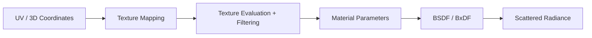

The BRDFs and BTDFs introduced in the previous chapter address only part of the problem of describing how a surface scatters light. Although they describe how light is scattered at a particular point on a surface, the renderer needs to determine which BRDFs and BTDFs are present at a point on a surface and what their parameters are. In this chapter, we describe a procedural shading mechanism that addresses this issue.

There are two components to pbrt’s approach: **textures**, which describe the spatial variation of some scalar or spectral value over a surface, and **materials**, which evaluate textures at points on surfaces in order to determine the parameters for their associated BSDFs. Separating the pattern generation responsibilities of textures from the implementations of reflection models via materials makes it easy to combine them in arbitrary ways, thereby making it easier to create a wide variety of appearances.

In pbrt, a texture is a fairly general concept: it is a function that maps points in some domain (e.g., a surface’s $(u, v)$ parametric space or $(x, y, z)$ object space) to values in some other domain (e.g., spectra or the real numbers). A variety of implementations of texture classes are available in the system. For example, pbrt has textures that represent zero-dimensional functions that return a constant in order to accommodate surfaces that have the same parameter value everywhere. Image map textures are two-dimensional functions that use a 2D array of pixel values to compute texture values at particular points (they are described in Section 10.4). There are even texture functions that compute values based on the values computed by other texture functions.

Textures may be a source of high-frequency variation in the final image. Figure 10.1 shows an image with severe aliasing due to a texture. Although the visual impact of this aliasing can be reduced with the nonuniform sampling techniques from Chapter 8, a better solution to this problem is to implement texture functions that adjust their frequency content based on the rate at which they are being sampled. For many texture functions, computing a reasonable approximation to the frequency content and antialiasing in this manner are not too difficult and are substantially more efficient than reducing aliasing by increasing the image sampling rate.

The first section of this chapter will discuss the problem of texture aliasing and general approaches to solving it. We will then describe the basic texture interface and illustrate its use with a variety of texture functions. After the textures have been defined, the last section, 10.5, introduces the `Material` interface and a number of implementations.

<details>
<summary>Figure 10.1 — Texture Aliasing (pictorial)</summary>

*Figure 10.1: Texture Aliasing. Both spheres have the same grid texture applied and each pixel is sampled at its center. No antialiasing is performed on the left sphere; because the texture has higher frequencies than the pixel sampling rate, severe aliasing results. On the right sphere, the texture function has taken into account the image sampling rate to prefilter its function and remove high-frequency detail, giving an antialiased result even with a single sample in each pixel.*

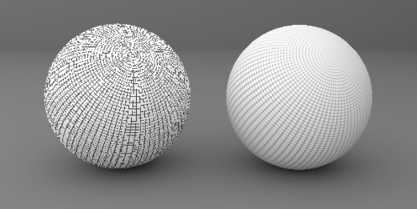

</details>

## 10.1 TEXTURE SAMPLING AND ANTIALIASING

The sampling task from Chapter 8 was a frustrating one since the aliasing problem was known to be unsolvable from the start. The infinite frequency content of geometric edges and hard shadows guarantees aliasing in the final images, no matter how high the image sampling rate. (Our only consolation is that the visual impact of this remaining aliasing can be reduced to unobjectionable levels with a sufficient number of well-placed samples.) Fortunately, things are not this difficult from the start for textures: either there is often a convenient analytic form of the texture function available, which makes it possible to remove excessively high frequencies before sampling it, or it is possible to be careful when evaluating the function so as not to introduce high frequencies in the first place. When this problem is carefully addressed in texture implementations, as is done through the rest of this chapter, there is usually no need for more than one sample per pixel in order to render an image without texture aliasing. (Of course, sufficiently reducing Monte Carlo noise from lighting calculations may be another matter.) Two problems must be addressed in order to remove aliasing from texture functions:

1. The sampling rate in texture space must be computed. The screen-space sampling rate is known from the image resolution and pixel sampling rate, but here we need to determine the resulting sampling rate on a surface in the scene in order to find the rate at which the texture function is being sampled.
2. Given the texture sampling rate, sampling theory must be applied to guide the computation of a texture value that does not have higher frequency variation than can be represented by the sampling rate (e.g., by removing excess frequencies beyond the Nyquist limit from the texture function).

These two issues will be addressed in turn throughout the rest of this section.

### 10.1.1 Finding the Texture Sampling Rate

Consider an arbitrary texture function that is a function of position, $T(\mathbf{p})$, defined on a surface in the scene. If we ignore the complications introduced by visibility—the possibility that another object may occlude the surface at nearby image samples or that the surface may have a limited extent on the image plane—this texture function can also be expressed as a function over points $(x, y)$ on the image plane, $T(f(x, y))$, where $f(x, y)$ is the function that maps image points to points on the surface. Thus, $T(f(x, y))$ gives the value of the texture function as seen at image position $(x, y)$.

As a simple example of this idea, consider a 2D texture function $T(s, t)$ applied to a quadrilateral that is perpendicular to the $z$ axis and has corners at the world-space points $(0, 0, 0)$, $(1, 0, 0)$, $(1, 1, 0)$, and $(0, 1, 0)$. If an orthographic camera is placed looking down the $z$ axis such that the quadrilateral precisely fills the image plane and if points $\mathbf{p}$ on the quadrilateral are mapped to 2D $(s, t)$ texture coordinates by

$$
s = p_x,\qquad t = p_y,
$$

then the relationship between $(s, t)$ and screen $(x, y)$ pixels is straightforward:

$$
s = \frac{x}{x_r},\qquad t = \frac{y}{y_r},
$$

where the overall image resolution is $(x_r, y_r)$ (Figure 10.2). Thus, given a sample spacing of one pixel in the image plane, the sample spacing in $(s, t)$ texture parameter space is $(1/x_r,\,1/y_r)$, and the texture function must remove any detail at a higher frequency than can be represented at that sampling rate.

**Figure 10.2 (diagram, redrawn as Mermaid).** An orthographic view of a quadrilateral that exactly fills the image plane makes the pixel-to-texture mapping trivial: each image-pixel step $\Delta x = 1$ maps to $\Delta s = 1/x_r$, and each $\Delta y = 1$ maps to $\Delta t = 1/y_r$.

*Figure 10.2: If a quadrilateral is viewed with an orthographic perspective such that the quadrilateral precisely fills the image plane, it is easy to compute the relationship between the sampling rate in (x, y) pixel coordinates and the texture sampling rate.*

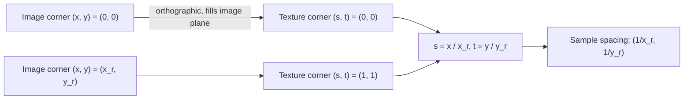

This relationship between pixel coordinates and texture coordinates, and thus the relationship between their sampling rates, is the key bit of information that determines the maximum frequency content allowable in the texture function. As a slightly more complex example, given a triangle with $(u, v)$ texture coordinates at its vertices and viewed with a perspective projection, it is possible to analytically find the differences in $u$ and $v$ across the sample points on the image plane. This approach was the basis of texture antialiasing in graphics processors before they became programmable.

For more complex scene geometry, camera projections, and mappings to texture coordinates, it is much more difficult to precisely determine the relationship between image positions and texture parameter values. Fortunately, for texture antialiasing, we do not need to be able to evaluate $f(x, y)$ for arbitrary $(x, y)$ but just need to find the relationship between changes in pixel sample position and the resulting change in texture sample position at a particular point on the image. This relationship is given by the partial derivatives of this function, $\partial f/\partial x$ and $\partial f/\partial y$. For example, these can be used to find a first-order approximation to the value of $f$,

$$
f(x', y') \approx f(x, y) + \frac{\partial f}{\partial x}(x' - x) + \frac{\partial f}{\partial y}(y' - y).
$$

If these partial derivatives are changing slowly with respect to the distances $x' - x$ and $y' - y$, this is a reasonable approximation. More importantly, the values of these partial derivatives give an approximation to the change in texture sample position for a shift of one pixel in the $x$ and $y$ directions, respectively, and thus directly yield the texture sampling rate. For example, in the previous quadrilateral example, $\partial s/\partial x = 1/x_r$, $\partial s/\partial y = 0$, $\partial t/\partial x = 0$, and $\partial t/\partial y = 1/y_r$.

The key to finding the values of these derivatives in the general case lies in values from the `RayDifferential` structure, which was defined in Section 3.6.1. This structure is initialized for each camera ray by the `Camera::GenerateRayDifferential()` method; it contains not only the ray being traced through the scene but also two additional rays, one offset horizontally one pixel sample from the camera ray and the other offset vertically by one pixel sample. All the geometric ray intersection routines use only the main camera ray for their computations; the auxiliary rays are ignored (this is easy to do because `RayDifferential` is a subclass of `Ray`).

We can use the offset rays to estimate the partial derivatives of the mapping $\mathbf{p}(x, y)$ from image position to world-space position and the partial derivatives of the mappings $u(x, y)$ and $v(x, y)$ from $(x, y)$ to $(u, v)$ parametric coordinates, giving the partial derivatives of rendering-space positions $\partial\mathbf{p}/\partial x$ and $\partial\mathbf{p}/\partial y$ and the derivatives of $(u, v)$ parametric coordinates $\partial u/\partial x$, $\partial v/\partial x$, $\partial u/\partial y$, and $\partial v/\partial y$. In Section 10.2, we will see how these can be used to compute the screen-space derivatives of arbitrary quantities based on $\mathbf{p}$ or $(u, v)$ and consequently the sampling rates of these quantities. The values of these derivatives at the intersection point are stored in the `SurfaceInteraction` structure.

〈SurfaceInteraction Public Members〉 +≡ 138

```rust
dpdx: Vector3f, dpdy: Vector3f,
dudx: Float = 0.0, dvdx: Float = 0.0,
dudy: Float = 0.0, dvdy: Float = 0.0,
```

The `SurfaceInteraction::ComputeDifferentials()` method computes these values. It is called by `SurfaceInteraction::GetBSDF()` before the `Material`’s `GetBxDF()` method is called so that these values will be available for any texture evaluation routines that are called by the material.

Ray differentials are not available for all rays traced by the system—for example, rays starting from light sources traced for photon mapping or bidirectional path tracing. Further, although we will see how to compute ray differentials after rays undergo specular reflection and transmission in Section 10.1.3, how to compute ray differentials after diffuse reflection is less clear. In cases like those as well as the corner case where one of the differentials’ directions is perpendicular to the surface normal, which leads to undefined numerical values in the following, an alternative approach based on approximating the ray differentials of a ray from the camera to the intersection point is used.

<details>
<summary>Reference / notes: Camera::GenerateRayDifferential() 207…</summary>

- `Camera::GenerateRayDifferential()` 207
- `Float` 23
- `Material` 674
- `Material::GetBxDF()` 674
- `Ray` 95
- `RayDifferential` 96
- `SurfaceInteraction` 138
- `SurfaceInteraction::ComputeDifferentials()` 637
- `SurfaceInteraction::GetBSDF()` 682
- `Vector3f` 86

</details>

〈SurfaceInteraction Method Definitions〉 ≡

```rust
fn compute_differentials(&mut self, ray: &RayDifferential, camera: &dyn Camera,
                         samples_per_pixel: i32) {
    if ray.has_differentials && dot(n, ray.rx_direction) != 0.0
        && dot(n, ray.ry_direction) != 0.0 {
        // 〈Estimate screen-space change in p using ray differentials 637〉
    } else {
        // 〈Approximate screen-space change in p based on camera projection 641〉
    }
    // 〈Estimate screen-space change in (u, v) 641〉
}
```

The key to estimating the derivatives is the assumption that the surface is locally flat with respect to the sampling rate at the point being shaded. This is a reasonable approximation in practice, and it is hard to do much better. Because ray tracing is a point-sampling technique, we have no additional information about the scene in between the rays we have traced. For highly curved surfaces or at silhouette edges, this approximation can break down, though this is rarely a source of noticeable error.

For this approximation, we need the plane through the point $\mathbf{p}$ intersected by the main ray that is tangent to the surface. This plane is given by the implicit equation

$$
a x + b y + c z + d = 0,
$$

where $a = n_x$, $b = n_y$, $c = n_z$, and $d = -(\mathbf{n}\cdot\mathbf{p})$. We can then compute the intersection points $\mathbf{p}_x$ and $\mathbf{p}_y$ between the auxiliary rays $\mathbf{r}_x$ and $\mathbf{r}_y$ and this plane (Figure 10.3). These new points give an approximation to the partial derivatives of position on the surface $\partial\mathbf{p}/\partial x$ and $\partial\mathbf{p}/\partial y$, based on forward differences:

$$
\frac{\partial\mathbf{p}}{\partial x} \approx \mathbf{p}_x - \mathbf{p},\qquad
\frac{\partial\mathbf{p}}{\partial y} \approx \mathbf{p}_y - \mathbf{p}.
$$

Because the differential rays are offset one pixel sample in each direction, there is no need to divide these differences by a $\Delta$ value, since $\Delta = 1$.

**Figure 10.3 (diagram, redrawn as Mermaid).** The tangent plane at $\mathbf{p}$ stands in for the true surface; the offset rays $\mathbf{r}_x$, $\mathbf{r}_y$ meet it at $\mathbf{p}_x$, $\mathbf{p}_y$.

*Figure 10.3: By approximating the local surface geometry at the intersection point with the tangent plane through p, approximations to the points at which the auxiliary rays rx and ry would intersect the surface can be found by finding their intersection points with the tangent plane px and py.*

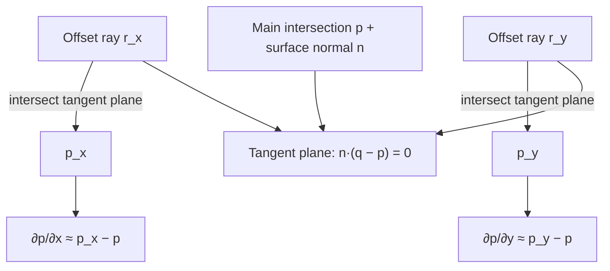

〈Estimate screen-space change in p using ray differentials〉 ≡ 637

```rust
// 〈Compute auxiliary intersection points with plane, px and py 638〉
self.dpdx = px - self.p();
self.dpdy = py - self.p();
```

<details>
<summary>Reference / notes: Camera 206…</summary>

- `Camera` 206
- `Dot()` 89
- `Interaction::n` 137
- `Interaction::p()` 137
- `RayDifferential` 96
- `RayDifferential::hasDifferentials` 96
- `RayDifferential::rxDirection` 96
- `RayDifferential::ryDirection` 96
- `SurfaceInteraction::dpdx` 636
- `SurfaceInteraction::dpdy` 636

</details>

The ray–plane intersection algorithm described in Section 6.1.2 gives the $t$ value where a ray described by origin $\mathbf{o}$ and direction $\mathbf{d}$ intersects a plane described by $a x + b y + c z + d = 0$:

$$
t = -\frac{\mathbf{n}\cdot\mathbf{o} + d}{\mathbf{n}\cdot\mathbf{d}}.
$$

To compute this value for the two auxiliary rays, the plane’s $d$ coefficient is computed first. It is not necessary to compute the $a$, $b$, and $c$ coefficients, since they are available in $\mathbf{n}$. We can then apply the formula directly.

〈Compute auxiliary intersection points with plane, px and py〉 ≡ 637

```rust
let d = -dot(n, Vector3f::from(p()));
let tx = (-dot(n, Vector3f::from(ray.rx_origin)) - d) / dot(n, ray.rx_direction);
let px = ray.rx_origin + tx * ray.rx_direction;

let ty = (-dot(n, Vector3f::from(ray.ry_origin)) - d) / dot(n, ray.ry_direction);
let py = ray.ry_origin + ty * ray.ry_direction;
```

For cases where ray differentials are not available, we will add a method to the `Camera` interface that returns approximate values for $\partial\mathbf{p}/\partial x$ and $\partial\mathbf{p}/\partial y$ at a point on a surface in the scene. These should be a reasonable approximation to the differentials of a ray from the camera that found an intersection at the given point. Cameras’ implementations of this method must return reasonable results even for points outside of their viewing volumes for which they cannot actually generate rays.

〈Camera Interface〉 +≡ 206

```rust
fn approximate_dp_dxy(&self, p: Point3f, n: Normal3f, time: Float,
                      samples_per_pixel: i32,
                      dpdx: &mut Vector3f, dpdy: &mut Vector3f);
```

`CameraBase` provides an implementation of an approach to approximating these differentials that is based on the minimum of the camera ray differentials across the entire image. Because all of pbrt’s current camera implementations inherit from `CameraBase`, the following method takes care of all of them.

〈CameraBase Public Methods〉 +≡ 212

```rust
fn approximate_dp_dxy(&self, p: Point3f, n: Normal3f, time: Float,
                      samples_per_pixel: i32,
                      dpdx: &mut Vector3f, dpdy: &mut Vector3f) {
    // 〈Compute tangent plane equation for ray differential intersections 640〉
    // 〈Find intersection points for approximated camera differential rays 640〉
    // 〈Estimate ∂p/∂x and ∂p/∂y in tangent plane at intersection point 641〉
}
```

This method starts by orienting the camera so that the camera-space $z$ axis is aligned with the vector from the camera position to the intersection point. It then uses lower bounds on the spread of rays over the image that are provided by the camera to find approximate differential rays. It then intersects these rays with the tangent plane at the intersection point. (See Figure 10.4.)

**Figure 10.4 (diagram, redrawn as Mermaid).** `CameraBase::Approximate_dp_dxy()` effectively reorients the camera to point at the intersection $\mathbf{p}$. In camera space the ray to $\mathbf{p}$ has origin $(0,0,0)$ and direction $(0,0,1)$; the extent of the differential rays on the tangent plane can then be found.

*Figure 10.4: `CameraBase::Approximate_dp_dxy()` effectively reorients the camera to point at the provided intersection point. In camera space, the ray to the intersection then has origin (0, 0, 0) and direction (0, 0, 1). The extent of ray differentials on the tangent plane defined by the surface normal at the intersection point can then be found.*

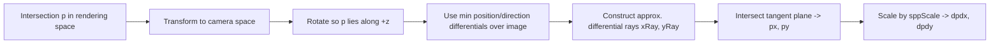

<details>
<summary>Reference / notes: CameraBase 212…</summary>

- `CameraBase` 212
- `Dot()` 89
- `Float` 23
- `Interaction::n` 137
- `Interaction::p()` 137
- `Normal3f` 94
- `Point3f` 92
- `RayDifferential::rxDirection` 96
- `RayDifferential::rxOrigin` 96
- `RayDifferential::ryDirection` 96
- `RayDifferential::ryOrigin` 96
- `Vector3f` 86

</details>

There are a number of sources of error in this approximation. Beyond the fact that it does not account for how light was scattered at intermediate surfaces for multiple-bounce ray paths, there is also the fact that it is based on the minimum of the camera’s differentials for all rays. In general, it tries to underestimate those derivatives rather than overestimate them, as we prefer aliasing over blurring here. The former error can at least be addressed with additional pixel samples. In order to give a sense of the impact of some of these approximations, Figure 10.5 has visualization that compares the local area estimated by those derivatives at intersections to the area computed using the actual ray differentials generated by the camera.

<details>
<summary>Figure 10.5 — Ratio of Filter Areas Estimated by Regular Ray Differentials to Areas Estimated by CameraBase::Approximate_dp_dxy() (pictorial visualization)</summary>

*Figure 10.5: Visualization of the Ratio of Filter Areas Estimated by Regular Ray Differentials to Areas Estimated by `CameraBase::Approximate_dp_dxy()`. We represent the filter area as the product $\max(|\partial u/\partial x|, |\partial u/\partial y|)\,\max(|\partial v/\partial x|, |\partial v/\partial y|)$ and visualize the base 2 logarithm of the ratio of areas computed by the two techniques. Log 2 ratios greater than 0 indicate that the camera-based approximation estimated a larger filter area.*

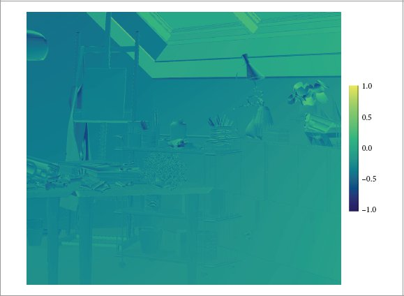

</details>

`CameraBase::Approximate_dp_dxy()` 638

For the first step of the algorithm, we have an intersection point in rendering space $\mathbf{p}$ that we would like to transform into a coordinate system where it is along the $z$ axis with the camera at the origin. Transforming to camera space gets us started and an additional rotation that transforms the vector from the origin to the intersection point to be aligned with $z$ finishes the job. The $d$ coefficient of the plane equation can then be found by taking the dot product of the transformed point and surface normal. Because the $x$ and $y$ components of the transformed point are equal to 0, the dot product can be optimized to be a single multiply.

〈Compute tangent plane equation for ray differential intersections〉 ≡ 638

```rust
let p_camera = camera_from_render(p, time);
let down_z_from_camera =
    rotate_from_to(normalize(Vector3f::from(p_camera)), Vector3f(0.0, 0.0, 1.0));
let p_down_z = down_z_from_camera.apply(p_camera);
let n_down_z = down_z_from_camera.apply(
    Normal3f::from(camera_from_render(n.into(), time)));
let d = n_down_z.z * p_down_z.z;
```

`Camera` implementations that inherit from `CameraBase` and use this method must initialize the following member variables with values that are lower bounds on each of the respective position and direction differentials over all the pixels in the image. 〈CameraBase Protected Members〉 +≡ 212

```rust
min_pos_differential_x: Vector3f, min_pos_differential_y: Vector3f,
min_dir_differential_x: Vector3f, min_dir_differential_y: Vector3f,
```

The main ray in this coordinate system has origin $(0, 0, 0)$ and direction $(0, 0, 1)$. Adding the position and direction differential vectors to those gives the origin and direction of each differential ray. Given those, the same calculation as earlier gives us the $t$ values for the ray–plane intersections for the differential rays and thence the intersection points. 〈Find intersection points for approximated camera differential rays〉 ≡ 638

```rust
let x_ray = Ray::new(Point3f(0.0, 0.0, 0.0) + min_pos_differential_x,
                     Vector3f(0.0, 0.0, 1.0) + min_dir_differential_x);
let tx = -(dot(n_down_z, Vector3f::from(x_ray.o)) - d) / dot(n_down_z, x_ray.d);
let y_ray = Ray::new(Point3f(0.0, 0.0, 0.0) + min_pos_differential_y,
                     Vector3f(0.0, 0.0, 1.0) + min_dir_differential_y);
let ty = -(dot(n_down_z, Vector3f::from(y_ray.o)) - d) / dot(n_down_z, y_ray.d);
let px = x_ray.at(tx);
let py = y_ray.at(ty);
```

For an orthographic camera, these differentials can be computed directly. There is no change in the direction vector, and the position differentials are the same at every pixel. Their values are already computed in the `OrthographicCamera` constructor, so can be used directly to initialize the base class’s member variables. 〈Compute minimum differentials for orthographic camera〉 ≡ 218

```rust
min_dir_differential_x = min_dir_differential_y = Vector3f(0.0, 0.0, 0.0);
min_pos_differential_x = dx_camera;
min_pos_differential_y = dy_camera;
```

All the other cameras call `FindMinimumDifferentials()`, which estimates these values by sampling at many points across the diagonal of the image and storing the minimum of all the differentials encountered. That function is not very interesting, so it is not included here. 〈Compute minimum differentials for PerspectiveCamera〉 ≡ 220

```rust
find_minimum_differentials(self);
```

<details>
<summary>Reference / notes: CameraBase::CameraFromRender() 214…</summary>

- `CameraBase::CameraFromRender()` 214
- `CameraBase::FindMinimumDifferentials()` 640
- `CameraBase::minDirDifferentialX` 640
- `CameraBase::minDirDifferentialY` 640
- `CameraBase::minPosDifferentialX` 640
- `CameraBase::minPosDifferentialY` 640
- `Dot()` 89
- `Float` 23
- `Normal3f` 94
- `OrthographicCamera` 217
- `OrthographicCamera::dxCamera` 218
- `OrthographicCamera::dyCamera` 218
- `Point3f` 92
- `Ray` 95
- `RotateFromTo()` 127
- `Transform` 120
- `Vector3f` 86

</details>

Given the intersection points $\mathbf{p}_x$ and $\mathbf{p}_y$, $\partial\mathbf{p}/\partial x$ and $\partial\mathbf{p}/\partial y$ can now be estimated by taking their differences with the main intersection point. To get final estimates of the partial derivatives, these vectors must be transformed back out into rendering space and scaled to account for the actual pixel sampling rate. As with the initial ray differentials that were generated in the 〈Scale camera ray differentials based on image sampling rate〉 fragment, these are scaled to account for the pixel sampling rate:

$$
\text{sppScale} =
\begin{cases}
1, & \text{if pixel jitter is disabled},\\[2pt]
\max\!\left(0.125,\; 1\big/\sqrt{\text{samplesPerPixel}}\right), & \text{otherwise}.
\end{cases}
$$

〈Estimate ∂p/∂x and ∂p/∂y in tangent plane at intersection point〉 ≡ 638

```rust
let spp_scale = if get_options().disable_pixel_jitter { 1.0 }
    else { Float::max(0.125, 1.0 / (samples_per_pixel as Float).sqrt()) };
*dpdx = spp_scale
    * render_from_camera(down_z_from_camera.apply_inverse(px - p_down_z), time);
*dpdy = spp_scale
    * render_from_camera(down_z_from_camera.apply_inverse(py - p_down_z), time);
```

A call to this method takes care of computing the $\partial\mathbf{p}/\partial x$ and $\partial\mathbf{p}/\partial y$ differentials in the `ComputeDifferentials()` method. 〈Approximate screen-space change in p based on camera projection〉 ≡ 637

```rust
camera.approximate_dp_dxy(p(), n, time, samples_per_pixel, &mut dpdx, &mut dpdy);
```

We now have both the partial derivatives $\partial\mathbf{p}/\partial u$ and $\partial\mathbf{p}/\partial v$ as well as, one way or another, $\partial\mathbf{p}/\partial x$ and $\partial\mathbf{p}/\partial y$. From them, we would now like to compute $\partial u/\partial x$, $\partial u/\partial y$, $\partial v/\partial x$, and $\partial v/\partial y$. Using the chain rule, we can find that (Equation 10.1; $\partial\mathbf{p}/\partial y$ has a similar expression with $\partial u/\partial x$ replaced by $\partial u/\partial y$ and $\partial v/\partial x$ replaced by $\partial v/\partial y$):

$$
\frac{\partial\mathbf{p}}{\partial x}
= \frac{\partial\mathbf{p}}{\partial u}\frac{\partial u}{\partial x}
+ \frac{\partial\mathbf{p}}{\partial v}\frac{\partial v}{\partial x}.
\tag{10.1}
$$

Equation (10.1) can be written as a matrix equation where the two following matrices that include $\partial\mathbf{p}$ have three rows, one for each of $\mathbf{p}$’s $x$, $y$, and $z$ components:

$$
\begin{pmatrix}
\partial\mathbf{p}/\partial x
\end{pmatrix}
=
\begin{pmatrix}
\partial\mathbf{p}/\partial u & \partial\mathbf{p}/\partial v
\end{pmatrix}
\begin{pmatrix}
\partial u/\partial x \\[2pt] \partial v/\partial x
\end{pmatrix}.
$$

This is an overdetermined linear system since there are three equations but only two unknowns, $\partial u/\partial x$ and $\partial v/\partial x$. An effective solution approach in this case is to apply linear least squares, which says that for a linear system of the form $A\mathbf{x} = \mathbf{b}$ with $A$ and $\mathbf{b}$ known, the least-squares solution for $\mathbf{x}$ is given by (Equation 10.2)

$$
\mathbf{x} = (A^{\mathsf T} A)^{-1} A^{\mathsf T}\,\mathbf{b}.
\tag{10.2}
$$

In this case, $A = \bigl(\partial\mathbf{p}/\partial u \;\; \partial\mathbf{p}/\partial v\bigr)$, $\mathbf{b} = \bigl(\partial\mathbf{p}/\partial x\bigr)$, and $\mathbf{x} = \bigl(\partial u/\partial x \;\; \partial v/\partial x\bigr)^{\mathsf T}$. 〈Estimate screen-space change in (u, v)〉 ≡ 637, 964

```rust
// 〈Compute AᵀA and its determinant 642〉
// 〈Compute Aᵀb for x and y 642〉
// 〈Compute u and v derivatives with respect to x and y 642〉
// 〈Clamp derivatives of u and v to reasonable values 642〉
```

<details>
<summary>Index / reference entries (from the printed index)</summary>

- `BasicPBRTOptions::disablePixelJitter` 1031
- `Camera::Approximate_dp_dxy()` 638
- `CameraBase::RenderFromCamera()` 214
- `Float` 23
- `GetOptions()` 1032
- `Interaction::n` 137
- `Interaction::p()` 137
- `Interaction::time` 137

</details>

<details>
<summary>Index / reference entries (from the printed index)</summary>

- `SurfaceInteraction::dpdx` 636
- `SurfaceInteraction::dpdy` 636
- `Transform::ApplyInverse()` 130

</details>

$A^{\mathsf T} A$ is a $2 \times 2$ matrix with elements given by dot products of partial derivatives of position (Equation 10.3):

$$
A^{\mathsf T} A =
\begin{pmatrix}
\frac{\partial\mathbf{p}}{\partial u}\cdot\frac{\partial\mathbf{p}}{\partial u} &
\frac{\partial\mathbf{p}}{\partial u}\cdot\frac{\partial\mathbf{p}}{\partial v} \\[6pt]
\frac{\partial\mathbf{p}}{\partial v}\cdot\frac{\partial\mathbf{p}}{\partial u} &
\frac{\partial\mathbf{p}}{\partial v}\cdot\frac{\partial\mathbf{p}}{\partial v}
\end{pmatrix}.
\tag{10.3}
$$

Its inverse is

$$
(A^{\mathsf T} A)^{-1} = \frac{1}{a c - b^2}
\begin{pmatrix} c & -b \\ -b & a \end{pmatrix}.
$$

Note that in both matrices the two off-diagonal entries are equal. Thus, the fragment that computes the entries of $A^{\mathsf T} A$ only needs to compute three values. The inverse of the matrix determinant is computed here as well. If its value is infinite, the linear system cannot be solved; setting `invDet` to 0 causes the subsequently computed derivatives to be 0, which leads to point-sampled textures, the best remaining option in that case.

〈Compute AᵀA and its determinant〉 ≡

```rust
let ata00 = dot(dpdu, dpdu);
let ata01 = dot(dpdu, dpdv);
let ata11 = dot(dpdv, dpdv);
let mut inv_det = 1.0 / difference_of_products(ata00, ata11, ata01, ata01);
inv_det = if inv_det.is_finite() { inv_det } else { 0.0 };
```

The $A^{\mathsf T}\mathbf{b}$ portion of the solution is easily computed. For the derivatives with respect to screen-space $x$, we have the two-element matrix (Equation 10.4)

$$
A^{\mathsf T}\mathbf{b}_x =
\begin{pmatrix}
\frac{\partial\mathbf{p}}{\partial u}\cdot\frac{\partial\mathbf{p}}{\partial x} \\[6pt]
\frac{\partial\mathbf{p}}{\partial v}\cdot\frac{\partial\mathbf{p}}{\partial x}
\end{pmatrix}.
\tag{10.4}
$$

The solution for screen-space $y$ is analogous.

〈Compute Aᵀb for x and y〉 ≡

```rust
let atb0x = dot(dpdu, dpdx);
let atb1x = dot(dpdv, dpdx);
let atb0y = dot(dpdu, dpdy);
let atb1y = dot(dpdv, dpdy);
```

The solution to Equation (10.2) for each partial derivative can be found by taking the product of Equations (10.3) and (10.4). We will gloss past the algebra; its result can be directly expressed in terms of the values computed so far. 〈Compute u and v derivatives with respect to x and y〉 ≡ 641

```rust
dudx = difference_of_products(ata11, atb0x, ata01, atb1x) * inv_det;
dvdx = difference_of_products(ata00, atb1x, ata01, atb0x) * inv_det;
dudy = difference_of_products(ata11, atb0y, ata01, atb1y) * inv_det;
dvdy = difference_of_products(ata00, atb1y, ata01, atb0y) * inv_det;
```

In certain tricky cases (e.g., with highly distorted $(u, v)$ parameterizations or at object silhouette edges), the estimated partial derivatives may be infinite or have very large magnitudes. It is worth clamping them to reasonable values in that case to prevent overflow and not-a-number values in subsequent computations that are based on them. 〈Clamp derivatives of u and v to reasonable values〉 ≡ 641

```rust
dudx = if dudx.is_finite() { dudx.clamp(-1e8, 1e8) } else { 0.0 };
dvdx = if dvdx.is_finite() { dvdx.clamp(-1e8, 1e8) } else { 0.0 };
dudy = if dudy.is_finite() { dudy.clamp(-1e8, 1e8) } else { 0.0 };
dvdy = if dvdy.is_finite() { dvdy.clamp(-1e8, 1e8) } else { 0.0 };
```

### 10.1.2 Ray Differentials at Medium Transitions

Now is a good time to take care of another detail related to ray differentials: recall from Section 9.1.5 that materials may return an unset `BSDF` to indicate an interface between two scattering media that does not itself scatter light. In this case, it is necessary to spawn a new ray in the same direction, but past the intersection on the surface. In this case we would like the effect of the ray differentials to be the same as if no scattering had occurred. This can be achieved by setting the differential origins to the points given by evaluating the ray equation at the intersection $t$ (see Figure 10.6).

**Figure 10.6 (diagram, redrawn as Mermaid).** The new ray keeps the same direction and footprint; its differential origins are advanced to the intersection distance $t$.

*Figure 10.6: When a ray intersects a surface that delineates the boundary between two media, a new ray is spawned on the other side of the boundary. If the origins of this ray’s differentials are set by evaluating the ray equation for the original differentials at the intersection t, then the new ray will represent the same footprint as the original one when it subsequently intersects a surface.*

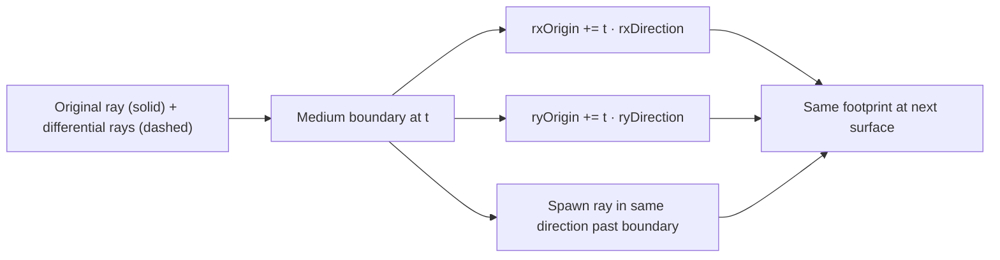

〈SurfaceInteraction Method Definitions〉 +≡

```rust
fn skip_intersection(&self, ray: &mut RayDifferential, t: Float) {
    *ray as &mut Ray = self.spawn_ray(ray.d);
    if ray.has_differentials {
        ray.rx_origin = ray.rx_origin + t * ray.rx_direction;
        ray.ry_origin = ray.ry_origin + t * ray.ry_direction;
    }
}
```

### 10.1.3 Ray Differentials for Specular Reflection and Transmission

Given the effectiveness of ray differentials for finding filter regions for texture antialiasing for camera rays, it is useful to extend the method to make it possible to determine texture-space sampling rates for objects that are seen indirectly via specular reflection or refraction; objects seen in mirrors, for example, should not have texture aliasing, identical to the case for directly visible objects. Igehy (1999) developed an elegant solution to the problem of how to find the appropriate differential rays for specular reflection and refraction, which is the approach used in pbrt.[^1] Figure 10.7 illustrates the difference that proper texture filtering for specular reflection and transmission can make: it shows a glass ball and a mirrored ball on a plane with a texture map containing high-frequency components. Ray differentials ensure that the images of the texture seen via reflection and refraction from the balls are free of aliasing artifacts. Here, ray differentials eliminate aliasing without excessively blurring the texture.

<details>
<summary>Figure 10.7 — Filtered vs. unfiltered reflections/refractions (pictorial)</summary>

*Figure 10.7: (a) Tracking ray differentials for reflected and refracted rays ensures that the image map texture seen in the balls is filtered to avoid aliasing. The left ball is glass, exhibiting reflection and refraction, and the right ball is a mirror, just showing reflection. Note that the texture is well filtered over both of the balls. (b) shows the aliasing artifacts that are present if ray differentials are not used.*

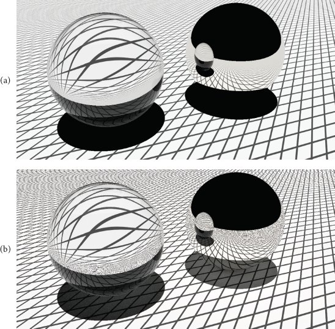

</details>

To compute the reflected or transmitted ray differentials at a surface intersection point, we need an approximation to the rays that would have been traced at the intersection points for the two offset rays in the ray differential that hit the surface (Figure 10.8). The new ray for the main ray is found by sampling the `BSDF`, so here we only need to compute the outgoing rays for the `rx` and `ry` differentials. This task is handled by another `SurfaceInteraction::SpawnRay()` variant that takes an incident ray differential as well as information about the `BSDF` and the type of scattering that occurred.

**Figure 10.8 (diagram, redrawn as Mermaid).** An offset ray $\mathbf{r}'$ generally hits the surface at a different point and is reflected in a different direction, because both the surface normal and the incident direction differ.

*Figure 10.8: The specular reflection formula gives the direction of the reflected ray at a point on a surface. An offset ray for a ray differential r′ (dashed line) will generally intersect the surface at a different point and be reflected in a different direction. The new direction is affected by the different surface normal at the point as well as by the offset ray’s different incident direction. The computation to find the reflected direction for the offset ray in pbrt estimates the change in reflected direction as a function of image-space position and approximates the ray differential’s direction with the main ray’s direction added to the estimated change in direction.*

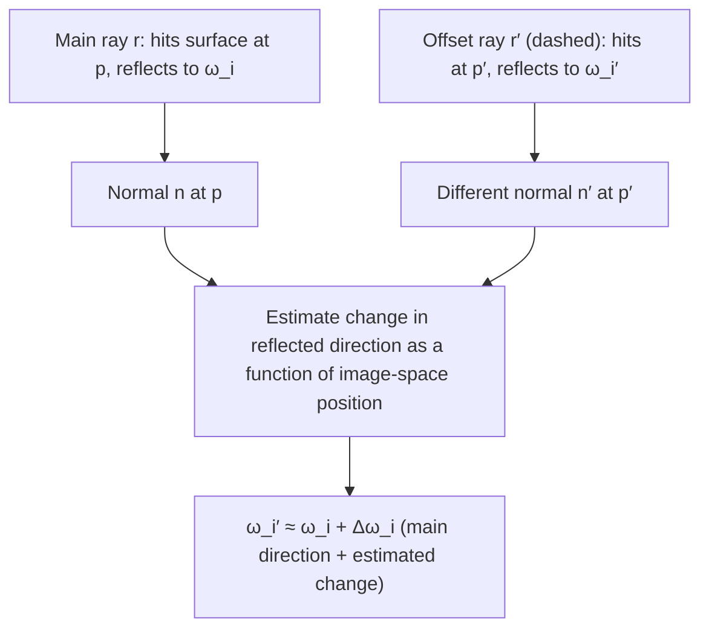

〈SurfaceInteraction Method Definitions〉 +≡

```rust
fn spawn_ray_diff(&self, rayi: &RayDifferential, bsdf: &BSDF,
                  wi: Vector3f, flags: BxDFFlags, eta: Float) -> RayDifferential {
    let mut rd = RayDifferential::from(self.spawn_ray(wi));
    if rayi.has_differentials {
        // 〈Compute ray differentials for specular reflection or transmission 645〉
    }
    // 〈Squash potentially troublesome differentials〉
    rd
}
```

It is not well defined what the ray differentials should be in the case of non-specular scattering. Therefore, this method handles the two types of specular scattering only; for all other types of rays, approximate differentials will be computed at their subsequent intersection points with `Camera::Approximate_dp_dxy()`.

〈Compute ray differentials for specular reflection or transmission〉 ≡ 645

```rust
// 〈Compute common factors for specular ray differentials 645〉
if flags == BxDFFlags::SpecularReflection {
    // 〈Initialize origins of specular differential rays 645〉
    // 〈Compute differential reflected directions 646〉
} else if flags == BxDFFlags::SpecularTransmission {
    // 〈Initialize origins of specular differential rays 645〉
    // 〈Compute differential transmitted directions 646〉
}
```

<details>
<summary>Reference / notes: BSDF 544…</summary>

- `BSDF` 544
- `BxDFFlags::SpecularReflection` 539
- `BxDFFlags::SpecularTransmission` 539
- `Camera::Approximate_dp_dxy()` 638
- `Float` 23
- `Interaction::p()` 137
- `Interaction::SpawnRay()` 383
- `Normal3f` 94
- `RayDifferential` 96
- `RayDifferential::hasDifferentials` 96
- `RayDifferential::rxDirection` 96
- `RayDifferential::ryDirection` 96
- `SurfaceInteraction::dpdx` 636
- `SurfaceInteraction::dpdy` 636
- `SurfaceInteraction::dudx` 636
- `SurfaceInteraction::dudy` 636
- `SurfaceInteraction::dvdx` 636
- `SurfaceInteraction::dvdy` 636
- `SurfaceInteraction::shading` 139
- `SurfaceInteraction::shading::dndu` 139
- `SurfaceInteraction::shading::dndv` 139
- `SurfaceInteraction::shading::n` 139
- `Vector3f` 86

</details>

A few variables will be used for both types of scattering, including the partial derivatives of the surface normal with respect to $x$ and $y$ on the image, $\partial\mathbf{n}/\partial x$ and $\partial\mathbf{n}/\partial y$, which are computed using the chain rule. 〈Compute common factors for specular ray differentials〉 ≡ 645

```rust
let n = shading.n;
let dndx = shading.dndu * dudx + shading.dndv * dvdx;
let dndy = shading.dndu * dudy + shading.dndv * dvdy;
let dwodx = -rayi.rx_direction - wo;
let dwody = -rayi.ry_direction - wo;
```

For both reflection and transmission, the origin of each differential ray can be found using the already-computed approximations of how much the surface position changes with respect to $(x, y)$ position on the image plane, $\partial\mathbf{p}/\partial x$ and $\partial\mathbf{p}/\partial y$. 〈Initialize origins of specular differential rays〉 ≡ 645

```rust
rd.has_differentials = true;
rd.rx_origin = p() + dpdx;
rd.ry_origin = p() + dpdy;
```

Finding the directions of these rays is slightly trickier. If we know how much the reflected direction $\omega_i$ changes with respect to a shift of a pixel sample in the $x$ and $y$ directions on the image plane, we can use this information to approximate the direction of the offset rays. For example, the direction for the ray offset in $x$ is $\omega_i + \partial\omega_i/\partial x$. Recall from Equation (9.1) that for a normal $\mathbf{n}$ and outgoing direction $\omega_o$ the direction for perfect specular reflection is

$$
\omega_i = -\omega_o + 2(\omega_o\cdot\mathbf{n})\,\mathbf{n}.
$$

The partial derivatives of this expression are easily computed:

$$
\frac{\partial\omega_i}{\partial x}
= -\frac{\partial\omega_o}{\partial x}
+ 2\left[(\omega_o\cdot\mathbf{n})\frac{\partial\mathbf{n}}{\partial x}
+ \frac{\partial(\omega_o\cdot\mathbf{n})}{\partial x}\,\mathbf{n}\right].
$$

Using the properties of the dot product, it can further be shown that

$$
\frac{\partial(\omega_o\cdot\mathbf{n})}{\partial x}
= \frac{\partial\omega_o}{\partial x}\cdot\mathbf{n}
+ \omega_o\cdot\frac{\partial\mathbf{n}}{\partial x}.
$$

The value of $\partial\omega_o/\partial x$ has already been computed from the difference between the direction of the ray differential’s main ray and the direction of the `rx` offset ray, and all the other necessary quantities are readily available from the `SurfaceInteraction`. 〈Compute differential reflected directions〉 ≡ 645

```rust
let dwo_dotn_dx = dot(dwodx, n) + dot(wo, dndx);
let dwo_dotn_dy = dot(dwody, n) + dot(wo, dndy);
rd.rx_direction = wi - dwodx
    + 2.0 * Vector3f::from(dot(wo, n) * dndx + dwo_dotn_dx * n);
rd.ry_direction = wi - dwody
    + 2.0 * Vector3f::from(dot(wo, n) * dndy + dwo_dotn_dy * n);
```

A similar process of differentiating the equation for the direction of a specularly transmitted ray, Equation (9.4), gives the equation to find the differential change in the transmitted direction. pbrt computes refracted rays as

$$
\omega_i = -\frac{1}{\eta}\,\omega_o + \mu\,\mathbf{n},
\qquad
\mu = \frac{1}{\eta}\cos\theta_o - \cos\theta_i,
$$

where $\mathbf{n}$ is flipped if necessary to lie in the same hemisphere as $\omega_o$, and where $\eta$ is the relative index of refraction from $\omega_o$’s medium to $\omega_i$’s medium. If we denote the term in brackets by $\mu$, then we have $\omega_i = -(1/\eta)\omega_o + \mu\mathbf{n}$. Taking the partial derivative in $x$, we have

$$
\frac{\partial\omega_i}{\partial x}
= -\frac{1}{\eta}\frac{\partial\omega_o}{\partial x}
+ \mu\frac{\partial\mathbf{n}}{\partial x}
+ \frac{\partial\mu}{\partial x}\,\mathbf{n}.
$$

Using some of the values found from computing specularly reflected ray differentials, we can find that we already know how to compute all of these values except for $\partial\mu/\partial x$. 〈Compute differential transmitted directions〉 ≡ 645

```rust
// 〈Find oriented surface normal for transmission 647〉
// 〈Compute partial derivatives of μ 647〉
rd.rx_direction = wi - eta * dwodx + Vector3f::from(mu * dndx + dmudx * n);
rd.ry_direction = wi - eta * dwody + Vector3f::from(mu * dndy + dmudy * n);
```

Before we get to the computation of $\mu$’s partial derivatives, we will start by reorienting the surface normal if necessary so that it lies on the same side of the surface as $\omega_o$. This matches pbrt’s computation of refracted ray directions.

<details>
<summary>Index / reference entries (from the printed index)</summary>

- `Dot()` 89
- `Float` 23
- `Vector3f` 86

</details>

〈Find oriented surface normal for transmission〉 ≡ 646

```rust
if dot(wo, n) < 0.0 {
    n = -n;
    dndx = -dndx;
    dndy = -dndy;
}
```

Returning to $\mu$ and considering $\partial\mu/\partial x$, we have

$$
\frac{\partial\mu}{\partial x}
= \frac{1}{\eta}\frac{\partial\cos\theta_o}{\partial x}
- \frac{\partial\cos\theta_i}{\partial x}.
$$

Its first term can be evaluated with already known values. For the second term, we will start with Snell’s law, which gives

$$
\sin\theta_i = \frac{\eta_o}{\eta_i}\sin\theta_o = \frac{1}{\eta}\sin\theta_o.
$$

If we square both sides of the equation and take the partial derivative $\partial/\partial x$, we find (this is the derivation shown in the scan that accompanied the page)

$$
2\cos\theta_i\frac{\partial\cos\theta_i}{\partial x}
= \frac{\partial}{\partial x}\left(1 - \frac{1 - (\omega_o\cdot\mathbf{n})^2}{\eta^2}\right)
= \frac{\partial}{\partial x}\left(\frac{(\omega_o\cdot\mathbf{n})^2}{\eta^2}\right)
= \frac{2(\omega_o\cdot\mathbf{n})}{\eta^2}
   \frac{\partial(\omega_o\cdot\mathbf{n})}{\partial x}.
$$

We now can solve for $\partial\cos\theta_i/\partial x$:

$$
\frac{\partial\cos\theta_i}{\partial x}
= \frac{\omega_o\cdot\mathbf{n}}{\eta^2\cos\theta_i}
  \frac{\partial(\omega_o\cdot\mathbf{n})}{\partial x}.
$$

Putting it all together and simplifying, we have

$$
\frac{\partial\mu}{\partial x}
= \left[\frac{1}{\eta}
- \frac{\omega_o\cdot\mathbf{n}}{\eta^2\cos\theta_i}\right]
  \frac{\partial(\omega_o\cdot\mathbf{n})}{\partial x},
$$

where in the implementation $\cos\theta_i = -\,\omega_i\cdot\mathbf{n}$ because the normal was flipped toward $\omega_o$; hence the plus sign in `1/eta + (1/eta²) * Dot(wo, n) / Dot(wi, n)`. The partial derivative in $y$ is analogous and the implementation follows. 〈Compute partial derivatives of μ〉 ≡ 646

```rust
let dwo_dotn_dx = dot(dwodx, n) + dot(wo, dndx);
let dwo_dotn_dy = dot(dwody, n) + dot(wo, dndy);
let mu = dot(wo, n) / eta - abs_dot(wi, n);
let dmudx = dwo_dotn_dx
    * (1.0 / eta + 1.0 / sqr(eta) * dot(wo, n) / dot(wi, n));
let dmudy = dwo_dotn_dy
    * (1.0 / eta + 1.0 / sqr(eta) * dot(wo, n) / dot(wi, n));
```

If a ray undergoes many specular bounces, ray differentials sometimes drift off to have very large magnitudes, which can leave a trail of infinite and not-a-number values in their wake when they are used for texture filtering calculations. Therefore, the final fragment in this `SpawnRay()` method computes the squared length of all the differentials. If any is greater than $10^{16}$, the ray differentials are discarded and the `RayDifferential` `hasDifferentials` value is set to false. The fragment that handles this, 〈Squash potentially troublesome differentials〉, is simple and thus not included here.

<details>
<summary>Index / reference entries (from the printed index)</summary>

- `AbsDot()` 90
- `Dot()` 89
- `Float` 23
- `Sqr()` 1034

</details>

### 10.1.4 Filtering Texture Functions

To eliminate texture aliasing, it is necessary to remove frequencies in texture functions that are past the Nyquist limit for the texture sampling rate. The goal is to compute, with as few approximations as possible, the result of the ideal texture resampling process, which says that in order to evaluate a texture function $T$ at a point $(x, y)$ on the image without aliasing, we must first band-limit it, removing frequencies beyond the Nyquist limit by convolving it with the sinc filter:[^2]

$$
T_b(x, y)
= \iint T\bigl(f(x', y')\bigr)\,
  \operatorname{sinc}(x - x')\,\operatorname{sinc}(y - y')\,dx'\,dy',
$$

where, as in Section 10.1.1, $f(x, y)$ maps pixel locations to points in the texture function’s domain. The band-limited function $T_b$ in turn should then be convolved with the pixel filter $g(x, y)$ centered at the $(x, y)$ point on the screen at which we want to evaluate the texture function:

$$
T(x, y) = \iint T_b(x', y')\,g(x - x', y - y')\,dx'\,dy'.
$$

This gives the theoretically perfect value for the texture as projected onto the screen. In practice, there are many simplifications that can be made to this process. For example, a box filter may be used for the band-limiting step, and the second step is usually ignored completely, effectively acting as if the pixel filter were a box filter, which makes it possible to do the antialiasing work completely in texture space. (The EWA filtering algorithm in Section 10.4.4 is a notable exception in that it assumes a Gaussian pixel filter.) Assuming box filters then if, for example, the texture function is defined over parametric $(u, v)$ coordinates, the filtering task is to average it over a region in $(u, v)$:

$$
\bar{T}(u, v) = \frac{1}{(u_1 - u_0)(v_1 - v_0)}
\int_{u_0}^{u_1}\int_{v_0}^{v_1} T(u', v')\,dv'\,du'.
$$

The extent of the filter region can be determined using the derivatives from the previous sections—for example, setting

$$
u_0 = u - \tfrac{1}{2}\max\!\left(\left|\frac{\partial u}{\partial x}\right|,
                                   \left|\frac{\partial u}{\partial y}\right|\right),
\qquad
u_1 = u + \tfrac{1}{2}\max\!\left(\left|\frac{\partial u}{\partial x}\right|,
                                   \left|\frac{\partial u}{\partial y}\right|\right),
$$

and similarly for $v_0$ and $v_1$ to conservatively specify the box’s extent.

The box filter is easy to use, since it can be applied analytically by computing the average of the texture function over the appropriate region. Intuitively, this is a reasonable approach to the texture filtering problem, and it can be computed directly for many texture functions. Indeed, through the rest of this chapter, we will often use a box filter to average texture function values between samples and informally use the term *filter region* to describe the area being averaged over. This is the most common approach when filtering texture functions. Even the box filter, with all of its shortcomings, gives acceptable results for texture filtering in many cases. One factor that helps is the fact that a number of samples are usually taken in each pixel. Thus, even if the filtered texture values used in each one are suboptimal, once they are filtered by the pixel reconstruction filter, the end result generally does not suffer too much.

An alternative to using the box filter to filter texture functions is to use the observation that the effect of the ideal sinc filter is to let frequency components below the Nyquist limit pass through unchanged but to remove frequencies past it. Therefore, if we know the frequency content of the texture function (e.g., if it is a sum of terms, each one with known frequency content), then if we replace the high-frequency terms with their average values, we are effectively doing the work of the sinc prefilter. This approach is known as **clamping**.

Finally, for texture functions where none of these techniques is easily applied, a final option is **supersampling**—the function is evaluated and filtered at multiple locations near the main evaluation point, thus increasing the sampling rate in texture space. If a box filter is used to filter these sample values, this is equivalent to averaging the value of the function. This approach can be expensive if the texture function is complex to evaluate, and as with image sampling, a very large number of samples may be needed to remove aliasing. Although this is a brute-force solution, it is still more efficient than increasing the image sampling rate, since it does not incur the cost of tracing more rays through the scene.

## 10.2 TEXTURE COORDINATE GENERATION

Almost all the textures in this chapter are functions that take a 2D or 3D coordinate and return a texture value. Sometimes there are obvious ways to choose these texture coordinates; for parametric surfaces, such as the quadrics in Chapter 6, there is a natural 2D $(u, v)$ parameterization of the surface, and for all types of surfaces the shading point $\mathbf{p}$ is a natural choice for a 3D coordinate. In other cases, there is no natural parameterization, or the natural parameterization may be undesirable. For instance, the $(u, v)$ values near the poles of spheres are severely distorted. Therefore, this section introduces classes that provide an interface to different techniques for generating these parameterizations as well as a number of implementations of them. The `Texture` implementations later in this chapter store a tagged pointer to a 2D or 3D mapping function as appropriate and use it to compute the texture coordinates at each point at which they are evaluated. Thus, it is easy to add new mappings to the system without having to modify all the `Texture` implementations, and different mappings can be used for different textures associated with the same surface. In pbrt, we will use the convention that 2D texture coordinates are denoted by $(s, t)$; this helps make clear the distinction between the intrinsic $(u, v)$ parameterization of the underlying surface and the possibly different coordinate values used for texturing.

`TextureMapping2D` defines the interface for 2D texture coordinate generation. It is defined in the file `base/texture.rs`. The implementations of the texture mapping classes are in `textures.rs` and `textures.rs`.

〈TextureMapping2D Definition〉 ≡

```rust
enum TextureMapping2D {
    UV(UVMapping),
    Spherical(SphericalMapping),
    Cylindrical(CylindricalMapping),
    Planar(PlanarMapping),
}
```

<details>
<summary>Index / reference entries (from the printed index)</summary>

- `CylindricalMapping` 653
- `PlanarMapping` 654
- `SphericalMapping` 652
- `TaggedPointer` 1073
- `TextureEvalContext` 650
- `TextureMapping2D` 649
- `UVMapping` 650

</details>

The `TextureMapping2D` interface consists of a single method, `Map()`. It is given a `TextureEvalContext` that stores relevant geometric information at the shading point and returns a small structure, `TexCoord2D`, that stores the $(s, t)$ texture coordinates and estimates for the change in $(s, t)$ with respect to pixel $x$ and $y$ coordinates so that textures that use the mapping can determine the $(s, t)$ sampling rate and filter accordingly. 〈TextureMapping2D Interface〉 ≡ 649

```rust
fn map(&self, ctx: TextureEvalContext) -> TexCoord2D;

struct TexCoord2D {
    st: Point2f,
    dsdx: Float, dsdy: Float, dtdx: Float, dtdy: Float,
}
```

In previous versions of pbrt, the `Map()` interface was defined to take a complete `SurfaceInteraction`; the `TextureEvalContext` structure did not exist. For this version, we have tightened up the interface to only include specific values that are useful for texture coordinate generation.

This change was largely motivated by the GPU rendering path: with the CPU renderer, all the relevant information is already at hand in the functions that call the `Map()` methods; most likely the `SurfaceInteraction` is already in the CPU cache. On the GPU, the necessary values have to be read from off-chip memory. `TextureEvalContext` makes it possible for the GPU renderer to only read the necessary values from memory, which in turn has measurable performance benefits. `TextureEvalContext` provides three constructors, not included here. Two initialize the various fields using corresponding values from either an `Interaction` or a `SurfaceInteraction` and the third allows specifying them directly. 〈TextureEvalContext Definition〉 ≡

```rust
struct TextureEvalContext {
    // 〈TextureEvalContext Public Methods〉
    p: Point3f,
    dpdx: Vector3f, dpdy: Vector3f,
    n: Normal3f,
    uv: Point2f,
    dudx: Float = 0.0, dudy: Float = 0.0,
    dvdx: Float = 0.0, dvdy: Float = 0.0,
}
```

### 10.2.1 (u, v) Mapping

`UVMapping` uses the $(u, v)$ coordinates in the `TextureEvalContext` to compute the texture coordinates, optionally scaling and offsetting their values in each dimension. 〈UVMapping Definition〉 ≡

```rust
struct UVMapping {
    su: Float, sv: Float, du: Float, dv: Float,
}
```

〈UVMapping Public Methods〉 ≡ 650

```rust
impl UVMapping {
    fn new(su: Float, sv: Float, du: Float, dv: Float) -> Self {
        Self { su, sv, du, dv }
    }
}
```

<details>
<summary>Reference / notes: Float 23…</summary>

- `Float` 23
- `Interaction` 136
- `Normal3f` 94
- `Point2f` 92
- `Point3f` 92
- `SurfaceInteraction` 138
- `TexCoord2D` 650
- `TextureEvalContext` 650
- `UVMapping` 650
- `Vector3f` 86

</details>

The scale-and-shift computation to compute $(s, t)$ coordinates is straightforward: 〈UVMapping Public Methods〉 +≡ 650

```rust
fn map(&self, ctx: TextureEvalContext) -> TexCoord2D {
    // 〈Compute texture differentials for 2D (u, v) mapping〉
    let st = Point2f(self.su * ctx.uv[0] + self.du,
                     self.sv * ctx.uv[1] + self.dv);
    TexCoord2D { st, dsdx, dsdy, dtdx, dtdy }
}
```

For a general 2D mapping function $f(u, v) \to (s, t)$, the screen-space derivatives of $s$ and $t$ are given by the chain rule (Equation 10.6):

$$
\frac{\partial s}{\partial x}
= \frac{\partial s}{\partial u}\frac{\partial u}{\partial x}
+ \frac{\partial s}{\partial v}\frac{\partial v}{\partial x},
\qquad
\frac{\partial s}{\partial y}
= \frac{\partial s}{\partial u}\frac{\partial u}{\partial y}
+ \frac{\partial s}{\partial v}\frac{\partial v}{\partial y},
$$

and analogously for $t$. Note that the `TextureEvalContext` provides the values $\partial(u, v)/\partial(x, y)$. In this case, $f(u, v) = (s_u u + d_u,\; s_v v + d_v)$ and so (Equation 10.7)

$$
\frac{\partial s}{\partial x} = s_u\frac{\partial u}{\partial x},
\quad
\frac{\partial s}{\partial y} = s_u\frac{\partial u}{\partial y},
\quad
\frac{\partial t}{\partial x} = s_v\frac{\partial v}{\partial x},
\quad
\frac{\partial t}{\partial y} = s_v\frac{\partial v}{\partial y}.
$$

We will skip past the straightforward fragment that implements Equation (10.7) to initialize `dsdx`, `dsdy`, `dtdx`, and `dtdy`.

**wgpu texture sampling.** On the GPU, the mapping and derivatives are computed per fragment (or in a compute shader) and handed to `textureSample*`. The derivatives $\partial(s,t)/\partial(x,y)$ correspond to `dpdx`/`dpdy` of the UV coordinate; wgpu uses them to select the mip level automatically when `textureSample` is used in uniform control flow. For explicit filtering (as in Section 10.4), pass them as `dpdx`/`dpdy` arguments to `textureSampleLevel` via the level-of-detail computation shown below.

```wgsl
struct TextureEvalContext {
    p: vec3<f32>,
    dpdx: vec3<f32>, dpdy: vec3<f32>,
    n: vec3<f32>,
    uv: vec2<f32>,
    dudx: f32, dudy: f32, dvdx: f32, dvdy: f32,
};

struct TexCoord2D {
    st: vec2<f32>,
    dsdx: f32, dsdy: f32, dtdx: f32, dtdy: f32,
};

// UVMapping::Map — scale and shift, plus analytic derivatives.
fn uv_map(ctx: TextureEvalContext, su: f32, sv: f32,
          du: f32, dv: f32) -> TexCoord2D {
    var c: TexCoord2D;
    c.st = vec2<f32>(su * ctx.uv.x + du, sv * ctx.uv.y + dv);
    c.dsdx = su * ctx.dudx;
    c.dsdy = su * ctx.dudy;
    c.dtdx = sv * ctx.dvdx;
    c.dtdy = sv * ctx.dvdy;
    return c;
}

// Standard 2D sampling: hardware computes the mip level from dpdx/dpdy.
@group(0) @binding(0) var tex: texture_2d<f32>;
@group(0) @binding(1) var samp: sampler;

fn sample_filtered(c: TexCoord2D) -> vec4<f32> {
    return textureSample(tex, samp, c.st);
}
```

### 10.2.2 Spherical Mapping

Another useful mapping effectively wraps a sphere around the object. Each point is projected along the vector from the sphere’s center through the point on to the sphere’s surface. Since this mapping is based on spherical coordinates, Equation (3.8) can be applied, with the angles it returns remapped to $[0, 1]$:

$$
s = \frac{\phi}{2\pi} = \frac{1}{2\pi}\operatorname{atan2}(y, x),
\qquad
t = \frac{\theta}{\pi} = \frac{1}{\pi}\arccos\!\frac{z}{\sqrt{x^2 + y^2 + z^2}}.
$$

*Figure 10.9 shows the use of this mapping with an object in the Kroken scene. The `SphericalMapping` further stores a transformation that is applied to points before this mapping is performed; this effectively allows the mapping sphere to be arbitrarily positioned and oriented with respect to the object.*

<details>
<summary>Figure 10.9 — Spherical mapping in the Kroken scene (pictorial)</summary>

*Figure 10.9: Use of the `SphericalMapping` in the Kroken Scene. (a) Visualization of the resulting $(u, v)$ parameterization. (b) Effect of using the `SphericalMapping` to apply a texture. Note that although the shape is spherical, it is modeled with a triangle mesh, to which the `SphericalMapping` is applied. (Scene courtesy of Angelo Ferretti.)*


</details>

<details>
<summary>Index / reference entries (from the printed index)</summary>

- `Point2f` 92
- `SphericalMapping` 652
- `TexCoord2D` 650
- `TextureEvalContext` 650
- `TextureEvalContext::uv` 650
- `UVMapping::du` 650
- `UVMapping::dv` 650
- `UVMapping::su` 650
- `UVMapping::sv` 650

</details>

〈SphericalMapping Definition〉 ≡

```rust
struct SphericalMapping {
    // 〈SphericalMapping Private Members 652〉
    texture_from_render: Transform,
}
```

The `Map()` function starts by computing the texture-space point $\mathbf{p}_t$. 〈SphericalMapping Public Methods〉 ≡ 652

```rust
fn map(&self, ctx: TextureEvalContext) -> TexCoord2D {
    let pt = self.texture_from_render.apply(ctx.p);
    // 〈Compute ∂s/∂p and ∂t/∂p for spherical mapping 652〉
    // 〈Compute texture coordinate differentials for spherical mapping 652〉
    // 〈Return (s, t) texture coordinates and differentials based on spherical mapping 653〉
}
```

For a mapping function based on a 3D point $\mathbf{p}$, the generalization of Equation (10.6) is

$$
\frac{\partial s}{\partial x}
= \frac{\partial s}{\partial\mathbf{p}}\cdot\frac{\partial\mathbf{p}}{\partial x},
\qquad
\frac{\partial t}{\partial x}
= \frac{\partial t}{\partial\mathbf{p}}\cdot\frac{\partial\mathbf{p}}{\partial x},
$$

with analogous expressions for $y$. Taking the partial derivatives of the mapping function, Equation (10.8), we can find (Equation 10.10)

$$
\frac{\partial s}{\partial\mathbf{p}}
= \frac{1}{2\pi(x^2 + y^2)}(-y,\; x,\; 0),
$$

$$
\frac{\partial t}{\partial\mathbf{p}}
= \frac{1}{\pi(x^2 + y^2 + z^2)}
\left(\frac{xz}{\sqrt{x^2 + y^2}},\;
      \frac{yz}{\sqrt{x^2 + y^2}},\;
      -\sqrt{x^2 + y^2}\right).
$$

These quantities are computed using the texture-space position $\mathbf{p}_t$. 〈Compute ∂s/∂p and ∂t/∂p for spherical mapping〉 ≡ 652

```rust
let x2y2 = sqr(pt.x) + sqr(pt.y);
let sqrt_x2y2 = x2y2.sqrt();
let dsdp = Vector3f(-pt.y, pt.x, 0.0) / (2.0 * PI * x2y2);
let dtdp = Vector3f(pt.x * pt.z / sqrt_x2y2,
                    pt.y * pt.z / sqrt_x2y2,
                    -sqrt_x2y2)
           / (PI * (x2y2 + sqr(pt.z)));
```

The final differentials are then found using the four dot products from Equation (10.9). 〈Compute texture coordinate differentials for spherical mapping〉 ≡ 652

```rust
let dpdx = self.texture_from_render.apply(ctx.dpdx);
let dpdy = self.texture_from_render.apply(ctx.dpdy);
let dsdx = dot(dsdp, dpdx); let dsdy = dot(dsdp, dpdy);
let dtdx = dot(dtdp, dpdx); let dtdy = dot(dtdp, dpdy);
```

Finally, previously defined spherical geometry utility functions compute the mapping of Equation (10.8). 〈Return (s, t) texture coordinates and differentials based on spherical mapping〉 ≡ 652

```rust
let vec = normalize(pt - Point3f(0.0, 0.0, 0.0));
let st = Point2f(spherical_theta(vec) * INV_PI,
                 spherical_phi(vec) * INV_2PI);
TexCoord2D { st, dsdx, dsdy, dtdx, dtdy }
```

<details>
<summary>Reference / notes: Dot() 89…</summary>

- `Dot()` 89
- `Float` 23
- `Pi` 1033
- `Point3f` 92
- `SphericalMapping::textureFromRender` 652
- `Sqr()` 1034
- `TexCoord2D` 650
- `TextureEvalContext` 650
- `TextureEvalContext::dpdx` 650
- `TextureEvalContext::dpdy` 650
- `TextureEvalContext::p` 650
- `Transform` 120
- `Vector3f` 86

</details>

<details>
<summary>Figure 10.10 — Cylindrical mapping (pictorial)</summary>

*Figure 10.10: Use of the Cylindrical Texture Mapping. (a) Visualization of the $(u, v)$ mapping from the `CylindricalMapping`. (b) Kettle with texture maps applied. (c) Scratch texture that is applied using the cylindrical texture mapping. (Scene courtesy of Angelo Ferretti.)*


</details>

### 10.2.3 Cylindrical Mapping

The cylindrical mapping effectively wraps a cylinder around the object and then uses the cylinder’s parameterization.

See Figure 10.10 for an example of its use. Note that the $t$ texture coordinate it returns is not necessarily between 0 and 1; the mapping should either be scaled in $z$ so that the object being textured has $t \in [0, 1]$ or the texture being used should return results for coordinates outside that range that match the desired result. 〈CylindricalMapping Definition〉 ≡

```rust
struct CylindricalMapping {
    // 〈CylindricalMapping Private Members 653〉
    texture_from_render: Transform,
}
```

`CylindricalMapping` also supports a transformation to orient the mapping cylinder. 〈CylindricalMapping Private Members〉 ≡ 653

```rust
texture_from_render: Transform,
```

Because the $s$ texture coordinate is computed in the same way as it is with the spherical mapping, the cylindrical mapping’s $\partial s/\partial\mathbf{p}$ matches the sphere’s in Equation (10.10). The partial derivative in $t$ can easily be seen to be

$$
\frac{\partial t}{\partial\mathbf{p}} = (0,\; 0,\; 1).
$$

<details>
<summary>Reference / notes: CylindricalMapping 653…</summary>

- `CylindricalMapping` 653
- `Inv2Pi` 1033
- `InvPi` 1033
- `Normalize()` 88
- `Point2f` 92
- `Point3f` 92
- `SphericalPhi()` 107
- `SphericalTheta()` 107
- `TexCoord2D` 650
- `Transform` 120
- `Vector3f` 86

</details>

Since the cylindrical mapping function and derivative computation are only slight variations on the spherical mapping’s, we will not include the implementation of its `Map()` function here.

### 10.2.4 Planar Mapping

Another classic mapping method is planar mapping. The point is effectively projected onto a plane; a 2D parameterization of the plane then gives texture coordinates for the point. For example, a point $\mathbf{p}$ might be projected onto the $z = 0$ plane to yield texture coordinates given by $s = p_x$ and $t = p_y$.

One way to define such a parameterized plane is with two nonparallel vectors $\mathbf{v}_s$ and $\mathbf{v}_t$ and offsets $d_s$ and $d_t$. The texture coordinates are given by the coordinates of the point with respect to the plane’s coordinate system, which are computed by taking the dot product of the vector from the point to the origin with each vector $\mathbf{v}_s$ and $\mathbf{v}_t$ and then adding the corresponding offset:

$$
s = d_s + \mathbf{p}\cdot\mathbf{v}_s,
\qquad
t = d_t + \mathbf{p}\cdot\mathbf{v}_t.
$$

〈PlanarMapping Definition〉 ≡

```rust
struct PlanarMapping {
    // 〈PlanarMapping Private Members 654〉
    texture_from_render: Transform,
    vs: Vector3f, vt: Vector3f,
    ds: Float, dt: Float,
}
```

A straightforward constructor, not included here, initializes the following member variables. 〈PlanarMapping Private Members〉 ≡ 654

```rust
fn map(&self, ctx: TextureEvalContext) -> TexCoord2D {
    let vec = self.texture_from_render.apply(ctx.p);
    // 〈Initialize partial derivatives of planar mapping (s, t) coordinates 654〉
    let st = Point2f(self.ds + dot(vec, self.vs),
                     self.dt + dot(vec, self.vt));
    TexCoord2D { st, dsdx, dsdy, dtdx, dtdy }
}
```

The planar mapping differentials can be computed directly using the partial derivatives of the mapping function, which are easily found. For example, the partial derivative of the $s$ texture coordinate with respect to screen-space $x$ is just

$$
\frac{\partial s}{\partial x} = \mathbf{v}_s\cdot\frac{\partial\mathbf{p}}{\partial x}.
$$

〈Initialize partial derivatives of planar mapping (s, t) coordinates〉 ≡ 654

```rust
let dpdx = self.texture_from_render.apply(ctx.dpdx);
let dpdy = self.texture_from_render.apply(ctx.dpdy);
let dsdx = dot(self.vs, dpdx); let dsdy = dot(self.vs, dpdy);
let dtdx = dot(self.vt, dpdx); let dtdy = dot(self.vt, dpdy);
```

<details>
<summary>Reference / notes: Dot() 89…</summary>

- `Dot()` 89
- `Float` 23
- `PlanarMapping::ds` 654
- `PlanarMapping::dt` 654
- `PlanarMapping::textureFromRender` 654
- `PlanarMapping::vs` 654
- `PlanarMapping::vt` 654
- `Point2f` 92
- `TexCoord2D` 650
- `TextureEvalContext` 650
- `TextureEvalContext::dpdx` 650
- `TextureEvalContext::dpdy` 650
- `TextureEvalContext::p` 650
- `TextureMapping3D` 655
- `Transform` 120
- `Vector3f` 86

</details>

### 10.2.5 3D Mapping

We will also define a `TextureMapping3D` class that defines the interface for generating 3D texture coordinates. 〈TextureMapping3D Definition〉 ≡

```rust
enum TextureMapping3D {
    PointTransform(PointTransformMapping),
}
```

The `Map()` method it specifies returns a 3D point and partial derivative vectors in the form of a `TexCoord3D` structure. 〈TextureMapping3D Interface〉 ≡ 655

```rust
fn map(&self, ctx: TextureEvalContext) -> TexCoord3D;
```

`TexCoord3D` parallels `TexCoord2D`, storing both the point and its screen-space derivatives. 〈TexCoord3D Definition〉 ≡

```rust
struct TexCoord3D {
    p: Point3f,
    dpdx: Vector3f, dpdy: Vector3f,
}
```

The natural 3D mapping takes the rendering-space coordinate of the point and applies a linear transformation to it. This will often be a transformation that takes the point back to the primitive’s object space. Such a mapping is implemented by the `PointTransformMapping` class. 〈PointTransformMapping Definition〉 ≡

```rust
struct PointTransformMapping {
    texture_from_render: Transform,
}
```

Because it applies a linear transformation, the differential change in texture coordinates can be found by applying the same transformation to the partial derivatives of position. 〈PointTransformMapping Public Methods〉 ≡ 655

```rust
fn map(&self, ctx: TextureEvalContext) -> TexCoord3D {
    TexCoord3D {
        p: self.texture_from_render.apply(ctx.p),
        dpdx: self.texture_from_render.apply(ctx.dpdx),
        dpdy: self.texture_from_render.apply(ctx.dpdy),
    }
}
```

<details>
<summary>Reference / notes: Point3f 92…</summary>

- `Point3f` 92
- `PointTransformMapping` 655
- `PointTransformMapping::textureFromRender` 655
- `TaggedPointer` 1073
- `TexCoord2D` 650
- `TexCoord3D` 655
- `TextureEvalContext` 650
- `TextureEvalContext::dpdx` 650
- `TextureEvalContext::dpdy` 650
- `TextureEvalContext::p` 650
- `Transform` 120
- `Vector3f` 86

</details>

## 10.3 TEXTURE INTERFACE AND BASIC TEXTURES

Given a variety of ways to generate 2D and 3D texture coordinates, we will now define the general interfaces for texture functions. As mentioned earlier, pbrt supports two types of textures: scalar `Float`-valued, and spectral-valued. For the first, there is `FloatTexture`, which is defined in `base/texture.rs`. There are currently 14 implementations of this interface in pbrt, which leads to a lengthy list of types for the `TaggedPointer` template class. Therefore, we have gathered them into a fragment, 〈FloatTextures〉, that is not included here. 〈FloatTexture Definition〉 ≡

```rust
enum FloatTexture {
    // 〈FloatTextures〉 — 14 implementations
}
```

A `FloatTexture` takes a `TextureEvalContext` and returns a `Float` value.

〈FloatTexture Interface〉 ≡ 656

```rust
fn evaluate(&self, ctx: TextureEvalContext) -> Float;
```

`SpectrumTexture` plays an equivalent role for spectral textures. It also has so many implementations that we have elided their enumeration from the text. It, too, is defined in `base/texture.rs`. 〈SpectrumTexture Definition〉 ≡

```rust
enum SpectrumTexture {
    // 〈SpectrumTextures〉
}
```

For the reasons that were discussed in Section 4.5.4, the `SpectrumTexture` evaluation routine does not return a full spectral distribution (e.g., an implementation of the `Spectrum` interface from Section 4.5.1). Rather, it takes a set of wavelengths of interest and returns the texture’s value at just those wavelengths. 〈SpectrumTexture Interface〉 ≡ 656

```rust
fn evaluate(&self, ctx: TextureEvalContext, lambda: SampledWavelengths)
    -> SampledSpectrum;
```

### 10.3.1 Constant Texture

The constant textures return the same value no matter where they are evaluated. Because they represent constant functions, they can be accurately reconstructed with any sampling rate and therefore need no antialiasing. Although these two textures are trivial, they are actually quite useful. By providing these classes, all parameters to all materials can be represented as textures, whether they are spatially varying or not. For example, a red diffuse object will have a `SpectrumConstantTexture` that always returns red as the diffuse color of the material. This way, the material system always evaluates a texture to get the surface properties at a point, avoiding the need for separate textured and nontextured versions of materials. Such an approach would grow increasingly unwieldy as the number of material parameters increased. `FloatConstantTexture`, like all the following texture implementations, is defined in the files `texture.rs` and `texture.rs`.

〈FloatConstantTexture Definition〉 ≡

```rust
struct FloatConstantTexture {
    value: Float,
}
impl FloatConstantTexture {
    fn new(value: Float) -> Self { Self { value } }
    fn evaluate(&self, _ctx: TextureEvalContext) -> Float { self.value }
}
```

<details>
<summary>Index / reference entries (from the printed index)</summary>

- `Float` 23
- `FloatConstantTexture` 656
- `FloatConstantTexture::value` 656
- `Material` 674
- `SampledSpectrum` 171
- `SampledWavelengths` 173
- `SpectrumConstantTexture` 657
- `TaggedPointer` 1073
- `TextureEvalContext` 650

</details>

The spectrum constant texture, `SpectrumConstantTexture`, is similarly simple. Here is its `Evaluate()` method; the rest of its structure parallels `FloatConstantTexture` and so is not included here.

〈SpectrumConstantTexture Public Methods〉 ≡

```rust
fn evaluate(&self, _ctx: TextureEvalContext, lambda: SampledWavelengths)
    -> SampledSpectrum {
    self.value.sample(lambda)
}
```

### 10.3.2 Scale Texture

We have defined the texture interface in a way that makes it easy to use the output of one texture function when computing another. This is useful since it lets us define generic texture operations using any of the other texture types. The `FloatScaledTexture` takes two `Float`-valued textures and returns the product of their values. 〈FloatScaledTexture Definition〉 ≡

```rust
struct FloatScaledTexture {
    tex: FloatTexture, scale: FloatTexture,
}
```

`FloatScaledTexture` ignores antialiasing, leaving it to its two subtextures to antialias themselves but not making an effort to antialias their product. While it is easy to show that the product of two band-limited functions is also band limited, the maximum frequency present in the product may be greater than that of either of the two terms individually. Thus, even if the scale and value textures are perfectly antialiased, the result might not be. Fortunately, the most common use of this texture is to scale another texture by a constant, in which case the other texture’s antialiasing is sufficient. One thing to note in the implementation of its `Evaluate()` method is that it skips evaluating the `tex` texture if the scale texture returns 0. It is worthwhile to avoid incurring the cost of this computation if it is unnecessary. 〈FloatScaledTexture Public Methods〉 ≡ 657

```rust
fn evaluate(&self, ctx: TextureEvalContext) -> Float {
    let sc = self.scale.evaluate(ctx);
    if sc == 0.0 { return 0.0; }
    self.tex.evaluate(ctx) * sc
}
```

`SpectrumScaledTexture` is the straightforward variant and is therefore not included here. An example of its use is shown in Figure 10.11.

### 10.3.3 Mix Textures

The mix textures are more general variations of the scale textures. They blend between two textures of the same type based on a scalar blending factor. Note that a constant texture could be used for the blending factor to achieve a uniform blend, or a more complex `Texture` could be used to blend in a spatially nonuniform way. Figure 10.12 shows the use of the `SpectrumMixTexture` where an image is used to blend between two constant RGB colors.

<details>
<summary>Reference / notes: Float 23…</summary>

- `Float` 23
- `FloatConstantTexture` 656
- `FloatScaledTexture` 657
- `FloatScaledTexture::scale` 657
- `FloatScaledTexture::tex` 657
- `FloatTexture` 656
- `FloatTexture::Evaluate()` 656
- `SampledSpectrum` 171
- `SampledWavelengths` 173
- `Spectrum::Sample()` 175
- `SpectrumMixTexture` 659
- `TextureEvalContext` 650

</details>

<details>
<summary>Figure 10.11 — SpectrumScaledTexture in the Watercolor scene (pictorial)</summary>

*Figure 10.11: Use of the `SpectrumScaledTexture` in the Watercolor Scene. The product of (a) a texture of paint strokes and (b) a mask representing splotches gives (c) colorful splotches. (d) When applied to the surface of a table, a convincing paint spill results. (Scene courtesy of Angelo Ferretti.)*


</details>

<details>
<summary>Figure 10.12 — Mix texture in the Kroken scene (pictorial)</summary>

*Figure 10.12: Use of the Mix Texture in the Kroken Scene. (a) The `SpectrumMixTexture` is used to find the color at each point on the bottom two cups. (b) Two fixed RGB colors are modulated using this image texture. (Scene courtesy of Angelo Ferretti.)*


</details>

<details>
<summary>Index / reference entries (from the printed index)</summary>

- `SpectrumMixTexture` 659
- `SpectrumScaledTexture` 657

</details>

〈FloatMixTexture Definition〉 ≡

```rust
struct FloatMixTexture {
    tex1: FloatTexture, tex2: FloatTexture,
    amount: FloatTexture,
}
```

To evaluate the mixture, the three textures are evaluated and the floating-point value is used to linearly interpolate between the two. When the blend amount `amt` is zero, the first texture’s value is returned, and when it is one the second one’s value is returned. The `Evaluate()` method here makes sure not to evaluate textures unnecessarily if the blending amount implies that only one of their values is necessary. (Section 15.1.1 has further discussion about why the logic for that is written just as it is here, rather than with, for example, cascaded `if` tests that each directly return the appropriate value.) We will generally assume that `amt` will be between zero and one, but this behavior is not enforced, so extrapolation is possible as well. As with the scale textures, antialiasing is ignored, so the introduction of aliasing here is a possibility. 〈FloatMixTexture Public Methods〉 ≡ 659

```rust
fn evaluate(&self, ctx: TextureEvalContext) -> Float {
    let amt = self.amount.evaluate(ctx);
    let mut t1 = 0.0;
    let mut t2 = 0.0;
    if amt != 1.0 { t1 = self.tex1.evaluate(ctx); }
    if amt != 0.0 { t2 = self.tex2.evaluate(ctx); }
    (1.0 - amt) * t1 + amt * t2
}
```

We will not include the implementation of `SpectrumMixTexture` here, as it parallels that of `FloatMixTexture`.

It can also be useful to blend between two textures based on the surface’s orientation. The `FloatDirectionMixTexture` and `SpectrumDirectionMixTexture` use the dot product of the surface normal with a specified direction to compute such a weight. As they are very similar, we will only discuss `SpectrumDirectionMixTexture` here.

〈SpectrumDirectionMixTexture Definition〉 ≡

```rust
struct SpectrumDirectionMixTexture {
    // 〈SpectrumDirectionMixTexture Private Members 659〉
    tex1: SpectrumTexture, tex2: SpectrumTexture,
    dir: Vector3f,
}
```

<details>
<summary>Index / reference entries (from the printed index)</summary>

- `Float` 23
- `FloatMixTexture::amount` 659
- `FloatMixTexture::tex1` 659
- `FloatMixTexture::tex2` 659
- `FloatTexture` 656
- `FloatTexture::Evaluate()` 656
- `SpectrumTexture` 656
- `TextureEvalContext` 650
- `Vector3f` 86

</details>

<details>
<summary>Figure 10.13 — SpectrumDirectionMixTexture in the Kroken scene (pictorial)</summary>

*Figure 10.13: Use of the `SpectrumDirectionMixTexture` in the Kroken Scene. The texture is used to select between one image texture that uses a planar projection to specify the cover image of the magazine and another that uses a different planar projection for its spine. (Scene courtesy of Angelo Ferretti.)*


</details>

If the normal is coincident with the specified direction, `tex1` is returned; if it is perpendicular, then `tex2` is. Otherwise, the two textures are blended. Figure 10.13 shows an example of the use of this texture. 〈SpectrumDirectionMixTexture Public Methods〉 ≡ 659

```rust
fn evaluate(&self, ctx: TextureEvalContext, lambda: SampledWavelengths)
    -> SampledSpectrum {
    let amt = abs_dot(ctx.n, self.dir);
    let mut t1 = SampledSpectrum::default();
    let mut t2 = SampledSpectrum::default();
    if amt != 0.0 { t1 = self.tex1.evaluate(ctx, lambda); }
    if amt != 1.0 { t2 = self.tex2.evaluate(ctx, lambda); }
    amt * t1 + (1.0 - amt) * t2
}
```

## 10.4 IMAGE TEXTURE

Image textures store 2D arrays of point-sampled values of a texture function. They use these samples to reconstruct a continuous image function that can be evaluated at an arbitrary $(s, t)$ position.[^3] These sample values are often called *texels*, since they are similar to pixels in an image but are used in the context of a texture. Image textures are the most widely used type of texture in computer graphics; digital photographs, scanned artwork, images created with image-editing programs, and images generated by renderers are all extremely useful sources of data for this particular texture representation (Figure 10.14).

<details>
<summary>Figure 10.14 — Image textures in the Watercolor scene (pictorial)</summary>

*Figure 10.14: An Example of Image Textures. Image textures are used throughout the Watercolor scene to represent spatially varying surface appearance properties. (a) Scene rendered with image textures. (b) Each image texture has been replaced with its average value. Note how much visual richness is lost. (Scene courtesy of Angelo Ferretti.)*

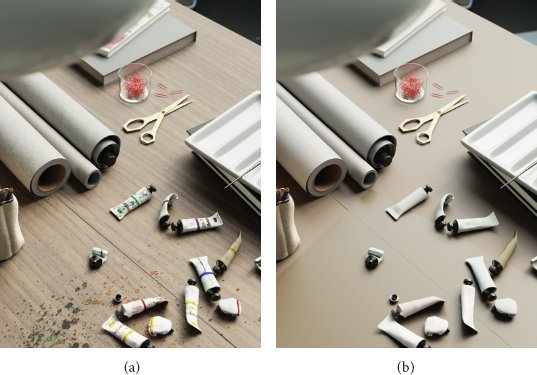

</details>

〈ImageTextureBase Definition〉 ≡

```rust
struct ImageTextureBase {
    // 〈ImageTextureBase Public Methods 662〉
    // 〈ImageTextureBase Protected Members 662〉
    // 〈ImageTextureBase Private Members 663〉
}
```

In the following, we will present the implementation of `SpectrumImageTexture`; `FloatImageTexture` is analogous and does not add anything new. 〈SpectrumImageTexture Definition〉 ≡

```rust
struct SpectrumImageTexture {
    // 〈SpectrumImageTexture Public Methods 662〉
    // 〈SpectrumImageTexture Private Members 662〉
}
```

<details>
<summary>Index / reference entries (from the printed index)</summary>

- `ImageTextureBase` 661

</details>

### 10.4.1 Texture Memory Management

The caller of `SpectrumImageTexture`’s constructor provides a texture mapping function, the filename of an image, various parameters that control the filtering of the image map, how boundary conditions are managed, and how colors are converted to spectral samples. All the necessary initialization is handled by `ImageTextureBase`. 〈SpectrumImageTexture Public Methods〉 ≡ 661

```rust
fn new(mapping: TextureMapping2D, filename: String,
       filter_options: MIPMapFilterOptions, wrap_mode: WrapMode,
       scale: Float, invert: bool, encoding: ColorEncoding,
       spectrum_type: SpectrumType, alloc: Allocator) -> Self {
    Self {
        base: ImageTextureBase::new(mapping, filename, filter_options,
                                    wrap_mode, scale, invert, encoding, alloc),
        spectrum_type,
    }
}
```

As was discussed in Section 4.6.6, RGB colors are transformed into spectra differently depending on whether or not they represent reflectances. The `spectrum_type` records what type of RGB a texture represents. 〈SpectrumImageTexture Private Members〉 ≡ 661

```rust
spectrum_type: SpectrumType,
```

The contents of the image file are used to create an instance of the `MIPMap` class that stores the texels in memory and handles the details of reconstruction and filtering to reduce aliasing. 〈ImageTextureBase Public Methods〉 ≡ 661

```rust
fn new(mapping: TextureMapping2D, filename: String,
       filter_options: MIPMapFilterOptions, wrap_mode: WrapMode,
       scale: Float, invert: bool, encoding: ColorEncoding,
       alloc: Allocator) -> Self {
    // 〈Get MIPMap from texture cache if present 663〉
    // 〈Create MIPMap for filename and add to texture cache 663〉
    Self { mapping, filename, scale, invert, /* mipmap, ... */ }
}
```

A floating-point scale can be specified with each texture; it is applied to the values returned by the `Evaluate()` method. Further, a true value for the `invert` parameter causes the texture value to be subtracted from 1 before it is returned. While the same functionality can be achieved with scale and mix textures, it is easy to also provide that functionality directly in the texture here. Doing so can lead to more efficient texture evaluation on GPUs, as is discussed further in Section 15.3.9. 〈ImageTextureBase Protected Members〉 ≡ 661

```rust
mapping: TextureMapping2D, filename: String, scale: Float,
invert: bool, mipmap: MipMap,
```

Each MIP map may require a meaningful amount of memory, and a complex scene may have thousands of image textures. Because an on-disk image may be reused for multiple textures in a scene, pbrt maintains a table of MIP maps that have been loaded so far so that they are only loaded into memory once even if they are used in more than one image texture.

<details>
<summary>Index / reference entries (from the printed index)</summary>

- `Allocator` 40
- `ColorEncoding` 1094
- `Float` 23
- `ImageTextureBase` 661
- `MIPMap` 665
- `MIPMapFilterOptions` 667
- `SpectrumImageTexture` 661
- `SpectrumType` 1125
- `TextureMapping2D` 649
- `WrapMode` 1082

</details>

pbrt loads textures in parallel after the scene description has been parsed; doing so reduces startup time before rendering begins. Therefore, a mutex is used here to ensure that only one thread accesses the texture cache at a time. Note that if the `MIPMap` is not found in the cache, the lock is released before it is read so that other threads can access the cache in the meantime. 〈Get MIPMap from texture cache if present〉 ≡ 662

```rust
let tex_info = TexInfo::new(filename, filter_options, wrap_mode, encoding);
let mut lock = texture_cache_mutex.lock().unwrap();
if let Some(mipmap) = texture_cache.get(&tex_info) {
    return mipmap.clone();
}
drop(lock);
```

The texture cache itself is managed with a `std::map` in pbrt (a Rust `HashMap`-like table here). 〈ImageTextureBase Private Members〉 ≡ 661

```rust
static texture_cache_mutex: Mutex<()>;
static texture_cache: Mutex<HashMap<TexInfo, MipMap>>;
```

`TexInfo` is a simple structure that acts as a key for the texture cache. It holds all the specifics that must match for a `MIPMap` to be reused in another image texture. 〈TexInfo Definition〉 ≡

```rust
struct TexInfo {
    filename: String,
    filter_options: MIPMapFilterOptions,
    wrap_mode: WrapMode,
    encoding: ColorEncoding,
}
```

The `TexInfo` constructor, not included here, sets its member variables with provided values. Its only other method is a comparison operator, which is required by `std::map`. 〈TexInfo Public Methods〉 ≡ 663

```rust
fn cmp_key(&self, other: &TexInfo) -> std::cmp::Ordering {
    (&self.filename, &self.filter_options, &self.encoding, &self.wrap_mode)
        .cmp(&(&other.filename, &other.filter_options,
               &other.encoding, &other.wrap_mode))
}
```

If the texture has not yet been loaded, a call to `CreateFromFile()` yields a `MIPMap` for it. If the file is not found or there is an error reading it, pbrt exits with an error message, so a `nullptr` return value does not need to be handled here. 〈Create MIPMap for filename and add to texture cache〉 ≡ 662

```rust
let mipmap = MipMap::create_from_file(filename, filter_options, wrap_mode,
                                      encoding, alloc);
texture_cache.lock().unwrap().insert(tex_info, mipmap.clone());
```

<details>
<summary>Reference / notes: ColorEncoding 1094…</summary>

- `ColorEncoding` 1094
- `ImageTextureBase::mipmap` 662
- `ImageTextureBase::textureCache` 663
- `ImageTextureBase::textureCacheMutex` 663
- `MIPMap` 665
- `MIPMapFilterOptions` 667
- `SpectrumImageTexture` 661
- `TexInfo` 663
- `TexInfo::encoding` 663
- `TexInfo::filename` 663
- `TexInfo::filterOptions` 663
- `TexInfo::wrapMode` 663
- `WrapMode` 1082

</details>

### 10.4.2 Image Texture Evaluation

Before describing the `MIPMap` implementation, we will discuss the `SpectrumImageTexture` `Evaluate()` method.

〈SpectrumImageTexture Method Definitions〉 ≡

```rust
fn evaluate(&self, ctx: TextureEvalContext, lambda: SampledWavelengths)
    -> SampledSpectrum {
    // 〈Apply texture mapping and flip t coordinate for image texture lookup 664〉
    // 〈Lookup filtered RGB value in MIPMap 664〉
    // 〈Return SampledSpectrum for RGB image texture value 664〉
}
```

It is easy to compute the $(s, t)$ texture coordinates and their derivatives for filtering with the `TextureMapping2D`’s `Map()` method. However, the $t$ coordinate must be flipped, because pbrt’s `Image` class (and in turn, `MIPMap`, which is based on it) defines $(0, 0)$ to be the upper left corner of the image, while image textures have $(0, 0)$ at the lower left. (These are the typical conventions for indexing these entities in computer graphics.) 〈Apply texture mapping and flip t coordinate for image texture lookup〉 ≡ 664

```rust
let mut c = self.mapping.map(ctx);
c.st[1] = 1.0 - c.st[1];
```

The `MIPMap`’s `Filter()` method provides the filtered value of the image texture over the specified region; any specified scale or inversion is easily applied to the value it returns. A call to `ClampZero()` here ensures that no negative values are returned after inversion. 〈Lookup filtered RGB value in MIPMap〉 ≡ 664

```rust
let mut rgb = self.scale
    * self.mipmap.filter::<RGB>(c.st, Vector2f(c.dsdx, c.dtdx),
                                Vector2f(c.dsdy, c.dtdy));
rgb = clamp_zero(if self.invert { RGB(1.0, 1.0, 1.0) - rgb } else { rgb });
```

As discussed in Section 4.6.2, an RGB color space is necessary in order to interpret the meaning of an RGB color value. Normally, the code that reads image file formats from disk returns an `RGBColorSpace` with the read image. Most RGB image formats default to sRGB, and some allow specifying an alternative color space. (For example, OpenEXR allows specifying the primaries of an arbitrary RGB color space in the image file’s metadata.) A color space and the value of `spectrum_type` make it possible to create the appropriate type RGB spectrum, and in turn, its `Spectrum::Sample()` can be called to get the `SampledSpectrum` that will be returned.

If the `MIPMap` has no associated color space, the image is assumed to have the same value in all channels and a constant value is returned for all the spectrum samples. This assumption is verified by a `DCHECK()` call in non-optimized builds. 〈Return SampledSpectrum for RGB image texture value〉 ≡ 664

```rust
if let Some(cs) = self.mipmap.get_rgb_color_space() {
    if self.spectrum_type == SpectrumType::Unbounded {
        return RGBUnboundedSpectrum::new(*cs, rgb).sample(lambda);
    } else if self.spectrum_type == SpectrumType::Albedo {
        return RGBAlbedoSpectrum::new(*cs, clamp(rgb, 0.0, 1.0)).sample(lambda);
    } else {
        return RGBIlluminantSpectrum::new(*cs, rgb).sample(lambda);
    }
}
debug_assert!(rgb[0] == rgb[1] && rgb[1] == rgb[2]);
SampledSpectrum::from(rgb[0])
```

<details>
<summary>Reference / notes: Clamp() 1033…</summary>

- `Clamp()` 1033
- `DCHECK()` 1066
- `Image` 1079
- `ImageTextureBase::invert` 662
- `ImageTextureBase::mapping` 662
- `ImageTextureBase::mipmap` 662
- `ImageTextureBase::scale` 662
- `MIPMap` 665
- `MIPMap::Filter()` 668
- `MIPMap::GetRGBColorSpace()` 667
- `RGB` 182
- `RGBAlbedoSpectrum` 197
- `RGBColorSpace` 183
- `RGBIlluminantSpectrum` 199
- `RGBIlluminantSpectrum::Sample()` 200
- `RGBUnboundedSpectrum` 198
- `RGBUnboundedSpectrum::Sample()` 199
- `SampledSpectrum` 171
- `SampledWavelengths` 173
- `Spectrum::Sample()` 175
- `SpectrumImageTexture::spectrumType` 662
- `SpectrumType::Albedo` 1125
- `SpectrumType::Unbounded` 1125
- `TexCoord2D` 650
- `TexCoord2D::dsdx` 650
- `TexCoord2D::dsdy` 650
- `TexCoord2D::dtdx` 650
- `TexCoord2D::dtdy` 650
- `TexCoord2D::st` 650
- `TextureEvalContext` 650
- `TextureMapping2D` 649
- `TextureMapping2D::Map()` 650

</details>

### 10.4.3 MIP Maps

As always, if the image texture function has higher frequency detail than can be represented by the texture sampling rate, aliasing will be present in the final image. Any frequencies higher than the Nyquist limit must be removed by prefiltering before the function is evaluated. Figure 10.15 shows the basic problem we face: an image texture has texels that are samples of some image function at a fixed frequency. The filter region for the lookup is given by its $(s, t)$ center point and offsets to the estimated texture coordinate locations for the adjacent image samples. Because these offsets are estimates of the texture sampling rate, we must remove any frequencies higher than twice the distance to the adjacent samples in order to satisfy the Nyquist criterion.

**Figure 10.15 (diagram, redrawn as Mermaid).** The lookup center (filled) and its four neighbors (filled) estimate the sampling rate; the filter footprint (ellipse) may cover many texels (open).

*Figure 10.15: Given a point at which to perform an image map lookup (denoted by the solid point in the center) and estimates of the texture-space sampling rate (denoted by adjacent solid points), it may be necessary to filter the contributions of a large number of texels in the image map (denoted by open points).*

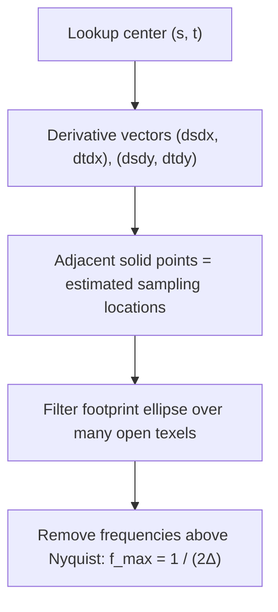

The texture sampling and reconstruction process has a few key differences from the image sampling process discussed in Chapter 8. These differences make it possible to address the antialiasing problem with more effective and less computationally expensive techniques. For example, here it is inexpensive to get the value of a sample—only an array lookup is necessary (as opposed to having to trace a number of rays to compute radiance). Further, because the texture image function is fully defined by the set of samples and there is no mystery about what its highest frequency could be, there is no uncertainty related to the function’s behavior between samples. These differences make it possible to remove detail from the texture before sampling, thus eliminating aliasing. However, the texture sampling rate will typically change from pixel to pixel. The sampling rate is determined by scene geometry and its orientation, the texture coordinate mapping function, and the camera projection and image sampling rate. Because the texture sampling rate is not fixed, texture filtering algorithms need to be able to filter over arbitrary regions of texture samples efficiently. The `MIPMap` class implements a number of methods for texture filtering with spatially varying filter widths. It can be found in the files `util/mipmap.rs` and `util/mipmap.rs`. The filtering algorithms it offers range from simple point sampling to bilinear interpolation and trilinear interpolation, which is fast and easy to implement and was widely used for texture filtering in early graphics hardware, to elliptically weighted averaging, which is more complex but returns extremely high-quality results. Figure 10.16 compares the result of texture filtering using trilinear interpolation and the EWA algorithm. 〈MIPMap Definition〉 ≡

```rust
struct MipMap {
    // 〈MIPMap Public Methods 667〉
    // 〈MIPMap Private Methods〉
    // 〈MIPMap Private Members 667〉
}
```

<details>
<summary>Index / reference entries (from the printed index)</summary>

- `MIPMap` 665

</details>

<details>
<summary>Figure 10.16 — Trilinear vs. EWA filtering (pictorial)</summary>

*Figure 10.16: Filtering the image map properly substantially improves the image. Trilinear interpolation is used for the sphere on the left and the EWA algorithm is used for the sphere on the right. Both of these approaches give a much better result than the unfiltered image map on the sphere on the left in Figure 10.1. Trilinear interpolation is not as effective as EWA at handling strongly anisotropic filter footprints, which is why the lines on the left sphere are blurrier. In regions with highly anisotropic filter footprints such as the pole of the sphere and toward the edges, EWA resolves much more detail.*

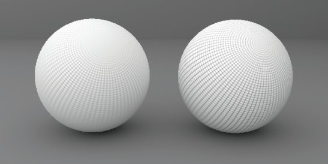

</details>

If an RGB image is provided to the `MIPMap` constructor, its channels should be stored in R, G, B order in memory; for efficiency, the following code assumes that this is the case. All the code that currently uses MIP maps in pbrt ensures that this is so.

〈MIPMap Method Definitions〉 ≡

```rust
fn new(image: Image, color_space: Option<&RGBColorSpace>,
       wrap_mode: WrapMode, alloc: Allocator,
       options: &MIPMapFilterOptions) -> Self {
    // color_space, wrap_mode, options stored; then build pyramid:
    let pyramid = Image::generate_pyramid(image, wrap_mode, alloc);
    Self { pyramid, color_space, wrap_mode, options: *options }
}
```

To limit the potential number of texels that need to be accessed, these filtering methods use an image pyramid of increasingly lower resolution prefiltered versions of the original image to accelerate their operation.[^4] The original image texels are at the bottom level of the pyramid, and the image at each level is half the resolution of the previous level, up to the top level, which has a single texel representing the average of all the texels in the original image. This collection of images needs at most $1/3$ more memory than storing the most detailed level alone and can be used to quickly find filtered values over large regions of the original image. The basic idea behind the pyramid is that if a large area of texels needs to be filtered, a reasonable approximation is to use a higher level of the pyramid and do the filtering over the same area there, accessing many fewer texels. The `MIPMap`’s image pyramid is represented by a vector of `Image`s. See Section B.5 for the implementation of `Image` and Section B.5.5 for its `GeneratePyramid()` method, which generates image pyramids.

<details>
<summary>Index / reference entries (from the printed index)</summary>

- `Allocator` 40
- `Image` 1079
- `Image::GeneratePyramid()` 1090
- `MIPMap` 665
- `MIPMapFilterOptions` 667
- `RGBColorSpace` 183
- `WrapMode` 1082

</details>

〈MIPMap Private Members〉 ≡ 665

```rust
pyramid: Vec<Image>,
color_space: Option<&'static RGBColorSpace>,
wrap_mode: WrapMode,
options: MIPMapFilterOptions,
```

The choice of filtering algorithm and a parameter used by the EWA method are represented by `MIPMapFilterOptions`. 〈MIPMapFilterOptions Definition〉 ≡

```rust
struct MIPMapFilterOptions {
    filter: FilterFunction = FilterFunction::EWA,
    max_anisotropy: Float = 8.0,
}
```

〈FilterFunction Definition〉 ≡

```rust
enum FilterFunction { Point, Bilinear, Trilinear, EWA }
```

A few simple utility methods return information about the image pyramid and the `MIPMap`’s color space. 〈MIPMap Public Methods〉 ≡ 665

```rust
fn level_resolution(&self, level: i32) -> Point2i { self.pyramid[level].resolution() }
fn levels(&self) -> i32 { self.pyramid.len() as i32 }
fn get_rgb_color_space(&self) -> Option<&RGBColorSpace> { self.color_space }
fn get_level(&self, level: i32) -> &Image { &self.pyramid[level] }
```

Given the image pyramid, we will define some utility `MIPMap` methods that retrieve the texel value at a specified pyramid level and discrete integer pixel coordinates. For the RGB variant, there is an implicit assumption that the image channels are laid out in R, G, B (and maybe A) order. 〈MIPMap Method Definitions〉 +≡

```rust
fn texel(&self, level: i32, st: Point2i) -> RGB {
    if let 3 | 4 = self.pyramid[level].n_channels() {
        RGB(self.pyramid[level].get_channel(st, 0, self.wrap_mode),
            self.pyramid[level].get_channel(st, 1, self.wrap_mode),
            self.pyramid[level].get_channel(st, 2, self.wrap_mode))
    } else {
        let v = self.pyramid[level].get_channel(st, 0, self.wrap_mode);
        RGB(v, v, v)
    }
}
```

The `Float` specialization of `Texel()`, not included here, is analogous.

<details>
<summary>Reference / notes: FilterFunction 667…</summary>

- `FilterFunction` 667
- `FilterFunction::EWA` 667
- `Float` 23
- `Image` 1079
- `Image::GetChannel()` 1081
- `Image::NChannels()` 1080
- `Image::Resolution()` 1080
- `MIPMap` 665
- `MIPMap::colorSpace` 667
- `MIPMap::pyramid` 667
- `MIPMapFilterOptions` 667
- `Point2i` 92
- `RGB` 182
- `RGBColorSpace` 183
- `WrapMode` 1082

</details>

### 10.4.4 Image Map Filtering

The `MIPMap` `Filter()` method returns a filtered image function value at the provided $(s, t)$ coordinates. It takes two derivatives that give the change in $(s, t)$ with respect to image pixel samples. 〈MIPMap Method Definitions〉 +≡

```rust
fn filter<T>(&self, st: Point2f, mut dst0: Vector2f, mut dst1: Vector2f) -> T {
    if self.options.filter != FilterFunction::EWA {
        // 〈Handle non-EWA MIP Map filter 668〉
    }
    // 〈Compute EWA ellipse axes 670〉
    // 〈Clamp ellipse vector ratio if too large 671〉
    // 〈Choose level of detail for EWA lookup and perform EWA filtering 671〉
}
```

The EWA filtering technique to be described shortly uses both derivatives of $(s, t)$ to compute an anisotropic filter—one that filters by different amounts in the different dimensions. The other three use an isotropic filter that filters both equally. The isotropic filters are more computationally efficient than the anisotropic filter, though they do not give results that are as good. For them, only a single value is needed to specify the width of the filter. The width here is conservatively chosen to avoid aliasing in both the $s$ and $t$ directions, though this choice means that textures viewed at an oblique angle will appear blurry, since the required sampling rate in one direction will be very different from the sampling rate along the other in this case. 〈Handle non-EWA MIP Map filter〉 ≡ 668

```rust
let width = 2.0 * max_of4(dst0[0].abs(), dst0[1].abs(),
                         dst1[0].abs(), dst1[1].abs());
// 〈Compute MIP Map level for width and handle very wide filter 669〉
if self.options.filter == FilterFunction::Point {
    // 〈Return point-sampled value at selected MIP level 669〉
} else if self.options.filter == FilterFunction::Bilinear {
    // 〈Return bilinear-filtered value at selected MIP level 669〉
} else {
    // 〈Return trilinear-filtered value at selected MIP level 670〉
}
```

Because filtering over many texels for wide filter widths would be inefficient, this method chooses a MIP map level from the pyramid such that the filter region at that level would cover four texels at that level. Figure 10.17 illustrates this idea.

**Figure 10.17 (diagram, redrawn as Mermaid).** The MIP level is chosen so the triangle filter covers four texels at that level (dashed box), from a very wide footprint (outer box) down to a single texel.

*Figure 10.17: Choosing a MIP Map Level for the Triangle Filter. The `MIPMap` chooses a level such that the filter covers four texels.*

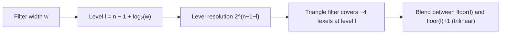

<details>
<summary>Index / reference entries (from the printed index)</summary>

- `Filter` 515
- `FilterFunction::Bilinear` 667
- `FilterFunction::EWA` 667
- `FilterFunction::Point` 667
- `Float` 23
- `MIPMap::options` 667
- `MIPMapFilterOptions::filter` 667
- `Point2f` 92
- `Vector2f` 86

</details>

Since the resolutions of the levels of the pyramid are all powers of two, the resolution of level $l$ is $2^{n_{\text{levels}}-1-l}$. Therefore, to find the level with a texel spacing width $w$ requires solving for $l$:

$$
l = n_{\text{levels}} - 1 + \log_2 w.
$$

In general, this will be a floating-point value between two MIP map levels. Values of $l$ greater than the number of pyramid levels correspond to a filter width wider than the image, in which case the single pixel at the top level is returned. 〈Compute MIP Map level for width and handle very wide filter〉 ≡ 668

```rust
let n_levels = self.levels();
let level = (n_levels - 1) as Float + w.max(1e-8).log2();
if level >= (n_levels - 1) as Float {
    return self.texel::<T>(n_levels - 1, Point2i(0, 0));
}
let i_level = (level as i32).max(0);
```

For a point-sampled texture lookup, it is only necessary to convert the continuous texture coordinates over $[0, 1]$ to discrete coordinates over the image resolution and to retrieve the appropriate texel value via the `MIPMap`’s `Texel()` method. 〈Return point-sampled value at selected MIP level〉 ≡ 668

```rust
let resolution = self.level_resolution(i_level);
let sti = Point2i((st[0] * resolution[0] as Float - 0.5).round() as i32,
                  (st[1] * resolution[1] as Float - 0.5).round() as i32);
return self.texel::<T>(i_level, sti);
```

Bilinear filtering, which is equivalent to filtering using a triangle filter, is easily implemented via a call to `Bilerp()`. 〈Return bilinear-filtered value at selected MIP level〉 ≡ 668

```rust
return self.bilerp::<T>(i_level, st);
```

Bilinear interpolation is provided in a separate method so that it can also be used for trilinear filtering.

〈MIPMap Method Definitions〉 +≡

```rust
fn bilerp(&self, level: i32, st: Point2f) -> RGB {
    if let 3 | 4 = self.pyramid[level].n_channels() {
        RGB(self.pyramid[level].bilerp_channel(st, 0, self.wrap_mode),
            self.pyramid[level].bilerp_channel(st, 1, self.wrap_mode),
            self.pyramid[level].bilerp_channel(st, 2, self.wrap_mode))
    } else {
        let v = self.pyramid[level].bilerp_channel(st, 0, self.wrap_mode);
        RGB(v, v, v)
    }
}
```

As shown by Figure 10.17, applying a triangle filter to the four texels around the sample point will either filter over too small a region or too large a region (except for very carefully selected filter widths). Therefore, the Trilinear filtering option applies the triangle filter at both of these levels and blends between them according to how close `level` is to each of them. This helps hide the transitions from one MIP map level to the next at nearby pixels in the final image. While applying a triangle filter to four texels at two levels in this manner does not generally give exactly the same result as applying a triangle filter to the original pixels, the difference is not too bad in practice, and the efficiency of this approach is worth this penalty. In any case, the following elliptically weighted average filtering approach should be used when texture quality is important.

<details>
<summary>Index / reference entries (from the printed index)</summary>

- `Float` 23
- `Image::BilerpChannel()` 1082
- `Image::NChannels()` 1080
- `Log2()` 1035
- `MIPMap::Bilerp()` 669
- `MIPMap::LevelResolution()` 667
- `MIPMap::Levels()` 667
- `MIPMap::pyramid` 667
- `MIPMap::Texel()` 667
- `Point2f` 92
- `Point2i` 92
- `RGB` 182

</details>

〈Return trilinear-filtered value at selected MIP level〉 ≡ 668

```rust
if i_level == 0 { self.bilerp::<T>(0, st) }
else {
    lerp(level - i_level as Float,
         self.bilerp::<T>(i_level, st),
         self.bilerp::<T>(i_level + 1, st))
}
```

**Figure 10.18 (diagram, redrawn as Mermaid).** The EWA filter applies a Gaussian filter to the texels in an elliptical area around the evaluation point; the ellipse edge passes through the adjacent texture-sample positions estimated by the coordinate partial derivatives.

*Figure 10.18: The EWA filter applies a Gaussian filter to the texels in an elliptical area around the evaluation point. The extent of the ellipse is such that its edge passes through the positions of the adjacent texture samples as estimated by the texture coordinate partial derivatives.*

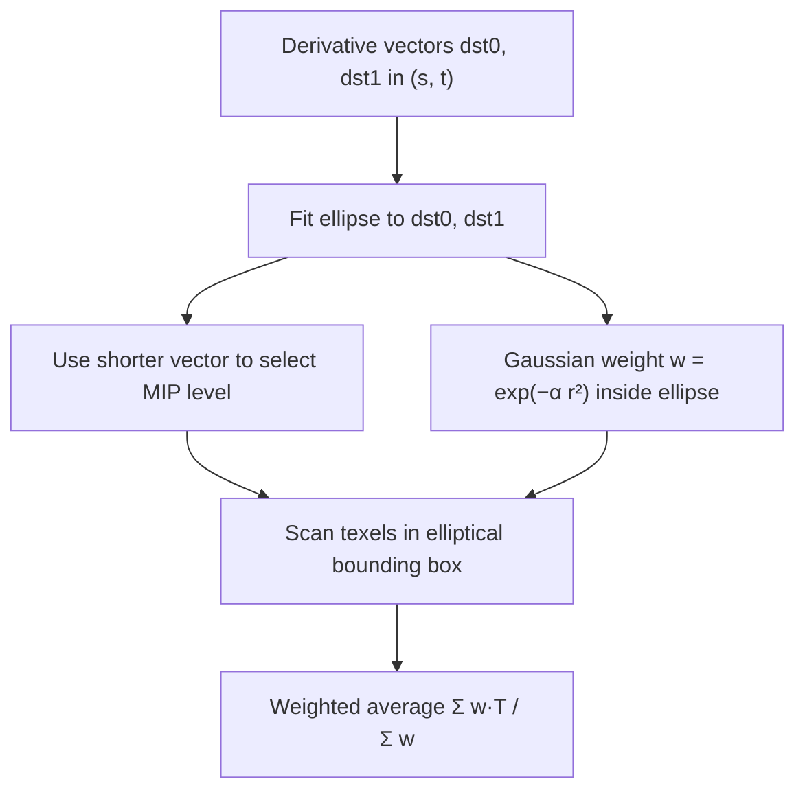

<details>
<summary>Figure 10.19 — Finding the r² ellipse value for the EWA filter table lookup (diagram, redrawn as Mermaid)</summary>

*Figure 10.19: Finding the r2 Ellipse Value for the EWA Filter Table Lookup.*

The implicit ellipse value $r^2 = A s^2 + B s t + C t^2$ at a texel is the squared ratio of the distance from the ellipse center to that texel, over the distance from the center to the ellipse boundary along the line through the texel. It indexes the precomputed Gaussian LUT.

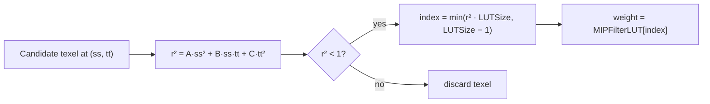

</details>

The elliptically weighted average (EWA) algorithm fits an ellipse to the two differential vectors in texture space and then filters the texture with a Gaussian filter function (Figure 10.18). It is widely regarded as one of the best texture filtering algorithms in graphics and has been carefully derived from the basic principles of sampling theory. Unlike the triangle filter, it can filter over arbitrarily oriented regions of the texture, with different filter extents in different directions. The quality of its results is improved by it being an anisotropic filter, since it can adapt to different sampling rates along the two image axes. We will not show the full derivation of this filter here, although we do note that it is distinguished by being a unified resampling filter: it simultaneously computes the result of a Gaussian filtered texture function convolved with a Gaussian reconstruction filter in image space. This is in contrast to many other texture filtering methods that ignore the effect of the image-space filter or equivalently assume that it is a box. Even if a Gaussian is not being used for filtering the samples for the image being rendered, taking some account of the spatial variation of the image filter improves the results, assuming that the filter being used is somewhat similar in shape to the Gaussian, as the Mitchell and windowed sinc filters are. The screen-space partial derivatives of the texture coordinates define the ellipse. The lookup method starts out by determining which of the two axes is the longer of the two, swapping them if needed so that `dst0` is the longer vector. The length of the shorter vector will be used to select a MIP map level. 〈Compute EWA ellipse axes〉 ≡ 668

```rust
if dst0.length_squared() < dst1.length_squared() {
    std::mem::swap(&mut dst0, &mut dst1);
}
let longer_vec_length = dst0.length();
let shorter_vec_length = dst1.length();
```

<details>
<summary>Index / reference entries (from the printed index)</summary>

- `Float` 23
- `Length()` 88
- `LengthSquared()` 87
- `Lerp()` 72
- `MIPMap::Bilerp()` 669

</details>

Next the ratio of the length of the longer vector to the length of the shorter one is considered. A large ratio indicates a very long and skinny ellipse. Because this method filters texels from a MIP map level chosen based on the length of the shorter differential vector, a large ratio means that a large number of texels need to be filtered. To avoid this expense (and to ensure that any EWA lookup takes a bounded amount of time), the length of the shorter vector may be increased to limit this ratio. The result may be an increase in blurring, although this effect usually is not noticeable in practice. 〈Clamp ellipse vector ratio if too large〉 ≡ 668

```rust
if shorter_vec_length * self.options.max_anisotropy < longer_vec_length
    && shorter_vec_length > 0.0 {
    let scale = longer_vec_length
        / (shorter_vec_length * self.options.max_anisotropy);
    dst1 *= scale;
    shorter_vec_length *= scale;
}
if shorter_vec_length == 0.0 { return self.bilerp::<T>(0, st); }
```

Like the triangle filter, the EWA filter uses the image pyramid to reduce the number of texels to be filtered for a particular texture lookup, choosing a MIP map level based on the length of the shorter vector. Given the limited ratio from the clamping above, the total number of texels used is thus bounded. Given the length of the shorter vector, the computation to find the appropriate pyramid level is the same as was used for the triangle filter. Similarly, the implementation here blends between the filtered results at the two levels around the computed level of detail, again to reduce artifacts from transitions from one level to another. 〈Choose level of detail for EWA lookup and perform EWA filtering〉 ≡ 668

```rust
let lod = (self.levels() - 1) as Float + shorter_vec_length.log2();
let lod = lod.max(0.0);
let ilod = lod.floor() as i32;
lerp(lod - ilod as Float,
     self.ewa::<T>(ilod, st, dst0, dst1),
     self.ewa::<T>(ilod + 1, st, dst0, dst1))
```

The `MIPMap::EWA()` method actually applies the filter at a particular level.

〈MIPMap Method Definitions〉 +≡

```rust
fn ewa(&self, level: i32, mut st: Point2f,
       mut dst0: Vector2f, mut dst1: Vector2f) -> T {
    if level >= self.levels() {
        return self.texel::<T>(self.levels() - 1, Point2i(0, 0));
    }
    // 〈Convert EWA coordinates to appropriate scale for level 672〉
    // 〈Find ellipse coefficients that bound EWA filter region 672〉
    // 〈Compute the ellipse’s (s, t) bounding box in texture space 672〉
    // 〈Scan over ellipse bound and evaluate quadratic equation to filter image 673〉
}
```

This method first converts from texture coordinates in $[0, 1]$ to coordinates and differentials in terms of the resolution of the chosen MIP map level. It also subtracts $0.5$ from the continuous position coordinate to align the sample point with the discrete texel coordinates, as was done in `MIPMap::Bilerp()`.

〈Convert EWA coordinates to appropriate scale for level〉 ≡ 671

```rust
let level_res = self.level_resolution(level);
st[0] = st[0] * level_res[0] as Float - 0.5;
st[1] = st[1] * level_res[1] as Float - 0.5;
dst0[0] *= level_res[0] as Float;
dst0[1] *= level_res[1] as Float;
dst1[0] *= level_res[0] as Float;
dst1[1] *= level_res[1] as Float;
```

It next computes the coefficients of the implicit equation for the ellipse centered at the origin that is defined by the vectors $(ds_0, dt_0)$ and $(ds_1, dt_1)$. Placing the ellipse at the origin rather than at $(s, t)$ simplifies the implicit equation and the computation of its coefficients and can be easily corrected for when the equation is evaluated later. The general form of the implicit equation for all points $(s, t)$ inside such an ellipse is $e(s, t) = A s^2 + B s t + C t^2 < F$, although it is more computationally efficient to divide through by $F$ and express this as

$$
A s^2 + B s t + C t^2 < 1.
$$

We will not derive the equations that give the values of the coefficients, although the interested reader can easily verify their correctness.[^5] 〈Find ellipse coefficients that bound EWA filter region〉 ≡ 671

```rust
let mut a = sqr(dst0[1]) + sqr(dst1[1]) + 1.0;
let mut b = -2.0 * (dst0[0] * dst0[1] + dst1[0] * dst1[1]);
let mut c = sqr(dst0[0]) + sqr(dst1[0]) + 1.0;
let inv_f = 1.0 / (a * c - sqr(b) * 0.25);
a *= inv_f; b *= inv_f; c *= inv_f;
```

The next step is to find the axis-aligned bounding box in discrete integer texel coordinates of the texels that are potentially inside the ellipse. The EWA algorithm loops over all of these candidate texels, filtering the contributions of those that are in fact inside the ellipse. The bounding box is found by determining the minimum and maximum values that the ellipse takes in the $s$ and $t$ directions. These extrema can be calculated by finding the partial derivatives $\partial e/\partial s$ and $\partial e/\partial t$, finding their solutions for $s = 0$ and $t = 0$, and adding the offset to the ellipse center. For brevity, we will not include the derivation for these expressions here. 〈Compute the ellipse’s (s, t) bounding box in texture space〉 ≡ 671

```rust
let det = -sqr(b) + 4.0 * a * c;
let inv_det = 1.0 / det;
let u_sqrt = (det * c).max(0.0).sqrt();
let v_sqrt = (a * det).max(0.0).sqrt();
let s0 = (st[0] - 2.0 * inv_det * u_sqrt).ceil() as i32;
let s1 = (st[0] + 2.0 * inv_det * u_sqrt).floor() as i32;
let t0 = (st[1] - 2.0 * inv_det * v_sqrt).ceil() as i32;
let t1 = (st[1] + 2.0 * inv_det * v_sqrt).floor() as i32;
```

<details>
<summary>Index / reference entries (from the printed index)</summary>

- `Float` 23
- `MIPMap::LevelResolution()` 667
- `Point2i` 92
- `SafeSqrt()` 1034
- `Sqr()` 1034

</details>

Now that the bounding box is known, the EWA algorithm loops over the texels, transforming each one to the coordinate system where the texture lookup point $(s, t)$ is at the origin with a translation. It then evaluates the ellipse equation to see if the texel is inside the ellipse (Figure 10.19) and computes the filter weight for the texel if so. The final filtered value returned is a weighted sum over texels $T(s', t')$ inside the ellipse, where $f$ is the Gaussian filter function:

$$
T = \frac{\sum_{s',t'} f(r^2)\,T(s',t')}{\sum_{s',t'} f(r^2)}.
$$

〈Scan over ellipse bound and evaluate quadratic equation to filter image〉 ≡ 671

```rust
let mut sum = T::default();
let mut sum_wts = 0.0;
for it in t0..=t1 {
    let tt = it as Float - st[1];
    for is in s0..=s1 {
        let ss = is as Float - st[0];
        // 〈Compute squared radius and filter texel if it is inside the ellipse 673〉
    }
}
return sum / sum_wts;
```

A nice feature of the implicit equation $e(s, t)$ is that its value at a particular texel is the squared ratio of the distance from the center of the ellipse to the texel to the distance from the center of the ellipse to the ellipse boundary along the line through that texel (Figure 10.19). This value can be used to index into a precomputed lookup table of Gaussian filter function values. 〈Compute squared radius and filter texel if it is inside the ellipse〉 ≡ 673

```rust
let r2 = a * sqr(ss) + b * ss * tt + c * sqr(tt);
if r2 < 1.0 {
    let index = (r2 * MIP_FILTER_LUT_SIZE as Float) as i32
        .min(MIP_FILTER_LUT_SIZE as i32 - 1);
    let weight = MIP_FILTER_LUT[index as usize];
    sum += weight * self.texel::<T>(level, Point2i(is, it));
    sum_wts += weight;
}
```

<details>
<summary>Index / reference entries (from the printed index)</summary>

- `Float` 23
- `GaussianFilter` 522
- `MIPFilterLUTSize` 674
- `Sqr()` 1034

</details>

The lookup table is precomputed and available as a constant array. Similar to the Gaussian Filter used for image reconstruction, the filter function is offset so that it goes to zero at the end of its extent rather than having an abrupt step. A value of $\alpha = 2$ was used for the table in pbrt. Because the table is indexed with squared distances from the filter center $r^2$, each entry stores a value $e^{-\alpha r^2} - e^{-\alpha}$, rather than $e^{-\alpha r^2}$. 〈MIPMap EWA Lookup Table Definition〉 ≡

```rust
const MIP_FILTER_LUT_SIZE: usize = 128;
static MIP_FILTER_LUT: [Float; MIP_FILTER_LUT_SIZE] = /* precomputed table */;
```

**wgpu texture sampling.** Hardware texture units implement the point/bilinear/trilinear part of the pyramid directly. In WGSL you select the mip level explicitly (or let `textureSample` derive it from UV derivatives). For anisotropic filtering, wgpu exposes a `sampler` with `max anisotropy`; otherwise, emulate EWA with a small, bounded number of `textureSampleLevel` taps along the major axis of the ellipse:

```wgsl
@group(0) @binding(0) var image: texture_2d<f32>;
@group(0) @binding(1) var linear_samp: sampler; // filtering, repeat

// Trilinear: hardware blends the two neighboring mip levels for us.
fn sample_trilinear(uv: vec2<f32>, lod: f32) -> vec4<f32> {
    return textureSampleLevel(image, linear_samp, uv, lod);
}

// Compact anisotropic approximation: rotate-projection taps along the
// major axis (dst0) with the minor-axis width handled by the sampler.
fn sample_aniso(uv: vec2<f32>, dst0: vec2<f32>, dst1: vec2<f32>) -> vec4<f32> {
    let level = max(0.0, log2(max(length(dst0), length(dst1))));
    var acc = vec4<f32>(0.0);
    let taps = 4;
    for (var i = 0; i < taps; i++) {
        let t = (f32(i) / f32(taps - 1)) - 0.5;
        acc += textureSampleLevel(image, linear_samp, uv + t * dst0, level);
    }
    return acc / f32(taps);
}
```

## 10.5 MATERIAL INTERFACE AND IMPLEMENTATIONS

With a variety of textures available, we will turn to materials, first introducing the material interface and then a few material implementations. pbrt’s materials all follow a similar form, evaluating textures to get parameter values that are used to initialize their particular `BSDF` model. Therefore, we will only include a few of their implementations in the text here.

The `Material` interface is defined by the `Material` class, which can be found in the file `base/material.rs`. pbrt includes the implementations of 11 materials; these are enough that we have collected all of their type names in a fragment that is not included in the text.

〈Material Definition〉 ≡

```rust
enum Material {
    // 〈Material Types〉 — 11 implementations
}
```

One of the most important methods that `Material` implementations must provide is `GetBxDF()`. It has the following signature:

```rust
fn get_bxdf<TextureEvaluator>(
    &self, tex_eval: TextureEvaluator,
    ctx: MaterialEvalContext, lambda: &mut SampledWavelengths
) -> ConcreteBxDF;
```

There are a few things to notice in its declaration. First, it is generic based on a type `TextureEvaluator`. This class is used by materials to, unsurprisingly, evaluate their textures. We will discuss it further in a page or two, as well as `MaterialEvalContext`, which serves a similar role to `TextureEvalContext`.

Most importantly, note the return type, `ConcreteBxDF`. This type is specific to each `Material` and should be replaced with the actual `BxDF` type that the material uses. (For example, the `DiffuseMaterial` returns a `DiffuseBxDF`.) Different materials thus have different signatures for their `GetBxDF()` methods. This is unusual for an interface method in C++ and is not usually allowed with regular C++ virtual functions, though we will see shortly how pbrt handles the variety of them.

Each `Material` is also responsible for defining the type of BxDF that it returns from its `GetBxDF()` method with a local type definition for the type `BxDF`. For example, `DiffuseMaterial` has `type BxDF = DiffuseBxDF;` in the body of its definition.

**Material pipeline (Mermaid).** The following diagram summarizes the data flow from per-shading-point context through texture evaluation, normal/bump mapping, and BxDF construction — the subject of the rest of this section.

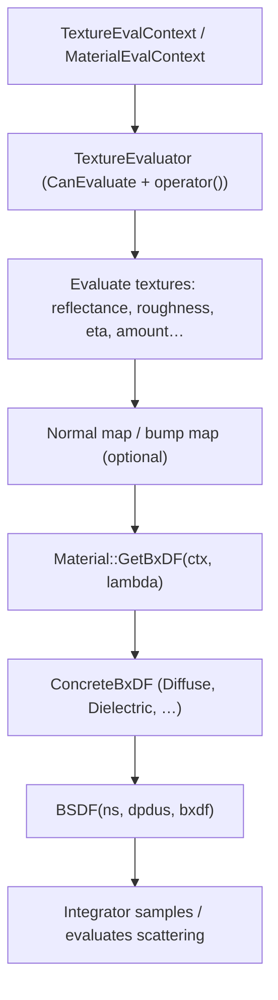

<details>
<summary>Reference / notes: BxDF 538…</summary>

- `BxDF` 538
- `DiffuseBxDF` 546
- `DiffuseMaterial` 678
- `Float` 23
- `Material` 674
- `MaterialEvalContext` 676
- `MIPFilterLUTSize` 674
- `PBRT_CONST` 929
- `TaggedPointer` 1073
- `TextureEvalContext` 650

</details>

〈Material Inline Method Definitions〉 ≡

```rust
fn get_bsdf<TextureEvaluator>(
    &self, tex_eval: TextureEvaluator, ctx: MaterialEvalContext,
    lambda: &mut SampledWavelengths, scratch: &mut ScratchBuffer
) -> BSDF {
    // 〈Define getBSDF closure for Material::GetBSDF() 675〉
    dispatch(get_bsdf)
}
```

`getBSDF` is a C++ generic lambda: when it is called, the `auto mtl` parameter will have a concrete type, that of a reference to a pointer to one of the materials enumerated in the 〈Material Types〉 fragment. Given `mtl`, then, we can find the concrete type of its material and thence the type of its BxDF. If a material does not return a BxDF, it should use `void` for its BxDF type definition. In that case, an unset `BSDF` is returned. (The `MixMaterial` is the only such Material in pbrt.)

〈Define getBSDF lambda function for Material::GetBSDF()〉 ≡ 675

```rust
let get_bsdf = |mtl: &ConcreteMtl| -> BSDF {
    type ConcreteBxDF = <ConcreteMtl as MaterialTrait>::BxDF;
    if type_is_void::<ConcreteBxDF>() { return BSDF::default(); }
    // 〈Allocate memory for ConcreteBxDF and return BSDF for material 676〉
};
```

The provided `ScratchBuffer` is used to allocate enough memory to store the material’s `BxDF`; using it is much more efficient than using C++’s `new` and `delete` operators here. That memory is then initialized with the value returned by the material’s `GetBxDF()` method before the complete `BSDF` is returned to the caller.

<details>
<summary>Reference / notes: BSDF 544…</summary>

- `BSDF` 544
- `BxDF` 538
- `Material` 674
- `MaterialEvalContext` 676
- `MixMaterial` 681
- `SampledWavelengths` 173
- `ScratchBuffer` 1078
- `TaggedPointer` 1073
- `TaggedPointer::Dispatch()` 1075
- `TextureEvaluator` 676

</details>

〈Allocate memory for ConcreteBxDF and return BSDF for material〉 ≡ 675

```rust
let bxdf: &mut ConcreteBxDF = scratch.alloc::<ConcreteBxDF>();
*bxdf = mtl.get_bxdf(tex_eval, ctx, lambda);
BSDF::new(ctx.ns, ctx.dpdus, bxdf)
```

Materials that incorporate subsurface scattering must define a `GetBSSRDF()` method that follows a similar form. They must also include a using declaration in their class definition that defines a concrete BSSRDF type. (The code for rendering BSSRDFs is included only in the online edition.)

```rust
fn get_bssrdf<TextureEvaluator>(
    &self, tex_eval: TextureEvaluator,
    ctx: MaterialEvalContext, lambda: &mut SampledWavelengths
) -> ConcreteBSSRDF;
```

The `Material` class provides a corresponding `GetBSSRDF()` method that uses the provided `ScratchBuffer` to allocate storage for the material-specific `BSSRDF`. 〈Material Interface〉 ≡ 674

```rust
fn get_bssrdf<TextureEvaluator>(
    &self, tex_eval: TextureEvaluator, ctx: MaterialEvalContext,
    lambda: &mut SampledWavelengths, buf: &mut ScratchBuffer
) -> BSSRDF;
```

The `MaterialEvalContext` that `GetBxDF()` and `GetBSSRDF()` take plays a similar role to other `*EvalContext` classes: it encapsulates only the values that are necessary for material evaluation. They are a superset of those that are used for texture evaluation, so it inherits from `TextureEvalContext`. Doing so has the added advantage that `MaterialEvalContext`s can be passed directly to the texture evaluation methods. 〈MaterialEvalContext Definition〉 ≡

```rust
struct MaterialEvalContext {
    // 〈MaterialEvalContext Public Methods 676〉
    // inherits TextureEvalContext
    wo: Vector3f,
    ns: Normal3f,
    dpdus: Vector3f,
}
```

As before, there is not only a constructor that initializes a `MaterialEvalContext` from a `SurfaceInteraction` but also a constructor that takes the values for the members individually (not included here). 〈MaterialEvalContext Public Methods〉 ≡ 676

```rust
impl Default for MaterialEvalContext { fn default() -> Self { /* … */ } }
impl From<&SurfaceInteraction> for MaterialEvalContext {
    fn from(si: &SurfaceInteraction) -> Self {
        Self { base: TextureEvalContext::from(si), wo: si.wo,
               ns: si.shading.n, dpdus: si.shading.dpdu }
    }
}
```

A `TextureEvaluator` is a class that is able to evaluate some or all of pbrt’s texture types. One of its methods takes a set of textures and reports whether it is capable of evaluating them, while others actually evaluate textures. On the face of it, there is no obvious need for such a class: why not allow Materials to call the Texture `Evaluate()` methods directly? This additional layer of abstraction aids performance with the wavefront integrator; it makes it possible to separate materials into those that have lightweight textures and those with heavyweight textures and to process them separately. Doing so is beneficial to performance on the GPU; see Section 15.3.9 for further discussion.

<details>
<summary>Reference / notes: BSDF 544…</summary>

- `BSDF` 544
- `Interaction::wo` 137
- `Material` 674
- `MaterialEvalContext` 676
- `MaterialEvalContext::dpdus` 676
- `MaterialEvalContext::ns` 676
- `MaterialEvalContext::wo` 676
- `Normal3f` 94
- `SampledWavelengths` 173
- `ScratchBuffer` 1078
- `ScratchBuffer::Alloc()` 1078
- `SurfaceInteraction` 138
- `SurfaceInteraction::shading::dpdu` 139
- `SurfaceInteraction::shading::n` 139
- `Texture` 655
- `TextureEvalContext` 650
- `TextureEvaluator` 676
- `UniversalTextureEvaluator` 677
- `Vector3f` 86

</details>

For now we will only define the `UniversalTextureEvaluator`, which can evaluate all textures. In practice, the indirection it adds is optimized away by the compiler such that it introduces no runtime overhead. It is used with all of pbrt’s integrators other than the one defined in Chapter 15.

〈UniversalTextureEvaluator Definition〉 ≡

```rust
struct UniversalTextureEvaluator;
```

TextureEvaluators must provide a `CanEvaluate()` method that takes lists of `FloatTexture`s and `SpectrumTexture`s. They can then examine the types of the provided textures to determine if they are able to evaluate them. For the universal texture evaluator, the answer is always the same. 〈UniversalTextureEvaluator Public Methods〉 ≡ 677

```rust
fn can_evaluate(&self, floats: &[FloatTexture],
                spectra: &[SpectrumTexture]) -> bool { true }
```

TextureEvaluators must also provide `operator()` method implementations that evaluate a given texture. Thus, given a texture evaluator `tex_eval`, material code should use the expression `tex_eval(tex, ctx)` rather than `tex.evaluate(ctx)`. The implementation of this method is again trivial for the universal evaluator. (A corresponding method for spectrum textures is effectively the same and not included here.) 〈UniversalTextureEvaluator Method Definitions〉 ≡

```rust
fn call(&self, tex: FloatTexture, ctx: TextureEvalContext) -> Float {
    tex.evaluate(ctx)
}
```

Returning to the `Material` interface, all materials must provide a `CanEvaluateTextures()` method that takes a texture evaluator. They should return the result of calling its `CanEvaluate()` method with all of their textures provided. Code that uses Materials is then responsible for ensuring that a `Material`’s `GetBxDF()` or `GetBSSRDF()` method is only called with a texture evaluator that is able to evaluate its textures. 〈Material Interface〉 +≡ 674

```rust
fn can_evaluate_textures<TextureEvaluator>(&self, tex_eval: TextureEvaluator) -> bool;
```

Materials also may modify the shading normals of objects they are bound to, usually in order to introduce the appearance of greater geometric detail than is actually present. The `Material` interface has two ways that they may do so, normal mapping and bump mapping.

pbrt’s normal mapping code, which will be described in Section 10.5.3, takes an image that specifies the shading normals. A `nullptr` value should be returned by this interface method if no normal map is included with a material. 〈Material Interface〉 +≡ 674

```rust
fn get_normal_map(&self) -> Option<&Image>;
```

Alternatively, shading normals may be specified via bump mapping, which takes a displacement function that specifies surface detail with a `FloatTexture`. A `nullptr` value should be returned if no such displacement function has been specified.

<details>
<summary>Index / reference entries (from the printed index)</summary>

- `Float` 23
- `FloatTexture` 656
- `FloatTexture::Evaluate()` 656
- `Image` 1079
- `Material` 674
- `SpectrumTexture` 656
- `TextureEvalContext` 650
- `TextureEvaluator` 676

</details>

〈Material Interface〉 +≡ 674

```rust
fn get_displacement(&self) -> FloatTexture;
```

What should be returned by `HasSubsurfaceScattering()` method implementations should be obvious; this method is used to determine for which materials in a scene it is necessary to do the additional processing to model that effect. 〈Material Interface〉 +≡ 674

```rust
fn has_subsurface_scattering(&self) -> bool;
```

### 10.5.1 Material Implementations

With the preliminaries covered, we will now present a few material implementations. All the Materials in pbrt are fairly basic bridges between Textures and BxDFs, so we will focus here on their basic form and some of the unique details of one of them.

**Diffuse Material**

`DiffuseMaterial` is the simplest material implementation and is a good starting point for understanding the material requirements. 〈DiffuseMaterial Definition〉 ≡

```rust
struct DiffuseMaterial {
    // 〈DiffuseMaterial Type Definitions 678〉
    // 〈DiffuseMaterial Public Methods 678〉
    // 〈DiffuseMaterial Private Members 678〉
}
```

These are the `BxDF` and `BSSRDF` type definitions for `DiffuseMaterial`. Because this material does not include subsurface scattering, `BSSRDF` can be set to be void.

〈DiffuseMaterial Type Definitions〉 ≡ 678

```rust
type BxDF = DiffuseBxDF;
type BSSRDF = (); // void
```

The constructor initializes the following member variables with provided values, so it is not included here. 〈DiffuseMaterial Private Members〉 ≡ 678

```rust
normal_map: Option<Image>,
displacement: FloatTexture,
reflectance: SpectrumTexture,
```

The `CanEvaluateTextures()` method is easy to implement; the various textures used for `BSDF` evaluation are passed to the given `TextureEvaluator`. Note that the displacement texture is not included here; if present, it is handled separately by the bump mapping code. 〈DiffuseMaterial Public Methods〉 ≡ 678

```rust
fn can_evaluate_textures<E: TextureEvaluator>(&self, tex_eval: E) -> bool {
    tex_eval.can_evaluate(&[], &[self.reflectance])
}
```

There is also not very much to `GetBxDF()`; it evaluates the reflectance texture, clamping the result to the range of valid reflectances before passing it along to the `DiffuseBxDF` constructor and returning a `DiffuseBxDF`.

<details>
<summary>Index / reference entries (from the printed index)</summary>

- `BxDF` 538
- `DiffuseBxDF` 546
- `DiffuseMaterial` 678
- `FloatTexture` 656
- `Image` 1079
- `Material` 674
- `SpectrumTexture` 656
- `Texture` 655
- `TextureEvaluator` 676
- `TextureEvaluator::CanEvaluate()` 677

</details>

〈DiffuseMaterial Public Methods〉 +≡ 678

```rust
fn get_bxdf<E: TextureEvaluator>(&self, tex_eval: E, ctx: MaterialEvalContext,
                                 lambda: &mut SampledWavelengths) -> DiffuseBxDF {
    let r = clamp(tex_eval.call(self.reflectance, ctx, lambda), 0.0, 1.0);
    DiffuseBxDF::new(r)
}
```

`GetNormalMap()` and `GetDisplacement()` return the corresponding member variables and the remaining methods are trivial; see the source code for details.

**Dielectric Material**

`DielectricMaterial` represents a dielectric interface.

〈DielectricMaterial Definition〉 ≡

```rust
struct DielectricMaterial {
    // 〈DielectricMaterial Type Definitions 679〉
    // 〈DielectricMaterial Public Methods 679〉
    // 〈DielectricMaterial Private Members 679〉
}
```

It returns a `DielectricBxDF` and does not include subsurface scattering.

〈DielectricMaterial Type Definitions〉 ≡ 679

```rust
type BxDF = DielectricBxDF;
type BSSRDF = ();
```

`DielectricMaterial` has a few more parameters than `DiffuseMaterial`. The index of refraction is specified with a `SpectrumTexture` so that it may vary with wavelength. Note also that two roughness values are stored, which allows the specification of an anisotropic microfacet distribution. If the distribution is isotropic, this leads to a minor inefficiency in storage and, shortly, texture evaluation, since both are always evaluated.

〈DielectricMaterial Private Members〉 ≡ 679

```rust
normal_map: Option<Image>,
displacement: FloatTexture,
u_roughness: FloatTexture, v_roughness: FloatTexture,
remap_roughness: bool,
eta: Spectrum,
```

`GetBxDF()` follows a similar form to `DiffuseMaterial`, evaluating various textures and using their results to initialize the returned `DielectricBxDF`. 〈DielectricMaterial Public Methods〉 ≡ 679

```rust
fn get_bxdf<E: TextureEvaluator>(&self, tex_eval: E, ctx: MaterialEvalContext,
                                 lambda: &mut SampledWavelengths) -> DielectricBxDF {
    // 〈Compute index of refraction for dielectric material 680〉
    // 〈Create microfacet distribution for dielectric material 680〉
    // 〈Return BSDF for dielectric material 680〉
}
```

<details>
<summary>Reference / notes: BxDF 538…</summary>

- `BxDF` 538
- `Clamp()` 1033
- `DielectricBxDF` 563
- `DiffuseBxDF` 546
- `FloatTexture` 656
- `Image` 1079
- `MaterialEvalContext` 676
- `SampledSpectrum` 171
- `SampledWavelengths` 173
- `Spectrum` 165
- `SpectrumTexture` 656
- `TextureEvaluator` 676
- `TextureEvaluator::operator()` 677

</details>

If the index of refraction is the same for all wavelengths, then all wavelengths will follow the same path if a ray is refracted. Otherwise, they will go in different directions—this is dispersion. In that case, pbrt only follows a single ray path according to the first wavelength in `SampledWavelengths` rather than tracing multiple rays to track each of them, and a call to `SampledWavelengths::TerminateSecondary()` is necessary. (See Section 4.5.4 for more information.) `DielectricMaterial` therefore calls `TerminateSecondary()` unless the index of refraction is known to be constant, as determined by checking if `eta`’s `Spectrum` type is a `ConstantSpectrum`. This check does not detect all cases where the sampled spectrum values are all the same, but it catches most of them in practice, and unnecessarily terminating the secondary wavelengths affects performance but not correctness. A bigger shortcoming of the implementation here is that there is no dispersion if light is reflected at a surface and not refracted. In that case, all wavelengths could still be followed. However, how light paths will be sampled at the surface is not known at this point in program execution. 〈Compute index of refraction for dielectric material〉 ≡ 679

```rust
let sampled_eta = eta(lambda[0]);
if !eta.is::<ConstantSpectrum>() { lambda.terminate_secondary(); }
```

It can be convenient to specify a microfacet distribution’s roughness with a scalar parameter in $[0, 1]$, where values close to zero correspond to near-perfect specular reflection, rather than by specifying $\alpha$ values directly. The `RoughnessToAlpha()` method performs a mapping that gives a reasonably intuitive control for surface appearance. 〈TrowbridgeReitzDistribution Public Methods〉 +≡ 575

```rust
fn roughness_to_alpha(roughness: Float) -> Float { roughness.sqrt() }
```

The `GetBxDF()` method then evaluates the roughness textures and remaps the returned values if required. 〈Create microfacet distribution for dielectric material〉 ≡ 679

```rust
let mut urough = tex_eval.call(self.u_roughness, ctx);
let mut vrough = tex_eval.call(self.v_roughness, ctx);
if self.remap_roughness {
    urough = TrowbridgeReitzDistribution::roughness_to_alpha(urough);
    vrough = TrowbridgeReitzDistribution::roughness_to_alpha(vrough);
}
let distrib = TrowbridgeReitzDistribution::new(urough, vrough);
```

Given the index of refraction and microfacet distribution, it is easy to pull the pieces together to return the final `BxDF`. 〈Return BSDF for dielectric material〉 ≡

```rust
DielectricBxDF::new(sampled_eta, distrib)
```

<details>
<summary>Index / reference entries (from the printed index)</summary>

- `ConstantSpectrum` 167
- `DielectricBxDF` 563
- `DielectricMaterial` 679
- `DielectricMaterial::eta` 679
- `DielectricMaterial::remapRoughness` 679
- `DielectricMaterial::uRoughness` 679
- `DielectricMaterial::vRoughness` 679
- `Float` 23
- `SampledWavelengths` 173
- `SampledWavelengths::TerminateSecondary()` 174
- `Spectrum` 165
- `TaggedPointer::Is()` 1074
- `TrowbridgeReitzDistribution` 575
- `TrowbridgeReitzDistribution::RoughnessToAlpha()` 680

</details>

**Mix Material**

The final material implementation that we will describe in the text is `MixMaterial`, which stores two other materials and uses a `Float`-valued texture to blend between them. 〈MixMaterial Definition〉 ≡

```rust
struct MixMaterial {
    // 〈MixMaterial Type Definitions〉
    // 〈MixMaterial Public Methods 681〉
    // 〈MixMaterial Private Members 681〉
}
```

〈MixMaterial Private Members〉 ≡ 681

```rust
amount: FloatTexture,
materials: [Material; 2],
```

`MixMaterial` does not cleanly fit into pbrt’s `Material` abstraction. For example, it is unable to define a single `BxDF` type that it will return, since its two constituent materials may have different BxDFs, and may themselves be MixMaterials, for that matter. Thus, `MixMaterial` requires special handling by the code that uses materials. (For example, there is a special case for MixMaterials in the `SurfaceInteraction::GetBSDF()` method described in Section 10.5.2.) This is not ideal: as a general point of software design, it would be better to have abstractions that make it possible to provide this functionality without requiring special-case handling in calling code. However, we were unable to find a clean way to do this while still being able to statically reason about the type of `BxDF` a material will return; that aspect of the `Material` interface offers enough of a performance benefit that we did not want to change it. Therefore, when a `MixMaterial` is encountered, one of its constituent materials is randomly chosen, with probability given by the floating-point amount texture. Thus, a 50/50 mix of two materials is not represented by the average of their respective BSDFs and so forth, but instead by each of them being evaluated half the time. This is effectively the material analog of the stochastic alpha test that was described in Section 7.1.1. The `ChooseMaterial()` method implements the logic.

〈MixMaterial Public Methods〉 ≡ 681

```rust
fn choose_material<E: TextureEvaluator>(&self, tex_eval: E,
                                        ctx: MaterialEvalContext) -> Material {
    let amt = tex_eval.call(self.amount, ctx);
    if amt <= 0.0 { return self.materials[0]; }
    if amt >= 1.0 { return self.materials[1]; }
    let u = hash_float(ctx.p, ctx.wo, self.materials[0], self.materials[1]);
    if amt < u { self.materials[0] } else { self.materials[1] }
}
```

<details>
<summary>Reference / notes: BSDF 544…</summary>

- `BSDF` 544
- `Float` 23
- `FloatTexture` 656
- `HashFloat()` 1042
- `Material` 674
- `MaterialEvalContext` 676
- `MaterialEvalContext::wo` 676
- `MixMaterial::amount` 681
- `MixMaterial::materials` 681
- `SurfaceInteraction::GetBSDF()` 682
- `TextureEvalContext::p` 650
- `TextureEvaluator` 676

</details>

Stochastic selection of materials can introduce noise in images at low sampling rates; see Figure 10.20. However, a few tens of samples are generally plenty to resolve any visual error. Furthermore, this approach does bring benefits: sampling and evaluation of the resulting `BSDF` is more efficient than if it was a weighted sum of the BSDFs from the constituent materials. `MixMaterial` provides an accessor that makes it possible to traverse all the materials in the scene, including those nested inside a `MixMaterial`, so that it is possible to perform operations such as determining which types of materials are and are not present in a scene. 〈MixMaterial Public Methods〉 +≡ 681

```rust
fn get_material(&self, i: i32) -> Material { self.materials[i as usize] }
```

<details>
<summary>Figure 10.20 — Effect of sampling rate with the MixMaterial (pictorial)</summary>

*Figure 10.20: Effect of Sampling Rate with the `MixMaterial`. In this scene, the `MixMaterial` is used to blend between blue and red diffuse materials for the dragon, using an equal weighting for each. (a) With one sample per pixel, there is visible noise in the corresponding pixels since each pixel only includes one of the two constituent materials. (b) With a sufficient number of samples (here, 128), stochastic selection of materials causes no visual harm. In practice, the pixel sampling rates necessary to reduce other forms of error from simulating light transport are almost always enough to resolve stochastic material sampling.*


</details>

A fatal error is issued if the `GetBxDF()` method is called. A call to `GetBSSRDF()` is handled similarly, in code not included here.

〈MixMaterial Public Methods〉 +≡ 681

```rust
fn get_bxdf<E: TextureEvaluator>(&self, _tex_eval: E,
    _ctx: MaterialEvalContext, _lambda: &mut SampledWavelengths) -> ! {
    panic!("MixMaterial::GetBxDF() shouldn't be called");
}
```

### 10.5.2 Finding the BSDF at a Surface

Because pbrt’s Integrators use the `SurfaceInteraction` class to collect the necessary information associated with each intersection point, we will add a `GetBSDF()` method to this class that handles all the details related to computing the `BSDF` at its point.

<details>
<summary>Reference / notes: BSDF 544…</summary>

- `BSDF` 544
- `Camera` 206
- `Integrator` 22
- `LOG_FATAL()` 1065
- `MaterialEvalContext` 676
- `MixMaterial` 681
- `RayDifferential` 96
- `SampledWavelengths` 173
- `Sampler` 469
- `ScratchBuffer` 1078
- `SurfaceInteraction` 138
- `TextureEvaluator` 676

</details>

〈SurfaceInteraction Method Definitions〉 +≡

```rust
fn get_bsdf(&mut self, ray: &RayDifferential, lambda: &mut SampledWavelengths,
            camera: &dyn Camera, scratch: &mut ScratchBuffer,
            sampler: &mut dyn Sampler) -> BSDF {
    // 〈Estimate (u, v) and position differentials at intersection point 683〉
    // 〈Resolve MixMaterial if necessary 683〉
    // 〈Return unset BSDF if surface has a null material 683〉
    // 〈Evaluate normal or bump map, if present 683〉
    // 〈Return BSDF for surface interaction 684〉
}
```

This method first calls the `SurfaceInteraction`’s `ComputeDifferentials()` method to compute information about the projected size of the surface area around the intersection on the image plane for use in texture antialiasing. 〈Estimate (u, v) and position differentials at intersection point〉 ≡ 682

```rust
self.compute_differentials(ray, camera, sampler.samples_per_pixel());
```

As described in Section 10.5.1, if there is a `MixMaterial` at the intersection point, it is necessary to resolve it to be a regular material. A `while` loop here ensures that nested MixMaterials are handled correctly.

〈Resolve MixMaterial if necessary〉 ≡ 682

```rust
while let Material::Mix(mix) = self.material {
    self.material = mix.choose_material(UniversalTextureEvaluator, (*self).into());
}
```

If the final material is `nullptr`, it represents a non-scattering interface between two types of participating media. In this case, a default uninitialized `BSDF` is returned.

〈Return unset BSDF if surface has a null material〉 ≡ 682

```rust
if self.material.is_null() { return BSDF::default(); }
```

Otherwise, normal or bump mapping is performed before the `BSDF` is created. 〈Evaluate normal or bump map, if present〉 ≡ 682

```rust
let displacement = self.material.get_displacement();
let normal_map = self.material.get_normal_map();
if displacement.is_some() || normal_map.is_some() {
    // 〈Get shading ∂p/∂u and ∂p/∂v using normal or bump map 683〉
    let ns = Normal3f::from(normalize(cross(dpdu, dpdv)));
    self.set_shading_geometry(ns, dpdu, dpdv,
                              shading.dndu, shading.dndv, false);
}
```

The appropriate utility function for normal or bump mapping is called, depending on which technique is to be used. 〈Get shading ∂p/∂u and ∂p/∂v using normal or bump map〉 ≡ 683

```rust
let (mut dpdu, mut dpdv);
if let Some(nm) = normal_map { (dpdu, dpdv) = normal_map_fn(nm, &self.into()); }
else { (dpdu, dpdv) = bump_map_fn(UniversalTextureEvaluator, displacement, &self.into()); }
```

With differentials both for texture filtering and for shading geometry now settled, the `Material::GetBSDF()` method can be called. Note that the universal texture evaluator is used both here and previously in the method, as there is no need to distinguish between different texture complexities in this part of the system.

<details>
<summary>Reference / notes: BumpMap() 687…</summary>

- `BumpMap()` 687
- `Cross()` 91
- `FloatTexture` 656
- `Image` 1079
- `Material::GetBSDF()` 675
- `Material::GetDisplacement()` 678
- `Material::GetNormalMap()` 677
- `MixMaterial` 681
- `MixMaterial::ChooseMaterial()` 681
- `Normal3f` 94
- `Normalize()` 88
- `NormalMap()` 685
- `Sampler::SamplesPerPixel()` 469
- `SurfaceInteraction::ComputeDifferentials()` 637
- `SurfaceInteraction::material` 398
- `SurfaceInteraction::SetShadingGeometry()` 140
- `SurfaceInteraction::shading::dndu` 139
- `SurfaceInteraction::shading::dndv` 139
- `TaggedPointer::Cast()` 1074
- `TaggedPointer::Is()` 1074
- `UniversalTextureEvaluator` 677
- `Vector3f` 86

</details>

〈Return BSDF for surface interaction〉 ≡ 682

```rust
let mut bsdf = self.material.get_bsdf(UniversalTextureEvaluator,
                                      (*self).into(), lambda, scratch);
if bsdf.is_some() && get_options().force_diffuse {
    // 〈Override bsdf with diffuse equivalent 684〉
}
bsdf
```

pbrt provides an option to override all the materials in a scene with equivalent diffuse BSDFs; doing so can be useful for some debugging problems. In this case, the hemispherical–directional reflectance is used to initialize a `DiffuseBxDF`. 〈Override bsdf with diffuse equivalent〉 ≡ 684

```rust
let r = bsdf.rho(self.wo, &[sampler.get_1d()], &[sampler.get_2d()]);
bsdf = BSDF::new(shading.n, shading.dpdu,
                 scratch.alloc::<DiffuseBxDF>(DiffuseBxDF::new(r)));
```

The `SurfaceInteraction::GetBSSRDF()` method, not included here, follows a similar path before calling `Material::GetBSSRDF()`.

### 10.5.3 Normal Mapping

Normal mapping is a technique that maps tabularized surface normals stored in images to surfaces and uses them to specify shading normals in order to give the appearance of fine geometric detail. With normal maps, one must choose a coordinate system for the stored normals. While any coordinate system may be chosen, one of the most useful is the local shading coordinate system at each point on a surface where the $z$ axis is aligned with the surface normal and tangent vectors are aligned with $x$ and $y$. (This is the same as the reflection coordinate system described in Section 9.1.1.) When that coordinate system is used, the approach is called *tangent-space normal mapping*. With tangent-space normal mapping, a given normal map can be applied to a variety of shapes, while choosing a coordinate system like object space would closely couple a normal map’s encoding to a specific geometric object. Normal maps are traditionally encoded in RGB images, where red, green, and blue respectively store the $x$, $y$, and $z$ components of the surface normal. When tangent-space normal mapping is used, normal map images are typically predominantly blue, reflecting the fact that the $z$ component of the surface normal has the largest magnitude unless the normal has been substantially perturbed. (See Figure 10.21.) This RGB encoding brings us to an unfortunate casualty from the adoption of spectral rendering in this version of pbrt: while pbrt’s `SpectrumTexture`s previously returned RGB colors, they now return point-sampled spectral values. If an RGB image map is used for a spectrum texture, it is not possible to exactly reconstruct the original RGB colors; there will unavoidably be error in the Monte Carlo estimator that must be evaluated to find RGB. Introducing noise in the orientations of surface normals is unacceptable, since it would lead to systemic bias in rendered images. Consider a bumpy shiny object: error in the surface normal would lead to scattered rays intersecting objects that they would never intersect given the correct normals, which could cause arbitrarily large error.

We might avoid that problem by augmenting the `SpectrumTexture` interface to include a method that returned RGB color, introducing a separate `RGBTexture` interface and texture implementations, or by introducing a `NormalTexture` that returned normals directly. Any of these could cleanly support normal mapping, though all would require a significant amount of additional code.

<details>
<summary>Figure 10.21 — Normal map on a pillow (pictorial)</summary>

*Figure 10.21: (a) A normal map modeling wrinkles for a pillow model. (b) Pillow geometry without normal map. (c) When applied to the pillow, the normal map gives a convincing approximation to more detailed geometry than is actually present. (Scene courtesy of Angelo Ferretti.)*


</details>

Because the capability of directly looking up RGB values is only needed for normal mapping, the `NormalMap()` function therefore takes an `Image` to specify the normal map. It assumes that the first three channels of the image represent red, green, and blue. With this approach we have lost the benefits of being able to scale and mix textures as well as the ability to apply a variety of mapping functions to compute texture coordinates. While that is unfortunate, those capabilities are less often used with normal maps than with other types of textures, and so we prefer not to make the `Texture` interfaces more complex purely for normal mapping. 〈Normal Mapping Function Definitions〉 ≡

```rust
fn normal_map(normal_map: &Image, ctx: &NormalBumpEvalContext,
              dpdu: &mut Vector3f, dpdv: &mut Vector3f) {
    // 〈Get normalized normal vector from normal map 686〉
    // 〈Transform tangent-space normal to rendering space 686〉
    // 〈Find ∂p/∂u and ∂p/∂v that give shading normal 687〉
}
```

Both `NormalMap()` and `BumpMap()` take a `NormalBumpEvalContext` to specify the local geometric information for the point where the shading geometry is being computed. 〈NormalBumpEvalContext Definition〉 ≡

```rust
struct NormalBumpEvalContext {
    // 〈NormalBumpEvalContext Public Methods 686〉
    // 〈NormalBumpEvalContext Public Members 686〉
}
```

As usual, it has a constructor, not included here, that performs initialization given a `SurfaceInteraction`.

<details>
<summary>Index / reference entries (from the printed index)</summary>

- `BumpMap()` 687
- `Image` 1079
- `NormalBumpEvalContext` 685
- `NormalMap()` 685
- `SurfaceInteraction` 138
- `Vector3f` 86

</details>

〈NormalBumpEvalContext Public Members〉 ≡ 685

```rust
p: Point3f, uv: Point2f, n: Normal3f,
shading: struct_field! {
    n: Normal3f,
    dpdu: Vector3f, dpdv: Vector3f,
    dndu: Normal3f, dndv: Normal3f,
},
dudx: Float = 0.0, dudy: Float = 0.0,
dvdx: Float = 0.0, dvdy: Float = 0.0,
dpdx: Vector3f, dpdy: Vector3f,
```

It also provides a conversion operator to `TextureEvalContext`, which only needs a subset of the values stored in `NormalBumpEvalContext`. 〈NormalBumpEvalContext Public Methods〉 ≡ 685

```rust
impl From<&NormalBumpEvalContext> for TextureEvalContext {
    fn from(ctx: &NormalBumpEvalContext) -> Self {
        TextureEvalContext::new(ctx.p, ctx.dpdx, ctx.dpdy, ctx.n, ctx.uv,
                                ctx.dudx, ctx.dudy, ctx.dvdx, ctx.dvdy)
    }
}
```

The first step in the normal mapping computation is to read the tangent-space normal vector from the image map. The image wrap mode is hard-coded here since `Repeat` is almost always the desired mode, though it would be easy to allow the wrap mode to be set via a parameter. Note also that the $v$ coordinate is inverted, again following the image texture coordinate convention discussed in Section 10.4.2. Normal maps are traditionally encoded in fixed-point image formats with pixel values that range from 0 to 1. This encoding allows the use of compact 8-bit pixel representations as well as compressed image formats that are supported by GPUs. Values read from the image must therefore be remapped to the range $[-1, 1]$ to reconstruct an associated normal vector. The normal vector must be renormalized, as both the quantization in the image pixel format and the bilinear interpolation may have caused it to be non-unit-length. 〈Get normalized normal vector from normal map〉 ≡ 685

```rust
let wrap = WrapMode2D::new(WrapMode::Repeat);
let uv = Point2f(ctx.uv[0], 1.0 - ctx.uv[1]);
let mut ns = Vector3f(
    2.0 * normal_map.bilerp_channel(uv, 0, wrap) - 1.0,
    2.0 * normal_map.bilerp_channel(uv, 1, wrap) - 1.0,
    2.0 * normal_map.bilerp_channel(uv, 2, wrap) - 1.0);
ns = normalize(ns);
```

In order to transform the normal to rendering space, a `Frame` can be used to specify a coordinate system where the original shading normal is aligned with the $+z$ axis. Transforming the tangent-space normal into this coordinate system gives the rendering-space normal. 〈Transform tangent-space normal to rendering space〉 ≡ 685

```rust
let frame = Frame::from_z(ctx.shading.n);
ns = frame.from_local(ns);
```

<details>
<summary>Index / reference entries (from the printed index)</summary>

- `Float` 23
- `Frame` 133
- `Frame::FromLocal()` 134

</details>

<details>
<summary>Reference / notes: Frame::FromZ() 134…</summary>

- `Frame::FromZ()` 134
- `GramSchmidt()` 90
- `Image::BilerpChannel()` 1082
- `Normal3f` 94
- `NormalBumpEvalContext::dpdx` 686
- `NormalBumpEvalContext::dpdy` 686
- `NormalBumpEvalContext::dudx` 686
- `NormalBumpEvalContext::dudy` 686
- `NormalBumpEvalContext::dvdx` 686
- `NormalBumpEvalContext::dvdy` 686
- `NormalBumpEvalContext::n` 686
- `NormalBumpEvalContext::p` 686
- `NormalBumpEvalContext::shading::n` 686
- `NormalBumpEvalContext::uv` 686
- `Normalize()` 88
- `Point2f` 92
- `Point3f` 92
- `TextureEvalContext` 650
- `Vector3f` 86
- `WrapMode` 1082
- `WrapMode2D` 1082

</details>

This function returns partial derivatives of the surface that account for the shading normal rather than the shading normal itself. Suitable partial derivatives can be found in two steps. First, a call to `GramSchmidt()` with the original $\partial\mathbf{p}/\partial u$ and the new shading normal $\mathbf{n}_s$ gives the closest vector to $\partial\mathbf{p}/\partial u$ that is perpendicular to $\mathbf{n}_s$. $\partial\mathbf{p}/\partial v$ is then found by taking the cross product of $\mathbf{n}_s$ and the new $\partial\mathbf{p}/\partial u$, giving an orthogonal coordinate system. Both of these vectors are respectively scaled to have the same length as the original $\partial\mathbf{p}/\partial u$ and $\partial\mathbf{p}/\partial v$ vectors. 〈Find ∂p/∂u and ∂p/∂v that give shading normal〉 ≡ 685

```rust
let ulen = length(ctx.shading.dpdu);
let vlen = length(ctx.shading.dpdv);
*dpdu = normalize(gram_schmidt(ctx.shading.dpdu, ns)) * ulen;
*dpdv = normalize(cross(ns, *dpdu)) * vlen;
```

### 10.5.4 Bump Mapping

Another way to define shading normals is via a `FloatTexture` that defines a displacement at each point on the surface: each point $\mathbf{p}$ has a displaced point $\mathbf{p}'$ associated with it, defined by

$$
\mathbf{p}' = \mathbf{p} + d(\mathbf{p})\,\mathbf{n}(\mathbf{p}),
$$

where $d(\mathbf{p})$ is the offset returned by the displacement texture at $\mathbf{p}$ and $\mathbf{n}(\mathbf{p})$ is the surface normal at $\mathbf{p}$ (Figure 10.22). We can use this texture to compute shading normals so that the surface appears as if it actually had been offset by the displacement function, without modifying its geometry. This process is called bump mapping. For relatively small displacement functions, the visual effect of bump mapping can be quite convincing.

**Figure 10.22 (diagram, redrawn as Mermaid).** A displacement function $d$ offsets the original surface $\mathbf{p}$ along its normal $\mathbf{n}$ to give the (never explicitly constructed) displaced surface $\mathbf{p}' = \mathbf{p} + d(\mathbf{p})\,\mathbf{n}(\mathbf{p})$.

*Figure 10.22: A displacement function associated with a material defines a new surface based on the old one, offset by the displacement amount along the normal at each point. pbrt does not compute a geometric representation of this displaced surface in the `BumpMap()` function, but instead uses it to compute shading normals for bump mapping.*

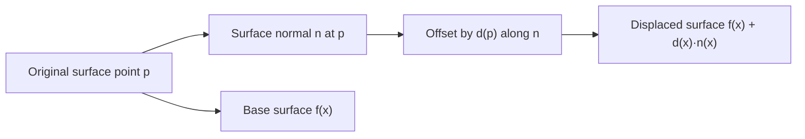

An example of bump mapping is shown in Figure 10.23, which shows part of the San Miguel scene rendered with and without bump mapping. There, the bump map gives the appearance of a substantial amount of detail in the walls and floors that is not actually present in the geometric model. Figure 10.24 shows one of the image maps used to define the bump function in Figure 10.23. The `BumpMap()` function is responsible for computing the effect of bump mapping at the point being shaded given a particular displacement texture. Its implementation is based on finding an approximation to the partial derivatives $\partial\mathbf{p}/\partial u$ and $\partial\mathbf{p}/\partial v$ of the displaced surface and using them in place of the surface’s actual partial derivatives to compute the shading normal. Assume that the original surface is defined by a parametric function $\mathbf{p}(u, v)$, and the bump offset function is a scalar function $d(u, v)$. Then the displaced surface is given by

$$
\mathbf{p}'(u, v) = \mathbf{p}(u, v) + d(u, v)\,\mathbf{n}(u, v),
$$

where $\mathbf{n}(u, v)$ is the surface normal at $(u, v)$. 〈Bump Mapping Function Definitions〉 ≡

```rust
fn bump_map<E: TextureEvaluator>(tex_eval: E, displacement: FloatTexture,
                                 ctx: &NormalBumpEvalContext,
                                 dpdu: &mut Vector3f, dpdv: &mut Vector3f) {
    // 〈Compute offset positions and evaluate displacement texture 689〉
    // 〈Compute bump-mapped differential geometry 690〉
}
```

<details>
<summary>Figure 10.23 — San Miguel with/without bump mapping (pictorial)</summary>

*Figure 10.23: Detail of the San Miguel scene, rendered (a) without bump mapping and (b) with bump mapping. Bump mapping substantially increases the apparent geometric complexity of the model, without the increased rendering time and memory use that would result from a geometric representation with the equivalent amount of small-scale detail. (Scene courtesy of Guillermo M. Leal Llaguno.)*


</details>

<details>
<summary>Figure 10.24 — Bump map image for the tiles in San Miguel (pictorial)</summary>

*Figure 10.24: The image used as a bump map for the tiles in the San Miguel rendering in Figure 10.23.*

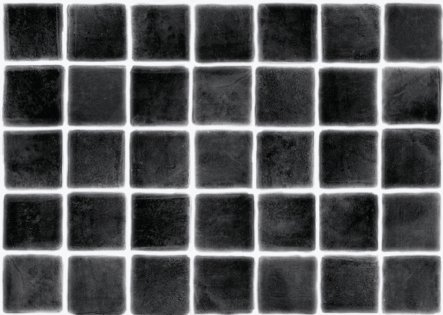

</details>

The partial derivatives of $\mathbf{p}'$ can be found using the chain rule. For example, the partial derivative in $u$ is

$$
\frac{\partial\mathbf{p}'}{\partial u}
= \frac{\partial\mathbf{p}}{\partial u}
+ \frac{\partial d}{\partial u}\,\mathbf{n}
+ d\,\frac{\partial\mathbf{n}}{\partial u}.
\tag{10.11}
$$

We have already computed the value of $\partial\mathbf{p}(u, v)/\partial u$; it is $\partial\mathbf{p}/\partial u$ and is available in the `TextureEvalContext` structure, which also stores the surface normal $\mathbf{n}(u, v)$ and the partial derivative $\partial\mathbf{n}(u, v)/\partial u = \partial\mathbf{n}/\partial u$. The displacement function $d(u, v)$ can be readily evaluated, which leaves $\partial d(u, v)/\partial u$ as the only remaining term. There are two possible approaches to finding the values of $\partial d(u, v)/\partial u$ and $\partial d(u, v)/\partial v$. One option would be to augment the `FloatTexture` interface with a method to compute partial derivatives of the underlying texture function. For example, for image map textures mapped to the surface directly using its $(u, v)$ parameterization, these partial derivatives can be computed by subtracting adjacent texels in the $u$ and $v$ directions. However, this approach is difficult to extend to complex procedural textures like some of the ones defined earlier in this chapter. Therefore, pbrt directly computes these values with forward differencing, without modifying the `FloatTexture` interface.

Recall the definition of the partial derivative:

$$
\frac{\partial d}{\partial u}
= \lim_{\Delta u \to 0}\frac{d(u + \Delta u, v) - d(u, v)}{\Delta u}.
$$

Forward differencing approximates the value using a finite value of $\Delta u$ and evaluating $d(u, v)$ at two positions. Thus, the final expression for $\partial\mathbf{p}'/\partial u$ is the following (for simplicity, we have dropped the explicit dependence on $(u, v)$ for some of the terms):

$$
\frac{\partial\mathbf{p}'}{\partial u}
\approx \frac{\partial\mathbf{p}}{\partial u}
+ \frac{d(u + \Delta u, v) - d(u, v)}{\Delta u}\,\mathbf{n}
+ d\,\frac{\partial\mathbf{n}}{\partial u}.
\tag{10.12}
$$

Interestingly enough, most bump-mapping implementations ignore the final term under the assumption that $d(u, v)$ is expected to be relatively small. (Since bump mapping is mostly useful for approximating small perturbations, this is a reasonable assumption.) The fact that many renderers do not compute the values $\partial\mathbf{n}/\partial u$ and $\partial\mathbf{n}/\partial v$ may also have something to do with this simplification. An implication of ignoring the last term is that the magnitude of the displacement function then does not affect the bump-mapped partial derivatives; adding a constant value to it globally does not affect the final result, since only differences of the bump function affect it. pbrt computes all three terms since it has $\partial\mathbf{n}/\partial u$ and $\partial\mathbf{n}/\partial v$ readily available, although in practice this final term rarely makes a visually noticeable difference. 〈Compute offset positions and evaluate displacement texture〉 ≡ 687

```rust
let mut shifted_ctx = *ctx;
// 〈Shift shiftedCtx du in the u direction 690〉
let u_displace = tex_eval.call(displacement, (&shifted_ctx).into());
// 〈Shift shiftedCtx dv in the v direction〉
let v_displace = tex_eval.call(displacement, (&shifted_ctx).into());
let displace = tex_eval.call(displacement, (ctx).into());
```

One remaining issue is how to choose the offsets $\Delta u$ and $\Delta v$ for the finite differencing computations. They should be small enough that fine changes in $d(u, v)$ are captured but large enough so that available floating-point precision is sufficient to give a good result. Here, we will choose $\Delta u$ and $\Delta v$ values that lead to an offset that is about half the image-space pixel sample spacing and use them to update the appropriate member variables in the `TextureEvalContext` to reflect a shift to the offset position.

<details>
<summary>Index / reference entries (from the printed index)</summary>

- `Float` 23
- `TextureEvalContext` 650

</details>

〈Shift shiftedCtx du in the u direction〉 ≡ 689

```rust
let mut du = 0.5 * (ctx.dudx.abs() + ctx.dudy.abs());
if du == 0.0 { du = 0.0005; }
shifted_ctx.p = ctx.p + du * ctx.shading.dpdu;
shifted_ctx.uv = ctx.uv + Vector2f(du, 0.0);
```

The 〈Shift shiftedCtx dv in the v direction〉 fragment is nearly the same as the fragment that shifts `du`, so it is not included here. Given the new positions and the displacement texture’s values at them, the partial derivatives can be computed directly using Equation (10.12):

〈Compute bump-mapped differential geometry〉 ≡ 687

```rust
*dpdu = ctx.shading.dpdu
    + (u_displace - displace) / du * Vector3f::from(ctx.shading.n)
    + displace * Vector3f::from(ctx.shading.dndu);
*dpdv = ctx.shading.dpdv
    + (v_displace - displace) / dv * Vector3f::from(ctx.shading.n)
    + displace * Vector3f::from(ctx.shading.dndv);
```

## FURTHER READING

**Ray Footprints** The cone-tracing method of Amanatides (1984) was one of the first techniques for automatically estimating filter footprints for ray tracing. The beam-tracing algorithm of Heckbert and Hanrahan (1984) was another early extension of ray tracing to incorporate an area associated with each image sample rather than just an infinitesimal ray. The pencil-tracing method of Shinya et al. (1987) is another approach to this problem. Other related work on the topic of associating areas or footprints with rays includes Mitchell and Hanrahan’s paper (1992) on rendering caustics and Turkowski’s technical report (1993). Collins (1994) estimated the ray footprint by keeping a tree of all rays traced from a given camera ray, examining corresponding rays at the same level and position. The ray differentials used in pbrt are based on Igehy’s (1999) formulation, which was extended by Suykens and Willems (2001) to handle glossy reflection in addition to perfect specular reflection. Belcour et al. (2017) applied Fourier analysis to the light transport equation in order to accurately and efficiently track ray footprints after scattering. Twelve floating-point values are required to store ray differentials, and Belcour et al.’s approach has similar storage requirements. This poses no challenge in a CPU ray tracer that only operates on one or a few rays at a time, but can add up to a considerable amount of storage (and consequently, bandwidth consumption) on the GPU. To address this issue, Akenine-Möller et al. (2019) developed a number of more space-efficient alternatives and showed their effectiveness for antialiasing that was further improved in subsequent work (Akenine-Möller et al. 2021; Boksansky et al. 2021). The approach we have implemented in `CameraBase::Approximate_dp_dxy()` was described by Li (2018).

Worley’s chapter in *Texturing and Modeling* (Ebert et al. 2003) on computing differentials for filter regions presents an approach similar to ours. See Elek et al. (2014) for an extension of ray differentials to include wavelength, which can improve results with spectral rendering.

**Image Texture Maps** Two-dimensional texture mapping with images was first introduced to graphics by Blinn and Newell (1976). Ever since Crow (1977) identified aliasing as the source of many errors in images in graphics, much work has been done to find efficient and effective ways of antialiasing image maps. Dungan, Stenger, and Sutty (1978) were the first to suggest creating a pyramid of prefiltered texture images; they used the nearest texture sample at the appropriate level when looking up texture values, using supersampling in screen space to antialias the result. Feibush, Levoy, and Cook (1980) investigated a spatially varying filter function, rather than a simple box filter. (Blinn and Newell were aware of Crow’s results and used a box filter for their textures.) Williams (1983) used a MIP map image pyramid for texture filtering with trilinear interpolation. Shortly thereafter, Crow (1984) introduced summed area tables, which make it possible to efficiently filter over axis-aligned rectangular regions of texture space. Summed area tables handle anisotropy better than Williams’s method, although only for primarily axis-aligned filter regions. Heckbert (1986) wrote a good survey of early texture mapping algorithms. Greene and Heckbert (1986) originally developed the elliptically weighted average technique, and Heckbert’s master’s thesis (1989b) put the method on a solid theoretical footing. Fournier and Fiume (1988) developed an even higher-quality texture filtering method that focuses on using a bounded amount of computation per lookup. Nonetheless, their method appears to be less efficient than EWA overall. Lansdale’s master’s thesis (1991) has an extensive description of EWA and Fournier and Fiume’s method, including implementation details. A number of researchers have investigated generalizing Williams’s original method using a series of trilinear MIP map samples in an effort to increase quality without having to pay the price for the general EWA algorithm. By taking multiple samples from the MIP map, anisotropy is handled well while preserving the computational efficiency. Examples include Barkans’s (1997) description of texture filtering in the Talisman architecture, McCormack et al.’s (1999) Feline method, and Cant and Shrubsole’s (2000) technique. Manson and Schaefer (2013, 2014) have shown how to accurately approximate a variety of filter functions with a fixed small number of bilinearly interpolated sample values. An algorithm to convert an arbitrary filter into a set of bilinear lookups over multiple passes subject to a specified performance target was given by Schuster et al. (2020). These sorts of approaches are particularly useful on GPUs, where hardware-accelerated bilinear interpolation is available.

For scenes with many image textures where reading them all into memory simultaneously has a prohibitive memory cost, an effective approach can be to allocate a fixed amount of memory for image maps (a texture cache), load textures into that memory on demand, and discard the image maps that have not been accessed recently when the memory fills up (Peachey 1990). To enable good performance with small texture caches, image maps should be stored in a tiled format that makes it possible to load in small square regions of the texture independently of each other. Tiling techniques like these are used in graphics hardware to improve the performance of their texture memory caches (Hakura and Gupta 1997; Igehy et al. 1998, 1999). High-performance texture caching with parallel execution can be challenging because the cache contents may be frequently updated; it is desirable to minimize mutual exclusion in the cache implementation so that threads do not stall while others are updating the cache. For an effective approach to this problem, see Pharr (2017), who applied the read-copy update technique (McKenney and Slingwine 1998) to accomplish this. Smith’s (2002) website and document on audio resampling gives a good overview of resampling signals in one dimension. Heckbert’s (1989a) zoom source code is the canonical reference for image resampling. His implementation carefully avoids feedback without using auxiliary storage. A variety of texture synthesis algorithms have been developed that take an example texture image and then synthesize larger texture images that appear similar to the original texture while not being exactly the same. Survey articles by Wei et al. (2009) and Barnes and Zhang (2017) summarize work in this area. Convolutional neural networks have been applied to this task (Gatys et al. 2015; Sendik and Cohen-Or 2017), giving impressive results, and Frühstück et al. (2019) have showed the effectiveness of generative adversarial networks for this problem.

**Solid Texturing and Noise Functions** Three-dimensional solid texturing was originally developed by Gardner (1984, 1985), Perlin (1985a), and Peachey (1985). Norton, Rockwood, and Skolmoski (1982) developed the clamping method that is widely used for antialiasing textures based on solid texturing. The general idea of procedural texturing, where texture is generated via computation rather than via looking up values from images, was introduced by Cook (1984), Perlin (1985a), and Peachey (1985). Noise functions, which randomly vary while still having limited frequency content, have been a key ingredient for many procedural texturing techniques. Perlin (1985a) introduced the first such noise function, and later revised it to correct a number of subtle shortcomings (Perlin 2002). (See also Kensler et al. (2008) for further improvements.) Many more noise functions have been developed; see Lagae et al. (2010) for a survey of work up to that year. Tricard et al. (2019) recently introduced a noise function (“phasor noise”) that can be filtered anisotropically and allows control of the orientation, frequency, and contrast of the noise function. Their paper also includes citations to other recent work on this topic. In recent years, the Shadertoy website, shadertoy.com, has become a hub of creative application of procedural modeling and texturing, all of it running interactively in web browsers. Shadertoy was developed by Quilez and Jeremias (2021).

**Shading Languages** The first languages and systems that supported the idea of user-supplied procedural shaders were developed by Cook (1984) and Perlin (1985a). (The texture composition model in this chapter is similar to Cook’s shade trees.) The RenderMan shading language, described in a paper by Hanrahan and Lawson (1990), remains the classic shading language in graphics, though a more modern shading language is available in Open Shading Language (OSL) (Gritz et al. 2010), which is open source and increasingly used for production rendering. It follows pbrt’s model of the shader returning a representation of the material rather than a final color value. See also Karrenberg et al. (2010), who introduced the AnySL shading language, which was designed for high performance as well as portability across multiple rendering systems (including pbrt).

See Ebert et al. (2003) and Apodaca and Gritz (2000) for techniques for writing procedural shaders; both of those have excellent discussions of issues related to antialiasing in procedural shaders.

**Normal Mapping, Bump Mapping, and Shading Normals** Blinn (1978) invented the bump-mapping technique. Kajiya (1985) generalized the idea of bump mapping the normal to frame mapping, which also perturbs the surface’s primary tangent vector and is useful for controlling the appearance of anisotropic reflection models. Normal mapping was introduced by Cohen et al. (1998). Mikkelsen’s thesis (2008) carefully investigates a number of the assumptions underlying bump mapping and normal mapping, proposes generalizations, and addresses a number of subtleties with respect to its application to real-time rendering. One visual shortcoming of normal and bump mapping is that those techniques do not naturally account for self-shadowing, where bumps cast shadows on the surface and prevent light from reaching nearby points. These shadows can have a significant impact on the appearance of rough surfaces. Max (1988) developed the horizon mapping technique, which efficiently accounts for this effect through precomputed information about each bump map. More recently, Conty Estevez et al. and Chiang et al. have introduced techniques based on microfacet shadowing functions to improve the visual fidelity of bump-mapped surfaces at shadow terminators (Conty Estevez et al. 2019, Chiang et al. 2019). Another challenging issue is that antialiasing bump and normal maps that have higher-frequency detail than can be represented in the image is quite difficult. In particular, it is not enough to remove high-frequency detail from the underlying function, but in general the `BSDF` needs to be modified to account for this detail. Fournier (1992) applied normal distribution functions to this problem, where the surface normal was generalized to represent a distribution of normal directions. Becker and Max (1993) developed algorithms for blending between bump maps and BRDFs that represented higher-frequency details. Schilling (1997, 2001) investigated this issue particularly for application to graphics hardware. Effective approaches to filtering bump maps were developed by Han et al. (2007) and Olano and Baker (2010). Both Dupuy et al. (2013) and Hery et al. (2014) developed techniques that convert displacements into anisotropic distributions of Beckmann microfacets. Further improvements to these approaches were introduced by Kaplanyan et al. (2016), Tokuyoshi and Kaplanyan (2019), and Wu et al. (2019). A number of researchers have looked at the issue of antialiasing surface reflection functions. Early work in this area was done by Amanatides, who developed an algorithm to detect specular aliasing for a specific BRDF model (Amanatides 1992). Van Horn and Turk (2008) developed an approach to automatically generate MIP maps of reflection functions that represent the characteristics of shaders over finite areas in order to antialias them. Bruneton and Neyret (2012) surveyed the state of the art in this area, and Jarabo et al. (2014b) also considered perceptual issues related to filtering inputs to these functions. See also Heitz et al. (2014) for further work on this topic.

**Displacement Mapping** An alternative to bump mapping is displacement mapping, where the bump function is used to actually modify the surface geometry, rather than just perturbing the normal (Cook 1984; Cook et al. 1987). Advantages of displacement mapping include geometric detail on object silhouettes and the possibility of accounting for self-shadowing. Patterson and collaborators described an innovative algorithm for displacement mapping with ray tracing where the geometry is unperturbed, but the ray’s direction is modified such that the intersections that are found are the same as would be found with the displaced geometry (Patterson, Hoggar, and Logie 1991; Logie and Patterson 1994). Heidrich and Seidel (1998) developed a technique for computing direct intersections with procedurally defined displacement functions. One approach for displacement mapping has been to use an implicit function to define the displaced surface and to then take steps along rays until a zero crossing with the implicit function is found—this point is an intersection. This approach was first introduced by Hart (1996); see Donnelly (2005) for information about using this approach for displacement mapping on the GPU. (This approach was more recently popularized by Quilez (2015) on the Shadertoy website.) Another option is to finely tessellate the scene geometry and displace its vertices to define high-resolution meshes. Pharr and Hanrahan (1996) described an approach to this problem based on geometry caching, and Wang et al. (2000) described an adaptive tessellation algorithm that reduces memory requirements. Smits, Shirley, and Stark (2000) lazily tessellate individual triangles, saving a substantial amount of memory. Measuring fine-scale surface geometry of real surfaces to acquire bump or displacement maps can be challenging. Johnson et al. (2011) developed a novel handheld system that can measure detail down to a few microns, which more than suffices for these uses.

**Material Models** Burley’s (2012) course notes describe a material model developed at Disney for feature films. This write-up includes extensive discussion of features of real-world reflection functions that can be observed in Matusik et al.’s (2003b) measurements of one hundred BRDFs and analyzes the ways that existing BRDF models do and do not fit these features well. These insights are then used to develop an “artist-friendly” material model that can express a wide range of surface appearances. The model describes reflection with a single color and ten scalar parameters, all of which are in the range $[0, 1]$ and have fairly predictable effects on the appearance of the resulting material. An earlier material model designed to have intuitive parameters for artistic control was developed by Strauss (1990). The bidirectional texture function (BTF) is a generalization of the BRDF that was introduced by Dana et al. (1999). (BTFs are also referred to as spatially varying BRDFs (SVBRDFs).) It is a six-dimensional reflectance function that adds two dimensions to account for spatial variation to the BSDF. pbrt’s material model can thus be seen as imposing a particular factorization of the BTF where variation due to the spatial dimension is incorporated into textures that in turn provide values for a parametric BSDF that defines the directional distribution. The BTF representation is especially useful for material acquisition, as it does not impose a particular representation or specific factorization of the six dimensions. The survey articles on BTF acquisition and representation by Müller et al. (2005) and Filip and Haindl (2009) have good coverage of earlier work in this area. Rainer et al. (2019) recently trained a neural network to represent a given BTF; network evaluation took the position and lighting directions as parameters and returned the corresponding BTF value. This work was subsequently generalized with a technique based on training a single network that provides a parameterization to which given BTFs can easily be mapped (Rainer et al. 2020). Kuznetsov et al. (2021) also used a neural approach, developing a compact representation that allowed 7D queries of position, two directions, and a filter size.

## EXERCISES

- **➋ 10.1** Read the papers by Manson and Schaefer (2013, 2014) on approximating high-quality filters with MIP maps and a small number of bilinear samples. Add an option to use their method for texture filtering in place of the EWA implementation currently in pbrt. Compare image quality for a number of scenes that use textures. How does running time compare? You may also find it beneficial to use a profiler to compare the amount of time it takes to run texture filtering code for each of the two approaches.
- **➋ 10.2** An additional advantage of properly antialiased image map lookups is that they improve cache performance. Consider, for example, the situation of undersampling a high-resolution image map: nearby samples on the screen will access widely separated parts of the image map, such that there is low probability that texels fetched from main memory for one texture lookup will already be in the cache for texture lookups at adjacent pixel samples. Modify pbrt so that it always does image texture lookups from the finest level of the `MIPMap`, being careful to ensure that the same number of texels are still being accessed. How does performance change? What do cache-profiling tools report about the overall change in effectiveness of the CPU cache?
- **➋ 10.3** Read Worley’s paper that describes a noise function with substantially different visual characteristics than Perlin noise (Worley 1996). Implement this cellular noise function, and add `Texture`s to pbrt that are based on it.
- **➌ 10.4** Read some of the papers on filtering bump maps referenced in the “Further Reading” section of this chapter, choose one of the techniques described there, and implement it in pbrt. Show the visual artifacts from bump map aliasing without the technique you implement, as well as examples of how well your implementation addresses them.
- **➌ 10.5** Modify pbrt to support a shading language to allow user-written programs to compute texture values. Unless you are also interested in writing your own compiler, OSL (Gritz et al. 2010) is a good choice.

<details>
<summary>Index / reference entries (from the printed index)</summary>

- `Texture` 655

</details>

[^1]: Igehy’s formulation is slightly different from the one here—he effectively tracked the differences between the main ray and the offset rays, while we store the offset rays explicitly. The mathematics all work out to be the same in the end; we chose this alternative because we believe that it makes the algorithm’s operation for camera rays easier to understand.

[^2]: One simplification that is present in this ideal filtering process is the implicit assumption that the texture function makes a linear contribution to frequency content in the image, so that filtering out its high frequencies removes high frequencies from the image. This is true for many uses of textures—for example, if an image map is used to modulate the diffuse term of a `DiffuseMaterial`. However, if a texture is used to determine the roughness of a glossy specular object, for example, this linearity assumption is incorrect, since a linear change in the roughness value has a nonlinear effect on the reflected radiance from the microfacet BRDF. We will ignore this issue here, since it is not easily solved in general. The “Further Reading” section has more discussion of this topic.

[^3]: The term *texture map* is often used to refer to this type of texture, although this usage blurs the distinction between the mapping that computes texture coordinates and the texture function itself.

[^4]: The name “MIP map” comes from the Latin *multum in parvo*, which means “much in little,” a nod to the image pyramid.

[^5]: Heckbert’s thesis has the original derivation (Heckbert 1989b, p. 80): $A$ and $C$ have an extra term of 1 added to them so the ellipse is a minimum of one texel separation wide. This ensures that the ellipse will not fall between the texels when magnifying at the most detailed level.

---

[↑ Back to top](#contents)
