# Chapter 11: Volume Scattering

<!-- interactive-nav -->
## Contents

- [Volume Scattering (wgpu)](#volume-scattering-wgpu)
- [11.1 Volume Scattering Processes](#111-volume-scattering-processes)
  - [11.1.1 Absorption](#1111-absorption)
  - [11.1.2 Emission](#1112-emission)
  - [11.1.3 Out Scattering and Attenuation](#1113-out-scattering-and-attenuation)
  - [11.1.4 In Scattering](#1114-in-scattering)
- [11.2 Transmittance](#112-transmittance)
  - [11.2.1 Null Scattering](#1121-null-scattering)
- [11.3 Phase Functions](#113-phase-functions)
  - [11.3.1 The Henyey–Greenstein Phase Function](#1131-the-henyeygreenstein-phase-function)
- [11.4 Media](#114-media)
  - [11.4.1 `Medium` Interface](#1141-medium-interface)
  - [11.4.2 Homogeneous Medium](#1142-homogeneous-medium)
  - [11.4.3 DDA Majorant Iterator](#1143-dda-majorant-iterator)
  - [11.4.4 Uniform Grid Medium](#1144-uniform-grid-medium)
  - [11.4.5 RGB Grid Medium](#1145-rgb-grid-medium)
- [Notes](#notes)
- [Further Reading](#further-reading)
- [Exercises](#exercises)

---

## Volume Scattering (wgpu)

The diagram below summarizes the volume-scattering sampling loop that a wgpu path tracer runs in a compute shader: a ray samples a free-flight distance, an event is classified as a true or a null scattering event, and transmittance is accumulated until the ray exits the medium.

```mermaid
flowchart TD
    R[Ray through participating medium] --> S[Sample free path: SampleExponential with sigma_maj]
    S --> E{Event type at p + t*omega}
    E -->|True scattering| P[Apply phase function p(omega, omega')]
    E -->|Null scattering| N[Ignore event; continue from sampled point]
    E -->|Sampled past endpoint| T[Accumulate transmittance / exit]
    P --> A[Accumulate in-scattered radiance]
    A --> R
    N --> R
    T --> O[Final radiance or shadow factor]
```

We have assumed so far that scenes are made up of collections of surfaces in a vacuum, which means that radiance is constant along rays between surfaces. However, there are many real-world situations where this assumption is inaccurate: fog and smoke attenuate and scatter light, and scattering from particles in the atmosphere makes the sky blue and sunsets red. This chapter introduces the mathematics that describe how light is affected as it passes through participating media—large numbers of very small particles distributed throughout a region of 3D space. These volume scattering models in computer graphics are based on the assumption that there are so many particles that scattering is best modeled as a probabilistic process rather than directly accounting for individual interactions with particles. Simulating the effect of participating media makes it possible to render images with atmospheric haze, beams of light through clouds, light passing through cloudy water, and subsurface scattering, where light exits a solid object at a different place than where it entered.

This chapter first describes the basic physical processes that affect the radiance along rays passing through participating media, including the phase function, which characterizes the distribution of light scattered at a point in space. (It is the volumetric analog to the BSDF.) It then introduces transmittance, which describes the attenuation of light in participating media. Computing unbiased estimates of transmittance can be tricky, so we then discuss null scattering, a mathematical formalism that makes it easier to sample scattering integrals like the one that describes transmittance. Next, the `Medium` interface is defined; it is used for representing the properties of participating media in a region of space. `Medium` implementations provide information about the scattering properties at points in their extent. This chapter does not cover techniques related to computing lighting and the effect of multiple scattering in volumetric media; the associated Monte Carlo integration algorithms and implementations of `Integrator`s that handle volumetric effects will be the topic of Chapter 14.

---

## 11.1 VOLUME SCATTERING PROCESSES

There are three main physical processes that affect the distribution of radiance in an environment with participating media:

- **Absorption:** the reduction in radiance due to the conversion of light to another form of energy, such as heat.
- **Emission:** radiance that is added to the environment from luminous particles.
- **Scattering:** radiance heading in one direction that is scattered to other directions due to collisions with particles.

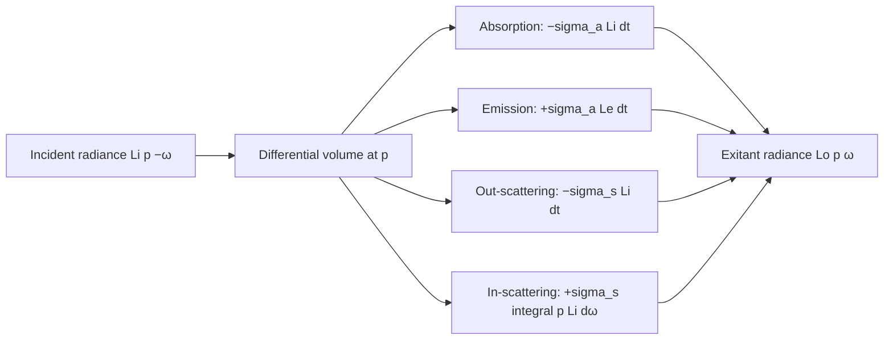

<details>
<summary>Book-edition cross-references</summary>

`Integrator` 22 · `Medium` 714

</details>

**Figure 11.1 — Dragon Illuminated by a Spotlight through Fog.** Light scattering from particles in the medium back toward the camera makes the spotlight's illumination visible even in pixels where there are no visible surfaces that reflect it. The dragon blocks light, casting a volumetric shadow on the right side of the image. (Dragon model courtesy of the Stanford Computer Graphics Laboratory.)

<details>
<summary>Pictorial figure: <code>images/img-1095-235.png</code></summary>

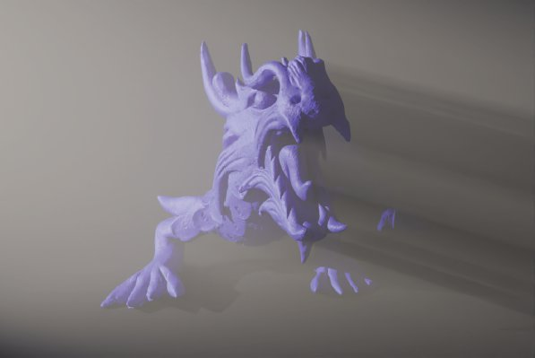

</details>

The characteristics of all of these properties may be homogeneous or inhomogeneous. Homogeneous properties are constant throughout some region of space, while inhomogeneous properties vary throughout space. Figure 11.1 shows a simple example of volume scattering, where a spotlight shining through a homogeneous participating medium illuminates particles in the medium and casts a volumetric shadow.

All of these processes may have different behavior at different wavelengths of light. While wavelength-dependent emission can be handled in the same way that it is from surface emitters, wavelength-dependent absorption and scattering require special handling in Monte Carlo estimators. We will gloss past those details in this chapter, deferring discussion of them until Section 14.2.2.

Physically, these processes all happen discretely: a photon is absorbed by some particle or it is not. We will nevertheless model all of these as continuous processes, following the same assumptions as underlie our use of radiometry to model light in pbrt (Section 4.1). However, as we apply Monte Carlo to solve the integrals that describe this process, we will end up considering the effect of these processes at particular points in the scene, which we will term scattering events. Note that "scattering events" is a slight misnomer, since absorption is a possibility as well as scattering.

All the models in this chapter are based on the assumption that the positions of the particles are uncorrelated—in other words, that although their density may vary spatially, their positions are otherwise independent. (In the context of the colors of noise introduced in Section 8.1.6, the assumption is a white noise distribution of their positions.) This assumption does not hold for many types of physical media; for example, it is not possible for two particles to both be in the same point in space and so a true white noise distribution is not possible. See the "Further Reading" section at the end of the chapter for pointers to recent work in relaxing this assumption.

### 11.1.1 ABSORPTION

Consider thick black smoke from a fire: the smoke obscures the objects behind it because its particles absorb light traveling from the object to the viewer. The thicker the smoke, the more light is absorbed. Figure 11.2 shows this effect with a realistic cloud model.

Absorption is described by the medium's absorption coefficient, $\sigma_a$, which is the probability density that light is absorbed per unit distance traveled in the medium. (Note that the medium absorption is distinct from the absorption coefficient used in specifying indices of refraction of conductors, as introduced in Section 9.3.6.) It is usually a spectrally varying quantity, though we will neglect the implications of that detail in this chapter and return to them in Section 14.2.2. Its units are reciprocal distance ($\mathrm{m}^{-1}$), which means that $\sigma_a$ can take on any nonnegative value; it is not required to be between 0 and 1, for instance. In general, the absorption coefficient may vary with both position $\mathrm{p}$ and direction $\omega$, although the volume scattering code in pbrt models it as purely a function of position. We will therefore sometimes simplify notation by not including $\omega$ in the use of $\sigma_a$ and other related scattering properties, though it is easy enough to reintroduce when it is relevant.

**Figure 11.2 — Absorbing media appear dark.** (a) A relatively dense medium leads to a more apparent boundary as well as a darker result. (b) A less dense medium gives a softer look, as more light makes it through the medium. (Cloud model courtesy of Walt Disney Animation Studios.)

<details>
<summary>Pictorial figure: <code>images/img-1097-236.png</code></summary>

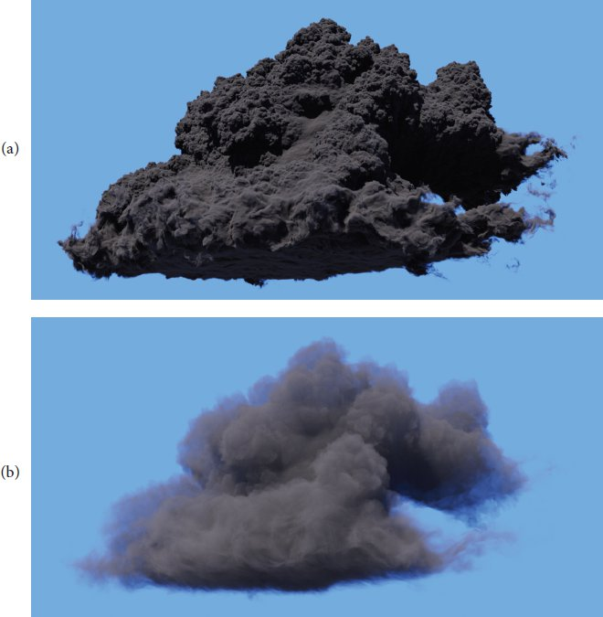

</details>

**Figure 11.3 — Absorption along a differential segment of a ray (diagram).** A ray carrying incident radiance $L_i(\mathrm{p},-\omega)$ arrives at a point $\mathrm{p}$ from direction $-\omega$; the exitant radiance $L_o(\mathrm{p},\omega)$ is reduced by the absorbing particles in a differential cylinder of length $\mathrm{d}t$. The change is $\mathrm{d}L_o(\mathrm{p},\omega) = -\sigma_a(\mathrm{p},\omega)L_i(\mathrm{p},-\omega)\,\mathrm{d}t$.

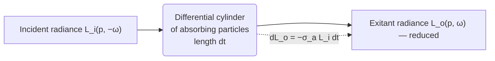

Figure 11.3 shows the effect of absorption along a very short segment of a ray. Some amount of radiance $L_i(\mathrm{p},-\omega)$ is arriving at point $\mathrm{p}$, and we would like to find the exitant radiance $L_o(\mathrm{p},\omega)$ after absorption in the differential volume. This change in radiance along the differential ray length $\mathrm{d}t$ is described by the differential equation[^fn1]

$$
L_o(\mathrm{p},\omega) - L_i(\mathrm{p},-\omega)
= \mathrm{d}L_o(\mathrm{p},\omega)
= -\sigma_a(\mathrm{p},\omega)\,L_i(\mathrm{p},-\omega)\,\mathrm{d}t,
$$

which says that the differential reduction in radiance along the beam is a linear function of its initial radiance. (This is another instance of the linearity assumption in radiometry: the fraction of light absorbed does not vary based on the ray's radiance, but is always a fixed fraction.)

This differential equation can be solved to give the integral equation describing the total fraction of light absorbed for a ray. If we assume that the ray travels a distance $d$ in direction $\omega$ through the medium starting at point $\mathrm{p}$, the surviving portion of the original radiance is given by

$$
L_o(\mathrm{p},\omega)
= \exp\!\left(-\int_0^d \sigma_a(\mathrm{p}+t\omega,\omega)\,\mathrm{d}t\right)
\,L_i(\mathrm{p}-d\omega,\omega).
$$

### 11.1.2 EMISSION

While absorption reduces the amount of radiance along a ray as it passes through a medium, emission increases it due to chemical, thermal, or nuclear processes that convert energy into visible light. Figure 11.4 shows emission in a differential volume, where we denote emitted radiance added to a ray per unit distance at a point $\mathrm{p}$ in direction $\omega$ by $\sigma_a(\mathrm{p},\omega)L_e(\mathrm{p},\omega)$. Figure 11.5 shows the effect of emission with a data set from a physical simulation of an explosion.

The differential equation that gives the change in radiance due to emission is

$$
\mathrm{d}L_o(\mathrm{p},\omega) = \sigma_a(\mathrm{p},\omega)\,L_e(\mathrm{p},\omega)\,\mathrm{d}t.
\tag{11.1}
$$

The presence of $\sigma_a$ on the right hand side stems from the connection between how efficiently an object absorbs light and how efficiently it emits it, as was introduced in Section 4.4.1. That factor also ensures that the corresponding term has units of radiance when the differential equation is converted to an integral equation.

**Figure 11.4 — Emission in a differential volume (diagram).** The volume emission function $L_e(\mathrm{p},\omega)$ gives the change in radiance along a ray passing through a differential volume of emissive particles; the change per differential distance is given by Equation (11.1) above.

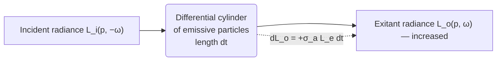

**Figure 11.5 — A participating medium where the dominant volumetric effect is emission.** (Scene courtesy of Jim Price.)

<details>
<summary>Pictorial figure: <code>images/img-1100-239.png</code></summary>


</details>

Note that this equation incorporates the assumption that the emitted light $L_e$ is not dependent on the incoming light $L_i$. This is always true under the linear optics assumptions that pbrt is based on.

### 11.1.3 OUT SCATTERING AND ATTENUATION

The third basic light interaction in participating media is scattering. As a ray passes through a medium, it may collide with particles and be scattered in different directions. This has two effects on the total radiance that the beam carries. It reduces the radiance exiting a differential region of the beam because some of it is deflected to different directions. This effect is called out scattering (Figure 11.6) and is the topic of this section. However, radiance from other rays may be scattered into the path of the current ray; this in-scattering process is the subject of the next section. We will sometimes say that these two forms of scattering are real scattering, to distinguish them from null scattering, which will be introduced in Section 11.2.1.

**Figure 11.6 — Out scattering (diagram).** Like absorption, out scattering reduces the radiance along a ray. Light that hits particles may be scattered in another direction such that the radiance exiting the region in the original direction is reduced.

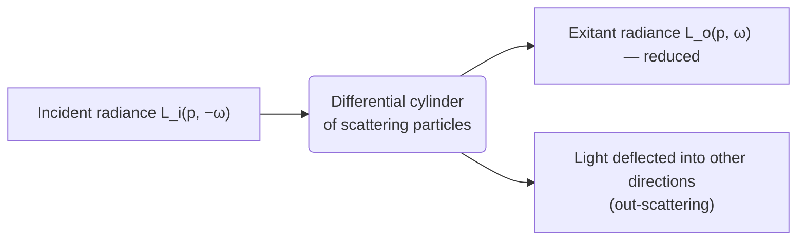

The probability of an out-scattering event occurring per unit distance is given by the scattering coefficient, $\sigma_s$. Similar to absorption, the reduction in radiance along a differential length $\mathrm{d}t$ due to out scattering is given by

$$
\mathrm{d}L_o(\mathrm{p},\omega) = -\sigma_s(\mathrm{p},\omega)\,L_i(\mathrm{p},-\omega)\,\mathrm{d}t.
$$

The total reduction in radiance due to absorption and out scattering is given by the sum $\sigma_a + \sigma_s$. This combined effect of absorption and out scattering is called attenuation or extinction. The sum of these two coefficients is denoted by the attenuation coefficient $\sigma_t$:

$$
\sigma_t(\mathrm{p},\omega) = \sigma_a(\mathrm{p},\omega) + \sigma_s(\mathrm{p},\omega).
$$

Two values related to the attenuation coefficient will be useful in the following. The first is the single-scattering albedo, which is defined as

$$
\rho(\mathrm{p},\omega) = \frac{\sigma_s(\mathrm{p},\omega)}{\sigma_t(\mathrm{p},\omega)}.
$$

Under the assumptions of radiometry, the single-scattering albedo is always between 0 and 1. It describes the probability of scattering (versus absorption) at a scattering event. The second is the mean free path, $1/\sigma_t(\mathrm{p},\omega)$, which gives the average distance that a ray travels in a medium with attenuation coefficient $\sigma_t(\mathrm{p},\omega)$ before interacting with a particle.

### 11.1.4 IN SCATTERING

While out scattering reduces radiance along a ray due to scattering in different directions, in scattering accounts for increased radiance due to scattering from other directions (Figure 11.7). Figure 11.8 shows the effect of in scattering with the cloud model. There is no absorption there, corresponding to a single scattering albedo of 1. Light thus scatters many times inside the cloud, giving it a very different appearance.

Assuming that the separation between particles is at least a few times the lengths of their radii, it is possible to ignore inter-particle interactions when describing scattering at a particular location. Under this assumption, the phase function $p(\omega,\omega')$ describes the angular distribution of scattered radiation at a point; it is the volumetric analog to the BSDF. The BSDF analogy is not exact, however. For example, phase functions have a normalization constraint: for all $\omega$, the condition

$$
\int_{\mathcal{S}^2} p(\omega,\omega')\,\mathrm{d}\omega' = 1
\tag{11.2}
$$

must hold.[^fn2] This constraint means that phase functions are probability distributions for scattering in a particular direction.

**Figure 11.7 — In scattering (diagram).** In scattering accounts for the increase in radiance along a ray due to scattering of light from other directions. Radiance from outside the differential volume is scattered along the direction of the ray and added to the incoming radiance.

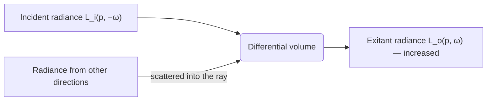

**Figure 11.8 — In scattering with the cloud model.** For these scenes, there is no absorption and only scattering, which gives a substantially different result than the clouds in Figure 11.2. (a) Relatively dense cloud. (b) Thinner cloud. (Cloud model courtesy of Walt Disney Animation Studios.)

<details>
<summary>Pictorial figure: <code>images/img-1103-242.png</code></summary>

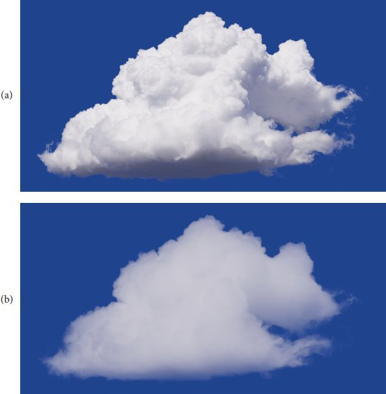

</details>

The total added radiance per unit distance due to in scattering is given by the source function $L_s$:

$$
\mathrm{d}L_o(\mathrm{p},\omega) = \sigma_t(\mathrm{p},\omega)\,L_s(\mathrm{p},\omega)\,\mathrm{d}t.
$$

It accounts for both volume emission and in scattering:

$$
L_s(\mathrm{p},\omega)
= \frac{\sigma_a(\mathrm{p},\omega)}{\sigma_t(\mathrm{p},\omega)}\,L_e(\mathrm{p},\omega)
+ \frac{\sigma_s(\mathrm{p},\omega)}{\sigma_t(\mathrm{p},\omega)}
  \int_{\mathcal{S}^2} p(\mathrm{p},\omega_i,\omega)\,L_i(\mathrm{p},\omega_i)\,\mathrm{d}\omega_i.
\tag{11.3}
$$

The in-scattering portion of the source function is the product of the albedo and the amount of added radiance at a point, which is given by the spherical integral of the product of incident radiance and the phase function. Note that the source function is very similar to the scattering equation, Equation (4.14); the main difference is that there is no cosine term since the phase function operates on radiance rather than differential irradiance.

---

## 11.2 TRANSMITTANCE

The scattering processes in Section 11.1 are all specified in terms of their local effect at points in space. However, in rendering, we are usually interested in their aggregate effects on radiance along a ray, which usually requires transforming the differential equations to integral equations that can be solved using Monte Carlo. The reduction in radiance between two points on a ray due to extinction is a quantity that will often be useful; for example, we will need to estimate this value to compute the attenuated radiance from a light source that is incident at a point on a surface in scenes with participating media.

Given the attenuation coefficient $\sigma_t$, the differential equation that describes extinction,

$$
\frac{\mathrm{d}L_o(\mathrm{p},\omega)}{\mathrm{d}t}
= -\sigma_t(\mathrm{p},\omega)\,L_i(\mathrm{p},-\omega),
\tag{11.4}
$$

can be solved to find the beam transmittance $T_r$, which gives the fraction of radiance that is transmitted between two points:

$$
T_r(\mathrm{p}\to\mathrm{p}')
= \exp\!\left(-\int_0^d \sigma_t(\mathrm{p}+t\omega,\omega)\,\mathrm{d}t\right).
\tag{11.5}
$$

Here $d = \lVert \mathrm{p} - \mathrm{p}' \rVert$ is the distance between $\mathrm{p}$ and $\mathrm{p}'$, and $\omega$ is the normalized direction vector between them. Note that the transmittance is always between 0 and 1. Thus, if exitant radiance from a point $\mathrm{p}$ on a surface in a given direction $\omega$ is given by $L_o(\mathrm{p},\omega)$, then after accounting for extinction the incident radiance at another point $\mathrm{p}'$ in direction $-\omega$ is

$$
T_r(\mathrm{p}\to\mathrm{p}')\,L_o(\mathrm{p},\omega).
$$

This idea is illustrated in Figure 11.9.

**Figure 11.9 — Beam transmittance (diagram).** The beam transmittance $T_r(\mathrm{p}\to\mathrm{p}')$ gives the fraction of light transmitted from one point to another, accounting for absorption and out scattering, but ignoring emission and in scattering. Given exitant radiance at a point $\mathrm{p}$ in direction $\omega$ (e.g., reflected radiance from a surface), the radiance visible at another point $\mathrm{p}'$ along the ray is $T_r(\mathrm{p}\to\mathrm{p}')L_o(\mathrm{p},\omega)$.

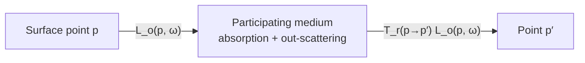

**Figure 11.10 — Shadow-Casting Volumetric Bunny.** The bunny, which is modeled entirely with participating media, casts a shadow on the ground plane because it attenuates light from the sun (which is to the left) on its way to the ground. (Bunny courtesy of the Stanford Computer Graphics Laboratory; volumetric enhancement courtesy of the OpenVDB sample model repository.)

<details>
<summary>Pictorial figure: <code>images/img-1105-244.png</code></summary>

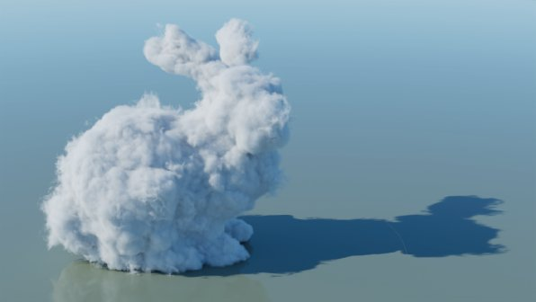

</details>

**Figure 11.11 — Multiplicativity of beam transmittance (diagram).** The transmittance between points $\mathrm{p}$ and $\mathrm{p}''$ equals the transmittance from $\mathrm{p}$ to $\mathrm{p}'$ times the transmittance from $\mathrm{p}'$ to $\mathrm{p}''$, for all points $\mathrm{p}'$ between $\mathrm{p}$ and $\mathrm{p}''$.

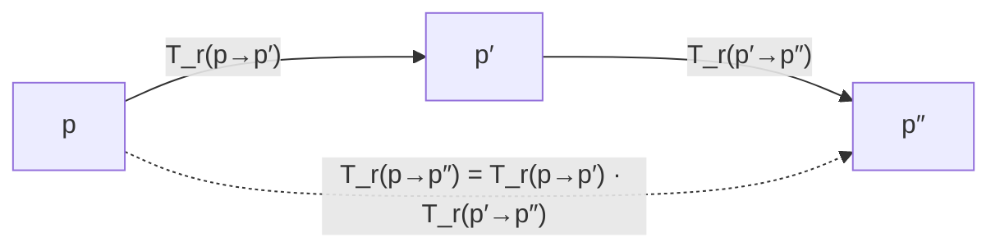

Not only is transmittance useful for modeling the attenuation of light within participating media, but accounting for transmittance along shadow rays makes it possible to accurately model shadowing on surfaces due to the effect of media; see Figure 11.10.

Two useful properties of beam transmittance are that transmittance from a point to itself is 1, $T_r(\mathrm{p}\to\mathrm{p}) = 1$, and in a vacuum $\sigma_t = 0$ and so $T_r(\mathrm{p}\to\mathrm{p}') = 1$ for all $\mathrm{p}'$. Furthermore, if the attenuation coefficient satisfies the directional symmetry $\sigma_t(\omega) = \sigma_t(-\omega)$ or does not vary with direction $\omega$ and only varies as a function of position, then the transmittance between two points is the same in both directions:

$$
T_r(\mathrm{p}\to\mathrm{p}') = T_r(\mathrm{p}'\to\mathrm{p}).
$$

This property follows directly from Equation (11.5).

Another important property, true in all media, is that transmittance is multiplicative along points on a ray:

$$
T_r(\mathrm{p}\to\mathrm{p}'') = T_r(\mathrm{p}\to\mathrm{p}')\,T_r(\mathrm{p}'\to\mathrm{p}''),
\tag{11.6}
$$

for all points $\mathrm{p}'$ between $\mathrm{p}$ and $\mathrm{p}''$ (Figure 11.11). This property is useful for volume scattering implementations, since it makes it possible to incrementally compute transmittance at multiple points along a ray: transmittance from the origin to a point $T_r(\mathrm{o}\to\mathrm{p})$ can be computed by taking the product of transmittance to a previous point $T_r(\mathrm{o}\to\mathrm{p}')$ and the transmittance of the segment between the previous and the current point $T_r(\mathrm{p}'\to\mathrm{p})$.

The negated exponent in the definition of $T_r$ in Equation (11.5) is called the optical thickness between the two points. It is denoted by the symbol $\tau$:

$$
\tau(\mathrm{p}\to\mathrm{p}') = \int_0^d \sigma_t(\mathrm{p}+t\omega,\omega)\,\mathrm{d}t,
\qquad T_r(\mathrm{p}\to\mathrm{p}') = e^{-\tau(\mathrm{p}\to\mathrm{p}')}.
$$

In a homogeneous medium, $\sigma_t$ is a constant, so the integral that defines $\tau$ is trivially evaluated, giving Beer's law:

$$
T_r(\mathrm{p}\to\mathrm{p}') = e^{-\sigma_t d}.
\tag{11.7}
$$

It may appear that a straightforward application of Monte Carlo could be used to compute the beam transmittance in inhomogeneous media. Equation (11.5) consists of a 1D integral over a ray's parametric $t$ position that is then exponentiated; given a method to sample distances along the ray $t'$ according to some distribution $p$, one could evaluate the estimator:

$$
e^{-\int_0^d \sigma_t(\mathrm{p}+t\omega,\omega)\,\mathrm{d}t}
\approx
\exp\!\left[-\frac{\sigma_t(\mathrm{p}+t'\omega,\omega)}{p(t')}\right].
\tag{11.8}
$$

However, even if the estimator in square brackets is an unbiased estimator of the optical thickness along the ray, the estimate of transmittance is *not* unbiased and will actually underestimate its value: $\mathrm{E}[e^{-X}] \ne e^{-\mathrm{E}[X]}$. (This state of affairs is explained by Jensen's inequality and the fact that $e^{-x}$ is a convex function.)

The error introduced by estimators of the form of Equation (11.8) decreases as error in the estimate of the beam transmittance decreases. For many applications, this error may be acceptable—it is still widespread practice in graphics to estimate $\tau$ in some manner, e.g., via a Riemann sum, and then to compute the transmittance that way. However, it is possible to derive an alternative equation for transmittance that allows unbiased estimation; that is the approach used in pbrt.

First, we will consider the change in radiance between two points $\mathrm{p}$ and $\mathrm{p}'$ along the ray. Integrating Equation (11.4) and dropping the directional dependence of $\sigma_t$ for notational simplicity, we can find that

$$
\int_0^d \frac{\mathrm{d}L(\mathrm{p}+t\omega)}{\mathrm{d}t}\,\mathrm{d}t
= L(\mathrm{p}') - L(\mathrm{p})
= -\int_0^d \sigma_t(\mathrm{p}+t\omega)\,L(\mathrm{p}+t\omega)\,\mathrm{d}t.
\tag{11.9}
$$

where, as before, $d$ is the distance between $\mathrm{p}$ and $\mathrm{p}'$ and $\omega$ is the normalized vector from $\mathrm{p}$ to $\mathrm{p}'$.

The transmittance is the fraction of the original radiance, and so $T_r(\mathrm{p}\to\mathrm{p}') = L(\mathrm{p}')/L(\mathrm{p})$. Thus, if we divide Equation (11.9) by $L(\mathrm{p})$ and rearrange terms, we can find that

$$
T_r(\mathrm{p}\to\mathrm{p}')
= 1 - \int_0^d \sigma_t(\mathrm{p}+t\omega)\,
       T_r(\mathrm{p}+t\omega\to\mathrm{p}')\,\mathrm{d}t.
\tag{11.10}
$$

We have found ourselves with transmittance defined recursively in terms of an integral that includes transmittance in the integrand; although this may seem to be making the problem more complex than it was before, this definition makes it possible to apply Monte Carlo to the integral and to compute unbiased estimates of transmittance. However, it is difficult to sample this integrand well; in practice, estimates of it will have high variance. Therefore, the following section will introduce an alternative formulation of it that is amenable to sampling and makes a number of efficient solution techniques possible.

### 11.2.1 NULL SCATTERING

The key idea that makes it possible to derive a more easily sampled transmittance integral is an approach known as null scattering. Null scattering is a mathematical formalism that can be interpreted as introducing an additional type of scattering that does not correspond to any type of physical scattering process but is specified so that it has no effect on the distribution of light. In doing so, null scattering makes it possible to treat inhomogeneous media as if they were homogeneous, which makes it easier to apply sampling algorithms to inhomogeneous media. (In Chapter 14, we will see that it is a key foundation for volumetric light transport algorithms beyond transmittance estimation.)

**Figure 11.12 — Null scattering fills an inhomogeneous medium with fictitious particles.** If the null-scattering coefficient is defined using a majorant $\sigma_{\mathrm{maj}}$ as in Equation (11.11), then (a) an inhomogeneous medium (dark circles) can be interpreted as (b) a medium filled with fictitious particles (light circles) up to a uniform density.

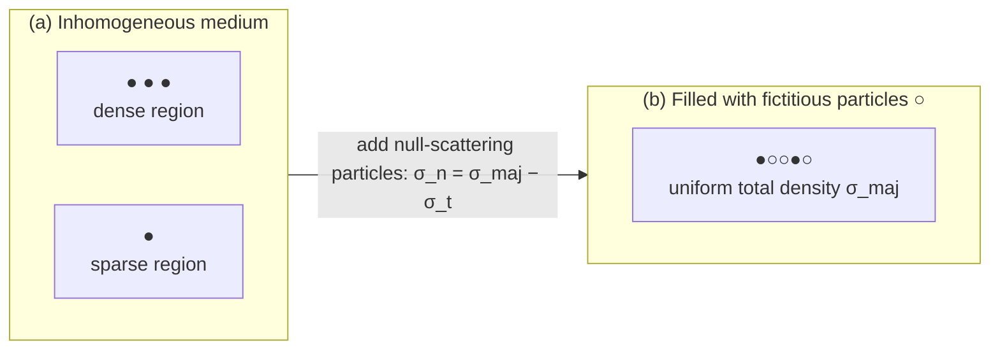

We will start by defining the null-scattering coefficient $\sigma_n$. Similar to the other scattering coefficients, it gives the probability of a null-scattering event per unit distance traveled in the medium. Here, we will define $\sigma_n(\mathrm{p})$ via a constant majorant $\sigma_{\mathrm{maj}}$ that is greater than or equal to $\sigma_a + \sigma_s$ at all points in the medium:[^fn3]

$$
\sigma_n(\mathrm{p},\omega) = \sigma_{\mathrm{maj}} - \sigma_t(\mathrm{p},\omega).
\tag{11.11}
$$

Thus, the total scattering coefficient $\sigma_a + \sigma_s + \sigma_n = \sigma_{\mathrm{maj}}$ is uniform throughout the medium. (This idea is illustrated in Figure 11.12.) With this definition of $\sigma_n$, we can rewrite Equation (11.4) in terms of the majorant and the null-scattering coefficient:

$$
\frac{\mathrm{d}L_o(\mathrm{p},\omega)}{\mathrm{d}t}
= -\bigl(\sigma_{\mathrm{maj}} - \sigma_n(\mathrm{p},\omega)\bigr)\,L_i(\mathrm{p},-\omega).
\tag{11.12}
$$

We will not include the full derivation here, but just as with Equation (11.10), this equation can be integrated over the segment of a ray and divided by the initial radiance $L(\mathrm{p})$ to find an equation for the transmittance. The result is:

$$
T_r(\mathrm{p}\to\mathrm{p}')
= e^{-\sigma_{\mathrm{maj}} d}
+ \int_0^d e^{-\sigma_{\mathrm{maj}} t}\,
  \sigma_n(\mathrm{p}+t\omega)\,
  T_r(\mathrm{p}+t\omega\to\mathrm{p}')\,\mathrm{d}t.
\tag{11.13}
$$

Note that with this expression of transmittance and a homogeneous medium, $\sigma_n = 0$ and the integral disappears. The first term then corresponds to Beer's law. For inhomogeneous media, the first term can be seen as computing an underestimate of the true transmittance, where the integral then accounts for the rest of it.

To compute Monte Carlo estimates of Equation (11.13), we would like to sample a distance $t'$ from some distribution that is proportional to the integrand and then apply the regular Monte Carlo estimator. A convenient sampling distribution is the probability density function (PDF) of the exponential distribution that is derived in Section A.4.2. In this case, the PDF associated with $e^{-\sigma_{\mathrm{maj}} t}$ is

$$
p_{\mathrm{maj}}(t) = \sigma_{\mathrm{maj}}\,e^{-\sigma_{\mathrm{maj}} t},
$$

and a corresponding sampling recipe is available via the `SampleExponential()` function.

<details>
<summary>Book-edition cross-references</summary>

`SampleExponential()` 1003

</details>

Because $p_{\mathrm{maj}}$ is nonzero over the range $[0, \infty)$, the sampling algorithm will sometimes generate samples $t' > d$, which may seem to be undesirable. However, although we could define a PDF for the exponential function limited to $[0, d]$, sampling from $p_{\mathrm{maj}}$ leads to a simple way to terminate the recursive evaluation of transmittance. To see why, consider rewriting the second term of Equation (11.13) as the sum of two integrals that cover the range $[0, \infty)$:

$$
\int_0^d e^{-\sigma_{\mathrm{maj}} t}\,
  \sigma_n(\mathrm{p}+t\omega)\,
  T_r(\mathrm{p}+t\omega\to\mathrm{p}')\,\mathrm{d}t
+ \int_d^{\infty} 0\,\mathrm{d}t.
\tag{11.14}
$$

If the Monte Carlo estimator is applied to this sum, we can see that the value of $t'$ with respect to $d$ determines which integrand is evaluated and thus that sampling $t' > d$ can be conveniently interpreted as a condition for ending the recursive estimation of Equation (11.13).

Given the decision to sample from $p_{\mathrm{maj}}$, perhaps the most obvious approach for estimating the value of Equation (11.13) is to sample $t'$ in this way and to directly apply the Monte Carlo estimator, which gives

$$
T_r(\mathrm{p}\to\mathrm{p}') \approx
e^{-\sigma_{\mathrm{maj}} d}
+ \begin{cases}
\dfrac{\sigma_n(\mathrm{p}+t'\omega)}{\sigma_{\mathrm{maj}}}
  \,T_r(\mathrm{p}+t'\omega\to\mathrm{p}') & t' < d,\\[6pt]
0 & \text{otherwise}.
\end{cases}
\tag{11.15}
$$

This estimator is known as the *next-flight estimator*. It has the advantage that it has zero variance for homogeneous media, although interestingly it is often not as efficient as other estimators for inhomogeneous media.

Other estimators randomly choose between the two terms of Equation (11.13) and only evaluate one of them. If we define $p_e$ as the discrete probability of evaluating the first term, transmittance can be estimated by

$$
T_r(\mathrm{p}\to\mathrm{p}') \approx
\begin{cases}
\dfrac{e^{-\sigma_{\mathrm{maj}} d}}{p_e}
  & \text{with probability } p_e,\\[8pt]
\dfrac{1}{1-p_e}\displaystyle\int_0^d e^{-\sigma_{\mathrm{maj}} t}\,
  \sigma_n(\mathrm{p}+t\omega)\,
  T_r(\mathrm{p}+t\omega\to\mathrm{p}')\,\mathrm{d}t
  & \text{otherwise}.
\end{cases}
\tag{11.16}
$$

The *ratio tracking* estimator is the result from setting $p_e = e^{-\sigma_{\mathrm{maj}} d}$. Then, the first case of Equation (11.16) yields a value of 1. We can further combine the choice between the two cases with sampling $t'$ using the fact that the probability that $t' > d$ is equal to $e^{-\sigma_{\mathrm{maj}} d}$. (This can be seen using $p_{\mathrm{maj}}$'s cumulative distribution function (CDF), Equation (A.1).) After simplifying, the resulting estimator works out to be:

$$
T_r(\mathrm{p}\to\mathrm{p}') \approx
\begin{cases}
1 & t' > d,\\[4pt]
\dfrac{\sigma_n(\mathrm{p}+t'\omega)}{\sigma_{\mathrm{maj}}}
  \,T_r(\mathrm{p}+t'\omega\to\mathrm{p}') & \text{otherwise}.
\end{cases}
\tag{11.17}
$$

If the recursive evaluations are expanded out, ratio tracking leads to an estimator of the form

$$
T_r(\mathrm{p}\to\mathrm{p}') \approx \prod_{i}^{n}
\frac{\sigma_n(\mathrm{p}+t_i\omega)}{\sigma_{\mathrm{maj}}},
$$

where $t_i$ are the series of $t$ values that are sampled from $p_{\mathrm{maj}}$ and where successive $t_i$ values are sampled starting from the previous one until one is sampled past the endpoint. Ratio tracking is the technique that is implemented to compute transmittance in pbrt's light transport routines in Chapter 14.

A disadvantage of ratio tracking is that it continues to sample the medium even after the transmittance has become very small. Russian roulette can be used to terminate recursive evaluation to avoid this problem. If the Russian roulette termination probability at each sampled point is set to be equal to the ratio of $\sigma_n$ and $\sigma_{\mathrm{maj}}$, then the scaling cancels and the estimator becomes

$$
T_r(\mathrm{p}\to\mathrm{p}') \approx
\begin{cases}
1 & t' > d,\\[4pt]
T_r(\mathrm{p}+t'\omega\to\mathrm{p}')
  & t' \le d \text{ and with probability }
    \dfrac{\sigma_n(\mathrm{p}+t'\omega)}{\sigma_{\mathrm{maj}}},\\[10pt]
0 & \text{otherwise}.
\end{cases}
\tag{11.18}
$$

Thus, recursive estimation of transmittance continues either until termination due to Russian roulette or until the sampled point is past the endpoint. This approach is the *track-length transmittance estimator*, also known as *delta tracking*.

A physical interpretation of delta tracking is that it randomly decides whether the ray interacts with a true particle or a fictitious particle at each scattering event. Interactions with fictitious particles (corresponding to null scattering) are ignored and the algorithm continues, restarting from the sampled point. Interactions with true particles cause extinction, in which case 0 is returned. If a ray makes it through the medium without extinction, the value 1 is returned.

Delta tracking can also be used to sample positions $t$ along a ray with probability proportional to $\sigma_t(t)T_r(t)$. The algorithm is given by the following Rust pseudocode, which assumes that `u()` generates a uniform random number between 0 and 1 and where the recursion has been transformed into a loop:

```rust
/// Returns Some(p + t*w) for a sampled real scattering position,
/// or None when no sample lies before d.
fn delta_tracking(
    p: Point3f,
    w: Vector3f,
    sigma_maj: f32,
    d: f32,
    sigma_n_at: impl Fn(Point3f) -> f32,
) -> Option<Point3f> {
    let mut t = sample_exponential(u(), sigma_maj);
    while t < d {
        let sigma_n = sigma_n_at(p + t * w);
        if u() < sigma_n / sigma_maj {
            // Null (fictitious) scattering: continue from this point.
            t += sample_exponential(u(), sigma_maj);
        } else {
            // A true particle: this is the sampled position.
            return Some(p + t * w);
        }
    }
    None // no sample before d
}
```

On the GPU, the same loop is branch-light and maps directly to a WGSL compute function. Here `sigma_maj` is a conservative upper bound on $\sigma_t$, `sigma_n` is reconstructed from a 3D density texture, and a small PCG hash provides uniform samples without state:

```wgsl
fn pcg_hash(seed: ptr<function, u32>) -> f32 {
    *seed = *seed * 747796405u + 2891336453u;
    let state = *seed;
    let word = ((state >> ((state >> 28u) + 4u)) ^ state) * 277803737u;
    *seed = word;
    return f32((word >> 22u) ^ word) / 4294967296.0;
}

fn sample_exponential(u: f32, sigma_maj: f32) -> f32 {
    return -log(max(u, 1e-20)) / sigma_maj;
}

// Returns 1.0 when the ray survives to distance d, 0.0 on extinction.
fn delta_tracking_transmittance(
    origin: vec3f, dir: vec3f, d: f32,
    sigma_maj: f32, density: texture_3d<f32>, samp: sampler,
    seed: ptr<function, u32>,
) -> f32 {
    var t = sample_exponential(pcg_hash(seed), sigma_maj);
    loop {
        if (t >= d) { return 1.0; }
        let q = origin + t * dir;
        // sigma_n = sigma_maj - sigma_t(q); sigma_t = sigma_t_base * density(q)
        let sigma_t_q = sigma_maj * textureSampleLevel(density, samp, q, 0.0).r;
        let sigma_n = max(sigma_maj - sigma_t_q, 0.0);
        if (pcg_hash(seed) < sigma_n / sigma_maj) {
            t += sample_exponential(pcg_hash(seed), sigma_maj);
        } else {
            return 0.0; // true interaction: extinction
        }
    }
}
```

<details>
<summary>Book-edition cross-references</summary>

`SampleExponential()` 1003

</details>

---

## 11.3 PHASE FUNCTIONS

Just as there is a wide variety of BSDF models that describe scattering from surfaces, many phase functions have also been developed. These range from parameterized models (which can be used to fit a function with a small number of parameters to measured data) to analytic models that are based on deriving the scattered radiance distribution that results from particles with known shape and material (e.g., spherical water droplets).

<details>
<summary>Book-edition cross-references</summary>

`SampleExponential()` 1003

</details>

In most naturally occurring media, the phase function is a 1D function of the angle $\theta$ between the two directions $\omega_o$ and $\omega_i$; these phase functions are often written as $p(\cos\theta)$. Media with this type of phase function are called isotropic or symmetric because their response to incident illumination is (locally) invariant under rotations. In addition to being normalized, an important property of naturally occurring phase functions is that they are reciprocal: the two directions can be interchanged and the phase function's value remains unchanged. Note that symmetric phase functions are trivially reciprocal because $\cos(-\theta) = \cos(\theta)$.

In anisotropic media that consist of particles arranged in a coherent structure, the phase function can be a 4D function of the two directions, which satisfies a more involved kind of reciprocity relation. Examples of this are crystals or media made of coherently oriented fibers; the "Further Reading" discusses these types of media further.

In a slightly confusing overloading of terminology, phase functions themselves can be isotropic or anisotropic as well. Thus, we might have an anisotropic phase function in an isotropic medium. An isotropic phase function describes equal scattering in all directions and is thus independent of either of the two directions. Because phase functions are normalized, there is only one such function:

$$
p(\omega_o,\omega_i) = \frac{1}{4\pi}.
$$

The `PhaseFunction` class defines the `PhaseFunction` interface. Only a single phase function is currently provided in pbrt, but we have used the `TaggedPointer` machinery to make it easy to add others. Its implementation is in the file `base/medium.h`. The interface and its sample structure translate naturally to a Rust enum plus a plain data struct:

```rust
// 〈PhaseFunction Definition〉 — the book's TaggedPointer becomes a Rust trait.
trait PhaseFunction {
    // 〈PhaseFunction Interface〉
    fn p(&self, wo: Vector3f, wi: Vector3f) -> f32;
    fn sample_p(&self, wo: Vector3f, u: Point2f) -> Option<PhaseFunctionSample>;
    fn pdf(&self, wo: Vector3f, wi: Vector3f) -> f32;
}

// 〈PhaseFunctionSample Definition〉
struct PhaseFunctionSample {
    p: f32,
    wi: Vector3f,
    pdf: f32,
}
```

The `p()` method returns the value of the phase function for the given pair of directions. As with BSDFs, pbrt uses the convention that the two directions both point away from the point where scattering occurs; this is a different convention from what is usually used in the scattering literature (Figure 11.13). It is also useful to be able to draw samples from the distribution described by a phase function. `PhaseFunction` implementations therefore must provide a `sample_p()` method, which samples an incident direction $\omega_i$ given the outgoing direction $\omega_o$ and a sample value in $[0,1)^2$.

**Figure 11.13 — Direction convention for phase functions (diagram).** Both the incident direction $\omega$ and the outgoing direction $\omega'$ point *away* from the point where scattering happens. This is the same convention used for BSDFs in pbrt but differs from the scattering literature, where the incident direction generally points toward the scattering point. The angle between the two directions is denoted by $\theta$.

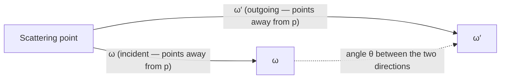

An accompanying `PDF()` method returns the value of the phase function sampling PDF for the provided directions. Phase function samples are returned in a structure that stores the phase function's value `p`, the sampled direction `wi`, and the PDF `pdf`.

<details>
<summary>Book-edition cross-references</summary>

`Float` 23 · `HGPhaseFunction` 713 · `TaggedPointer` 1073 · `Vector3f` 86

</details>

### 11.3.1 THE HENYEY–GREENSTEIN PHASE FUNCTION

A widely used phase function was developed by Henyey and Greenstein (1941). This phase function was specifically designed to be easy to fit to measured scattering data. A single parameter $g$ (called the asymmetry parameter) controls the distribution of scattered light:[^fn4]

$$
p_{HG}(\cos\theta)
= \frac{1}{4\pi}\,
  \frac{1 - g^2}{\bigl(1 + g^2 + 2g(\cos\theta)\bigr)^{3/2}}.
$$

The `henyey_greenstein()` function implements this computation; in WGSL form, suitable for a compute shader:

```rust
// 〈Scattering Inline Functions〉
fn henyey_greenstein(cos_theta: f32, g: f32) -> f32 {
    let denom = 1.0 + g * g + 2.0 * g * cos_theta;
    INV_4PI * (1.0 - g * g) / (denom * denom.sqrt())
}
```

```wgsl
const INV_4PI: f32 = 0.07957747154594767;

fn henyey_greenstein(cos_theta: f32, g: f32) -> f32 {
    // pbrt's direction convention gives +2g(cosθ) in the denominator;
    // the scattering literature uses −2g(cosθ) (see Note 4).
    let denom = 1.0 + g * g + 2.0 * g * cos_theta;
    return INV_4PI * (1.0 - g * g) / (denom * sqrt(denom));
}
```

The asymmetry parameter $g$ in the Henyey–Greenstein model has a precise meaning. It is the integral of the product of the given phase function and the cosine of the angle between $\omega'$ and $\omega$ and is referred to as the mean cosine. Given an arbitrary phase function $p$, the value of $g$ can be computed as[^fn5]

$$
g = \int_{\mathcal{S}^2} p(-\omega,\omega')\,(\omega\cdot\omega')\,\mathrm{d}\omega'
  = 2\pi\int_0^{\pi} p(-\cos\theta)\,\cos\theta\,\sin\theta\,\mathrm{d}\theta.
\tag{11.19}
$$

Thus, an isotropic phase function gives $g = 0$, as expected. Any number of phase functions can satisfy this equation; the $g$ value alone is not enough to uniquely describe a scattering distribution. Nevertheless, the convenience of being able to easily convert a complex scattering distribution into a simple parameterized model is often more important than this potential loss in accuracy.

<details>
<summary>Book-edition cross-references</summary>

`Float` 23 · `Inv4Pi` 1033 · `PhaseFunctionSample` 711 · `Point2f` 92 · `SafeSqrt()` 1034 · `Sqr()` 1034 · `Vector3f` 86

</details>

**Figure 11.14 — Henyey–Greenstein plots.** Plots of the phase function for asymmetry parameters $g=-0.25$ and $g=0.7$. Negative $g$ values describe phase functions that primarily scatter light back in the incident direction, and positive $g$ values describe phase functions that primarily scatter light forward in the direction it was already traveling (here, along the $+x$ axis).

The plot itself is a polar-style visibility of the same formula: the horizontal axis is the scattering direction ($\cos\theta$ along the axis of travel), with the forward direction toward $+x$. Reading the two curves:

| $g$ | Shape in the plot | Physical meaning |
| --- | --- | --- |
| $-0.25$ | small lobe centered near the backward direction, roughly $-0.25$ on the axis | weak back-scattering |
| $0$ | circle, $p = 1/(4\pi)$ | isotropic scattering |
| $0.7$ | broad, large lobe extending to about $1.5$ on the forward axis | strong forward-scattering |

Because pbrt uses the same direction convention for BSDFs and phase functions, the $2g\cos\theta$ term carries a $+$ sign here; the scattering literature uses $-$ (see [Note 4](#notes)). The closed form above, together with the mean-cosine integral (11.19), fully captures the plotted information, so the page-scan plot is not reproduced.

**Figure 11.15 — Ganesha model filled with participating media**, rendered with (left) strong backward scattering ($g = -0.9$) and (right) strong forward scattering ($g = 0.9$). Because most of the light comes from a light source behind the objects, forward scattering leads to more light reaching the camera in this case.

<details>
<summary>Pictorial figure: <code>images/img-1116-249.png</code></summary>

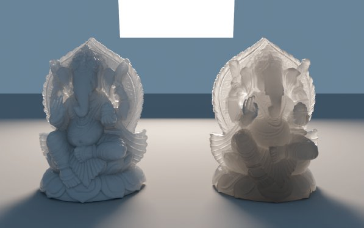

</details>

More complex phase functions that are not described well with a single asymmetry parameter can often be modeled by a weighted sum of phase functions like Henyey–Greenstein, each with different parameter values:

$$
p(\omega,\omega') = \sum_{i=1}^n w_i\,p_i(\omega\to\omega'),
$$

where the weights $w_i$ sum to one to maintain normalization. This generalization is not provided in pbrt but would be easy to add. Figure 11.14 shows plots of the Henyey–Greenstein phase function with varying asymmetry parameters. The value of $g$ for this model must be in the range $(-1, 1)$. Negative values of $g$ correspond to back-scattering, where light is mostly scattered back toward the incident direction, and positive values correspond to forward-scattering. The greater the magnitude of $g$, the more scattering occurs close to the $\omega$ or $-\omega$ directions (for back-scattering and forward-scattering, respectively). See Figure 11.15 to compare the visual effect of forward- and back-scattering.

The `HGPhaseFunction` class implements the Henyey–Greenstein model in the context of the `PhaseFunction` interface. Its only parameter is $g$, which is provided to the constructor and stored in a member variable:

```rust
// 〈HGPhaseFunction Definition〉
struct HGPhaseFunction {
    g: f32, // 〈HGPhaseFunction Private Members〉
}

impl HGPhaseFunction {
    fn new(g: f32) -> Self { Self { g } }

    // Evaluating the phase function calls henyey_greenstein().
    fn p(&self, wo: Vector3f, wi: Vector3f) -> f32 {
        henyey_greenstein(dot(wo, wi), self.g)
    }
}
```

It is possible to sample directly from the Henyey–Greenstein phase function's distribution. This operation is provided via a stand-alone utility function. Because the sampling algorithm is exact and because the Henyey–Greenstein phase function is normalized, the PDF is equal to the phase function's value for the sampled direction:

```rust
// 〈Sampling Function Definitions〉
fn sample_henyey_greenstein(
    wo: Vector3f, g: f32, u: Point2f,
) -> (Vector3f, f32) {
    // 〈Compute cos θ for Henyey–Greenstein sample〉
    let cos_theta = if g.abs() < 1e-3 {
        1.0 - 2.0 * u[0]
    } else {
        -1.0 / (2.0 * g)
            * (1.0 + g * g
               - ((1.0 - g * g) / (1.0 + g - 2.0 * g * u[0])).powi(2))
    };
    // 〈Compute direction wi for Henyey–Greenstein sample〉
    let sin_theta = (1.0 - cos_theta * cos_theta).max(0.0).sqrt();
    let phi = 2.0 * PI * u[1];
    let w_frame = Frame::from_z(wo);
    let wi = w_frame.from_local(spherical_direction(sin_theta, cos_theta, phi));
    let pdf = henyey_greenstein(cos_theta, g);
    (wi, pdf)
}
```

The PDF for the Henyey–Greenstein phase function is separable into $\theta$ and $\phi$ components, with $p(\phi) = 1/(2\pi)$ as usual. The main task is to sample $\cos\theta$. With pbrt's convention for the orientation of direction vectors, the distribution for $\theta$ is

$$
\cos\theta = -\frac{1}{2g}\left[1+g^2
  - \left(\frac{1-g^2}{1+g-2g\xi}\right)^2\right],
$$

if $g \ne 0$; otherwise, $\cos\theta = 1 - 2\xi$ gives a uniform sampling over the sphere of directions. The $(\cos\theta,\phi)$ values specify a direction with respect to a coordinate system where $\omega_o$ is along the $+z$ axis. Therefore, it is necessary to transform the sampled vector to $\omega_o$'s coordinate system before returning it.

The `HGPhaseFunction` sampling method is now easily implemented, and because sampling is exact and phase functions are normalized, its `PDF()` method just evaluates the phase function for the given directions:

```rust
impl PhaseFunction for HGPhaseFunction {
    // 〈HGPhaseFunction Public Methods〉
    fn sample_p(&self, wo: Vector3f, u: Point2f) -> Option<PhaseFunctionSample> {
        let (wi, pdf) = sample_henyey_greenstein(wo, self.g, u);
        Some(PhaseFunctionSample { p: pdf, wi, pdf })
    }

    fn pdf(&self, wo: Vector3f, wi: Vector3f) -> f32 {
        self.p(wo, wi)
    }
}
```

<details>
<summary>Book-edition cross-references</summary>

`Dot()` 89 · `Float` 23 · `HenyeyGreenstein()` 711 · `HGPhaseFunction` 713 · `PhaseFunction` 710 · `Point2f` 92 · `Sqr()` 1034 · `Vector3f` 86

</details>

---

## 11.4 MEDIA

Implementations of the `Medium` interface provide various representations of volumetric scattering properties in a region of space. In a complex scene, there may be multiple `Medium` instances, each representing different types of scattering in different parts of the scene. For example, an outdoor lake scene might have one `Medium` to model atmospheric scattering, another to model mist rising from the lake, and a third to model particles suspended in the water of the lake.

The `Medium` interface is also defined in the file `base/media.h`. In Rust it is expressed as a tagged union (`TaggedPointer` in the book) over the available implementations:

```rust
// 〈Medium Definition〉
enum Medium {
    Homogeneous(HomogeneousMedium),
    Grid(GridMedium),
    RgbGrid(RGBGridMedium),
    Cloud(CloudMedium),
    NanoVDB(NanoVDBMedium),
}
```

pbrt provides five medium implementations. The first three will be discussed in the book, but `CloudMedium` is only included in the online edition of the book and the last, `NanoVDBMedium`, will not be presented at all. (It provides support for using volumes defined in the NanoVDB format in pbrt. As elsewhere, we avoid discussion of the use of third-party APIs in the book text.)

Before we get to the specification of the methods in the interface, we will describe a few details related to how media are represented in pbrt.

<details>
<summary>Book-edition cross-references</summary>

`CloudMedium` 714 · `Float` 23 · `Frame` 133 · `Frame::FromLocal()` 134 · `Frame::FromZ()` 134 · `GridMedium` 728 · `HGPhaseFunction::p()` 713 · `HomogeneousMedium` 720 · `NanoVDBMedium` 714 · `PhaseFunctionSample` 711 · `Pi` 1033 · `Point2f` 92 · `RGBGridMedium` 731 · `SafeSqrt()` 1034 · `SampleHenyeyGreenstein()` 713 · `SphericalDirection()` 106 · `Sqr()` 1034 · `TaggedPointer` 1073 · `Vector3f` 86

</details>

The spatial distribution and extent of media in a scene is defined by associating `Medium` instances with the camera, lights, and primitives in the scene. For example, `Camera`s store a `Medium` that represents the medium that the camera is inside. Rays leaving the camera then have the `Medium` associated with them. In a similar fashion, each `Light` stores a `Medium` representing its medium. A `nullptr` value can be used to indicate a vacuum (where no volumetric scattering occurs). In pbrt, the boundary between two different types of scattering media is always represented by the surface of a primitive. Rather than storing a single `Medium` like lights and cameras each do, primitives may store a `MediumInterface`, which stores the medium on each side of the primitive's surface:

```rust
// 〈MediumInterface Definition〉
struct MediumInterface {
    // 〈MediumInterface Public Members〉
    inside: Medium,
    outside: Medium,
}

impl MediumInterface {
    // 〈MediumInterface Public Methods〉
    fn new(medium: Medium) -> Self {
        Self { inside: medium.clone(), outside: medium }
    }
    fn new_sided(inside: Medium, outside: Medium) -> Self {
        Self { inside, outside }
    }
    fn is_medium_transition(&self) -> bool {
        self.inside != self.outside
    }
}
```

`MediumInterface` holds two `Medium`s, one for the interior of the primitive and one for the exterior. Specifying the extent of participating media in this way does allow the user to specify impossible or inconsistent configurations. For example, a primitive could be specified as having one medium outside of it, and the camera could be specified as being in a different medium without there being a `MediumInterface` between the camera and the surface of the primitive. In this case, a ray leaving the primitive toward the camera would be treated as being in a different medium from a ray leaving the camera toward the primitive. In turn, light transport algorithms would be unable to compute consistent results. For pbrt's purposes, we think it is reasonable to expect that the user will be able to specify a consistent configuration of media in the scene and that the added complexity of code to check this is not worthwhile.

With this context in hand, we can now provide a missing piece in the implementation of `SurfaceInteraction::SetIntersectionProperties()`—the implementation of the 〈Set medium properties at surface intersection〉 fragment. (Recall that this method is called by `Primitive::Intersect()` methods when an intersection has been found.) Instead of simply copying the value of the primitive's `MediumInterface` into the `SurfaceInteraction`, it follows a slightly different approach and only uses this `MediumInterface` if it specifies a proper transition between participating media. Otherwise, the `Ray::medium` field takes precedence. Setting the `SurfaceInteraction`'s `mediumInterface` field in this way greatly simplifies the specification of scenes containing media: in particular, it is not necessary to provide corresponding `Medium`s at every scene surface that is in contact with a medium. Instead, only non-opaque surfaces that have different media on each side require an explicit medium interface. In the simplest case where a scene containing opaque objects is filled with a participating medium (e.g., haze), it is enough for the camera and light sources to have their media specified accordingly.

```rust
// 〈Set medium properties at surface intersection〉
if prim_medium_interface.is_some()
    && prim_medium_interface.as_ref().unwrap().is_medium_transition()
{
    medium_interface = prim_medium_interface;
} else {
    medium = ray_medium;
}
```

Once `medium_interface` or `medium` is set, it is possible to implement methods that return information about the local media. For surface interactions, a direction $\mathrm{w}$ can be specified to select a side of the surface. If a `MediumInterface` has been stored, the dot product with the surface normal determines whether the inside or outside medium should be returned. Otherwise, `medium` is returned.

```rust
// 〈Interaction Public Methods〉
fn get_medium_w(&self, w: Vector3f) -> Medium {
    if let Some(mi) = &self.medium_interface {
        return if dot(w, self.n) > 0.0 { mi.outside.clone() } else { mi.inside.clone() };
    }
    self.medium.clone()
}
```

For interactions that are known to be inside participating media, another variant of `get_medium()` that does not take the irrelevant outgoing direction vector is available. In this case, if a `MediumInterface` has been stored, it should point to the same medium for both "inside" and "outside."

```rust
fn get_medium(&self) -> Medium {
    if let Some(mi) = &self.medium_interface {
        mi.inside.clone()
    } else {
        self.medium.clone()
    }
}
```

Primitives associated with shapes that represent medium boundaries generally have a `Material` associated with them. For example, the surface of a lake might use an instance of `DielectricMaterial` to describe scattering at the lake surface, which also acts as the boundary between the rising mist's `Medium` and the lake water's `Medium`. However, sometimes we only need the shape for the boundary surface that it provides to delimit a participating medium boundary and we do not want to see the surface itself. For example, the medium representing a cloud might be bounded by a box made of triangles where the triangles are only there to delimit the cloud's extent and should not otherwise affect light passing through them.

<details>
<summary>Book-edition cross-references</summary>

`DielectricMaterial` 679 · `Interaction::medium` 138 · `Interaction::mediumInterface` 138 · `Material` 674 · `Medium` 714 · `MediumInterface::inside` 715 · `MediumInterface::IsMediumTransition()` 715 · `MediumInterface::outside` 715 · `SurfaceInteraction` 138 · `SurfaceInteraction::GetBSDF()` 682 · `Vector3f` 86

</details>

While such a surface that disappears and does not affect ray paths could be accurately described by a BTDF that represents perfect specular transmission with the same index of refraction on both sides, dealing with such surfaces places extra burden on the `Integrator`s (not all of which handle this type of specular light transport well). Therefore, pbrt allows such surfaces to have a `Material` that is `nullptr`, indicating that they do not affect light passing through them; in turn, `SurfaceInteraction::GetBSDF()` will return an unset BSDF. The light transport routines then do not worry about light scattering from such surfaces and only account for changes in the current medium at them. For an example of the difference that scattering at the surface makes, see Figure 11.16, which has two instances of the Ganesha model filled with scattering media; one has a scattering surface at the boundary and the other does not.

**Figure 11.16 — Scattering media inside the Ganesha.** Both models have the same isotropic homogeneous scattering media inside of them. On the left, the `Material` is `nullptr`, which indicates that the surface should be ignored by rays and is only used to delineate a participating medium's extent. On the right, the model's surface has a dielectric interface that both makes the interface visible and scatters some of the incident light, making the interior darker.

<details>
<summary>Pictorial figure: <code>images/img-1127-250.png</code></summary>

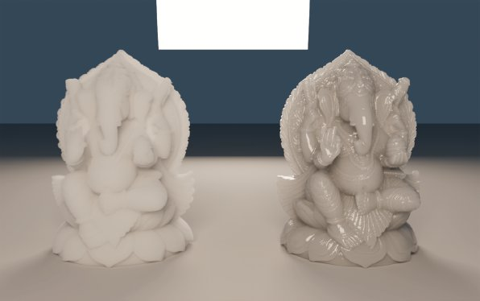

</details>

### 11.4.1 `Medium` INTERFACE

`Medium` implementations must include three methods. The first is `IsEmissive()`, which indicates whether they include any volumetric emission. This method is used solely so that pbrt can check if a scene has been specified without any light sources and print an informative message if so.

The `SamplePoint()` method returns information about the scattering and emission properties of the medium at a specified rendering-space point in the form of a `MediumProperties` object. `MediumProperties` is a simple structure that wraps up the values that describe scattering and emission at a point inside a medium. When initialized to their default values, its member variables together indicate no scattering or emission. Thus, implementations of `SamplePoint()` can directly return a `MediumProperties` with no further initialization if the specified point is outside of the medium's spatial extent.

On the GPU, the same data is laid out as a plain struct in a storage buffer; the RGB form shown here is the wgpu-friendly counterpart of pbrt's spectral `SampledSpectrum` members (a spectral renderer uses an array of wavelength bins instead of `vec3f`):

```wgsl
struct MediumProperties {
    sigma_a: vec3f,   // absorption coefficient  (per wavelength bin / RGB)
    sigma_s: vec3f,   // scattering coefficient
    le: vec3f,        // emitted radiance
    // phase: index into a small phase-function table kept in a uniform buffer
};

struct RayMajorantSegment {
    t_min: f32,
    t_max: f32,
    sigma_maj: vec3f, // constant majorant over [t_min, t_max)
};
```

The host-side interface then reads:

```rust
// 〈Medium Interface〉
trait Medium {
    fn is_emissive(&self) -> bool;
    fn sample_point(&self, p: Point3f, lambda: &SampledWavelengths)
        -> MediumProperties;
    fn majorant_iterator_type_marker(&self); // ensures MajorantIterator is declared
}

// 〈MediumProperties Definition〉
struct MediumProperties {
    sigma_a: SampledSpectrum,
    sigma_s: SampledSpectrum,
    phase: PhaseFunction,
    le: SampledSpectrum,
}
```

<details>
<summary>Book-edition cross-references</summary>

`Medium` 714 · `MediumProperties` 718 · `Point3f` 92 · `SampledWavelengths` 173

</details>

The third method that `Medium` implementations must implement is `SampleRay()`, which provides information about the medium's majorant $\sigma_{\mathrm{maj}}$ along the ray's extent. It does so using one or more `RayMajorantSegment` objects. Each describes a constant majorant over a segment of a ray.

Some `Medium` implementations have a single medium-wide majorant (e.g., `HomogeneousMedium`), though for media where the scattering coefficients vary significantly over their extent, it is usually better to have distinct local majorants that bound $\sigma_t$ over smaller regions. These tighter majorants can improve rendering performance by reducing the frequency of null scattering when sampling interactions along a ray. The number of segments along a ray is variable, depending on both the ray's geometry and how the medium discretizes space.

However, we would not like to return variable-sized arrays of `RayMajorantSegment`s from `SampleRay()` method implementations. Although dynamic memory allocation to store them could be efficiently handled using a `ScratchBuffer`, another motivation not to immediately return all of them is that often not all the `RayMajorantSegment`s along the ray are needed; if the ray path terminates or scattering occurs along the ray, then any additional `RayMajorantSegment`s past the corresponding point would be unused and their initialization would be wasted work. Therefore, the `RayMajorantIterator` interface provides a mechanism for `Medium` implementations to return `RayMajorantSegment`s one at a time as they are needed. There is a single method in this interface: `Next()`. Implementations of it should return majorant segments from the front to the back of the ray with no overlap in $t$ between segments, though it may skip over ranges of $t$ corresponding to regions of space where there is no scattering. (See Figure 11.17.) After it has returned all segments along the ray, an unset optional value should be returned. Thanks to this interface, different `Medium` implementations can generate `RayMajorantSegment`s in different ways depending on their internal medium representation.

**Figure 11.17 — Ray-majorant segments (diagram).** `RayMajorantIterator` implementations return a series of segments in parametric $t$ along a ray where each segment has a majorant that is an upper bound of the medium's $\sigma_t$ value along the segment. Implementations are free to specify segments of varying lengths and to skip regions of space with no scattering, though they must provide segments in front-to-back order.

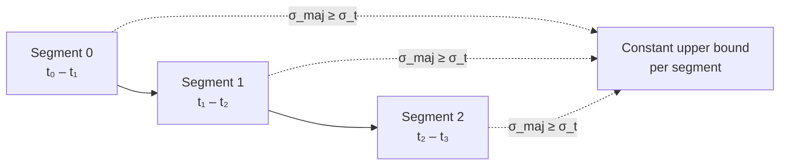

In the book's illustration the first segment carries the bound labelled `[t0, t1]` and a second, shorter segment sits further along the ray above the plotted $\sigma_t$ profile; a gap with no scattering is skipped entirely. The Mermaid version above generalizes this to an arbitrary front-to-back sequence.

Turning back now to the `SampleRay()` interface method: in Chapters 14 and 15 we will find it useful to know the type of `RayMajorantIterator` that is associated with a specific `Medium` type. We can then declare the iterator as a local variable that is stored on the stack, which improves efficiency both from avoiding dynamic memory allocation for it and from allowing the compiler to more easily store it in registers. Therefore, pbrt requires that `Medium` implementations include a local type definition for `MajorantIterator` in their class definition that gives the type of their `RayMajorantIterator`. Their `SampleRay()` method itself should then directly return their majorant iterator type.

```rust
// e.g. inside a Medium implementation's class definition:
type MajorantIterator = /* its RayMajorantIterator type */;
fn sample_ray(&self, ray: Ray, t_max: f32, lambda: &SampledWavelengths)
    -> Self::MajorantIterator;
```

(The form of this type and method definition is similar to the `Material::GetBxDF()` methods in Section 10.5.) For cases where the medium's type is not known at compile time, the `Medium` class itself provides the implementation of a different `SampleRay()` method that takes a `ScratchBuffer`, uses it to allocate the appropriate amount of storage for the medium's ray iterator, and then calls the `Medium`'s `SampleRay()` method implementation to initialize it. The returned `RayMajorantIterator` can then be used to iterate over the majorant segments. The implementation of this method uses the same trick that `Material::GetBSDF()` does: the `TaggedPointer`'s dynamic dispatch capabilities are used to automatically generate a separate call to the provided lambda function for each medium type, with the medium parameter specialized to be of the `Medium`'s concrete type.

```rust
// 〈Medium Sampling Function Definitions〉
impl Medium {
    fn sample_ray_dyn(&self, ray: Ray, t_max: f32,
                      lambda: &SampledWavelengths,
                      buf: &mut ScratchBuffer) -> RayMajorantIterator {
        // 〈Return RayMajorantIterator for medium's majorant iterator〉
        // The tagged dispatch generates one call per concrete medium type;
        // the iterator is then allocated in `buf` and initialized.
        self.dispatch(|medium| {
            let iter = buf.alloc::<ConcreteMedium::MajorantIterator>();
            *iter = medium.sample_ray(ray, t_max, lambda);
            RayMajorantIterator::new(iter)
        })
    }
}

// 〈RayMajorantIterator Definition〉
enum RayMajorantIterator {
    Homogeneous(HomogeneousMajorantIterator),
    Dda(DDAMajorantIterator),
}
```

The `Medium` passed to the lambda function arrives as a reference to a pointer to the medium type; those are easily removed to get the basic underlying type. From it, the iterator type follows from the `MajorantIterator` type declaration in the associated class. In turn, storage can be allocated for the iterator type and it can be initialized. Since the returned value is of the `RayMajorantIterator` interface type, the caller can proceed without concern for the actual type.

<details>
<summary>Book-edition cross-references</summary>

`DDAMajorantIterator` 723 · `Float` 23 · `HomogeneousMajorantIterator` 721 · `Material::GetBSDF()` 675 · `Material::GetBxDF()` 674 · `Medium` 714 · `Ray` 95 · `RayMajorantIterator` 719 · `RayMajorantSegment` 718 · `SampledWavelengths` 173 · `ScratchBuffer` 1078 · `TaggedPointer` 1073 · `TaggedPointer::DispatchCPU()` 1076

</details>

### 11.4.2 HOMOGENEOUS MEDIUM

The `HomogeneousMedium` is the simplest possible medium. It represents a region of space with constant $\sigma_a$, $\sigma_s$, and $L_e$ values throughout its extent. It uses the Henyey–Greenstein phase function to represent scattering in the medium, also with a constant $g$. Its definition is in the files `media.h` and `media.cpp`. This medium was used for the images in Figures 11.15 and 11.16.

```rust
// 〈HomogeneousMedium Definition〉
struct HomogeneousMedium {
    // 〈HomogeneousMedium Private Data〉
    sigma_a_spec: DenselySampledSpectrum,
    sigma_s_spec: DenselySampledSpectrum,
    le_spec: DenselySampledSpectrum,
    phase: HGPhaseFunction,
}
```

Its constructor (not included here) initializes the following member variables from provided parameters. It takes spectral values in the general form of `Spectrum`s but converts them to the form of `DenselySampledSpectrum`s. While this incurs a memory cost of a kilobyte or so for each one, it ensures that sampling the spectrum will be fairly efficient and will not require, for example, the binary search that `PiecewiseLinearSpectrum` uses. It is unlikely that there will be enough distinct instances of `HomogeneousMedium` in a scene that this memory cost will be significant.

Implementation of the `IsEmissive()` interface method is straightforward, and `SamplePoint()` just needs to sample the various constant scattering properties at the specified wavelengths:

```rust
impl Medium for HomogeneousMedium {
    fn is_emissive(&self) -> bool { self.le_spec.max_value() > 0.0 }

    fn sample_point(&self, _p: Point3f, lambda: &SampledWavelengths)
        -> MediumProperties {
        let sigma_a = self.sigma_a_spec.sample(lambda);
        let sigma_s = self.sigma_s_spec.sample(lambda);
        let le = self.le_spec.sample(lambda);
        MediumProperties { sigma_a, sigma_s, phase: &self.phase, le }
    }
}

// 〈HomogeneousMedium Public Type Definitions〉
type MajorantIterator = HomogeneousMajorantIterator;
```

`SampleRay()` uses the `HomogeneousMajorantIterator` class for its `RayMajorantIterator`. There is no need for null scattering in a homogeneous medium and so a single `RayMajorantSegment` for the ray's entire extent suffices; `HomogeneousMajorantIterator` therefore stores such a segment directly.

```rust
// 〈HomogeneousMajorantIterator Definition〉
struct HomogeneousMajorantIterator {
    seg: RayMajorantSegment,
    called: bool,
}

impl HomogeneousMajorantIterator {
    // Its default constructor sets `called` to true and stores no segment;
    // in this way, a ray missing the medium is handled by a default-initialized
    // iterator.
    fn default() -> Self { Self { seg: RayMajorantSegment::default(), called: true } }
    fn new(t_min: f32, t_max: f32, sigma_maj: SampledSpectrum) -> Self {
        Self { seg: RayMajorantSegment { t_min, t_max, sigma_maj }, called: false }
    }
    // The first call to Next() returns the segment; subsequent calls return None.
    fn next(&mut self) -> Option<RayMajorantSegment> {
        if self.called { return None; }
        self.called = true;
        Some(self.seg)
    }
}
```

The implementation of `HomogeneousMedium::SampleRay()` is now trivial. Its only task is to compute the majorant, which is equal to $\sigma_t = \sigma_a + \sigma_s$.

```rust
impl HomogeneousMedium {
    fn sample_ray(&self, _ray: Ray, t_max: f32,
                  lambda: &SampledWavelengths) -> HomogeneousMajorantIterator {
        let sigma_a = self.sigma_a_spec.sample(lambda);
        let sigma_s = self.sigma_s_spec.sample(lambda);
        HomogeneousMajorantIterator::new(0.0, t_max, sigma_a + sigma_s)
    }
}
```

<details>
<summary>Book-edition cross-references</summary>

`DenselySampledSpectrum` 167 · `DenselySampledSpectrum::Sample()` 167 · `HGPhaseFunction` 713 · `HomogeneousMajorantIterator` 721 · `HomogeneousMedium::Le_spec` 720 · `HomogeneousMedium::phase` 720 · `HomogeneousMedium::sigma_a_spec` 720 · `HomogeneousMedium::sigma_s_spec` 720 · `MediumProperties` 718 · `PiecewiseLinearSpectrum` 168 · `Point3f` 92 · `RayMajorantIterator` 719 · `SampledSpectrum` 171 · `SampledWavelengths` 173 · `ScratchBuffer::Alloc()` 1078 · `Spectrum` 165 · `Spectrum::MaxValue()` 166 · `Spectrum::Sample()` 175

</details>

<details>
<summary>Book-edition cross-references</summary>

`Float` 23 · `HomogeneousMajorantIterator` 721 · `HomogeneousMajorantIterator::called` 721 · `HomogeneousMajorantIterator::seg` 721 · `HomogeneousMedium::sigma_a_spec` 720 · `HomogeneousMedium::sigma_s_spec` 720 · `Ray` 95 · `RayMajorantIterator` 719 · `RayMajorantSegment` 718 · `SampledSpectrum` 171 · `SampledWavelengths` 173 · `SampleExponential()` 1003 · `Spectrum::Sample()` 175

</details>

### 11.4.3 DDA MAJORANT ITERATOR

Before moving on to the remaining two `Medium` implementations, we will describe another `RayMajorantIterator` that is much more efficient than the `HomogeneousMajorantIterator` when the medium's scattering coefficients vary over its extent. To understand the problem with a single majorant in this case, recall that the mean free path is the average distance between scattering events. It is one over the attenuation coefficient and so the average $t$ step returned by a call to `SampleExponential()` given a majorant $\sigma_{\mathrm{maj}}$ will be $1/\sigma_{\mathrm{maj}}$. Now consider a medium that has a $\sigma_t = 1$ almost everywhere but has $\sigma_t = 100$ in a small region. If $\sigma_{\mathrm{maj}} = 100$ everywhere, then in the less dense region 99% of the sampled distances will be null-scattering events and the ray will take steps that are 100 times shorter than it would take if $\sigma_{\mathrm{maj}}$ was 1. Rendering performance suffers accordingly.

This issue motivates using a data structure to store spatially varying majorants, which allows tighter majorants and more efficient sampling operations. A variety of data structures have been used for this problem; the "Further Reading" section has details. The remainder of pbrt's `Medium` implementations all use a simple grid where each cell stores a majorant over the corresponding region of the volume. In turn, as a ray passes through the medium, it is split into segments through this grid and sampled based on the local majorant. More precisely, the local majorant is found with the combination of a regular grid of voxels of scalar densities and a `SampledSpectrum` $\sigma_t$ value. The majorant in each voxel is given by the product of $\sigma_t$ and the voxel's density. The `MajorantGrid` class stores that grid of voxels.

```rust
// 〈MajorantGrid Definition〉
struct MajorantGrid {
    // 〈MajorantGrid Public Members〉
    bounds: Bounds3f,
    voxels: Vec<f32>,
    res: Point3i,
}

impl MajorantGrid {
    // The voxel array is indexed with x consecutive in memory, then y, then z.
    fn lookup(&self, x: i32, y: i32, z: i32) -> f32 {
        self.voxels[(x + self.res.x * (y + self.res.y * z)) as usize]
    }
    fn set(&mut self, x: i32, y: i32, z: i32, v: f32) {
        let i = (x + self.res.x * (y + self.res.y * z)) as usize;
        self.voxels[i] = v;
    }
    // Returns bounds with respect to [0, 1]^3, not the `bounds` member.
    fn voxel_bounds(&self, x: i32, y: i32, z: i32) -> Bounds3f {
        let p0 = Point3f::new(x as f32 / self.res.x as f32,
                              y as f32 / self.res.y as f32,
                              z as f32 / self.res.z as f32);
        let p1 = Point3f::new((x + 1) as f32 / self.res.x as f32,
                              (y + 1) as f32 / self.res.y as f32,
                              (z + 1) as f32 / self.res.z as f32);
        Bounds3f::new(p0, p1)
    }
}
```

Efficiently enumerating the voxels that the ray passes through can be done with a technique that is similar in spirit to Bresenham's classic line drawing algorithm, which incrementally finds series of pixels that a line passes through using just addition and comparisons to step from one pixel to the next. (This type of algorithm is known as a digital differential analyzer (DDA)—hence the name of the `DDAMajorantIterator`.) The main difference between the ray stepping algorithm and Bresenham's is that we would like to find all of the voxels that the ray passes through, while Bresenham's algorithm typically only turns on one pixel per row or column that a line passes through.

```rust
// 〈DDAMajorantIterator Definition〉
struct DDAMajorantIterator {
    sigma_t: SampledSpectrum,
    t_min: f32,
    t_max: f32,
    grid: *const MajorantGrid,
    // DDA state
    next_crossing_t: [f32; 3],
    delta_t: [f32; 3],
    step: [i32; 3],
    voxel_limit: [i32; 3],
    voxel: [i32; 3],
}

impl DDAMajorantIterator {
    fn new(ray: Ray, t_min: f32, t_max: f32,
           grid: *const MajorantGrid,
           sigma_t: SampledSpectrum) -> Self {
        let mut it = Self {
            sigma_t, t_min, t_max, grid,
            next_crossing_t: [0.0; 3], delta_t: [0.0; 3],
            step: [0; 3], voxel_limit: [0; 3], voxel: [0; 3],
        };
        // 〈Set up 3D DDA for ray through the majorant grid〉
        it.setup(ray, t_min);
        it
    }
}
```

After copying parameters passed to it to member variables, the constructor's main task is to compute a number of values that represent the DDA's state. The `t_min` and `t_max` member variables store the parametric range of the ray for which majorant segments are yet to be generated; `t_min` is advanced after each step. Their default values specify a degenerate range, which causes a default-initialized `DDAMajorantIterator` to return no segments when its `Next()` method is called.

```rust
// Degenerate defaults: t_min = +∞, t_max = −∞ → Next() yields nothing.
t_min: f32 = f32::INFINITY,
t_max: f32 = f32::NEG_INFINITY,
grid: *const MajorantGrid,
```

Grid voxel traversal is handled by an incremental algorithm that tracks the current voxel and the parametric $t$ where the ray enters the next voxel in each direction. It successively takes a step in the direction that has the smallest such $t$ until the ray exits the grid or traversal is halted. The values that the algorithm needs to keep track of are the following:

1. The integer coordinates of the voxel currently being considered, `voxel`.
2. The parametric $t$ position along the ray where it makes its next crossing into another voxel in each of the $x$, $y$, and $z$ directions, `next_crossing_t` (Figure 11.18).
3. The change in the current voxel coordinates after a step in each direction (1 or $-1$), stored in `step`.
4. The parametric distance along the ray between voxels in each direction, `delta_t`.
5. The coordinates of the voxel after the last one the ray passes through when it exits the grid, `voxel_limit`.

The first two values are updated as the ray steps through the grid, while the last three are constant for each ray. All are stored in member variables.

<details>
<summary>Book-edition cross-references</summary>

`DDAMajorantIterator` 723 · `Float` 23 · `Infinity` 361 · `MajorantGrid` 722 · `Ray` 95 · `SampledSpectrum` 171

</details>

**Figure 11.18 — Stepping a ray through a voxel grid (diagram).** The parametric distance along the ray to the point where it crosses into the next voxel in the $x$ direction is stored in `next_crossing_t[0]`, and similarly for the $y$ and $z$ directions (not shown). When the ray crosses into the next $x$ voxel, it is immediately possible to update `next_crossing_t[0]` by adding a fixed value—the voxel width in $x$ divided by the ray's $x$ direction, `delta_t[0]`.

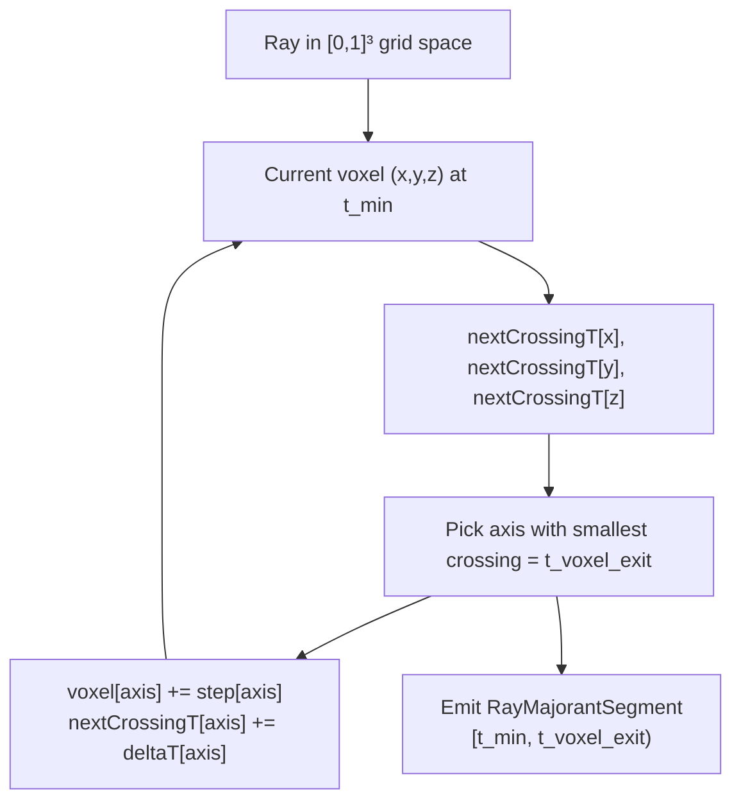

The scan shows a ray entering at `t_min`, with `deltaT[0]` marked as the parametric distance between successive $x$-face crossings and the two `nextCrossingT` values marking the crossings into the next $x$ and $y$ voxels, respectively; the redraw preserves that state machine.

For the DDA computations, we will transform the ray to a coordinate system where the grid spans $[0,1]^3$, giving the ray `ray_grid`. Working in this space simplifies some of the calculations related to the DDA.[^fn6]

```rust
// 〈Set up 3D DDA for ray through the majorant grid〉
let diag = grid.bounds.diag();
let ray_grid = Ray::new(
    Point3f::new(grid.bounds.offset(ray.o)),
    Vector3f::new(ray.d.x / diag.x, ray.d.y / diag.y, ray.d.z / diag.z),
);
let grid_intersect = ray_grid.at(t_min);
for axis in 0..3 {
    // 〈Initialize ray stepping parameters for axis〉
    // 〈Compute current voxel for axis and handle negative zero direction〉
    // 〈Handle ray with positive or negative direction for voxel stepping〉
}
```

Some of the DDA state values for each dimension are always computed in the same way, while others depend on the sign of the ray's direction in that dimension. The integer coordinates of the initial voxel are easily found using the grid intersection point. Because it is with respect to the $[0,1]^3$ cube, all that is necessary is to scale by the resolution in each dimension and take the integer component of that value. It is, however, important to clamp this value to the valid range in case round-off error leads to an out-of-bounds value. Next, `delta_t` is found by dividing the voxel width, which is one over its resolution since we are working in $[0,1]^3$, by the absolute value of the ray's direction component for the current axis. (The absolute value is taken since $t$ only increases as the DDA visits successive voxels.) Finally, a rare and subtle case related to the IEEE floating-point representation must be handled. Recall from Section 6.8.1 that both "positive" and "negative" zero values can be represented as floats. Normally there is no need to distinguish between them as the distinction is mostly not evident—for example, comparing a negative zero to a positive zero gives a true result. However, the fragment after this one will take advantage of the fact that it is legal to compute $1 \div 0$ in floating point, which gives an infinite value. There, we would always like the positive infinity, and thus negative zeros are cleaned up here.

```rust
// 〈Compute current voxel for axis and handle negative zero direction〉
voxel[axis] = clamp((grid_intersect[axis] * grid.res[axis] as f32) as i32,
                   0, grid.res[axis] - 1);
delta_t[axis] = 1.0 / (ray_grid.d[axis].abs() * grid.res[axis] as f32);
if ray_grid.d[axis] == -0.0 { ray_grid.d[axis] = 0.0; }
```

The parametric $t$ value where the ray exits the current voxel, `next_crossing_t[axis]`, is found with the ray–slab intersection algorithm from Section 6.1.2, using the plane that passes through the corresponding voxel face. Given a zero-valued direction component, `next_crossing_t` ends up with the positive floating-point $\infty$ value. The voxel stepping logic will always decide to step in one of the other directions and will correctly never step in this direction.

```rust
// 〈Handle ray with positive direction for voxel stepping〉
let next_voxel_pos = (voxel[axis] + 1) as f32 / grid.res[axis] as f32;
next_crossing_t[axis] =
    t_min + (next_voxel_pos - grid_intersect[axis]) / ray_grid.d[axis];
step[axis] = 1;
voxel_limit[axis] = grid.res[axis];
```

For positive directions, rays exit at the upper end of a voxel's extent and therefore advance plus one voxel in each dimension. Traversal completes when the upper limit of the grid is reached. Similar expressions give these values for rays with negative direction components.

```rust
// 〈Handle ray with negative direction for voxel stepping〉
let next_voxel_pos = voxel[axis] as f32 / grid.res[axis] as f32;
next_crossing_t[axis] =
    t_min + (next_voxel_pos - grid_intersect[axis]) / ray_grid.d[axis];
step[axis] = -1;
voxel_limit[axis] = -1;
```

<details>
<summary>Book-edition cross-references</summary>

`Bounds3::Diagonal()` 101 · `Bounds3::Offset()` 102 · `DDAMajorantIterator::grid` 723 · `MajorantGrid::bounds` 722 · `Point3f` 92 · `Ray` 95 · `Ray::d` 95 · `Ray::o` 95 · `Vector3f` 86 · `Clamp()` 1033 · `DDAMajorantIterator::deltaT` 723 · `DDAMajorantIterator::nextCrossingT` 723 · `DDAMajorantIterator::step` 723 · `DDAMajorantIterator::voxel` 723 · `DDAMajorantIterator::voxelLimit` 723 · `Float` 23 · `MajorantGrid::res` 722

</details>

The `Next()` method takes care of generating the majorant segment for the current voxel and taking a step to the next using the DDA. Traversal terminates when the remaining parametric range $[t_{\min}, t_{\max}]$ is degenerate.

```rust
fn next(&mut self) -> Option<RayMajorantSegment> {
    if self.t_min >= self.t_max { return None; }
    // 〈Find stepAxis for stepping to next voxel and exit point tVoxelExit〉
    // 〈Get maxDensity for current voxel and initialize RayMajorantSegment, seg〉
    // 〈Advance to next voxel in maximum density grid〉
    Some(seg)
}
```

The first order of business when `Next()` executes is to figure out which axis to step along to visit the next voxel. This gives the $t$ value at which the ray exits the current voxel, `t_voxel_exit`. Determining this axis requires finding the smallest of three numbers—the parametric $t$ values where the ray enters the next voxel in each dimension, which is a straightforward task. However, in this case an optimization is possible because we do not care about the value of the smallest number, just its corresponding index in the `next_crossing_t` array. It is possible to compute this index in straight-line code without any branches, which can be beneficial to performance. The following tricky bit of code determines which of the three `next_crossing_t` values is the smallest and sets `step_axis` accordingly. It encodes this logic by setting each of the three low-order bits in an integer to the results of three comparisons between pairs of `next_crossing_t` values. It then uses a table (`cmp_to_axis`) to map the resulting integer to the direction with the smallest value.

```rust
// 〈Find stepAxis for stepping to next voxel and exit point tVoxelExit〉
let bits = ((next_crossing_t[0] < next_crossing_t[1]) as i32) << 2
         | ((next_crossing_t[0] < next_crossing_t[2]) as i32) << 1
         | ((next_crossing_t[1] < next_crossing_t[2]) as i32);
const CMP_TO_AXIS: [usize; 8] = [2, 1, 2, 1, 2, 2, 0, 0];
let step_axis = CMP_TO_AXIS[bits as usize];
let t_voxel_exit = t_max.min(next_crossing_t[step_axis]);
```

Computing the majorant for the current voxel is a matter of multiplying `sigma_t` with the maximum density value over the voxel's volume.

```rust
// 〈Get maxDensity for current voxel and initialize RayMajorantSegment, seg〉
let sigma_maj = self.sigma_t * unsafe { &*self.grid }
    .lookup(self.voxel[0], self.voxel[1], self.voxel[2]);
let seg = RayMajorantSegment { t_min: self.t_min, t_max: t_voxel_exit, sigma_maj };
```

With the majorant segment initialized, the method finishes by updating the `DDAMajorantIterator`'s state to reflect stepping to the next voxel in the ray's path. That is easy to do given that the 〈Find stepAxis for stepping to next voxel and exit point tVoxelExit〉 fragment has already set `step_axis` to the dimension with the smallest $t$ step that advances to the next voxel. First, `t_min` is tentatively set to correspond to the current voxel's exit point, though if stepping causes the ray to exit the grid, it is advanced to `t_max`. This way, the if test at the start of `Next()` will return immediately the next time it is called. Otherwise, the DDA steps to the next voxel coordinates and increments the chosen direction's `next_crossing_t` by its `delta_t` value so that future traversal steps will know how far it is necessary to go before stepping in this direction again.

```rust
// 〈Advance to next voxel in maximum density grid〉
self.t_min = t_voxel_exit;
if next_crossing_t[step_axis] > self.t_max { self.t_min = self.t_max; }
self.voxel[step_axis] += self.step[step_axis];
if self.voxel[step_axis] == self.voxel_limit[step_axis] { self.t_min = self.t_max; }
next_crossing_t[step_axis] += self.delta_t[step_axis];
```

<details>
<summary>Book-edition cross-references</summary>

`DDAMajorantIterator::grid` 723 · `DDAMajorantIterator::nextCrossingT` 723 · `DDAMajorantIterator::sigma_t` 723 · `DDAMajorantIterator::tMax` 723 · `DDAMajorantIterator::tMin` 723 · `DDAMajorantIterator::voxel` 723 · `Float` 23 · `MajorantGrid::Lookup()` 722 · `RayMajorantSegment` 718 · `SampledSpectrum` 171

</details>

Although the grid can significantly improve the efficiency of volume sampling by providing majorants that are a better fit to the local medium density and thence reducing the number of null-scattering events, it also introduces the overhead of additional computations for stepping through voxels with the DDA. Too low a grid resolution and the majorants may not fit the volume well; too high a resolution and too much time will be spent walking through the grid. Figure 11.19 has a graph that illustrates these trade-offs, plotting voxel grid resolution versus execution time when rendering the cloud model used in Figures 11.2 and 11.8. We can see that the performance characteristics are similar on both the CPU and the GPU, with both exhibiting good performance with grid resolutions that span roughly 64 through 256 voxels on a side. Figure 11.20 shows the extinction coefficient and the majorant along a randomly selected ray that was traced when rendering the cloud scene; we can see that the majorants end up fitting the extinction coefficient well.

**Figure 11.19 — Rendering performance versus maximum density grid resolution.** Performance is measured when rendering the cloud model in Figure 11.8 on both the CPU and the GPU; results are normalized to the performance on the corresponding processor with a single-voxel grid. Low-resolution grids give poor performance from many null-scattering events due to loose majorants, while high-resolution grids harm performance from grid traversal overhead. Best results occur for grids of roughly 64–256 voxels per side.

Transcribed plot data (relative execution time vs. grid resolution, log-spaced abscissa at 1, 8, 64, 256, 1024; CPU in blue, GPU in orange, normalized to 1 voxel per side):

| Grid resolution (voxels/side) | CPU (relative time) | GPU (relative time) |
| --- | --- | --- |
| 1 | 1.00 | 1.00 |
| ~2–4 | ~1.0 (slight rise) | ~1.05–1.10 (peak) |
| 8 | ~0.75 | ~0.9 |
| 64 | ~0.28 | ~0.25 |
| 256 | ~0.22 (minimum) | ~0.20 (minimum) |
| 1024 | ~0.70 | ~0.50 |

Both curves follow the same U-shape: loose majorants (low resolution) cause many null-scattering events, while excessive resolution spends too much time traversing voxels. The scan is replaced by this table and the surrounding discussion, so no page screenshot is retained.

**Figure 11.20 — Extinction coefficient and majorant along a ray.** These quantities are plotted for a randomly selected ray that was traced when rendering the image in Figure 11.8. The majorant grid resolution was 256 voxels on a side, which leads to a good fit to the actual extinction coefficient along the ray.

Transcribed plot readings (horizontal axis: parametric $t$ along the ray, sampled out to roughly 175; blue curve $\sigma_t$, red curve $\sigma_{\mathrm{maj}}$, majorant grid $256^3$):

- For $t \lesssim 130$, $\sigma_t$ hovers around $1.0$ with modest fluctuations; $\sigma_{\mathrm{maj}}$ is a stepwise bound near $1.0$–$1.1$.
- Between $t \approx 135$ and $t \approx 165$, $\sigma_t$ jumps into a dense band around $1.5$–$1.9$; the majorant steps up to roughly $1.8$–$1.9$ and follows the changes with short constant segments.
- Near $t \approx 165$–$170$, $\sigma_t$ dips toward $0.5$ and then falls to $0$; the majorant steps down accordingly to about $0.2$ before the ray exits.

The majorant stays just above the extinction coefficient everywhere, which is exactly the fit that makes delta tracking efficient. The page-scan plot is replaced by these readings and is not retained.

<details>
<summary>Book-edition cross-references</summary>

`DDAMajorantIterator::deltaT` 723 · `DDAMajorantIterator::nextCrossingT` 723 · `DDAMajorantIterator::step` 723 · `DDAMajorantIterator::tMin` 723 · `DDAMajorantIterator::voxel` 723 · `DDAMajorantIterator::voxelLimit` 723

</details>

The DDA traversal itself maps well to a compute shader. The GLSL-style ray–slab setup becomes a small WGSL loop that advances along the axis with the smallest crossing time and emits one `RayMajorantSegment` per voxel:

```wgsl
struct RayMajorantSegment { t_min: f32, t_max: f32, sigma_maj: vec3f };

// Trilinear density fetch in [0,1]^3, then sigma_t = sigma_t_base * density.
fn sigma_maj_at(q: vec3f, grid: texture_3d<f32>, samp: sampler,
                sigma_t_base: vec3f) -> vec3f {
    return sigma_t_base * textureSampleLevel(grid, samp, q, 0.0).r;
}

// One DDA step: returns the exit t and advances voxel/crossing state.
fn dda_step(
    voxel: ptr<function, vec3i>,
    next_crossing_t: ptr<function, vec3f>,
    delta_t: vec3f,
    step_dir: vec3i,
    voxel_limit: vec3i,
) -> u32 {
    let c = *next_crossing_t;
    // Branch-free selection of the smallest crossing (ties broken by index).
    var axis = 0u;
    if (c.y < c.z) {
        if (c.x >= c.y) { axis = 1u; }
    } else if (c.x >= c.z) {
        axis = 2u;
    }
    (*next_crossing_t)[axis] += delta_t[axis];
    (*voxel)[axis] += step_dir[axis];
    return select(0u, 1u, (*voxel)[axis] == voxel_limit[axis]);
}
```

### 11.4.4 UNIFORM GRID MEDIUM

The `GridMedium` stores medium densities and (optionally) emission at a regular 3D grid of positions, similar to the way that the image textures represent images with a 2D grid of samples. Its constructor takes a 3D array that stores the medium's density and values that define emission as well as the medium space bounds of the grid and a transformation matrix that goes from medium space to rendering space. Most of its work is direct initialization of member variables, which we have elided here. Its one interesting bit is in the fragment 〈Initialize majorantGrid for GridMedium〉, which we will see in a few pages.

```rust
// 〈GridMedium Definition〉
struct GridMedium {
    // 〈GridMedium Private Members〉
    bounds: Bounds3f,
    render_from_medium: Transform,
    sigma_a_spec: DenselySampledSpectrum,
    sigma_s_spec: DenselySampledSpectrum,
    density_grid: SampledGrid<f32>,
    phase: HGPhaseFunction,
    // Emission may be given as a temperature grid (blackbody) or a scaled spectrum.
    temperature_grid: Option<SampledGrid<f32>>,
    le_spec: DenselySampledSpectrum,
    le_scale: SampledGrid<f32>,
    is_emissive: bool,
    majorant_grid: MajorantGrid,
}
```

Two steps give the $\sigma_a$ and $\sigma_s$ values for the medium at a point: first, baseline spectral values of these coefficients, `sigma_a_spec` and `sigma_s_spec`, are sampled at the specified wavelengths to give `SampledSpectrum` values for them. These are then scaled by the interpolated density from `density_grid`. The phase function in this medium is uniform and parameterized only by the Henyey–Greenstein $g$ parameter.

The `GridMedium` allows volumetric emission to be specified in one of two ways. First, a grid of temperature values may be provided; these are interpreted as blackbody emission temperatures specified in degrees Kelvin (Section 4.4.1). Alternatively, a single general spectral distribution may be provided. Both are then scaled by values from the `LeScale` grid. Even though spatially varying general spectral distributions are not supported, these representations make it possible to specify a variety of emissive effects; Figure 11.5 uses blackbody emission and Figure 11.21 uses a scaled spectrum. An exercise at the end of the chapter outlines how this representation might be generalized.

**Figure 11.21 — Volumetric emission specified with a spectrum.** The emission inside the globe is specified using a fixed spectrum that represents a purple color that is then scaled by a spatially varying factor. (Scene courtesy of Jim Price.)

<details>
<summary>Pictorial figure: <code>images/img-1148-255.png</code></summary>

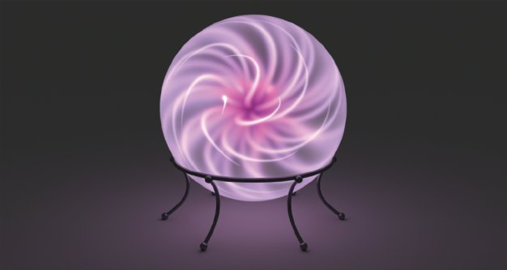

</details>

A Boolean, `is_emissive`, indicates whether any emission has been specified. It is initialized in the `GridMedium` constructor, which makes the implementation of the `IsEmissive()` interface method easy. The medium's properties at a given point are found by interpolating values from the appropriate grids:

```rust
impl Medium for GridMedium {
    fn is_emissive(&self) -> bool { self.is_emissive }

    fn sample_point(&self, mut p: Point3f, lambda: &SampledWavelengths)
        -> MediumProperties {
        // 〈Sample spectra for grid medium σa and σs〉
        let mut sigma_a = self.sigma_a_spec.sample(lambda);
        let mut sigma_s = self.sigma_s_spec.sample(lambda);
        // 〈Scale scattering coefficients by medium density at p〉
        p = self.render_from_medium.apply_inverse(p);
        let p = Point3f::from(self.bounds.offset(p)); // remap to [0,1]^3
        let d = self.density_grid.lookup(p);
        sigma_a *= d;
        sigma_s *= d;
        // 〈Compute grid emission Le at p〉
        let mut le = SampledSpectrum::new(0.0);
        if self.is_emissive {
            let scale = self.le_scale.lookup(p);
            if scale > 0.0 {
                le = if let Some(temp) = &self.temperature_grid {
                    let t = temp.lookup(p);
                    scale * BlackbodySpectrum::new(t).sample(lambda)
                } else {
                    scale * self.le_spec.sample(lambda)
                };
            }
        }
        MediumProperties { sigma_a, sigma_s, phase: &self.phase, le }
    }
}
```

<details>
<summary>Book-edition cross-references</summary>

`Bounds3f` 97 · `DenselySampledSpectrum` 167 · `Float` 23 · `GridMedium` 728 · `HGPhaseFunction` 713 · `SampledGrid` 1076 · `SampledSpectrum` 171 · `Transform` 120 · `DenselySampledSpectrum::Sample()` 167 · `GridMedium::isEmissive` 729 · `GridMedium::phase` 728 · `GridMedium::sigma_a_spec` 728 · `GridMedium::sigma_s_spec` 728 · `MediumProperties` 718 · `Point3f` 92 · `SampledWavelengths` 173

</details>

As mentioned earlier, `GridMedium` uses `DDAMajorantIterator` to provide its majorants rather than using a single grid-wide majorant:

```rust
type MajorantIterator = DDAMajorantIterator;
```

The `GridMedium` constructor concludes with the following fragment, which initializes a `MajorantGrid` with its majorants. Doing so is just a matter of iterating over all the majorant cells, computing their bounds, and finding the maximum density over them. The maximum density is easily found with a convenient `SampledGrid` method.

```rust
// 〈Initialize majorantGrid for GridMedium〉
for z in 0..majorant_grid.res.z {
    for y in 0..majorant_grid.res.y {
        for x in 0..majorant_grid.res.x {
            let bounds = majorant_grid.voxel_bounds(x, y, z);
            let max_density = density_grid.max_value(bounds);
            majorant_grid.set(x, y, z, max_density);
        }
    }
}
```

The implementation of the `SampleRay()` `Medium` interface method is now easy. We can find the overlap of the ray with the medium using a straightforward fragment, not included here, and compute the baseline $\sigma_t$ value. With that, we have enough information to initialize the `DDAMajorantIterator`.

```rust
fn sample_ray(&self, ray: Ray, ray_t_max: f32,
              lambda: &SampledWavelengths) -> DDAMajorantIterator {
    // 〈Transform ray to medium's space and compute bounds overlap〉
    let sigma_a = self.sigma_a_spec.sample(lambda);
    let sigma_s = self.sigma_s_spec.sample(lambda);
    let sigma_t = sigma_a + sigma_s;
    DDAMajorantIterator::new(ray, t_min, t_max, &self.majorant_grid, sigma_t)
}
```

<details>
<summary>Book-edition cross-references</summary>

`BlackbodySpectrum` 169 · `Bounds3::Offset()` 102 · `Bounds3f` 97 · `DDAMajorantIterator` 723 · `DenselySampledSpectrum::Sample()` 167 · `Float` 23 · `GridMedium` 728 · `GridMedium::bounds` 728 · `GridMedium::densityGrid` 728 · `GridMedium::isEmissive` 729 · `GridMedium::LeScale` 728 · `GridMedium::Le_spec` 728 · `GridMedium::majorantGrid` 730 · `GridMedium::renderFromMedium` 728 · `GridMedium::temperatureGrid` 728 · `MajorantGrid` 722 · `MajorantGrid::res` 722 · `MajorantGrid::Set()` 722 · `MajorantGrid::VoxelBounds()` 722 · `Point3f` 92 · `SampledGrid` 1076 · `SampledGrid::Lookup()` 1077 · `SampledGrid::MaxValue()` 1077 · `SampledSpectrum` 171 · `Transform::ApplyInverse()` 130

</details>

### 11.4.5 RGB GRID MEDIUM

The last `Medium` implementation that we will describe is the `RGBGridMedium`. It is a variant of `GridMedium` that allows specifying the absorption and scattering coefficients as well as volumetric emission via RGB colors. This makes it possible to render a variety of colorful volumetric effects; an example is shown in Figure 11.22.

```rust
// 〈RGBGridMedium Definition〉
struct RGBGridMedium {
    // 〈RGBGridMedium Private Members〉
    bounds: Bounds3f,
    render_from_medium: Transform,
    le_grid: Option<SampledGrid<RGBIlluminantSpectrum>>,
    le_scale: f32,
    sigma_a_grid: Option<SampledGrid<RGBUnboundedSpectrum>>,
    sigma_s_grid: Option<SampledGrid<RGBUnboundedSpectrum>>,
    sigma_scale: f32,
    phase: HGPhaseFunction,
    majorant_grid: MajorantGrid,
}
```

Its constructor, not included here, is similar to that of `GridMedium` in that most of what it does is to directly initialize member variables with values passed to it. As with `GridMedium`, the medium's extent is jointly specified by a medium space bounding box and a transformation from medium space to rendering space.

<details>
<summary>Book-edition cross-references</summary>

`Bounds3f` 97 · `DDAMajorantIterator` 723 · `Float` 23 · `GridMedium` 728 · `GridMedium::majorantGrid` 730 · `Ray` 95 · `RGBGridMedium` 731 · `SampledSpectrum` 171 · `SampledWavelengths` 173 · `Transform` 120

</details>

**Figure 11.22 — Volumetric scattering properties specified using RGB coefficients.** The `RGBGridMedium` class makes it possible to specify colorful participating media like the example shown here. (Scene courtesy of Jim Price.)

<details>
<summary>Pictorial figure: <code>images/img-1153-256.png</code></summary>


</details>

Emission is specified by the combination of an optional `SampledGrid` of `RGBIlluminantSpectrum` values and a scale factor. The `RGBGridMedium` reports itself as emissive if the grid is present and the scale is nonzero. This misses the case of a fully zero `LeGrid`, though we assume that case to be unusual:

```rust
fn is_emissive(&self) -> bool {
    self.le_grid.is_some() && self.le_scale > 0.0
}
```

Sampling the medium at a point is mostly a matter of converting the various RGB values to `SampledSpectrum` values and trilinearly interpolating them to find their values at the lookup point $\mathrm{p}$. As with earlier `Medium` implementations, the phase function is uniform throughout this medium. The absorption and scattering coefficients are stored using the `RGBUnboundedSpectrum` class. However, this class does not support the arithmetic operations that are necessary to perform trilinear interpolation in the `SampledGrid::Lookup()` method. For such cases, `SampledGrid` allows passing a callback function that converts the in-memory values to another type that does support them. Here, the implementation provides one that converts to `SampledSpectrum`, which does allow arithmetic and matches the type to be returned in `MediumProperties` as well. Because `sigma_scale` is applied to both $\sigma_a$ and $\sigma_s$, it provides a convenient way to fine-tune the density of a medium without needing to update all of its individual RGB values.

```rust
fn sample_point(&self, mut p: Point3f, lambda: &SampledWavelengths)
    -> MediumProperties {
    p = self.render_from_medium.apply_inverse(p);
    let p = Point3f::from(self.bounds.offset(p));

    // 〈Compute σa and σs for RGBGridMedium〉
    let convert = |s: RGBUnboundedSpectrum| s.sample(lambda);
    let sigma_a = self.sigma_scale
        * self.sigma_a_grid.as_ref()
            .map_or_else(|| SampledSpectrum::new(1.0), |g| g.lookup(p, convert));
    let sigma_s = self.sigma_scale
        * self.sigma_s_grid.as_ref()
            .map_or_else(|| SampledSpectrum::new(1.0), |g| g.lookup(p, convert));

    // 〈Find emitted radiance Le for RGBGridMedium〉
    let mut le = SampledSpectrum::new(0.0);
    if let Some(grid) = &self.le_grid {
        if self.le_scale > 0.0 {
            let convert = |s: RGBIlluminantSpectrum| s.sample(lambda);
            le = self.le_scale * grid.lookup(p, convert);
        }
    }
    MediumProperties { sigma_a, sigma_s, phase: &self.phase, le }
}
```

<details>
<summary>Book-edition cross-references</summary>

`Bounds3::Offset()` 102 · `Float` 23 · `HGPhaseFunction` 713 · `MediumProperties` 718 · `Point3f` 92 · `RGBGridMedium` 731 · `RGBGridMedium::LeGrid` 732 · `RGBGridMedium::LeScale` 732 · `RGBGridMedium::renderFromMedium` 731 · `RGBGridMedium::sigmaScale` 732 · `RGBIlluminantSpectrum` 199 · `RGBUnboundedSpectrum` 198 · `RGBUnboundedSpectrum::Sample()` 199 · `SampledGrid` 1076 · `SampledGrid::Lookup()` 1077 · `SampledSpectrum` 171 · `SampledWavelengths` 173 · `Transform::ApplyInverse()` 130

</details>

The `DDAMajorantIterator` provides majorants for the `RGBGridMedium` as well:

```rust
type MajorantIterator = DDAMajorantIterator;
```

The `MajorantGrid` that is used by the `DDAMajorantIterator` is initialized by the following fragment, which runs at the end of the `RGBGridMedium` constructor:

```rust
// 〈Initialize majorantGrid for RGBGridMedium〉
for z in 0..majorant_grid.res.z {
    for y in 0..majorant_grid.res.y {
        for x in 0..majorant_grid.res.x {
            let bounds = majorant_grid.voxel_bounds(x, y, z);
            // 〈Initialize majorantGrid voxel for RGB σa and σs〉
            initialize_majorant_voxel(&mut majorant_grid, x, y, z, bounds);
        }
    }
}
```

Before explaining how the majorant grid voxels are initialized, we will discuss why `RGBUnboundedSpectrum` values are stored in `rgbDensityGrid` rather than the more obvious choice of RGB values. The most important reason is that the RGB to spectrum conversion approach from Section 4.6.6 does not guarantee that the spectral distribution's value will always be less than or equal to the maximum of the original RGB components. Thus, storing RGB and setting majorants using bounds on RGB values would not give bounds on the eventual `SampledSpectrum` values that are computed. One might nevertheless try to store RGB, convert those RGB values to spectra when initializing the majorant grid, and then bound those spectra to find majorants. That approach would also be unsuccessful, since when two RGB values are linearly interpolated, the corresponding `RGBUnboundedSpectrum` does not vary linearly between the `RGBUnboundedSpectrum` distributions of the two original RGB values.

Thus, `RGBGridMedium` stores `RGBUnboundedSpectrum` values at the grid sample points and linearly interpolates their `SampledSpectrum` values at lookup points. With that approach, we can guarantee that bounds on `RGBUnboundedSpectrum` values in a region of space (and then a bit more, given trilinear interpolation) give bounds on the sampled spectral values that are returned by `SampledGrid::Lookup()` in the `SamplePoint()` method, fulfilling the requirement for the majorant grid. To compute the majorants, we use a `SampledGrid` method that returns its maximum value over a region of space and takes a lambda function that converts its underlying type to another—here, `Float` for the `MajorantGrid`.

<details>
<summary>Book-edition cross-references</summary>

`Bounds3f` 97 · `DDAMajorantIterator` 723 · `MajorantGrid` 722 · `MajorantGrid::res` 722 · `MajorantGrid::VoxelBounds()` 722 · `RGB` 182 · `RGBGridMedium` 731 · `RGBGridMedium::LeGrid` 732 · `RGBGridMedium::LeScale` 732 · `RGBGridMedium::majorantGrid` 734 · `RGBIlluminantSpectrum` 199 · `RGBIlluminantSpectrum::Sample()` 200 · `RGBUnboundedSpectrum` 198 · `SampledGrid` 1076 · `SampledGrid::Lookup()` 1077 · `SampledSpectrum` 171

</details>

One nit in how the majorants are computed is that the following code effectively assumes that the values in the $\sigma_a$ and $\sigma_s$ grids are independent. Although it computes a valid majorant, it is unable to account for cases like the two being defined such that $\sigma_s = c - \sigma_a$ for some constant $c$. Then, the bound will be looser than it could be.

```rust
// 〈Initialize majorantGrid voxel for RGB σa and σs〉
let max = |s: RGBUnboundedSpectrum| s.max_value();
let max_sigma_t =
    self.sigma_a_grid.as_ref().map_or(1.0, |g| g.max_value(bounds, max))
  + self.sigma_s_grid.as_ref().map_or(1.0, |g| g.max_value(bounds, max));
majorant_grid.set(x, y, z, self.sigma_scale * max_sigma_t);
```

With the majorant grid initialized, the `SampleRay()` method's implementation is trivial. (See Exercise 11.3 for a way in which it might be improved, however.)

```rust
// 〈RGBGridMedium Public Methods〉
fn sample_ray(&self, ray: Ray, ray_t_max: f32,
              lambda: &SampledWavelengths) -> DDAMajorantIterator {
    // 〈Transform ray to medium's space and compute bounds overlap〉
    let sigma_t = SampledSpectrum::new(1.0);
    DDAMajorantIterator::new(ray, t_min, t_max, &self.majorant_grid, sigma_t)
}
```

<details>
<summary>Book-edition cross-references</summary>

`DDAMajorantIterator` 723 · `Float` 23 · `MajorantGrid` 722 · `MajorantGrid::Set()` 722 · `Ray` 95 · `RGBGridMedium::majorantGrid` 734 · `RGBGridMedium::sigmaScale` 732 · `RGBGridMedium::sigma_aGrid` 732 · `RGBGridMedium::sigma_sGrid` 732 · `RGBUnboundedSpectrum` 198 · `SampledGrid::MaxValue() 1077 · SampledSpectrum` 171 · `SampledWavelengths` 173

</details>

The WGSL-side representation of an RGB grid medium mirrors the host struct: grid dimensions, a transform into medium space, a density/emission 3D texture, and per-channel scale factors kept in a uniform buffer. Sampling is a single trilinear `textureSampleLevel` followed by the scale multiply, which is why grid media are a natural fit for a wgpu compute path tracer:

```wgsl
struct RGBGridUniforms {
    render_from_medium: mat4x4f,
    bounds_min: vec3f,
    bounds_size: vec3f,
    sigma_scale: vec3f,
    le_scale: vec3f,
};

@group(0) @binding(0) var<uniform> grid: RGBGridUniforms;
@group(0) @binding(1) var density_tex: texture_3d<f32>;
@group(0) @binding(2) var emission_tex: texture_3d<f32>;
@group(0) @binding(3) var grid_sampler: sampler;

fn sample_medium(p_render: vec3f) -> MediumProperties {
    let p_medium = (grid.render_from_medium * vec4f(p_render, 1.0)).xyz;
    let uvw = (p_medium - grid.bounds_min) / grid.bounds_size;
    let density = textureSampleLevel(density_tex, grid_sampler, uvw, 0.0).rgb;
    return MediumProperties(
        grid.sigma_scale * density,          // sigma_a
        grid.sigma_scale * density,          // sigma_s (RGB channels)
        grid.le_scale * textureSampleLevel(emission_tex, grid_sampler, uvw, 0.0).rgb, // le
    );
}
```

---

## Notes

[^fn1]: The position for the $L_i$ functions should actually be $\mathrm{p} + \mathrm{d}t\,\omega$, though in a slight abuse of notation we will here and elsewhere use $\mathrm{p}$.

[^fn2]: This difference is purely due to convention; the phase function could have equally well been defined to include the albedo, like the BSDF.

[^fn3]: The attentive reader will note that for some of the following Monte Carlo estimators based on null scattering, there is no mathematical requirement that $\sigma_n$ must be positive and that thus, the so-called majorant is not necessarily greater than or equal to $\sigma_a + \sigma_s$. It turns out that Monte Carlo estimators that include negative $\sigma_n$ values tend to have high variance, so in practice actual majorants are used.

[^fn4]: Note that the sign of the $2g(\cos\theta)$ term in the denominator is the opposite of the sign used in the scattering literature. This difference is due to our use of the same direction convention for BSDFs and phase functions.

[^fn5]: Once more, there is a sign difference compared to the radiative transfer literature: the first argument to $p$ is negated due to our use of the same direction convention for BSDFs and phase functions.

[^fn6]: If you are wondering why it is correct to use the value of `t_min` that was computed using `ray` with `ray_grid` to find the point `grid_intersect`, review Section 6.1.4 and carefully consider how the components of `ray_grid` are initialized.

---

## FURTHER READING

The books written by van de Hulst (1980) and Preisendorfer (1965, 1976) are excellent introductions to volume light transport. The seminal book by Chandrasekhar (1960) is another excellent resource, although it is mathematically challenging. d'Eon's book (2016) has rigorous coverage of this topic and includes extensive references to work in the area. Novák et al.'s report (2018) provides a comprehensive overview of research in volumetric light transport for rendering through 2018; see also the "Further Reading" section of Chapter 14 for more references on this topic. The Henyey–Greenstein phase function was originally described by Henyey and Greenstein (1941). Detailed discussion of scattering and phase functions, along with derivations of phase functions that describe scattering from independent spheres, cylinders, and other simple shapes, can be found in van de Hulst's book (1981). Extensive discussion of the Mie and Rayleigh scattering models is also available there. Hansen and Travis's survey article is also a good introduction to the variety of commonly used phase functions (Hansen and Travis 1974); see also d'Eon's book (2016) for a catalog of useful phase functions and associated sampling techniques.

While the Henyey–Greenstein model often works well, there are many media that it cannot represent accurately. Gkioulekas et al. (2013a) showed that sums of Henyey–Greenstein and von Mises-Fisher lobes are more accurate for representing scattering in many materials than Henyey–Greenstein alone and derived a 2D parameter space that allows for intuitive control of translucent appearance. The paper by Raab et al. (2006) introduced many important sampling building-blocks for rendering participating media to graphics, including the delta-tracking algorithm for inhomogeneous media. Delta tracking has been independently invented in a number of fields; see both Kutz et al. (2017) and Kettunen et al. (2021) for further details of this history.

<details>
<summary>Book-edition cross-references</summary>

`DDAMajorantIterator` 723 · `Float` 23 · `MajorantGrid` 722 · `MajorantGrid::Set()` 722 · `Ray` 95 · `RGBGridMedium::majorantGrid` 734 · `RGBGridMedium::sigmaScale` 732 · `RGBGridMedium::sigma_aGrid` 732 · `RGBGridMedium::sigma_sGrid` 732 · `RGBUnboundedSpectrum` 198 · `SampledGrid::MaxValue()` 1077 · `SampledSpectrum` 171 · `SampledWavelengths` 173

</details>

The ratio tracking algorithm was introduced to graphics by Novák et al. (2014), though see the discussion in Novák et al. (2018) for the relationship of this approach to previously developed estimators in neutron transport. Novák et al. (2014) also introduced residual ratio tracking, which makes use of lower bounds on a medium's density to analytically integrate part of the beam transmittance. Kutz et al. (2017) extended this approach to distance sampling and introduced the integral formulation of transmittance due to Galtier et al. (2013). Our derivation of the integral transmittance equations (11.10) and (11.13) follows Georgiev et al. (2019), as does our discussion of connections between those equations and various transmittance estimators. Georgiev et al. also developed a number of additional estimators for transmittance that can give significantly lower error than the ratio tracking estimator that pbrt uses. Kettunen et al. (2021) recently developed a significantly improved transmittance estimator with much lower error than previous approaches.

Remarkably, their estimator is effectively a combination of uniform ray marching with a correction term that removes bias. For media with substantial variation in density, delta tracking can be inefficient—many small steps must be taken to get through the optically thin sections. Danskin and Hanrahan (1992) presented a technique for efficient volume ray marching using a hierarchical data structure. Another way of addressing this issue was presented by Szirmay-Kalos et al. (2011), who used a grid to partition scattering volumes in cells and applied delta tracking using the majorant of each cell as the ray passed through them. This is effectively the approach implemented in pbrt's `DDAMajorantIterator`. The grid cell traversal algorithm implemented there is due to Cleary and Wyvill (1988) and draws from Bresenham's line drawing algorithm (Bresenham 1965). Media stored in grids are sometimes tabulated in the camera's projective space, making it possible to have more detail close to the camera and less detail farther away. Gamito has recently developed an algorithm for DDA traversal in this case (Gamito 2021). Yue et al. (2010) used a kd-tree to store majorants, which was better able to adapt to spatially varying densities than a grid. In follow-on work, they derived an approach to estimate the efficiency of spatial partitionings and used it to construct them more effectively (Yue et al. 2011). Because scattering may be sampled rarely in optically thin media, many samples may be necessary to achieve low error. To address this issue, Villemin et al. proposed increasing the sampling density in such media (Villemin et al. 2018). Kulla and Fajardo (2012) noted that techniques based on sampling according to transmittance ignore another important factor: spatial variation in the scattering coefficient. They developed a method based on computing a tabularized 1D sampling distribution for each ray passing through participating media based on the product of beam transmittance and scattering coefficient at a number of points along it. They then drew samples from this distribution, showing good results. A uniform grid of sample values as is implemented in `GridMedium` and `RGBGridMedium` may consume an excessive amount of memory, especially for media that have not only large empty regions of space but also fine detail in some regions. This issue is addressed by Museth's VDB format (2013) as well as the Field3D system that was described by Wrenninge (2015), both of which use adaptive hierarchical grids to reduce storage requirements. pbrt's `NanoVDBMedium` is based on NanoVDB (Museth 2021), which is a lighterweight version of VDB.

<details>
<summary>Book-edition cross-references</summary>

`DDAMajorantIterator` 723 · `GridMedium` 728 · `NanoVDBMedium` 714 · `RGBGridMedium` 731

</details>

Just as procedural modeling of textures is an effective technique for shading surfaces, procedural modeling of volume densities can be used to describe realistic-looking volumetric objects like clouds and smoke. Perlin and Hoffert (1989) described early work in this area, and the book by Ebert et al. (2003) has a number of sections devoted to this topic, including further references. More recently, accurate physical simulation of the dynamics of smoke and fire has led to extremely realistic volume data sets, including the ones used in this chapter; for early work in this area, see for example Fedkiw, Stam, and Jensen (2001). The book by Wrenninge (2012) has further information about modeling participating media, with particular focus on techniques used in modern feature film production. For media that are generated through simulations, it may be desirable to account for the variation in the medium over time in order to include the effect of motion blur. Clinton and Elendt (2009) described an approach to do so based on deforming the vertices of the grid that stores the medium, and Kulla and Fajardo (2012) applied Eulerian motion blur, where each grid cell also stores a velocity vector that is used to shift the lookup point based on its time. Wrenninge described a more efficient approach that instead stores the scattering properties in each cell as a compact time-varying function (Wrenninge 2016).

In this chapter, we have ignored all issues related to sampling and antialiasing of volume density functions that are represented by samples in a 3D grid, although these issues should be considered, especially in the case of a volume that occupies just a few pixels on the screen. Furthermore, we have used a simple triangle filter to reconstruct densities at intermediate positions, which is suboptimal for the same reasons that the triangle filter is not a high-quality image reconstruction filter. Marschner and Lobb (1994) presented the theory and practice of sampling and reconstruction for 3D data sets, applying ideas similar to those in Chapter 8. See also the paper by Theußl, Hauser, and Gröller (2000) for a comparison of a variety of windowing functions for volume reconstruction with the sinc function and a discussion of how to derive optimal parameters for volume reconstruction filter functions. Hofmann et al. (2021) noted that sample reconstruction may have a significant performance cost, even with trilinear filtering. They suggested stochastic sample filtering, where a single volume sample is chosen with probability given by its filter weight, and showed performance benefits. However, this approach does introduce bias if a nonlinear function is applied to the sample value (as is the case when estimating transmittance, for example).

Acquiring volumetric scattering properties of real-world objects is particularly difficult, requiring a solution to the inverse problem of determining the values that lead to the measured result. See Jensen et al. (2001b), Goesele et al. (2004), Narasimhan et al. (2006), and Peers et al. (2006) for work on acquiring scattering properties for subsurface scattering. More recently, Gkioulekas et al. (2013b) produced accurate measurements of a variety of media. Hawkins et al. (2005) have developed techniques to measure properties of media like smoke, acquiring measurements in real time. Another interesting approach to this problem was introduced by Frisvad et al. (2007), who developed methods to compute these properties from a lower-level characterization of the scattering properties of the medium. A comprehensive survey of work in this area was presented by Frisvad et al. (2020). (See also the discussion of inverse rendering techniques in Section 16.3.1 for additional approaches to these problems.) Acquiring the volumetric density variation of participating media is also challenging. See work by Fuchs et al. (2007), Atcheson et al. (2008), and Gu et al. (2013a) for a variety of approaches to this problem, generally based on illuminating the medium in particular ways while photographing it from one or more viewpoints.

<details>
<summary>Book-edition cross-references</summary>

`GridMedium` 728 · `RGBGridMedium` 731

</details>

---

## EXERCISES

**➋ 11.1** The `GridMedium` and `RGBGridMedium` classes use a relatively large amount of memory for complex volume densities. Determine their memory requirements when used with complex medium densities and modify their implementations to reduce memory use. One approach might be to detect regions of space with constant (or relatively constant) density values using an octree data structure and to only refine the octree in regions where the densities are changing. Another possibility is to use less memory to record each density value—for example, by computing the minimum and maximum densities and then using 8 or 16 bits per density value to interpolate between them. What sorts of errors appear when either of these approaches is pushed too far?

**➋ 11.2** Improve `GridMedium` to allow specifying grids of arbitrary `Spectrum` values to define emission. How much more memory does your approach use for blackbody emission distributions than the current implementation, which only stores floating-point temperatures in that case? How much memory does it use when other spectral representations are provided? Can you find ways of reducing memory use—for example, by detecting equal spectra and only storing them in memory once?

**➌ 11.3** One shortcoming of the majorants computed by the `RGBGridMedium` is that they do not account for spectral variation in the scattering coefficients—although conservative, they may give a loose bound for wavelengths where the coefficients are much lower than the maximum values. Computing tighter majorants is not straightforward in a spectral renderer: in a renderer that used RGB color for rendering, it is easy to maintain a majorant grid of RGB values instead of Floats, though doing so is more difficult with a spectral renderer, for reasons related to why `RGBUnboundedSpectrum` values are stored in the grids for $\sigma_a$ and $\sigma_s$ and not RGB. (See the discussion of this topic before the 〈Initialize majorantGrid voxel for RGB σa and σs〉 fragment.) Investigate this issue and develop an approach that better accounts for spectral variation in the scattering coefficients to return wavelength-varying majorants when `RGBGridMedium::SampleRay()` is called. You might, for example, find a way to compute `RGBUnboundedSpectrum` values that bound the maximum of two or more others. How much overhead does your representation introduce? How much is rendering time improved for scenes with colored media due to more efficient sampling when it is used?

**➋ 11.4** The `Medium` implementations that use the `MajorantGrid` all currently use fixed grid resolutions for it, regardless of the amount of variation in density in their underlying media. Read the paper by Yue et al. (2011) and use their approach to choose those resolutions adaptively. Then, measure performance over a sweep of grid sizes with a variety of volume densities. Are there any cases where there is a significant performance benefit from a different grid resolution? Considering their assumptions and pbrt's implementation, can you explain any discrepancies between grid sizes set with their heuristics versus the most efficient resolution in pbrt?

**➋ 11.5** Read Wrenninge's paper (2016) on a time-varying density representation for motion blur in volumes and implement this approach in pbrt. One challenge will be to generate volumes in this representation; you may need to implement a physical simulation system in order to make some yourself.

<details>
<summary>Book-edition cross-references</summary>

`GridMedium` 728 · `MajorantGrid` 722 · `RGBGridMedium` 731 · `RGBGridMedium::SampleRay()` 734 · `RGBUnboundedSpectrum` 198 · `Spectrum` 165

</details>

---

[↑ Back to top](#contents)
