# Chapter 12: Light Sources

<!-- interactive-nav -->
## Contents

- [Light Sources (wgpu)](#light-sources-wgpu)
- [12.1 LIGHT INTERFACE](#121-light-interface)
- [12.2 POINT LIGHTS](#122-point-lights)
- [12.3 DISTANT LIGHTS](#123-distant-lights)
- [12.4 AREA LIGHTS](#124-area-lights)
- [12.5 INFINITE AREA LIGHTS](#125-infinite-area-lights)
- [12.6 LIGHT SAMPLING](#126-light-sampling)
- [FURTHER READING](#further-reading)
- [EXERCISES](#exercises)

---

## Light Sources (wgpu)

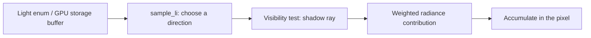

In a wgpu renderer the ideas in this chapter map cleanly onto two layers: CPU-side Rust code builds and bounds the lights (any `Light` can be packed into a storage buffer), and WGSL code samples them in a shading or compute pass. The sampling distributions, PDFs, and importance values derived here are exactly the numbers a shader needs in order to produce an unbiased estimate of direct illumination.

In order for objects in a scene to be visible, there must be a source of illumination so that some light is reflected from them to the camera sensor. To that end, this chapter first presents the `Light` interface, which allows specification of a variety of types of light sources. (Before reading this chapter, you may wish to review Section 4.4, which describes the physical processes underlying light emission.) The implementations of a number of useful light sources follow. Because the implementations of different types of lights are all hidden behind a carefully designed interface, the light transport routines in Chapters 13 through 15 can generally operate without knowing which particular types of lights are in the scene, similar to how acceleration structures can hold collections of different types of primitives without needing to know the details of their actual representations.

A wide variety of light source models are introduced in this chapter, although the variety is slightly limited by pbrt’s physically based design. Many non-physical light source models have been developed for computer graphics, incorporating control over properties like the rate at which the light falls off with distance, which objects are illuminated by the light, which objects cast shadows from the light, and so on. These sorts of controls are incompatible with physically based light transport algorithms and thus cannot be provided in the models here.

As an example of the problems such lighting controls pose, consider a light that does not cast shadows: the total energy arriving at surfaces in the scene increases without bound as more surfaces are added. Consider a series of concentric shells of spheres around such a light; if occlusion is ignored, each added shell increases the total received energy. This directly violates the principle that the total energy arriving at surfaces illuminated by the light cannot be greater than the total energy emitted by the light.

In scenes with many lights, it is impractical to account for the illumination from all of them at each point being shaded. Fortunately, this issue is yet another that can be handled stochastically. Given a suitable weighting factor, an unbiased estimate of the effect of illumination from all the lights can be computed by considering just a few of them, or even just one. The last section of this chapter therefore introduces the `LightSampler`, which defines an interface for choosing such light sources as well as a number of implementations of it.

<details>
<summary>Book index references: Light 740, LightSampler 781</summary>

`Light` (page 740) · `LightSampler` (page 781).

</details>

## 12.1 LIGHT INTERFACE

The `Light` class defines the interface that light sources must implement. It is defined in the file `base/light.h` and all the light implementations in the following sections are in the files `lights.h` and `lights.cpp`. In a Rust port the tagged pointer becomes an enum, which gives the same static dispatch on the active light type:

*〈Light Definition〉 ≡*

```rust
enum Light {
    Point(PointLight),
    Distant(DistantLight),
    Projection(ProjectionLight),
    Goniometric(GoniometricLight),
    Spot(SpotLight),
    DiffuseArea(DiffuseAreaLight),
    UniformInfinite(UniformInfiniteLight),
    ImageInfinite(ImageInfiniteLight),
    PortalImageInfinite(PortalImageInfiniteLight),
}

trait LightInterface {
    // <Light Interface>
    fn phi(&self, lambda: SampledWavelengths) -> SampledSpectrum;
    fn kind(&self) -> LightType;
    fn sample_li(&self, ctx: LightSampleContext, u: Point2f,
                 lambda: SampledWavelengths, allow_incomplete_pdf: bool)
        -> Option<LightLiSample>;
    fn pdf_li(&self, ctx: LightSampleContext, wi: Vector3f,
              allow_incomplete_pdf: bool) -> f32;
    fn l(&self, p: Point3f, n: Normal3f, uv: Point2f, w: Vector3f,
         lambda: &SampledWavelengths) -> SampledSpectrum;
    fn le(&self, ray: &Ray, lambda: &SampledWavelengths) -> SampledSpectrum;
    fn preprocess(&mut self, scene_bounds: &Bounds3f);
}
```

This chapter will describe all 9 of the following types of light source.

*〈Light Source Types〉 ≡ (page 740)* — `PointLight`, `DistantLight`, `ProjectionLight`, `GoniometricLight`, `SpotLight`, `DiffuseAreaLight`, `UniformInfiniteLight`, `ImageInfiniteLight`, `PortalImageInfiniteLight`.

All lights must be able to return their total emitted power, $\Phi$. Among other things, this makes it possible to sample lights according to their relative power in the forthcoming `PowerLightSampler`. Devoting more samples to the lights that make the largest contribution can significantly improve rendering efficiency.

*〈Light Interface〉 ≡ (page 740)*

```rust
fn phi(&self, lambda: SampledWavelengths) -> SampledSpectrum;
```

The Light interface does not completely abstract away all the differences among different types of light source. While doing so would be desirable in principle, in practice pbrt’s integrators sometimes need to handle different types of light source differently, both for efficiency and for correctness. We have already seen an example of this issue in the `RandomWalkIntegrator` in Section 1.3.6. There, “infinite” lights received special handling since they must be considered for rays that escape the scene without hitting any geometry.

Another example is that the Monte Carlo algorithms that sample illumination from light sources need to be aware of which lights are described by delta distributions, since this affects some of their computations. Lights therefore categorize themselves into one of a few different types; the `Type()` method returns which one a light is.

*〈Light Interface〉 +≡ (page 740)*

```rust
fn kind(&self) -> LightType;
```

There are four different light categories:

- `DeltaPosition`: lights that emit solely from a single point in space. (“Delta” refers to the fact that such lights can be described by Dirac delta distributions.)
- `DeltaDirection`: lights that emit radiance along a single direction.
- `Area`: lights that emit radiance from the surface of a geometric shape.
- `Infinite`: lights “at infinity” that do not have geometry associated with them but provide radiance to rays that escape the scene.

*〈LightType Definition〉 ≡*

```rust
enum LightType { DeltaPosition, DeltaDirection, Area, Infinite }
```

A helper function checks if a light is defined using a Dirac delta distribution.

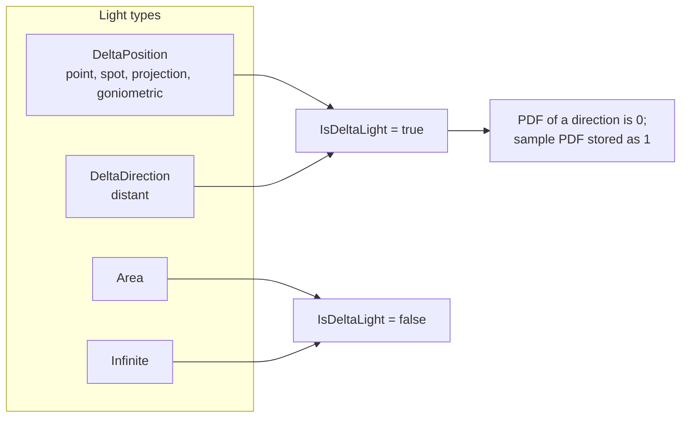

*Figure 12.1 (diagram, redrawn)* — An effective sampling strategy for choosing an incident direction from a point for direct lighting computations is to allow the light source to define a distribution of directions with respect to solid angle at the point. A small spherical light source subtends a narrow cone of directions at the receiving point; sampling inside that cone is far better than sampling uniformly over the hemisphere.

*〈Light Inline Functions〉 ≡*

```rust
fn is_delta_light(t: LightType) -> bool {
    matches!(t, LightType::DeltaPosition | LightType::DeltaDirection)
}
```

Being able to sample directions at a point where illumination may be incident is an important sampling operation for rendering. Consider a diffuse surface illuminated by a small spherical area light source (Figure 12.1): sampling directions using the `BSDF`’s sampling distribution is likely to be very inefficient because the light is only visible within a small cone of directions from the point. A much better approach is to instead use a sampling distribution that is based on the light source. In this case, the sampling routine should choose from among only those directions where the sphere is potentially visible.

This important task is the responsibility of implementations of the `SampleLi()` method. Its caller passes a `LightSampleContext` that provides information about a reference point in the scene, and the light optionally returns a `LightLiSample` that encapsulates incident radiance, information about where it is being emitted from, and the value of the probability density function (PDF) for the sampled point. If it is impossible for light to reach the reference point or if there is no valid light sample associated with u, an invalid sample can be returned. Finally, `allowIncompletePDF` indicates whether the sampling routine may skip generating samples for directions where the light’s contribution is small. This capability is used by integrators that apply MIS compensation (Section 2.2.3).

*〈Light Interface〉 +≡ (page 740)*

```rust
fn sample_li(&self, ctx: LightSampleContext, u: Point2f,
             lambda: SampledWavelengths, allow_incomplete_pdf: bool)
    -> Option<LightLiSample>;
```

<details>
<summary>Book index references: LightLiSample 743, LightSampleContext 741, LightType 740, Point2f 92, SampledWavelengths 173</summary>

`LightLiSample` (743) · `LightSampleContext` (741) · `LightType` (740) · `LightType::DeltaDirection` (740) · `LightType::DeltaPosition` (740) · `Point2f` (92) · `SampledWavelengths` (173).

</details>

The `LightSampleContext` takes the usual role of encapsulating just as much information about the point receiving illumination as the various sampling routines need.

*〈LightSampleContext Definition〉 ≡*

```rust
struct LightSampleContext { pi: Point3fi, n: Normal3f, ns: Normal3f }
```

The context just stores a point in the scene, a surface normal, and a shading normal. The point is provided as a `Point3fi` that makes it possible to include error bounds around the computed ray intersection point. Some of the following sampling routines will need this information as part of their sampling process. If the point is in a scattering medium and not on a surface, the two normals are left at their default $(0, 0, 0)$ values.

Note that the context does not include a time—pbrt’s light sources do not support animated transformations. An exercise at the end of the chapter discusses issues related to extending them to do so.

*〈LightSampleContext Public Members〉 ≡ (page 742)*

```rust
pi: Point3fi,
n: Normal3f,
ns: Normal3f,
```

As with the other Context classes, a variety of constructors make it easy to create a `LightSampleContext`.

*〈LightSampleContext Public Methods〉 ≡ (page 742)*

```rust
impl LightSampleContext {
    fn from_surface(si: &SurfaceInteraction) -> Self {
        Self { pi: si.pi, n: si.n, ns: si.shading.n }
    }
    fn from_interaction(intr: &Interaction) -> Self {
        Self { pi: intr.pi, n: Normal3f::ZERO, ns: Normal3f::ZERO }
    }
    fn new(pi: Point3fi, n: Normal3f, ns: Normal3f) -> Self {
        Self { pi, n, ns }
    }
}
```

A convenience method provides the point as a regular `Point3f` for the routines that would prefer to access it as such.

*〈LightSampleContext Public Methods〉 +≡ (page 742)*

```rust
fn p(&self) -> Point3f { Point3f::from(self.pi) }
```

Light samples are bundled up into instances of the `LightLiSample` structure. The radiance $L$ is the amount of radiance leaving the light toward the receiving point; it does not include the effect of extinction due to participating media or occlusion, if there is an object between the light and the receiver. `wi` gives the direction along which light arrives at the point that was specified via the `LightSampleContext` (see Figure 12.2) and the point from which light is being emitted is provided by `pLight`. Finally, the PDF value for the light sample is returned in `pdf`. This PDF should be measured with respect to solid angle at the receiving point.

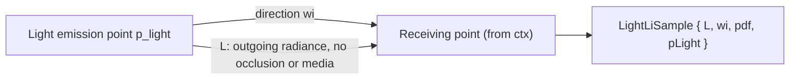

*Figure 12.2 (diagram, redrawn)* — The `Light::SampleLi()` method returns incident radiance from the light at a point and also returns the direction vector $\omega_i$ that gives the direction from which radiance is arriving.

<details>
<summary>Book index references: Interaction 136, LightLiSample 743, Normal3f 94, Point3f 92, Point3fi 1061, SurfaceInteraction 138</summary>

`Interaction` (136) · `Light::SampleLi()` (741) · `LightSampleContext` (741) · `LightSampleContext::pi` (742) · `Normal3f` (94) · `Point3f` (92) · `Point3fi` (1061) · `SurfaceInteraction` (138).

</details>

*〈LightLiSample Definition〉 ≡*

```rust
struct LightLiSample {
    l: SampledSpectrum,   // incident radiance, without occlusion / media
    wi: Vector3f,         // direction from which radiance arrives
    pdf: f32,             // with respect to solid angle at the receiver
    p_light: Interaction, // point from which light is emitted
}

impl LightLiSample {
    fn new(l: SampledSpectrum, wi: Vector3f, pdf: f32,
           p_light: Interaction) -> Self { Self { l, wi, pdf, p_light } }
}
```

Just as we saw for perfect specular reflection and transmission with BSDFs, light sources that are defined in terms of delta distributions fit naturally into this sampling framework, although they require care on the part of the routines that call their sampling methods, since there are implicit delta distributions in the radiance and PDF values that they return. For the most part, these delta distributions naturally cancel out when estimators are evaluated, although multiple importance sampling code must be aware of this case, just as with BSDFs. For samples taken from delta distribution lights, the `pdf` value in the returned `LightLiSample` should be set to 1.

Related to this, the `PDF_Li()` method returns the value of the PDF for sampling the given direction `wi` from the point represented by `ctx`. This method is particularly useful in the context of multiple importance sampling (MIS) where, for example, the `BSDF` may have sampled a direction and we need to compute the PDF for the light’s sampling that direction in order to compute the MIS weight. Implementations of this method may assume that a ray from `ctx` in direction `wi` has already been found to intersect the light source, and as with `SampleLi()`, the PDF should be measured with respect to solid angle. Here, the returned PDF value should be 0 if the light is described by a Dirac delta distribution.

*〈Light Interface〉 +≡ (page 740)*

```rust
fn pdf_li(&self, ctx: LightSampleContext, wi: Vector3f,
          allow_incomplete_pdf: bool) -> f32;
```

If a ray happens to intersect an area light source, it is necessary to find the radiance that is emitted back along the ray. This task is handled by the `L()` method, which takes local information about the intersection point and the outgoing direction. This method should never be called for any light that does not have geometry associated with it.

*〈Light Interface〉 +≡ (page 740)*

```rust
fn l(&self, p: Point3f, n: Normal3f, uv: Point2f, w: Vector3f,
     lambda: &SampledWavelengths) -> SampledSpectrum;
```

<details>
<summary>Book index references: Bounds3f 97, Float 23, Interaction 136, LightType::Infinite 740, Ray 95, Vector3f 86, and others</summary>

`Bounds3f` (97) · `Float` (23) · `Interaction` (136) · `LightLiSample` (743) · `LightSampleContext` (741) · `LightType::Infinite` (740) · `Normal3f` (94) · `Point2f` (92) · `Point3f` (92) · `Ray` (95) · `SampledSpectrum` (171) · `SampledWavelengths` (173) · `Vector3f` (86).

</details>

Another interface method that only applies to some types of lights is `Le()`. It enables infinite area lights to contribute radiance to rays that do not hit any geometry in the scene. This method should only be called for lights that report their type to be `LightType::Infinite`.

*〈Light Interface〉 +≡ (page 740)*

```rust
fn le(&self, ray: &Ray, lambda: &SampledWavelengths) -> SampledSpectrum;
```

Finally, the `Light` interface includes a `Preprocess()` method that is invoked prior to rendering. It takes the rendering space bounds of the scene as an argument. Some light sources need to know these bounds and they are not available when lights are initially created, so this method makes the bounds available to them.

*〈Light Interface〉 +≡ (page 740)*

```rust
fn preprocess(&mut self, scene_bounds: &Bounds3f);
```

There are three additional light interface methods that will be defined later, closer to the code that uses them. `Light::Bounds()` provides information that bounds the light’s spatial and directional emission distribution; one use of it is to build acceleration hierarchies for light sampling, as is done in Section 12.6.3. `Light::SampleLe()` and `Light::PDF_Le()` are used to sample rays leaving light sources according to their distribution of emission. They are cornerstones of bidirectional light transport algorithms and are defined in the online edition of the book along with algorithms that use them.

### 12.1.1 PHOTOMETRIC LIGHT SPECIFICATION

pbrt uses radiometry as the basis of its model of light transport. However, light sources are often described using photometric units—a light bulb package might report that it emits 1,000 lumens of light, for example. Beyond their familiarity, one advantage of photometric descriptions of light emission is that they also account for the variation of human visual response with wavelength. It is also more intuitive to describe lights in terms of the visible power that they emit rather than the power they consume in the process of doing so. (Related to this topic, recall the discussion of luminous efficacy in Section 4.4.) Therefore, light sources in pbrt’s scene description files can be specified in terms of the luminous power that they emit. These specifications are then converted to radiometric quantities in the code that initializes the scene representation. Radiometric values are then passed to the constructors of the `Light` implementations in this chapter, often in the form of a base spectral distribution and a scale factor that is applied to it.

### 12.1.2 THE `LightBase` CLASS

As there was with classes like `CameraBase` and `FilmBase` for `Camera` and `Film` implementations, there is a `LightBase` class that all of pbrt’s light sources inherit from. `LightBase` stores a number of values that are common to all of pbrt’s lights and is thus able to implement some of the `Light` interface methods. It is not required that a `Light` in pbrt inherit from `LightBase`, but lights must provide implementations of a few more `Light` methods if they do not. (In Rust, `LightBase` becomes a struct that each light stores as a field, with a small trait providing the shared methods.)

*〈LightBase Definition〉 ≡*

```rust
struct LightBase {
    // <LightBase Protected Members>
    kind: LightType,
    render_from_light: Transform,
    medium_interface: MediumInterface,
    spectrum_cache: &'static InternCache<DenselySampledSpectrum>,
}

impl LightBase {
    // <LightBase Public Methods>
    fn kind(&self) -> LightType { self.kind }
    fn l(&self, _p: Point3f, _n: Normal3f, _uv: Point2f, _w: Vector3f,
         _lambda: &SampledWavelengths) -> SampledSpectrum {
        SampledSpectrum::ZERO
    }
    fn le(&self, _ray: &Ray, _lambda: &SampledWavelengths) -> SampledSpectrum {
        SampledSpectrum::ZERO
    }
    // <LightBase Protected Methods>
    fn lookup_spectrum(s: Spectrum) -> &'static DenselySampledSpectrum;
}
```

The following three values are passed to the `LightBase` constructor, which stores them in these member variables:

- `type` characterizes the light’s type.
- `renderFromLight` is a transformation that defines the light’s coordinate system with respect to rendering space. As with shapes, it is often handy to be able to implement a light assuming a particular coordinate system (e.g., that a spotlight is always located at the origin of its light space, shining down the +z axis). The rendering-from-light transformation makes it possible to place such lights at arbitrary positions and orientations in the scene.
- A `MediumInterface` describes the participating medium on the inside and the outside of the light source. For lights that do not have “inside” and “outside” (e.g., a point light), the `MediumInterface` stores the same `Medium` on both sides.

<details>
<summary>Book index references: Camera 206, CameraBase 212, Film 244, FilmBase 247, Light::Bounds() 791, Medium 714, MediumInterface 715</summary>

`Camera` (206) · `CameraBase` (212) · `Film` (244) · `FilmBase` (247) · `Light` (740) · `Light::Bounds()` (791) · `LightBase` (744) · `Medium` (714) · `MediumInterface` (715).

</details>

*〈LightBase Protected Members〉 ≡ (page 744)*

```rust
kind: LightType,
render_from_light: Transform,
medium_interface: MediumInterface,
```

`LightBase` can thus take care of providing an implementation of the `Type()` interface method.

*〈LightBase Public Methods〉 ≡ (page 744)*

```rust
fn kind(&self) -> LightType { self.kind }
```

It also provides default implementations of `L()` and `Le()` so that lights that are not respectively area or infinite lights do not need to implement these themselves.

*〈LightBase Public Methods〉 +≡ (page 744)*

```rust
fn l(&self, _p: Point3f, _n: Normal3f, _uv: Point2f, _w: Vector3f,
     _lambda: &SampledWavelengths) -> SampledSpectrum {
    SampledSpectrum::ZERO
}
```

*〈LightBase Public Methods〉 +≡ (page 744)*

```rust
fn le(&self, _ray: &Ray, _lambda: &SampledWavelengths) -> SampledSpectrum {
    SampledSpectrum::ZERO
}
```

Most of the following `Light` implementations take a `Spectrum` value in their constructor to specify the light’s spectral emission but then convert it to a `DenselySampledSpectrum` to store in a member variable. By doing so, they enjoy the benefits of efficient sampling operations from tabularizing the spectrum and a modest performance benefit from not requiring dynamic dispatch to call `Spectrum` methods.

However, a `DenselySampledSpectrum` that covers the visible wavelengths uses approximately 2 kB of storage; for scenes with millions of light sources, the memory required may be significant. Therefore, `LightBase` provides a `LookupSpectrum()` method that helps reduce memory use by eliminating redundant copies of the same `DenselySampledSpectrum`. It uses the `InternCache` from Section B.4.2 to do so, only allocating storage for a single instance of each `DenselySampledSpectrum` provided. If many lights have the same spectral emission profile, the memory savings may be significant.

<details>
<summary>Book index references: DenselySampledSpectrum 167, InternCache 1070, Spectrum 165, Transform 120, and others</summary>

`DenselySampledSpectrum` (167) · `InternCache` (1070) · `InternCache::Lookup()` (1070) · `LightBase` (744) · `LightBase::type` (745) · `LightType` (740) · `MediumInterface` (715) · `Normal3f` (94) · `Point2f` (92) · `Point3f` (92) · `Ray` (95) · `SampledSpectrum` (171) · `SampledWavelengths` (173) · `Spectrum` (165) · `Transform` (120) · `Vector3f` (86).

</details>

*〈LightBase Method Definitions〉 ≡*

```rust
// First-call initialization (mutual exclusion, GPU-capable allocator) is omitted.
fn lookup_spectrum(s: Spectrum) -> &'static DenselySampledSpectrum {
    static SPECTRUM_CACHE: OnceLock<InternCache<DenselySampledSpectrum>> = OnceLock::new();
    let create = |alloc: Allocator, s: &DenselySampledSpectrum| {
        alloc.new_object::<DenselySampledSpectrum>(*s, alloc)
    };
    SPECTRUM_CACHE.get_or_init(InternCache::new)
        .lookup(DenselySampledSpectrum::new(s), create)
}
```

The *〈Initialize spectrumCache on first call〉* fragment, not included here, handles the details of initializing the `spectrumCache`, including ensuring mutual exclusion if multiple threads have called `LookupSpectrum()` concurrently and using an appropriate memory allocator—notably, one that allocates memory on the GPU if GPU rendering has been enabled.

`LookupSpectrum()` then calls the `InternCache::Lookup()` method that takes a callback function to create the object that is stored in the cache. In this way, it is able to pass the provided allocator to the `DenselySampledSpectrum` constructor, which in turn ensures that it is used to allocate the storage needed for its spectral samples.

*〈Return unique DenselySampledSpectrum from intern cache for s〉 ≡ (page 746)*

```rust
let create = |alloc: Allocator, s: &DenselySampledSpectrum| {
    alloc.new_object::<DenselySampledSpectrum>(*s, alloc)
};
spectrum_cache.lookup(DenselySampledSpectrum::new(s), create)
```

*〈LightBase Protected Members〉 +≡ (page 744)*

```rust
spectrum_cache: &'static InternCache<DenselySampledSpectrum>,
```

## 12.2 POINT LIGHTS

A number of interesting lights can be described in terms of emission from a single point in space with some possibly angularly varying distribution of outgoing light. This section describes the implementation of a number of them, starting with `PointLight`, which represents an isotropic point light source that emits the same amount of light in all directions. (Figure 12.3 shows a scene rendered with a point light source.) Building on this base, a number of more complex lights based on point sources will then be introduced, including spotlights and a light that projects an image into the scene.

*〈PointLight Definition〉 ≡*

```rust
struct PointLight {
    base: LightBase,
    // <PointLight Private Members>
    i: &'static DenselySampledSpectrum,
    scale: f32,
}
```

PointLights are positioned at the origin in the light coordinate system. To place them elsewhere, the rendering-from-light transformation should be set accordingly. In addition to passing the common light parameters to `LightBase`, the constructor supplies `LightType::DeltaPosition` for its light type, since point lights represent singularities that only emit light from a single position. The constructor also stores the light’s intensity (Section 4.1.1).

<details>
<summary>Figure 12.3 — Scene Rendered with a Point Light Source</summary>

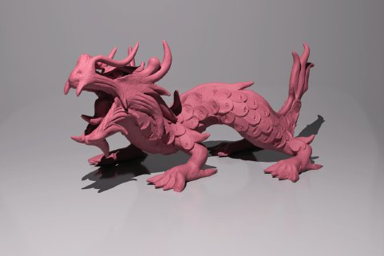

</details>

*Figure 12.3* — Scene Rendered with a Point Light Source. Notice the hard shadow boundaries from this type of light. (Dragon model courtesy of the Stanford Computer Graphics Laboratory.)

<details>
<summary>Book index references: Allocator 40, DenselySampledSpectrum 167, LightBase::spectrumCache 746, PointLight 746, std::pmr::polymorphic_allocator::new_object() 41</summary>

`Allocator` (40) · `DenselySampledSpectrum` (167) · `InternCache` (1070) · `InternCache::Lookup()` (1070) · `LightBase` (744) · `LightBase::spectrumCache` (746) · `PointLight` (746) · `std::pmr::polymorphic_allocator::new_object()` (41).

</details>

*〈PointLight Public Methods〉 ≡ (page 746)*

```rust
fn new(render_from_light: Transform, medium_interface: MediumInterface,
       i: Spectrum, scale: f32) -> Self {
    Self {
        base: LightBase::new(LightType::DeltaPosition, render_from_light, medium_interface),
        i: LightBase::lookup_spectrum(i),
        scale,
    }
}
```

As `HomogeneousMedium` and `GridMedium` did with spectral scattering coefficients, `PointLight` uses a `DenselySampledSpectrum` rather than a `Spectrum` for the spectral intensity, trading off storage for more efficient spectral sampling operations.

*〈PointLight Private Members〉 ≡ (page 746)*

```rust
i: &'static DenselySampledSpectrum,
scale: f32,
```

Strictly speaking, it is incorrect to describe the light arriving at a point due to a point light source using units of radiance. Radiant intensity is instead the proper unit for describing emission from a point light source, as explained in Section 4.1. In the light source interfaces here, however, we will abuse terminology and use `SampleLi()` methods to report the illumination arriving at a point for all types of light sources, dividing radiant intensity by the squared distance to the point p to convert units. In the end, the correctness of the computation does not suffer from this fudge, and it makes the implementation of light transport algorithms more straightforward by not requiring them to use different interfaces for different types of lights.

<details>
<summary>Book index references: HomogeneousMedium 720, LightBase::LookupSpectrum() 745, PointLight::I 747, Transform::operator() 130, and others</summary>

`DenselySampledSpectrum` (167) · `DistanceSquared()` (93) · `Float` (23) · `HomogeneousMedium` (720) · `Interaction` (136) · `LightBase` (744) · `LightBase::LookupSpectrum()` (745) · `LightBase::mediumInterface` (745) · `LightBase::renderFromLight` (745) · `LightLiSample` (743) · `LightSampleContext` (741) · `LightSampleContext::p()` (742) · `LightType::DeltaPosition` (740) · `MediumInterface` (715) · `Normalize()` (88) · `Point2f` (92) · `Point3f` (92) · `PointLight` (746) · `PointLight::I` (747) · `PointLight::scale` (747) · `SampledSpectrum` (171) · `SampledWavelengths` (173) · `Spectrum` (165) · `Transform` (120) · `Transform::operator()` (130) · `Vector3f` (86).

</details>

Point lights are described by a delta distribution such that they only illuminate a receiving point from a single direction. Thus, the sampling problem is deterministic and makes no use of the random sample u. We find the light’s position p in the rendering coordinate system and sample its spectral emission at the provided wavelengths. Note that a PDF value of 1 is returned in the `LightLiSample`: there is implicitly a Dirac delta distribution in both the radiance and the PDF that cancels when the Monte Carlo estimator is evaluated.

*〈PointLight Public Methods〉 +≡ (page 746)*

```rust
fn sample_li(&self, ctx: LightSampleContext, _u: Point2f,
             lambda: SampledWavelengths, _allow_incomplete_pdf: bool)
    -> Option<LightLiSample>
{
    let p = self.base.render_from_light(Point3f::ZERO);
    let wi = normalize(p - ctx.p());
    let li = self.scale * self.i.sample(lambda) / distance_squared(p, ctx.p());
    Some(LightLiSample::new(li, wi, 1.0, Interaction::new(p, &self.base.medium_interface)))
}
```

Due to the delta distribution, the `PointLight::PDF_Li()` method returns 0. This value reflects the fact that there is no chance for some other sampling process to randomly generate a direction that would intersect an infinitesimal light source.

*〈PointLight Public Methods〉 +≡ (page 746)*

```rust
fn pdf_li(&self, _ctx: LightSampleContext, _wi: Vector3f,
          _allow_incomplete_pdf: bool) -> f32 { 0.0 }
```

The total power emitted by the light source can be found by integrating the intensity over the entire sphere of directions:

$$
\Phi = \int_{S^2} I \, \mathrm{d}\omega = I \int_{S^2} \mathrm{d}\omega = 4\pi I.
$$

Radiant power is returned by the `Phi()` method and not the luminous power that may have been used to specify the light source.

*〈PointLight Method Definitions〉 ≡*

```rust
fn phi(&self, lambda: SampledWavelengths) -> SampledSpectrum {
    4.0 * PI * self.scale * self.i.sample(lambda)
}
```

### 12.2.1 SPOTLIGHTS

Spotlights are a handy variation on point lights; rather than shining illumination in all directions, they emit light in a cone of directions from their position. For simplicity, we will define the spotlight in the light coordinate system to always be at position $(0, 0, 0)$ and pointing down the +z axis. To place or orient it elsewhere in the scene, the rendering-from-light transformation should be set accordingly. Figure 12.4 shows a rendering of the same scene as Figure 12.3, illuminated with a spotlight instead of a point light.

*〈SpotLight Definition〉 ≡*

```rust
struct SpotLight {
    base: LightBase,
    // <SpotLight Private Members>
    i_emit: &'static DenselySampledSpectrum,
    scale: f32,
    cos_falloff_start: f32,
    cos_falloff_end: f32,
}
```

There is not anything interesting in the `SpotLight` constructor, so it is not included here. It is given angles that set the extent of the `SpotLight`’s cone —the overall angular width of the cone and the angle at which falloff starts (Figure 12.5)—but it stores the cosines of these angles, which are more useful to have at hand in the `SpotLight`’s methods.

<details>
<summary>Figure 12.4 — Scene Rendered with a Spotlight</summary>

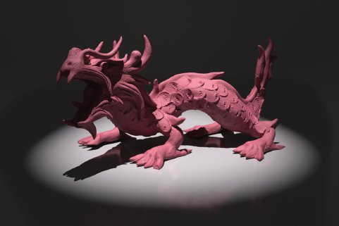

</details>

*Figure 12.4* — Scene Rendered with a Spotlight. The spotlight cone smoothly cuts off illumination past a user-specified angle from the light’s central axis. (Dragon model courtesy of the Stanford Computer Graphics Laboratory.)

<details>
<summary>Book index references: DenselySampledSpectrum::Sample() 167, LightBase 744, Pi 1033, PointLight::I 747, SpotLight 748</summary>

`CosTheta()` (107) · `DenselySampledSpectrum::Sample()` (167) · `LightBase` (744) · `Pi` (1033) · `PointLight::I` (747) · `PointLight::scale` (747) · `ProjectionLight` (751) · `SampledSpectrum` (171) · `SampledWavelengths` (173) · `SmoothStep()` (1034) · `SpotLight` (748) · `SpotLight::cosFalloffEnd` (749) · `SpotLight::cosFalloffStart` (749) · `SpotLight::Iemit` (749) · `SpotLight::scale` (749) · `Vector3f` (86).

</details>

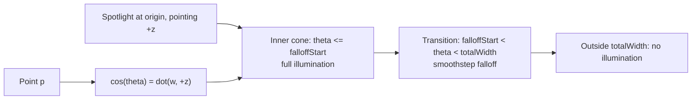

*Figure 12.5 (diagram, redrawn)* — Spotlights are defined by two angles, `falloffStart` and `totalWidth`, that are measured with respect to the z axis in light space. Objects inside the inner cone of angles, up to `falloffStart`, are fully illuminated by the light. The directions between `falloffStart` and `totalWidth` are a transition zone that ramps down from full illumination to no illumination, such that points outside the `totalWidth` cone are not illuminated at all. The cosine of the angle $\theta$ between the vector to a point p and the spotlight axis can easily be computed with a dot product.

*〈SpotLight Private Members〉 ≡ (page 748)*

```rust
i_emit: &'static DenselySampledSpectrum,
scale: f32,
cos_falloff_start: f32,
cos_falloff_end: f32,
```

The `SpotLight::SampleLi()` method is of similar form to that of `PointLight::SampleLi()`, though an unset sample is returned if the receiving point is outside of the spotlight’s outer cone and thus receives zero radiance.

*〈SpotLight Public Methods〉 ≡ (page 748)*

```rust
fn sample_li(&self, ctx: LightSampleContext, _u: Point2f,
             lambda: SampledWavelengths, _allow_incomplete_pdf: bool)
    -> Option<LightLiSample>
{
    let p = self.base.render_from_light(Point3f::ZERO);
    let wi = normalize(p - ctx.p());
    // <Compute incident radiance Li for SpotLight>
    let w_light = normalize(self.base.render_from_light.apply_inverse(-wi));
    let li = self.i(w_light, lambda) / distance_squared(p, ctx.p());
    if li.is_zero() { return None; }
    Some(LightLiSample::new(li, wi, 1.0, Interaction::new(p, &self.base.medium_interface)))
}
```

<details>
<summary>Book index references: CosTheta 107, LightBase::mediumInterface 745, SpotLight::I() 750, SpotLight::SampleLi() 749, Transform::ApplyInverse() 130, and others</summary>

`CosTheta()` (107) · `DenselySampledSpectrum` (167) · `DistanceSquared()` (93) · `Float` (23) · `Interaction` (136) · `LightBase::mediumInterface` (745) · `LightBase::renderFromLight` (745) · `LightLiSample` (743) · `LightSampleContext` (741) · `LightSampleContext::p()` (742) · `Normalize()` (88) · `Point2f` (92) · `Point3f` (92) · `PointLight::SampleLi()` (747) · `SampledSpectrum` (171) · `SampledWavelengths` (173) · `SpotLight::I()` (750) · `SpotLight::SampleLi()` (749) · `Transform::ApplyInverse()` (130) · `Vector3f` (86).

</details>

The `I()` method computes the distribution of light accounting for the spotlight cone. This computation is encapsulated in a separate method since other `SpotLight` methods will need to perform it as well.

*〈Compute incident radiance Li for SpotLight〉 ≡ (page 749)*

```rust
let w_light = normalize(self.base.render_from_light.apply_inverse(-wi));
let li = self.i(w_light, lambda) / distance_squared(p, ctx.p());
```

As with point lights, the `SpotLight`’s `PDF_Li()` method always returns zero. It is not included here. To compute the spotlight’s strength for a direction leaving the light, the first step is to compute the cosine of the angle between that direction and the vector along the center of the spotlight’s cone. Because the spotlight is oriented to point down the +z axis, the `CosTheta()` function can be used to do so. The `SmoothStep()` function is then used to modulate the emission according to the cosine of the angle: it returns 0 if the provided value is below `cosFalloffEnd`, 1 if it is above `cosFalloffStart`, and it interpolates between 0 and 1 for intermediate values using a cubic curve. (To understand its usage, keep in mind that for $\theta \in [0, \pi]$, as is the case here, if $\theta > \theta'$, then $\cos\theta < \cos\theta'$.)

*〈SpotLight Method Definitions〉 ≡*

```rust
fn i(&self, w: Vector3f, lambda: SampledWavelengths) -> SampledSpectrum {
    smooth_step(cos_theta(w), self.cos_falloff_end, self.cos_falloff_start)
        * self.scale * self.i_emit.sample(lambda)
}
```

To compute the power emitted by a spotlight, it is necessary to integrate the falloff function over the sphere. In spherical coordinates, $\theta$ and $\phi$ are separable, so we just need to integrate over $\theta$ and scale the result by $2\pi$. For the part that lies inside the inner cone of full power, we have

$$
\int_0^{\theta_{\mathrm{start}}} \sin\theta \, \mathrm{d}\theta
    = 1 - \cos\theta_{\mathrm{start}}.
$$

The falloff region works out simply, thanks in part to `SmoothStep()` being a polynomial:

$$
\int_{\theta_{\mathrm{start}}}^{\theta_{\mathrm{end}}}
    \operatorname{smoothstep}(\cos\theta, \cos\theta_{\mathrm{end}}, \cos\theta_{\mathrm{start}})
    \sin\theta \, \mathrm{d}\theta
    = \frac{\cos\theta_{\mathrm{start}} - \cos\theta_{\mathrm{end}}}{2}.
$$

*〈SpotLight Method Definitions〉 +≡*

```rust
fn phi(&self, lambda: SampledWavelengths) -> SampledSpectrum {
    self.scale * self.i_emit.sample(lambda) * 2.0 * PI
        * ((1.0 - self.cos_falloff_start)
           + (self.cos_falloff_start - self.cos_falloff_end) / 2.0)
}
```

### 12.2.2 TEXTURE PROJECTION LIGHTS

Another useful light source acts like a slide projector; it takes an image map and projects its image out into the scene. The `ProjectionLight` class uses a projective transformation to project points in the scene onto the light’s projection plane based on the field of view angle given to the constructor (Figure 12.6). The use of this light in the lighting example scene is shown in Figure 12.7.

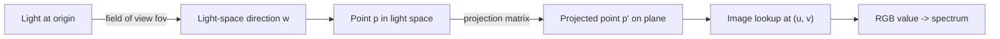

*Figure 12.6 (diagram, redrawn)* — The Basic Setting for Projection Light Sources. A point p in the light’s coordinate system is projected onto the plane of the image using the light’s projection matrix.

<details>
<summary>Figure 12.7 — Scene Rendered with a Projection Light Using a Grid Image</summary>

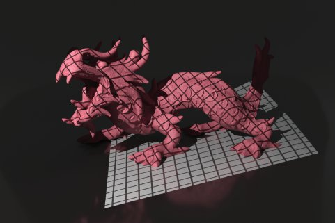

</details>

*Figure 12.7* — Scene Rendered with a Projection Light Using a Grid Image. The projection light acts like a slide projector, projecting an image onto objects in the scene. (Dragon model courtesy of the Stanford Computer Graphics Laboratory.)

*〈ProjectionLight Definition〉 ≡*

```rust
struct ProjectionLight {
    base: LightBase,
    // <ProjectionLight Private Members>
    image: Image,
    image_color_space: &'static RGBColorSpace,
    scale: f32,
    screen_bounds: Bounds2f,
    hither: f32,
    screen_from_light: Transform,
    light_from_screen: Transform,
    area: f32,
    distrib: PiecewiseConstant2D,
}
```

This light could use a `Texture` to represent the light projection distribution so that procedural projection patterns could be used. However, having a tabularized representation of the projection function makes it easier to sample with probability proportional to the projection function. Therefore, the `Image` class is used to specify the projection pattern.

*〈ProjectionLight Method Definitions〉 ≡*

```rust
fn new(render_from_light: Transform, medium_interface: MediumInterface,
       im: Image, image_color_space: &'static RGBColorSpace,
       scale: f32, fov: f32, alloc: Allocator) -> Self {
    let mut light = Self { /* base, image, color space, scale, distrib(alloc) */ };
    // <ProjectionLight constructor implementation>
    light
}
```

<details>
<summary>Book index references: Allocator 40, Image 1079, RGBColorSpace 183, Texture 655</summary>

`Allocator` (40) · `Float` (23) · `Image` (1079) · `LightBase` (744) · `LightType::DeltaPosition` (740) · `MediumInterface` (715) · `ProjectionLight` (751) · `RGBColorSpace` (183) · `Texture` (655) · `Transform` (120).

</details>

A color space for the image is stored so that it is possible to convert image RGB values to spectra.

*〈ProjectionLight Private Members〉 ≡ (page 751)*

```rust
image: Image,
image_color_space: &'static RGBColorSpace,
scale: f32,
```

The constructor has more work to do than the ones we have seen so far, including initializing a projection matrix and computing the area of the projected image on the projection plane.

*〈ProjectionLight constructor implementation〉 ≡ (page 751)*

```rust
// <Initialize ProjectionLight projection matrix>
// <Compute projection image area A>
// <Compute sampling distribution for ProjectionLight>
```

First, similar to the `PerspectiveCamera`, the `ProjectionLight` constructor computes a projection matrix and the screen space extent of the projection on the $z = 1$ plane.

*〈Initialize ProjectionLight projection matrix〉 ≡ (page 752)*

```rust
let aspect = image.resolution().x as f32 / image.resolution().y as f32;
let screen_bounds = if aspect > 1.0 {
    Bounds2f::new(Point2f::new(-aspect, -1.0), Point2f::new(aspect, 1.0))
} else {
    Bounds2f::new(Point2f::new(-1.0, -1.0 / aspect), Point2f::new(1.0, 1.0 / aspect))
};
let screen_from_light = perspective(fov, hither, 1e30 /* yon */);
let light_from_screen = inverse(screen_from_light);
```

Since there is no particular need to keep ProjectionLights compact, both of the screen–light transformations are stored explicitly, which makes code in the following that uses them more succinct.

*〈ProjectionLight Private Members〉 +≡ (page 751)*

```rust
screen_bounds: Bounds2f,
hither: f32,
screen_from_light: Transform,
light_from_screen: Transform,
```

For a number of the following methods, we will need the light-space area of the image on the $z = 1$ plane. One way to find this is to compute half of one of the two rectangle edge lengths using the projection’s field of view and to use the fact that the plane is a distance of 1 from the camera’s position. Doubling that gives one edge length and the other can be found using a factor based on the aspect ratio; see Figure 12.8.

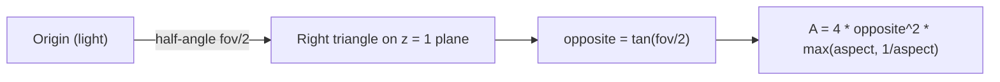

*Figure 12.8 (diagram, redrawn)* — The first step of computing the light-space area of the image on the $z = 1$ projection plane is to compute the length `opposite` illustrated here. It is easily found using basic trigonometry, $\text{opposite} = \tan(\mathrm{fov}/2)$.

<details>
<summary>Book index references: Bounds2f 97, Image::Resolution() 1080, Perspective() 220, Radians() 1033, Sqr() 1034, Transform::Inverse() 121</summary>

`Bounds2f` (97) · `Float` (23) · `Image::Resolution()` (1080) · `Perspective()` (220) · `PerspectiveCamera` (220) · `Point2f` (92) · `ProjectionLight` (751) · `ProjectionLight::A` (753) · `ProjectionLight::hither` (752) · `ProjectionLight::image` (751) · `ProjectionLight::lightFromScreen` (752) · `ProjectionLight::screenBounds` (752) · `ProjectionLight::screenFromLight` (752) · `Radians()` (1033) · `Sqr()` (1034) · `Transform` (120) · `Transform::Inverse()` (121).

</details>

*〈Compute projection image area A〉 ≡ (page 752)*

```rust
let opposite = (fov.to_radians() / 2.0).tan();
let area = 4.0 * opposite.powi(2) * if aspect > 1.0 { aspect } else { 1.0 / aspect };
```

*〈ProjectionLight Private Members〉 +≡ (page 751)*

```rust
area: f32,
```

The `ProjectionLight::SampleLi()` follows the same form as `SpotLight::SampleLi()` except that it uses the following `I()` method to compute the spectral intensity of the projected image. We will therefore skip over its implementation here. We will also not include the `PDF_Li()` method’s implementation, as it, too, returns 0. The direction passed to the `I()` method should be normalized and already transformed into the light’s coordinate system.

*〈ProjectionLight Method Definitions〉 +≡*

```rust
fn i(&self, w: Vector3f, lambda: &SampledWavelengths) -> SampledSpectrum {
    // <Discard directions behind projection light>
    if w.z < self.hither { return SampledSpectrum::ZERO; }
    // <Project point onto projection plane and compute RGB>
    // <Return scaled wavelength samples corresponding to RGB>
}
```

Because the projective transformation has the property that it projects points behind the center of projection to points in front of it, it is important to discard points with a negative z value. Therefore, the projection code immediately returns no illumination for projection points that are behind the hither plane for the projection. If this check were not done, then it would not be possible to know if a projected point was originally behind the light (and therefore not illuminated) or in front of it.

*〈Discard directions behind projection light〉 ≡ (page 753)*

```rust
if w.z < self.hither { return SampledSpectrum::ZERO; }
```

After being projected to the projection plane, points with coordinate values outside the screen window are discarded. Points that pass this test are transformed to get texture coordinates inside $[0, 1]^2$ for the lookup in the image.

<details>
<summary>Book index references: Bounds2::Inside() 100, Image::LookupNearestChannel() 1082, RGBIlluminantSpectrum 199, RGBUnboundedSpectrum 198</summary>

`Bounds2::Inside()` (100) · `Bounds2::Offset()` (102) · `Float` (23) · `Image::LookupNearestChannel()` (1082) · `Point2f` (92) · `Point3f` (92) · `ProjectionLight` (751) · `ProjectionLight::hither` (752) · `ProjectionLight::image` (751) · `ProjectionLight::screenBounds` (752) · `ProjectionLight::screenFromLight` (752) · `RGB` (182) · `RGBIlluminantSpectrum` (199) · `RGBUnboundedSpectrum` (198) · `SampledSpectrum` (171) · `SampledWavelengths` (173) · `SpotLight::SampleLi()` (749) · `Transform::operator()` (130) · `Vector3f` (86).

</details>

One thing to note is that a “nearest” lookup is used rather than, say, bilinear interpolation of the image samples. Although bilinear interpolation would lead to smoother results, especially for low-resolution image maps, in this way the projection function will exactly match the piecewise-constant distribution that is used for importance sampling in the light emission sampling methods. Further, the code here assumes that the image stores red, green, and blue in its first three channels; the code that creates ProjectionLights ensures that this is so.

*〈Project point onto projection plane and compute RGB〉 ≡ (page 753)*

```rust
let ps = self.screen_from_light(Point3f::from(w));
if !inside(Point2f::new(ps.x, ps.y), self.screen_bounds) {
    return SampledSpectrum::ZERO;
}
let uv = self.screen_bounds.offset(Point2f::new(ps.x, ps.y));
let mut rgb = RGB::default();
for c in 0..3 { rgb[c] = self.image.lookup_nearest_channel(uv, c); }
```

It is important to use an `RGBIlluminantSpectrum` to convert the RGB value to spectral samples rather than, say, an `RGBUnboundedSpectrum`. This ensures that, for example, a $(1, 1, 1)$ RGB value corresponds to the color space’s illuminant and not a constant spectral distribution.

*〈Return scaled wavelength samples corresponding to RGB〉 ≡ (page 753)*

```rust
let s = RGBIlluminantSpectrum::new(*self.image_color_space, clamp_zero(rgb));
self.scale * s.sample(lambda)
```

The total emitted power is given by integrating radiant intensity over the sphere of directions (Equation (4.2)), though here the projection function is tabularized over a planar 2D area. Power can thus be computed by integrating over the area of the image and applying a change of variables factor $\mathrm{d}\omega/\mathrm{d}A$:

$$
\Phi = \int_{S^2} I(\omega) \, \mathrm{d}\omega
     = \int_A I(p) \, \frac{\mathrm{d}\omega}{\mathrm{d}A} \, \mathrm{d}A.
$$

*〈ProjectionLight Method Definitions〉 +≡*

```rust
fn phi(&self, lambda: SampledWavelengths) -> SampledSpectrum {
    let mut sum = SampledSpectrum::ZERO;
    for y in 0..self.image.resolution().y {
        for x in 0..self.image.resolution().x {
            // <Compute change of variables factor dwdA for projection light pixel>
            // <Update sum for projection light pixel>
        }
    }
    // <Return final power for projection light>
}
```

Recall from Section 4.2.3 that differential area $\mathrm{d}A$ is converted to differential solid angle $\mathrm{d}\omega$ by multiplying by a $\cos\theta$ factor and dividing by the squared distance. Because the plane we are integrating over is at $z = 1$, the distance from the origin to a point on the plane is equal to $1/\cos\theta$ and thus the aggregate factor is $\cos^3\theta$; see Figure 12.9.

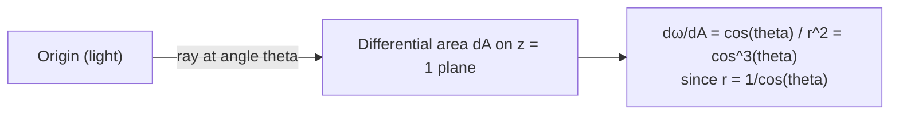

*Figure 12.9 (diagram, redrawn)* — To find the power of a point light source, we generally integrate radiant intensity over directions around the light. For the `ProjectionLight`, we instead integrate over the $z = 1$ plane, in which case we need to account for the change of variables, applying both a $\cos\theta$ and a $1/r^2$ factor.

*〈Compute change of variables factor dwdA for projection light pixel〉 ≡ (page 754)*

```rust
let ps = self.screen_bounds.lerp(Point2f::new(
    (x as f32 + 0.5) / self.image.resolution().x as f32,
    (y as f32 + 0.5) / self.image.resolution().y as f32));
let mut w = Vector3f::from(self.light_from_screen(Point3f::new(ps.x, ps.y, 0.0)));
w = normalize(w);
let dwd_a = cos_theta(w).powi(3);
```

<details>
<summary>Book index references: CosTheta 107, Lerp() 72, Pow() 1034, RGBIlluminantSpectrum::Sample() 200</summary>

`CosTheta()` (107) · `Float` (23) · `Image::Resolution()` (1080) · `Lerp()` (72) · `Normalize()` (88) · `Point2f` (92) · `Point3f` (92) · `Pow()` (1034) · `ProjectionLight` (751) · `ProjectionLight::image` (751) · `ProjectionLight::imageColorSpace` (751) · `ProjectionLight::lightFromScreen` (752) · `ProjectionLight::scale` (751) · `ProjectionLight::screenBounds` (752) · `RGBIlluminantSpectrum` (199) · `RGBIlluminantSpectrum::Sample()` (200) · `SampledSpectrum` (171) · `SampledWavelengths` (173) · `Vector3f` (86).

</details>

For the same reasons as in the `Project()` method, an `RGBIlluminantSpectrum` is used to convert each RGB value to spectral samples.

*〈Update sum for projection light pixel〉 ≡ (page 754)*

```rust
let mut rgb = RGB::default();
for c in 0..3 { rgb[c] = self.image.get_channel((x, y), c); }
let s = RGBIlluminantSpectrum::new(*self.image_color_space, clamp_zero(rgb));
sum += s.sample(lambda) * dwd_a;
```

The final integrated value includes a factor of the area that was integrated over, $A$, and is divided by the total number of pixels.

*〈Return final power for projection light〉 ≡ (page 754)*

```rust
self.scale * self.area * sum
    / (self.image.resolution().x * self.image.resolution().y) as f32
```

### 12.2.3 GONIOPHOTOMETRIC DIAGRAM LIGHTS

A goniophotometric diagram describes the angular distribution of luminance from a point light source; it is widely used in illumination engineering to characterize lights. Figure 12.10 shows an example of a goniophotometric diagram in two dimensions. In this section, we will implement a light source that uses goniophotometric diagrams encoded in 2D image maps to describe the emission distribution lights. Figure 12.11 shows a few goniophotometric diagrams encoded as image maps and Figure 12.12 shows a scene rendered with a light source that uses one of these images to modulate its directional distribution of illumination. The `GoniometricLight` uses the equal-area parameterization of the sphere that was introduced in Section 3.8.3, so the center of the image corresponds to the “up” direction.

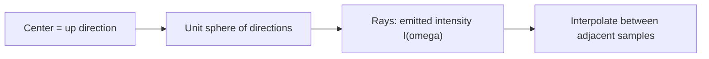

*Figure 12.10 (diagram, redrawn)* — An Example of a Goniophotometric Diagram Specifying an Outgoing Light Distribution from a Point Light Source in 2D. The emitted intensity is defined in a fixed set of directions on the unit sphere, and the intensity for a given outgoing direction $\omega$ is found by interpolating the intensities of the adjacent samples.

<details>
<summary>Book index references: Image::GetChannel() 1081, RGBIlluminantSpectrum::Sample() 200, ProjectionLight::A 753</summary>

`Image::GetChannel()` (1081) · `Image::Resolution()` (1080) · `ProjectionLight::A` (753) · `ProjectionLight::image` (751) · `ProjectionLight::imageColorSpace` (751) · `ProjectionLight::scale` (751) · `RGB` (182) · `RGBIlluminantSpectrum` (199) · `RGBIlluminantSpectrum::Sample()` (200).

</details>

<details>
<summary>Figure 12.11 — Goniophotometric Diagrams for Real-World Light Sources</summary>

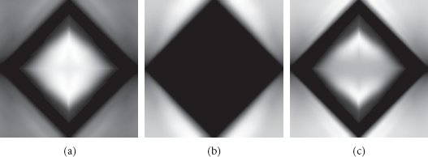

</details>

*Figure 12.11* — Goniophotometric Diagrams for Real-World Light Sources. These images are encoded using an equal-area parameterization (Section 3.8.3). (a) A light that mostly illuminates in its up direction, with only a small amount of illumination in the down direction. (b) A light that mostly illuminates in the down direction. (c) A light that casts illumination both above and below.

<details>
<summary>Figure 12.12 — Scene Rendered Using the Goniophotometric Diagram from Figure 12.11(b)</summary>

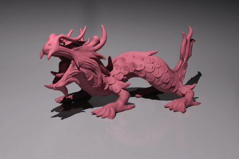

</details>

*Figure 12.12* — Scene Rendered Using the Goniophotometric Diagram from Figure 12.11(b). Even though a point light source is the basis of this light, including the directional variation of a realistic light improves the visual realism of the rendered image. (Dragon model courtesy of the Stanford Computer Graphics Laboratory.)

*〈GoniometricLight Definition〉 ≡*

```rust
struct GoniometricLight {
    base: LightBase,
    // <GoniometricLight Private Members>
    i_emit: &'static DenselySampledSpectrum,
    scale: f32,
    image: Image,
}
```

The `GoniometricLight` constructor takes a base intensity, an image map that scales the intensity based on the angular distribution of light, and the usual transformation and medium interface; these are stored in the following member variables. In the following methods, only the first channel of the image map will be used to scale the light’s intensity: the `GoniometricLight` does not support specifying color via the image. It is the responsibility of calling code to convert RGB images to luminance or some other appropriate scalar value before passing the image to the constructor here.

<details>
<summary>Book index references: DenselySampledSpectrum 167, GoniometricLight 756, ProjectionLight 751, SpotLight 748</summary>

`DenselySampledSpectrum` (167) · `Float` (23) · `GoniometricLight` (756) · `Image` (1079) · `LightBase` (744) · `ProjectionLight` (751) · `SpotLight` (748).

</details>

*〈GoniometricLight Private Members〉 ≡ (page 756)*

```rust
i_emit: &'static DenselySampledSpectrum,
scale: f32,
image: Image,
```

The `SampleLi()` method follows the same form as that of `SpotLight` and `ProjectionLight`, so it is not included here. It uses the following method to compute the radiant intensity for a given direction.

*〈GoniometricLight Public Methods〉 ≡ (page 756)*

```rust
fn i(&self, w: Vector3f, lambda: &SampledWavelengths) -> SampledSpectrum {
    let uv = equal_area_sphere_to_square(w);
    self.scale * self.i_emit.sample(lambda) * self.image.lookup_nearest_channel(uv, 0)
}
```

Because it uses an equal-area mapping from the image to the sphere, each pixel in the image subtends an equal solid angle and the change of variables factor for integrating over the sphere of directions is the same for all pixels. Its value is $4\pi$, the ratio of the area of the unit sphere to the unit square.

*〈GoniometricLight Method Definitions〉 ≡*

```rust
fn phi(&self, lambda: SampledWavelengths) -> SampledSpectrum {
    let mut sum_y = 0.0;
    for y in 0..self.image.resolution().y {
        for x in 0..self.image.resolution().x {
            sum_y += self.image.get_channel((x, y), 0);
        }
    }
    self.scale * self.i_emit.sample(lambda) * 4.0 * PI * sum_y
        / (self.image.resolution().x * self.image.resolution().y) as f32
}
```

## 12.3 DISTANT LIGHTS

Another useful light source type is the distant light, also known as a directional light. It describes an emitter that deposits illumination from the same direction at every point in space. Such a light is also called a point light “at infinity,” since, as a point light becomes progressively farther away, it acts more and more like a directional light. For example, the sun (as considered from Earth) can be thought of as a directional light source. Although it is actually an area light source, the illumination effectively arrives at Earth in nearly parallel beams because it is so far away.

<details>
<summary>Book index references: DistantLight 757, EqualAreaSphereToSquare() 113, Pi 1033, Vector3f 86</summary>

`DenselySampledSpectrum` (167) · `DenselySampledSpectrum::Sample()` (167) · `DistantLight` (757) · `EqualAreaSphereToSquare()` (113) · `Float` (23) · `GoniometricLight::Iemit` (756) · `GoniometricLight::image` (756) · `GoniometricLight::scale` (756) · `Image::GetChannel()` (1081) · `Image::LookupNearestChannel()` (1082) · `Image::Resolution()` (1080) · `LightBase` (744) · `LightBase::LookupSpectrum()` (745) · `LightType` (740) · `Pi` (1033) · `Point2f` (92) · `SampledSpectrum` (171) · `SampledWavelengths` (173) · `Spectrum` (165) · `Transform` (120) · `Vector3f` (86).

</details>

*〈DistantLight Definition〉 ≡*

```rust
struct DistantLight {
    base: LightBase,
    // <DistantLight Private Members>
    l_emit: &'static DenselySampledSpectrum,
    scale: f32,
    scene_center: Point3f,
    scene_radius: f32,
}
```

The `DistantLight` constructor does not take a `MediumInterface` parameter; the only reasonable medium for a distant light to be in is a vacuum—if it was itself in a medium that absorbed any light at all, then all of its emission would be absorbed, since it is modeled as being infinitely far away.

*〈DistantLight Public Methods〉 ≡ (page 757)*

```rust
fn new(render_from_light: &Transform, l_emit: Spectrum, scale: f32) -> Self {
    Self {
        base: LightBase::new(LightType::DeltaDirection, *render_from_light, None),
        l_emit: LightBase::lookup_spectrum(l_emit),
        scale,
        scene_center: Point3f::ZERO,
        scene_radius: 0.0,
    }
}
```

*〈DistantLight Private Members〉 ≡ (page 757)*

```rust
l_emit: &'static DenselySampledSpectrum,
scale: f32,
```

Some of the `DistantLight` methods need to know the bounds of the scene. Because pbrt creates lights before the scene geometry, these bounds are not available when the `DistantLight` constructor executes. Therefore, `DistantLight` implements the optional `Preprocess()` method where it converts the scene’s `Bounds3f` to a bounding sphere, which will be an easier representation to work with in the following.

*〈DistantLight Public Methods〉 +≡ (page 757)*

```rust
fn preprocess(&mut self, scene_bounds: &Bounds3f) {
    let (center, radius) = scene_bounds.bounding_sphere();
    self.scene_center = center;
    self.scene_radius = radius;
}
```

*〈DistantLight Private Members〉 +≡ (page 757)*

```rust
scene_center: Point3f,
scene_radius: f32,
```

The incident radiance at a point p due to a distant light can be described using a Dirac delta distribution,

$$
L_i(p, \omega) = L_e \, \delta(\omega - \omega_l),
$$

where the light’s direction is $\omega_l$. Given this definition, the implementation of the `SampleLi()` method is straightforward: the incident direction and radiance are always the same. The only interesting bit is the initialization of the `Interaction` that provides the second point for the future shadow ray. It is set along the distant light’s incident direction at a distance of twice the radius of the scene’s bounding sphere, guaranteeing a second point that is outside of the scene’s bounds (Figure 12.13).

*〈DistantLight Public Methods〉 +≡ (page 757)*

```rust
fn sample_li(&self, ctx: LightSampleContext, _u: Point2f,
             lambda: SampledWavelengths, _allow_incomplete_pdf: bool)
    -> Option<LightLiSample>
{
    let wi = normalize(self.base.render_from_light(Vector3f::new(0.0, 0.0, 1.0)));
    let p_outside = ctx.p() + wi * (2.0 * self.scene_radius);
    Some(LightLiSample::new(
        self.scale * self.l_emit.sample(lambda), wi, 1.0,
        Interaction::outside(p_outside)))
}
```

<details>
<summary>Book index references: Bounds3::BoundingSphere() 103, DistantLight::sceneCenter 758, LightBase::renderFromLight 745</summary>

`Bounds3::BoundingSphere()` (103) · `Bounds3f` (97) · `DenselySampledSpectrum::Sample()` (167) · `DistantLight::Lemit` (757) · `DistantLight::scale` (757) · `DistantLight::sceneCenter` (758) · `DistantLight::sceneRadius` (758) · `Float` (23) · `Interaction` (136) · `LightBase::renderFromLight` (745) · `LightLiSample` (743) · `LightSampleContext` (741) · `LightSampleContext::p()` (742) · `Normalize()` (88) · `Point2f` (92) · `Point3f` (92) · `SampledWavelengths` (173) · `Transform::operator()` (130) · `Vector3f` (86).

</details>

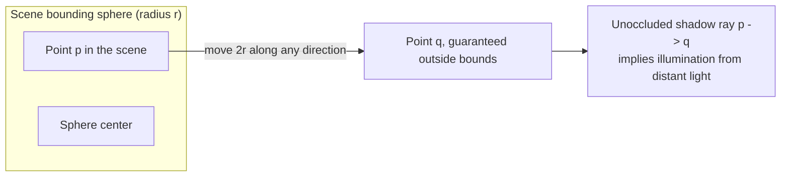

*Figure 12.13 (diagram, redrawn)* — Computing the Second Point for a `DistantLight` Shadow Ray. Given a sphere that bounds the scene (dashed line) with radius $r$ and given some point in the scene p, if we then move a distance of $2r$ along any vector from p, the resulting point must be outside of the scene’s bound. If a shadow ray to such a point is unoccluded, then we can be certain that the point p receives illumination from a distant light along the vector’s direction.

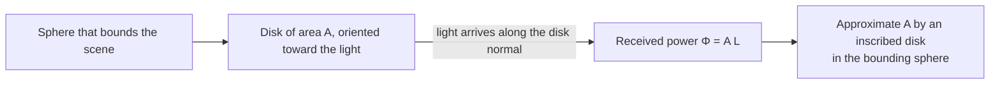

*Figure 12.14 (diagram, redrawn)* — An approximation of the power emitted by a distant light into a given scene can be obtained by finding the sphere that bounds the scene, computing the area of an inscribed disk, and computing the power that arrives on the surface of that disk.

The distant light is different than the lights we have seen so far in that the amount of power it emits is related to the spatial extent of the scene. In fact, it is proportional to the area of the scene receiving light. To see why this is so, consider a disk of area $A$ being illuminated by a distant light with emitted radiance $L$ where the incident light arrives along the disk’s normal direction. The total power reaching the disk is

$$
\Phi = A L.
$$

As the size of the receiving surface varies, power varies proportionally. To find the emitted power for a `DistantLight`, it is impractical to compute the total surface area of the objects that are visible to the light. Instead, we will approximate this area with a disk inside the scene’s bounding sphere oriented in the light’s direction (Figure 12.14). This will always overestimate the actual area but is sufficient for the needs of code elsewhere in the system.

*〈DistantLight Method Definitions〉 ≡*

```rust
fn phi(&self, lambda: SampledWavelengths) -> SampledSpectrum {
    self.scale * self.l_emit.sample(lambda) * PI * self.scene_radius.powi(2)
}
```

## 12.4 AREA LIGHTS

Area lights are defined by the combination of a `Shape` and a directional distribution of radiance at each point on its surface. In general, computing radiometric quantities related to area lights requires computing integrals over the surface of the light that often cannot be computed in closed form, though they are well suited to Monte Carlo integration. The reward for this complexity (and computational expense) is soft shadows and more realistic lighting effects, rather than the hard shadows and stark lighting that come from point lights. (See Figure 12.15, which shows the effect of varying the size of an area light source used to illuminate the dragon; compare its soft look to illumination from a point light in Figure 12.3.)

<details>
<summary>Book index references: DistantLight 757, Pi 1033, Shape 261, Sqr() 1034</summary>

`DenselySampledSpectrum::Sample()` (167) · `DistantLight` (757) · `DistantLight::Lemit` (757) · `DistantLight::scale` (757) · `DistantLight::sceneRadius` (758) · `LightBase` (744) · `Pi` (1033) · `SampledSpectrum` (171) · `SampledWavelengths` (173) · `Shape` (261) · `Sqr()` (1034).

</details>

The `DiffuseAreaLight` class defines an area light where emission at each point on the surface has a uniform directional distribution.

*〈DiffuseAreaLight Definition〉 ≡*

```rust
struct DiffuseAreaLight {
    base: LightBase,
    // <DiffuseAreaLight Private Members>
    shape: Shape,
    alpha: FloatTexture,
    area: f32,
    two_sided: bool,
    l_emit: &'static DenselySampledSpectrum,
    scale: f32,
    image: Image,
    image_color_space: &'static RGBColorSpace,
}
```

<details>
<summary>Figure 12.15 — Dragon Model Illuminated by Disk Area Lights</summary>

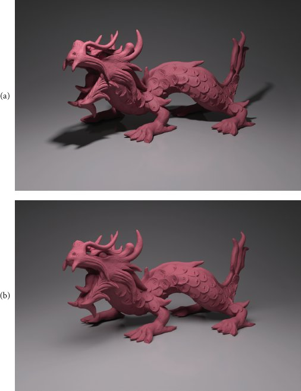

</details>

*Figure 12.15* — Dragon Model Illuminated by Disk Area Lights. (a) The disk’s radius is relatively small; the shadow has soft penumbrae, but otherwise the image looks similar to the one with a point light. (b) The effect of using a much larger disk: not only have the penumbrae become much larger, to the point of nearly eliminating the shadow of the tail, for example, but note also how the shading on the body is smoother, with the specular highlights less visible due to illumination coming from a wider range of directions. (Dragon model courtesy of the Stanford Computer Graphics Laboratory.)

Its constructor, not included here, sets the following member variables from the parameters provided to it. If an alpha texture has been associated with the shape to cut away parts of its surface, it is used here so that there is no illumination from those parts of the shape.[^alpha-light] (Recall that alpha masking was introduced in Section 7.1.1.) The area of the emissive `Shape` is needed in a number of the following methods and so is cached in a member variable.

[^alpha-light]: As a special case, pbrt also (reluctantly) supports the trick of creating an invisible light source by specifying a light with a zero-valued alpha texture. Though non-physical, such lights can be useful for artistic purposes. In code not included in the text here, the `DiffuseAreaLight` constructor characterizes them as being of `LightType::DeltaPosition`, which leads to their being handled correctly in the lighting integration routines even though rays can never intersect them.

<details>
<summary>Book index references: DiffuseAreaLight 759, LightType::DeltaPosition 740, Shape 261</summary>

`DiffuseAreaLight` (759) · `LightType::DeltaPosition` (740) · `Shape` (261).

</details>

*〈DiffuseAreaLight Private Members〉 ≡ (page 759)*

```rust
shape: Shape,
alpha: FloatTexture,
area: f32,
```

A number of parameters specify emission from DiffuseAreaLights. By default, emission is only on one side of the surface, where the surface normal is outward-facing. A scaling transform that flips the normal or the ReverseOrientation directive in the scene description file can be used to cause emission to be on the other side of the surface. If `twoSided` is true, then the light emits on both sides. Emission that varies over the surface can be defined using an `Image`; if one is provided to the constructor, the surface will have spatially varying emission defined by its color values. Otherwise, spatially uniform emitted spectral radiance is given by a provided `Lemit` spectrum. For both methods of specifying emission, an additional scale factor in `scale` is applied to the returned radiance.

*〈DiffuseAreaLight Private Members〉 +≡ (page 759)*

```rust
two_sided: bool,
l_emit: &'static DenselySampledSpectrum,
scale: f32,
image: Image,
image_color_space: &'static RGBColorSpace,
```

Recall from Section 12.1 that the `Light` interface includes an `L()` method that area lights must implement to provide the emitted radiance at a specified point on their surface. This method is called if a ray happens to intersect an emissive surface, for example. `DiffuseAreaLight`’s implementation starts by checking a few cases in which there is no emitted radiance before calculating emission using the `Image`, if provided, and otherwise the specified constant radiance.

<details>
<summary>Book index references: HashFloat() 1042, Image::BilerpChannel() 1082, Shape::Sample() 267, SurfaceInteraction::areaLight 398</summary>

`DenselySampledSpectrum` (167) · `DenselySampledSpectrum::Sample()` (167) · `DiffuseAreaLight::AlphaMasked()` (762) · `DiffuseAreaLight::image` (761) · `DiffuseAreaLight::Lemit` (761) · `DiffuseAreaLight::scale` (761) · `DiffuseAreaLight::twoSided` (761) · `Dot()` (89) · `Float` (23) · `FloatTexture` (656) · `Image` (1079) · `Interaction` (136) · `Light` (740) · `Normal3f` (94) · `Point2f` (92) · `Point3f` (92) · `RGBColorSpace` (183) · `SampledSpectrum` (171) · `SampledWavelengths` (173) · `Shape` (261) · `Vector3f` (86).

</details>

*〈DiffuseAreaLight Public Methods〉 ≡ (page 759)*

```rust
fn l(&self, p: Point3f, n: Normal3f, mut uv: Point2f, w: Vector3f,
     lambda: &SampledWavelengths) -> SampledSpectrum {
    // <Check for zero emitted radiance from point on area light>
    if !self.two_sided && dot(n, w) < 0.0 { return SampledSpectrum::ZERO; }
    if self.alpha_masked(Interaction::new(p, uv)) { return SampledSpectrum::ZERO; }
    if self.image.is_some() {
        // <Return DiffuseAreaLight emission using image>
        let mut rgb = RGB::default();
        uv[1] = 1.0 - uv[1];
        for c in 0..3 { rgb[c] = self.image.bilerp_channel(uv, c); }
        let spec = RGBIlluminantSpectrum::new(*self.image_color_space, clamp_zero(rgb));
        return self.scale * spec.sample(lambda);
    }
    self.scale * self.l_emit.sample(lambda)
}
```

Two cases allow immediately returning no emitted radiance: the first is if the light is one-sided and the outgoing direction $\omega$ faces away from the surface normal and the second is if the point on the light’s surface has been cut away by an alpha texture.

*〈Check for zero emitted radiance from point on area light〉 ≡ (page 761)*

```rust
if !self.two_sided && dot(n, w) < 0.0 { return SampledSpectrum::ZERO; }
if self.alpha_masked(Interaction::new(p, uv)) { return SampledSpectrum::ZERO; }
```

The `AlphaMasked()` method performs a stochastic alpha test for a point on the light.

*〈DiffuseAreaLight Private Methods〉 ≡ (page 759)*

```rust
fn alpha_masked(&self, intr: &Interaction) -> bool {
    if self.alpha.is_none() { return false; }
    let a = UniversalTextureEvaluator::eval(self.alpha, intr);
    if a >= 1.0 { return false; }
    if a <= 0.0 { return true; }
    hash_float(intr.p()) > a
}
```

If an `Image` has been provided to specify emission, then the emitted radiance is found by looking up an RGB value and converting it to the requested spectral samples. Note that the v coordinate is inverted before being passed to `BilerpChannel()`; in this way, the parameterization matches the image texture coordinate conventions that were described in Section 10.4.2. (See Figure 6.26 for a scene with an area light source with emission defined using an image.)

*〈Return DiffuseAreaLight emission using image〉 ≡ (page 761)*

```rust
let mut rgb = RGB::default();
uv[1] = 1.0 - uv[1];
for c in 0..3 { rgb[c] = self.image.bilerp_channel(uv, c); }
let spec = RGBIlluminantSpectrum::new(*self.image_color_space, clamp_zero(rgb));
self.scale * spec.sample(lambda)
```

<details>
<summary>Book index references: DiffuseAreaLight::alpha 761, Image::BilerpChannel() 1082, Shape::PDF() 268, UniversalTextureEvaluator 677</summary>

`DiffuseAreaLight::alpha` (761) · `DiffuseAreaLight::image` (761) · `DiffuseAreaLight::imageColorSpace` (761) · `DiffuseAreaLight::scale` (761) · `Float` (23) · `HashFloat()` (1042) · `Image` (1079) · `Image::BilerpChannel()` (1082) · `Interaction` (136) · `Interaction::n` (137) · `Interaction::p()` (137) · `Interaction::uv` (137) · `Light::L()` (743) · `LightLiSample` (743) · `LightSampleContext` (741) · `Point2f` (92) · `RGB` (182) · `RGBIlluminantSpectrum` (199) · `RGBIlluminantSpectrum::Sample()` (200) · `SampledSpectrum` (171) · `SampledWavelengths` (173) · `Shape` (261) · `Shape::Sample()` (267) · `SurfaceInteraction` (138) · `SurfaceInteraction::areaLight` (398) · `UniversalTextureEvaluator` (677) · `Vector3f` (86).

</details>

For convenience, we will add a method to the `SurfaceInteraction` class that makes it easy to compute the emitted radiance at a surface point intersected by a ray.

*〈SurfaceInteraction Method Definitions〉 +≡*

```rust
fn le(&self, w: Vector3f, lambda: &SampledWavelengths) -> SampledSpectrum {
    match self.area_light {
        Some(light) => light.l(self.p(), self.n, self.uv, w, lambda),
        None => SampledSpectrum::ZERO,
    }
}
```

All the `SampleLi()` methods so far have been deterministic: because all the preceding light models have been defined in terms of Dirac delta distributions of either position or direction, there has only been a single incident direction along which illumination arrives at any point. This is no longer the case with area lights and we will finally make use of the uniform 2D sample u.

*〈DiffuseAreaLight Method Definitions〉 ≡*

```rust
fn sample_li(&self, ctx: LightSampleContext, u: Point2f,
             lambda: SampledWavelengths, _allow_incomplete_pdf: bool)
    -> Option<LightLiSample>
{
    // <Sample point on shape for DiffuseAreaLight>
    // <Check sampled point on shape against alpha texture, if present>
    // <Return LightLiSample for sampled point on shape>
}
```

The second variant of `Shape::Sample()`, which takes a receiving point and returns a point on the shape and PDF expressed with respect to solid angle at the receiving point, is an exact match for the `Light` `SampleLi()` interface. Therefore, the implementation starts by calling that method. The astute reader will note that if an image is being used to define the light’s emission, leaving the sampling task to the shape alone may not be ideal. Yet, extending the `Shape`’s sampling interface to optionally take a reference to an `Image` or some other representation of spatially varying emission would be a clunky addition. pbrt’s solution to this problem is that `BilinearPatch` shapes (but no others) allow specifying an image to use for sampling. To have to specify this information twice in the scene description is admittedly not ideal, but it suffices to make the common case of a quadrilateral emitter with an image work out.

*〈Sample point on shape for DiffuseAreaLight〉 ≡ (page 762)*

```rust
let shape_ctx = ShapeSampleContext::new(ctx.pi, ctx.n, ctx.ns, 0.0 /* time */);
let Some(mut ss) = self.shape.sample(shape_ctx, u) else { return None };
if ss.pdf == 0.0 || length_squared(ss.intr.p() - ctx.p()) == 0.0 { return None; }
ss.intr.medium_interface = Some(&self.base.medium_interface);
```

If the sampled point has been masked by the alpha texture, an invalid sample is returned.

<details>
<summary>Book index references: BilinearPatch 328, Shape::PDF() 268, ShapeSample 268, ShapeSampleContext 268</summary>

`BilinearPatch` (328) · `DenselySampledSpectrum::Sample()` (167) · `DiffuseAreaLight::AlphaMasked()` (762) · `DiffuseAreaLight::area` (761) · `DiffuseAreaLight::image` (761) · `DiffuseAreaLight::L()` (761) · `DiffuseAreaLight::Lemit` (761) · `DiffuseAreaLight::scale` (761) · `DiffuseAreaLight::shape` (761) · `DiffuseAreaLight::twoSided` (761) · `Float` (23) · `Image` (1079) · `Interaction::mediumInterface` (138) · `Interaction::n` (137) · `Interaction::p()` (137) · `Interaction::uv` (137) · `LightBase::mediumInterface` (745) · `LightLiSample` (743) · `LightSampleContext` (741) · `LightSampleContext::n` (742) · `LightSampleContext::ns` (742) · `LightSampleContext::p()` (742) · `LightSampleContext::pi` (742) · `Normalize()` (88) · `Pi` (1033) · `SampledSpectrum` (171) · `SampledWavelengths` (173) · `Shape` (261) · `Shape::PDF()` (268) · `Shape::Sample()` (267) · `ShapeSample` (268) · `ShapeSample::intr` (268) · `ShapeSample::pdf` (268) · `ShapeSampleContext` (268) · `Vector3f` (86).

</details>

*〈Check sampled point on shape against alpha texture, if present〉 ≡ (page 762)*

```rust
if self.alpha_masked(&ss.intr) { return None; }
```

If the shape has generated a valid sample, the next step is to compute the emitted radiance at the sample point. If that is a zero-valued spectrum, then an unset sample value is returned; calling code can then avoid the expense of tracing an unnecessary shadow ray.

*〈Return LightLiSample for sampled point on shape〉 ≡ (page 762)*

```rust
let wi = normalize(ss.intr.p() - ctx.p());
let le = self.l(ss.intr.p(), ss.intr.n, ss.intr.uv, -wi, lambda);
if le.is_zero() { return None; }
Some(LightLiSample::new(le, wi, ss.pdf, ss.intr))
```

The PDF for sampling a given direction from a receiving point is also easily handled, again thanks to `Shape` providing a corresponding method.

*〈DiffuseAreaLight Method Definitions〉 +≡*

```rust
fn pdf_li(&self, ctx: LightSampleContext, wi: Vector3f,
          _allow_incomplete_pdf: bool) -> f32 {
    let shape_ctx = ShapeSampleContext::new(ctx.pi, ctx.n, ctx.ns, 0.0);
    self.shape.pdf(shape_ctx, wi)
}
```

Emitted power from an area light with uniform emitted radiance over the surface can be computed in closed form: from Equation (4.1) it follows that it is $\pi$ times the surface area times the emitted radiance,

$$
\Phi = \pi A L
$$

(and twice that for a two-sided emitter). If an image has been specified for the emission, its average value is computed in a fragment that is not included here. That computation neglects the effect of any alpha texture and effectively assumes that there is no distortion in the surface’s $(u, v)$ parameterization. If these are not the case, there will be error in the $\Phi$ value.

*〈DiffuseAreaLight Method Definitions〉 +≡*

```rust
fn phi(&self, lambda: SampledWavelengths) -> SampledSpectrum {
    let mut l = SampledSpectrum::ZERO;
    if self.image.is_some() {
        // <Compute average light image emission>
    } else {
        l = self.l_emit.sample(lambda) * self.scale;
    }
    PI * if self.two_sided { 2.0 } else { 1.0 } * self.area * l
}
```

<details>
<summary>Figure 12.16 — Car model illuminated with area lights and environment maps</summary>


</details>

*Figure 12.16* — Car model (a) illuminated with a few area lights, (b) illuminated with midday skylight from an environment map, (c) using a sunset environment map. (Model courtesy of Yasutoshi Mori.)

## 12.5 INFINITE AREA LIGHTS

Another useful kind of light is an infinitely far-away area light source that surrounds the entire scene. One way to visualize this type of light is as an enormous sphere that casts light into the scene from every direction. One important use of infinite area lights is for environment lighting, where an image of the illumination in an environment is used to illuminate synthetic objects as if they were in that environment. Figure 12.16 compares illuminating a car model with standard area lights to illuminating it with two environment maps that simulate illumination from the sky at different times of day. The increase in realism is striking. pbrt provides three implementations of infinite area lights of progressive complexity. The first describes an infinite light with uniform emitted radiance; the second instead takes an image that represents the directional distribution of emitted radiance, and the third adds capabilities for culling parts of such images that are occluded at the reference point, which can substantially improve sampling efficiency.

### 12.5.1 UNIFORM INFINITE LIGHTS

A uniform infinite light source is fairly easy to implement; some of the details will be helpful for understanding the infinite light variants to follow.

*〈UniformInfiniteLight Definition〉 ≡*

```rust
struct UniformInfiniteLight {
    base: LightBase,
    // <UniformInfiniteLight Private Members>
    l_emit: &'static DenselySampledSpectrum,
    scale: f32,
    scene_center: Point3f,
    scene_radius: f32,
}
```

Emitted radiance is specified as usual by both a spectrum and a separate scale. (The straightforward constructor that initializes these is not included in the text.)

*〈UniformInfiniteLight Private Members〉 ≡ (page 765)*

```rust
l_emit: &'static DenselySampledSpectrum,
scale: f32,
```

All the infinite light sources, including `UniformInfiniteLight`, store a bounding sphere of the scene that they use when computing their total power and for sampling rays leaving the light.

*〈UniformInfiniteLight Private Members〉 +≡ (page 765)*

```rust
scene_center: Point3f,
scene_radius: f32,
```

Infinite lights must implement the following `Le()` method to return their emitted radiance for a given ray. Since the `UniformInfiniteLight` emits the same amount for all rays, the implementation is trivial.

*〈UniformInfiniteLight Method Definitions〉 ≡*

```rust
fn le(&self, _ray: &Ray, _lambda: &SampledWavelengths) -> SampledSpectrum {
    self.scale * self.l_emit.sample(_lambda)
}
```

We can see the use of the `allowIncompletePDF` parameter for the first time in the `SampleLi()` method. If it is true, then `UniformInfiniteLight` immediately returns an unset sample. (And its `PDF_Li()` method, described a bit later, will return a PDF of zero for all directions.) To understand why it is implemented in this way, consider the direct lighting integral

$$
\int_{S^2} f(p, \omega_o, \omega_i)\, L_i(p, \omega_i)\, |\cos\theta_i| \, \mathrm{d}\omega_i
= c \int_{S^2} f(p, \omega_o, \omega_i)\, |\cos\theta_i| \, \mathrm{d}\omega_i .
$$

For a uniform infinite light, the incident radiance function is a constant times the visibility term; the constant $c$ can be pulled out of the integral. There is no reason for the light to participate in sampling this integral, since `BSDF` sampling accounts for the remaining factors well. Furthermore, recall from Section 2.2.3 that multiple importance sampling (MIS) can increase variance when one of the sampling techniques is much more effective than the others. This is such a case, so as long as calling code is sampling the `BSDF` and using MIS, samples should not be generated here. (This is an application of MIS compensation, which was introduced in Section 2.2.3.)

<details>
<summary>Book index references: SampleUniformSphere() 1016, UniformSpherePDF() 1016, UniformInfiniteLight 765</summary>

`DenselySampledSpectrum` (167) · `DenselySampledSpectrum::Sample()` (167) · `Float` (23) · `LightBase` (744) · `Point3f` (92) · `Ray` (95) · `SampledSpectrum` (171) · `SampledWavelengths` (173) · `UniformInfiniteLight` (765) · `UniformInfiniteLight::Lemit` (765) · `UniformInfiniteLight::scale` (765).

</details>

*〈UniformInfiniteLight Method Definitions〉 +≡*

```rust
fn sample_li(&self, ctx: LightSampleContext, u: Point2f,
             lambda: SampledWavelengths, allow_incomplete_pdf: bool)
    -> Option<LightLiSample>
{
    if allow_incomplete_pdf { return None; }
    // <Return uniform spherical sample for uniform infinite light>
}
```

If sampling is to be performed, the light generates a sample so that valid Monte Carlo estimates can still be computed. This task is easy—all directions are sampled with uniform probability. Note that the endpoint of the shadow ray is set in the same way as it was by the `DistantLight`: by computing a point that is certainly outside of the scene’s bounds.

*〈Return uniform spherical sample for uniform infinite light〉 ≡ (page 766)*

```rust
let wi = sample_uniform_sphere(u);
let pdf = uniform_sphere_pdf();
Some(LightLiSample::new(
    self.scale * self.l_emit.sample(lambda), wi, pdf,
    Interaction::new(ctx.p() + wi * (2.0 * self.scene_radius),
                     Some(&self.base.medium_interface))))
```

The `PDF_Li()` method must account for the value of `allowIncompletePDF` so that the PDF values it returns are consistent with its sampling method.

*〈UniformInfiniteLight Method Definitions〉 +≡*

```rust
fn pdf_li(&self, _ctx: LightSampleContext, _w: Vector3f,
          allow_incomplete_pdf: bool) -> f32 {
    if allow_incomplete_pdf { 0.0 } else { uniform_sphere_pdf() }
}
```

<details>
<summary>Book index references: DistantLight::Phi() 759, SampleUniformSphere() 1016, UniformSpherePDF() 1016</summary>

`DenselySampledSpectrum::Sample()` (167) · `DistantLight` (757) · `DistantLight::Phi()` (759) · `Float` (23) · `Image` (1079) · `Interaction` (136) · `LightBase::mediumInterface` (745) · `LightLiSample` (743) · `LightSampleContext` (741) · `LightSampleContext::p()` (742) · `Pi` (1033) · `Point2f` (92) · `SampledSpectrum` (171) · `SampledWavelengths` (173) · `SampleUniformSphere()` (1016) · `UniformInfiniteLight::Lemit` (765) · `UniformInfiniteLight::scale` (765) · `UniformInfiniteLight::sceneRadius` (765) · `UniformSpherePDF()` (1016) · `Vector3f` (86).

</details>

The total power from an infinite light can be found by taking the product of the integral of the incident radiance over all directions times an integral over the area of the disk, along the lines of `DistantLight::Phi()`:

$$
\Phi = 4\pi^2 r^2 L .
$$

*〈UniformInfiniteLight Method Definitions〉 +≡*

```rust
fn phi(&self, lambda: SampledWavelengths) -> SampledSpectrum {
    4.0 * PI * PI * self.scene_radius.powi(2) * self.scale * self.l_emit.sample(lambda)
}
```

### 12.5.2 IMAGE INFINITE LIGHTS

`ImageInfiniteLight` is a useful infinite light variation that uses an `Image` to define the directional distribution of emitted radiance. Given an image that represents the distribution of incident radiance in a real-world environment (sometimes called an environment map), this light can be used to render objects under the same illumination, which is particularly useful for applications like visual effects for movies, where it is often necessary to composite rendered objects with film footage. (See the “Further Reading” section for information about techniques for capturing this lighting data from real-world environments.) Figure 12.17 shows the image radiance maps used in Figure 12.16.

<details>
<summary>Figure 12.17 — Environment Maps Used for Illumination in Figure 12.16</summary>


</details>

*Figure 12.17* — Environment Maps Used for Illumination in Figure 12.16. All use the octahedral mapping and equal-area parameterization of the sphere from Section 3.8.3. (a) Midday and (b) sunset sky. (Midday environment map courtesy of Sergej Majboroda, sunset environment map courtesy of Greg Zaal, both via Poly Haven.)

*〈ImageInfiniteLight Definition〉 ≡*

```rust
struct ImageInfiniteLight {
    base: LightBase,
    // <ImageInfiniteLight Private Members>
    image: Image,
    image_color_space: &'static RGBColorSpace,
    scale: f32,
    scene_center: Point3f,
    scene_radius: f32,
    distribution: PiecewiseConstant2D,
    compensated_distribution: PiecewiseConstant2D,
}
```

The image that specifies the emission distribution should use the equal-area octahedral parameterization of directions that was defined in Section 3.8.3. The `LightBase::renderFromLight` transformation can be used to orient the environment map.

*〈ImageInfiniteLight Private Members〉 ≡ (page 767)*

```rust
image: Image,
image_color_space: &'static RGBColorSpace,
scale: f32,
```

Like UniformInfiniteLights, ImageInfiniteLights also need the scene bounds; here again, the `Preprocess()` method (this one not included in the text) stores the scene’s bounding sphere after all the scene geometry has been created.

*〈ImageInfiniteLight Private Members〉 +≡ (page 767)*

```rust
scene_center: Point3f,
scene_radius: f32,
```

<details>
<summary>Book index references: LightBase::renderFromLight 745, RGBColorSpace 183</summary>

`Float` (23) · `Image` (1079) · `LightBase` (744) · `LightBase::renderFromLight` (745) · `Point3f` (92) · `RGBColorSpace` (183) · `UniformInfiniteLight` (765).

</details>

The `ImageInfiniteLight` constructor contains a fair amount of boilerplate code that we will skip past. (For example, it verifies that the provided image has channels named “R,” “G,” and “B” and issues an error if it does not.) The interesting parts of it are gathered in the following fragment.

*〈ImageInfiniteLight constructor implementation〉 ≡ (page 768)*

```rust
// <Initialize sampling PDFs for image infinite area light>
// <Initialize compensated PDF for image infinite area light>
```

The image maps used with ImageInfiniteLights often have substantial variation along different directions: consider, for example, an environment map of the sky during daytime, where the relatively small number of directions that the sun subtends are thousands of times brighter than the rest of the directions. Therefore, implementing a sampling method for ImageInfiniteLights that matches the illumination distribution can significantly reduce variance in rendered images compared to sampling directions uniformly. To this end, the constructor initializes a `PiecewiseConstant2D` distribution that is proportional to the image pixel values.

*〈Initialize sampling PDFs for image infinite area light〉 ≡ (page 768)*

```rust
let d = image.get_sampling_distribution();
let domain = Bounds2f::new(Point2f::new(0.0, 0.0), Point2f::new(1.0, 1.0));
distribution = PiecewiseConstant2D::new(d, domain, alloc);
```

*〈ImageInfiniteLight Private Members〉 +≡ (page 767)*

```rust
distribution: PiecewiseConstant2D,
```

A second sampling distribution is computed based on a thresholded version of the image where the average pixel value is subtracted from each pixel’s sampling weight. The use of both of these sampling distributions will be discussed in more detail shortly, with the implementation of the `SampleLi()` method.

*〈Initialize compensated PDF for image infinite area light〉 ≡ (page 768)*

```rust
let average = d.iter().sum::<f32>() / d.len() as f32;
for v in d.iter_mut() { *v = (*v - average).max(0.0); }
compensated_distribution = PiecewiseConstant2D::new(d, domain, alloc);
```

<details>
<summary>Book index references: Array2D 1069, PiecewiseConstant2D 1019, WrapMode::OctahedralSphere 1082</summary>

`Array2D` (1069) · `Bounds2f` (97) · `EqualAreaSphereToSquare()` (113) · `Float` (23) · `Image::GetSamplingDistribution()` (1085) · `ImageInfiniteLight` (767) · `ImageInfiniteLight::compensatedDistribution` (768) · `ImageInfiniteLight::distribution` (768) · `ImageInfiniteLight::image` (767) · `ImageInfiniteLight::ImageLe()` (769) · `Light` (740) · `LightBase::renderFromLight` (745) · `PiecewiseConstant2D` (1019) · `Point2f` (92) · `Ray` (95) · `SampledSpectrum` (171) · `SampledWavelengths` (173) · `Vector3f` (86).

</details>

*〈ImageInfiniteLight Private Members〉 +≡ (page 767)*

```rust
compensated_distribution: PiecewiseConstant2D,
```

Before we get to the sampling methods, we will provide an implementation of the `Le()` method that is required by the `Light` interface for infinite lights. After computing the 2D coordinates of the provided ray’s direction in image coordinates, it defers to the `ImageLe()` method.

*〈ImageInfiniteLight Public Methods〉 ≡ (page 767)*

```rust
fn le(&self, ray: &Ray, lambda: &SampledWavelengths) -> SampledSpectrum {
    let w_light = normalize(self.base.render_from_light.apply_inverse(ray.d));
    let uv = equal_area_sphere_to_square(w_light);
    self.image_le(uv, lambda)
}
```

`ImageLe()` returns the emitted radiance for a given point in the image.

*〈ImageInfiniteLight Private Methods〉 ≡ (page 767)*

```rust
fn image_le(&self, uv: Point2f, lambda: &SampledWavelengths) -> SampledSpectrum {
    let mut rgb = RGB::default();
    for c in 0..3 {
        rgb[c] = self.image.lookup_nearest_channel(uv, c, WrapMode::OctahedralSphere);
    }
    let spec = RGBIlluminantSpectrum::new(*self.image_color_space, clamp_zero(rgb));
    self.scale * spec.sample(lambda)
}
```

There is a bit more work to do for sampling an incident direction at a reference point according to the light’s emitted radiance.

*〈ImageInfiniteLight Public Methods〉 +≡ (page 767)*

```rust
fn sample_li(&self, ctx: LightSampleContext, u: Point2f,
             lambda: SampledWavelengths, allow_incomplete_pdf: bool)
    -> Option<LightLiSample>
{
    // <Find (u, v) sample coordinates in infinite light texture>
    // <Convert infinite light sample point to direction>
    // <Compute PDF for sampled infinite light direction>
    // <Return radiance value for infinite light direction>
}
```

The first step is to generate an image sample with probability proportional to the image pixel values, which is a task that is handled by the `PiecewiseConstant2D` `Sample()` method. If `SampleLi()` is called with `allowIncompletePDF` being true, then the second sampling distribution that was based on the thresholded image is used. The motivation for doing so is the same as when `UniformInfiniteLight::SampleLi()` does not generate samples at all in that case: here, there is no reason to spend samples in parts of the image that have a relatively low contribution. It is better to let other sampling techniques (e.g., `BSDF` sampling) generate samples in those directions when they are actually important for the full function being integrated. Light samples are then allocated to the bright parts of the image, where they are more useful.

*〈Find (u, v) sample coordinates in infinite light texture〉 ≡ (page 769)*

```rust
let mut map_pdf = 0.0;
let uv = if allow_incomplete_pdf {
    self.compensated_distribution.sample(u, &mut map_pdf)
} else {
    self.distribution.sample(u, &mut map_pdf)
};
if map_pdf == 0.0 { return None; }
```

It is a simple matter to convert from image coordinates to a rendering space direction `wi`.

*〈Convert infinite light sample point to direction〉 ≡ (page 769)*

```rust
let w_light = equal_area_square_to_sphere(uv);
let wi = self.base.render_from_light(w_light);
```

The PDF returned by `PiecewiseConstant2D::Sample()` is with respect to the image’s $[0, 1]^2$ domain. To find the corresponding PDF with respect to direction, the change of variables factor for going from the unit square to the unit sphere $1/(4\pi)$ must be applied:

$$
p(\omega) = \frac{p(u, v)}{4\pi}.
$$

*〈Compute PDF for sampled infinite light direction〉 ≡ (page 769)*

```rust
let pdf = map_pdf / (4.0 * PI);
```

Finally, as with the `DistantLight` and `UniformInfiniteLight`, the second point for the shadow ray is found by offsetting along the `wi` direction far enough until that resulting point is certainly outside of the scene’s bounds.

*〈Return radiance value for infinite light direction〉 ≡ (page 769)*

```rust
Some(LightLiSample::new(
    self.image_le(uv, lambda), wi, pdf,
    Interaction::new(ctx.p() + wi * (2.0 * self.scene_radius),
                     Some(&self.base.medium_interface))))
```

<details>
<summary>Book index references: EqualAreaSphereToSquare() 113, PiecewiseConstant2D::Sample() 1020, UniformInfiniteLight::SampleLi() 766</summary>

`EqualAreaSquareToSphere()` (112) · `Float` (23) · `Image::LookupNearestChannel()` (1082) · `ImageInfiniteLight::compensatedDistribution` (768) · `ImageInfiniteLight::distribution` (768) · `ImageInfiniteLight::image` (767) · `ImageInfiniteLight::imageColorSpace` (767) · `ImageInfiniteLight::scale` (767) · `LightBase::renderFromLight` (745) · `LightLiSample` (743) · `LightSampleContext` (741) · `PiecewiseConstant2D` (1019) · `PiecewiseConstant2D::Sample()` (1020) · `Point2f` (92) · `RGB` (182) · `RGBIlluminantSpectrum` (199) · `RGBIlluminantSpectrum::Sample()` (200) · `SampledSpectrum` (171) · `SampledWavelengths` (173) · `Transform::operator()` (130) · `UniformInfiniteLight::SampleLi()` (766) · `Vector3f` (86) · `WrapMode::OctahedralSphere` (1082).

</details>

Figure 12.18 illustrates how much error is reduced by sampling image infinite lights well. It compares three images of a dragon model illuminated by the morning skylight environment map from Figure 12.17. The first image was rendered using a simple uniform spherical sampling distribution for selecting incident illumination directions, the second used the full image-based sampling distribution, and the third used the compensated distribution—all rendered with 32 samples per pixel. For the same number of samples taken and with negligible additional computational cost, both importance sampling methods give a much better result with much lower variance. Most of the work to compute the PDF for a provided direction is handled by the `PiecewiseConstant2D` distribution. Here as well, the PDF value it returns is divided by $4\pi$ to account for the area of the unit sphere.

<details>
<summary>Figure 12.18 — Dragon Model Illuminated by the Morning Skylight Environment Map</summary>


</details>

*Figure 12.18* — Dragon Model Illuminated by the Morning Skylight Environment Map. All images were rendered with 32 samples per pixel. (a) Rendered using a uniform sampling distribution. (b) Rendered with samples distributed according to environment map image pixels. (c) Rendered using the compensated distribution that skips sampling unimportant parts of the image. All images took essentially the same amount of time to render, though (b) has over 38,000 times lower MSE than (a), and (c) further improves MSE by a factor of 1.52. (Dragon model courtesy of the Stanford Computer Graphics Laboratory.)

<details>
<summary>Book index references: PiecewiseConstant2D::PDF() 1021, UniformInfiniteLight 765</summary>

`DistantLight` (757) · `EqualAreaSphereToSquare()` (113) · `Float` (23) · `ImageInfiniteLight` (767) · `ImageInfiniteLight::compensatedDistribution` (768) · `ImageInfiniteLight::distribution` (768) · `ImageInfiniteLight::ImageLe()` (769) · `ImageInfiniteLight::sceneRadius` (767) · `Interaction` (136) · `LightBase::mediumInterface` (745) · `LightBase::renderFromLight` (745) · `LightLiSample` (743) · `LightSampleContext` (741) · `LightSampleContext::p()` (742) · `Pi` (1033) · `PiecewiseConstant2D` (1019) · `PiecewiseConstant2D::PDF()` (1021) · `PiecewiseConstant2D::Sample()` (1020) · `Point2f` (92) · `Transform::ApplyInverse()` (130) · `UniformInfiniteLight` (765) · `Vector3f` (86).

</details>

*〈ImageInfiniteLight Method Definitions〉 ≡*

```rust
fn pdf_li(&self, _ctx: LightSampleContext, w: Vector3f,
          allow_incomplete_pdf: bool) -> f32 {
    let w_light = self.base.render_from_light.apply_inverse(w);
    let uv = equal_area_sphere_to_square(w_light);
    let pdf = if allow_incomplete_pdf {
        self.compensated_distribution.pdf(uv)
    } else {
        self.distribution.pdf(uv)
    };
    pdf / (4.0 * PI)
}
```

The `ImageInfiniteLight::Phi()` method, not included here, integrates incident radiance over the sphere by looping over all the image pixels and summing them before multiplying by a factor of $4\pi$ to account for the area of the unit sphere as well as by the area of a disk of radius `sceneRadius`.

### ⋆ 12.5.3 PORTAL IMAGE INFINITE LIGHTS

`ImageInfiniteLights` provide a handy sort of light source, though one shortcoming of that class’s implementation is that it does not account for visibility in its sampling routines. Samples that it generates that turn out to be occluded are much less useful than those that do carry illumination to the reference point. While the expense of ray tracing is necessary to fully account for visibility, accounting for even some visibility effects in light sampling can significantly reduce error.

<details>
<summary>Figure 12.19 — Watercolor Scene Illuminated by a Daytime Sky Environment Map</summary>

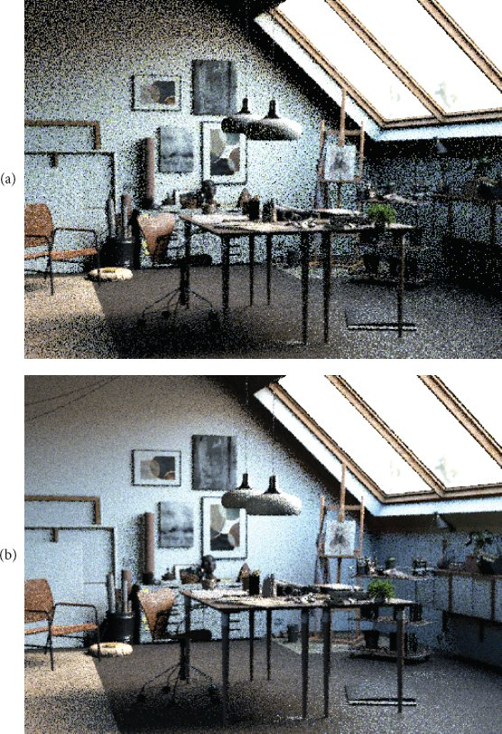

</details>

*Figure 12.19* — Watercolor Scene Illuminated by a Daytime Sky Environment Map. This is a challenging scene to render since the direct lighting calculation only finds illumination when it samples a ray that passes through the window. (a) When rendered with the `ImageInfiniteLight` and 16 samples per pixel, error is high because the environment map includes a bright sun, though it does not illuminate all parts of the room. For such points, none of the many samples taken toward the sun has any contribution. (b) When rendered using the `PortalImageInfiniteLight`, results are much better with the same number of samples because the light is able to sample just the part of the environment map that is visible through the window. In this case, MSE is reduced by a factor of 2.82. (Scene courtesy of Angelo Ferretti.)

<details>
<summary>Book index references: ImageInfiniteLight 767, PortalImageInfiniteLight 773</summary>

`ImageInfiniteLight` (767) · `PortalImageInfiniteLight` (773).

</details>

Consider the scene shown in Figure 12.19, where all the illumination is coming from a skylight environment map that is visible only through the windows. Part of the scene is directly illuminated by the sun, but much of it is not. Those other parts are still illuminated, but by much less bright regions of blue sky. Yet because the sun is so bright, the `ImageInfiniteLight` ends up taking many samples in its direction, though all the ones where the sun is not visible through the window will be wasted. In those regions of the scene, light sampling will occasionally choose a part of the sky that is visible through the window and occasionally `BSDF` sampling will find a path to the light through the window, so that the result is still correct in expectation, but many samples may be necessary to achieve a high-quality result.

The `PortalImageInfiniteLight` is designed to handle this situation more effectively. Given a user-specified portal, a quadrilateral region through which the environment map is potentially visible, it generates a custom sampling distribution at each point being shaded so that it can draw samples according to the region of the environment map that is visible through the portal. For an equal number of samples, this can be much more effective than the `ImageInfiniteLight`’s approach, as shown in Figure 12.19(b).

*〈PortalImageInfiniteLight Definition〉 ≡*

```rust
struct PortalImageInfiniteLight {
    base: LightBase,
    // <PortalImageInfiniteLight Private Members>
    portal: [Point3f; 4],
    portal_frame: Frame,
    image: Image,
    distribution: WindowedPiecewiseConstant2D,
    image_color_space: &'static RGBColorSpace,
    scale: f32,
    scene_radius: f32,
}
```

Given a portal and a point in the scene, there is a set of directions from that point that pass through the portal. If we can find the corresponding region of the environment map, then our task is to sample from it according to the environment map’s emission. This idea is illustrated in Figure 12.20. With the equal-area mapping, the shape of the visible region of the environment map seen from a given point can be complex. The problem is illustrated in Figure 12.21(a), which visualizes the visible regions from two points in the scene from Figure 12.19. The `PortalImageInfiniteLight` therefore uses a different parameterization of directions that causes the visible region seen through a portal to always be rectangular. Later in this section, we will see how this property makes efficient sampling possible. The directional parameterization used by the `PortalImageInfiniteLight` is based on a coordinate system where the x and y axes are aligned with the edges of the portal. Note that the position of the portal is not used in defining this coordinate system—only the directions of its edges. As a first indication that this idea is getting us somewhere, consider the vectors from a point in the scene to the four corners of the portal, transformed into this coordinate system.

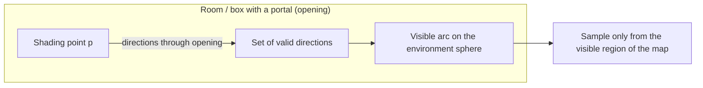

*Figure 12.20 (diagram, redrawn)* — Given a scene with a portal (opening in the box), for each point in the scene we can find the set of directions that pass through the portal. To sample illumination efficiently, we would like to only sample from the corresponding visible region of the environment map (thick segment on the sphere).

<details>
<summary>Book index references: ImageInfiniteLight 767, LightBase 744, PortalImageInfiniteLight 773</summary>

`ImageInfiniteLight` (767) · `LightBase` (744) · `PortalImageInfiniteLight` (773).

</details>

<details>
<summary>Figure 12.21 — Shapes of Visible Regions of an Environment Map as Seen through a Portal</summary>

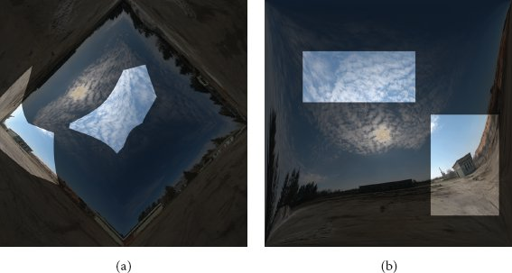

</details>

*Figure 12.21* — Shapes of Visible Regions of an Environment Map as Seen through a Portal. These images illustrate the visible regions of the environment map as seen through the window for a point on the floor and a point on one of the paintings on the wall for the scene in Figure 12.19. (a) The equal-area mapping used by the `ImageInfiniteLight` is convenient for sampling the entire environment map, but it leads to the portal-visible regions having complex shapes. (b) With the directional parameterization used by the `PortalImageInfiniteLight`, the visible region is always rectangular, which makes it feasible to sample from just that part of it. (Environment map courtesy of Sergej Majboroda, via Poly Haven.)

It should be evident that in this coordinate system, vectors to adjacent vertices of the portal only differ in one of their x or y coordinate values and that the four directions thus span a rectangular region in xy. (If this is not clear, it is a detail worth pausing to work through.) We will term directional representations that have this property as rectified. The xy components of vectors in this coordinate system still span $(-\infty, \infty)$, so it is necessary to map them to a finite 2D domain if the environment map is to be represented using an image. It is important that this mapping does not interfere with the axis-alignment of the portal edges and that rectification is preserved. This requirement rules out a number of possibilities, including both the equirectangular and equal-area mappings. Even normalizing a vector and taking the x and y coordinates of the resulting unit vector is unsuitable given this requirement.

A mapping that does work is based on the angles $\alpha$ and $\beta$ that the x and y coordinates of the vector respectively make with the z axis, as illustrated in Figure 12.22. These angles are given by

$$
(\alpha, \beta) = \left(\arctan\frac{x}{z},\; \arctan\frac{y}{z}\right).
$$

We can ignore vectors with negative z components in the rectified coordinate system: they face away from the portal and thus do not receive any illumination. Each of $\alpha$ and $\beta$ then spans the range $[-\pi/2, \pi/2]$ and the pair of them can be easily mapped to $[0, 1]^2$ (u, v) image coordinates. The environment map resampled into this parameterization is shown in Figure 12.21(b), with the visible regions for the same two points in the scene indicated. We will start the implementation of the `PortalImageInfiniteLight` with its `ImageFromRender()` method, which applies this mapping to a vector in the rendering coordinate system `wRender`. (We will come to the initialization of the `portalFrame` member variable in the `PortalImageInfiniteLight` constructor later in this section.) It uses `pstd::optional` for the return value in order to be able to return an invalid result in the case that the vector is coplanar with the portal or facing away from it.

<details>
<summary>Book index references: Clamp() 1033, Frame::ToLocal() 134, PortalImageInfiniteLight::portalFrame 776</summary>

`ImageInfiniteLight` (767) · `PortalImageInfiniteLight` (773) · `Clamp()` (1033) · `Float` (23) · `Frame::ToLocal()` (134) · `Pi` (1033) · `Point2f` (92) · `PortalImageInfiniteLight::portalFrame` (776) · `Sqr()` (1034) · `Vector3f` (86).

</details>

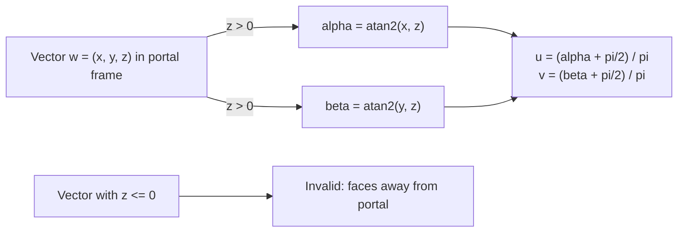

*Figure 12.22 (diagram, redrawn)* — Vectors in the portal’s coordinate system can be represented by a pair of angles $(\alpha, \beta)$ that measure the angle made by the x or y component, respectively, with the z axis.

*〈PortalImageInfiniteLight Private Methods〉 ≡ (page 773)*

```rust
fn image_from_render(&self, w_render: Vector3f,
                     duv_dw: Option<&mut f32>) -> Option<Point2f> {
    let w = self.portal_frame.to_local(w_render);
    if w.z <= 0.0 { return None; }
    // <Compute Jacobian determinant of mapping d(u, v)/dω if needed>
    let alpha = w.x.atan2(w.z);
    let beta = w.y.atan2(w.z);
    Some(Point2f::new(clamp((alpha + PI / 2.0) / PI, 0.0, 1.0),
                      clamp((beta + PI / 2.0) / PI, 0.0, 1.0)))
}
```

We will find it useful to be able to convert sampling densities from the $(u, v)$ parameterization of the image to be with respect to solid angle on the unit sphere. The appropriate factor can be found following the usual approach of computing the determinant of the Jacobian of the mapping function, which is based on Equation (12.1), and then rescaling the coordinates to image coordinates in $[0, 1]^2$. The result is a simple expression when expressed in terms of $\omega$:

$$
\frac{\mathrm{d}(u, v)}{\mathrm{d}\omega}
    = \pi^2 \frac{(1 - \omega_x^2)(1 - \omega_y^2)}{\omega_z}.
$$

If a non-null `duv_dw` parameter is passed to this method, this factor is returned.

*〈Compute Jacobian determinant of mapping d(u, v)/dω if needed〉 ≡ (pages 775, 776)*

```rust
if let Some(d) = duv_dw {
    *d = PI * PI * (1.0 - w.x * w.x) * (1.0 - w.y * w.y) / w.z;
}
```

The inverse transformation can be found by working in reverse. It is implemented in `RenderFromImage()`, which also optionally returns the same change of variables factor.

*〈PortalImageInfiniteLight Private Methods〉 +≡ (page 773)*

```rust
fn render_from_image(&self, uv: Point2f,
                     duv_dw: Option<&mut f32>) -> Vector3f {
    let alpha = -PI / 2.0 + uv[0] * PI;
    let beta = -PI / 2.0 + uv[1] * PI;
    let x = alpha.tan();
    let y = beta.tan();
    let w = normalize(Vector3f::new(x, y, 1.0));
    // <Compute Jacobian determinant of mapping d(u, v)/dω if needed>
    self.portal_frame.from_local(w)
}
```

Because the mapping is rectified, we can find the image-space bounding box of the visible region of the environment map from a given point using the coordinates of two opposite portal corners. This method also returns an optional value, for the same reasons as for `ImageFromRender()`.

*〈PortalImageInfiniteLight Private Methods〉 +≡ (page 773)*

```rust
fn image_bounds(&self, p: Point3f) -> Option<Bounds2f> {
    let p0 = self.image_from_render(normalize(self.portal[0] - p), None);
    let p1 = self.image_from_render(normalize(self.portal[2] - p), None);
    match (p0, p1) {
        (Some(p0), Some(p1)) => Some(Bounds2f::new(p0, p1)),
        _ => None,
    }
}
```

Most of the `PortalImageInfiniteLight` constructor consists of straightforward initialization of member variables from provided parameter values, checking that the provided image has RGB channels, and so forth. All of that has not been included in this text. We will, however, discuss the following three fragments, which run at the end of the constructor.

*〈PortalImageInfiniteLight constructor conclusion〉 ≡ (page 776)*

```rust
// <Compute frame for portal coordinate system>
// <Resample environment map into rectified image>
// <Initialize sampling distribution for portal image infinite light>
```

The portal itself is specified by four vertices, given in the rendering coordinate system. Additional code, not shown here, checks to ensure that they describe a planar quadrilateral. A `Frame` for the portal’s coordinate system can be found from two normalized adjacent edge vectors of the portal using the `Frame::FromXY()` method.

<details>
<summary>Book index references: Frame 133, Frame::FromXY() 134, ParallelFor() 1107</summary>

`Bounds2f` (97) · `Float` (23) · `Frame` (133) · `Frame::FromLocal()` (134) · `Frame::FromXY()` (134) · `Normalize()` (88) · `Pi` (1033) · `Point2f` (92) · `Point3f` (92) · `PortalImageInfiniteLight::ImageFromRender()` (775) · `PortalImageInfiniteLight::portal` (776) · `PortalImageInfiniteLight::portalFrame` (776) · `Vector3f` (86).

</details>

*〈Compute frame for portal coordinate system〉 ≡ (page 776)*

```rust
let p01 = normalize(self.portal[1] - self.portal[0]);
let p03 = normalize(self.portal[3] - self.portal[0]);
self.portal_frame = Frame::from_xy(p03, p01);
```

*〈PortalImageInfiniteLight Private Members〉 ≡ (page 773)*

```rust
portal: [Point3f; 4],
portal_frame: Frame,
```

The constructor also resamples a provided equal-area image into the rectified representation at the same resolution. Because the rectified image depends on the geometry of the portal, it is better to take an equal-area image and resample it in the constructor than to require the user to provide an already-rectified image. In this way, it is easy for the user to change the portal specification just by changing the portal’s coordinates in the scene description file.

*〈Resample environment map into rectified image〉 ≡ (page 776)*

```rust
image = Image::new(PixelFormat::Float, equal_area_image.resolution(),
                   &["R", "G", "B"], equal_area_image.encoding(), alloc);
parallel_for(0, image.resolution().y, |y| {
    for x in 0..image.resolution().x {
        // <Resample equalAreaImage to compute rectified image pixel (x, y)>
    }
});
```

*〈PortalImageInfiniteLight Private Members〉 +≡ (page 773)*

```rust
image: Image,
```

At each rectified image pixel, the implementation first computes the corresponding light-space direction and looks up a bilinearly interpolated value from the equal-area image. No further filtering is performed. A better implementation would use a spatially varying filter here in order to ensure that there was no risk of introducing aliasing due to undersampling the source image.

*〈Resample equalAreaImage to compute rectified image pixel (x, y)〉 ≡ (page 777)*

```rust
// <Find (u, v) coordinates in equal-area image for pixel>
for c in 0..3 {
    let v = equal_area_image.bilerp_channel(uv_equi, c, WrapMode::OctahedralSphere);
    image.set_channel((x, y), c, v);
}
```

The image coordinates in the equal-area image can be found by determining the direction vector corresponding to the current pixel in the rectified image and then finding the equal-area image coordinates that this direction maps to.

<details>
<summary>Book index references: EqualAreaSphereToSquare() 113, WindowedPiecewiseConstant2D 1025, Image::SetChannel() 1083</summary>

`EqualAreaSphereToSquare()` (113) · `Float` (23) · `Image` (1079) · `Image::BilerpChannel()` (1082) · `Image::Encoding()` (1080) · `Image::Resolution()` (1080) · `Image::SetChannel()` (1083) · `LightBase::renderFromLight` (745) · `Normalize()` (88) · `ParallelFor()` (1107) · `PiecewiseConstant2D` (1019) · `PixelFormat::Float` (1080) · `Point2f` (92) · `PortalImageInfiniteLight::RenderFromImage()` (776) · `Transform::ApplyInverse()` (130) · `Vector3f` (86) · `WindowedPiecewiseConstant2D` (1025) · `WrapMode::OctahedralSphere` (1082).

</details>

*〈Find (u, v) coordinates in equal-area image for pixel〉 ≡ (page 777)*

```rust
let uv = Point2f::new((x as f32 + 0.5) / image.resolution().x as f32,
                      (y as f32 + 0.5) / image.resolution().y as f32);
let mut w = self.render_from_image(uv, None);
w = normalize(self.base.render_from_light.apply_inverse(w));
let uv_equi = equal_area_sphere_to_square(w);
```

Given the rectified image, the next step is to initialize an instance of the `WindowedPiecewiseConstant2D` data structure, which performs the sampling operation. (It is defined in Section A.5.6.) As its name suggests, it generalizes the functionality of the `PiecewiseConstant2D` class to allow a caller-specified window that limits the sampling region. It is worthwhile to include the change of variables factor $\mathrm{d}(u, v)/\mathrm{d}\omega$ at each pixel in the image sampling distribution. Doing so causes the weights associated with image samples to be more uniform, as this factor will nearly cancel the same factor when a sample’s PDF is computed. (The cancellation is not exact, as the factor here is computed at the center of each pixel while in the PDF it is computed at the exact sample location.)

*〈Initialize sampling distribution for portal image infinite light〉 ≡ (page 776)*

```rust
let duv_dw = |p: Point2f| {
    let mut duv_dw;
    self.render_from_image(p, Some(&mut duv_dw));
    duv_dw
};
let d = image.get_sampling_distribution(duv_dw);
distribution = WindowedPiecewiseConstant2D::new(d, alloc);
```

*〈PortalImageInfiniteLight Private Members〉 +≡ (page 773)*

```rust
distribution: WindowedPiecewiseConstant2D,
```

The light’s total power can be found by integrating radiance over the hemisphere of directions that can be seen through the portal and then multiplying by the portal’s area, since all light that reaches the scene passes through it. The corresponding `PortalImageInfiniteLight::Phi()` method is not included here, as it boils down to being a matter of looping over the pixels, applying the change of variables factor to account for integration over the unit sphere, and then multiplying the integrated radiance by the portal’s area.

<details>
<summary>Book index references: Array2D 1069, Bounds2::Inside() 100, Image::GetSamplingDistribution() 1085</summary>

`Array2D` (1069) · `Bounds2::Inside()` (100) · `Bounds2f` (97) · `Float` (23) · `Image::GetSamplingDistribution()` (1085) · `Image::LookupNearestChannel()` (1082) · `Normalize()` (88) · `Point2f` (92) · `PortalImageInfiniteLight::distribution` (778) · `PortalImageInfiniteLight::ImageBounds()` (776) · `PortalImageInfiniteLight::imageColorSpace` (779) · `PortalImageInfiniteLight::ImageFromRender()` (775) · `PortalImageInfiniteLight::ImageLookup()` (778) · `PortalImageInfiniteLight::RenderFromImage()` (776) · `PortalImageInfiniteLight::scale` (779) · `Ray` (95) · `Ray::d` (95) · `Ray::o` (95) · `RGB` (182) · `RGBIlluminantSpectrum` (199) · `RGBIlluminantSpectrum::Sample()` (200) · `SampledSpectrum` (171) · `SampledWavelengths` (173) · `WindowedPiecewiseConstant2D` (1025).

</details>

In order to compute the radiance for a ray that has left the scene, the $(u, v)$ coordinates in the image corresponding to the ray’s direction are computed first. The radiance corresponding to those coordinates is returned if they are inside the portal bounds for the ray origin, and a zero-valued spectrum is returned otherwise. (In principle, the `Le()` method should only be called for rays that have left the scene, so that the portal check should always pass, but it is worth including for the occasional ray that escapes the scene due to a geometric error in the scene model. This way, those end up carrying no radiance rather than causing a light leak.)

*〈PortalImageInfiniteLight Method Definitions〉 ≡*

```rust
fn le(&self, ray: &Ray, lambda: &SampledWavelengths) -> SampledSpectrum {
    let uv = self.image_from_render(normalize(ray.d), None);
    let b = self.image_bounds(ray.o);
    match (uv, b) {
        (Some(uv), Some(b)) if inside(uv, b) => self.image_lookup(uv, lambda),
        _ => SampledSpectrum::ZERO,
    }
}
```

The `ImageLookup()` method returns the radiance at the given image $(u, v)$ and wavelengths. We encapsulate this functionality in its own method, as it will be useful repeatedly in the remainder of the light’s implementation.

*〈PortalImageInfiniteLight Method Definitions〉 +≡*

```rust
fn image_lookup(&self, uv: Point2f, lambda: &SampledWavelengths) -> SampledSpectrum {
    let mut rgb = RGB::default();
    for c in 0..3 { rgb[c] = self.image.lookup_nearest_channel(uv, c); }
    let spec = RGBIlluminantSpectrum::new(*self.image_color_space, clamp_zero(rgb));
    self.scale * spec.sample(lambda)
}
```

As before, the image’s color space must be known in order to convert its RGB values to spectra.

*〈PortalImageInfiniteLight Private Members〉 +≡ (page 773)*

```rust
image_color_space: &'static RGBColorSpace,
scale: f32,
```

`SampleLi()` is able to take advantage of the combination of the rectified image representation and the ability of `WindowedPiecewiseConstant2D` to sample a direction from the specified point that passes through the portal, according to the directional distribution of radiance over the portal.

*〈PortalImageInfiniteLight Method Definitions〉 +≡*

```rust
fn sample_li(&self, ctx: LightSampleContext, u: Point2f,
             lambda: SampledWavelengths, _allow_incomplete_pdf: bool)
    -> Option<LightLiSample>
{
    // <Sample (u, v) in potentially visible region of light image>
    // <Convert portal image sample point to direction and compute PDF>
    // <Compute radiance for portal light sample and return LightLiSample>
}
```

`WindowedPiecewiseConstant2D`’s `Sample()` method takes a `Bounds2f` to specify the sampling region. This is easily provided using the `ImageBounds()` method. It may not be able to generate a valid sample—for example, if the point is on the outside of the portal or lies on its plane. In this case, an unset sample is returned.

*〈Sample (u, v) in potentially visible region of light image〉 ≡ (page 779)*

```rust
let Some(b) = self.image_bounds(ctx.p()) else { return None };
let mut map_pdf = 0.0;
let Some(uv) = self.distribution.sample(u, b, &mut map_pdf) else { return None };
```

<details>
<summary>Book index references: WindowedPiecewiseConstant2D::Sample() 1026, PortalImageInfiniteLight::sceneRadius 779</summary>

`Bounds2f` (97) · `Float` (23) · `Interaction` (136) · `LightBase::mediumInterface` (745) · `LightLiSample` (743) · `LightSampleContext` (741) · `LightSampleContext::p()` (742) · `Point2f` (92) · `Point3f` (92) · `PortalImageInfiniteLight::distribution` (778) · `PortalImageInfiniteLight::ImageBounds()` (776) · `PortalImageInfiniteLight::ImageLookup()` (778) · `PortalImageInfiniteLight::RenderFromImage()` (776) · `PortalImageInfiniteLight::sceneRadius` (779) · `RGBColorSpace` (183) · `SampledSpectrum` (171) · `SampledWavelengths` (173) · `Vector3f` (86) · `WindowedPiecewiseConstant2D` (1025) · `WindowedPiecewiseConstant2D::Sample()` (1026).

</details>

After image $(u, v)$ coordinates are converted to a direction, the method computes the sampling PDF with respect to solid angle at the reference point represented by `ctx`. Doing so just requires the application of the change of variables factor returned by `RenderFromImage()`.

*〈Convert portal image sample point to direction and compute PDF〉 ≡ (page 779)*

```rust
let mut duv_dw = 0.0;
let wi = self.render_from_image(uv, Some(&mut duv_dw));
if duv_dw == 0.0 { return None; }
let pdf = map_pdf / duv_dw;
```

The remaining pieces are easy at this point: `ImageLookup()` provides the radiance for the sampled direction and the endpoint of the shadow ray is found in the same way that is done for the other infinite lights.

*〈Compute radiance for portal light sample and return LightLiSample〉 ≡ (page 779)*

```rust
let l = self.image_lookup(uv, lambda);
let p_l = ctx.p() + 2.0 * self.scene_radius * wi;
Some(LightLiSample::new(l, wi, pdf,
                        Interaction::new(p_l, Some(&self.base.medium_interface))))
```

Also as with the other infinite lights, the radius of the scene’s bounding sphere is stored when the `Preprocess()` method, not included here, is called.

*〈PortalImageInfiniteLight Private Members〉 +≡ (page 773)*

```rust
scene_radius: f32,
```

Finding the PDF for a specified direction follows the way in which the PDF was calculated in the sampling method.

*〈PortalImageInfiniteLight Method Definitions〉 +≡*

```rust
fn pdf_li(&self, ctx: LightSampleContext, w: Vector3f,
          _allow_incomplete_pdf: bool) -> f32 {
    // <Find image (u, v) coordinates corresponding to direction w>
    // <Return PDF for sampling (u, v) from reference point>
}
```

First, `ImageFromRender()` gives the $(u, v)$ coordinates in the portal image for the specified direction.

*〈Find image (u, v) coordinates corresponding to direction w〉 ≡ (page 780)*

```rust
let mut duv_dw = 0.0;
let Some(uv) = self.image_from_render(w, Some(&mut duv_dw)) else { return 0.0 };
if duv_dw == 0.0 { return 0.0; }
```

Following its `Sample()` method, the `WindowedPiecewiseConstant2D::PDF()` method also takes a 2D bounding box to window the function. The PDF value it returns is normalized with respect to those bounds and a value of zero is returned if the given point is outside of them. Application of the change of variables factor gives the final PDF with respect to solid angle.

*〈Return PDF for sampling (u, v) from reference point〉 ≡ (page 780)*

```rust
let Some(b) = self.image_bounds(ctx.p()) else { return 0.0 };
let pdf = self.distribution.pdf(uv, b);
pdf / duv_dw
```

## 12.6 LIGHT SAMPLING

Due to the linearity assumption in radiometry, illumination at a point in a scene with multiple light sources can be computed by summing the independent contributions of each light. As we have seen before, however, correctness alone is not always sufficient—if it were, we might have sampled ImageInfiniteLights uniformly with the suggestion that one take thousands of samples per pixel until error has been reduced sufficiently. Especially in scenes with thousands or more independent light sources, considering all of them carries too much of a performance cost.

<details>
<summary>Book index references: Bounds2f 97, LightSampleContext::p() 742, PortalImageInfiniteLight::ImageBounds() 776</summary>

`Bounds2f` (97) · `Float` (23) · `ImageInfiniteLight` (767) · `LightSampleContext` (741) · `LightSampleContext::p()` (742) · `Point2f` (92) · `PortalImageInfiniteLight::ImageBounds()` (776) · `PortalImageInfiniteLight::ImageFromRender()` (775) · `Vector3f` (86) · `WindowedPiecewiseConstant2D::PDF()` (1028).

</details>

Fortunately, here, too, is a setting where stochastic sampling can be applied. An unbiased estimator for a sum of terms $f_i$ is given by

$$
\sum_{i=1}^{n} f_i \approx \frac{f_j}{p(j)},
$$

where the probability mass function (PMF) $p(j) > 0$ for any term where $f_j$ is nonzero and where $j \sim p$. This is the discrete analog to the integral Monte Carlo estimator, Equation (2.7). Therefore, we can replace any sum over all the scene’s light sources with a sum over just one or a few of them, where the contributions are weighted by one over the probability of sampling the ones selected.

Figure 12.23 is a rendered image of a scene with 8,878 light sources. A few observations motivate some of the light sampling algorithms to come. At any given point in the scene, some lights are facing away and others are occluded. Ideally, such lights would be given a zero sampling probability. Furthermore, often many lights are both far away from a given point and have relatively low power; such lights should have a low probability of being sampled. (Consider, for example, the small yellow lights inset in the machinery.) Of course, even a small and dim light is important to points close to it. Therefore, the most effective light sampling probabilities will vary across the scene depending on position, surface normal, the `BSDF`, and so forth.

<details>
<summary>Figure 12.23 — Zero Day Scene, with 8,878 Light Sources</summary>

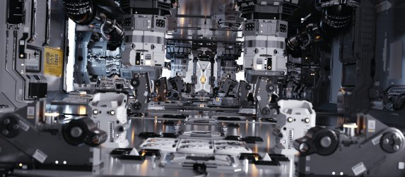

</details>

*Figure 12.23* — Zero Day Scene, with 8,878 Light Sources. It is infeasible to consider every light when computing reflected radiance at a point on a surface, and therefore light sampling methods from this section are necessary to render this scene efficiently. (Scene courtesy of Beeple.)

The `LightSampler` class defines the `LightSampler` interface for sampling light sources.[^overloaded] It is defined in the file `base/lightsampler.h`. `LightSampler` implementations can be found in `lightsamplers.h` and `lightsamplers.cpp`.

[^overloaded]: Our use of the term “sampling light sources” is admittedly overloaded: it can refer to both sampling a point on the surface of a light or a direction toward it, as well as choosing an individual light source. The intended meaning should always be clear in context.

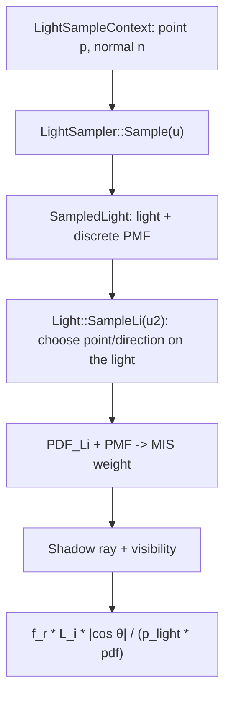

*Figure (added, light sampling)* — The complete direct-lighting sampling pipeline: first choose a light (this section), then a point or direction on it (Sections 12.2–12.5), evaluate both PDFs for the MIS weight, and finally test visibility.

*〈LightSampler Definition〉 ≡*

```rust
enum LightSampler {
    Uniform(UniformLightSampler),
    Power(PowerLightSampler),
    Bvh(BVHLightSampler),
}
```

The key `LightSampler` method is `Sample()`, which takes a uniform 1D sample and information about a reference point in the form of a `LightSampleContext`. When sampling is successful, a `SampledLight` is returned. Otherwise, the optional value is left unset, as may happen if the light sampler is able to determine that no lights illuminate the provided point.

*〈LightSampler Interface〉 ≡ (page 781)*

```rust
fn sample(&self, ctx: &LightSampleContext, u: f32) -> Option<SampledLight>;
```

<details>
<summary>Book index references: BVHLightSampler 796, PowerLightSampler 783, SampledLight 782, TaggedPointer 1073, UniformLightSampler 782</summary>

`BVHLightSampler` (796) · `Float` (23) · `LightSampleContext` (741) · `PowerLightSampler` (783) · `SampledLight` (782) · `TaggedPointer` (1073) · `UniformLightSampler` (782).

</details>

`SampledLight` just wraps up a light and the discrete probability for it having been sampled.

*〈SampledLight Definition〉 ≡*

```rust
struct SampledLight { light: Light, p: f32 }
```

In order to compute the MIS weighting term when a ray happens to hit a light source, it is necessary to be able to find the value of the probability mass function for sampling a particular light. This task is handled by `PMF()` method implementations.

*〈LightSampler Interface〉 +≡ (page 781)*

```rust
fn pmf(&self, ctx: &LightSampleContext, light: Light) -> f32;
```

LightSamplers must also provide methods to sample a light and return the corresponding probability independent of a specific point being illuminated. These methods are useful for light transport algorithms like bidirectional path tracing that start paths at the light sources.

*〈LightSampler Interface〉 +≡ (page 781)*

```rust
fn sample(&self, u: f32) -> Option<SampledLight>;
fn pmf(&self, light: Light) -> f32;
```

### 12.6.1 UNIFORM LIGHT SAMPLING

`UniformLightSampler` is the simplest possible light sampler: it samples all lights with uniform probability. In practice, more sophisticated sampling algorithms are usually much more effective, but this one is easy to implement and provides a useful baseline for comparing light sampling techniques.

*〈UniformLightSampler Definition〉 ≡*

```rust
struct UniformLightSampler { lights: Vec<Light> }
```

As with all light samplers, an array of all the lights in the scene is provided to the constructor; `UniformLightSampler` makes a copy of them in a member variable.

*〈UniformLightSampler Public Methods〉 ≡ (page 782)*

```rust
fn new(lights: &[Light], alloc: Allocator) -> Self {
    Self { lights: lights.to_vec() }
}
```

<details>
<summary>Book index references: Allocator 40, Light 740, SampledLight 782, UniformLightSampler::lights 782</summary>

`Allocator` (40) · `Float` (23) · `Light` (740) · `LightSampleContext` (741) · `SampledLight` (782) · `UniformLightSampler` (782) · `UniformLightSampler::lights` (782).

</details>

*〈UniformLightSampler Private Members〉 ≡ (page 782)*

```rust
lights: Vec<Light>,
```

Since the light sampling probabilities do not depend on the lookup point, we will only include the variants of `Sample()` and `PMF()` that do not take a `LightSampleContext` here. The versions of these methods that do take a context just call these variants. For sampling, a light is chosen by scaling the provided uniform sample by the array size and returning the corresponding light.

*〈UniformLightSampler Public Methods〉 +≡ (page 782)*

```rust
fn sample(&self, u: f32) -> Option<SampledLight> {
    if self.lights.is_empty() { return None; }
    let light_index = (u * self.lights.len() as f32) as usize;
    let light_index = light_index.min(self.lights.len() - 1);
    Some(SampledLight { light: self.lights[light_index], p: 1.0 / self.lights.len() as f32 })
}
```

Given uniform sampling probabilities, the value of the PMF is always one over the number of lights.

*〈UniformLightSampler Public Methods〉 +≡ (page 782)*

```rust
fn pmf(&self, _light: Light) -> f32 {
    if self.lights.is_empty() { 0.0 } else { 1.0 / self.lights.len() as f32 }
}
```

### 12.6.2 POWER LIGHT SAMPLER

`PowerLightSampler` sets the probability for sampling each light according to its power. Doing so generally gives better results than sampling uniformly, but the lack of spatial variation in sampling probabilities limits its effectiveness. (We will return to this topic at the end of this section where some comparisons between the two techniques are presented.)

*〈PowerLightSampler Definition〉 ≡*

```rust
struct PowerLightSampler {
    // <PowerLightSampler Private Members>
    lights: Vec<Light>,
    light_to_index: HashMap<Light, usize>,
    alias_table: AliasTable,
}
```

Its constructor also makes a copy of the provided lights but initializes some additional data structures as well.

*〈PowerLightSampler Method Definitions〉 ≡*

```rust
fn new(lights: &[Light], alloc: Allocator) -> Self {
    let mut s = Self {
        lights: lights.to_vec(),
        light_to_index: HashMap::new(),
        alias_table: AliasTable::empty(alloc),
    };
    if lights.is_empty() { return s; }
    // <Initialize lightToIndex hash table>
    // <Compute lights' power and initialize alias table>
    s
}
```

<details>
<summary>Book index references: AliasTable 994, HashMap 1069, Light::Phi() 740, SampledSpectrum::Average() 172, SampledWavelengths::SampleVisible() 241</summary>

`AliasTable` (994) · `AliasTable::PMF()` (997) · `AliasTable::Sample()` (997) · `Float` (23) · `HashMap` (1069) · `Light` (740) · `Light::Phi()` (740) · `LightSampleContext` (741) · `PowerLightSampler` (783) · `PowerLightSampler::aliasTable` (784) · `PowerLightSampler::lights` (783) · `PowerLightSampler::lightToIndex` (784) · `SampledLight` (782) · `SampledSpectrum` (171) · `SampledSpectrum::Average()` (172) · `SampledSpectrum::SafeDiv()` (172) · `SampledWavelengths` (173) · `SampledWavelengths::PDF()` (174) · `SampledWavelengths::SampleVisible()` (241) · `UniformLightSampler` (782).

</details>

*〈PowerLightSampler Private Members〉 ≡ (page 783)*

```rust
lights: Vec<Light>,
```

To efficiently return the value of the PMF for a given light, it is necessary to be able to find the index in the lights array of a given light. Therefore, the constructor also initializes a hash table that maps from Lights to indices.

*〈Initialize lightToIndex hash table〉 ≡ (page 783)*

```rust
for (i, light) in self.lights.iter().enumerate() {
    self.light_to_index.insert(*light, i);
}
```

*〈PowerLightSampler Private Members〉 +≡ (page 783)*

```rust
light_to_index: HashMap<Light, usize>,
```

The `PowerLightSampler` uses an `AliasTable` for sampling. It is initialized here with weights based on the emitted power returned by each light’s `Phi()` method. Note that if the light’s emission distribution is spiky (e.g., as with many fluorescent lights), there is a risk of underestimating its power if a spike is missed. We have not found this to be a problem in practice, however.

*〈Compute lights' power and initialize alias table〉 ≡ (page 783)*

```rust
let mut light_power = Vec::new();
let lambda = SampledWavelengths::sample_visible(0.5);
for light in &self.lights {
    let phi = safe_div(light.phi(lambda), lambda.pdf());
    light_power.push(phi.average());
}
self.alias_table = AliasTable::new(light_power, alloc);
```

*〈PowerLightSampler Private Members〉 +≡ (page 783)*

```rust
alias_table: AliasTable,
```

Given the alias table, sampling is easy.

*〈PowerLightSampler Public Methods〉 ≡ (page 783)*

```rust
fn sample(&self, u: f32) -> Option<SampledLight> {
    if self.alias_table.is_empty() { return None; }
    let mut pmf = 0.0;
    let light_index = self.alias_table.sample(u, &mut pmf);
    Some(SampledLight { light: self.lights[light_index], p: pmf })
}
```

To evaluate the PMF, the hash table gives the mapping to an index in the array of lights. In turn, the PMF returned by the alias table for the corresponding entry is the probability of sampling the light.

*〈PowerLightSampler Public Methods〉 +≡ (page 783)*

```rust
fn pmf(&self, light: Light) -> f32 {
    if self.alias_table.is_empty() { return 0.0; }
    self.alias_table.pmf(self.light_to_index[&light])
}
```

As with the `UniformLightSampler`, the `Sample()` and `PMF()` methods that do take a `LightSampleContext` just call the corresponding methods that do not take one. Sampling lights based on their power usually works well. Figure 12.24 compares both sampling methods using the Zero Day scene. For this scene, noise is visibly reduced when sampling according to power, and mean squared error (MSE) is improved by a factor of 12.4. Although sampling according to power generally works well, it is not optimal. Like uniform sampling, it is hindered by not taking the geometry of emitters and the relationship between emitters and the receiving point into account. Relatively dim light sources may make the greatest visual contribution in a scene, especially if the bright ones are far away, mostly occluded, or not visible at all. As an extreme example of this problem with sampling according to power, consider a large triangular light source that emits a small amount of radiance. The triangle’s emitted power can be made arbitrarily large by scaling it to increase its total area. However, at any point in the scene the triangle can do no more than subtend a hemisphere, which limits its effect on the total incident radiance at a point. Sampling by power can devote far too many samples to such lights.

<details>
<summary>Figure 12.24 — Sampling Lights Uniformly versus by Emitted Power</summary>

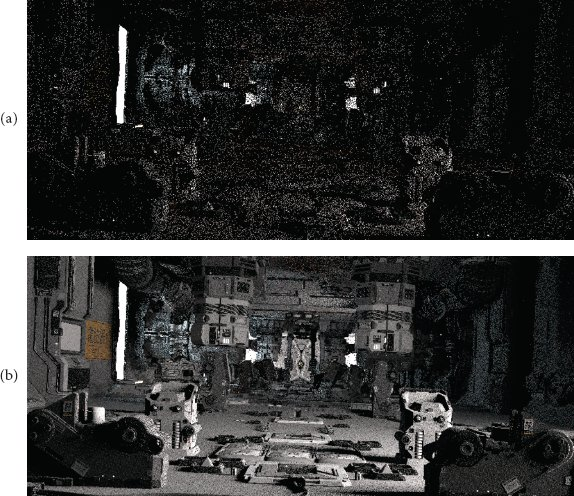

</details>

*Figure 12.24* — Sampling Lights Uniformly versus by Emitted Power with the Zero Day Scene. (a) Rendered with uniform light sampling. (b) Rendered with lights sampled according to power. Both images are rendered with 16 samples per pixel and rendering time is nearly the same. Sampling lights according to power reduces MSE by a factor of 12.4 for this scene. (Scene courtesy of Beeple.)

Lights can also be stored in a GPU buffer and sampled directly in WGSL. The following sketch shows the essentials: a flat `Light` struct in a storage buffer and a `sampleLight()` routine that handles the delta-light cases and a uniformly sampled area/infinite light. The PMF of the discrete light choice is returned alongside the sample so the shader can form the MIS weight.

```wgsl
struct Light {
    light_type : u32,        // 0 point, 1 spot, 2 distant, 3 area, 4 infinite
    position   : vec3f,
    direction  : vec3f,      // spot/distant axis
    intensity  : vec3f,      // spectral intensity or radiance (RGB proxy)
    power      : f32,
    cos_start  : f32,        // spot falloff
    cos_end    : f32,
    area       : f32,
};

@group(0) @binding(0) var<storage, read> lights : array<Light>;

struct LightSample {
    radiance : vec3f,
    wi       : vec3f,        // direction from which radiance arrives
    pdf      : f32,          // solid-angle PDF at the receiver
    origin   : vec3f,        // second point for the shadow ray
    valid    : u32,
};

fn sample_light(light : Light, p : vec3f, u : vec2f, scene_radius : f32)
    -> LightSample
{
    var s : LightSample;
    s.valid = 0u;
    if (light.light_type == 0u) {            // point light: delta position
        let d = light.position - p;
        let r2 = max(dot(d, d), 1e-8);
        s.wi = normalize(d);
        s.radiance = light.intensity / r2;
        s.pdf = 1.0;                          // implicit delta cancels
        s.origin = light.position;
        s.valid = 1u;
    } else if (light.light_type == 1u) {      // spot light
        let d = light.position - p;
        let r2 = max(dot(d, d), 1e-8);
        let cos_theta = dot(-normalize(d), light.direction);
        if (cos_theta <= light.cos_end) { return s; }   // outside cone
        let t = clamp((cos_theta - light.cos_end) /
                      (light.cos_start - light.cos_end), 0.0, 1.0);
        let falloff = t * t * (3.0 - 2.0 * t);          // SmoothStep
        s.wi = normalize(d);
        s.radiance = light.intensity * falloff / r2;
        s.pdf = 1.0;
        s.origin = light.position;
        s.valid = 1u;
    } else if (light.light_type == 2u) {      // distant: delta direction
        s.wi = normalize(light.direction);
        s.radiance = light.intensity;
        s.pdf = 1.0;
        s.origin = p + s.wi * (2.0 * scene_radius);
        s.valid = 1u;
    } else {                                  // area / infinite: uniform sphere
        let wi = sample_uniform_sphere(u);
        s.wi = wi;
        s.radiance = light.intensity;
        s.pdf = 1.0 / (4.0 * PI);
        s.origin = p + wi * (2.0 * scene_radius);
        s.valid = 1u;
    }
    return s;
}
```

On the GPU the discrete light choice itself can be made with the same alias table used by `PowerLightSampler`: store the alias and probability tables in buffers and use two uniform samples.

```wgsl
@group(0) @binding(1) var<storage, read> alias_table : array<vec2f>; // (index, prob)

fn sample_power_light(u1 : f32, u2 : f32) -> vec2u { // (light index, pmf)
    let n = u32(u1 * f32(arrayLength(&alias_table)));
    let entry = alias_table[n];
    if (u2 < entry.y) { return vec2u(n, bitcast<u32>(entry.y)); }
    let other = u32(entry.x);
    return vec2u(other, bitcast<u32>(alias_table[other].y));
}
```

### ⋆ 12.6.3 BVH LIGHT SAMPLING

Varying the light sampling probabilities based on the point being shaded can be an effective light sampling strategy, though if there are more than a handful of lights, some sort of data structure is necessary to do this without having to consider every light at each point being shaded. One widely used approach is to construct a hierarchy over the light sources with the effect of multiple lights aggregated into the higher nodes of the hierarchy. This representation makes it possible to traverse the hierarchy to find the important lights near a given point.

Given a good light hierarchy, it is possible to render scenes with hundreds of thousands or even millions of light sources nearly as efficiently as a scene with just one light. In this section, we will describe the implementation of the `BVHLightSampler`, which applies bounding volume hierarchies to this task.

**Bounding Lights.** When bounding volume hierarchies (BVHs) were used for intersection acceleration structures in Section 7.3, it was necessary to abstract away the details of the various types of primitives and underlying shapes that they stored so that the `BVHAggregate` did not have to be explicitly aware of each of them. There, the primitives’ rendering-space bounding boxes were used for building the hierarchy. Although there were cases where the quality of the acceleration structure might have been improved using shape-specific information (e.g., if the acceleration structure was aware of skinny diagonal triangles with large bounding boxes with respect to the triangle’s area), the `BVHAggregate`’s implementation was substantially simplified with that approach. We would like to have a similar decoupling for the `BVHLightSampler`, though it is less obvious what the right abstraction should be. For example, we might want to know that a spotlight only emits light in a particular cone, so that the sampler does not choose it for points outside the cone. Similarly, we might want to know that a one-sided area light only shines light on one side of a particular plane. For all sorts of lights, knowing their total power would be helpful so that brighter lights can be sampled preferentially to dimmer ones. Of course, power does not tell the whole story, as the light’s spatial extent and relationship to a receiving point affect how much power is potentially received at that point. The `LightBounds` structure provides the abstraction used by pbrt for these purposes. It stores a variety of values that make it possible to represent the emission distribution of a variety of types of light.

*〈LightBounds Definition〉 ≡*

```rust
struct LightBounds {
    // <LightBounds Public Members>
    bounds: Bounds3f,
    phi: f32,
    w: Vector3f,
    cos_theta_o: f32,
    cos_theta_e: f32,
    two_sided: bool,
}
```

It is evident that the spatial bounds of the light and its emitted power will be useful quantities, so those are included in `LightBounds`. However, this representation excludes light sources at infinity such as the `DistantLight` and the various infinite lights. That limitation is fine, however, since it is unclear how such light sources would be stored in a BVH anyway. (The `BVHLightSampler` therefore handles these types of lights separately.)

*〈LightBounds Public Members〉 ≡ (page 786)*

```rust
bounds: Bounds3f,
phi: f32,
```

As suggested earlier, bounding a light’s directional emission distribution is important for sampling lights effectively. The representation used here is based on a unit vector $\omega$ that specifies a principal direction for the emitter’s surface normal and two angles that specify its variation. First, $\theta_o$ specifies the maximum deviation of the emitter’s surface normal from the principal normal direction $\omega$. Second, $\theta_e$ specifies the angle beyond $\theta_o$ up to which there may be emission (see Figure 12.25). Thus, directions that make an angle up to $\theta_o + \theta_e$ with $\omega$ may receive illumination from a light and those that make a greater angle certainly do not.

<details>
<summary>Book index references: Bounds3f 97, BVHAggregate 407, DirectionCone 114</summary>

`Bounds3f` (97) · `BVHAggregate` (407) · `BVHLightSampler` (796) · `DistantLight` (757) · `Float` (23) · `DirectionCone` (114) · `DirectionCone::Union()` (116) · `SafeSqrt()` (1034) · `Sqr()` (1034) · `Normal3f` (94) · `Point3f` (92).

</details>

While this representation may seem overly specialized for emissive shapes alone, it works well for all of pbrt’s (noninfinite) light types. For example, a point light can be represented with an arbitrary average normal $\omega$ and an angle of $\pi$ for $\theta_o$. A spotlight can use the direction it is facing for $\omega$, its central cone angle for $\theta_o$, and the angular width of its falloff region for $\theta_e$.

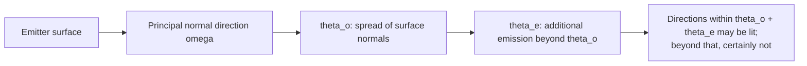

*Figure 12.25 (diagram, redrawn)* — Specification of Potential Emission Directions for a Light. Lights specify a principal direction of their distribution of surface normals $\omega$ as well as two angles, $\theta_o$ and $\theta_e$. The first angle bounds the variation in surface normals from $\omega$ and the second gives the additional angle beyond which emission is possible.

Our implementation stores the cosine of these angles rather than the angles themselves; this representation will make it possible to avoid the expense of evaluating a number of trigonometric functions in the following.

*〈LightBounds Public Members〉 +≡ (page 786)*

```rust
w: Vector3f,
cos_theta_o: f32,
cos_theta_e: f32,
```

The last part of the emission bounds for a light is a `twoSided` flag, which indicates whether the direction $\omega$ should be negated to specify a second cone that uses the same pair of angles.

*〈LightBounds Public Members〉 +≡ (page 786)*

```rust
two_sided: bool,
```

The `LightBounds` constructor takes corresponding parameters and initializes the member variables. The implementation is straightforward, and so is not included here.

*〈LightBounds Public Methods〉 ≡ (page 786)*

```rust
fn new(b: &Bounds3f, w: Vector3f, phi: f32,
       cos_theta_o: f32, cos_theta_e: f32, two_sided: bool) -> Self;
```

To cluster lights into a hierarchy, we will need to be able to find the bounds that encompass two specified `LightBounds` objects. This capability is provided by the `Union()` function.

*〈LightBounds Inline Methods〉 ≡*

```rust
fn union(a: &LightBounds, b: &LightBounds) -> LightBounds {
    // <If one LightBounds has zero power, return the other>
    // <Find average direction and updated angles for LightBounds>
    // <Return final LightBounds union>
}
```

It is worthwhile to start out by checking for the easy case of one or the other specified `LightBounds` having zero power. In this case, the other can be returned immediately.

*〈If one LightBounds has zero power, return the other〉 ≡ (page 787)*

```rust
if a.phi == 0.0 { return *b; }
if b.phi == 0.0 { return *a; }
```

Otherwise, a new average normal direction and updated angles $\theta_o$ and $\theta_e$ must be computed. Most of the work involved is handled by the `DirectionCone`’s `Union()` method, which takes a pair of cones of directions and returns one that bounds the two of them. The cosine of the new angle $\theta_o$ is then given by the cosine of the spread angle of that cone.

The value of $\theta_e$ should be the maximum of the $\theta_e$ values for the two cones. However, because `LightBounds` stores the cosines of the angles and because the cosine function is monotonically decreasing over the range of possible $\theta$ values, $[0, \pi]$, we take the minimum cosine of the two angles.

*〈Find average direction and updated angles for LightBounds〉 ≡ (page 787)*

```rust
let cone = direction_cone_union(DirectionCone::new(a.w, a.cos_theta_o),
                                DirectionCone::new(b.w, b.cos_theta_o));
let cos_theta_o = cone.cos_theta;
let cos_theta_e = a.cos_theta_e.min(b.cos_theta_e);
```

The remainder of the parameter values for the `LightBounds` constructor are easily computed from the two `LightBounds` that were provided.

*〈Return final LightBounds union〉 ≡ (page 787)*

```rust
LightBounds::new(&bounds_union(a.bounds, b.bounds), cone.w,
                 a.phi + b.phi, cos_theta_o, cos_theta_e,
                 a.two_sided | b.two_sided)
```

A utility method returns the centroid of the spatial bounds; this value will be handy when building the light BVH.

*〈LightBounds Public Methods〉 +≡ (page 786)*

```rust
fn centroid(&self) -> Point3f { (self.bounds.p_min + self.bounds.p_max) / 2.0 }
```

The `Importance()` method provides the key `LightBounds` functionality: it returns a scalar value that estimates the contribution of the light or lights represented in the `LightBounds` at a given point. If the provided normal is nondegenerate, it is assumed to be the surface normal at the receiving point. Scattering points in participating media pass a zero-valued `Normal3f`.

*〈LightBounds Method Definitions〉 ≡*

```rust
fn importance(&self, p: Point3f, n: Normal3f) -> f32 {
    // <Return importance for light bounds at reference point>
}
```

It is necessary to make a number of assumptions in order to estimate the amount of light arriving at a point given a `LightBounds`. While it will be possible to make use of principles such as the received power falling off with the squared distance from the emitter or the incident irradiance at a surface varying according to Lambert’s law, some approximations are inevitable, given the loss of specifics that comes with adopting the `LightBounds` representation.

*〈Return importance for light bounds at reference point〉 ≡ (pages 788, 796)*

```rust
// <Compute clamped squared distance to reference point>
// <Define cosine and sine clamped subtraction lambdas>
// <Compute sine and cosine of angle to vector w, theta_w>
// <Compute cos theta_b for reference point>
// <Compute cos theta' and test against cos theta_e>
// <Return final importance at reference point>
```

Even computing the squared distance for the falloff of received power is challenging if `bounds` is not degenerate: to which point in `bounds` should the distance be computed? It may seem that finding the minimum distance from the point p to the bounds would be a safe choice, though this would imply a very small distance for a point close to the bounds and a zero distance for a point inside it. Either of these would lead to a very large $1/r^2$ factor and potentially high error due to giving too much preference to such a `LightBounds`. Further, choosing between the two child `LightBounds` of a node when a point is inside both would be impossible, given infinite weights for each. Therefore, our first fudge is to compute the distance from the center of the bounding box but further to ensure that the squared distance is not too small with respect to the length of the diagonal of the bounding box. Thus, for larger bounding boxes with corresponding uncertainty about what the actual spatial distribution of emission is, the inverse squared distance factor cannot become too large.

*〈Compute clamped squared distance to reference point〉 ≡ (page 788)*

```rust
let pc = (self.bounds.p_min + self.bounds.p_max) / 2.0;
let mut d2 = distance_squared(p, pc);
d2 = d2.max(self.bounds.diagonal().length() / 2.0);
```

In the following computations, we will need to produce a series of values of the form $\cos(\max(0, \theta_a - \theta_b))$ and $\sin(\max(0, \theta_a - \theta_b))$. Given the sine and cosine of $\theta_a$ and $\theta_b$, it is possible to do so without evaluating any trigonometric functions. To see how, consider the cosine: $\theta_a - \theta_b < 0$ implies that $\theta_a < \theta_b$ and that therefore $\cos\theta_a > \cos\theta_b$. We thus start by checking that case and returning $\cos 0 = 1$ if it is true. We are otherwise left with $\cos(\theta_a - \theta_b)$, which can be expressed in terms of the sines and cosines of the two angles using a trigonometric identity,

$$
\cos\theta_a \cos\theta_b + \sin\theta_a \sin\theta_b .
$$

The case for sine follows analogously. Two simple lambda functions provide these capabilities. (Only the one for cosine is included in the text, as `sinSubClamped` follows a similar form.)

*〈Define cosine and sine clamped subtraction lambdas〉 ≡ (page 788)*

```rust
let cos_sub_clamped = |sin_a: f32, cos_a: f32, sin_b: f32, cos_b: f32| -> f32 {
    if cos_a > cos_b { 1.0 } else { cos_a * cos_b + sin_a * sin_b }
};
```

There are a number of angles involved in the importance computation. In addition to the ones that specify the directional emission bounds, $\theta_o$ and $\theta_e$, we will start by computing the sine and cosine of $\theta_w$, the angle between the principal normal direction and the vector from the center of the light bounds to the reference point (Figure 12.26(a)).

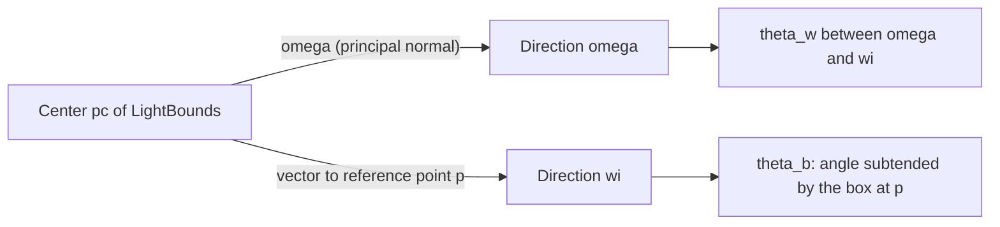

*Figure 12.26 (diagram, redrawn)* — (a) $\theta_w$ measures the angle between the principal normal direction $\omega$ and the vector from the center of the bounding box to the reference point. (b) $\theta_b$ is the angle that the `LightBounds`’s bounding box, `bounds`, subtends with respect to the reference point.

<details>
<summary>Book index references: Bounds3::Diagonal() 101, DistanceSquared() 93, Length() 88</summary>

`Bounds3::Diagonal()` (101) · `Bounds3::pMax` (98) · `Bounds3::pMin` (98) · `DistanceSquared()` (93) · `Float` (23) · `Length()` (88) · `LightBounds::bounds` (786) · `Point3f` (92).

</details>

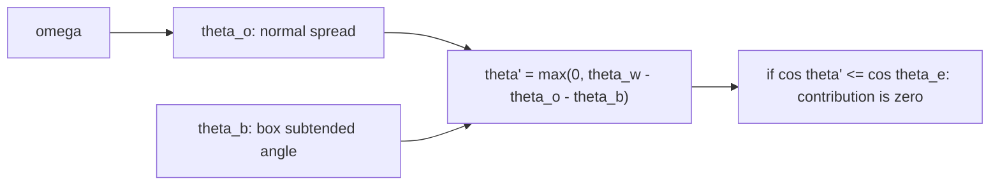

*Figure 12.27 (diagram, redrawn)* — $\theta'$ is the minimum angle between the emitter and the vector to the reference point.

*〈Compute sine and cosine of angle to vector w, θw〉 ≡ (page 788)*

```rust
let wi = normalize(p - pc);
let mut cos_theta_w = dot(Vector3f::from(self.w), wi);
if self.two_sided { cos_theta_w = cos_theta_w.abs(); }
let sin_theta_w = safe_sqrt(1.0 - cos_theta_w * cos_theta_w);
```

To bound the variation of various angles across the extent of the bounding box, we will also make use of the angle that the bounding box subtends with respect to the reference point (see Figure 12.26(b)). We will denote this angle $\theta_b$. The preexisting `DirectionCone::BoundSubtendedDirections()` function takes care of computing its cosine. Its sine follows directly.

*〈Compute cos θb for reference point〉 ≡ (page 788)*

```rust
let cos_theta_b = bound_subtended_directions(self.bounds, p).cos_theta;
let sin_theta_b = safe_sqrt(1.0 - cos_theta_b * cos_theta_b);
```

The last angle we will use is the minimum angle between the emitter’s normal and the vector to the reference point. We will denote it by $\theta'$, and it is given by

$$
\theta' = \max(0, \theta_w - \theta_o - \theta_b).
$$

As with the other angles, we only need its sine and cosine, which can be computed one subtraction at a time. If this angle is greater than $\theta_e$ (or, here, if its cosine is less than $\cos\theta_e$), then it is certain that the lights represented by the bounds do not illuminate the reference point and an importance value of 0 can be returned immediately.

*〈Compute cos θ′ and test against cos θe〉 ≡ (page 788)*

```rust
let sin_theta_o = safe_sqrt(1.0 - self.cos_theta_o * self.cos_theta_o);
let cos_theta_x = cos_sub_clamped(sin_theta_w, cos_theta_w, sin_theta_o, self.cos_theta_o);
let sin_theta_x = sin_sub_clamped(sin_theta_w, cos_theta_w, sin_theta_o, self.cos_theta_o);
let cos_theta_p = cos_sub_clamped(sin_theta_x, cos_theta_x, sin_theta_b, cos_theta_b);
if cos_theta_p <= self.cos_theta_e { return 0.0; }
```

<details>
<summary>Book index references: DirectionCone::BoundSubtendedDirections() 115, Dot() 89, SafeSqrt() 1034</summary>

`DirectionCone::BoundSubtendedDirections()` (115) · `DirectionCone::cosTheta` (114) · `Dot()` (89) · `Float` (23) · `LightBounds::bounds` (786) · `LightBounds::twoSided` (787) · `LightBounds::w` (787) · `Normalize()` (88) · `SafeSqrt()` (1034) · `Sqr()` (1034) · `Vector3f` (86).

</details>

The importance value can now be computed. It starts with the product of the power of the lights, the $\cos\theta'$ factor that accounts for the cosine at the emitter, and the inverse squared distance:

```rust
// <Return final importance at reference point>
let mut importance = self.phi * cos_theta_p / d2;
// <Account for cos theta_i in importance at surfaces>
return importance;
```

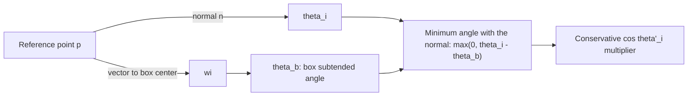

*Figure 12.28 (diagram, redrawn)* — An angle that gives a lower bound on the angle between the incident lighting direction and the surface normal can be found by subtracting $\theta_b$, the angle that the bounding box subtends with respect to the reference point p, from $\theta_i$, the angle between the surface normal and the vector to the center of the box.

At a surface, the importance also accounts for a conservative estimate of the incident cosine factor there. We have `wi`, the unit vector from the reference point to the center of the `LightBounds`, but would like to conservatively set the importance based on the maximum value of the incident cosine over the entire bounding box. The corresponding minimum angle with the surface normal is given by $\max(0, \theta_i - \theta_b)$ (see Figure 12.28).

Our implementation of this computation uses the `cosSubClamped()` lambda function introduced earlier to compute the cosine of the angle directly using the sines and cosines of the two contributing angles.

*〈Account for cos θi in importance at surfaces〉 ≡ (page 791)*

```rust
if n != Normal3f::ZERO {
    let cos_theta_i = abs_dot(wi, n);
    let sin_theta_i = safe_sqrt(1.0 - cos_theta_i * cos_theta_i);
    let cos_theta_p_i = cos_sub_clamped(sin_theta_i, cos_theta_i, sin_theta_b, cos_theta_b);
    importance *= cos_theta_p_i;
}
```

**Bounds for Light Implementations.** Given the definition of `LightBounds`, we will add another method to the `Light` interface to allow lights to return bounds on their emission.

*〈Light Interface〉 +≡ (page 740)*

```rust
fn bounds(&self) -> Option<LightBounds>;
```

<details>
<summary>Book index references: AbsDot() 90, PointLight::Phi() 748, SafeSqrt() 1034</summary>

`AbsDot()` (90) · `DistantLight` (757) · `Float` (23) · `ImageInfiniteLight` (767) · `Light` (740) · `LightBounds` (786) · `Normal3f` (94) · `PointLight` (746) · `PointLight::Phi()` (748) · `SafeSqrt()` (1034) · `Sqr()` (1034).

</details>

Lights at infinity return an unset optional value. Here, for example, is the implementation of this method for `ImageInfiniteLight`. The other infinite lights and the `DistantLight` do likewise.

*〈ImageInfiniteLight Public Methods〉 +≡ (page 767)*

```rust
fn bounds(&self) -> Option<LightBounds> { None }
```

The `PointLight`’s implementation is just a few lines of code, as befitting the simplicity of that type of light source. The spatial bounds are given by the light’s rendering space position and the total emitted power is easily computed following the approach in `PointLight::Phi()`. Because this light shines in all directions, the average normal direction is arbitrary and $\theta_o$ is $\pi$, corresponding to the full sphere of directions.

*〈PointLight Method Definitions〉 +≡*

```rust
fn bounds(&self) -> Option<LightBounds> {
    let p = self.base.render_from_light(Point3f::ZERO);
    let phi = 4.0 * PI * self.scale * self.i.max_value();
    Some(LightBounds::new(&Bounds3f::new(p, p), Vector3f::new(0.0, 0.0, 1.0),
                          phi, PI.cos(), (PI / 2.0).cos(), false))
}
```

The `SpotLight`’s bounding method is a bit more interesting: now the average normal vector is relevant; it is set here to be the light’s direction. The $\theta_o$ range is set to be the angular width of the inner cone of the light and $\theta_e$ corresponds to the width of its falloff at the edges. While this falloff does not exactly match the cosine-weighted falloff used in the `LightBounds::Importance()` method, it is close enough for these purposes. There is a subtlety in the computation of phi for this light: it is computed as if the light source was an isotropic point source and is not affected by the spotlight’s cone angle, like the computation in `SpotLight::Phi()` is. To understand the reason for this, consider two spotlights with the same radiant intensity, one with a very narrow cone and one with a wide cone, both illuminating some point in the scene. The total power emitted by the former is much less than the latter, though for a point inside both of their cones, both should be sampled with equal probability—effectively, the cone is accounted for in the light importance function and so should not be included in the phi value supplied here.

<details>
<summary>Book index references: Shape::NormalBounds() 262, Spectrum::MaxValue() 166, SpotLight::cosFalloffStart 749</summary>

`Bounds3f` (97) · `DiffuseAreaLight::shape` (761) · `DiffuseAreaLight::twoSided` (761) · `DirectionCone` (114) · `Float` (23) · `GoniometricLight` (756) · `LightBase::renderFromLight` (745) · `LightBounds` (786) · `LightBounds::Importance()` (788) · `Normalize()` (88) · `Pi` (1033) · `Point3f` (92) · `PointLight::I` (747) · `PointLight::scale` (747) · `ProjectionLight` (751) · `Shape::Bounds()` (262) · `Shape::NormalBounds()` (262) · `Spectrum::MaxValue()` (166) · `SpotLight` (748) · `SpotLight::cosFalloffEnd` (749) · `SpotLight::cosFalloffStart` (749) · `SpotLight::Iemit` (749) · `SpotLight::Phi()` (750) · `SpotLight::scale` (749) · `Transform::operator()` (130) · `Vector3f` (86).

</details>

*〈SpotLight Method Definitions〉 +≡*

```rust
fn bounds(&self) -> Option<LightBounds> {
    let p = self.base.render_from_light(Point3f::ZERO);
    let w = normalize(self.base.render_from_light(Vector3f::new(0.0, 0.0, 1.0)));
    let phi = self.scale * self.i_emit.max_value() * 4.0 * PI;
    let cos_theta_e = (self.cos_falloff_end.acos() - self.cos_falloff_start.acos()).cos();
    Some(LightBounds::new(&Bounds3f::new(p, p), w, phi,
                          self.cos_falloff_start, cos_theta_e, false))
}
```

We will skip past the implementations of the `ProjectionLight` and `GoniometricLight` `Bounds()` methods, which are along similar lines.

The `DiffuseAreaLight`’s `Bounds()` implementation is different than the previous ones. the utility of the `Shape::NormalBounds()` method may now be better appreciated; the cone of directions that it returns gives the average normal direction $\omega$ and its spread angle $\theta_o$. For area lights, $\theta_e = \pi/2$, since illumination is emitted in the entire hemisphere around each surface normal.

*〈DiffuseAreaLight Method Definitions〉 +≡*

```rust
fn bounds(&self) -> Option<LightBounds> {
    // <Compute phi for diffuse area light bounds>
    let nb = self.shape.normal_bounds();
    Some(LightBounds::new(&self.shape.bounds(), nb.w, phi, nb.cos_theta,
                          (PI / 2.0).cos(), self.two_sided))
}
```

<details>
<summary>Figure 12.29 — Simple Scene with Two Area Lights</summary>


</details>

*Figure 12.29* — Simple Scene with Two Area Lights. The quadrilateral on the right emits light from both sides, while the one on the left only emits from the front side. (a) If the `DiffuseAreaLight::Bounds()` method includes an additional factor of 2 for the two-sided light’s importance, then it receives more samples than it should. (b) Without this factor, the light importance values are more accurate, which in turn gives a visible reduction in error. The MSE improvement is a factor of 1.42.

The phi value is found by integrating over the light’s area. For lights that use an `Image` for spatially varying emission, the *〈Compute average DiffuseAreaLight image channel value〉* fragment, not included here, computes its average value. Because `LightBounds` accounts for whether the emitter is one- or two-sided, it is important not to double the shape’s area if it is two-sided; that factor is already included in the importance computation. (This subtlety is similar to the one for the `SpotLight`’s phi value.) See Figure 12.29 for an illustration of how this detail makes a difference.

<details>
<summary>Book index references: DiffuseAreaLight::Bounds() 792, Image 1079, LightBounds 786</summary>

`DiffuseAreaLight::Bounds()` (792) · `Image` (1079) · `LightBounds` (786).

</details>

*〈Compute phi for diffuse area light bounds〉 ≡ (page 792)*

```rust
let mut phi = 0.0;
if self.image.is_some() {
    // <Compute average DiffuseAreaLight image channel value>
} else {
    phi = self.l_emit.max_value();
}
phi *= self.scale * self.area * PI;
```

**Compactly Bounding Lights.** The `LightBounds` class uses 52 bytes of storage. This is not a problem as far as the total amount of memory consumed for the lights in the scene, but it does affect performance from the amount of space it uses in the cache. For scenes with thousands of lights, multiple instances of the `LightBounds` will be accessed when traversing the light BVH, and so minimizing its storage requirements improves cache performance and thus overall performance. (This is especially the case on the GPU, since many threads run concurrently on each processor and each will generally follow a different path through the light BVH and thus access different `LightBounds` instances.) Therefore, we have also implemented a `CompactLightBounds` class, which applies a number of techniques to reduce storage requirements for the `LightBounds` information. It uses just 24 bytes of storage. We use both classes in pbrt: the uncompressed `LightBounds` is convenient for lights to return from their Bounds() methods and is also a good representation to use when building the light BVH. `CompactLightBounds` is used solely in the in-memory representation of light BVH nodes, where minimizing size is beneficial to performance.

*〈CompactLightBounds Definition〉 ≡*

```rust
struct CompactLightBounds {
    // <CompactLightBounds Private Members>
    w: OctahedralVector,
    phi: f32,
    q_cos_theta_o: u16, // 15 bits
    q_cos_theta_e: u16, // 15 bits
    two_sided: bool,    // 1 bit
    qb: [[u16; 3]; 2],
}
```

<details>
<summary>Book index references: CompactLightBounds::QuantizeCos() 795, OctahedralVector 109</summary>

`Bounds3f` (97) · `CompactLightBounds` (794) · `CompactLightBounds::QuantizeCos()` (795) · `DiffuseAreaLight::area` (761) · `DiffuseAreaLight::Lemit` (761) · `DiffuseAreaLight::scale` (761) · `Float` (23) · `LightBounds` (786) · `LightBounds::bounds` (786) · `LightBounds::cosTheta_e` (787) · `LightBounds::cosTheta_o` (787) · `LightBounds::phi` (786) · `LightBounds::twoSided` (787) · `LightBounds::w` (787) · `Normalize()` (88) · `OctahedralVector` (109) · `Pi` (1033) · `Spectrum::MaxValue()` (166) · `Vector3` (86).

</details>

Its constructor takes both a `LightBounds` instance and a bounding box `allb` that must completely bound `LightBounds::bounds`. This bounding box is used to compute quantized bounding box vertex positions to reduce their storage requirements.

*〈CompactLightBounds Public Methods〉 ≡ (page 794)*

```rust
fn new(lb: &LightBounds, allb: &Bounds3f) -> Self {
    let mut cb = Self {
        w: OctahedralVector::new(normalize(lb.w)),
        phi: lb.phi,
        q_cos_theta_o: quantize_cos(lb.cos_theta_o),
        q_cos_theta_e: quantize_cos(lb.cos_theta_e),
        two_sided: lb.two_sided,
        qb: [[0; 3]; 2],
    };
    // <Quantize bounding box into qb>
    cb
}
```

The `OctahedralVector` class from Section 3.8.3 stores a unit vector in 4 bytes, saving 8 from the Vector3 used in `LightBounds`. Then, the two cosines and the `twoSided` flag are packed into another 4 bytes using a bitfield, saving another 8. We have left `phi` alone, since the various compactions already implemented are sufficient for pbrt’s current requirements.

*〈CompactLightBounds Private Members〉 ≡ (page 794)*

```rust
w: OctahedralVector,
phi: f32,
// qCosTheta_o (15 bits), qCosTheta_e (15 bits), twoSided (1 bit) packed into 4 bytes
qb: [[u16; 3]; 2],
```

`QuantizeCos()` maps the provided value (which is expected to be the cosine of an angle and thus between –1 and 1) to a 15-bit unsigned integer. After being remapped to be in $[0, 1]$, multiplying by the largest representable 15-bit unsigned integer, $2^{15} - 1 = 32{,}767$, gives a value that spans the valid range. Note the use of `pstd::floor()` to round the quantized cosine value down before returning it: this is preferable to, say, rounding to the nearest integer, since it ensures that any quantization error serves to slightly increase the corresponding angle rather than decreasing it. (Decreasing it could lead to inadvertently determining that the light did not illuminate a point that it actually did.)

*〈CompactLightBounds Private Methods〉 ≡ (page 794)*

```rust
fn quantize_cos(c: f32) -> u16 { ((32767.0 * ((c + 1.0) / 2.0)).floor()) as u16 }
```

The bounding box corners are also quantized. Each coordinate of each corner gets 16 bits, all of them stored in the `qb` member variable. This brings the storage for the bounds down to 12 bytes, from 24 before. Here the quantization is also conservative, rounding down at the lower end of the extent and rounding up at the upper end.

*〈Quantize bounding box into qb〉 ≡ (page 794)*

```rust
for c in 0..3 {
    self.qb[0][c] = quantize_bounds(lb.bounds[0][c], allb.p_min[c], allb.p_max[c]).floor() as u16;
    self.qb[1][c] = quantize_bounds(lb.bounds[1][c], allb.p_min[c], allb.p_max[c]).ceil() as u16;
}
```

*〈CompactLightBounds Private Members〉 +≡ (page 794)*

```rust
qb: [[u16; 3]; 2],
```

`QuantizeBounds()` remaps a coordinate value c between min and max to the range $[0, 2^{16} - 1]$, the range of values that an unsigned 16-bit integer can store.

<details>
<summary>Book index references: Bounds3::pMin 98, Clamp() 1033, QuantizeBounds() 795</summary>

`Bounds3::pMin` (98) · `Clamp()` (1033) · `CompactLightBounds::QuantizeBounds()` (795) · `Float` (23) · `LightBounds::bounds` (786) · `OctahedralVector` (109).

</details>

*〈CompactLightBounds Private Methods〉 +≡ (page 794)*

```rust
fn quantize_bounds(c: f32, min: f32, max: f32) -> f32 {
    if min == max { 0.0 } else { 65535.0 * clamp((c - min) / (max - min), 0.0, 1.0) }
}
```

A few convenience methods make the values of various member variables available. For the two quantized cosines, the inverse computation of `QuantizeCos()` is performed.

*〈CompactLightBounds Public Methods〉 +≡ (page 794)*

```rust
fn two_sided(&self) -> bool { self.two_sided }
fn cos_theta_o(&self) -> f32 { 2.0 * (self.q_cos_theta_o as f32 / 32767.0) - 1.0 }
fn cos_theta_e(&self) -> f32 { 2.0 * (self.q_cos_theta_e as f32 / 32767.0) - 1.0 }
```

The `Bounds()` method returns the `Bounds3f` for the `CompactLightBounds`. It must be passed the same `Bounds3f` as was originally passed to its constructor for the correct result to be returned.

*〈CompactLightBounds Public Methods〉 +≡ (page 794)*

```rust
fn bounds(&self, allb: &Bounds3f) -> Bounds3f {
    Bounds3f::new(
        Point3f::new(
            lerp(self.qb[0][0] as f32 / 65535.0, allb.p_min.x, allb.p_max.x),
            lerp(self.qb[0][1] as f32 / 65535.0, allb.p_min.y, allb.p_max.y),
            lerp(self.qb[0][2] as f32 / 65535.0, allb.p_min.z, allb.p_max.z)),
        Point3f::new(
            lerp(self.qb[1][0] as f32 / 65535.0, allb.p_min.x, allb.p_max.x),
            lerp(self.qb[1][1] as f32 / 65535.0, allb.p_min.y, allb.p_max.y),
            lerp(self.qb[1][2] as f32 / 65535.0, allb.p_min.z, allb.p_max.z)))
}
```

Finally, `CompactLightBounds` also provides an `Importance()` method. Its implementation also requires that the original `Bounds3f` be provided so that the `Bounds()` method can be called. Given the unquantized bounds and cosines made available in appropriately named local variables, the remainder of the implementation can share the same fragments as were used in the implementation of `LightBounds::Importance()`.

*〈CompactLightBounds Public Methods〉 +≡ (page 794)*

```rust
fn importance(&self, p: Point3f, n: Normal3f, allb: &Bounds3f) -> f32 {
    let bounds = self.bounds(allb);
    let cos_theta_o = self.cos_theta_o();
    let cos_theta_e = self.cos_theta_e();
    // <Return importance for light bounds at reference point>
}
```

<details>
<summary>Book index references: CompactLightBounds::Bounds() 796, LightBounds::Importance() 788</summary>

`Bounds3f` (97) · `BVHLightSampler` (796) · `CompactLightBounds` (794) · `CompactLightBounds::Bounds()` (796) · `CompactLightBounds::CosTheta_e()` (796) · `CompactLightBounds::CosTheta_o()` (796) · `CompactLightBounds::qb` (795) · `CompactLightBounds::qCosTheta_e` (795) · `CompactLightBounds::qCosTheta_o` (795) · `CompactLightBounds::twoSided` (795) · `Float` (23) · `LightBounds::Importance()` (788) · `Normal3f` (94) · `Point3f` (92).

</details>

**Light Bounding Volume Hierarchies.** Given a way of bounding lights as well as a compact representation of these bounds, we can turn to the implementation of the `BVHLightSampler`. This light sampler is the default for most of the integrators in pbrt. Not only is it effective at efficiently sampling among large collections of lights, it even reduces error in simple scenes with just a few lights. Figures 12.30 and 12.31 show two examples.

*〈BVHLightSampler Definition〉 ≡*

```rust
struct BVHLightSampler {
    // <BVHLightSampler Private Members>
    lights: Vec<Light>,
    infinite_lights: Vec<Light>,
    all_light_bounds: Bounds3f,
    nodes: Vec<LightBVHNode>,
    light_to_bit_trail: HashMap<Light, u32>,
}
```

Its constructor starts by making a copy of the provided array of lights before proceeding to initialize the BVH and additional data structures.

<details>
<summary>Figure 12.30 — A Simple Scene with Two Light Sources</summary>


</details>

*Figure 12.30* — A Simple Scene with Two Light Sources. (a) Rendered with 1 sample per pixel using the `PowerLightSampler`. (b) Rendered with 1 sample per pixel using the `BVHLightSampler`. Even with a small number of lights, error is visibly lower with a sampler that uses spatially varying sampling probabilities due to being able to choose nearby bright lights with higher probability. In this case, MSE is improved by a factor of 2.72.

<details>
<summary>Book index references: BVHLightSampler::infiniteLights 799, BVHLightSampler::lightToBitTrail 800</summary>

`Allocator` (40) · `BVHLightSampler` (796) · `BVHLightSampler::infiniteLights` (799) · `BVHLightSampler::lights` (797) · `BVHLightSampler::lightToBitTrail` (800) · `BVHLightSampler::nodes` (799) · `Light` (740) · `PowerLightSampler` (783).

</details>

*〈BVHLightSampler Method Definitions〉 ≡*

```rust
fn new(lights: &[Light], alloc: Allocator) -> Self {
    let mut s = Self {
        lights: lights.to_vec(),
        infinite_lights: Vec::new(),
        all_light_bounds: Bounds3f::empty(),
        nodes: Vec::new(),
        light_to_bit_trail: HashMap::new(),
    };
    // <Initialize infiniteLights array and light BVH>
    s
}
```

*〈BVHLightSampler Private Members〉 ≡ (page 796)*

```rust
lights: Vec<Light>,
```

<details>
<summary>Figure 12.31 — Zero Day Scene, with 8,878 Area Lights</summary>

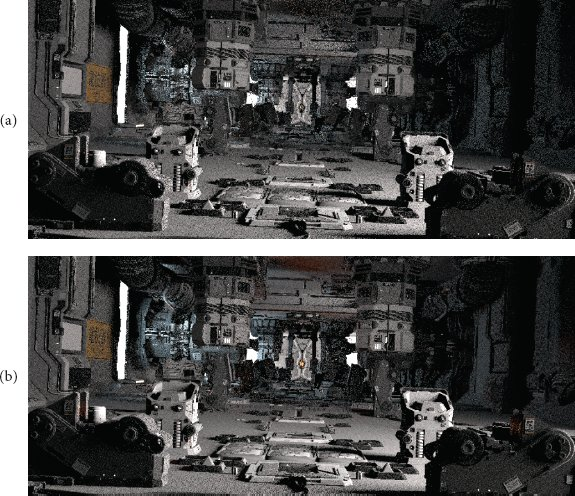

</details>

*Figure 12.31* — Zero Day Scene, with 8,878 Area Lights. (a) Rendered with the `PowerLightSampler`. (b) Rendered with the `BVHLightSampler`. Both images are rendered with 16 samples per pixel. For a scene of this complexity, an effective light sampling algorithm is crucial. The `BVHLightSampler` gives an MSE improvement of 2.37× with only a 5.8% increase in rendering time. Monte Carlo efficiency is improved by a factor of 2.25. (Scene courtesy of Beeple.)

Because the BVH cannot store lights at infinity, the first step is to partition the lights into those that can be stored in the BVH and those that cannot. This is handled by a loop over all the provided lights after which the BVH is constructed.

*〈Initialize infiniteLights array and light BVH〉 ≡ (page 797)*

```rust
let mut bvh_lights: Vec<(usize, LightBounds)> = Vec::new();
for i in 0..self.lights.len() {
    // <Store ith light in either infiniteLights or bvhLights>
}
if !bvh_lights.is_empty() {
    self.build_bvh(&mut bvh_lights, 0, bvh_lights.len(), 0, 0);
}
```

<details>
<summary>Book index references: BVHLightSampler::buildBVH() 800, CompactLightBounds 794</summary>

`BVHLightSampler` (796) · `BVHLightSampler::buildBVH()` (800) · `BVHLightSampler::lights` (797) · `CompactLightBounds` (794) · `LightBounds` (786) · `PowerLightSampler` (783).

</details>

Lights that are not able to provide a `LightBounds` are added to the `infiniteLights` array and are sampled independently of the lights stored in the BVH. As long as they have nonzero emitted power, the rest are added to the `bvhLights` array, which is used during BVH construction. Along the way, a bounding box that encompasses all the BVH lights’ bounding boxes is maintained in `allLightBounds`; this is the bounding box that will be passed to the `CompactLightBounds` for quantizing the spatial bounds of individual lights.

*〈Store ith light in either infiniteLights or bvhLights〉 ≡ (page 798)*

```rust
let light = self.lights[i];
if let Some(lb) = light.bounds() {
    if lb.phi > 0.0 {
        bvh_lights.push((i, lb));
        self.all_light_bounds = bounds_union(self.all_light_bounds, lb.bounds);
    }
} else {
    self.infinite_lights.push(light);
}
```

*〈BVHLightSampler Private Members〉 +≡ (page 796)*

```rust
infinite_lights: Vec<Light>,
all_light_bounds: Bounds3f,
```

The light BVH is represented using an instance of the `LightBVHNode` structure for each tree node, both interior and leaf. It uses a total of 28 bytes of storage, adding just 4 to the 24 used by `CompactLightBounds`, though its declaration specifies 32-byte alignment, ensuring that 2 of them fit neatly into a typical 64-byte cache line on a CPU, and 4 of them fit into a 128-byte GPU cache line.

*〈LightBVHNode Definition〉 ≡*

```rust
#[repr(align(32))]
struct LightBVHNode {
    light_bounds: CompactLightBounds,
    child_or_light_index: u32, // 31 bits
    is_leaf: bool,             // 1 bit
}
```

Naturally, each `LightBVHNode` stores the `CompactLightBounds` for either a single light or a collection of them. Like the `BVHAggregate`’s BVH, the light BVH is laid out in memory so that the first child of each interior node is immediately after it. Therefore, it is only necessary to store information about the second child’s location in the `LightBVHNode`. The `BVHLightSampler` stores all nodes in a contiguous array, so an index suffices; a full pointer is unnecessary.

*〈LightBVHNode Public Members〉 ≡ (page 799)*

```rust
light_bounds: CompactLightBounds,
child_or_light_index: u32,
is_leaf: bool,
```

<details>
<summary>Book index references: BVHAggregate 407, Light::Bounds() 791, LightBVHNode 799</summary>

`Bounds3f` (97) · `BVHAggregate` (407) · `BVHLightSampler` (796) · `BVHLightSampler::allLightBounds` (799) · `BVHLightSampler::infiniteLights` (799) · `BVHLightSampler::lights` (797) · `CompactLightBounds` (794) · `Light` (740) · `Light::Bounds()` (791) · `LightBounds` (786) · `LightBounds::bounds` (786) · `LightBounds::phi` (786) · `LightBVHNode` (799) · `HashMap` (1069) · `HashMap::Insert()` (1069).

</details>

*〈BVHLightSampler Private Members〉 +≡ (page 796)*

```rust
nodes: Vec<LightBVHNode>,
```

Two object-creation methods return a `LightBVHNode` of the specified type.

*〈LightBVHNode Public Methods〉 ≡ (page 799)*

```rust
fn make_leaf(light_index: u32, cb: &CompactLightBounds) -> Self {
    Self { light_bounds: *cb, child_or_light_index: light_index, is_leaf: true }
}
```

*〈LightBVHNode Public Methods〉 +≡ (page 799)*

```rust
fn make_interior(child1_index: u32, cb: &CompactLightBounds) -> Self {
    Self { light_bounds: *cb, child_or_light_index: child1_index, is_leaf: false }
}
```

The `buildBVH()` method constructs the BVH by recursively partitioning the lights until it reaches a single light, at which point a leaf node is constructed. Its implementation closely follows the approach implemented in the `BVHAggregate::buildRecursive()` method: along each dimension, the light bounds are assigned to a fixed number of buckets according to their centroids. Next, a cost model is evaluated for splitting the lights at each bucket boundary. The minimum cost split is chosen and the lights are partitioned into two sets, each one passed to a recursive invocation of `buildBVH()`.

Because these two methods are so similar, here we will only include the fragments where the `BVHLightSampler` substantially diverges—in how nodes are initialized and in the cost model used to evaluate candidate splits.

*〈BVHLightSampler Private Methods〉 ≡ (page 796)*

```rust
fn build_bvh(&mut self, bvh_lights: &mut Vec<(usize, LightBounds)>,
             start: usize, end: usize, bit_trail: u32, depth: u32)
    -> (usize, LightBounds);
```

When this method is called with a range corresponding to a single light, a leaf node is initialized and the recursion terminates. A `CompactLightBounds` is created using the bounding box of all lights’ bounds to initialize its quantized bounding box coordinates and the BVH tree node can be added to the `nodes` array.

*〈Initialize leaf node if only a single light remains〉 ≡ (page 800)*

```rust
if end - start == 1 {
    let node_index = self.nodes.len();
    let cb = CompactLightBounds::new(&bvh_lights[start].1, &self.all_light_bounds);
    let light_index = bvh_lights[start].0;
    self.nodes.push(LightBVHNode::make_leaf(light_index as u32, &cb));
    self.light_to_bit_trail.insert(self.lights[light_index], bit_trail);
    return (node_index, bvh_lights[start].1);
}
```

In order to implement the `PMF()` method, it is necessary to follow a path through the BVH from the root down to the leaf node for the given light. We encode these paths using bit trails, integers where each bit encodes which of the two child nodes should be visited at each level of the tree in order to reach the light’s leaf node. The lowest bit indicates which child should be visited after the root node, and so forth. These values are computed while the BVH is built and stored in a hash table that uses `Light`s as keys.

*〈BVHLightSampler Private Members〉 +≡ (page 796)*

```rust
light_to_bit_trail: HashMap<Light, u32>,
```

When there are multiple lights to consider, the `EvaluateCost()` method is called to evaluate the cost model for the two `LightBounds` for each split candidate. In addition to the `LightBounds` for which to compute the cost, it takes the bounding box of all the lights passed to the current invocation of `buildBVH()` as well as the dimension in which the split is being performed.

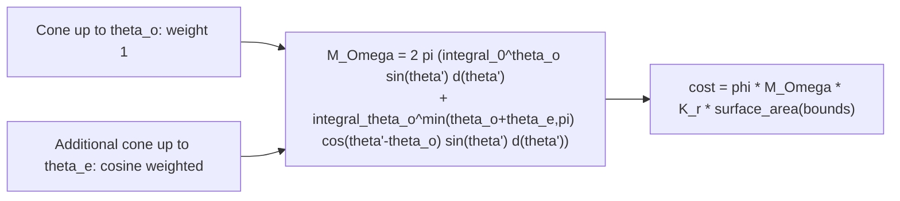

*Figure 12.32 (diagram, redrawn)* — The direction bounds measure is found by integrating to find the solid angle of the center cone up to $\theta_o$ and then applying a cosine weighting over the additional angle of $\theta_e$.

*〈BVHLightSampler Private Methods〉 +≡ (page 796)*

```rust
fn evaluate_cost(&self, b: &LightBounds, bounds: &Bounds3f, dim: usize) -> f32 {
    // <Evaluate direction bounds measure for LightBounds>
    // <Return complete cost estimate for LightBounds>
}
```

The principal surface normal direction and the angles $\theta_o$ and $\theta_e$ that are stored in `LightBounds` are worthwhile to include in the light BVH cost function. Doing so can encourage partitions of primitives into groups that emit light in different directions, which can be helpful for culling groups of lights that do not illuminate a given receiving point. To compute these costs, pbrt uses a weighted measure of the solid angle of directions that the direction bounds subtend. A weight of 1 is used for all directions inside the center cone up to $\theta_o$ and then the remainder of directions up to $\theta_e$ are cosine-weighted, following the importance computation earlier. (See Figure 12.32.) Integrating over the relevant directions gives us the direction bounds measure,

$$
M_\Omega = 2\pi\left(
  \int_0^{\theta_o} \sin\theta'\,\mathrm{d}\theta'
  + \int_{\theta_o}^{\min(\theta_o+\theta_e,\,\pi)}
    \cos(\theta' - \theta_o)\sin\theta'\,\mathrm{d}\theta'
\right).
$$

The first term integrates to $1 - \cos\theta_o$ and the second has a simple analytic form that is evaluated in the second term of `M_omega`’s initializer below.

*〈Evaluate direction bounds measure for LightBounds〉 ≡ (page 801)*

```rust
let theta_o = b.cos_theta_o.acos();
let theta_e = b.cos_theta_e.acos();
let theta_w = (theta_o + theta_e).min(PI);
let sin_theta_o = safe_sqrt(1.0 - b.cos_theta_o * b.cos_theta_o);
let m_omega = 2.0 * PI * (1.0 - b.cos_theta_o)
    + PI / 2.0 * (2.0 * theta_w * sin_theta_o
        - (theta_o - 2.0 * theta_w).cos()
        - 2.0 * theta_o * sin_theta_o + b.cos_theta_o);
```

Three other factors go into the full cost estimate: the power estimate `phi`: in general, the higher the power of the lights in a `LightBounds`, the more important it is to minimize factors like the spatial and direction bounds. A regularization factor $K_r$ that discourages long and thin bounding boxes. The surface area of the `LightBounds`’s bounding box.

The use of surface area in the cost metric deserves note: with the `BVHAggregate`, the surface area heuristic was grounded in geometric probability, as the surface area of a convex object is proportional to the probability of a random ray intersecting it. In this case, no rays are being traced. Arguably, minimizing the volume of the bounds would be a more appropriate approach in this case. In practice, the surface area seems to be more effective—one reason is that it penalizes bounding boxes that span a large extent in two dimensions but little or none in the third. Such bounding boxes are undesirable as they may subtend large solid angles, adding more uncertainty to importance estimates.

*〈Return complete cost estimate for LightBounds〉 ≡ (page 801)*

```rust
let k_r = bounds.diagonal().max_component_value() / bounds.diagonal()[dim];
b.phi * m_omega * k_r * b.bounds.surface_area()
```

Once the lights have been partitioned, two fragments take care of recursively initializing the child nodes and then initializing the interior node. The first step is to take a spot in the `nodes` array for the interior node; this spot must be claimed before the children are initialized in order to ensure that the first child is the successor of the interior node in the array. Two recursive calls to `buildBVH()` then initialize the children. The main thing to note in them is the maintenance of the `bitTrail` value passed down into each one. For the first child, the corresponding bit should be set to zero. bitTrail is zero-initialized in the initial call to `buildBVH()`, so it has this value already and there is nothing to do. For the second call, the bit for the current tree depth is set to 1.

*〈Allocate interior LightBVHNode and recursively initialize children〉 ≡ (page 802)*

```rust
let node_index = self.nodes.len();
self.nodes.push(LightBVHNode::empty());
let child0 = self.build_bvh(bvh_lights, start, mid, bit_trail, depth + 1);
let child1 = self.build_bvh(bvh_lights, mid, end, bit_trail | (1u << depth), depth + 1);
```

The interior node can be initialized after the children have been. Its light bounds are given by the union of its children’s, which allows initializing a `CompactLightBounds` and then the `LightBVHNode` itself.

<details>
<summary>Book index references: Bounds3::SurfaceArea() 102, Tuple3::MaxComponentValue() 85</summary>

`Bounds3::Diagonal()` (101) · `Bounds3::SurfaceArea()` (102) · `BVHAggregate` (407) · `BVHLightSampler::allLightBounds` (799) · `BVHLightSampler::buildBVH()` (800) · `BVHLightSampler::nodes` (799) · `CompactLightBounds` (794) · `Float` (23) · `LightBounds` (786) · `LightBounds::bounds` (786) · `LightBounds::phi` (786) · `LightBounds::Union()` (787) · `LightBVHNode` (799) · `LightBVHNode::MakeInterior()` (800) · `LightSampleContext` (741) · `SampledLight` (782) · `Tuple3::MaxComponentValue()` (85).

</details>

*〈Initialize interior node and return node index and bounds〉 ≡ (page 802)*

```rust
let lb = light_bounds_union(child0.1, child1.1);
let cb = CompactLightBounds::new(&lb, &self.all_light_bounds);
self.nodes[node_index] = LightBVHNode::make_interior(child1.0 as u32, &cb);
(node_index, lb)
```

Given the BVH, we can now implement the `Sample()` method, which samples a light given a reference point in a `LightSampleContext`.

*〈BVHLightSampler Public Methods〉 ≡ (page 796)*

```rust
fn sample(&self, ctx: &LightSampleContext, mut u: f32) -> Option<SampledLight> {
    // <Compute infinite light sampling probability pInfinite>
    if u < p_infinite {
        // <Sample infinite lights with uniform probability>
    } else {
        // <Traverse light BVH to sample light>
    }
}
```

The first choice to make is whether an infinite light should be sampled or whether the light BVH should be used to choose a noninfinite light. The `BVHLightSampler` gives equal probability to sampling each infinite light and to sampling the BVH, from which the probability of sampling an infinite light follows directly.

*〈Compute infinite light sampling probability pInfinite〉 ≡ (pages 802, 805)*

```rust
let p_infinite = self.infinite_lights.len() as f32
    / (self.infinite_lights.len() + if self.nodes.is_empty() { 0 } else { 1 }) as f32;
```

If an infinite light is to be sampled, then the random sample u is rescaled to provide a new uniform random sample that is used to index into the `infiniteLights` array.

*〈Sample infinite lights with uniform probability〉 ≡ (page 802)*

```rust
u /= p_infinite;
let index = (u * self.infinite_lights.len() as f32) as usize
    .min(self.infinite_lights.len() - 1);
let pmf = p_infinite / self.infinite_lights.len() as f32;
return Some(SampledLight { light: self.infinite_lights[index], p: pmf });
```

Otherwise a light is sampled by traversing the BVH. At each interior node, probabilities are found for sampling each of the two children using importance values returned by the `LightBounds` for the reference point. A child node is then randomly chosen according to these probabilities. In the end, the probability of choosing a leaf node is equal to the product of probabilities along the path from the root to the leaf (see Figure 12.33). With this traversal scheme, there is no need to maintain a stack of nodes to be processed as the `BVHAggregate` does—a single path is taken down the tree from the root to a leaf.

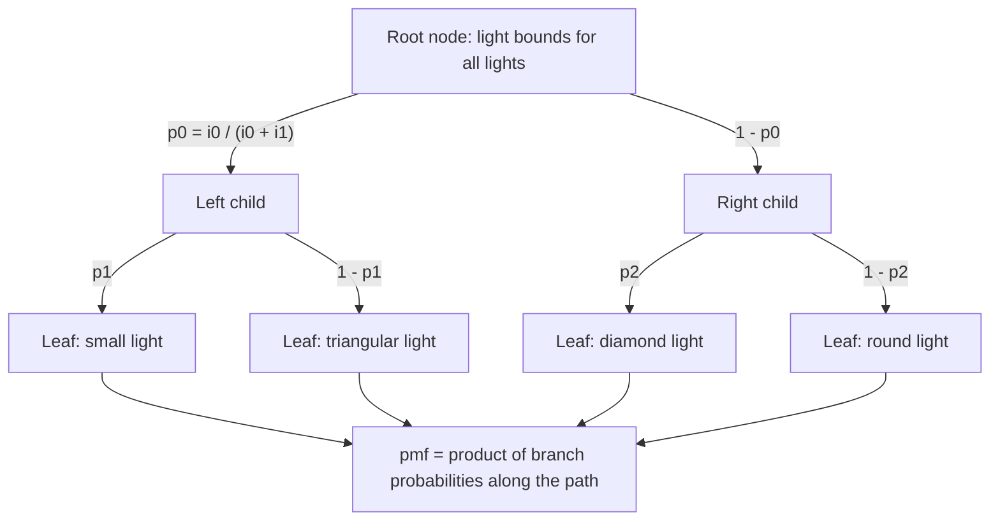

*Figure 12.33 (diagram, redrawn)* — Sampling a Light BVH. At each non-leaf node of the tree, we compute discrete probabilities $p_i$ and $1 - p_i$ for sampling each child node and then randomly choose a child accordingly. The probability of sampling each leaf node is the product of probabilities along the path from the root of the tree down to it. Here, the nodes that are visited and the associated probabilities for sampling the triangular light source are highlighted.

<details>
<summary>Book index references: BVHAggregate 407, OneMinusEpsilon 470, SampleDiscrete() 70</summary>

`BVHAggregate` (407) · `BVHLightSampler` (796) · `BVHLightSampler::infiniteLights` (799) · `BVHLightSampler::nodes` (799) · `Float` (23) · `SampledLight` (782) · `LightBVHNode::childOrLightIndex` (799) · `LightBVHNode::isLeaf` (799) · `LightBVHNode::lightBounds` (799) · `LightSampleContext::ns` (742) · `LightSampleContext::p()` (742) · `Normal3f` (94) · `OneMinusEpsilon` (470) · `Point3f` (92) · `SampleDiscrete()` (70).

</details>

*〈Traverse light BVH to sample light〉 ≡ (page 802)*

```rust
if self.nodes.is_empty() { return None; }
// <Declare common variables for light BVH traversal>
loop {
    // <Process light BVH node for light sampling>
}
```

A few values will be handy in the following traversal of the BVH. Among them are the uniform sample u, which is remapped to a new uniform random sample in $[0, 1)$. `pmf` starts out with the probability of sampling the BVH in the first place; each time a child node of the tree is randomly sampled, it will be multiplied by the discrete probability of that sampling choice so that in the end it stores the complete probability for sampling the light.

*〈Declare common variables for light BVH traversal〉 ≡ (page 804)*

```rust
let p = ctx.p();
let n = ctx.ns;
u = ((u - p_infinite) / (1.0 - p_infinite)).min(ONE_MINUS_EPSILON);
let mut node_index = 0usize;
let mut pmf = 1.0 - p_infinite;
```

At each interior node, a child node is randomly sampled. Given a leaf node, we have reached the sampled light.

*〈Process light BVH node for light sampling〉 ≡ (page 804)*

```rust
let node = self.nodes[node_index];
if !node.is_leaf {
    // <Compute light BVH child node importances>
    // <Randomly sample light BVH child node>
} else {
    // <Confirm light has nonzero importance before returning light sample>
}
```

The first step at an interior node is to compute the importance values for the two child nodes. It may be the case that both of them are 0, indicating that neither child illuminates the reference point. That we may end up in this situation may be surprising: in that case, why would we have chosen to visit this node in the first place? This state of affairs is a natural consequence of the accuracy of light bounds improving on the way down the tree, which makes it possible for them to better differentiate regions that their respective subtrees do and do not illuminate.

*〈Compute light BVH child node importances〉 ≡ (page 804)*

```rust
let children = [&self.nodes[node_index + 1], &self.nodes[node.child_or_light_index as usize]];
let ci = [children[0].light_bounds.importance(p, n, &self.all_light_bounds),
          children[1].light_bounds.importance(p, n, &self.all_light_bounds)];
if ci[0] == 0.0 && ci[1] == 0.0 { return None; }
```

Given at least one nonzero importance value, `SampleDiscrete()` takes care of choosing a child node. The sampling PMF it returns is incorporated into the running `pmf` product. We further use its capability for remapping the sample u to a new uniform sample in $[0, 1)$, which allows the reuse of the u variable in subsequent loop iterations.

*〈Randomly sample light BVH child node〉 ≡ (page 804)*

```rust
let mut node_pmf = 0.0;
let child = sample_discrete(&ci, &mut u, Some(&mut node_pmf), None);
pmf *= node_pmf;
node_index = if child == 0 { node_index + 1 } else { node.child_or_light_index as usize };
```

When a leaf node is reached, we have found a light. The light should only be returned if it has a nonzero importance value, however: if the importance is zero, then it is better to return no light than to return one and cause the caller to go through some additional work to sample it before finding that it has no contribution. Most of the time, we have already determined that the node’s light bounds have a nonzero importance value by dint of sampling the node while traversing the BVH in the first place. It is thus only in the case of a single-node BVH with a single light stored in it that this test must be performed here.

*〈Confirm light has nonzero importance before returning light sample〉 ≡ (page 804)*

```rust
if node_index > 0 || node.light_bounds.importance(p, n, &self.all_light_bounds) > 0.0 {
    return Some(SampledLight { light: self.lights[node.child_or_light_index as usize], p: pmf });
}
return None;
```

Computing the PMF for sampling a specified light follows a set of computations similar to those of the sampling method: if the light is an infinite light, the infinite light sampling probability is returned and otherwise the BVH is traversed to compute the light’s sampling probability. In this case, BVH traversal is not stochastic, but is specified by the bit trail for the given light, which encodes the path to the leaf node that stores it.

*〈BVHLightSampler Public Methods〉 +≡ (page 796)*

```rust
fn pmf(&self, ctx: &LightSampleContext, light: Light) -> f32 {
    // <Handle infinite light PMF computation>
    // <Initialize local variables for BVH traversal for PMF computation>
    // <Compute light's PMF by walking down tree nodes to the light>
}
```

If the given light is not in the bit trail hash table, then it is not stored in the BVH and therefore must be an infinite light. The probability of sampling it is one over the total number of infinite lights plus one if there is a light BVH.

*〈Handle infinite light PMF computation〉 ≡ (page 805)*

```rust
if !self.light_to_bit_trail.contains_key(&light) {
    return 1.0 / (self.infinite_lights.len() + if self.nodes.is_empty() { 0 } else { 1 }) as f32;
}
```

A number of values will be useful as the tree is traversed, including the bit trail that points the way to the correct leaf, the PMF of the path taken so far, and the index of the current node being visited, starting here at the root.

*〈Initialize local variables for BVH traversal for PMF computation〉 ≡ (page 805)*

```rust
let mut bit_trail = self.light_to_bit_trail[&light];
let p = ctx.p();
let n = ctx.ns;
// <Compute infinite light sampling probability pInfinite>
let mut pmf = 1.0 - p_infinite;
let mut node_index = 0usize;
```

For a light that is stored in the BVH, the probability of sampling it is again computed as the product of each discrete probability of sampling the child node that leads to its leaf node.

*〈Compute light's PMF by walking down tree nodes to the light〉 ≡ (page 805)*

```rust
loop {
    let node = &self.nodes[node_index];
    if node.is_leaf { return pmf; }
    // <Compute child importances and update PMF for current node>
    // <Use bitTrail to find next node index and update its value>
}
```

The lowest bit of `bitTrail` encodes which of the two children of the node is visited on a path down to the light’s leaf node. In turn, it is possible to compute the probability of sampling that node given the two child nodes’ importance values.

*〈Compute child importances and update PMF for current node〉 ≡ (page 806)*

```rust
let child0 = &self.nodes[node_index + 1];
let child1 = &self.nodes[node.child_or_light_index as usize];
let ci = [child0.light_bounds.importance(p, n, &self.all_light_bounds),
          child1.light_bounds.importance(p, n, &self.all_light_bounds)];
pmf *= ci[(bit_trail & 1) as usize] / (ci[0] + ci[1]);
```

The low-order bit of `bitTrail` also points us to which node to visit next on the way down the tree. After `nodeIndex` is updated, `bitTrail` is shifted right by one bit so that the low-order bit encodes the choice to make at the next level of the tree.

*〈Use bitTrail to find next node index and update its value〉 ≡ (page 806)*

```rust
node_index = if bit_trail & 1 != 0 {
    node.child_or_light_index as usize
} else {
    node_index + 1
};
bit_trail >>= 1;
```

The basic `Sample()` and `PMF()` methods for when a reference point is not specified sample all the lights uniformly and so are not included here, as they parallel the implementations in the `UniformLightSampler`.

The same traversal maps directly to WGSL. Each node is one entry in a storage buffer; importance evaluation uses the compact bounds, and the running PMF is updated at each level.

```wgsl
struct LightBVHNode {
    // 24-byte compact bounds, 4-byte child/light index + leaf flag
    bounds      : CompactLightBounds,
    child_index : u32,
    is_leaf     : u32,
};

@group(0) @binding(2) var<storage, read> light_nodes : array<LightBVHNode>;

fn sample_light_bvh(p : vec3f, n : vec3f, u_in : f32, p_infinite : f32)
    -> vec2u   // (light index, packed PMF bits)
{
    var u = clamp((u_in - p_infinite) / (1.0 - p_infinite), 0.0, 0.99999994);
    var node_index = 0u;
    var pmf = 1.0 - p_infinite;
    loop {
        let node = light_nodes[node_index];
        if (node.is_leaf != 0u) {
            return vec2u(node.child_index, bitcast<u32>(pmf));
        }
        let c0 = importance(node.bounds, p, n);
        let c1 = importance(light_nodes[node.child_index].bounds, p, n);
        if (c0 + c1 <= 0.0) { return vec2u(0xffffffffu, 0u); }
        let p0 = c0 / (c0 + c1);
        if (u < p0) {
            pmf = pmf * p0;
            u = u / p0;
            node_index = node_index + 1u;      // first child follows in memory
        } else {
            pmf = pmf * (1.0 - p0);
            u = (u - p0) / (1.0 - p0);
            node_index = node.child_index;
        }
    }
}
```

## FURTHER READING

### Light Emission Descriptions

Warn (1983) developed early models of light sources with nonisotropic emission distributions, including the spotlight model used in this chapter. Verbeck and Greenberg (1984) also described a number of techniques for modeling light sources that are now classic parts of the light modeling toolbox. Barzel (1997) described a highly parameterized model for light sources, including multiple parameters for controlling rate of falloff, the area of space that is illuminated, and so on. Bjorke (2001) described a number of additional techniques for shaping illumination for artistic effect. (Many parts of the Barzel and Bjorke approaches are not physically based, however.)

The goniophotometric light source approximation is widely used to model area light sources in the field of illumination engineering. The rule of thumb there is that once a reference point is five times an area light source’s radius away from it, a point light approximation has sufficient accuracy for most applications. File format standards have been developed for encoding goniophotometric diagrams for these applications (Illuminating Engineering Society of North America 2002). Many lighting fixture manufacturers provide data in these formats on their websites.

Ashdown (1993) proposed a more sophisticated light source model than goniophotometric; he measured the directional distribution of emitted radiance at a large number of points around a light source and described how to use the resulting 4D table to compute the received radiance distribution at other points. Another generalization of goniometric lights was suggested by Heidrich et al. (1998), who represented light sources as a 4D exitant lightfield—essentially a function of both position and direction—and showed how to use this representation for rendering. Additional work in this area was done by Goesele et al. (2003) and Mas et al. (2008), who introduced a more space-efficient representation and improved rendering efficiency.

Peters (2021a) has developed efficient techniques for sampling lights defined by lines (i.e., infinitesimally thin cylinders) and shown how to sample the product of lighting and the BRDF using linearly transformed cosines (Heitz et al. 2016a). Real-world light sources are often fairly complex, including carefully designed systems of mirrors and lenses to shape the distribution of light emitted by the light source. (Consider, for example, the headlights on a car, where it is important to evenly illuminate the surface of the road without shining too much light in the eyes of approaching drivers.) All the corresponding specular reflection and transmission is challenging for light transport algorithms. It can therefore be worthwhile to do some precomputation to create a representation of light sources’ final emission distributions after all of this scattering that is then used as the light source model for rendering. To this end, Kniep et al. (2009) proposed tracing the paths of photons leaving the light’s filament until they hit a bounding surface around the light. They then recorded the position and direction of outgoing photons and used this information when computing illumination at points in the scene. Velázquez-Armendáriz et al. (2015) showed how to compute a set of point lights with directionally varying emission distributions to model emitted radiance from complex light sources. They then approximated the radiance distribution in the light interior using spherical harmonics. More recently, Zhu et al. (2021) applied a neural representation to complex lights, encoding lights’ radiance distributions and view-dependent sampling distributions and opacities in neural networks.

### Illumination from Environment Maps

Blinn and Newell (1976) first introduced the idea of environment maps and their use for simulating illumination, although they only considered illumination of specular objects. Greene (1986) further refined these ideas, considering antialiasing and different representations for environment maps. Nishita and Nakamae (1986) developed algorithms for efficiently rendering objects illuminated by hemispherical skylights and generated some of the first images that showed off that distinctive lighting effect. Miller and Hoffman (1984) were the first to consider using arbitrary environment maps to illuminate objects with diffuse and glossy BRDFs. Debevec (1998) later extended this work and investigated issues related to capturing images of real environments.

Representing illumination from the sun and sky is a particularly important application of infinite light sources; the “Further Reading” section in Chapter 14 includes a number of references related to simulating skylight scattering. Directly measuring illumination from the sky is also an effective way to find accurate skylight illumination; see Kider et al. (2014) for details of a system built to do this.

pbrt’s infinite area light source models incident radiance from the light as purely a function of direction. Especially for indoor scenes, this assumption can be fairly inaccurate; position matters as well. Unger et al. (2003) captured the incident radiance as a function of direction at many different locations in a real-world scene and used this representation for rendering. Unger et al. (2008) improved on this work and showed how to decimate the samples to reduce storage requirements without introducing too much error. Lu et al. (2015) developed techniques for efficiently importance sampling these light sources.

The use of the `allowIncompletePDF` parameter to avoid generating low-probability samples from infinite light sources in the presence of multiple importance sampling is an application of MIS compensation, which was developed by Karlík et al. (2019).

Subr and Arvo (2007b) developed an efficient technique for sampling environment map light sources that not only accounts for the $\cos\theta$ term from the scattering equation but also only generates samples in the hemisphere around the surface normal. More recently, Conty Estevez and Lecocq (2018) introduced a technique for sampling according to the product of the BSDF and the environment map based on discretizing the environment map into coarse grids of pixels, conservatively evaluating the maximum of the BSDF over the corresponding sets of directions, and then choosing a region of the environment map according to the product of BSDF and pixel values. Given a selected grid cell, conventional environment map sampling is applied. (See also the “Further Reading” section in Chapter 13 for further references to light and BSDF product sampling algorithms.)

When environment maps are used for illuminating indoor scenes, many incident directions may be blocked by the building structure. Bitterli et al. (2015) developed the environment map rectification approach to this problem that we have implemented in the `PortalImageInfiniteLight`. One shortcoming of Bitterli et al.’s approach is that the image must be rectified for each plane in which there is a portal. Ogaki (2020) addresses this issue by building a BVH over the portals using Conty Estevez and Kulla’s light BVH (2018) and then decomposing portals into triangles to sample a specific direction according to the environment map.

Sampling-based approaches can also be used to account for environment map visibility. Bashford-Rogers et al. (2013) developed a two-pass algorithm where a first pass from the camera finds directions that reach the environment map; this information is used to create sampling distributions for use in a second rendering pass. Atanasov et al. (2018) also applied a two-pass algorithm to the task, furthermore discretizing regions of the scene in order to account for different parts of the environment map being visible in different regions of the scene.

### Optimizing Visibility Testing

As discussed in Chapter 6, one way to reduce the time spent tracing shadow rays is to have methods like `Shape::IntersectP()` and `Primitive::IntersectP()` that just check for any occlusion along a ray without bothering to compute the geometric information at the intersection point. Another approach for optimizing ray tracing for shadow rays is the shadow cache, where each light stores a pointer to the last primitive that occluded a shadow ray to the light. That primitive is checked first to see if it occludes subsequent shadow rays before the ray is passed to the acceleration structure (Haines and Greenberg 1986). Pearce (1991) pointed out that the shadow cache does not work well if the scene has finely tessellated geometry; it may be better to cache the BVH node that held the last occluder, for instance. (The shadow cache can similarly be defeated when multiple levels of reflection and refraction are present or when Monte Carlo ray-tracing techniques are used.) Hart et al. (1999) developed a generalization of the shadow cache that tracks which objects block light from particular light sources and clips their geometry against the light-source geometry so that shadow rays do not need to be traced toward the parts of the light that are certain to be occluded.

<details>
<summary>Book index references: Primitive::IntersectP() 398, Shape::IntersectP() 266</summary>

`PortalImageInfiniteLight` (773) · `Primitive::IntersectP()` (398) · `Shape::IntersectP()` (266).

</details>

A related technique, described by Haines and Greenberg (1986), is the light buffer for point light sources, where the light discretizes the directions around it and determines which objects are visible along each set of directions (and are thus potential occluding objects for shadow rays). A related optimization is shaft culling, which takes advantage of coherence among groups of rays traced in a similar set of directions (e.g., shadow rays from a single point to points on an area light source). With shaft culling, a shaft that bounds a collection of rays is computed and then the objects in the scene that penetrate the shaft are found. For all the rays in the shaft, it is only necessary to check for intersections with those objects that intersect the shaft, and the expense of ray intersection acceleration structure traversal for each of the rays is avoided (Haines and Wallace 1994). Woo and Amanatides (1990) classified which lights are visible, not visible, and partially visible in different parts of the scene and stored this information in a voxel-based 3D data structure, using the information to save shadow ray tests. Fernandez, Bala, and Greenberg (2002) developed a similar approach based on spatial decomposition that stores references to important blockers in each voxel and also builds up this information on demand during rendering. A related approach to reducing the cost of shadow rays is visibility caching, where the point-to-point visibility function’s value is cached for clusters of points on surfaces in the scene (Clarberg and Akenine-Möller 2008b; Popov et al. 2013).

For complex models, simplified versions of their geometry can be used for shadow ray intersections. For example, the simplification envelopes described by Cohen et al. (1996) can create a simplified mesh that bounds a given mesh from both the inside and the outside. If a ray misses the mesh that bounds a complex model from the outside or intersects the mesh that bounds it from the inside, then no further shadow processing is necessary. Only the uncertain remaining cases need to be intersected against the full geometry. A related technique is described by Lukaszewski (2001), who uses the Minkowski sum to effectively expand primitives (or bounds of primitives) in the scene so that intersecting one ray against one of these primitives can determine if any of a collection of rays might have intersected the actual primitives. The expense of tracing shadow rays to light sources can be significant; a number of techniques have been developed to improve the efficiency of this part of the rendering computation. Billen et al. (2013) tested only a random subset of potential occluders for intersections; a compensation term ensured that the result was unbiased. Following work showed how to use simplified geometry for some shadow tests while still computing the correct result overall (Billen et al. 2014).

### Many-Light Sampling

A number of approaches have been developed to efficiently render scenes with hundreds or thousands of light sources. Early work on this problem was done by Ward (1991) and Shirley et al. (1996). Wald et al. (2003) suggested rendering an image with path tracing and a very low sampling rate (e.g., one path per pixel), recording information about which of the light sources made some contribution to the image. This information is then used to set probabilities for sampling each light. Donikian et al. (2006) adaptively found PDFs for sampling lights through an iterative process of taking a number of light samples, noting which ones were effective, and reusing this information at nearby pixels. The “lightcuts” algorithm, described in the “Further Reading” section of Chapter 13, also addresses this problem.

Tokuyoshi and Harada (2016) organized lights in trees of bounding spheres and stochastically culled them when shading. Conty Estevez and Kulla (2018) organized lights in BVHs and introduced effective approaches for building light BVHs and sampling lights stored in them. pbrt’s `BVHLightSampler` is directly based on their approach. (The Iray renderer uses a BVH in a similar fashion for light sampling (Keller et al. 2017).) Conty Estevez and Kulla’s approach was subsequently improved by Liu et al. (2019b), who incorporated the `BSDF` in the sampling weight computations.

<details>
<summary>Book index references: BVHLightSampler 796</summary>

`BVHLightSampler` (796).

</details>

Incorporating light visibility into the sampling process can substantially improve the results. Vévoda et al. (2018) clustered lights and tracked visibility to them, applying Bayesian regression to learn how to effectively sample lights. Guo et al. (2020) cached information about voxel-to-voxel visibility in a discretization of the scene, which can either be used for Russian roulette or for light importance sampling. Bitterli et al. (2020) showed how to apply spatial and temporal resampling of light samples that include visibility in order to achieve high-quality results with few shadow rays per pixel. The “bit trail” technique used to encode the path from the root to each light at the leaves of pbrt’s `BVHLightSampler` is due to Laine (2010).

<details>
<summary>Book index references: BVHLightSampler 796, DiffuseAreaLight 759, GoniometricLight 756, ProjectionLight 751</summary>

`BVHLightSampler` (796) · `DiffuseAreaLight` (759) · `GoniometricLight` (756) · `ProjectionLight` (751).

</details>

## EXERCISES

1. ➊ 12.1 The functionality of the `SpotLight` could be replicated by using a suitable image in conjunction with the `ProjectionLight` or `GoniometricLight`. Discuss the advantages and disadvantages of providing this specific functionality separately with the `SpotLight` class.

2. ➋ 12.2 Modify the `ProjectionLight` to also support orthographic projections. This variant is particularly useful even without an image map, since it gives a directional light source with a beam of user-defined extent.

3. ➌ 12.3 The current light source implementations do not support animated transformations. Modify pbrt to include this functionality and render images showing off the effect of animating light positions. Note that if you would like to use the `BVHLightSampler` with animated light sources, it will require substantial modifications.

4. ➋ 12.4 Implement an area light that generalizes the `DiffuseAreaLight` to support directionally varying emitted radiance. You might, for example, allow focusing the light by computing the cosine of the outgoing direction and the surface normal and raising it to some power. Derive a model such that the total power of the light is left unchanged as the directional distribution of emitted radiance varies and update the light’s `SampleLe()` methods for sampling rays leaving the light to account for the emission distribution. Discuss the implications of your approach for sampling via `SampleLi()`; should that method be aware of the changed directional distribution?

5. ➋ 12.5 Read some of the papers in the “Further Reading” section that discuss the shadow cache, and add this optimization to pbrt. Measure how much it speeds up the system for a variety of scenes. What techniques can you come up with that make it work better in the presence of multiple levels of reflection?

6. ➋ 12.6 One of the advantages of the linearity assumption in radiometry is that the final image of a scene is the same as the sum of individual images that account for each light source’s contribution (assuming a floating-point image file format is used that does not clip pixel radiance values). An implication of this property is that if a renderer creates a separate image for each light source, it is possible to write interactive lighting design tools that make it possible to quickly see the effects of scaling the contributions of individual lights in the scene without needing to rerender it from scratch. Instead, a light’s individual image can be scaled and the final image regenerated by summing all the light images again. (This technique was first applied for opera lighting design by Dorsey, Sillion, and Greenberg (1991).) Modify pbrt to output a separate image for each of the lights in the scene, and write an interactive lighting design tool that uses them in this manner.

7. ➌ 12.7 Read the paper by Velázquez-Armendáriz et al. (2015), and implement their method for efficiently rendering scenes with complex light sources. Create or find models of a few complex lights that include many shapes that exhibit specular reflection or transmission in order to evaluate your implementation.

8. ➋ 12.8 Generalize the `PortalImageInfiniteLight` to allow the specification of multiple portals. Note that multiple coplanar portals can be supported without resampling the environment map, but non-coplanar portals will require multiple copies of it. As noted by Bitterli et al. (2015), the summed area table representation makes it easy to compute the total power passing through a portal given a receiving point. Modify your implementation to use the relative power of multiple portals as a sampling distribution to choose which portal to sample. Render images that show the benefit of this improvement.

9. ➋ 12.9 Sampling wavelengths according to the XYZ matching functions is a reasonable approach for many scenes, though if the light sources in the scene have highly peaked spectra (as, for example, many fluorescent lights do), error may be reduced by instead sampling wavelengths according to the lights’ spectral distributions. Implement this approach and compare the results to pbrt’s current wavelength sampling implementation using a variety of spectral emission profiles. How much does the alternative sampling strategy help in the best case versus the worst case? Can you find a way to improve the results further by applying multiple importance sampling?

10. ➌ 12.10 The `BVHLightSampler` is missing a number of features in the BVH sampling scheme described by Conty Estevez and Kulla (2018), including an importance factor specialized for participating media and adaptive splitting, where multiple lights may be returned from the sampling operation when it is difficult to determine which child node is a better choice at the upper levels of the tree. Read their paper and improve pbrt’s implementation. What is the change in Monte Carlo efficiency? Does the reduction in error justify the increase in computation?

11. ➌ 12.11 Another shortcoming of the current `BVHLightSampler` implementation is that it does not account for the `BSDF` at the reference point but instead effectively assumes a diffuse surface. Read the paper by Liu et al. (2019b) and improve the BVH light sampler’s implementation by using their approach to account for this factor. Measure the change in MSE for a variety of scenes with this improvement.

---

[↑ Back to top](#contents)
