# Chapter 12: Light Sources

## Light Sources (wgpu)

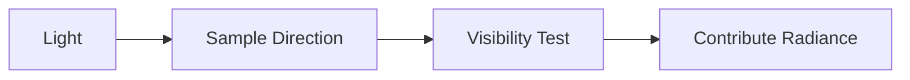

In order for objects in a scene to be visible, there must be a source of illumination so that some light is reflected from them to the camera sensor. To that end, this chapter first presents the `Light` interface, which allows specification of a variety of types of light sources. (Before reading this chapter, you may wish to review Section 4.4, which describes the physical processes underlying light emission.) The implementations of a number of useful light sources follow. Because the implementations of different types of lights are all hidden behind a carefully designed interface, the light transport routines in Chapters 13 through 15 can generally operate without knowing which particular types of lights are in the scene, similar to how acceleration structures can hold collections of different types of primitives without needing to know the details of their actual representations.

A wide variety of light source models are introduced in this chapter, although the variety is slightly limited by pbrt’s physically based design. Many non-physical light source models have been developed for computer graphics, incorporating control over properties like the rate at which the light falls off with distance, which objects are illuminated by the light, which objects cast shadows from the light, and so on. These sorts of controls are incompatible with physically based light transport algorithms and thus cannot be provided in the models here.

As an example of the problems such lighting controls pose, consider a light that does not cast shadows: the total energy arriving at surfaces in the scene increases without bound as more surfaces are added. Consider a series of concentric shells of spheres around such a light; if occlusion is ignored, each added shell increases the total received energy. This directly violates the principle that the total energy arriving at surfaces illuminated by the light cannot be greater than the total energy emitted by the light.

In scenes with many lights, it is impractical to account for the illumination from all of them at each point being shaded. Fortunately, this issue is yet another that can be handled stochastically. Given a suitable weighting factor, an unbiased estimate of the effect of illumination from all the lights can be computed by considering just a few of them, or even just one. The last section of this chapter therefore introduces the `LightSampler`, which defines an interface for choosing such light sources as well as a number of implementations of it.

```text
    Light 740
    LightSampler 781
```

## 12.1 LIGHT INTERFACE

The `Light` class defines the interface that light sources must implement. It is defined in the file `base/light.h` and all the light implementations in the following sections are in the files `lights.h` and `lights.cpp`.

〈Light Definition〉 ≡ class Light : public TaggedPointer<〈Light Source Types 740〉 > { public: 〈Light Interface 740〉 };

This chapter will describe all 9 of the following types of light source.

〈Light Source Types〉 ≡ 740

```text
   PointLight, DistantLight, ProjectionLight, GoniometricLight, SpotLight,
   DiffuseAreaLight,        UniformInfiniteLight,       ImageInfiniteLight,
   PortalImageInfiniteLight
```

All lights must be able to return their total emitted power, Φ. Among other things, this makes it possible to sample lights according to their relative power in the forthcoming `PowerLightSampler`. Devoting more samples to the lights that make the largest contribution can significantly improve rendering efficiency.

〈Light Interface〉 ≡ 740

```rust
   SampledSpectrum Phi(SampledWavelengths lambda) const;
```

The Light interface does not completely abstract away all the differences among different types of light source. While doing so would be desirable in principle, in practice pbrt’s integrators sometimes need to handle different types of light source differently, both for efficiency and for correctness. We have already seen an example of this issue in the `RandomWalkIntegrator` in Section 1.3.6. There, “infinite” lights received special handling since they must be considered for rays that escape the scene without hitting any geometry.

Another example is that the Monte Carlo algorithms that sample illumination from light sources need to be aware of which lights are described by delta distributions, since this affects some of their computations. Lights therefore categorize themselves into one of a few different types; the `Type()` method returns which one a light is.

```text
    DiffuseAreaLight 759
    DistantLight 757
    GoniometricLight 756
    ImageInfiniteLight 767
    Light 740
    LightType 740
    PointLight 746
    PortalImageInfiniteLight 773
```

```text
    PowerLightSampler 783
    ProjectionLight 751
    RandomWalkIntegrator 33
    SampledSpectrum 171
    SampledWavelengths 173
    SpotLight 748
    TaggedPointer 1073
    UniformInfiniteLight 765
```

〈Light Interface〉 +≡ 740

```rust
   LightType Type() const;
```

There are four different light categories:

- `DeltaPosition`: lights that emit solely from a single point in space. (“Delta” refers to the fact that such lights can be described by Dirac delta distributions.)
- `DeltaDirection`: lights that emit radiance along a single direction.
- `Area`: lights that emit radiance from the surface of a geometric shape.
- `Infinite`: lights “at infinity” that do not have geometry associated with them but provide radiance to rays that escape the scene.

〈LightType Definition〉 ≡ enum class LightType { DeltaPosition, DeltaDirection, Area, Infinite };

A helper function checks if a light is defined using a Dirac delta distribution.

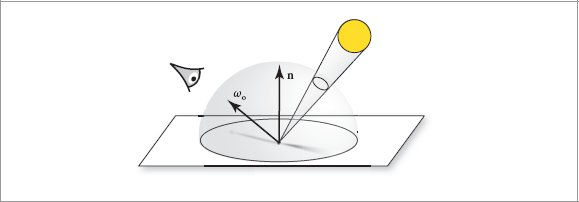

*Figure 12.1: An effective sampling strategy for choosing an incident direction from a point for direct lighting computations is to allow the light source to define a distribution of directions with respect to solid angle at the point. Here, a small spherical light source is illuminating the point. The cone of directions that the sphere subtends is a much better sampling distribution to use than a uniform distribution over the hemisphere, for example.*

〈Light Inline Functions〉 ≡

```rust
   bool IsDeltaLight(LightType type) {
       return (type == LightType::DeltaPosition ||
               type == LightType::DeltaDirection); }
```

Being able to sample directions at a point where illumination may be incident is an important sampling operation for rendering. Consider a diffuse surface illuminated by a small spherical area light source (Figure 12.1): sampling directions using the `BSDF`’s sampling distribution is likely to be very inefficient because the light is only visible within a small cone of directions from the point. A much better approach is to instead use a sampling distribution that is based on the light source. In this case, the sampling routine should choose from among only those directions where the sphere is potentially visible.

This important task is the responsibility of implementations of the `SampleLi()` method. Its caller passes a `LightSampleContext` that provides information about a reference point in the scene, and the light optionally returns a `LightLiSample` that encapsulates incident radiance, information about where it is being emitted from, and the value of the probability density function (PDF) for the sampled point. If it is impossible for light to reach the reference point or if there is no valid light sample associated with u, an invalid sample can be returned. Finally, `allowIncompletePDF` indicates whether the sampling routine may skip generating samples for directions where the light’s contribution is small. This capability is used by integrators that apply MIS compensation (Section 2.2.3).

〈Light Interface〉 +≡ 740

```rust
   pstd::optional<LightLiSample> SampleLi(LightSampleContext ctx, Point2f u,
   SampledWavelengths lambda, bool allowIncompletePDF = false) const;
```

```text
    LightLiSample 743
    LightSampleContext 741
    LightType 740
    LightType::DeltaDirection 740
    LightType::DeltaPosition 740
    Point2f 92
    SampledWavelengths 173
```

The `LightSampleContext` takes the usual role of encapsulating just as much information about the point receiving illumination as the various sampling routines need.

〈LightSampleContext Definition〉 ≡ class LightSampleContext { public: 〈LightSampleContext Public Methods 742〉 〈LightSampleContext Public Members 742〉 };

The context just stores a point in the scene, a surface normal, and a shading normal. The point is provided as a `Point3fi` that makes it possible to include error bounds around the computed ray intersection point. Some of the following sampling routines will need this information as part of their sampling process. If the point is in a scattering medium and not on a surface, the two normals are left at their default (0, 0, 0) values.

Note that the context does not include a time—pbrt’s light sources do not support animated transformations. An exercise at the end of the chapter discusses issues related to extending them to do so.

〈LightSampleContext Public Members〉 ≡ 741

```rust
   Point3fi pi; Normal3f n, ns;
```

As with the other Context classes, a variety of constructors make it easy to create a `LightSampleContext`.

〈LightSampleContext Public Methods〉 ≡ 741

```rust
   LightSampleContext(const SurfaceInteraction &si) : pi(si.pi), n(si.n),
   ns(si.shading.n) {}
   LightSampleContext(const Interaction &intr) : pi(intr.pi) {}
   LightSampleContext(Point3fi pi, Normal3f n, Normal3f ns) : pi(pi), n(n),
   ns(ns) {}
```

A convenience method provides the point as a regular `Point3f` for the routines that would prefer to access it as such.

〈LightSampleContext Public Methods〉 +≡ 741

```rust
   Point3f p() const { return Point3f(pi); }
```

Light samples are bundled up into instances of the `LightLiSample` structure. The radiance L is the amount of radiance leaving the light toward the receiving point; it does not include the effect of extinction due to participating media or occlusion, if there is an object between the light and the receiver. `wi` gives the direction along which light arrives at the point that was specified via the `LightSampleContext` (see Figure 12.2) and the point from which light is being emitted is provided by `pLight`. Finally, the PDF value for the light sample is returned in `pdf`. This PDF should be measured with respect to solid angle at the receiving point.

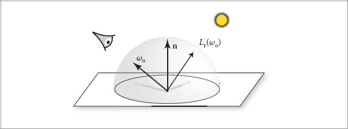

*Figure 12.2: The `Light::SampleLi()` method returns incident radiance from the light at a point and also returns the direction vector ωi that gives the direction from which radiance is arriving.*

```text
    Interaction 136
    Light::SampleLi() 741
    LightSampleContext 741
    LightSampleContext::pi 742
    Normal3f 94
    Point3f 92
    Point3fi 1061
    SurfaceInteraction 138
```

〈LightLiSample Definition〉 ≡ struct LightLiSample { 〈LightLiSample Public Methods〉 SampledSpectrum L; Vector3f wi; Float pdf; Interaction pLight; };

Just as we saw for perfect specular reflection and transmission with BSDFs, light sources that are defined in terms of delta distributions fit naturally into this sampling framework, although they require care on the part of the routines that call their sampling methods, since there are implicit delta distributions in the radiance and PDF values that they return. For the most part, these delta distributions naturally cancel out when estimators are evaluated, although multiple importance sampling code must be aware of this case, just as with BSDFs. For samples taken from delta distribution lights, the `pdf` value in the returned `LightLiSample` should be set to 1.

Related to this, the `PDF_Li()` method returns the value of the PDF for sampling the given direction `wi` from the point represented by `ctx`. This method is particularly useful in the context of multiple importance sampling (MIS) where, for example, the `BSDF` may have sampled a direction and we need to compute the PDF for the light’s sampling that direction in order to compute the MIS weight. Implementations of this method may assume that a ray from `ctx` in direction `wi` has already been

found to intersect the light source, and as with `SampleLi()`, the PDF should be measured with respect to solid angle. Here, the returned PDF value should be 0 if the light is described by a Dirac delta distribution.

〈Light Interface〉 +≡ 740

```rust
   Float PDF_Li(LightSampleContext ctx, Vector3f wi, bool allowIncompletePDF =
   false) const;
```

If a ray happens to intersect an area light source, it is necessary to find the radiance that is emitted back along the ray. This task is handled by the `L()` method, which takes local information about the intersection point and the outgoing direction. This method should never be called for any light that does not have geometry associated with it.

〈Light Interface〉 +≡ 740

```rust
   SampledSpectrum L(Point3f p, Normal3f n, Point2f uv, Vector3f w, const
   SampledWavelengths &lambda) const;
```

```text
    Bounds3f 97
    Float 23
    Interaction 136
    LightLiSample 743
    LightSampleContext 741
    LightType::Infinite 740
    Normal3f 94
    Point2f 92
    Point3f 92
    Ray 95
    SampledSpectrum 171
    SampledWavelengths 173
    Vector3f 86
```

Another interface method that only applies to some types of lights is `Le()`. It enables infinite area lights to contribute radiance to rays that do not hit any geometry in the scene. This method should only be called for lights that report their type to be `LightType::Infinite`.

〈Light Interface〉 +≡ 740

```rust
   SampledSpectrum Le(const Ray &ray, const SampledWavelengths &lambda) const;
```

Finally, the `Light` interface includes a `Preprocess()` method that is invoked prior to rendering. It takes the rendering space bounds of the scene as an argument. Some light sources need to know these bounds and they are not available when lights are initially created, so this method makes the bounds available to them.

〈Light Interface〉 +≡ 740

```rust
    void Preprocess(const Bounds3f &sceneBounds);
```

There are three additional light interface methods that will be defined later, closer to the code that uses them. `Light::Bounds()` provides information that bounds the light’s spatial and directional emission distribution; one use of it is to build acceleration hierarchies for light sampling, as is done in Section 12.6.3. `Light::SampleLe()` and `Light::PDF_Le()` are used to sample rays leaving light sources according to their distribution of emission. They are cornerstones of bidirectional light transport algorithms and are defined in the online edition of the book along with algorithms that use them.

### 12.1.1 PHOTOMETRIC LIGHT SPECIFICATION

pbrt uses radiometry as the basis of its model of light transport. However, light sources are often described using photometric units—a light bulb package might report that it emits 1,000 lumens of light, for example. Beyond their familiarity, one advantage of photometric descriptions of light emission is that they also account for the variation of human visual response with wavelength. It is also more intuitive to describe lights in terms of the visible power that they emit rather than the power they consume in the process of doing so. (Related to this topic, recall the discussion of luminous efficacy in Section 4.4.) Therefore, light sources in pbrt’s scene description files can be specified in terms of the luminous power that they emit. These specifications are then converted to radiometric quantities in the code that initializes the scene representation. Radiometric values are then passed to the constructors of the `Light` implementations in this chapter, often in the form of a base spectral distribution and a scale factor that is applied to it.

### 12.1.2 THE `LightBase` CLASS

As there was with classes like `CameraBase` and `FilmBase` for `Camera` and `Film` implementations, there is a `LightBase` class that all of pbrt’s light sources inherit from. `LightBase` stores a number of values that are common to all of pbrt’s lights and is thus able to implement some of the `Light` interface methods. It is not required that a `Light` in pbrt inherit from `LightBase`, but lights must provide implementations of a few more `Light` methods if they do not.

〈LightBase Definition〉 ≡ class LightBase { public: 〈LightBase Public Methods 745〉 protected: 〈LightBase Protected Methods〉 〈LightBase Protected Members 745〉 };

The following three values are passed to the `LightBase` constructor, which stores them in these member variables:

`type` characterizes the light’s type.

`renderFromLight` is a transformation that defines the light’s coordinate system with respect to rendering space. As with shapes, it is often handy to be able to implement a light assuming a particular coordinate system (e.g., that a spotlight is always located at the origin of its light space, shining down the +z axis). The rendering-from-light transformation makes it possible to place such lights at arbitrary positions and orientations in the scene.

A `MediumInterface` describes the participating medium on the inside and the outside of the light source. For lights that do not have “inside” and “outside” (e.g., a point light), the `MediumInterface` stores the same `Medium` on both sides.

```text
    Camera 206
    CameraBase 212
    Film 244
    FilmBase 247
    Light 740
    Light::Bounds() 791
    LightBase 744
    Medium 714
    MediumInterface 715
```

〈LightBase Protected Members〉 ≡ 744

```rust
   LightType type; Transform renderFromLight; MediumInterface mediumInterface;
```

`LightBase` can thus take care of providing an implementation of the `Type()` interface method.

〈LightBase Public Methods〉 ≡ 744

```rust
   LightType Type() const { return type; }
```

It also provides default implementations of `L()` and `Le()` so that lights that are not respectively area or infinite lights do not need to implement these themselves.

〈LightBase Public Methods〉 +≡ 744

```rust
   SampledSpectrum L(Point3f p, Normal3f n, Point2f uv, Vector3f w, const
   SampledWavelengths &lambda) const {
        return SampledSpectrum(0.f); }
```

〈LightBase Public Methods〉 +≡ 744

```rust
   SampledSpectrum Le(const Ray &, const SampledWavelengths &) const {
        return SampledSpectrum(0.f); }
```

Most of the following `Light` implementations take a `Spectrum` value in their constructor to specify the light’s spectral emission but then convert it to a `DenselySampledSpectrum` to store in a member variable. By doing so, they enjoy the benefits of efficient sampling operations from tabularizing the

spectrum and a modest performance benefit from not requiring dynamic dispatch to call `Spectrum` methods.

However, a `DenselySampledSpectrum` that covers the visible wavelengths uses approximately 2 kB of storage; for scenes with millions of light sources, the memory required may be significant. Therefore, `LightBase` provides a `LookupSpectrum()` method that helps reduce memory use by eliminating redundant copies of the same `DenselySampledSpectrum`. It uses the `InternCache` from Section B.4.2 to do so, only allocating storage for a single instance of each `DenselySampledSpectrum` provided. If many lights have the same spectral emission profile, the memory savings may be significant.

```text
    DenselySampledSpectrum 167
    InternCache 1070
    InternCache::Lookup() 1070
    LightBase 744
    LightBase::type 745
    LightType 740
    MediumInterface 715
    Normal3f 94
    Point2f 92
    Point3f 92
    Ray 95
    SampledSpectrum 171
    SampledWavelengths 173
    Spectrum 165
    Transform 120
    Vector3f 86
```

〈LightBase Method Definitions〉 ≡ const DenselySampledSpectrum *LightBase::LookupSpectrum(Spectrum s) { 〈Initialize spectrumCache on first call〉 〈Return unique DenselySampledSpectrum from intern cache for s 746〉 }

The 〈Initialize spectrumCache on first call〉 fragment, not included here, handles the details of initializing the `spectrumCache`, including ensuring mutual exclusion if multiple threads have called `LookupSpectrum()` concurrently and using an appropriate memory allocator—notably, one that allocates memory on the GPU if GPU rendering has been enabled.

`LookupSpectrum()` then calls the `InternCache::Lookup()` method that takes a callback function to create the object that is stored in the cache. In this way, it is able to pass the provided allocator to the `DenselySampledSpectrum` constructor, which in turn ensures that it is used to allocate the storage needed for its spectral samples.

〈Return unique DenselySampledSpectrum from intern cache for s〉 ≡ auto create = [](Allocator alloc, const DenselySampledSpectrum &s) { return alloc.new_object<DenselySampledSpectrum>(s, alloc); }; return spectrumCache->Lookup(DenselySampledSpectrum(s), create);

〈LightBase Protected Members〉 +≡ 744

```rust
   static InternCache<DenselySampledSpectrum> *spectrumCache;
```

## 12.2 POINT LIGHTS

A number of interesting lights can be described in terms of emission from a single point in space with some possibly angularly varying distribution of outgoing light. This section describes the implementation of a number of them, starting with `PointLight`, which represents an isotropic point light source that emits the same amount of light in all directions. (Figure 12.3 shows a scene rendered with a point light source.) Building on this base, a number of more complex lights based on point sources will then be introduced, including spotlights and a light that projects an image into the scene.

〈PointLight Definition〉 ≡ class PointLight : public LightBase { public: 〈PointLight Public Methods 747〉 private: 〈PointLight Private Members 747〉 };

PointLights are positioned at the origin in the light coordinate system. To place them elsewhere, the rendering-from-light transformation should be set accordingly. In addition to passing the common light parameters to `LightBase`, the constructor supplies `LightType::DeltaPosition`


*Figure 12.3: Scene Rendered with a Point Light Source. Notice the hard shadow boundaries from this type of light. (Dragon model courtesy of the Stanford Computer Graphics Laboratory.)*

```text
   Allocator 40
   DenselySampledSpectrum 167
   InternCache 1070
   InternCache::Lookup() 1070
   LightBase 744
   LightBase::spectrumCache 746
   PointLight 746
   std::pmr::polymorphic_allocator::new_object() 41
```

for its light type, since point lights represent singularities that only emit light from a single position. The constructor also stores the light’s intensity (Section 4.1.1).

〈PointLight Public Methods〉 ≡ 746

```rust
   PointLight(Transform renderFromLight, MediumInterface mediumInterface,
   Spectrum I, Float scale) : LightBase(LightType::DeltaPosition,
   renderFromLight, mediumInterface), I(LookupSpectrum(I)), scale(scale) {}
```

As `HomogeneousMedium` and `GridMedium` did with spectral scattering coefficients, `PointLight` uses a `DenselySampledSpectrum` rather than a `Spectrum` for the spectral intensity, trading off storage for more efficient spectral sampling operations.

〈PointLight Private Members〉 ≡ 746

const DenselySampledSpectrum *I; Float scale;

Strictly speaking, it is incorrect to describe the light arriving at a point due to a point light source using units of radiance. Radiant intensity is instead the proper unit for describing emission from a point light source, as explained in Section 4.1. In the light source interfaces here, however, we will abuse terminology and use `SampleLi()` methods to report the illumination arriving at a point for all types of light sources, dividing radiant intensity by the squared distance to the point p to convert units. In the end, the correctness of the computation does not suffer from this fudge, and it makes the implementation of light transport algorithms more straightforward by not requiring them to use different interfaces for different types of lights.

```text
   DenselySampledSpectrum 167
   DistanceSquared() 93
   Float 23
   HomogeneousMedium 720
   Interaction 136
   LightBase 744
   LightBase::LookupSpectrum() 745
   LightBase::mediumInterface 745
   LightBase::renderFromLight 745
   LightLiSample 743
   LightSampleContext 741
   LightSampleContext::p() 742
   LightType::DeltaPosition 740
   MediumInterface 715
   Normalize() 88
   Point2f 92
   Point3f 92
   PointLight 746
   PointLight::I 747
   PointLight::scale 747
   SampledSpectrum 171
   SampledWavelengths 173
   Spectrum 165
   Transform 120
   Transform::operator() 130
   Vector3f 86
```

Point lights are described by a delta distribution such that they only illuminate a receiving point from a single direction. Thus, the sampling problem is deterministic and makes no use of the random sample u. We find the light’s position p in the rendering coordinate system and sample its spectral emission at the provided wavelengths. Note that a PDF value of 1 is returned in the `LightLiSample`: there is implicitly a Dirac delta distribution in both the radiance and the PDF that cancels when the Monte Carlo estimator is evaluated.

〈PointLight Public Methods〉 +≡ 746

pstd::optional<LightLiSample> SampleLi(LightSampleContext ctx, Point2f u, SampledWavelengths lambda, bool allowIncompletePDF) const { Point3f p = renderFromLight(Point3f(0, 0, 0)); Vector3f wi = Normalize(p - ctx.p()); SampledSpectrum Li = scale * I->Sample(lambda) / DistanceSquared(p, ctx.p()); return LightLiSample(Li, wi, 1, Interaction(p, &mediumInterface)); }

Due to the delta distribution, the `PointLight::PDF_Li()` method returns 0. This value reflects the fact that there is no chance for some other sampling process to randomly generate a direction that would intersect an infinitesimal light source.

〈PointLight Public Methods〉 +≡ 746

Float PDF_Li(LightSampleContext, Vector3f, bool allowIncompletePDF) const { return 0; }

The total power emitted by the light source can be found by integrating the intensity over the entire sphere of directions: Radiant power is returned by the `Phi()` method and not the luminous power that may have been used to specify the light source.

〈PointLight Method Definitions〉 ≡ SampledSpectrum PointLight::Phi(SampledWavelengths lambda) const { return 4 * Pi * scale * I->Sample(lambda); }

### 12.2.1 SPOTLIGHTS

Spotlights are a handy variation on point lights; rather than shining illumination in all directions, they emit light in a cone of directions from their position. For simplicity, we will define the spotlight in the light coordinate system to always be at position (0, 0, 0) and pointing down the +z axis. To place or orient it elsewhere in the scene, the rendering-from-light transformation should be set accordingly. Figure 12.4 shows a rendering of the same scene as Figure 12.3, illuminated with a spotlight instead of a point light.

〈SpotLight Definition〉 ≡ class SpotLight : public LightBase { public: 〈SpotLight Public Methods 749〉 private: 〈SpotLight Private Members 749〉 };

There is not anything interesting in the `SpotLight` constructor, so it is not included here. It is given angles that set the extent of the `SpotLight`’s cone —the overall angular width of the cone and the angle at which falloff starts (Figure 12.5)—but it stores the cosines of these angles, which are more useful to have at hand in the `SpotLight`’s methods.


*Figure 12.4: Scene Rendered with a Spotlight. The spotlight cone smoothly cuts off illumination past a user-specified angle from the light’s central axis. (Dragon model courtesy of the Stanford Computer Graphics Laboratory.)*

DenselySampledSpectrum::Sample() 167 LightBase 744 Pi 1033 PointLight::I 747 PointLight::scale 747 SampledSpectrum 171 SampledWavelengths 173 SpotLight 748

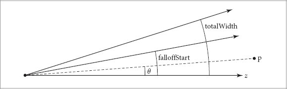

*Figure 12.5: Spotlights are defined by two angles, `falloffStart` and `totalWidth`, that are measured with respect to the z axis in light space. Objects inside the inner cone of angles, up to `falloffStart`, are fully illuminated by the light. The directions between `falloffStart` and `totalWidth` are a transition zone that ramps down from full illumination to no illumination, such that points outside the `totalWidth` cone are not illuminated at all. The cosine of the angle θ between the vector to a point p and the spotlight axis can easily be computed with a dot product.*

〈SpotLight Private Members〉 ≡ 748

const DenselySampledSpectrum *Iemit; Float scale, cosFalloffStart, cosFalloffEnd;

The `SpotLight::SampleLi()` method is of similar form to that of `PointLight::SampleLi()`, though an unset sample is returned if the receiving point is outside of the spotlight’s outer cone and thus receives zero radiance.

〈SpotLight Public Methods〉 ≡ 748

pstd::optional<LightLiSample> SampleLi(LightSampleContext ctx, Point2f u, SampledWavelengths lambda, bool allowIncompletePDF) const { Point3f p = renderFromLight(Point3f(0, 0, 0)); Vector3f wi = Normalize(p - ctx.p()); 〈Compute incident radiance Li for SpotLight 749〉 if (!Li) return {}; return LightLiSample(Li, wi, 1, Interaction(p, &mediumInterface)); }

```text
   CosTheta() 107
   DenselySampledSpectrum 167
   DistanceSquared() 93
   Float 23
   Interaction 136
   LightBase::mediumInterface 745
   LightBase::renderFromLight 745
   LightLiSample 743
```

```text
   LightSampleContext 741
   LightSampleContext::p() 742
   Normalize() 88
   Point2f 92
   Point3f 92
   PointLight::SampleLi() 747
   SampledSpectrum 171
   SampledWavelengths 173
   SpotLight::I() 750
   SpotLight::SampleLi() 749
   Transform::ApplyInverse() 130
   Vector3f 86
```

The `I()` method computes the distribution of light accounting for the spotlight cone. This computation is encapsulated in a separate method since other `SpotLight` methods will need to perform it as well.

〈Compute incident radiance Li for SpotLight〉 ≡ 749

Vector3f wLight = Normalize(renderFromLight.ApplyInverse(-wi)); SampledSpectrum Li = I(wLight, lambda) / DistanceSquared(p, ctx.p());

As with point lights, the `SpotLight`’s `PDF_Li()` method always returns zero. It is not included here. To compute the spotlight’s strength for a direction leaving the light, the first step is to compute the cosine of the angle between that direction and the vector along the center of the spotlight’s cone. Because the spotlight is oriented to point down the +z axis, the `CosTheta()` function can be used to do so. The `SmoothStep()` function is then used to modulate the emission according to the cosine of the angle: it returns 0 if the provided value is below `cosFalloffEnd`, 1 if it is above `cosFalloffStart`, and it interpolates between 0 and 1 for intermediate values using a cubic curve. (To understand its usage, keep in mind that for θ ∈ [0, π], as is the case here, if θ > θ′, then cos θ < cos θ′.)

〈SpotLight Method Definitions〉 ≡ SampledSpectrum SpotLight::I(Vector3f w, SampledWavelengths lambda) const {

return SmoothStep(CosTheta(w), cosFalloffEnd, cosFalloffStart) * scale * Iemit->Sample(lambda); }

To compute the power emitted by a spotlight, it is necessary to integrate the falloff function over the sphere. In spherical coordinates, θ and ϕ are separable, so we just need to integrate over θ and scale the result by 2π. For the part that lies inside the inner cone of full power, we have

The falloff region works out simply, thanks in part to `SmoothStep()` being a polynomial.

〈SpotLight Method Definitions〉 +≡ SampledSpectrum SpotLight::Phi(SampledWavelengths lambda) const { return scale * Iemit->Sample(lambda) * 2 * Pi * ((1 - cosFalloffStart) + (cosFalloffStart - cosFalloffEnd) / 2); }

### 12.2.2 TEXTURE PROJECTION LIGHTS

Another useful light source acts like a slide projector; it takes an image map and projects its image out into the scene. The `ProjectionLight` class uses a projective transformation to project points in the scene onto the light’s projection plane based on the field of view angle given to the constructor (Figure 12.6). The use of this light in the lighting example scene is shown in Figure 12.7.

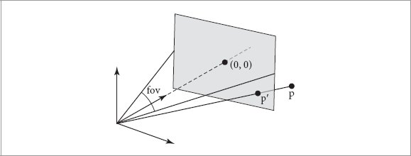

*Figure 12.6: The Basic Setting for Projection Light Sources. A point p in the light’s coordinate system is projected onto the plane of the image using the light’s projection matrix.*

CosTheta() 107 DenselySampledSpectrum::Sample() 167 Pi 1033 ProjectionLight 751 SampledSpectrum 171 SampledWavelengths 173 SmoothStep() 1034 SpotLight::cosFalloffEnd 749 SpotLight::cosFalloffStart 749 SpotLight::Iemit 749 SpotLight::scale 749 Vector3f 86


*Figure 12.7: Scene Rendered with a Projection Light Using a Grid Image. The projection light acts like a slide projector, projecting an image onto objects in the scene. (Dragon model courtesy of the Stanford Computer Graphics Laboratory.)*

〈ProjectionLight Definition〉 ≡ class ProjectionLight : public LightBase { public: 〈ProjectionLight Public Methods〉 private: 〈ProjectionLight Private Members 751〉 };

This light could use a `Texture` to represent the light projection distribution so that procedural projection patterns could be used. However, having a tabularized representation of the projection function makes it easier to sample with probability proportional to the projection function. Therefore, the `Image` class is used to specify the projection pattern.

〈ProjectionLight Method Definitions〉 ≡ ProjectionLight::ProjectionLight(

Transform renderFromLight, MediumInterface mediumInterface, Image im, const RGBColorSpace *imageColorSpace, Float scale, Float fov, Allocator alloc) : LightBase(LightType::DeltaPosition, renderFromLight, mediumInterface), image(std::move(im)), imageColorSpace(imageColorSpace), scale(scale), distrib(alloc) { 〈ProjectionLight constructor implementation 752〉 }

```text
   Allocator 40
   Float 23
   Image 1079
   LightBase 744
   LightType::DeltaPosition 740
   MediumInterface 715
   ProjectionLight 751
   RGBColorSpace 183
   Texture 655
   Transform 120
```

A color space for the image is stored so that it is possible to convert image RGB values to spectra.

〈ProjectionLight Private Members〉 ≡ 751

Image image; const RGBColorSpace *imageColorSpace; Float scale;

The constructor has more work to do than the ones we have seen so far, including initializing a projection matrix and computing the area of the projected image on the projection plane.

〈ProjectionLight constructor implementation〉 ≡ 751

〈Initialize ProjectionLight projection matrix 752〉 〈Compute projection image area A 752〉 〈Compute sampling distribution for ProjectionLight〉

First, similar to the `PerspectiveCamera`, the `ProjectionLight` constructor computes a projection matrix and the screen space extent of the projection on the z = 1 plane.

〈Initialize ProjectionLight projection matrix〉 ≡ 752

```rust
   Float aspect = Float(image.Resolution().x) / Float(image.Resolution().y);
   if (aspect > 1) screenBounds = Bounds2f(Point2f(-aspect, -1),
   Point2f(aspect, 1)); else
        screenBounds = Bounds2f(Point2f(-1, -1/aspect), Point2f(1, 1/aspect));
        screenFromLight = Perspective(fov, hither, 1e30f /* yon */);
        lightFromScreen = Inverse(screenFromLight);
```

Since there is no particular need to keep ProjectionLights compact, both of the screen–light transformations are stored explicitly, which makes code in the following that uses them more succinct.

〈ProjectionLight Private Members〉 +≡ 751

Bounds2f screenBounds; Float hither = 1e-3f; Transform screenFromLight, lightFromScreen;

For a number of the following methods, we will need the light-space area of the image on the z = 1 plane. One way to find this is to compute half of one of the two rectangle edge lengths using the projection’s field of view and to use the fact that the plane is a distance of 1 from the camera’s position. Doubling that gives one edge length and the other can be found using a factor based on the aspect ratio; see Figure 12.8.

```text
   Bounds2f 97
   Float 23
   Image::Resolution() 1080
   Perspective() 220
   PerspectiveCamera 220
   Point2f 92
   ProjectionLight 751
   ProjectionLight::A 753
   ProjectionLight::hither 752
   ProjectionLight::image 751
   ProjectionLight::lightFromScreen 752
   ProjectionLight::screenBounds 752
   ProjectionLight::screenFromLight 752
   Radians() 1033
   Sqr() 1034
   Transform 120
   Transform::Inverse() 121
```

〈Compute projection image area A〉 ≡ 752

```rust
   Float opposite = std::tan(Radians(fov) / 2); A = 4 * Sqr(opposite) *
   (aspect > 1 ? aspect : (1 / aspect));
```

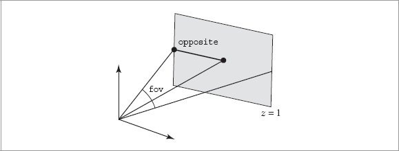

*Figure 12.8: The first step of computing the light-space area of the image on the z = 1 projection plane is to compute the length opposite illustrated here. It is easily found using basic trigonometry.*

〈ProjectionLight Private Members〉 +≡ 751

Float A;

The `ProjectionLight::SampleLi()` follows the same form as `SpotLight::SampleLi()` except that it uses the following `I()` method to compute the spectral intensity of the projected image. We will therefore skip over its implementation here. We will also not include the `PDF_Li()` method’s implementation, as it, too, returns 0. The direction passed to the `I()` method should be normalized and already transformed into the light’s coordinate system.

〈ProjectionLight Method Definitions〉 +≡ SampledSpectrum ProjectionLight::I(Vector3f w, const SampledWavelengths &lambda) const { 〈Discard directions behind projection light 753〉 〈Project point onto projection plane and compute RGB 753〉 〈Return scaled wavelength samples corresponding to RGB 754〉 }

Because the projective transformation has the property that it projects points behind the center of projection to points in front of it, it is important to discard points with a negative z value. Therefore, the projection code immediately returns no illumination for projection points that are behind the hither plane for the projection. If this check were not done, then it would not be possible to know if a projected point was originally behind the light (and therefore not illuminated) or in front of it.

〈Discard directions behind projection light〉 ≡ 753

if (w.z < hither) return SampledSpectrum(0.f);

After being projected to the projection plane, points with coordinate values outside the screen window are discarded. Points that pass this test are transformed to get texture coordinates inside [0, 1]2 for the lookup in the image.

```text
   Bounds2::Inside() 100
   Bounds2::Offset() 102
   Float 23
   Image::LookupNearestChannel() 1082
   Point2f 92
   Point3f 92
   ProjectionLight 751
   ProjectionLight::hither 752
   ProjectionLight::image 751
   ProjectionLight::screenBounds 752
   ProjectionLight::screenFromLight 752
   RGB 182
   RGBIlluminantSpectrum 199
   RGBUnboundedSpectrum 198
   SampledSpectrum 171
   SampledWavelengths 173
   SpotLight::SampleLi() 749
   Transform::operator() 130
   Vector3f 86
```

One thing to note is that a “nearest” lookup is used rather than, say, bilinear interpolation of the image samples. Although bilinear interpolation would lead to smoother results, especially for low-resolution image maps, in this way the projection function will exactly match the piecewise-constant distribution that is used for importance sampling in the light emission sampling methods. Further, the code here assumes that the image stores red, green, and blue in its first three channels; the code that creates ProjectionLights ensures that this is so.

〈Project point onto projection plane and compute RGB〉 ≡ 753

Point3f ps = screenFromLight(Point3f(w)); if (!Inside(Point2f(ps.x, ps.y), screenBounds)) return SampledSpectrum(0.f); Point2f uv = Point2f(screenBounds.Offset(Point2f(ps.x, ps.y))); RGB rgb; for (int c = 0; c < 3; ++c) rgb[c] = image.LookupNearestChannel(uv, c);

It is important to use an `RGBIlluminantSpectrum` to convert the RGB value to spectral samples rather than, say, an `RGBUnboundedSpectrum`. This ensures that, for example, a (1, 1, 1) RGB value corresponds to the color space’s illuminant and not a constant spectral distribution.

〈Return scaled wavelength samples corresponding to RGB〉 ≡ 753

RGBIlluminantSpectrum s(*imageColorSpace, ClampZero(rgb)); return scale * s.Sample(lambda);

The total emitted power is given by integrating radiant intensity over the sphere of directions (Equation (4.2)), though here the projection function is tabularized over a planar 2D area. Power can thus be computed by integrating over the area of the image and applying a change of variables factor dω/dA:

〈ProjectionLight Method Definitions〉 +≡ SampledSpectrum ProjectionLight::Phi(SampledWavelengths lambda) const { SampledSpectrum sum(0.f); for (int y = 0; y < image.Resolution().y; ++y) for (int x = 0; x < image.Resolution().x; ++x) { 〈Compute change of variables factor dwdA for projection light pixel 754〉 〈Update sum for projection light pixel 755〉 } 〈Return final power for projection light 755〉 }

Recall from Section 4.2.3 that differential area dA is converted to differential solid angle dω by multiplying by a cos θ factor and dividing by the squared distance. Because the plane we are integrating over is at z = 1, the distance from the origin to a point on the plane is equal to 1/cos θ and thus the aggregate factor is cos3 θ; see Figure 12.9.

〈Compute change of variables factor dwdA for projection light pixel〉 ≡ 754

Point2f ps = screenBounds.Lerp(Point2f((x + 0.5f) / image.Resolution().x, (y + 0.5f) / image.Resolution().y)); Vector3f w = Vector3f(lightFromScreen(Point3f(ps.x, ps.y, 0))); w = Normalize(w); Float dwdA = Pow<3>(CosTheta(w));

```text
   CosTheta() 107
   Float 23
   Image::Resolution() 1080
   Lerp() 72
   Normalize() 88
   Point2f 92
   Point3f 92
   Pow() 1034
   ProjectionLight 751
   ProjectionLight::image 751
   ProjectionLight::imageColorSpace 751
   ProjectionLight::lightFromScreen 752
   ProjectionLight::scale 751
   ProjectionLight::screenBounds 752
   RGBIlluminantSpectrum 199
   RGBIlluminantSpectrum::Sample() 200
   SampledSpectrum 171
   SampledWavelengths 173
   Vector3f 86
```

For the same reasons as in the `Project()` method, an `RGBIlluminantSpectrum` is used to convert each RGB value to spectral samples.

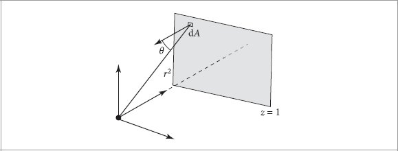

*Figure 12.9: To find the power of a point light source, we generally integrate radiant intensity over directions around the light. For the `ProjectionLight`, we instead integrate over the z = 1 plane, in which case we need to account for the change of variables, applying both a cos θ and a 1/r2 factor.*

〈Update sum for projection light pixel〉 ≡ 754

RGB rgb; for (int c = 0; c < 3; ++c) rgb[c] = image.GetChannel({x, y}, c); RGBIlluminantSpectrum s(*imageColorSpace, ClampZero(rgb)); sum += s.Sample(lambda) * dwdA;

The final integrated value includes a factor of the area that was integrated over, A, and is divided by the total number of pixels.

〈Return final power for projection light〉 ≡ 754

return scale * A * sum / (image.Resolution().x * image.Resolution().y);

### 12.2.3 GONIOPHOTOMETRIC DIAGRAM LIGHTS

A goniophotometric diagram describes the angular distribution of luminance from a point light source; it is widely used in illumination engineering to characterize lights. Figure 12.10 shows an example of a goniophotometric diagram in two dimensions. In this section, we will implement a light source that uses goniophotometric diagrams encoded in 2D image maps to describe the emission distribution lights. Figure 12.11 shows a few goniophotometric diagrams encoded as image maps and Figure 12.12 shows a scene rendered with a light source that uses one of these images to modulate its directional distribution of illumination. The `GoniometricLight` uses the equal-area parameterization of the sphere that was introduced in Section 3.8.3, so the center of the image corresponds to the “up” direction.

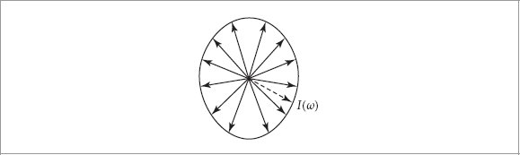

*Figure 12.10: An Example of a Goniophotometric Diagram Specifying an Outgoing Light Distribution from a Point Light Source in 2D. The emitted intensity is defined in a fixed set of directions on the unit sphere, and the intensity for a given outgoing direction ω is found by interpolating the intensities of the adjacent samples.*

```text
   Image::GetChannel() 1081
   Image::Resolution() 1080
   ProjectionLight::A 753
   ProjectionLight::image 751
   ProjectionLight::imageColorSpace 751
   ProjectionLight::scale 751
   RGB 182
   RGBIlluminantSpectrum 199
   RGBIlluminantSpectrum::Sample() 200
```


*Figure 12.11: Goniophotometric Diagrams for Real-World Light Sources. These images are encoded using an equal-area parameterization (Section 3.8.3). (a) A light that mostly illuminates in its up direction, with only a small amount of illumination in the down direction. (b) A light that mostly illuminates in the down direction. (c) A light that casts illumination both above and below.*


*Figure 12.12: Scene Rendered Using the Goniophotometric Diagram from Figure 12.11(b). Even though a point light source is the basis of this light, including the directional variation of a realistic light improves the visual realism of the rendered image. (Dragon model courtesy of the Stanford Computer Graphics Laboratory.)*

〈GoniometricLight Definition〉 ≡ class GoniometricLight : public LightBase { public: 〈GoniometricLight Public Methods 757〉 private: 〈GoniometricLight Private Members 756〉 };

The `GoniometricLight` constructor takes a base intensity, an image map that scales the intensity based on the angular distribution of light, and the usual transformation and medium interface; these are stored in the following member variables. In the following methods, only the first channel of the image map will be used to scale the light’s intensity: the `GoniometricLight` does not support specifying color via the image. It is the responsibility of calling code to convert RGB images to luminance or some other appropriate scalar value before passing the image to the constructor here.

〈GoniometricLight Private Members〉 ≡ 756

const DenselySampledSpectrum *Iemit; Float scale; Image image;

```text
   DenselySampledSpectrum 167
   Float 23
   GoniometricLight 756
   Image 1079
   LightBase 744
   ProjectionLight 751
   SpotLight 748
```

The `SampleLi()` method follows the same form as that of `SpotLight` and `ProjectionLight`, so it is not included here. It uses the following method to compute the radiant intensity for a given direction.

〈GoniometricLight Public Methods〉 ≡ 756

SampledSpectrum I(Vector3f w, const SampledWavelengths &lambda) const { Point2f uv = EqualAreaSphereToSquare(w); return scale * Iemit->Sample(lambda) * image.LookupNearestChannel(uv, 0); }

Because it uses an equal-area mapping from the image to the sphere, each pixel in the image subtends an equal solid angle and the change of variables factor for integrating over the sphere of directions is the same for all pixels. Its value is 4π, the ratio of the area of the unit sphere to the unit square.

〈GoniometricLight Method Definitions〉 ≡ SampledSpectrum GoniometricLight::Phi(SampledWavelengths lambda) const { Float sumY = 0; for (int y = 0; y < image.Resolution().y; ++y) for (int x = 0; x < image.Resolution().x; ++x) sumY += image.GetChannel({x, y}, 0); return scale * Iemit->Sample(lambda) * 4 * Pi * sumY / (image.Resolution().x * image.Resolution().y); }

## 12.3 DISTANT LIGHTS

Another useful light source type is the distant light, also known as a directional light. It describes an emitter that deposits illumination from the same direction at every point in space. Such a light is also called a point light “at infinity,” since, as a point light becomes progressively farther away, it acts more and more like a directional light. For example, the sun (as considered from Earth) can be thought of as a directional light source. Although it is actually an area light source, the illumination effectively arrives at Earth in nearly parallel beams because it is so far away.

```text
   DenselySampledSpectrum 167
   DenselySampledSpectrum::Sample() 167
   DistantLight 757
   EqualAreaSphereToSquare() 113
   Float 23
   GoniometricLight::Iemit 756
   GoniometricLight::image 756
   GoniometricLight::scale 756
   Image::GetChannel() 1081
   Image::LookupNearestChannel() 1082
   Image::Resolution() 1080
   LightBase 744
   LightBase::LookupSpectrum() 745
   LightType 740
   Pi 1033
   Point2f 92
   SampledSpectrum 171
```

```text
   SampledWavelengths 173
   Spectrum 165
   Transform 120
   Vector3f 86
```

〈DistantLight Definition〉 ≡ class DistantLight : public LightBase { public: 〈DistantLight Public Methods 757〉 private: 〈DistantLight Private Members 757〉 };

The `DistantLight` constructor does not take a `MediumInterface` parameter; the only reasonable medium for a distant light to be in is a vacuum—if it was itself in a medium that absorbed any light at all, then all of its emission would be absorbed, since it is modeled as being infinitely far away.

〈DistantLight Public Methods〉 ≡ 757

DistantLight(const Transform &renderFromLight, Spectrum Lemit, Float scale) : LightBase(LightType::DeltaDirection, renderFromLight, {}), Lemit(LookupSpectrum(Lemit)), scale(scale) {}

〈DistantLight Private Members〉 ≡ 757

const DenselySampledSpectrum *Lemit; Float scale;

Some of the `DistantLight` methods need to know the bounds of the scene. Because pbrt creates lights before the scene geometry, these bounds are not available when the `DistantLight` constructor executes. Therefore, `DistantLight` implements the optional `Preprocess()` method where it converts the scene’s `Bounds3f` to a bounding sphere, which will be an easier representation to work with in the following.

〈DistantLight Public Methods〉 +≡ 757

void Preprocess(const Bounds3f &sceneBounds) { sceneBounds.BoundingSphere(&sceneCenter, &sceneRadius); }

〈DistantLight Private Members〉 +≡ 757

Point3f sceneCenter; Float sceneRadius;

The incident radiance at a point p due to a distant light can be described using a Dirac delta distribution, Li(p, ω) = Le δ(ω – ωl), where the light’s direction is ωl. Given this definition, the implementation of the `SampleLi()` method is straightforward: the incident direction and radiance are always the same. The only interesting bit is the initialization of the `Interaction` that provides the second point for the future shadow ray. It is set along the distant light’s incident direction at a distance of twice the radius of the scene’s bounding sphere, guaranteeing a second point that is outside of the scene’s bounds (Figure 12.13).

〈DistantLight Public Methods〉 +≡ 757

pstd::optional<LightLiSample> SampleLi(LightSampleContext ctx, Point2f u, SampledWavelengths lambda, bool allowIncompletePDF) const { Vector3f wi = Normalize(renderFromLight(Vector3f(0, 0, 1))); Point3f pOutside = ctx.p() + wi * (2 * sceneRadius); return LightLiSample(scale * Lemit->Sample(lambda), wi, 1, Interaction(pOutside, nullptr)); }

```text
   Bounds3::BoundingSphere() 103
   Bounds3f 97
   DenselySampledSpectrum::Sample() 167
   DistantLight::Lemit 757
   DistantLight::scale 757
   DistantLight::sceneCenter 758
   DistantLight::sceneRadius 758
   Float 23
   Interaction 136
   LightBase::renderFromLight 745
   LightLiSample 743
   LightSampleContext 741
   LightSampleContext::p() 742
   Normalize() 88
   Point2f 92
   Point3f 92
   SampledWavelengths 173
   Transform::operator() 130
   Vector3f 86
```

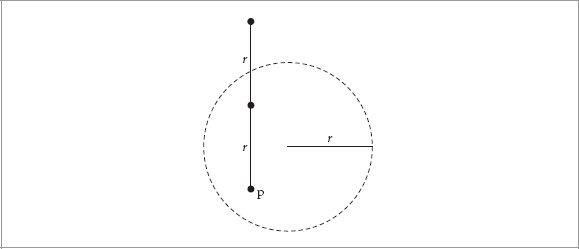

*Figure 12.13: Computing the Second Point for a `DistantLight` Shadow Ray. Given a sphere that bounds the scene (dashed line) with radius r and given some point in the scene p, if we then move a distance of 2r along any vector from p, the resulting point must be outside of the scene’s bound. If a shadow ray to such a point is unoccluded, then we can be certain that the point p receives illumination from a distant light along the vector’s direction.*

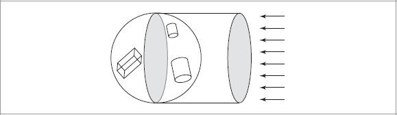

*Figure 12.14: An approximation of the power emitted by a distant light into a given scene can be obtained by finding the sphere that bounds the scene, computing the area of an inscribed disk, and computing the power that arrives on the surface of that disk.*

The distant light is different than the lights we have seen so far in that the amount of power it emits is related to the spatial extent of the scene. In fact, it is proportional to the area of the scene receiving light. To see why this is so, consider a disk of area A being illuminated by a distant light with emitted radiance L where the incident light arrives along the disk’s normal direction. The total power reaching the disk is Φ = AL. As the size of the receiving surface varies, power varies proportionally. To find the emitted power for a `DistantLight`, it is impractical to compute the total surface area of the objects that are visible to the light. Instead, we will approximate this area with a disk inside the scene’s bounding sphere oriented in the light’s direction (Figure 12.14). This will always overestimate the actual area but is sufficient for the needs of code elsewhere in the system.

〈DistantLight Method Definitions〉 ≡ SampledSpectrum DistantLight::Phi(SampledWavelengths lambda) const { return scale * Lemit->Sample(lambda) * Pi * Sqr(sceneRadius); }

## 12.4 AREA LIGHTS

Area lights are defined by the combination of a `Shape` and a directional distribution of radiance at each point on its surface. In general, computing radiometric quantities related to area lights requires computing integrals over the surface of the light that often cannot be computed in closed form, though they are well suited to Monte Carlo integration. The reward for this complexity (and computational expense) is soft shadows and more realistic lighting effects, rather than the hard shadows and stark lighting that come from point lights. (See Figure 12.15, which shows the effect of varying the size of an area light source used to illuminate the dragon; compare its soft look to illumination from a point light in Figure 12.3.)

```text
   DenselySampledSpectrum::Sample() 167
   DistantLight 757
   DistantLight::Lemit 757
   DistantLight::scale 757
   DistantLight::sceneRadius 758
   LightBase 744
   Pi 1033
   SampledSpectrum 171
   SampledWavelengths 173
   Shape 261
   Sqr() 1034
```

The `DiffuseAreaLight` class defines an area light where emission at each point on the surface has a uniform directional distribution.

〈DiffuseAreaLight Definition〉 ≡ class DiffuseAreaLight : public LightBase { public: 〈DiffuseAreaLight Public Methods 761〉 private: 〈DiffuseAreaLight Private Members 761〉 〈DiffuseAreaLight Private Methods 762〉 };


*Figure 12.15: Dragon Model Illuminated by Disk Area Lights. (a) The disk’s radius is relatively small; the shadow has soft penumbrae, but otherwise the image looks similar to the one with a point light. (b) The effect of using a much larger disk: not only have the penumbrae become much larger, to the point of nearly eliminating the shadow of the tail, for example, but note also how the shading on the body is smoother, with the specular highlights less visible due to illumination coming from a wider range of directions. (Dragon model courtesy of the Stanford Computer Graphics Laboratory.)*

Its constructor, not included here, sets the following member variables from the parameters provided to it. If an alpha texture has been associated with the shape to cut away parts of its surface, it is used here so that there is no illumination from those parts of the shape.1 (Recall that alpha masking was introduced in Section 7.1.1.) The area of the emissive `Shape` is needed in a number of the following methods and so is cached in a member variable.

```text
   DiffuseAreaLight 759
   LightType::DeltaPosition 740
   Shape 261
```

〈DiffuseAreaLight Private Members〉 ≡ 759

Shape shape; FloatTexture alpha; Float area;

A number of parameters specify emission from DiffuseAreaLights. By default, emission is only on one side of the surface, where the surface normal is outward-facing. A scaling transform that flips the normal or the ReverseOrientation directive in the scene description file can be used to cause emission to be on the other side of the surface. If `twoSided` is true, then the light emits on both sides. Emission that varies over the surface can be defined using an `Image`; if one is provided to the constructor, the surface will have spatially varying emission defined by its color values. Otherwise, spatially uniform emitted spectral radiance is given by a provided `Lemit` spectrum. For both methods of specifying emission, an additional scale factor in `scale` is applied to the returned radiance.

〈DiffuseAreaLight Private Members〉 +≡ 759

bool twoSided; const DenselySampledSpectrum *Lemit; Float scale; Image image; const RGBColorSpace *imageColorSpace;

Recall from Section 12.1 that the `Light` interface includes an `L()` method that area lights must implement to provide the emitted radiance at a specified point on their surface. This method is called if a ray happens to intersect an emissive surface, for example. `DiffuseAreaLight`’s implementation starts by checking a few cases in which there is no emitted radiance before calculating emission using the `Image`, if provided, and otherwise the specified constant radiance.

```text
   DenselySampledSpectrum 167
   DenselySampledSpectrum::Sample() 167
   DiffuseAreaLight::AlphaMasked() 762
   DiffuseAreaLight::image 761
   DiffuseAreaLight::Lemit 761
   DiffuseAreaLight::scale 761
   DiffuseAreaLight::twoSided 761
   Dot() 89
   Float 23
   FloatTexture 656
   Image 1079
   Interaction 136
   Light 740
   Normal3f 94
   Point2f 92
   Point3f 92
   RGBColorSpace 183
   SampledSpectrum 171
   SampledWavelengths 173
   Shape 261
   Vector3f 86
```

〈DiffuseAreaLight Public Methods〉 ≡ 759

SampledSpectrum L(Point3f p, Normal3f n, Point2f uv, Vector3f w, const SampledWavelengths &lambda) const { 〈Check for zero emitted radiance from point on area light 761〉 if (image) { 〈Return DiffuseAreaLight emission using image 762〉 } else return scale * Lemit->Sample(lambda); }

Two cases allow immediately returning no emitted radiance: the first is if the light is one-sided and the outgoing direction ω faces away from the surface normal and the second is if the point on the light’s surface has been cut away by an alpha texture.

〈Check for zero emitted radiance from point on area light〉 ≡ 761

if (!twoSided && Dot(n, w) < 0) return SampledSpectrum(0.f); if (AlphaMasked(Interaction(p, uv))) return SampledSpectrum(0.f);

The `AlphaMasked()` method performs a stochastic alpha test for a point on the light.

〈DiffuseAreaLight Private Methods〉 ≡ 759

```rust
   bool AlphaMasked(const Interaction &intr) const {
       if (!alpha) return false; Float a = UniversalTextureEvaluator()(alpha,
       intr); if (a >= 1) return false; if (a <= 0) return true; return
       HashFloat(intr.p()) > a; }
```

If an `Image` has been provided to specify emission, then the emitted radiance is found by looking up an RGB value and converting it to the requested spectral samples. Note that the v coordinate is inverted before being passed to `BilerpChannel()`; in this way, the parameterization matches the image texture coordinate conventions that were described in Section 10.4.2. (See Figure 6.26 for a scene with an area light source with emission defined using an image.)

〈Return DiffuseAreaLight emission using image〉 ≡ 761

RGB rgb; uv[1] = 1 - uv[1]; for (int c = 0; c < 3; ++c) rgb[c] = image.BilerpChannel(uv, c); RGBIlluminantSpectrum spec(*imageColorSpace, ClampZero(rgb)); return scale * spec.Sample(lambda);

```text
   DiffuseAreaLight::alpha 761
   DiffuseAreaLight::image 761
   DiffuseAreaLight::imageColorSpace 761
   DiffuseAreaLight::scale 761
   Float 23
   HashFloat() 1042
   Image 1079
   Image::BilerpChannel() 1082
   Interaction 136
   Interaction::n 137
   Interaction::p() 137
   Interaction::uv 137
   Light::L() 743
   LightLiSample 743
   LightSampleContext 741
   Point2f 92
   RGB 182
   RGBIlluminantSpectrum 199
   RGBIlluminantSpectrum::Sample() 200
   SampledSpectrum 171
   SampledWavelengths 173
   Shape 261
   Shape::Sample() 267
   SurfaceInteraction 138
   SurfaceInteraction::areaLight 398
   UniversalTextureEvaluator 677
```

```text
   Vector3f 86
```

For convenience, we will add a method to the `SurfaceInteraction` class that makes it easy to compute the emitted radiance at a surface point intersected by a ray.

〈SurfaceInteraction Method Definitions〉 +≡ SampledSpectrum SurfaceInteraction::Le(Vector3f w, const SampledWavelengths &lambda) const { return areaLight ? areaLight.L(p(), n, uv, w, lambda) : SampledSpectrum(0.f); }

All the `SampleLi()` methods so far have been deterministic: because all the preceding light models have been defined in terms of Dirac delta distributions of either position or direction, there has only been a single incident direction along which illumination arrives at any point. This is no longer the case with area lights and we will finally make use of the uniform 2D sample u.

〈DiffuseAreaLight Method Definitions〉 ≡ pstd::optional<LightLiSample> DiffuseAreaLight::SampleLi(LightSampleContext ctx, Point2f u, SampledWavelengths lambda, bool allowIncompletePDF) const { 〈Sample point on shape for DiffuseAreaLight 763〉 〈Check sampled point on shape against alpha texture, if present 763〉 〈Return LightLiSample for sampled point on shape 763〉 }

The second variant of `Shape::Sample()`, which takes a receiving point and returns a point on the shape and PDF expressed with respect to solid angle at the receiving point, is an exact match for the `Light` `SampleLi()` interface. Therefore, the implementation starts by calling that method. The astute reader will note that if an image is being used to define the light’s emission, leaving the sampling task to the shape alone may not be ideal. Yet, extending the `Shape`’s sampling interface to optionally take a reference to an `Image` or some other representation of spatially varying emission would be a clunky addition. pbrt’s solution to this problem is that `BilinearPatch` shapes (but no others) allow specifying an image to use for sampling. To have to specify this information twice in the scene description is admittedly not ideal, but it suffices to make the common case of a quadrilateral emitter with an image work out.

〈Sample point on shape for DiffuseAreaLight〉 ≡ 762

ShapeSampleContext shapeCtx(ctx.pi, ctx.n, ctx.ns, 0 /* time */); pstd::optional<ShapeSample> ss = shape.Sample(shapeCtx, u); if (!ss || ss->pdf == 0 || LengthSquared(ss->intr.p() - ctx.p()) == 0) return {}; ss->intr.mediumInterface = &mediumInterface;

If the sampled point has been masked by the alpha texture, an invalid sample is returned.

```text
   BilinearPatch 328
   DenselySampledSpectrum::Sample() 167
   DiffuseAreaLight::AlphaMasked() 762
   DiffuseAreaLight::area 761
   DiffuseAreaLight::image 761
   DiffuseAreaLight::L() 761
   DiffuseAreaLight::Lemit 761
   DiffuseAreaLight::scale 761
   DiffuseAreaLight::shape 761
   DiffuseAreaLight::twoSided 761
   Float 23
   Image 1079
   Interaction::mediumInterface 138
   Interaction::n 137
   Interaction::p() 137
   Interaction::uv 137
   LightBase::mediumInterface 745
   LightLiSample 743
   LightSampleContext 741
   LightSampleContext::n 742
   LightSampleContext::ns 742
   LightSampleContext::p() 742
   LightSampleContext::pi 742
   Normalize() 88
   Pi 1033
   SampledSpectrum 171
   SampledWavelengths 173
   Shape 261
```

```text
   Shape::PDF() 268
   Shape::Sample() 267
   ShapeSample 268
   ShapeSample::intr 268
   ShapeSample::pdf 268
   ShapeSampleContext 268
   Vector3f 86
```

〈Check sampled point on shape against alpha texture, if present〉 ≡ 762

if (AlphaMasked(ss->intr)) return {};

If the shape has generated a valid sample, the next step is to compute the emitted radiance at the sample point. If that is a zero-valued spectrum, then an unset sample value is returned; calling code can then avoid the expense of tracing an unnecessary shadow ray.

〈Return LightLiSample for sampled point on shape〉 ≡ 762

Vector3f wi = Normalize(ss->intr.p() - ctx.p()); SampledSpectrum Le = L(ss->intr.p(), ss->intr.n, ss->intr.uv, -wi, lambda); if (!Le) return {}; return LightLiSample(Le, wi, ss->pdf, ss->intr);

The PDF for sampling a given direction from a receiving point is also easily handled, again thanks to `Shape` providing a corresponding method.

〈DiffuseAreaLight Method Definitions〉 +≡ Float DiffuseAreaLight::PDF_Li(LightSampleContext ctx, Vector3f wi, bool allowIncompletePDF) const { ShapeSampleContext shapeCtx(ctx.pi, ctx.n, ctx.ns, 0 /* time */); return shape.PDF(shapeCtx, wi); }

Emitted power from an area light with uniform emitted radiance over the surface can be computed in closed form: from Equation (4.1) it follows that it is π times the surface area times the emitted radiance. If an image has been specified for the emission, its average value is computed in a fragment that is not included here. That computation neglects the effect of any alpha texture and effectively assumes that there is no distortion in the surface’s (u, v) parameterization. If these are not the case, there will be error in the Φ value.

〈DiffuseAreaLight Method Definitions〉 +≡

SampledSpectrum DiffuseAreaLight::Phi(SampledWavelengths lambda) const { SampledSpectrum L(0.f); if (image) { 〈Compute average light image emission〉 } else L = Lemit->Sample(lambda) * scale; return Pi * (twoSided ? 2 : 1) * area * L; }

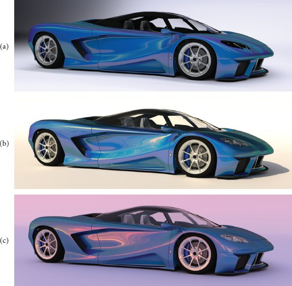

*Figure 12.16: Car model (a) illuminated with a few area lights, (b) illuminated with midday skylight from an environment map, (c) using a sunset environment map. (Model courtesy of Yasutoshi Mori.)*

## 12.5 INFINITE AREA LIGHTS

Another useful kind of light is an infinitely far-away area light source that surrounds the entire scene. One way to visualize this type of light is as an enormous sphere that casts light into the scene from every direction. One important use of infinite area lights is for environment lighting, where an image of the illumination in an environment is used to illuminate synthetic objects as if they were in that environment. Figure 12.16 compares illuminating a car model with standard area lights to illuminating it with two environment maps that simulate illumination from the sky at different times of day. The increase in realism is striking. pbrt provides three implementations of infinite area lights of progressive complexity. The first describes an infinite light with uniform emitted radiance; the second instead takes an image that represents the directional distribution of emitted radiance, and the third adds capabilities for culling parts of such images that are occluded at the reference point, which can substantially improve sampling efficiency.

### 12.5.1 UNIFORM INFINITE LIGHTS

A uniform infinite light source is fairly easy to implement; some of the details will be helpful for understanding the infinite light variants to follow.

〈UniformInfiniteLight Definition〉 ≡ class UniformInfiniteLight : public LightBase { public: 〈UniformInfiniteLight Public Methods〉 private: 〈UniformInfiniteLight Private Members 765〉 };

Emitted radiance is specified as usual by both a spectrum and a separate scale. (The straightforward constructor that initializes these is not included in the text.)

〈UniformInfiniteLight Private Members〉 ≡ 765

const DenselySampledSpectrum *Lemit; Float scale;

All the infinite light sources, including `UniformInfiniteLight`, store a bounding sphere of the scene that they use when computing their total power and for sampling rays leaving the light.

〈UniformInfiniteLight Private Members〉 +≡ 765

Point3f sceneCenter; Float sceneRadius;

Infinite lights must implement the following `Le()` method to return their emitted radiance for a given ray. Since the `UniformInfiniteLight` emits the same amount for all rays, the implementation is trivial.

〈UniformInfiniteLight Method Definitions〉 ≡ SampledSpectrum UniformInfiniteLight::Le(const Ray &ray, const SampledWavelengths &lambda) const { return scale * Lemit->Sample(lambda); }

We can see the use of the `allowIncompletePDF` parameter for the first time in the `SampleLi()` method. If it is true, then `UniformInfiniteLight` immediately returns an unset sample. (And its `PDF_Li()` method, described a bit later, will return a PDF of zero for all directions.) To understand why it is implemented in this way, consider the direct lighting integral

```text
   DenselySampledSpectrum 167
   DenselySampledSpectrum::Sample() 167
   Float 23
   LightBase 744
   Point3f 92
   Ray 95
   SampledSpectrum 171
   SampledWavelengths 173
   UniformInfiniteLight 765
   UniformInfiniteLight::Lemit 765
   UniformInfiniteLight::scale 765
```

For a uniform infinite light, the incident radiance function is a constant times the visibility term; the constant can be pulled out of the integral. There is no reason for the light to participate in sampling this integral, since `BSDF` sampling accounts for the remaining factors well. Furthermore, recall from Section 2.2.3 that multiple importance sampling (MIS) can increase variance when one of the sampling techniques is much more effective than the others. This is such a case, so as long as calling code is sampling the `BSDF` and using MIS, samples should not be generated here. (This is an application of MIS compensation, which was introduced in Section 2.2.3.)

〈UniformInfiniteLight Method Definitions〉 +≡ pstd::optional<LightLiSample> UniformInfiniteLight::SampleLi(LightSampleContext ctx, Point2f u, SampledWavelengths lambda, bool allowIncompletePDF) const { if (allowIncompletePDF) return {}; 〈Return uniform spherical sample for uniform infinite light 766〉 }

If sampling is to be performed, the light generates a sample so that valid Monte Carlo estimates can still be computed. This task is easy—all directions are sampled with uniform probability. Note that the endpoint of the shadow ray is set in the same way as it was by the `DistantLight`: by computing a point that is certainly outside of the scene’s bounds.

〈Return uniform spherical sample for uniform infinite light〉 ≡ 766

Vector3f wi = SampleUniformSphere(u); Float pdf = UniformSpherePDF(); return LightLiSample(scale * Lemit->Sample(lambda), wi, pdf, Interaction(ctx.p() + wi * (2 * sceneRadius), &mediumInterface));

The `PDF_Li()` method must account for the value of `allowIncompletePDF` so that the PDF values it returns are consistent with its sampling method.

〈UniformInfiniteLight Method Definitions〉 +≡ Float UniformInfiniteLight::PDF_Li(LightSampleContext ctx, Vector3f w, bool allowIncompletePDF) const { if (allowIncompletePDF) return 0; return UniformSpherePDF(); }

```text
    DenselySampledSpectrum::Sample() 167
    DistantLight 757
    DistantLight::Phi() 759
    Float 23
    Image 1079
    Interaction 136
    LightBase::mediumInterface 745
    LightLiSample 743
    LightSampleContext 741
    LightSampleContext::p() 742
    Pi 1033
    Point2f 92
    SampledSpectrum 171
    SampledWavelengths 173
    SampleUniformSphere() 1016
    UniformInfiniteLight::Lemit 765
    UniformInfiniteLight::scale 765
    UniformInfiniteLight::sceneRadius 765
    UniformSpherePDF() 1016
    Vector3f 86
```

The total power from an infinite light can be found by taking the product of the integral of the incident radiance over all directions times an integral over the area of the disk, along the lines of `DistantLight::Phi()`.

〈UniformInfiniteLight Method Definitions〉 +≡ SampledSpectrum UniformInfiniteLight::Phi(SampledWavelengths lambda) const { return 4 * Pi * Pi * Sqr(sceneRadius) * scale * Lemit->Sample(lambda); }

### 12.5.2 IMAGE INFINITE LIGHTS

`ImageInfiniteLight` is a useful infinite light variation that uses an `Image` to define the directional distribution of emitted radiance. Given an image that represents the distribution of incident radiance in a real-world environment (sometimes called an environment map), this light can be used to render objects under the same illumination, which is particularly useful for applications like visual effects for movies, where it is often necessary to composite rendered objects with film footage. (See the “Further Reading” section for information about techniques for capturing this lighting data from real-world environments.) Figure 12.17 shows the image radiance maps used in Figure 12.16.

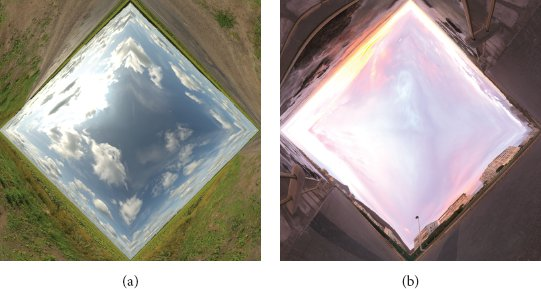

*Figure 12.17: Environment Maps Used for Illumination in Figure 12.16. All use the octahedral mapping and equal-area parameterization of the sphere from Section 3.8.3. (a) Midday and (b) sunset sky. (Midday environment map courtesy of Sergej Majboroda, sunset environment map courtesy of Greg Zaal, both via Poly Haven.)*

〈ImageInfiniteLight Definition〉 ≡ class ImageInfiniteLight : public LightBase { public: 〈ImageInfiniteLight Public Methods 768〉 private: 〈ImageInfiniteLight Private Methods 769〉 〈ImageInfiniteLight Private Members 767〉 };

The image that specifies the emission distribution should use the equal-area octahedral parameterization of directions that was defined in Section 3.8.3. The `LightBase::renderFromLight` transformation can be used to orient the environment map.

〈ImageInfiniteLight Private Members〉 ≡ 767

Image image; const RGBColorSpace *imageColorSpace; Float scale;

Like UniformInfiniteLights, ImageInfiniteLights also need the scene bounds; here again, the `Preprocess()` method (this one not included in the text) stores the scene’s bounding sphere after all the scene geometry has been created.

〈ImageInfiniteLight Private Members〉 +≡ 767

Point3f sceneCenter; Float sceneRadius;

```text
   Float 23
   Image 1079
   LightBase 744
   LightBase::renderFromLight 745
   Point3f 92
   RGBColorSpace 183
   UniformInfiniteLight 765
```

The `ImageInfiniteLight` constructor contains a fair amount of boilerplate code that we will skip past. (For example, it verifies that the provided image has channels named “R,” “G,” and “B” and issues an error if it does not.) The interesting parts of it are gathered in the following fragment.

〈ImageInfiniteLight constructor implementation〉 ≡ 〈Initialize sampling PDFs for image infinite area light 768〉 〈Initialize compensated PDF for image infinite area light 768〉

The image maps used with ImageInfiniteLights often have substantial variation along different directions: consider, for example, an environment map of the sky during daytime, where the relatively small number of directions that the sun subtends are thousands of times brighter than the rest of the directions. Therefore, implementing a sampling method for ImageInfiniteLights that matches the illumination distribution can significantly reduce variance in rendered images compared to sampling directions uniformly. To this end, the constructor initializes a `PiecewiseConstant2D` distribution that is proportional to the image pixel values.

〈Initialize sampling PDFs for image infinite area light〉 ≡ 768

```rust
   Array2D<Float> d = image.GetSamplingDistribution(); Bounds2f domain =
   Bounds2f(Point2f(0, 0), Point2f(1, 1)); distribution =
   PiecewiseConstant2D(d, domain, alloc);
```

〈ImageInfiniteLight Private Members〉 +≡ 767

PiecewiseConstant2D distribution;

A second sampling distribution is computed based on a thresholded version of the image where the average pixel value is subtracted from each pixel’s sampling weight. The use of both of these sampling distributions will be discussed in more detail shortly, with the implementation of the `SampleLi()` method.

〈Initialize compensated PDF for image infinite area light〉 ≡ 768

```rust
   Float average = std::accumulate(d.begin(), d.end(), 0.) / d.size(); for
   (Float &v : d) v = std::max<Float>(v - average, 0); compensatedDistribution
   = PiecewiseConstant2D(d, domain, alloc);
```

```text
   Array2D 1069
   Bounds2f 97
   EqualAreaSphereToSquare() 113
   Float 23
   Image::GetSamplingDistribution() 1085
   ImageInfiniteLight 767
   ImageInfiniteLight::compensatedDistribution 768
   ImageInfiniteLight::distribution 768
   ImageInfiniteLight::image 767
   ImageInfiniteLight::ImageLe() 769
   Light 740
   LightBase::renderFromLight 745
   PiecewiseConstant2D 1019
   Point2f 92
   Ray 95
   SampledSpectrum 171
   SampledWavelengths 173
   Vector3f 86
```

〈ImageInfiniteLight Private Members〉 +≡ 767

PiecewiseConstant2D compensatedDistribution;

Before we get to the sampling methods, we will provide an implementation of the `Le()` method that is required by the `Light` interface for infinite lights. After computing the 2D coordinates of the provided ray’s direction in image coordinates, it defers to the `ImageLe()` method.

〈ImageInfiniteLight Public Methods〉 ≡ 767

SampledSpectrum Le(const Ray &ray, const SampledWavelengths &lambda) const { Vector3f wLight = Normalize(renderFromLight.ApplyInverse(ray.d)); Point2f uv = EqualAreaSphereToSquare(wLight); return ImageLe(uv, lambda); }

`ImageLe()` returns the emitted radiance for a given point in the image.

〈ImageInfiniteLight Private Methods〉 ≡ 767

SampledSpectrum ImageLe(Point2f uv, const SampledWavelengths &lambda) const { RGB rgb; for (int c = 0; c < 3; ++c) rgb[c] = image.LookupNearestChannel(uv, c, WrapMode::OctahedralSphere); RGBIlluminantSpectrum spec(*imageColorSpace, ClampZero(rgb)); return scale * spec.Sample(lambda); }

There is a bit more work to do for sampling an incident direction at a reference point according to the light’s emitted radiance.

〈ImageInfiniteLight Public Methods〉 +≡ 767

pstd::optional<LightLiSample> SampleLi(LightSampleContext ctx, Point2f u, SampledWavelengths lambda, bool allowIncompletePDF) const { 〈Find (u, v) sample coordinates in infinite light texture 769〉 〈Convert infinite light sample point to direction 769〉 〈Compute PDF for sampled infinite light direction 770〉 〈Return radiance value for infinite light direction 770〉 }

```text
   EqualAreaSquareToSphere() 112
   Float 23
   Image::LookupNearestChannel() 1082
   ImageInfiniteLight::compensatedDistribution 768
   ImageInfiniteLight::distribution 768
   ImageInfiniteLight::image 767
   ImageInfiniteLight::imageColorSpace 767
   ImageInfiniteLight::scale 767
   LightBase::renderFromLight 745
   LightLiSample 743
   LightSampleContext 741
   PiecewiseConstant2D 1019
```

```text
   PiecewiseConstant2D::Sample() 1020
   Point2f 92
   RGB 182
   RGBIlluminantSpectrum 199
   RGBIlluminantSpectrum::Sample() 200
   SampledSpectrum 171
   SampledWavelengths 173
   Transform::operator() 130
   UniformInfiniteLight::SampleLi() 766
   Vector3f 86
   WrapMode::OctahedralSphere 1082
```

The first step is to generate an image sample with probability proportional to the image pixel values, which is a task that is handled by the `PiecewiseConstant2D` `Sample()` method. If `SampleLi()` is called with `allowIncompletePDF` being true, then the second sampling distribution that was based on the thresholded image is used. The motivation for doing so is the same as when `UniformInfiniteLight::SampleLi()` does not generate samples at all in that case: here, there is no reason to spend samples in parts of the image that have a relatively low contribution. It is better to let other sampling techniques (e.g., `BSDF` sampling) generate samples in those directions when they are actually important for the full function being integrated. Light samples are then allocated to the bright parts of the image, where they are more useful.

〈Find (u, v) sample coordinates in infinite light texture〉 ≡ 769

Float mapPDF = 0; Point2f uv; if (allowIncompletePDF) uv = compensatedDistribution.Sample(u, &mapPDF); else uv = distribution.Sample(u, &mapPDF); if (mapPDF == 0) return {};

It is a simple matter to convert from image coordinates to a rendering space direction `wi`.

〈Convert infinite light sample point to direction〉 ≡ 769

Vector3f wLight = EqualAreaSquareToSphere(uv); Vector3f wi = renderFromLight(wLight);

The PDF returned by `PiecewiseConstant2D::Sample()` is with respect to the image’s [0, 1]2 domain. To find the corresponding PDF with respect to direction, the change of variables factor for going from the unit square to the unit sphere 1/(4π) must be applied.

〈Compute PDF for sampled infinite light direction〉 ≡ 769

Float pdf = mapPDF / (4 * Pi);

Finally, as with the `DistantLight` and `UniformInfiniteLight`, the second point for the shadow ray is found by offsetting along the `wi` direction far enough until that resulting point is certainly outside of the scene’s bounds.

〈Return radiance value for infinite light direction〉 ≡ 769

return LightLiSample(ImageLe(uv, lambda), wi, pdf, Interaction(ctx.p() + wi * (2 * sceneRadius), &mediumInterface));

*Figure 12.18 illustrates how much error is reduced by sampling image infinite lights well. It compares three images of a dragon model illuminated by the morning skylight environment map from Figure 12.17. The first image was rendered using a simple uniform spherical sampling distribution for selecting incident illumination directions, the second used the full image-based sampling distribution, and the third used the compensated distribution—all rendered with 32 samples per pixel. For the same number of samples taken and with negligible additional computational cost, both importance sampling methods give a much better result with much lower variance. Most of the work to compute the PDF for a provided direction is handled by the `PiecewiseConstant2D` distribution. Here as well, the PDF value it returns is divided by 4π to account for the area of the unit sphere.*

```text
   DistantLight 757
   EqualAreaSphereToSquare() 113
   Float 23
   ImageInfiniteLight 767
   ImageInfiniteLight::compensatedDistribution 768
   ImageInfiniteLight::distribution 768
   ImageInfiniteLight::ImageLe() 769
   ImageInfiniteLight::sceneRadius 767
   Interaction 136
   LightBase::mediumInterface 745
   LightBase::renderFromLight 745
   LightLiSample 743
   LightSampleContext 741
   LightSampleContext::p() 742
   Pi 1033
```

```text
    PiecewiseConstant2D 1019
    PiecewiseConstant2D::PDF() 1021
    PiecewiseConstant2D::Sample() 1020
    Point2f 92
    Transform::ApplyInverse() 130
    UniformInfiniteLight 765
    Vector3f 86
```

〈ImageInfiniteLight Method Definitions〉 ≡ Float ImageInfiniteLight::PDF_Li(LightSampleContext ctx, Vector3f w, bool allowIncompletePDF) const { Vector3f wLight = renderFromLight.ApplyInverse(w); Point2f uv = EqualAreaSphereToSquare(wLight); Float pdf = 0; if (allowIncompletePDF) pdf = compensatedDistribution.PDF(uv); else pdf = distribution.PDF(uv); return pdf / (4 * Pi); }

The `ImageInfiniteLight::Phi()` method, not included here, integrates incident radiance over the sphere by looping over all the image pixels and summing them before multiplying by a factor of 4π to account for the area of the unit sphere as well as by the area of a disk of radius `sceneRadius`.

⋆ 12.5.3 PORTAL IMAGE INFINITE LIGHTS

ImageInfiniteLights provide a handy sort of light source, though one shortcoming of that class’s implementation is that it does not account for visibility in its sampling routines. Samples that it generates that turn out to be occluded are much less useful than those that do carry illumination to the reference point. While the expense of ray tracing is necessary to fully account for visibility, accounting for even some visibility effects in light sampling can significantly reduce error.

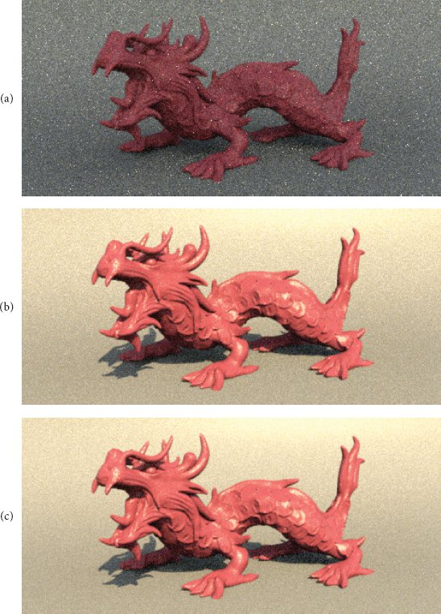

*Figure 12.18: Dragon Model Illuminated by the Morning Skylight Environment Map. All images were rendered with 32 samples per pixel. (a) Rendered using a uniform sampling distribution. (b) Rendered with samples distributed according to environment map image pixels. (c) Rendered using the compensated distribution that skips sampling unimportant parts of the image. All images took essentially the same amount of time to render, though (b) has over 38,000 times lower MSE than (a), and (c) further improves MSE by a factor of 1.52. (Dragon model courtesy of the Stanford Computer Graphics Laboratory.)*

Consider the scene shown in Figure 12.19, where all the illumination is coming from a skylight environment map that is visible only through the windows. Part of the scene is directly illuminated by the sun, but much of it is not. Those other parts are still illuminated, but by much less bright regions of blue sky. Yet because the sun is so bright, the `ImageInfiniteLight` ends up taking many samples in its direction, though all the ones where the sun is not visible through the window will be wasted. In those regions of the scene, light sampling will occasionally choose a part of the sky that is visible through the window and occasionally `BSDF` sampling will find a path to the light through the window, so that the result is still correct in expectation, but many samples may be necessary to achieve a high-quality result.

```text
   ImageInfiniteLight 767
```


*Figure 12.19: Watercolor Scene Illuminated by a Daytime Sky Environment Map. This is a challenging scene to render since the direct lighting calculation only finds illumination when it samples a ray that passes through the window. (a) When rendered with the `ImageInfiniteLight` and 16 samples per pixel, error is high because the environment map includes a bright sun, though it does not illuminate all parts of the room. For such points, none of the many samples taken toward the sun has any contribution. (b) When rendered using the `PortalImageInfiniteLight`, results are much better with the same number of samples because the light is able to sample just the part of the environment map that is visible through the window. In this case, MSE is reduced by a factor of 2.82. (Scene courtesy of Angelo Ferretti.)*

```text
   ImageInfiniteLight 767
   PortalImageInfiniteLight 773
```

The `PortalImageInfiniteLight` is designed to handle this situation more effectively. Given a user-specified portal, a quadrilateral region through which the environment map is potentially visible, it generates a custom sampling distribution at each point being shaded so that it can draw samples according to the region of the environment map that is visible through the portal. For an equal number of samples, this can be much more effective than the `ImageInfiniteLight`’s approach, as shown in Figure 12.19(b).

〈PortalImageInfiniteLight Definition〉 ≡ class PortalImageInfiniteLight : public LightBase { public: 〈PortalImageInfiniteLight Public Methods〉 private: 〈PortalImageInfiniteLight Private Methods 775〉 〈PortalImageInfiniteLight Private Members 776〉 };

Given a portal and a point in the scene, there is a set of directions from that point that pass through the portal. If we can find the corresponding region of the environment map, then our task is to sample from it according to the environment map’s emission. This idea is illustrated in Figure 12.20. With the equal-area mapping, the shape of the visible region of the environment map seen from a given point can be complex. The problem is illustrated in Figure 12.21(a), which visualizes the visible regions from two points in the scene from Figure 12.19. The `PortalImageInfiniteLight` therefore uses a different parameterization of directions that causes the visible region seen through a portal to always be rectangular. Later in this section, we will see how this property makes efficient sampling possible. The directional parameterization used by the `PortalImageInfiniteLight` is based on a coordinate system where the x and y axes are aligned with the edges of the portal. Note that the position of the portal is not used in defining this coordinate system—only the directions of its edges. As a first indication that this idea is getting us somewhere, consider the vectors from a point in the scene to the four corners of the portal, transformed into this coordinate system.

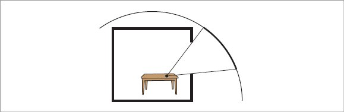

*Figure 12.20: Given a scene with a portal (opening in the box), for each point in the scene we can find the set of directions that pass through the portal. To sample illumination efficiently, we would like to only sample from the corresponding visible region of the environment map (thick segment on the sphere).*

```text
   ImageInfiniteLight 767
   LightBase 744
```

```text
   PortalImageInfiniteLight 773
```


*Figure 12.21: Shapes of Visible Regions of an Environment Map as Seen through a Portal. These images illustrate the visible regions of the environment map as seen through the window for a point on the floor and a point on one of the paintings on the wall for the scene in Figure 12.19. (a) The equal-area mapping used by the `ImageInfiniteLight` is convenient for sampling the entire environment map, but it leads to the portal-visible regions having complex shapes. (b) With the directional parameterization used by the `PortalImageInfiniteLight`, the visible region is always rectangular, which makes it feasible to sample from just that part of it. (Environment map courtesy of Sergej Majboroda, via Poly Haven.)*

It should be evident that in this coordinate system, vectors to adjacent vertices of the portal only differ in one of their x or y coordinate values and that the four directions thus span a rectangular region in xy. (If this is not clear, it is a detail worth pausing to work through.) We will term directional representations that have this property as rectified. The xy components of vectors in this coordinate system still span (−∞, ∞), so it is necessary to map them to a finite 2D domain if the environment map is to be represented using an image. It is important that this mapping does not interfere with the axis-alignment of the portal edges and that rectification is preserved. This requirement rules out a number of possibilities, including both the equirectangular and equal-area mappings. Even normalizing a vector and taking the x and y coordinates of the resulting unit vector is unsuitable given this requirement.

A mapping that does work is based on the angles α and β that the x and y coordinates of the vector respectively make with the z axis, as illustrated in Figure 12.22. These angles are given by

We can ignore vectors with negative z components in the rectified coordinate system: they face away from the portal and thus do not receive any illumination. Each of α and β then spans the range [–π/2, π/2] and the pair of them can be easily mapped to [0, 1]2 (u, v) image coordinates. The environment map resampled into this parameterization is shown in Figure 12.21(b), with the visible regions for the same two points in the scene indicated. We will start the implementation of the `PortalImageInfiniteLight` with its `ImageFromRender()` method, which applies this mapping to a vector in the rendering coordinate system `wRender`. (We will come to the initialization of the `portalFrame` member variable in the `PortalImageInfiniteLight` constructor later in this section.) It uses `pstd::optional` for the return value in order to be able to return an invalid result in the case that the vector is coplanar with the portal or facing away from it.

```text
   ImageInfiniteLight 767
   PortalImageInfiniteLight 773
```

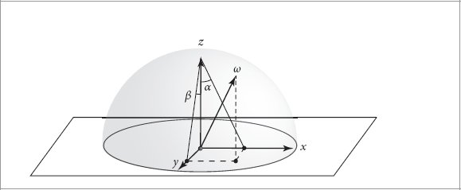

*Figure 12.22: Vectors in the portal’s coordinate system can be represented by a pair of angles (α, β) that measure the angle made by the x or y component, respectively, with the z axis.*

〈PortalImageInfiniteLight Private Methods〉 ≡ 773

pstd::optional<Point2f> ImageFromRender(Vector3f wRender, Float *duv_dw = nullptr) const { Vector3f w = portalFrame.ToLocal(wRender); if (w.z <= 0) return {}; 〈Compute Jacobian determinant of mapping d(u, v)/dω if needed 775〉 Float alpha = std::atan2(w.x, w.z), beta = std::atan2(w.y, w.z); return Point2f(Clamp((alpha + Pi / 2) / Pi, 0, 1), Clamp((beta + Pi / 2) / Pi, 0, 1)); }

We will find it useful to be able to convert sampling densities from the (u, v) parameterization of the image to be with respect to solid angle on the unit sphere. The appropriate factor can be found following the usual approach of computing the determinant of the Jacobian of the mapping function, which is based on Equation (12.1), and then rescaling the coordinates to image coordinates in [0, 1]2. The result is a simple expression when expressed in terms of ω:

```text
   Clamp() 1033
   Float 23
   Frame::ToLocal() 134
   Pi 1033
   Point2f 92
   PortalImageInfiniteLight::portalFrame 776
```

```text
   Sqr() 1034
   Vector3f 86
```

If a non-nullptr `duv_dw` parameter is passed to this method, this factor is returned.

〈Compute Jacobian determinant of mapping d(u, v)/dω if needed〉 ≡ 775, 776

if (duv_dw) *duv_dw = Sqr(Pi) * (1 - Sqr(w.x)) * (1 - Sqr(w.y)) / w.z;

The inverse transformation can be found by working in reverse. It is implemented in `RenderFromImage()`, which also optionally returns the same change of variables factor.

〈PortalImageInfiniteLight Private Methods〉 +≡ 773

Vector3f RenderFromImage(Point2f uv, Float *duv_dw = nullptr) const { Float alpha = -Pi / 2 + uv[0] * Pi, beta = -Pi / 2 + uv[1] * Pi; Float x = std::tan(alpha), y = std::tan(beta); Vector3f w = Normalize(Vector3f(x, y, 1)); 〈Compute Jacobian determinant of mapping d(u, v)/dω if needed 775〉 return portalFrame.FromLocal(w); }

Because the mapping is rectified, we can find the image-space bounding box of the visible region of the environment map from a given point using the coordinates of two opposite portal corners. This method also returns an optional value, for the same reasons as for `ImageFromRender()`.

〈PortalImageInfiniteLight Private Methods〉 +≡ 773

pstd::optional<Bounds2f> ImageBounds(Point3f p) const { pstd::optional<Point2f> p0 = ImageFromRender(Normalize(portal[0] - p)); pstd::optional<Point2f> p1 = ImageFromRender(Normalize(portal[2] - p)); if (!p0 || !p1) return {}; return Bounds2f(*p0, *p1); }

Most of the `PortalImageInfiniteLight` constructor consists of straightforward initialization of member variables from provided parameter values, checking that the provided image has RGB channels, and so forth. All of that has not been included in this text. We will, however, discuss the following three fragments, which run at the end of the constructor.

〈PortalImageInfiniteLight constructor conclusion〉 ≡ 〈Compute frame for portal coordinate system 776〉 〈Resample environment map into rectified image 777〉

〈Initialize sampling distribution for portal image infinite light 778〉

The portal itself is specified by four vertices, given in the rendering coordinate system. Additional code, not shown here, checks to ensure that they describe a planar quadrilateral. A `Frame` for the portal’s coordinate system can be found from two normalized adjacent edge vectors of the portal using the `Frame::FromXY()` method.

```text
   Bounds2f 97
   Float 23
   Frame 133
   Frame::FromLocal() 134
   Frame::FromXY() 134
   Normalize() 88
   Pi 1033
   Point2f 92
   Point3f 92
   PortalImageInfiniteLight::ImageFromRender() 775
   PortalImageInfiniteLight::portal 776
   PortalImageInfiniteLight::portalFrame 776
   Vector3f 86
```

〈Compute frame for portal coordinate system〉 ≡ 776

Vector3f p01 = Normalize(portal[1] - portal[0]); Vector3f p03 = Normalize(portal[3] - portal[0]); portalFrame = Frame::FromXY(p03, p01);

〈PortalImageInfiniteLight Private Members〉 ≡ 773

pstd::array<Point3f, 4> portal; Frame portalFrame;

The constructor also resamples a provided equal-area image into the rectified representation at the same resolution. Because the rectified image depends on the geometry of the portal, it is better to take an equal-area image and resample it in the constructor than to require the user to provide an already-rectified image. In this way, it is easy for the user to change the portal specification just by changing the portal’s coordinates in the scene description file.

〈Resample environment map into rectified image〉 ≡ 776

image = Image(PixelFormat::Float, equalAreaImage.Resolution(), {"R", "G", "B"}, equalAreaImage.Encoding(), alloc); ParallelFor(0, image.Resolution().y, [&](int y) { for (int x = 0; x < image.Resolution().x; ++x) {

```rust
                〈Resample equalAreaImage to compute rectified image pixel (x, y) 777〉
         }
   });
```

〈PortalImageInfiniteLight Private Members〉 +≡ 773

Image image;

At each rectified image pixel, the implementation first computes the corresponding light-space direction and looks up a bilinearly interpolated value from the equal-area image. No further filtering is performed. A better implementation would use a spatially varying filter here in order to ensure that there was no risk of introducing aliasing due to undersampling the source image.

〈Resample equalAreaImage to compute rectified image pixel (x, y)〉 ≡ 777

〈Find (u, v) coordinates in equal-area image for pixel 777〉 for (int c = 0; c < 3; ++c) { Float v = equalAreaImage.BilerpChannel(uvEqui, c, WrapMode::OctahedralSphere); image.SetChannel({x, y}, c, v); }

The image coordinates in the equal-area image can be found by determining the direction vector corresponding to the current pixel in the rectified image and then finding the equal-area image coordinates that this direction maps to.

```text
   EqualAreaSphereToSquare() 113
   Float 23
   Image 1079
   Image::BilerpChannel() 1082
   Image::Encoding() 1080
   Image::Resolution() 1080
   Image::SetChannel() 1083
   LightBase::renderFromLight 745
   Normalize() 88
   ParallelFor() 1107
   PiecewiseConstant2D 1019
   PixelFormat::Float 1080
   Point2f 92
   PortalImageInfiniteLight::RenderFromImage() 776
   Transform::ApplyInverse() 130
   Vector3f 86
   WindowedPiecewiseConstant2D 1025
   WrapMode::OctahedralSphere 1082
```

〈Find (u, v) coordinates in equal-area image for pixel〉 ≡ 777

Point2f uv((x + 0.5f) / image.Resolution().x, (y + 0.5f) / image.Resolution().y); Vector3f w = RenderFromImage(uv); w = Normalize(renderFromLight.ApplyInverse(w)); Point2f uvEqui = EqualAreaSphereToSquare(w);

Given the rectified image, the next step is to initialize an instance of the `WindowedPiecewiseConstant2D` data structure, which performs the sampling operation. (It is defined in Section A.5.6.) As its name suggests, it generalizes the functionality of the `PiecewiseConstant2D` class to allow a caller-specified window that limits the sampling region. It is worthwhile to include the change of variables factor d(u, v)/dω at each pixel in the image sampling distribution. Doing so causes the weights associated with image samples to be more uniform, as this factor will nearly cancel the same factor when a sample’s PDF is computed. (The cancellation is not exact, as the factor here is computed at the center of each pixel while in the PDF it is computed at the exact sample location.)

〈Initialize sampling distribution for portal image infinite light〉 ≡ 776

```rust
   auto duv_dw = [&](Point2f p) {
         Float duv_dw; (void)RenderFromImage(p, &duv_dw); return duv_dw; };
   Array2D<Float> d = image.GetSamplingDistribution(duv_dw); distribution =
   WindowedPiecewiseConstant2D(d, alloc);
```

〈PortalImageInfiniteLight Private Members〉 +≡ 773

WindowedPiecewiseConstant2D distribution;

The light’s total power can be found by integrating radiance over the hemisphere of directions that can be seen through the portal and then multiplying by the portal’s area, since all light that reaches the scene passes through it. The corresponding `PortalImageInfiniteLight::Phi()` method is not included here, as it boils down to being a matter of looping over the pixels, applying the change of variables factor to account for integration over the unit sphere, and then multiplying the integrated radiance by the portal’s area.

```text
   Array2D 1069
   Bounds2::Inside() 100
   Bounds2f 97
   Float 23
```

```text
   Image::GetSamplingDistribution() 1085
   Image::LookupNearestChannel() 1082
   Normalize() 88
   Point2f 92
   PortalImageInfiniteLight::distribution 778
   PortalImageInfiniteLight::ImageBounds() 776
   PortalImageInfiniteLight::imageColorSpace 779
   PortalImageInfiniteLight::ImageFromRender() 775
   PortalImageInfiniteLight::ImageLookup() 778
   PortalImageInfiniteLight::RenderFromImage() 776
   PortalImageInfiniteLight::scale 779
   Ray 95
   Ray::d 95
   Ray::o 95
   RGB 182
   RGBIlluminantSpectrum 199
   RGBIlluminantSpectrum::Sample() 200
   SampledSpectrum 171
   SampledWavelengths 173
   WindowedPiecewiseConstant2D 1025
```

In order to compute the radiance for a ray that has left the scene, the (u, v) coordinates in the image corresponding to the ray’s direction are computed first. The radiance corresponding to those coordinates is returned if they are inside the portal bounds for the ray origin, and a zero-valued spectrum is returned otherwise. (In principle, the `Le()` method should only be called for rays that have left the scene, so that the portal check should always pass, but it is worth including for the occasional ray that escapes the scene due to a geometric error in the scene model. This way, those end up carrying no radiance rather than causing a light leak.)

〈PortalImageInfiniteLight Method Definitions〉 ≡ SampledSpectrum PortalImageInfiniteLight::Le(const Ray &ray, const SampledWavelengths &lambda) const { pstd::optional<Point2f> uv = ImageFromRender(Normalize(ray.d)); pstd::optional<Bounds2f> b = ImageBounds(ray.o); if (!uv || !b || !Inside(*uv, *b)) return SampledSpectrum(0.f); return ImageLookup(*uv, lambda); }

The `ImageLookup()` method returns the radiance at the given image (u, v) and wavelengths. We encapsulate this functionality in its own method, as it will be useful repeatedly in the remainder of the light’s implementation.

〈PortalImageInfiniteLight Method Definitions〉 +≡ SampledSpectrum PortalImageInfiniteLight::ImageLookup(Point2f uv, const SampledWavelengths &lambda) const { RGB rgb; for (int c = 0; c < 3; ++c) rgb[c] = image.LookupNearestChannel(uv, c); RGBIlluminantSpectrum spec(*imageColorSpace, ClampZero(rgb)); return scale * spec.Sample(lambda); }

As before, the image’s color space must be known in order to convert its RGB values to spectra.

〈PortalImageInfiniteLight Private Members〉 +≡ 773

const RGBColorSpace *imageColorSpace; Float scale;

`SampleLi()` is able to take advantage of the combination of the rectified image representation and the ability of `WindowedPiecewiseConstant2D` to sample a direction from the specified point that passes through the portal, according to the directional distribution of radiance over the portal.

〈PortalImageInfiniteLight Method Definitions〉 +≡ pstd::optional<LightLiSample> PortalImageInfiniteLight::SampleLi(LightSampleContext ctx, Point2f u, SampledWavelengths lambda, bool allowIncompletePDF) const { 〈Sample (u, v) in potentially visible region of light image 779〉 〈Convert portal image sample point to direction and compute PDF 779〉 〈Compute radiance for portal light sample and return LightLiSample 779〉 }

`WindowedPiecewiseConstant2D`’s `Sample()` method takes a `Bounds2f` to specify the sampling region. This is easily provided using the `ImageBounds()` method. It may not be able to generate a valid sample—for example, if the point is on the outside of the portal or lies on its plane. In this case, an unset sample is returned.

〈Sample (u, v) in potentially visible region of light image〉 ≡ 779

pstd::optional<Bounds2f> b = ImageBounds(ctx.p()); if (!b) return {}; Float mapPDF; pstd::optional<Point2f> uv = distribution.Sample(u, *b, &mapPDF); if (!uv) return {};

```text
   Bounds2f 97
   Float 23
   Interaction 136
   LightBase::mediumInterface 745
   LightLiSample 743
   LightSampleContext 741
   LightSampleContext::p() 742
   Point2f 92
   Point3f 92
   PortalImageInfiniteLight::distribution 778
   PortalImageInfiniteLight::ImageBounds() 776
   PortalImageInfiniteLight::ImageLookup() 778
   PortalImageInfiniteLight::RenderFromImage() 776
   PortalImageInfiniteLight::sceneRadius 779
   RGBColorSpace 183
   SampledSpectrum 171
   SampledWavelengths 173
   Vector3f 86
   WindowedPiecewiseConstant2D 1025
   WindowedPiecewiseConstant2D::Sample() 1026
```

After image (u, v) coordinates are converted to a direction, the method computes the sampling PDF with respect to solid angle at the reference point represented by `ctx`. Doing so just requires the application of the change of variables factor returned by `RenderFromImage()`.

〈Convert portal image sample point to direction and compute PDF〉 ≡ 779

Float duv_dw; Vector3f wi = RenderFromImage(*uv, &duv_dw); if (duv_dw == 0) return {}; Float pdf = mapPDF / duv_dw;

The remaining pieces are easy at this point: `ImageLookup()` provides the radiance for the sampled direction and the endpoint of the shadow ray is found in the same way that is done for the other infinite lights.

〈Compute radiance for portal light sample and return LightLiSample〉 ≡ 779

SampledSpectrum L = ImageLookup(*uv, lambda); Point3f pl = ctx.p() + 2 * sceneRadius * wi; return LightLiSample(L, wi, pdf, Interaction(pl, &mediumInterface));

Also as with the other infinite lights, the radius of the scene’s bounding sphere is stored when the `Preprocess()` method, not included here, is called.

〈PortalImageInfiniteLight Private Members〉 +≡ 773

Float sceneRadius;

Finding the PDF for a specified direction follows the way in which the PDF was calculated in the sampling method. 〈PortalImageInfiniteLight Method Definitions〉 +≡ Float PortalImageInfiniteLight::PDF_Li(LightSampleContext ctx, Vector3f w, bool allowIncompletePDF) const { 〈Find image (u, v) coordinates corresponding to direction w 780〉 〈Return PDF for sampling (u, v) from reference point 780〉 }

First, `ImageFromRender()` gives the (u, v) coordinates in the portal image for the specified direction.

〈Find image (u, v) coordinates corresponding to direction w〉 ≡ 780

Float duv_dw; pstd::optional<Point2f> uv = ImageFromRender(w, &duv_dw); if (!uv || duv_dw == 0) return 0;

Following its `Sample()` method, the `WindowedPiecewiseConstant2D::PDF()` method also takes a 2D bounding box to window the function. The PDF value it returns is normalized with respect to those bounds and a value of zero is returned if the given point is outside of them. Application of the change of variables factor gives the final PDF with respect to solid angle.

〈Return PDF for sampling (u, v) from reference point〉 ≡ 780

pstd::optional<Bounds2f> b = ImageBounds(ctx.p()); if (!b) return 0; Float pdf = distribution.PDF(*uv, *b); return pdf / duv_dw;

## 12.6 LIGHT SAMPLING

Due to the linearity assumption in radiometry, illumination at a point in a scene with multiple light sources can be computed by summing the independent contributions of each light. As we have seen before, however, correctness alone is not always sufficient—if it were, we might have sampled ImageInfiniteLights uniformly with the suggestion that one take thousands of samples per pixel until error has been reduced sufficiently. Especially in scenes with thousands or more independent light sources, considering all of them carries too much of a performance cost.

```text
    Bounds2f 97
    Float 23
    ImageInfiniteLight 767
    LightSampleContext 741
    LightSampleContext::p() 742
    Point2f 92
    PortalImageInfiniteLight::ImageBounds() 776
    PortalImageInfiniteLight::ImageFromRender() 775
    Vector3f 86
    WindowedPiecewiseConstant2D::PDF() 1028
```

Fortunately, here, too, is a setting where stochastic sampling can be applied. An unbiased estimator for a sum of terms fi is given by where the probability mass function (PMF) p(j) > 0 for any term where fj is nonzero and where j ~ p. This is the discrete analog to the integral Monte Carlo estimator, Equation (2.7). Therefore, we can replace any sum over all the scene’s light sources with a sum over just one or a few of them, where the contributions are weighted by one over the probability of sampling the ones selected.

*Figure 12.23 is a rendered image of a scene with 8,878 light sources. A few observations motivate some of the light sampling algorithms to come. At any given point in the scene, some lights are facing away and others are occluded. Ideally, such lights would be given a zero sampling probability. Furthermore, often many lights are both far away from a given point and have relatively low power; such lights should have a low probability of being sampled. (Consider, for example, the small yellow lights inset in the machinery.) Of course, even a small and dim light is important to points close to it. Therefore, the most effective light sampling probabilities will vary across the scene depending on position, surface normal, the `BSDF`, and so forth.*


*Figure 12.23: Zero Day Scene, with 8,878 Light Sources. It is infeasible to consider every light when computing reflected radiance at a point on a surface, and therefore light sampling methods from this section are necessary to render this scene efficiently. (Scene courtesy of Beeple.)*

The `LightSampler` class defines the `LightSampler` interface for sampling light sources.2 It is defined in the file `base/lightsampler.h`. `LightSampler` implementations can be found in `lightsamplers.h` and `lightsamplers.cpp`.

〈LightSampler Definition〉 ≡ class LightSampler : public TaggedPointer<UniformLightSampler, PowerLightSampler, BVHLightSampler> { public: 〈LightSampler Interface 781〉 };

The key `LightSampler` method is `Sample()`, which takes a uniform 1D sample and information about a reference point in the form of a `LightSampleContext`. When sampling is successful, a `SampledLight` is returned. Otherwise, the optional value is left unset, as may happen if the light sampler is able to determine that no lights illuminate the provided point.

〈LightSampler Interface〉 ≡ 781

```rust
   pstd::optional<SampledLight> Sample(const LightSampleContext &ctx, Float u)
   const;
```

```text
    BVHLightSampler 796
    Float 23
    LightSampleContext 741
    PowerLightSampler 783
    SampledLight 782
    TaggedPointer 1073
```

```text
    UniformLightSampler 782
```

`SampledLight` just wraps up a light and the discrete probability for it having been sampled.

〈SampledLight Definition〉 ≡ struct SampledLight { Light light; Float p = 0; };

In order to compute the MIS weighting term when a ray happens to hit a light source, it is necessary to be able to find the value of the probability mass function for sampling a particular light. This task is handled by `PMF()` method implementations.

〈LightSampler Interface〉 +≡ 781

```rust
   Float PMF(const LightSampleContext &ctx, Light light) const;
```

LightSamplers must also provide methods to sample a light and return the corresponding probability independent of a specific point being illuminated. These methods are useful for light transport algorithms like bidirectional path tracing that start paths at the light sources.

〈LightSampler Interface〉 +≡ 781

```rust
   pstd::optional<SampledLight> Sample(Float u) const; Float PMF(Light light)
   const;
```

### 12.6.1 UNIFORM LIGHT SAMPLING

`UniformLightSampler` is the simplest possible light sampler: it samples all lights with uniform probability. In practice, more sophisticated sampling algorithms are usually much more effective, but this one is easy to implement and provides a useful baseline for comparing light sampling techniques.

〈UniformLightSampler Definition〉 ≡ class UniformLightSampler { public: 〈UniformLightSampler Public Methods 782〉 private: 〈UniformLightSampler Private Members 782〉 };

As with all light samplers, an array of all the lights in the scene is provided to the constructor; `UniformLightSampler` makes a copy of them in a member variable.

〈UniformLightSampler Public Methods〉 ≡ 782

UniformLightSampler(pstd::span<const Light> lights, Allocator alloc) : lights(lights.begin(), lights.end(), alloc) {}

```text
    Allocator 40
    Float 23
```

```text
    Light 740
    LightSampleContext 741
    SampledLight 782
    UniformLightSampler 782
    UniformLightSampler::lights 782
```

〈UniformLightSampler Private Members〉 ≡ 782

pstd::vector<Light> lights;

Since the light sampling probabilities do not depend on the lookup point, we will only include the variants of `Sample()` and `PMF()` that do not take a `LightSampleContext` here. The versions of these methods that do take a context just call these variants. For sampling, a light is chosen by scaling the provided uniform sample by the array size and returning the corresponding light.

〈UniformLightSampler Public Methods〉 +≡ 782

pstd::optional<SampledLight> Sample(Float u) const { if (lights.empty()) return {}; int lightIndex = std::min<int>(u * lights.size(), lights.size() - 1); return SampledLight{lights[lightIndex], 1.f / lights.size()}; }

Given uniform sampling probabilities, the value of the PMF is always one over the number of lights.

〈UniformLightSampler Public Methods〉 +≡ 782

Float PMF(Light light) const { if (lights.empty()) return 0; return 1.f / lights.size(); }

### 12.6.2 POWER LIGHT SAMPLER

`PowerLightSampler` sets the probability for sampling each light according to its power. Doing so generally gives better results than sampling uniformly, but the lack of spatial variation in sampling probabilities limits its effectiveness. (We will return to this topic at the end of this section where some comparisons between the two techniques are presented.)

〈PowerLightSampler Definition〉 ≡ class PowerLightSampler { public: 〈PowerLightSampler Public Methods 784〉 private: 〈PowerLightSampler Private Members 783〉 };

Its constructor also makes a copy of the provided lights but initializes some additional data structures as well.

〈PowerLightSampler Method Definitions〉 ≡

PowerLightSampler::PowerLightSampler(pstd::span<const Light> lights, Allocator alloc) : lights(lights.begin(), lights.end(), alloc), lightToIndex(alloc), aliasTable(alloc) { if (lights.empty()) return; 〈Initialize lightToIndex hash table 783〉 〈Compute lights’ power and initialize alias table 784〉 }

```text
   Allocator 40
   Float 23
   Light 740
   PowerLightSampler 783
   PowerLightSampler::aliasTable 784
   PowerLightSampler::lights 783
   PowerLightSampler::lightToIndex 784
   SampledLight 782
   UniformLightSampler::lights 782
```

〈PowerLightSampler Private Members〉 ≡ 783

pstd::vector<Light> lights;

To efficiently return the value of the PMF for a given light, it is necessary to be able to find the index in the lights array of a given light. Therefore, the constructor also initializes a hash table that maps from Lights to indices.

〈Initialize lightToIndex hash table〉 ≡ 783

```rust
   for (size_t i = 0; i < lights.size(); ++i) lightToIndex.Insert(lights[i],
   i);
```

〈PowerLightSampler Private Members〉 +≡ 783

HashMap<Light, size_t> lightToIndex;

The `PowerLightSampler` uses an `AliasTable` for sampling. It is initialized here with weights based on the emitted power returned by each light’s `Phi()` method. Note that if the light’s emission distribution is spiky (e.g., as with many fluorescent lights), there is a risk of underestimating its power if a spike is missed. We have not found this to be a problem in practice, however.

〈Compute lights’ power and initialize alias table〉 ≡ 783

pstd::vector<Float> lightPower; SampledWavelengths lambda = SampledWavelengths::SampleVisible(0.5f); for (const auto &light : lights) { SampledSpectrum phi = SafeDiv(light.Phi(lambda), lambda.PDF()); lightPower.push_back(phi.Average()); } aliasTable = AliasTable(lightPower, alloc);

〈PowerLightSampler Private Members〉 +≡ 783

AliasTable aliasTable;

Given the alias table, sampling is easy.

〈PowerLightSampler Public Methods〉 ≡ 783

pstd::optional<SampledLight> Sample(Float u) const { if (!aliasTable.size()) return {}; Float pmf; int lightIndex = aliasTable.Sample(u, &pmf); return SampledLight{lights[lightIndex], pmf}; }

```text
   AliasTable 994
   AliasTable::PMF() 997
   AliasTable::Sample() 997
   Float 23
   HashMap 1069
   Light 740
   Light::Phi() 740
   LightSampleContext 741
   PowerLightSampler 783
   PowerLightSampler::aliasTable 784
   PowerLightSampler::lights 783
   PowerLightSampler::lightToIndex 784
   SampledLight 782
   SampledSpectrum 171
   SampledSpectrum::Average() 172
   SampledSpectrum::SafeDiv() 172
   SampledWavelengths 173
   SampledWavelengths::PDF() 174
   SampledWavelengths::SampleVisible() 241
   UniformLightSampler 782
```

To evaluate the PMF, the hash table gives the mapping to an index in the array of lights. In turn, the PMF returned by the alias table for the corresponding entry is the probability of sampling the light.

〈PowerLightSampler Public Methods〉 +≡ 783

Float PMF(Light light) const {

```rust
       if (!aliasTable.size()) return 0; return
       aliasTable.PMF(lightToIndex[light]); }
```

As with the `UniformLightSampler`, the `Sample()` and `PMF()` methods that do take a `LightSampleContext` just call the corresponding methods that do not take one. Sampling lights based on their power usually works well. Figure 12.24 compares both sampling methods using the Zero Day scene. For this scene, noise is visibly reduced when sampling according to power, and mean squared error (MSE) is improved by a factor of 12.4. Although sampling according to power generally works well, it is not optimal. Like uniform sampling, it is hindered by not taking the geometry of emitters and the relationship between emitters and the receiving point into account. Relatively dim light sources may make the greatest visual contribution in a scene, especially if the bright ones are far away, mostly occluded, or not visible at all. As an extreme example of this problem with sampling according to power, consider a large triangular light source that emits a small amount of radiance. The triangle’s emitted power can be made arbitrarily large by scaling it to increase its total area. However, at any point in the scene the triangle can do no more than subtend a hemisphere, which limits its effect on the total incident radiance at a point. Sampling by power can devote far too many samples to such lights.


*Figure 12.24: Sampling Lights Uniformly versus by Emitted Power with the Zero Day Scene. (a) Rendered with uniform light sampling. (b) Rendered with lights sampled according to power. Both images are rendered with 16 samples per pixel and rendering time is nearly the same. Sampling lights according to power reduces MSE by a factor of 12.4 for this scene. (Scene courtesy of Beeple.)*

⋆ 12.6.3 BVH LIGHT SAMPLING

Varying the light sampling probabilities based on the point being shaded can be an effective light sampling strategy, though if there are more than a handful of lights, some sort of data structure is necessary to do this without having to consider every light at each point being shaded. One widely used approach is to construct a hierarchy over the light sources with the effect of multiple lights aggregated into the higher nodes of the hierarchy. This representation makes it possible to traverse the hierarchy to find the important lights near a given point.

Given a good light hierarchy, it is possible to render scenes with hundreds of thousands or even millions of light sources nearly as efficiently as a scene with just one light. In this section, we will describe the implementation of the `BVHLightSampler`, which applies bounding volume hierarchies to this task.

```text
   BVHLightSampler 796
```

Bounding Lights When bounding volume hierarchies (BVHs) were used for intersection acceleration structures in Section 7.3, it was necessary to abstract away the details of the various types of primitives and underlying shapes that they stored so that the `BVHAggregate` did not have to be explicitly aware of each of them. There, the primitives’ rendering-space bounding boxes were used for building the hierarchy. Although there were cases where the quality of the acceleration structure might have been improved using shape-specific information (e.g., if the acceleration structure was aware of skinny diagonal triangles with large bounding boxes with respect to the triangle’s area), the `BVHAggregate`’s implementation was substantially simplified with that approach. We would like to have a similar decoupling for the `BVHLightSampler`, though it is less obvious what the right abstraction should be. For example, we might want to know that a spotlight only emits light in a particular cone, so that the sampler does not choose it for points outside the cone. Similarly, we might want to know that a one-sided area light only shines light on one side of a particular plane. For all sorts of lights, knowing their total power would be helpful so that brighter lights can be sampled preferentially to dimmer ones. Of course, power does not tell the whole story, as the light’s spatial extent and relationship to a receiving point affect how much power is potentially received at that point. The `LightBounds` structure provides the abstraction used by pbrt for these purposes. It stores a variety of values that make it possible to represent the emission distribution of a variety of types of light.

〈LightBounds Definition〉 ≡ class LightBounds { public: 〈LightBounds Public Methods 787〉 〈LightBounds Public Members 786〉 };

It is evident that the spatial bounds of the light and its emitted power will be useful quantities, so those are included in `LightBounds`. However, this representation excludes light sources at infinity such as the `DistantLight` and the various infinite lights. That limitation is fine, however, since it is unclear how such light sources would be stored in a BVH anyway. (The `BVHLightSampler` therefore handles these types of lights separately.)

〈LightBounds Public Members〉 ≡ 786

Bounds3f bounds; Float phi = 0;

As suggested earlier, bounding a light’s directional emission distribution is important for sampling lights effectively. The representation used here is based on a unit vector ω that specifies a principal direction for the emitter’s surface normal and two angles that specify its variation. First, θo specifies the maximum deviation of the emitter’s surface normal from the principal normal direction ω. Second, θe specifies the angle beyond θo up to which there may be emission (see Figure 12.25). Thus, directions that make an angle up to θo + θe with ω may receive illumination from a light and those that make a greater angle certainly do not.

```text
   Bounds3f 97
   BVHAggregate 407
   BVHLightSampler 796
   DistantLight 757
   Float 23
```

While this representation may seem overly specialized for emissive shapes alone, it works well for all of pbrt’s (noninfinite) light types. For example, a point light can be represented with an arbitrary average normal ω and an angle of π for θo. A spotlight can use the direction it is facing for ω, its central cone angle for θo, and the angular width of its falloff region for θe.

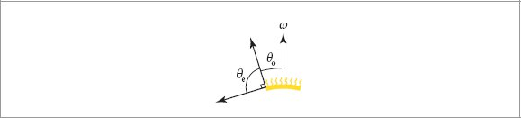

*Figure 12.25: Specification of Potential Emission Directions for a Light. Lights specify a principal direction of their distribution of surface normals ω as well as two angles, θo and θe. The first angle bounds the variation in surface normals from ω and the second gives the additional angle beyond which emission is possible.*

Our implementation stores the cosine of these angles rather than the angles themselves; this representation will make it possible to avoid the expense of evaluating a number of trigonometric functions in the following.

〈LightBounds Public Members〉 +≡ 786

Vector3f w; Float cosTheta_o, cosTheta_e;

The last part of the emission bounds for a light is a `twoSided` flag, which indicates whether the direction ω should be negated to specify a second cone that uses the same pair of angles.

〈LightBounds Public Members〉 +≡ 786

bool twoSided;

The `LightBounds` constructor takes corresponding parameters and initializes the member variables. The implementation is straightforward, and so is not included here.

〈LightBounds Public Methods〉 ≡ 786

LightBounds(const Bounds3f &b, Vector3f w, Float phi, Float cosTheta_o, Float cosTheta_e, bool twoSided);

To cluster lights into a hierarchy, we will need to be able to find the bounds that encompass two specified `LightBounds` objects. This capability is provided by the `Union()` function.

〈LightBounds Inline Methods〉 ≡

LightBounds Union(const LightBounds &a, const LightBounds &b) { 〈If one LightBounds has zero power, return the other 787〉 〈Find average direction and updated angles for LightBounds 788〉 〈Return final LightBounds union 788〉 }

It is worthwhile to start out by checking for the easy case of one or the other specified `LightBounds` having zero power. In this case, the other can be returned immediately.

〈If one LightBounds has zero power, return the other〉 ≡ 787

```rust
   if (a.phi == 0) return b; if (b.phi == 0) return a;
```

```text
   Bounds3f 97
   DirectionCone 114
   DirectionCone::Union() 116
   Float 23
   LightBounds 786
   LightBounds::phi 786
   Vector3f 86
```

Otherwise, a new average normal direction and updated angles θo and θe must be computed. Most of the work involved is handled by the `DirectionCone`’s `Union()` method, which takes a pair of cones of directions and returns one that bounds the two of them. The cosine of the new angle θo is then given by the cosine of the spread angle of that cone.

The value of θe should be the maximum of the θe values for the two cones. However, because `LightBounds` stores the cosines of the angles and because the cosine function is monotonically decreasing over the range of possible θ values, [0, π], we take the minimum cosine of the two angles.

〈Find average direction and updated angles for LightBounds〉 ≡ 787

DirectionCone cone = Union(DirectionCone(a.w, a.cosTheta_o), DirectionCone(b.w, b.cosTheta_o)); Float cosTheta_o = cone.cosTheta; Float cosTheta_e = std::min(a.cosTheta_e, b.cosTheta_e);

The remainder of the parameter values for the `LightBounds` constructor are easily computed from the two `LightBounds` that were provided.

〈Return final LightBounds union〉 ≡ 787

return LightBounds(Union(a.bounds, b.bounds), cone.w, a.phi + b.phi, cosTheta_o, cosTheta_e, a.twoSided | b.twoSided);

A utility method returns the centroid of the spatial bounds; this value will be handy when building the light BVH.

〈LightBounds Public Methods〉 +≡ 786

Point3f Centroid() const { return (bounds.pMin + bounds.pMax) / 2; }

The `Importance()` method provides the key `LightBounds` functionality: it returns a scalar value that estimates the contribution of the light or lights represented in the `LightBounds` at a given point. If the provided normal is nondegenerate, it is assumed to be the surface normal at the receiving point. Scattering points in participating media pass a zero-valued `Normal3f`.

〈LightBounds Method Definitions〉 ≡ Float LightBounds::Importance(Point3f p, Normal3f n) const { 〈Return importance for light bounds at reference point 788〉 }

It is necessary to make a number of assumptions in order to estimate the amount of light arriving at a point given a `LightBounds`. While it will be possible to make use of principles such as the received power falling off with the squared distance from the emitter or the incident irradiance at a surface varying according to Lambert’s law, some approximations are inevitable, given the loss of specifics that comes with adopting the `LightBounds` representation.

```text
   Bounds3::pMax 98
   Bounds3::pMin 98
   DirectionCone 114
   DirectionCone::cosTheta 114
   DirectionCone::Union() 116
   DirectionCone::w 114
   Float 23
```

```text
   LightBounds 786
   LightBounds::bounds 786
   LightBounds::cosTheta_e 787
   LightBounds::cosTheta_o 787
   LightBounds::phi 786
   LightBounds::twoSided 787
   LightBounds::w 787
   Normal3f 94
   Point3f 92
```

〈Return importance for light bounds at reference point〉 ≡ 788, 796

〈Compute clamped squared distance to reference point 789〉 〈Define cosine and sine clamped subtraction lambdas 789〉 〈Compute sine and cosine of angle to vector w, θw 790〉 〈Compute cos θb for reference point 790〉 〈Compute cos θ′ and test against cos θe 790〉 〈Return final importance at reference point 791〉

Even computing the squared distance for the falloff of received power is challenging if `bounds` is not degenerate: to which point in `bounds` should the distance be computed? It may seem that finding the minimum distance from the point p to the bounds would be a safe choice, though this would imply a very small distance for a point close to the bounds and a zero distance for a point inside it. Either of these would lead to a very large 1/r2 factor and potentially high error due to giving too much preference to such a `LightBounds`. Further, choosing between the two child `LightBounds` of a node when a point is inside both would be impossible, given infinite weights for each. Therefore, our first fudge is to compute the distance from the center of the bounding box but further to ensure that the squared distance is not too small with respect to the length of the diagonal of the bounding box. Thus, for larger bounding boxes with corresponding uncertainty about what the actual spatial distribution of emission is, the inverse squared distance factor cannot become too large.

〈Compute clamped squared distance to reference point〉 ≡ 788

Point3f pc = (bounds.pMin + bounds.pMax) / 2; Float d2 = DistanceSquared(p, pc); d2 = std::max(d2, Length(bounds.Diagonal()) / 2);

In the following computations, we will need to produce a series of values of the form cos(max(0, θa – θb)) and sin(max(0, θa – θb)). Given the sine and cosine of θa and θb, it is possible to do so without evaluating any trigonometric functions. To see how, consider the cosine: θa – θb < 0 implies that θa < θb and that therefore cos θa > cos θb. We thus start by checking that case and returning cos 0 = 1 if it is true. We are otherwise left with cos(θa – θb), which can be expressed in terms of the sines and cosines of the two angles using a trigonometric identity, cos θa cos θb + sin θa sin θb. The case for sine follows analogously. Two simple lambda functions provide these capabilities. (Only the one for cosine is included in the text, as `sinSubClamped` follows a similar form.)

〈Define cosine and sine clamped subtraction lambdas〉 ≡ 788

auto cosSubClamped = [](Float sinTheta_a, Float cosTheta_a, Float sinTheta_b, Float cosTheta_b) -> Float { if (cosTheta_a > cosTheta_b) return 1; return cosTheta_a * cosTheta_b + sinTheta_a * sinTheta_b; };

There are a number of angles involved in the importance computation. In addition to the ones that specify the directional emission bounds, θo and θe, we will start by computing the sine and cosine of θw, the angle between the principal normal direction and the vector from the center of the light bounds to the reference point (Figure 12.26(a)).

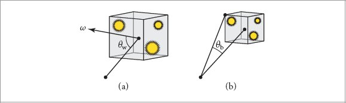

*Figure 12.26: (a) θw measures the angle between the principal normal direction ω and the vector from the center of the bounding box to the reference point. (b) θb is the angle that the `LightBounds`’s bounding box, `bounds`, subtends with respect to the reference point.*

```text
   Bounds3::Diagonal() 101
   Bounds3::pMax 98
   Bounds3::pMin 98
   DistanceSquared() 93
   Float 23
   Length() 88
   LightBounds::bounds 786
   Point3f 92
```

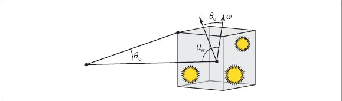

*Figure 12.27: θ′ is the minimum angle between the emitter and the vector to the reference point.*

〈Compute sine and cosine of angle to vector w, θw〉 ≡ 788

```rust
   Vector3f wi = Normalize(p - pc); Float cosTheta_w = Dot(Vector3f(w), wi); if
   (twoSided) cosTheta_w = std::abs(cosTheta_w); Float sinTheta_w = SafeSqrt(1
   - Sqr(cosTheta_w));
```

To bound the variation of various angles across the extent of the bounding box, we will also make use of the angle that the bounding box subtends with respect to the reference point (see Figure 12.26(b)). We will denote this angle θb. The preexisting `DirectionCone::BoundSubtendedDirections()` function takes care of computing its cosine. Its sine follows directly.

〈Compute cos θb for reference point〉 ≡ 788

```rust
   Float cosTheta_b = BoundSubtendedDirections(bounds, p).cosTheta; Float
   sinTheta_b = SafeSqrt(1 - Sqr(cosTheta_b));
```

The last angle we will use is the minimum angle between the emitter’s normal and the vector to the reference point. We will denote it by θ′, and it is given by θ′ = max(0, θw – θo – θb); see Figure 12.27. As with the other angles, we only need its sine and cosine, which can be computed one subtraction at a time. If this angle is greater than θe (or, here, if its cosine is less than cos θe), then it is certain that the lights represented by the bounds do not illuminate the reference point and an importance value of 0 can be returned immediately.

〈Compute cos θ′ and test against cos θe〉 ≡ 788

```rust
   Float sinTheta_o = SafeSqrt(1 - Sqr(cosTheta_o)); Float cosTheta_x =
       cosSubClamped(sinTheta_w, cosTheta_w, sinTheta_o, cosTheta_o); Float
       sinTheta_x =
       sinSubClamped(sinTheta_w, cosTheta_w, sinTheta_o, cosTheta_o); Float
       cosThetap =
       cosSubClamped(sinTheta_x, cosTheta_x, sinTheta_b, cosTheta_b); if
       (cosThetap <= cosTheta_e) return 0;
```

```text
   DirectionCone::BoundSubtendedDirections() 115
   DirectionCone::cosTheta 114
   Dot() 89
   Float 23
   LightBounds::bounds 786
   LightBounds::twoSided 787
   LightBounds::w 787
   Normalize() 88
   SafeSqrt() 1034
   Sqr() 1034
   Vector3f 86
```

The importance value can now be computed. It starts with the product of the power of the lights, the cos θ′ factor that accounts for the cosine at the emitter, and the inverse squared distance.

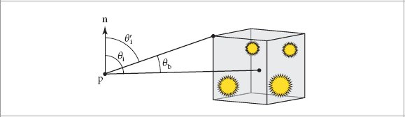

*Figure 12.28: An angle that gives a lower bound on the angle between the incident lighting direction and the surface normal can be found by subtracting θb, the angle that the bounding box subtends with respect to the reference point p, from θi, the angle between the surface normal and the vector to the center of the box.*

〈Return final importance at reference point〉 ≡ 788

Float importance = phi * cosThetap / d2; 〈Account for cos θi in importance at surfaces 791〉 return importance;

At a surface, the importance also accounts for a conservative estimate of the incident cosine factor there. We have wi, the unit vector from the reference point to the center of the `LightBounds`, but would like to conservatively set the importance based on the maximum value of the incident cosine over the entire bounding box. The corresponding minimum angle with the surface normal is given by max(0, θi – θb) (see Figure 12.28).

Our implementation of this computation uses the `cosSubClamped()` lambda function introduced earlier to compute the cosine of the angle directly using the sines and cosines of the two contributing angles.

〈Account for cos θi in importance at surfaces〉 ≡ 791

```rust
   if (n != Normal3f(0, 0, 0)) {
       Float cosTheta_i = AbsDot(wi, n); Float sinTheta_i = SafeSqrt(1 -
       Sqr(cosTheta_i)); Float cosThetap_i = cosSubClamped(sinTheta_i,
       cosTheta_i, sinTheta_b, cosTheta_b); importance *= cosThetap_i; }
```

Bounds for Light Implementations

Given the definition of `LightBounds`, we will add another method to the `Light` interface to allow lights to return bounds on their emission.

〈Light Interface〉 +≡ 740

pstd::optional<LightBounds> Bounds() const;

```text
   AbsDot() 90
   DistantLight 757
   Float 23
   ImageInfiniteLight 767
   Light 740
   LightBounds 786
   Normal3f 94
   PointLight 746
   PointLight::Phi() 748
   SafeSqrt() 1034
   Sqr() 1034
```

Lights at infinity return an unset optional value. Here, for example, is the implementation of this method for `ImageInfiniteLight`. The other infinite lights and the `DistantLight` do likewise.

〈ImageInfiniteLight Public Methods〉 +≡ 767

pstd::optional<LightBounds> Bounds() const { return {}; }

The `PointLight`’s implementation is just a few lines of code, as befitting the simplicity of that type of light source. The spatial bounds are given by the light’s rendering space position and the total emitted power is easily computed following the approach in `PointLight::Phi()`. Because this light shines in all directions, the average normal direction is arbitrary and θo is π, corresponding to the full sphere of directions.

〈PointLight Method Definitions〉 +≡ pstd::optional<LightBounds> PointLight::Bounds() const { Point3f p = renderFromLight(Point3f(0, 0, 0)); Float phi = 4 * Pi * scale * I->MaxValue(); return LightBounds(Bounds3f(p, p), Vector3f(0, 0, 1), phi, std::cos(Pi), std::cos(Pi / 2), false); }

The `SpotLight`’s bounding method is a bit more interesting: now the average normal vector is relevant; it is set here to be the light’s direction. The θo range is set to be the angular width of the inner cone of the light and θe corresponds to the width of its falloff at the edges. While this falloff does not exactly match the cosine-weighted falloff used in the `LightBounds::Importance()` method, it is close enough for these purposes. There is a subtlety in the computation of phi for this light: it is computed as if the light source was an isotropic point source and is not affected by the spotlight’s cone angle, like the computation in `SpotLight::Phi()` is. To understand the reason for this, consider two spotlights with the same radiant intensity, one with a very narrow cone and one with a wide cone, both illuminating some point in the scene. The total power emitted by the former is much less than the latter, though for a point inside both of their cones, both should be sampled with equal probability—effectively, the cone is accounted for in the light importance function and so should not be included in the phi value supplied here.

```text
   Bounds3f 97
   DiffuseAreaLight::shape 761
   DiffuseAreaLight::twoSided 761
   DirectionCone 114
   DirectionCone::cosTheta 114
   DirectionCone::w 114
   Float 23
   GoniometricLight 756
   LightBase::renderFromLight 745
   LightBounds 786
   LightBounds::Importance() 788
   Normalize() 88
   Pi 1033
   Point3f 92
   PointLight::I 747
   PointLight::scale 747
   ProjectionLight 751
   Shape::Bounds() 262
   Shape::NormalBounds() 262
   Spectrum::MaxValue() 166
   SpotLight 748
   SpotLight::cosFalloffEnd 749
   SpotLight::cosFalloffStart 749
```

```text
   SpotLight::Iemit 749
   SpotLight::Phi() 750
   SpotLight::scale 749
   Transform::operator() 130
   Vector3f 86
```

〈SpotLight Method Definitions〉 +≡ pstd::optional<LightBounds> SpotLight::Bounds() const { Point3f p = renderFromLight(Point3f(0, 0, 0)); Vector3f w = Normalize(renderFromLight(Vector3f(0, 0, 1))); Float phi = scale * Iemit->MaxValue() * 4 * Pi; Float cosTheta_e = std::cos(std::acos(cosFalloffEnd) - std::acos(cosFalloffStart)); return LightBounds(Bounds3f(p, p), w, phi, cosFalloffStart, cosTheta_e, false); }

We will skip past the implementations of the `ProjectionLight` and `GoniometricLight` `Bounds()` methods, which are along similar lines.

The `DiffuseAreaLight`’s `Bounds()` implementation is different than the previous ones. the utility of the `Shape::NormalBounds()` method may now be better appreciated; the cone of directions that it returns gives the average normal direction ω and its spread angle θo. For area lights, θe = π/2, since illumination is emitted in the entire hemisphere around each surface normal.

〈DiffuseAreaLight Method Definitions〉 +≡ pstd::optional<LightBounds> DiffuseAreaLight::Bounds() const { 〈Compute phi for diffuse area light bounds 794〉 DirectionCone nb = shape.NormalBounds(); return LightBounds(shape.Bounds(), nb.w, phi, nb.cosTheta, std::cos(Pi / 2), twoSided); }

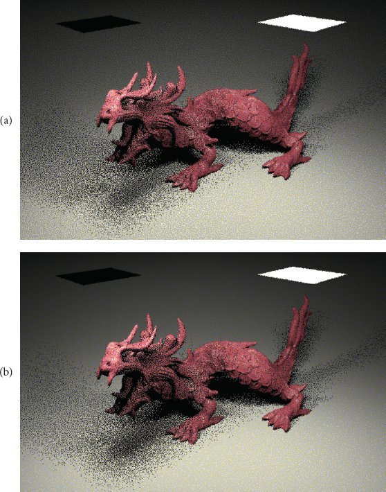

*Figure 12.29: Simple Scene with Two Area Lights. The quadrilateral on the right emits light from both sides, while the one on the left only emits from the front side. (a) If the `DiffuseAreaLight::Bounds()` method includes an additional factor of 2 for the two-sided light’s importance, then it receives more samples than it should. (b) Without this factor, the light importance values are more accurate, which in turn gives a visible reduction in error. The MSE improvement is a factor of 1.42.*

The phi value is found by integrating over the light’s area. For lights that use an `Image` for spatially varying emission, the 〈Compute average DiffuseAreaLight image channel value〉 fragment, not included here, computes its average value. Because `LightBounds` accounts for whether the emitter is one- or two-sided, it is important not to double the shape’s area if it is two-sided; that factor is already included in the importance computation. (This subtlety is similar to the one for the `SpotLight`’s phi value.) See Figure 12.29 for an illustration of how this detail makes a difference.

```text
   DiffuseAreaLight::Bounds() 792
   Image 1079
   LightBounds 786
```

〈Compute phi for diffuse area light bounds〉 ≡ 792

Float phi = 0; if (image) { 〈Compute average DiffuseAreaLight image channel value〉 } else phi = Lemit->MaxValue(); phi *= scale * area * Pi;

Compactly Bounding Lights The `LightBounds` class uses 52 bytes of storage. This is not a problem as far as the total amount of memory consumed for the lights in the scene, but it does affect performance from the amount of space it uses in the cache. For scenes with thousands of lights, multiple instances of the `LightBounds` will be accessed when traversing the light BVH, and so minimizing its storage requirements improves cache performance and thus overall performance. (This is especially the case on the GPU, since many threads run concurrently on each processor and each will generally follow a different path through the light BVH and thus access different `LightBounds` instances.) Therefore, we have also implemented a `CompactLightBounds` class, which applies a number of techniques to reduce storage requirements for the `LightBounds` information. It uses just 24 bytes of storage. We use both classes in pbrt: the uncompressed `LightBounds` is convenient for lights to return from their Bounds() methods and is also a good representation to use when building the light BVH. `CompactLightBounds` is used solely in the in-memory representation of light BVH nodes, where minimizing size is beneficial to performance.

〈CompactLightBounds Definition〉 ≡ class CompactLightBounds { public: 〈CompactLightBounds Public Methods 794〉 private: 〈CompactLightBounds Private Methods 795〉 〈CompactLightBounds Private Members 795〉 };

```text
   Bounds3f 97
   CompactLightBounds 794
   CompactLightBounds::QuantizeCos() 795
   DiffuseAreaLight::area 761
   DiffuseAreaLight::Lemit 761
   DiffuseAreaLight::scale 761
   Float 23
   LightBounds 786
   LightBounds::bounds 786
   LightBounds::cosTheta_e 787
   LightBounds::cosTheta_o 787
   LightBounds::phi 786
   LightBounds::twoSided 787
   LightBounds::w 787
   Normalize() 88
   OctahedralVector 109
   Pi 1033
   Spectrum::MaxValue() 166
   Vector3 86
```

Its constructor takes both a `LightBounds` instance and a bounding box `allb` that must completely bound `LightBounds::bounds`. This bounding box is used to compute quantized bounding box vertex positions to reduce their storage requirements.

〈CompactLightBounds Public Methods〉 ≡ 794

CompactLightBounds(const LightBounds &lb, const Bounds3f &allb) : w(Normalize(lb.w)), phi(lb.phi), qCosTheta_o(QuantizeCos(lb.cosTheta_o)), qCosTheta_e(QuantizeCos(lb.cosTheta_e)), twoSided(lb.twoSided) { 〈Quantize bounding box into qb 795〉 }

The `OctahedralVector` class from Section 3.8.3 stores a unit vector in 4 bytes, saving 8 from the Vector3 used in `LightBounds`. Then, the two cosines and the `twoSided` flag are packed into another 4 bytes using a bitfield, saving another 8. We have left `phi` alone, since the various compactions already implemented are sufficient for pbrt’s current requirements.

〈CompactLightBounds Private Members〉 ≡ 794

OctahedralVector w; Float phi = 0; struct { unsigned int qCosTheta_o: 15; unsigned int qCosTheta_e: 15; unsigned int twoSided: 1; };

`QuantizeCos()` maps the provided value (which is expected to be the cosine of an angle and thus between –1 and 1) to a 15-bit unsigned integer. After being remapped to be in [0, 1], multiplying by the largest representable 15-bit unsigned integer, 215 – 1 = 32,767, gives a value that spans the valid range. Note the use of `pstd::floor()` to round the quantized cosine value down before returning it: this is preferable to, say, rounding to the nearest integer, since it ensures that any quantization error serves to slightly increase the corresponding angle rather than decreasing it. (Decreasing it could lead to inadvertently determining that the light did not illuminate a point that it actually did.)

〈CompactLightBounds Private Methods〉 ≡ 794

static unsigned int QuantizeCos(Float c) { return pstd::floor(32767.f * ((c + 1) / 2)); }

The bounding box corners are also quantized. Each coordinate of each corner gets 16 bits, all of them stored in the `qb` member variable. This brings the storage for the bounds down to 12 bytes, from 24 before. Here the quantization is also conservative, rounding down at the lower end of the extent and rounding up at the upper end.

〈Quantize bounding box into qb〉 ≡ 794

for (int c = 0; c < 3; ++c) { qb[0][c] = pstd::floor(QuantizeBounds(lb.bounds[0][c], allb.pMin[c], allb.pMax[c])); qb[1][c] = pstd::ceil(QuantizeBounds(lb.bounds[1][c], allb.pMin[c], allb.pMax[c])); }

〈CompactLightBounds Private Members〉 +≡ 794

uint16_t qb[2][3];

`QuantizeBounds()` remaps a coordinate value c between min and max to the range [0, 216 – 1], the range of values that an unsigned 16-bit integer can store.

```text
   Bounds3::pMin 98
   Clamp() 1033
   CompactLightBounds::QuantizeBounds() 795
   Float 23
   LightBounds::bounds 786
   OctahedralVector 109
```

〈CompactLightBounds Private Methods〉 +≡ 794

static Float QuantizeBounds(Float c, Float min, Float max) { if (min == max) return 0; return 65535.f * Clamp((c - min) / (max -min), 0, 1); }

A few convenience methods make the values of various member variables available. For the two quantized cosines, the inverse computation of `QuantizeCos()` is performed.

〈CompactLightBounds Public Methods〉 +≡ 794

bool TwoSided() const { return twoSided; } Float CosTheta_o() const { return 2 * (qCosTheta_o / 32767.f) - 1; } Float CosTheta_e() const { return 2 * (qCosTheta_e / 32767.f) - 1; }

The `Bounds()` method returns the `Bounds3f` for the `CompactLightBounds`. It must be passed the same `Bounds3f` as was originally passed to its constructor for the correct result to be returned.

〈CompactLightBounds Public Methods〉 +≡ 794

Bounds3f Bounds(const Bounds3f &allb) const { return {Point3f(Lerp(qb[0][0] / 65535.f, allb.pMin.x, allb.pMax.x), Lerp(qb[0][1] / 65535.f, allb.pMin.y, allb.pMax.y), Lerp(qb[0][2] / 65535.f, allb.pMin.z, allb.pMax.z)), Point3f(Lerp(qb[1][0] / 65535.f, allb.pMin.x, allb.pMax.x), Lerp(qb[1][1] / 65535.f, allb.pMin.y, allb.pMax.y), Lerp(qb[1][2] / 65535.f, allb.pMin.z, allb.pMax.z))}; }

Finally, `CompactLightBounds` also provides an `Importance()` method. Its implementation also requires that the original `Bounds3f` be provided so that the `Bounds()` method can be called. Given the unquantized bounds and cosines made available in appropriately named local variables, the remainder of the implementation can share the same fragments as were used in the implementation of `LightBounds::Importance()`.

〈CompactLightBounds Public Methods〉 +≡ 794

Float Importance(Point3f p, Normal3f n, const Bounds3f &allb) const { Bounds3f bounds = Bounds(allb); Float cosTheta_o = CosTheta_o(), cosTheta_e = CosTheta_e(); 〈Return importance for light bounds at reference point 788〉

}

```text
   Bounds3f 97
   BVHLightSampler 796
   CompactLightBounds 794
   CompactLightBounds::Bounds() 796
   CompactLightBounds::CosTheta_e() 796
   CompactLightBounds::CosTheta_o() 796
   CompactLightBounds::qb 795
   CompactLightBounds::qCosTheta_e 795
   CompactLightBounds::qCosTheta_o 795
   CompactLightBounds::twoSided 795
   Float 23
   LightBounds::Importance() 788
   Normal3f 94
   Point3f 92
```

Light Bounding Volume Hierarchies Given a way of bounding lights as well as a compact representation of these bounds, we can turn to the implementation of the `BVHLightSampler`. This light sampler is the default for most of the integrators in pbrt. Not only is it effective at efficiently sampling among large collections of lights, it even reduces error in simple scenes with just a few lights. Figures 12.30 and 12.31 show two examples.

〈BVHLightSampler Definition〉 ≡ class BVHLightSampler { public: 〈BVHLightSampler Public Methods 802〉 private: 〈BVHLightSampler Private Methods 800〉 〈BVHLightSampler Private Members 797〉 };

Its constructor starts by making a copy of the provided array of lights before proceeding to initialize the BVH and additional data structures.

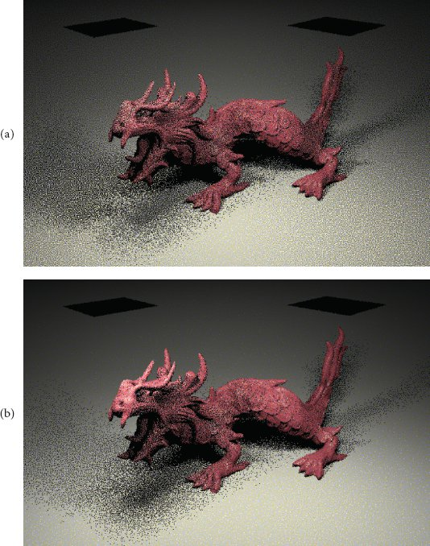

*Figure 12.30: A Simple Scene with Two Light Sources. (a) Rendered with 1 sample per pixel using the `PowerLightSampler`. (b) Rendered with 1 sample per pixel using the `BVHLightSampler`. Even with a small number of lights, error is visibly lower with a sampler that uses spatially varying sampling probabilities due to being able to choose nearby bright lights with higher probability. In this case, MSE is improved by a factor of 2.72.*

```text
   Allocator 40
   BVHLightSampler 796
   BVHLightSampler::infiniteLights 799
   BVHLightSampler::lights 797
   BVHLightSampler::lightToBitTrail 800
   BVHLightSampler::nodes 799
   Light 740
   PowerLightSampler 783
```

〈BVHLightSampler Method Definitions〉 ≡ BVHLightSampler::BVHLightSampler(pstd::span<const Light> lights, Allocator alloc) : lights(lights.begin(), lights.end(), alloc), infiniteLights(alloc), nodes(alloc), lightToBitTrail(alloc) { 〈Initialize infiniteLights array and light BVH 798〉 }

〈BVHLightSampler Private Members〉 ≡ 796

pstd::vector<Light> lights;


*Figure 12.31: Zero Day Scene, with 8,878 Area Lights. (a) Rendered with the `PowerLightSampler`. (b) Rendered with the `BVHLightSampler`. Both images are rendered with 16 samples per pixel. For a scene of this complexity, an effective light sampling algorithm is crucial. The `BVHLightSampler` gives an MSE improvement of 2.37× with only a 5.8% increase in rendering time. Monte Carlo efficiency is improved by a factor of 2.25. (Scene courtesy of Beeple.)*

Because the BVH cannot store lights at infinity, the first step is to partition the lights into those that can be stored in the BVH and those that cannot. This is handled by a loop over all the provided lights after which the BVH is constructed.

〈Initialize infiniteLights array and light BVH〉 ≡ 797

```rust
   std::vector<std::pair<int, LightBounds>> bvhLights; for (size_t i = 0; i <
   lights.size(); ++i) {
       〈Store ith light in either infiniteLights or bvhLights 799〉
   }
   if (!bvhLights.empty()) buildBVH(bvhLights, 0, bvhLights.size(), 0, 0);
```

```text
   BVHLightSampler 796
   BVHLightSampler::buildBVH() 800
   BVHLightSampler::lights 797
   CompactLightBounds 794
   LightBounds 786
   PowerLightSampler 783
```

Lights that are not able to provide a `LightBounds` are added to the `infiniteLights` array and are sampled independently of the lights stored in the BVH. As long as they have nonzero emitted power, the rest are added to the `bvhLights` array, which is used during BVH construction. Along the way, a bounding box that encompasses all the BVH lights’ bounding boxes is maintained in `allLightBounds`; this is the bounding box that will be passed to the `CompactLightBounds` for quantizing the spatial bounds of individual lights.

〈Store ith light in either infiniteLights or bvhLights〉 ≡ 798

```rust
   Light light = lights[i]; pstd::optional<LightBounds> lightBounds =
   light.Bounds(); if (!lightBounds) infiniteLights.push_back(light); else if
   (lightBounds->phi > 0) {
       bvhLights.push_back(std::make_pair(i, *lightBounds)); allLightBounds =
       Union(allLightBounds, lightBounds->bounds); }
```

〈BVHLightSampler Private Members〉 +≡ 796

pstd::vector<Light> infiniteLights; Bounds3f allLightBounds;

The light BVH is represented using an instance of the `LightBVHNode` structure for each tree node, both interior and leaf. It uses a total of 28 bytes of storage, adding just 4 to the 24 used by `CompactLightBounds`, though its declaration specifies 32-byte alignment, ensuring that 2 of them fit neatly into a typical 64-byte cache line on a CPU, and 4 of them fit into a 128-byte GPU cache line.

〈LightBVHNode Definition〉 ≡ struct alignas (32) LightBVHNode { 〈LightBVHNode Public Methods 799〉 〈LightBVHNode Public Members 799〉 };

Naturally, each `LightBVHNode` stores the `CompactLightBounds` for either a single light or a collection of them. Like the `BVHAggregate`’s BVH, the light BVH is laid out in memory so that the first child of each interior node is immediately after it. Therefore, it is only necessary to store information about the second child’s location in the `LightBVHNode`. The `BVHLightSampler` stores all nodes in a contiguous array, so an index suffices; a full pointer is unnecessary.

〈LightBVHNode Public Members〉 ≡ 799

CompactLightBounds lightBounds; struct { unsigned int childOrLightIndex:31; unsigned int isLeaf:1; };

```text
   Bounds3f 97
   BVHAggregate 407
   BVHLightSampler 796
   BVHLightSampler::allLightBounds 799
   BVHLightSampler::infiniteLights 799
   BVHLightSampler::lights 797
   CompactLightBounds 794
   Light 740
   Light::Bounds() 791
   LightBounds 786
   LightBounds::bounds 786
   LightBounds::phi 786
   LightBVHNode 799
```

〈BVHLightSampler Private Members〉 +≡ 796

pstd::vector<LightBVHNode> nodes;

Two object-creation methods return a `LightBVHNode` of the specified type.

〈LightBVHNode Public Methods〉 ≡ 799

static LightBVHNode MakeLeaf(unsigned int lightIndex, const CompactLightBounds &cb) { return LightBVHNode{cb, {lightIndex, 1}}; }

〈LightBVHNode Public Methods〉 +≡ 799

static LightBVHNode MakeInterior(unsigned int child1Index, const CompactLightBounds &cb) { return LightBVHNode{cb, {child1Index, 0}}; }

The `buildBVH()` method constructs the BVH by recursively partitioning the lights until it reaches a single light, at which point a leaf node is constructed. Its implementation closely follows the approach implemented in the `BVHAggregate::buildRecursive()` method: along each dimension, the light bounds are assigned to a fixed number of buckets according to their centroids. Next, a cost model is evaluated for splitting the lights at each bucket boundary. The minimum cost split is chosen and the lights are partitioned into two sets, each one passed to a recursive invocation of `buildBVH()`.

Because these two methods are so similar, here we will only include the fragments where the `BVHLightSampler` substantially diverges—in how nodes are initialized and in the cost model used to evaluate candidate splits.

〈BVHLightSampler Private Methods〉 ≡ 796

std::pair<int, LightBounds> buildBVH( std::vector<std::pair<int, LightBounds>> &bvhLights, int start, int end, uint32_t bitTrail, int depth);

When this method is called with a range corresponding to a single light, a leaf node is initialized and the recursion terminates. A `CompactLightBounds` is created using the bounding box of all lights’ bounds to initialize its quantized bounding box coordinates and the BVH tree node can be added to the `nodes` array.

〈Initialize leaf node if only a single light remains〉 ≡ if (end - start == 1) { int nodeIndex = nodes.size(); CompactLightBounds cb(bvhLights[start].second, allLightBounds); int lightIndex = bvhLights[start].first; nodes.push_back(LightBVHNode::MakeLeaf(lightIndex, cb)); lightToBitTrail.Insert(lights[lightIndex], bitTrail); return {nodeIndex, bvhLights[start].second}; }

```text
   BVHAggregate::buildRecursive() 410
   BVHLightSampler 796
   BVHLightSampler::allLightBounds 799
   BVHLightSampler::lights 797
   BVHLightSampler::lightToBitTrail 800
```

```text
   BVHLightSampler::nodes 799
   CompactLightBounds 794
   HashMap 1069
   HashMap::Insert() 1069
   Light 740
   LightBounds 786
   LightBVHNode 799
   LightBVHNode::MakeLeaf() 799
```

In order to implement the `PMF()` method, it is necessary to follow a path through the BVH from the root down to the leaf node for the given light. We encode these paths using bit trails, integers where each bit encodes which of the two child nodes should be visited at each level of the tree in order to reach the light’s leaf node. The lowest bit indicates which child should be visited after the root node, and so forth. These values are computed while the BVH is built and stored in a hash table that uses `Light`s as keys.

〈BVHLightSampler Private Members〉 +≡ 796

HashMap<Light, uint32_t> lightToBitTrail;

When there are multiple lights to consider, the `EvaluateCost()` method is called to evaluate the cost model for the two `LightBounds` for each split candidate. In addition to the `LightBounds` for which to compute the cost, it takes the bounding box of all the lights passed to the current invocation of `buildBVH()` as well as the dimension in which the split is being performed.

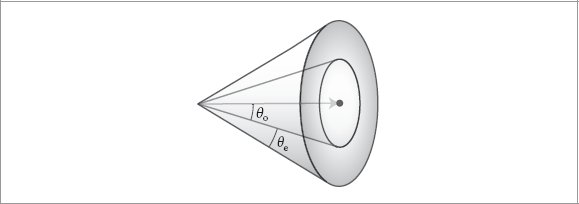

*Figure 12.32: The direction bounds measure is found by integrating to find the solid angle of the center cone up to θo and then applying a cosine weighting over the additional angle of θe.*

〈BVHLightSampler Private Methods〉 +≡ 796

Float EvaluateCost(const LightBounds &b, const Bounds3f &bounds, int dim) const { 〈Evaluate direction bounds measure for LightBounds 801〉 〈Return complete cost estimate for LightBounds 802〉 }

The principal surface normal direction and the angles θo and θe that are stored in `LightBounds` are worthwhile to include in the light BVH cost function. Doing so can encourage partitions of primitives into groups that emit light in different directions, which can be helpful for culling groups of lights that do not illuminate a given receiving point. To compute these costs, pbrt uses a weighted measure of the solid angle of directions that the direction bounds subtend. A weight of 1 is used for all directions inside the center cone up to θo and then the remainder of directions up to θe are cosine-weighted, following the importance computation earlier. (See Figure 12.32.) Integrating over the relevant directions gives us the direction bounds measure. The first term integrates to 1 – cos θo and the second has a simple analytic form that is evaluated in the second term of `M_omega`’s initializer below.

〈Evaluate direction bounds measure for LightBounds〉 ≡ 801

```rust
   Float theta_o = std::acos(b.cosTheta_o), theta_e = std::acos(b.cosTheta_e);
   Float theta_w = std::min(theta_o + theta_e, Pi); Float sinTheta_o =
   SafeSqrt(1 - Sqr(b.cosTheta_o)); Float M_omega = 2 * Pi * (1 -
   b.cosTheta_o) +
       Pi / 2 * (2 * theta_w * sinTheta_o - std::cos(theta_o - 2 * theta_w) -
                 2 * theta_o * sinTheta_o + b.cosTheta_o);
```

```text
   Bounds3f 97
   Float 23
   LightBounds 786
   LightBounds::cosTheta_e 787
   LightBounds::cosTheta_o 787
   Pi 1033
   SafeSqrt() 1034
   Sqr() 1034
```

Three other factors go into the full cost estimate: the power estimate `phi`: in general, the higher the power of the lights in a `LightBounds`, the more important it is to minimize factors like the spatial and direction bounds. A regularization factor `Kr` that discourages long and thin bounding boxes. The surface area of the `LightBounds`’s bounding box.

The use of surface area in the cost metric deserves note: with the `BVHAggregate`, the surface area heuristic was grounded in geometric probability, as the surface area of a convex object is proportional to the probability of a random ray intersecting it. In this case, no rays are being traced. Arguably, minimizing the volume of the bounds would be a more appropriate approach in this case. In practice, the surface area seems to be more effective—one reason is that it penalizes bounding boxes that span a large extent in two dimensions but little or none in the third. Such bounding boxes are undesirable as they may subtend large solid angles, adding more uncertainty to importance estimates.

〈Return complete cost estimate for LightBounds〉 ≡ 801

Float Kr = MaxComponentValue(bounds.Diagonal()) / bounds.Diagonal()[dim]; return b.phi * M_omega * Kr * b.bounds.SurfaceArea();

Once the lights have been partitioned, two fragments take care of recursively initializing the child nodes and then initializing the interior node. The first step is to take a spot in the `nodes` array for the interior node; this spot must be claimed before the children are initialized in order to ensure that the first child is the successor of the interior node in the array. Two recursive calls to `buildBVH()` then initialize the children. The main thing to note in them is the maintenance of the `bitTrail` value passed down into each one. For the first child, the corresponding bit should be set to zero. bitTrail is zero-initialized in the initial call to `buildBVH()`, so it has this value already and there is nothing to do. For the second call, the bit for the current tree depth is set to 1.

〈Allocate interior LightBVHNode and recursively initialize children〉 ≡ int nodeIndex = nodes.size(); nodes.push_back(LightBVHNode()); std::pair<int, LightBounds> child0 = buildBVH(bvhLights, start, mid, bitTrail, depth + 1); std::pair<int, LightBounds> child1 = buildBVH(bvhLights, mid, end, bitTrail | (1u << depth), depth + 1);

The interior node can be initialized after the children have been. Its light bounds are given by the union of its children’s, which allows initializing a `CompactLightBounds` and then the `LightBVHNode` itself.

```text
   Bounds3::Diagonal() 101
   Bounds3::SurfaceArea() 102
   BVHAggregate 407
   BVHLightSampler::allLightBounds 799
   BVHLightSampler::buildBVH() 800
   BVHLightSampler::nodes 799
   CompactLightBounds 794
   Float 23
   LightBounds 786
   LightBounds::bounds 786
   LightBounds::phi 786
   LightBounds::Union() 787
   LightBVHNode 799
   LightBVHNode::MakeInterior() 800
   LightSampleContext 741
```

```text
   SampledLight 782
   Tuple3::MaxComponentValue() 85
```

〈Initialize interior node and return node index and bounds〉 ≡ LightBounds lb = Union(child0.second, child1.second); CompactLightBounds cb(lb, allLightBounds); nodes[nodeIndex] = LightBVHNode::MakeInterior(child1.first, cb); return {nodeIndex, lb};

Given the BVH, we can now implement the `Sample()` method, which samples a light given a reference point in a `LightSampleContext`.

〈BVHLightSampler Public Methods〉 ≡ 796

pstd::optional<SampledLight> Sample(const LightSampleContext &ctx, Float u) const { 〈Compute infinite light sampling probability pInfinite 803〉 if (u < pInfinite) { 〈Sample infinite lights with uniform probability 803〉 } else { 〈Traverse light BVH to sample light 804〉 } }

The first choice to make is whether an infinite light should be sampled or whether the light BVH should be used to choose a noninfinite light. The `BVHLightSampler` gives equal probability to sampling each infinite light and to sampling the BVH, from which the probability of sampling an infinite light follows directly.

〈Compute infinite light sampling probability pInfinite〉 ≡ 802, 805

Float pInfinite = Float(infiniteLights.size()) / Float(infiniteLights.size() + (nodes.empty() ? 0 : 1));

If an infinite light is to be sampled, then the random sample u is rescaled to provide a new uniform random sample that is used to index into the `infiniteLights` array.

〈Sample infinite lights with uniform probability〉 ≡ 802

u /= pInfinite; int index = std::min<int>(u * infiniteLights.size(), infiniteLights.size() - 1); Float pmf = pInfinite / infiniteLights.size(); return SampledLight{infiniteLights[index], pmf};

Otherwise a light is sampled by traversing the BVH. At each interior node, probabilities are found for sampling each of the two children using importance values returned by the `LightBounds` for the reference point. A child node is then randomly chosen according to these probabilities. In the end, the probability of choosing a leaf node is equal to the product of probabilities along the path from the root to the leaf (see Figure 12.33). With this traversal scheme, there is no need to maintain a stack of nodes to be processed as the `BVHAggregate` does—a single path is taken down the tree from the root to a leaf.

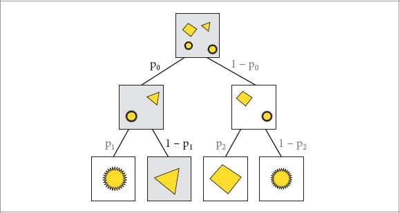

*Figure 12.33: Sampling a Light BVH. At each non-leaf node of the tree, we compute discrete probabilities pi and 1 – pi for sampling each child node and then randomly choose a child accordingly. The probability of sampling each leaf node is the product of probabilities along the path from the root of the tree down to it. Here, the nodes that are visited and the associated probabilities for sampling the triangular light source are highlighted.*

```text
   BVHAggregate 407
   BVHLightSampler 796
   BVHLightSampler::infiniteLights 799
   BVHLightSampler::nodes 799
   Float 23
   SampledLight 782
```

〈Traverse light BVH to sample light〉 ≡ 802

```rust
   if (nodes.empty()) return {}; 〈Declare common variables for light BVH traversal 804〉
   while (true) {
       〈Process light BVH node for light sampling 804〉
   }
```

A few values will be handy in the following traversal of the BVH. Among them are the uniform sample u, which is remapped to a new uniform random sample in [0, 1). `pmf` starts out with the probability of sampling the BVH in the first place; each time a child node of the tree is randomly sampled, it will be multiplied by the discrete probability of that sampling choice so that in the end it stores the complete probability for sampling the light.

〈Declare common variables for light BVH traversal〉 ≡ 804

Point3f p = ctx.p(); Normal3f n = ctx.ns; u = std::min<Float>((u -pInfinite) / (1 - pInfinite), OneMinusEpsilon); int nodeIndex = 0; Float pmf = 1 - pInfinite;

At each interior node, a child node is randomly sampled. Given a leaf node, we have reached the sampled light.

〈Process light BVH node for light sampling〉 ≡ 804

LightBVHNode node = nodes[nodeIndex]; if (!node.isLeaf) { 〈Compute light BVH child node importances 804〉 〈Randomly sample light BVH child node 805〉 } else { 〈Confirm light has nonzero importance before returning light sample 805〉 }

The first step at an interior node is to compute the importance values for the two child nodes. It may be the case that both of them are 0, indicating that neither child illuminates the reference point. That we may end up in this situation may be surprising: in that case, why would we have chosen to visit this node in the first place? This state of affairs is a natural consequence of the accuracy of light bounds improving on the way down the tree, which makes it possible for them to better differentiate regions that their respective subtrees do and do not illuminate.

```text
   BVHLightSampler::allLightBounds 799
   BVHLightSampler::nodes 799
   CompactLightBounds::Importance() 796
```

```text
   Float 23
   LightBVHNode 799
   LightBVHNode::childOrLightIndex 799
   LightBVHNode::isLeaf 799
   LightBVHNode::lightBounds 799
   LightSampleContext::ns 742
   LightSampleContext::p() 742
   Normal3f 94
   OneMinusEpsilon 470
   Point3f 92
   SampleDiscrete() 70
```

〈Compute light BVH child node importances〉 ≡ 804

const LightBVHNode *children[2] = {&nodes[nodeIndex + 1], &nodes[node.childOrLightIndex] }; Float ci[2] = { children[0]->lightBounds.Importance(p, n, allLightBounds), children[1]->lightBounds.Importance(p, n, allLightBounds)}; if (ci[0] == 0 && ci[1] == 0) return {};

Given at least one nonzero importance value, `SampleDiscrete()` takes care of choosing a child node. The sampling PMF it returns is incorporated into the running `pmf` product. We further use its capability for remapping the sample u to a new uniform sample in [0, 1), which allows the reuse of the u variable in subsequent loop iterations.

〈Randomly sample light BVH child node〉 ≡ 804

Float nodePMF; int child = SampleDiscrete(ci, u, &nodePMF, &u); pmf *= nodePMF; nodeIndex = (child == 0) ? (nodeIndex + 1) : node.childOrLightIndex;

When a leaf node is reached, we have found a light. The light should only be returned if it has a nonzero importance value, however: if the importance is zero, then it is better to return no light than to return one and cause the caller to go through some additional work to sample it before finding that it has no contribution. Most of the time, we have already determined that the node’s light bounds have a nonzero importance value by dint of sampling the node while traversing the BVH in the first place. It is thus only in the case of a single-node BVH with a single light stored in it that this test must be performed here.

〈Confirm light has nonzero importance before returning light sample〉 ≡ 804

if (nodeIndex > 0 || node.lightBounds.Importance(p, n, allLightBounds) > 0) return SampledLight{lights[node.childOrLightIndex], pmf}; return {};

Computing the PMF for sampling a specified light follows a set of computations similar to those of the sampling method: if the light is an infinite light, the infinite light sampling probability is returned and otherwise the BVH is traversed to compute the light’s sampling probability. In this case, BVH traversal is not stochastic, but is specified by the bit trail for the given light, which encodes the path to the leaf node that stores it.

〈BVHLightSampler Public Methods〉 +≡ 796

Float PMF(const LightSampleContext &ctx, Light light) const { 〈Handle infinite light PMF computation 805〉 〈Initialize local variables for BVH traversal for PMF computation 805〉 〈Compute light’s PMF by walking down tree nodes to the light 806〉 }

```text
   BVHLightSampler::allLightBounds 799
   BVHLightSampler::infiniteLights 799
   BVHLightSampler::lights 797
   BVHLightSampler::lightToBitTrail 800
   BVHLightSampler::nodes 799
   CompactLightBounds::Importance() 796
   Float 23
   HashMap::HasKey() 1069
   Light 740
   LightBVHNode::childOrLightIndex 799
   LightBVHNode::lightBounds 799
   LightSampleContext 741
   LightSampleContext::ns 742
   LightSampleContext::p() 742
   Normal3f 94
   Point3f 92
   SampleDiscrete() 70
   SampledLight 782
```

If the given light is not in the bit trail hash table, then it is not stored in the BVH and therefore must be an infinite light. The probability of sampling it is one over the total number of infinite lights plus one if there is a light BVH.

〈Handle infinite light PMF computation〉 ≡ 805

```rust
   if (!lightToBitTrail.HasKey(light)) return 1.f / (infiniteLights.size() +
   (nodes.empty() ? 0 : 1));
```

A number of values will be useful as the tree is traversed, including the bit trail that points the way to the correct leaf, the PMF of the path taken so far, and the index of the current node being visited, starting here at the root.

〈Initialize local variables for BVH traversal for PMF computation〉 ≡ 805

```rust
   uint32_t bitTrail = lightToBitTrail[light]; Point3f p = ctx.p(); Normal3f n
   = ctx.ns; 〈Compute infinite light sampling probability pInfinite 803〉
   Float pmf = 1 - pInfinite; int nodeIndex = 0;
```

For a light that is stored in the BVH, the probability of sampling it is again computed as the product of each discrete probability of sampling the child node that leads to its leaf node.

〈Compute light’s PMF by walking down tree nodes to the light〉 ≡ 805

while (true) { const LightBVHNode *node = &nodes[nodeIndex]; if (node->isLeaf) return pmf; 〈Compute child importances and update PMF for current node 806〉 〈Use bitTrail to find next node index and update its value 806〉 }

The lowest bit of `bitTrail` encodes which of the two children of the node is visited on a path down to the light’s leaf node. In turn, it is possible to compute the probability of sampling that node given the two child nodes’ importance values.

〈Compute child importances and update PMF for current node〉 ≡ 806

const LightBVHNode *child0 = &nodes[nodeIndex + 1]; const LightBVHNode *child1 = &nodes[node->childOrLightIndex]; Float ci[2] = { child0->lightBounds.Importance(p, n, allLightBounds), child1->lightBounds.Importance(p, n, allLightBounds) }; pmf *= ci[bitTrail & 1] / (ci[0] + ci[1]);

The low-order bit of `bitTrail` also points us to which node to visit next on the way down the tree. After `nodeIndex` is updated, `bitTrail` is shifted right by one bit so that the low-order bit encodes the choice to make at the next level of the tree.

〈Use bitTrail to find next node index and update its value〉 ≡ 806

nodeIndex = (bitTrail & 1) ? node->childOrLightIndex : (nodeIndex + 1); bitTrail >>= 1;

The basic `Sample()` and `PMF()` methods for when a reference point is not specified sample all the lights uniformly and so are not included here, as they parallel the implementations in the `UniformLightSampler`.

## FURTHER READING

Light Emission Descriptions Warn (1983) developed early models of light sources with nonisotropic emission distributions, including the spotlight model used in this chapter. Verbeck and Greenberg (1984) also described a number of techniques for modeling light sources that are now classic parts of the light modeling toolbox. Barzel (1997) described a highly parameterized model for light sources, including multiple parameters for controlling rate of falloff, the area of space that is illuminated, and so on. Bjorke (2001) described a number of additional techniques for shaping illumination for artistic effect. (Many parts of the Barzel and Bjorke approaches are not physically based, however.)

```text
   BVHLightSampler::nodes 799
   CompactLightBounds::Importance() 796
   Float 23
   LightBVHNode 799
   LightBVHNode::childOrLightIndex 799
   LightBVHNode::lightBounds 799
   UniformLightSampler 782
```

The goniophotometric light source approximation is widely used to model area light sources in the field of illumination engineering. The rule of thumb there is that once a reference point is five times an area light source’s radius away from it, a point light approximation has sufficient accuracy for most applications. File format standards have been developed for encoding goniophotometric diagrams for these applications (Illuminating Engineering Society of North America 2002). Many lighting fixture manufacturers provide data in these formats on their websites. Ashdown (1993) proposed a more sophisticated light source model than goniophotometric; he measured the directional distribution of emitted radiance at a large number of points around a light source and described

how to use the resulting 4D table to compute the received radiance distribution at other points. Another generalization of goniometric lights was suggested by Heidrich et al. (1998), who represented light sources as a 4D exitant light-field—essentially a function of both position and direction —and showed how to use this representation for rendering. Additional work in this area was done by Goesele et al. (2003) and Mas et al. (2008), who introduced a more space-efficient representation and improved rendering efficiency. Peters (2021a) has developed efficient techniques for sampling lights defined by lines (i.e., infinitesimally thin cylinders) and shown how to sample the product of lighting and the BRDF using linearly transformed cosines (Heitz et al. 2016a). Real-world light sources are often fairly complex, including carefully designed systems of mirrors and lenses to shape the distribution of light emitted by the light source. (Consider, for example, the headlights on a car, where it is important to evenly illuminate the surface of the road without shining too much light in the eyes of approaching drivers.) All the corresponding specular reflection and transmission is challenging for light transport algorithms. It can therefore be worthwhile to do some precomputation to create a representation of light sources’ final emission distributions after all of this scattering that is then used as the light source model for rendering. To this end, Kniep et al. (2009) proposed tracing the paths of photons leaving the light’s filament until they hit a bounding surface around the light. They then recorded the position and direction of outgoing photons and used this information when computing illumination at points in the scene. Velázquez-Armendáriz et al. (2015) showed how to compute a set of point lights with directionally varying emission distributions to model emitted radiance from complex light sources. They then approximated the radiance distribution in the light interior using spherical harmonics. More recently, Zhu et al. (2021) applied a neural representation to complex lights, encoding lights’ radiance distributions and view-dependent sampling distributions and opacities in neural networks.

Illumination from Environment Maps Blinn and Newell (1976) first introduced the idea of environment maps and their use for simulating illumination, although they only considered

illumination of specular objects. Greene (1986) further refined these ideas, considering antialiasing and different representations for environment maps. Nishita and Nakamae (1986) developed algorithms for efficiently rendering objects illuminated by hemispherical skylights and generated some of the first images that showed off that distinctive lighting effect. Miller and Hoffman (1984) were the first to consider using arbitrary environment maps to illuminate objects with diffuse and glossy BRDFs. Debevec (1998) later extended this work and investigated issues related to capturing images of real environments. Representing illumination from the sun and sky is a particularly important application of infinite light sources; the “Further Reading” section in Chapter 14 includes a number of references related to simulating skylight scattering. Directly measuring illumination from the sky is also an effective way to find accurate skylight illumination; see Kider et al. (2014) for details of a system built to do this. pbrt’s infinite area light source models incident radiance from the light as purely a function of direction. Especially for indoor scenes, this assumption can be fairly inaccurate; position matters as well. Unger et al. (2003) captured the incident radiance as a function of direction at many different locations in a real-world scene and used this representation for rendering. Unger et al. (2008) improved on this work and showed how to decimate the samples to reduce storage requirements without introducing too much error. Lu et al. (2015) developed techniques for efficiently importance sampling these light sources. The use of the `allowIncompletePDF` parameter to avoid generating low-probability samples from infinite light sources in the presence of multiple importance sampling is an application of MIS compensation, which was developed by Karlík et al. (2019). Subr and Arvo (2007b) developed an efficient technique for sampling environment map light sources that not only accounts for the cos θ term from the scattering equation but also only generates samples in the hemisphere around the surface normal. More recently, Conty Estevez and Lecocq (2018) introduced a technique for sampling according to the product of the BSDF and the environment map based on discretizing the

environment map into coarse grids of pixels, conservatively evaluating the maximum of the BSDF over the corresponding sets of directions, and then choosing a region of the environment map according to the product of BSDF and pixel values. Given a selected grid cell, conventional environment map sampling is applied. (See also the “Further Reading” section in Chapter 13 for further references to light and BSDF product sampling algorithms.) When environment maps are used for illuminating indoor scenes, many incident directions may be blocked by the building structure. Bitterli et al. (2015) developed the environment map rectification approach to this problem that we have implemented in the `PortalImageInfiniteLight`. One shortcoming of Bitterli et al.’s approach is that the image must be rectified for each plane in which there is a portal. Ogaki (2020) addresses this issue by building a BVH over the portals using Conty Estevez and Kulla’s light BVH (2018) and then decomposing portals into triangles to sample a specific direction according to the environment map. Sampling-based approaches can also be used to account for environment map visibility. Bashford-Rogers et al. (2013) developed a two-pass algorithm where a first pass from the camera finds directions that reach the environment map; this information is used to create sampling distributions for use in a second rendering pass. Atanasov et al. (2018) also applied a two-pass algorithm to the task, furthermore discretizing regions of the scene in order to account for different parts of the environment map being visible in different regions of the scene.

Optimizing Visibility Testing As discussed in Chapter 6, one way to reduce the time spent tracing shadow rays is to have methods like `Shape::IntersectP()` and `Primitive::IntersectP()` that just check for any occlusion along a ray without bothering to compute the geometric information at the intersection point. Another approach for optimizing ray tracing for shadow rays is the shadow cache, where each light stores a pointer to the last primitive that occluded a shadow ray to the light. That primitive is checked first to see if it occludes subsequent shadow rays before the ray is passed to the acceleration structure (Haines and Greenberg 1986). Pearce (1991) pointed out that the

shadow cache does not work well if the scene has finely tessellated geometry; it may be better to cache the BVH node that held the last occluder, for instance. (The shadow cache can similarly be defeated when multiple levels of reflection and refraction are present or when Monte Carlo ray-tracing techniques are used.) Hart et al. (1999) developed a generalization of the shadow cache that tracks which objects block light from particular light sources and clips their geometry against the light-source geometry so that shadow rays do not need to be traced toward the parts of the light that are certain to be occluded.

```text
   PortalImageInfiniteLight 773
   Primitive::IntersectP() 398
   Shape::IntersectP() 266
```

A related technique, described by Haines and Greenberg (1986), is the light buffer for point light sources, where the light discretizes the directions around it and determines which objects are visible along each set of directions (and are thus potential occluding objects for shadow rays). A related optimization is shaft culling, which takes advantage of coherence among groups of rays traced in a similar set of directions (e.g., shadow rays from a single point to points on an area light source). With shaft culling, a shaft that bounds a collection of rays is computed and then the objects in the scene that penetrate the shaft are found. For all the rays in the shaft, it is only necessary to check for intersections with those objects that intersect the shaft, and the expense of ray intersection acceleration structure traversal for each of the rays is avoided (Haines and Wallace 1994). Woo and Amanatides (1990) classified which lights are visible, not visible, and partially visible in different parts of the scene and stored this information in a voxel-based 3D data structure, using the information to save shadow ray tests. Fernandez, Bala, and Greenberg (2002) developed a similar approach based on spatial decomposition that stores references to important blockers in each voxel and also builds up this information on demand during rendering. A related approach to reducing the cost of shadow rays is visibility caching, where the point-to-point visibility function’s value is cached for clusters of points on surfaces in the scene (Clarberg and Akenine-Möller 2008b; Popov et al. 2013).

For complex models, simplified versions of their geometry can be used for shadow ray intersections. For example, the simplification envelopes described by Cohen et al. (1996) can create a simplified mesh that bounds a given mesh from both the inside and the outside. If a ray misses the mesh that bounds a complex model from the outside or intersects the mesh that bounds it from the inside, then no further shadow processing is necessary. Only the uncertain remaining cases need to be intersected against the full geometry. A related technique is described by Lukaszewski (2001), who uses the Minkowski sum to effectively expand primitives (or bounds of primitives) in the scene so that intersecting one ray against one of these primitives can determine if any of a collection of rays might have intersected the actual primitives. The expense of tracing shadow rays to light sources can be significant; a number of techniques have been developed to improve the efficiency of this part of the rendering computation. Billen et al. (2013) tested only a random subset of potential occluders for intersections; a compensation term ensured that the result was unbiased. Following work showed how to use simplified geometry for some shadow tests while still computing the correct result overall (Billen et al. 2014).

Many-Light Sampling A number of approaches have been developed to efficiently render scenes with hundreds or thousands of light sources. Early work on this problem was done by Ward (1991) and Shirley et al. (1996). Wald et al. (2003) suggested rendering an image with path tracing and a very low sampling rate (e.g., one path per pixel), recording information about which of the light sources made some contribution to the image. This information is then used to set probabilities for sampling each light. Donikian et al. (2006) adaptively found PDFs for sampling lights through an iterative process of taking a number of light samples, noting which ones were effective, and reusing this information at nearby pixels. The “lightcuts” algorithm, described in the “Further Reading” section of Chapter 13, also addresses this problem. Tokuyoshi and Harada (2016) organized lights in trees of bounding spheres and stochastically culled them when shading. Conty Estevez and Kulla

(2018) organized lights in BVHs and introduced effective approaches for building light BVHs and sampling lights stored in them. pbrt’s `BVHLightSampler` is directly based on their approach. (The Iray renderer uses a BVH in a similar fashion for light sampling (Keller et al. 2017).) Conty Estevez and Kulla’s approach was subsequently improved by Liu et al. (2019b), who incorporated the `BSDF` in the sampling weight computations.

```text
   BVHLightSampler 796
```

Incorporating light visibility into the sampling process can substantially improve the results. Vévoda et al. (2018) clustered lights and tracked visibility to them, applying Bayesian regression to learn how to effectively sample lights. Guo et al. (2020) cached information about voxel-to-voxel visibility in a discretization of the scene, which can either be used for Russian roulette or for light importance sampling. Bitterli et al. (2020) showed how to apply spatial and temporal resampling of light samples that include visibility in order to achieve high-quality results with few shadow rays per pixel. The “bit trail” technique used to encode the path from the root to each light at the leaves of pbrt’s `BVHLightSampler` is due to Laine (2010).

```text
   BVHLightSampler 796
   DiffuseAreaLight 759
   GoniometricLight 756
   ProjectionLight 751
```

## EXERCISES

➊ 12.1 The functionality of the `SpotLight` could be replicated by using a suitable image in conjunction with the `ProjectionLight` or `GoniometricLight`. Discuss the advantages and disadvantages of providing this specific functionality separately with the `SpotLight` class. ➋ 12.2 Modify the `ProjectionLight` to also support orthographic projections. This variant is particularly useful even without an image map, since it gives a directional light source with a beam of user-defined extent. ➌ 12.3 The current light source implementations do not support animated transformations. Modify pbrt to include this functionality and render images showing off the effect of animating light positions. Note that if you would like to use the `BVHLightSampler` with animated light sources, it will require substantial modifications.

➋ 12.4 Implement an area light that generalizes the `DiffuseAreaLight` to support directionally varying emitted radiance. You might, for example, allow focusing the light by computing the cosine of the outgoing direction and the surface normal and raising it to some power. Derive a model such that the total power of the light is left unchanged as the directional distribution of emitted radiance varies and update the light’s `SampleLe()` methods for sampling rays leaving the light to account for the emission distribution. Discuss the implications of your approach for sampling via `SampleLi()`; should that method be aware of the changed directional distribution? ➋ 12.5 Read some of the papers in the “Further Reading” section that discuss the shadow cache, and add this optimization to pbrt. Measure how much it speeds up the system for a variety of scenes. What techniques can you come up with that make it work better in the presence of multiple levels of reflection? ➋ 12.6 One of the advantages of the linearity assumption in radiometry is that the final image of a scene is the same as the sum of individual images that account for each light source’s contribution (assuming a floating-point image file format is used that does not clip pixel radiance values). An implication of this property is that if a renderer creates a separate image for each light source, it is possible to write interactive lighting design tools that make it possible to quickly see the effects of scaling the contributions of individual lights in the scene without needing to rerender it from scratch. Instead, a light’s individual image can be scaled and the final image regenerated by summing all the light images again. (This technique was first applied for opera lighting design by Dorsey, Sillion, and Greenberg (1991).) Modify pbrt to output a separate image for each of the lights in the scene, and write an interactive lighting design tool that uses them in this manner. ➌ 12.7 Read the paper by Velázquez-Armendáriz et al. (2015), and implement their method for efficiently rendering scenes with complex light sources. Create or find models of a few complex lights that include many shapes that exhibit specular reflection or transmission in order to evaluate your implementation. ➋ 12.8 Generalize the `PortalImageInfiniteLight` to allow the specification of multiple portals. Note that multiple coplanar portals can be supported without resampling the environment map, but non-coplanar portals will require multiple copies of it. As noted by Bitterli et al. (2015), the summed area table representation makes it easy to compute the total power passing through a portal given a receiving point. Modify your implementation to use the relative power of multiple portals as a sampling distribution to choose which portal to sample. Render images that show the benefit of this improvement. ➋ 12.9 Sampling wavelengths according to the XYZ matching functions is a reasonable approach for many scenes, though if the light sources in the scene have highly peaked spectra (as, for example, many fluorescent lights do), error may be reduced by instead sampling wavelengths according to the lights’ spectral distributions. Implement this approach and compare the results to pbrt’s current wavelength sampling implementation using a variety of spectral emission profiles. How much does the alternative sampling strategy help in the best case versus the worst case? Can you find a way to improve the results further by applying multiple importance sampling? ➌ 12.10 The `BVHLightSampler` is missing a number of features in the BVH sampling scheme described by Conty Estevez and Kulla (2018), including an importance factor specialized for participating media and adaptive splitting, where multiple lights may be returned from the sampling operation when it is difficult to determine which child

node is a better choice at the upper levels of the tree. Read their paper and improve pbrt’s implementation. What is the change in Monte Carlo efficiency? Does the reduction in error justify the increase in computation? ➌ 12.11 Another shortcoming of the current `BVHLightSampler` implementation is that it does not account for the `BSDF` at the reference point but instead effectively assumes a diffuse surface. Read the paper by Liu et al. (2019b) and improve the BVH light sampler’s implementation by using their approach to account for this factor. Measure the change in MSE for a variety of scenes with this improvement.

```text
     BVHLightSampler 796
     PortalImageInfiniteLight 773
```

_________________ 1 As a special case, pbrt also (reluctantly) supports the trick of creating an invisible light source by specifying a light with a zero-valued alpha texture. Though non-physical, such lights can be useful for artistic purposes. In code not included in the text here, the `DiffuseAreaLight` constructor characterizes them as being of `LightType::DeltaPosition`, which leads to their being handled correctly in the lighting integration routines even though rays can never intersect them. 2 Our use of the term “sampling light sources” is admittedly overloaded: it can refer to both sampling a point on the surface of a light or a direction toward it, as well as choosing an individual light source. The intended meaning should always be clear in context.
