# Chapter 13: Light Transport I: Surface

## Surface Light Transport (wgpu)

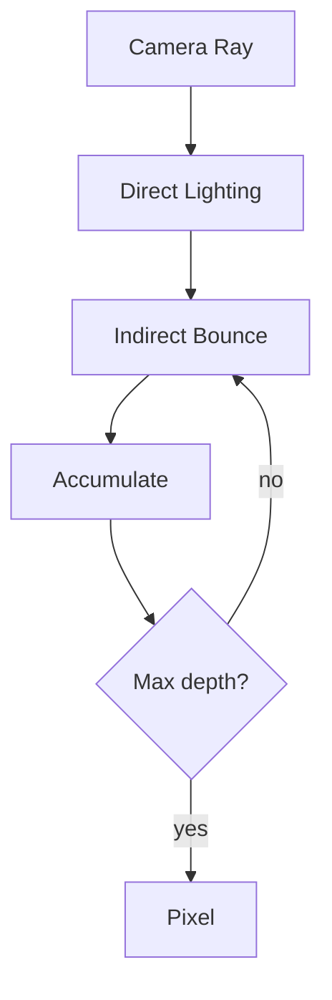


This chapter brings together the ray-tracing algorithms, radiometric concepts, and Monte Carlo sampling algorithms of the previous chapters to implement two different integrators that compute scattered radiance from surfaces in the scene. These integrators are much more effective than the `RandomWalkIntegrator` from the first chapter; with them, some scenes are rendered with hundreds of times lower error.

We start by deriving the light transport equation, which was first introduced in Section 1.2.6. We can then formally introduce the path-tracing algorithm, which applies Monte Carlo integration to solve that equation. We will then describe the implementation of the `SimplePathIntegrator`, which provides a pared-down implementation of path tracing that is useful for understanding the basic algorithm and for debugging sampling algorithms. The chapter concludes with the `PathIntegrator`, which is a more complete path tracing implementation.

Both of these integrators find light-carrying paths starting from the camera, accounting for scattering from shapes’ surfaces. Chapter 14 will extend path tracing to include the effects of participating media. (The online edition of this book also includes a chapter that describes bidirectional methods for constructing light-carrying paths starting both from the camera and from light sources.)

## 13.1 THE LIGHT TRANSPORT EQUATION

The light transport equation (LTE) is the governing equation that describes the equilibrium distribution of radiance in a scene. It gives the total reflected radiance at a point on a surface in terms of emission from the surface, its `BSDF`, and the distribution of incident illumination arriving at the point. For now we will continue to only consider the case where there are no participating media in the scene, saving those complexities for Chapter 14.

The detail that makes evaluating the LTE difficult is the fact that incident radiance at a point is affected by the geometry and scattering properties of all the objects in the scene. For example, a bright light shining on a red object may cause a reddish tint on nearby objects in the scene, or glass may focus light into caustic patterns on a tabletop. Rendering algorithms that account for this complexity are often called global illumination algorithms, to differentiate them from local illumination algorithms that use only information about the local surface properties in their shading computations.

```text
    PathIntegrator 833
    RandomWalkIntegrator 33
```

```text
    SimplePathIntegrator 826
```

In this section, we will first derive the LTE and describe some approaches for manipulating the equation to make it easier to solve numerically. We will then describe two generalizations of the LTE that make some of its key properties more clear and serve as the foundation for integrators that implement sophisticated light transport algorithms.

### 13.1.1 BASIC DERIVATION

The light transport equation depends on the basic assumptions we have already made in choosing to use radiometry to describe light—that wave optics effects are unimportant and that the distribution of radiance in the scene is in equilibrium.

The key principle underlying the LTE is energy balance. Any change in energy has to be “charged” to some process, and we must keep track of all the energy. Since we are assuming that lighting is a linear process, the difference between the amount of energy going out of a system and the amount of energy coming in must also be equal to the difference between energy emitted and energy absorbed. This idea holds at many levels of scale. On a macro level we have conservation of power: Φo − Φi = Φe − Φa. The difference between the power leaving an object, Φo, and the power entering it, Φi, is equal to the difference between the power it emits and the power it absorbs, Φe − Φa.

To enforce energy balance at a surface, exitant radiance Lo must be equal to emitted radiance plus the fraction of incident radiance that is scattered. Emitted radiance is given by Le, and scattered radiance is given by the scattering equation, which gives

Because we have assumed for now that no participating media are present, radiance is constant along rays through the scene. We can therefore relate the incident radiance at p to the outgoing radiance from another point p′, as shown by Figure 13.1. If we define the ray-casting function t(p, ω) as a function that computes the first surface point p′ intersected by a ray from p in the direction ω, we can write the incident radiance at p in terms of outgoing radiance at p′: Li(p, ω) = Lo(t(p, ω), −ω).

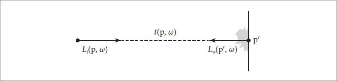


*Figure 13.1: Radiance along a Ray through Free Space Is Unchanged. Therefore, to compute the incident radiance along a ray from point p in direction ω, we can find the first surface the ray intersects and compute exitant radiance in the direction −ω there. The ray-casting function t(p, ω) gives the point p′ on the first surface that the ray (p, ω) intersects.*

In case the scene is not closed, we will define the ray-casting function to return a special value Λ if the ray (p, ω) does not intersect any object in the scene, such that Lo(Λ, ω) is always 0.

Dropping the subscripts from Lo for brevity, this relationship allows us to write the LTE as

The key to the above representation is that there is only one quantity of interest, exitant radiance from points on surfaces. Of course, it appears on both sides of the equation, so our task is still not simple, but it is certainly easier. It is important to keep in mind that we were able to arrive at this equation simply by enforcing energy balance in our scene.

### 13.1.2 ANALYTIC SOLUTIONS TO THE LTE

The brevity of the LTE belies the fact that it is impossible to solve analytically other than in very simple cases. The complexity that comes from physically based `BSDF` models, arbitrary scene geometry, and the intricate visibility relationships among objects all conspire to mandate a numerical solution technique. Fortunately, the combination of ray-tracing algorithms and Monte Carlo integration gives a powerful pair of tools that can handle this complexity without needing to impose restrictions on various components of the LTE (e.g., requiring that all `BSDFs` be Lambertian or substantially limiting the geometric representations that are supported).

It is possible to find analytic solutions to the LTE in very simple settings. While this is of little help for general-purpose rendering, it can help with debugging the implementations of integrators. If an integrator that is supposed to solve the complete LTE does not compute a solution that matches an analytic solution, then clearly there is a bug in the integrator. As an example, consider the interior of a sphere where all points on the surface of the sphere have a Lambertian BRDF, f (p, ωo, ωi) = c, and

also emit a constant amount of radiance in all directions. We have

The outgoing radiance distribution at any point on the sphere interior must be the same as at any other point; nothing in the environment introduces any variation among different points. Therefore, the incident radiance distribution must be the same at all points, and the cosine-weighted integral of incident radiance must be the same everywhere as well. As such, we can replace the radiance functions with constants and simplify, writing the LTE as L = Le + cπ L. While we could immediately solve this equation for L, it is interesting to consider successive substitution of the right hand side into the L term on the right hand side. If we also replace πc with

ρhh, the reflectance of a Lambertian surface, we have In other words, exitant radiance is equal to the emitted radiance at the point plus light that has been scattered by a `BSDF` once after emission, plus light that has been scattered twice, and so forth.

Because ρhh < 1 due to conservation of energy, the series converges and the reflected radiance at all points in all directions is

(This series is called a Neumann series.)

This process of repeatedly substituting the LTE’s right hand side into the incident radiance term in the integral can be instructive in more general cases.1 For example, only accounting for direct illumination effectively computes the result of making a single substitution:

where

```text
                                       Ld(p, ωi) = Le(t(p, ωi), −ωi)
```

and further scattering is ignored.

Over the next few pages, we will see how performing successive substitutions in this manner and then regrouping the results expresses the LTE in a more natural way for developing rendering algorithms.

### 13.1.3 THE SURFACE FORM OF THE LTE

One reason the LTE as written in Equation (13.1) is complex is that the relationship between geometric objects in the scene is implicit in the ray-tracing function t(p, ω). Making the behavior of this function explicit in the integrand will shed some light on the structure of this equation. To do this, we will rewrite Equation (13.1) as an integral over area instead of an integral over directions on the sphere.

First, we define exitant radiance from a point p′ to a point p by

```text
                                            L(p′ → p) = L(p′, ω)
```

if p′ and p are mutually visible and . We can also write the `BSDF` at p′ as

```text
                                       f (p″ → p′ → p) = f (p′, ωo, ωi),
```

where and (Figure 13.2). This is sometimes called the three-point form of the `BSDF`.

Rewriting the terms in the LTE in this manner is not quite enough, however. We also need to multiply by the Jacobian that relates solid angle to area in order to transform the LTE from an integral over direction to one over surface area. Recall that this is |cos θ′|/r2.

We will combine this change-of-variables term, the original |cos θ| term from the LTE, and a binary visibility function V (V = 1 if the two points are mutually visible, and V = 0 otherwise) into a single geometric coupling term, G(p ↔ p′):

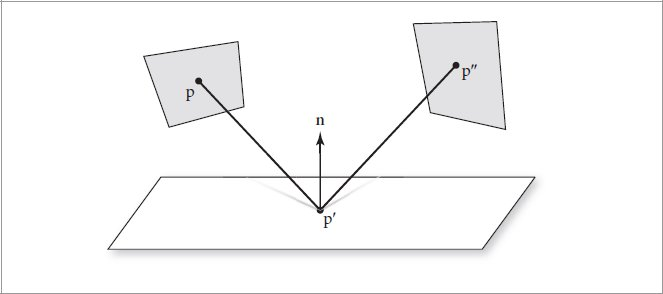


*Figure 13.2: The three-point form of the light transport equation converts the integral to be over the domain of points on surfaces in the scene, rather than over directions on the sphere. It is a key transformation for deriving the path integral form of the light transport equation.*

Substituting these into the light transport equation and converting to an area integral, we have the three-point form of the LTE,

where A is all the surfaces of the scene.

Although Equations (13.1) and (13.3) are equivalent, they represent two different ways of approaching light transport. To evaluate Equation (13.1) with Monte Carlo, we would sample directions from a distribution of directions on the sphere and cast rays to evaluate the integrand. For Equation (13.3), however, we would sample points on surfaces according to a distribution over surface area and compute the coupling between those points to evaluate the integrand, tracing rays to evaluate the visibility term V (p ↔ p′).

### 13.1.4 INTEGRAL OVER PATHS

With the area integral form of Equation (13.3), we can derive a more flexible form of the LTE known as the path integral formulation of light transport, which expresses radiance as an integral over paths that are themselves points in a high-dimensional path space. One of the main motivations for using path space is that it provides an expression for the value of a measurement as an explicit integral over paths, as opposed to the unwieldy recursive definition resulting from the energy balance equation, (13.1).

The explicit form allows for considerable freedom in how these paths are found—essentially any technique for randomly choosing paths can be turned into a workable rendering algorithm that computes the right answer given a sufficient number of samples. This form of the LTE provides the foundation for bidirectional light transport algorithms.

To go from the area integral to a sum over path integrals involving light-carrying paths of different lengths, we can start to expand the three-point light transport equation, repeatedly substituting the right hand side of the equation into the L(p″ → p′) term inside the integral. Here are the first few terms that give incident radiance at a point p0 from another point p1, where p1 is the first point on a surface along the ray from p0 in direction p1 − p0:

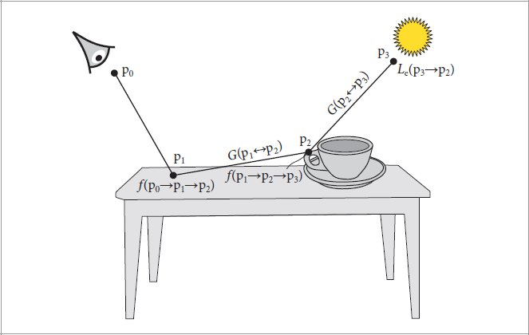


*Figure 13.3: The integral over all points p2 and p3 on surfaces in the scene given by the light transport equation gives the total contribution of two bounce paths to radiance leaving p1 in the direction of p0. The components of the product in the integrand are shown here: the emitted radiance from the light, Le; the geometric terms between vertices, G; and scattering from the `BSDFs`, f .*

Each term on the right side of this equation represents a path of increasing length. For example, the third term is illustrated in Figure 13.3. This path has four vertices, connected by three segments. The total contribution of all such paths of length four (i.e., a vertex at the camera, two vertices at points on surfaces in the scene, and a vertex on a light source) is given by this term. Here, the first two vertices of the path, p0 and p1, are predetermined based on the camera ray origin and the point that the camera ray intersects, but p2 and p3 can vary over all points on surfaces in the scene. The integral over all such p2 and p3 gives the total contribution of paths of length four to radiance arriving at the camera.

This infinite sum can be written compactly as

P(pn) gives the amount of radiance scattered over a path pn with n + 1 vertices, pn = p0, p1, … , pn, where p0 is on the film plane or front lens element and pn is on a light source, and

Before we move on, we will define one additional term that will be helpful in the subsequent discussion. The product of a path’s `BSDF` and geometry terms is called the throughput of the path; it describes the fraction of radiance from the light source that arrives at the camera after all the scattering at vertices between them. We will denote it by

so

Given Equation (13.4) and a particular length n, all that we need to do to compute a Monte Carlo estimate of the radiance arriving at p0 due to paths of length n is to sample a set of vertices with an appropriate sampling density, pn ~ p, to generate a path and then to evaluate an estimate of P (pn)

using those vertices: Whether we generate those vertices by starting a path from the camera, starting from the light, starting from both ends, or starting from a point in the middle is a detail that only affects how the path probability p(pn) is computed. We will see how this formulation leads to practical light transport algorithms throughout this and the following chapters.

### 13.1.5 DELTA DISTRIBUTIONS IN THE INTEGRAND

Delta functions may be present in P (pi) terms due not only to certain types of light sources (e.g., point lights and directional lights) but also to `BSDF` components described by delta distributions. If present, these distributions need to be handled explicitly by the light transport algorithm. For example, it is impossible to randomly choose an outgoing direction from a point on a surface that would intersect a point light source; instead, it is necessary to explicitly choose the single direction from the point to the light source if we want to be able to include its contribution. (The same is true for sampling `BSDFs` with delta components.) While handling this case introduces some additional complexity to the integrators, it is generally welcome because it reduces the dimensionality of the integral to be evaluated, turning parts of it into a plain sum.

For example, consider the direct illumination term, P (p2), in a scene with a single point light source at point plight described by a delta distribution:

In other words, p2 must be the light’s position in the scene; the delta distribution in the numerator cancels out due to an implicit delta distribution in p(plight) (recall the discussion of sampling Dirac delta distributions in Section 12.1), and we are left with terms that can be evaluated directly, with no need for Monte Carlo. An analogous situation holds for `BSDFs` with delta distributions in the path throughput T (pn); each one eliminates an integral over area from the estimate to be computed.

### 13.1.6 PARTITIONING THE INTEGRAND

Many rendering algorithms have been developed that are particularly good at solving the LTE under some conditions but do not work well (or at all) under others. For example, Whitted’s original ray-tracing algorithm only handles specular reflection from delta distribution `BSDFs` and ignores multiply scattered light from diffuse and glossy `BSDFs`.

Because we would like to be able to derive correct light transport algorithms that account for all possible modes of scattering without ignoring any contributions and without double-counting others, it is important to pay attention to which parts of the LTE a particular solution method accounts for. A nice way of approaching this problem is to partition the LTE in various ways. For example, we might

expand the sum over paths to where the first term is trivially evaluated by computing the emitted radiance at p1, the second term is solved with an accurate direct lighting solution technique, but the remaining terms in the sum are handled with a faster but less accurate approach. If the contribution of these additional terms to the total reflected radiance is relatively small for the scene we are rendering, this may be a reasonable approach to take. The only detail is that it is important to be careful to ignore P (p1) and P (p2) with the algorithm that handles P (p3) and beyond (and similarly with the other terms).

It is also useful to partition individual P (pn) terms. For example, we might want to split the emission term into emission from small light sources, Le,s, and emission from large light sources, Le,l, giving us two separate integrals to estimate:

The two integrals can be evaluated independently, possibly using completely different algorithms or different numbers of samples, selected in a way that handles the different conditions well. As long as the estimate of the Le,s integral ignores any emission from large lights, the estimate of the Le,l integral ignores emission from small lights, and all lights are categorized as either “large” or “small,” the correct result is computed in the end.

Finally, the `BSDF` terms can be partitioned as well (in fact, this application was the reason `BSDF` categorization with `BxDFFlags` values was introduced in Section 9.1.2). For example, if fΔ denotes components of the `BSDF` described by delta distributions and f¬Δ denotes the remaining components,

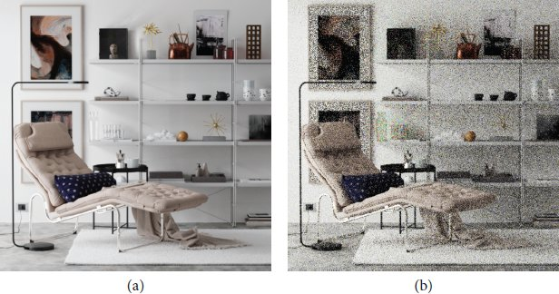


*Figure 13.4: Kroken Scene Rendered with Path Tracing. (a) Rendered with path tracing with 8192 samples per pixel. (b) Rendered with just 8 samples per pixel, giving the characteristic grainy noise that is the hallmark of variance. Although the second image appears darker, the average pixel values of both are actually the same; very large values in some of its pixels cannot be displayed in print. (Scene courtesy of Angelo Ferretti.)*

Note that because there are n − 1BSDF terms in the product, it is important to be careful not to count only terms with just fΔ components or just f¬Δ components; all the mixed terms like fΔ f¬Δ f¬Δ must be accounted for as well if a partitioning scheme like this is used.

## 13.2 PATH TRACING

Now that we have derived the path integral form of the light transport equation, we will show how it can be used to derive the path-tracing light transport algorithm and will present a path-tracing integrator. Figure 13.4 compares images of a scene rendered with different numbers of pixel samples using the path-tracing integrator. In general, hundreds or thousands of samples per pixel may be necessary for high-quality results.

Path tracing was the first general-purpose unbiased Monte Carlo light transport algorithm used in graphics. Kajiya (1986) introduced it in the same paper that first described the light transport equation. Path tracing incrementally generates paths of scattering events starting at the camera and ending at light sources in the scene.

Although it is slightly easier to derive path tracing directly from the basic light transport equation, we will instead approach it from the path integral form, which helps build understanding of the path integral equation and makes the generalization to bidirectional path sampling algorithms easier to understand.

### 13.2.1 OVERVIEW

Given the path integral form of the LTE, we would like to estimate the value of the exitant radiance

from the camera ray’s intersection point p1, for a given camera ray from p0 that first intersects the scene at p1. We have two problems that must be solved in order to compute this estimate:

1. How do we estimate the value of the sum of the infinite number of P (pi) terms with a finite amount of computation?
2. Given a particular P (pi) term, how do we generate one or more paths p in order to compute a Monte Carlo estimate of its multidimensional integral?

For path tracing, we can take advantage of the fact that for physically valid scenes, paths with more vertices scatter less light than paths with fewer vertices overall (this is not necessarily true for any particular pair of paths, just in the aggregate). This is a natural consequence of conservation of energy in `BSDFs`. Therefore, we will always estimate the first few terms P (pi) and will then start to apply Russian roulette to stop sampling after a finite number of terms without introducing bias. (Recall that Section 2.2.4 showed how to use Russian roulette to probabilistically stop computing terms in a sum as long as the terms that are not skipped are reweighted appropriately.) For example, if we always computed estimates of P (p1), P (p2), and P (p3) but stopped without computing more terms with probability q, then an unbiased estimate of the sum would be

Using Russian roulette in this way does not solve the problem of needing to evaluate an infinite sum but has pushed it a bit farther out.

If we take this idea a step further and instead randomly consider terminating evaluation of the sum at

each term with probability qi, we will eventually stop continued evaluation of the sum. Yet, because for any particular value of i there is greater than zero probability of evaluating the term P (pi) and because it will be weighted appropriately if we do evaluate it, the final result is an unbiased estimate of the sum.

### 13.2.2 PATH SAMPLING

Given this method for evaluating only a finite number of terms of the infinite sum, we also need a way to estimate the contribution of a particular term P (pi). We need i + 1 vertices to specify the path, where the last vertex pi is on a light source and the first vertex p0 is a point on the camera film or lens (Figure 13.5). Looking at the form of P (pi), a multiple integral over surface area of objects in the scene, the most natural thing to do is to sample vertices pi according to the surface area of objects in the scene, such that all points on surfaces in the scene are sampled with equal probability. (We do not actually use this approach in the integrator implementations in this chapter for reasons that will be described later, but this sampling technique could possibly be used to improve the efficiency of our basic implementation and helps to clarify the meaning of the path integral LTE.)

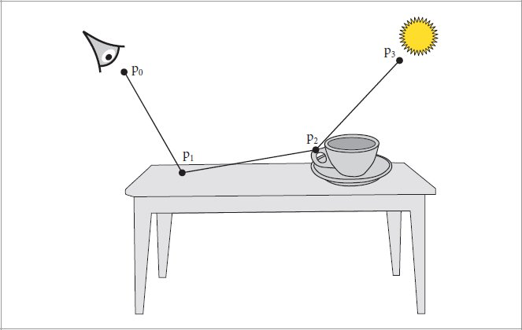


*Figure 13.5: A path pi of i + 1 vertices from the camera at p, intersecting a series of positions on surfaces in the scene, to a point on the light pi. Scattering according to the `BSDF` occurs at each path vertex from p1 to pi−1 such that the radiance estimate at the camera due to this path is given by the product of the path throughput T (pi) and the emitted radiance from the light divided by the path sampling weights.*

With this sampling approach, we might define a discrete probability over the n objects in the scene. If each has surface area Ai, then the probability of sampling a path vertex on the surface of the ith object

should be Then, given a method to sample a point on the ith object with uniform probability, the probability density function (PDF) for sampling any particular point on object i is 1/Ai. Thus, the overall

probability density for sampling the point is and all samples pi have the same PDF value:

It is reassuring that they all have the same weight, since our intent was to choose among all points on surfaces in the scene with equal probability.

Given the set of vertices p0, p1, … , pi−1 sampled in this manner, we can then sample the last vertex pi on a light source in the scene, defining its PDF in the same way. Although we could use the same technique used for sampling path vertices to sample points on lights, this would usually lead to high variance, since for all the paths where pi was not on the surface of an emitter, the path would have zero value. The expected value would still be the correct value of the integral, but convergence would be extremely slow. A better approach is to sample over the areas of only the emitting objects with probabilities updated accordingly. Given a complete path, we have all the information we need to compute the estimate of P (pi); it is just a matter of evaluating each of the terms.

It is easy to be more creative about how we set the sampling probabilities with this general approach. For example, if we knew that indirect illumination from a few objects contributed to most of the lighting in the scene, we could assign a higher probability to generating path vertices pi on those objects, updating the sample weights appropriately.

However, there are two interrelated problems with sampling paths in this manner. The first can lead to high variance, while the second can lead to incorrect results. The first problem is that many of the paths will have no contribution if they have pairs of adjacent vertices that are not mutually visible. Consider applying this area sampling method in a complex building model: adjacent vertices in the path will almost always have a wall or two between them, giving no contribution for the path and high variance in the estimate.

The second problem is that if the integrand has delta functions in it (e.g., a point light source or a perfect specular `BSDF`), this sampling technique will never be able to choose path vertices such that the delta distributions are nonzero. Even if there are no delta distributions, as the `BSDFs` become increasingly glossy almost all the paths will have low contributions since the points in f (pi+1 → pi → pi−1) will cause the `BSDF` to have a small or zero value, and again we will suffer from high variance.

### 13.2.3 INCREMENTAL PATH CONSTRUCTION

A solution that solves both of these problems is to construct the path incrementally, starting from the vertex at the camera p0. At each vertex, the `BSDF` is sampled to generate a new direction; the next vertex pi+1 is found by tracing a ray from pi in the sampled direction and finding the closest intersection. We are effectively trying to find a path with a large overall contribution by making a

series of choices that find directions with important local contributions. While one can imagine situations where this approach could be ineffective, it is generally a good strategy.

Because this approach constructs the path by sampling `BSDFs` according to solid angle, and because the path integral LTE is an integral over surface area in the scene, we need to apply the correction to convert from the probability density according to solid angle pω to a density according to area pA (Section 4.2). If ωi−1 is the normalized direction sampled at pi−1, it is:

This correction causes all the factors of the corresponding geometric function G(pi+1 ↔ pi) to cancel out of P (pi) except for the cos θi+1 term. Furthermore, we already know that pi−1 and pi must be mutually visible since we traced a ray to find pi, so the visibility term is trivially equal to 1. An alternative way to think about this is that ray tracing provides an operation to importance sample the visibility component of G.

With path tracing, the last vertex of the path, which is on the surface of a light source, gets special treatment. Rather than being sampled incrementally, it is sampled from a distribution that is just over the surfaces of the lights. (Sampling the last vertex in this way is often referred to as next event estimation (NEE), after a Monte Carlo technique with that name.) For now we will assume there is such a sampling distribution pe over the emitters, though in Section 13.4 we will see that a more effective estimator can be constructed using multiple importance sampling.

With this approach, the value of the Monte Carlo estimate for a path is

Because this sampling scheme reuses vertices of the path of length i − 1 (except the vertex on the emitter) when constructing the path of length i, it does introduce correlation among the P (pi) terms. This does not affect the unbiasedness of the Monte Carlo estimator, however. In practice this correlation is more than made up for by the improved efficiency from tracing fewer rays than would be necessary to make the P (pi) terms independent.

Relationship to the `RandomWalkIntegrator` With this derivation of the foundations of path tracing complete, the implementation of the `RandomWalkIntegrator` from Chapter 1 can now be understood more formally: at each path vertex, uniform spherical sampling is used for the distribution pω—and hence the division by 1/(4π), corresponding to the uniform spherical PDF. The factor in parentheses in Equation (13.7) is effectively computed via the product of `beta` values through recursive calls to

`RandomWalkIntegrator::LiRandomWalk()`. Emissive surfaces contribute to the radiance estimate whenever a randomly sampled path hits a surface with a nonzero Le; because directions are sampled with respect to solid angle, the pe(pi) factor in Equation (13.7) is not over emissive geometry but is the uniform directional probability pω. Most of the remaining G factor then cancels out due to the change of variables from integrating over area to integrating over solid angle.

## 13.3 A SIMPLE PATH TRACER

The path tracing estimator in Equation (13.7) makes it possible to apply the `BSDF` and light sampling techniques that were respectively defined in Chapters 9 and 12 to rendering. As shown in Figure 13.6, more effective importance sampling approaches than the uniform sampling in the `RandomWalkIntegrator` significantly reduce error. Although the `SimplePathIntegrator` takes longer to render an image at equal sample counts, most of that increase is because paths often terminate early with the `RandomWalkIntegrator`; because it samples outgoing directions at intersections uniformly over the sphere, half of the sampled directions lead to path termination at non-transmissive surfaces. The overall improvement in Monte Carlo efficiency from the `SimplePathIntegrator` is 12.8×.

The “simple” in the name of this integrator is meaningful: `PathIntegrator`, which will be introduced shortly, adds a number of additional sampling improvements and should be used in preference to `SimplePathIntegrator` if rendering efficiency is important. This integrator is still useful beyond pedagogy, however; it is also useful for debugging and for validating the implementation of sampling algorithms. For example, it can be configured to use `BSDFs`’ sampling methods or to use uniform directional sampling; given a sufficient number of samples, both approaches should converge to the same result (assuming that the `BSDF` is not perfect specular). If they do not, the error is presumably in the `BSDF` sampling code. Light sampling techniques can be tested in a similar fashion.

```text
    PathIntegrator 833
    RandomWalkIntegrator 33
    RandomWalkIntegrator::LiRandomWalk() 33
    SimplePathIntegrator 826
```

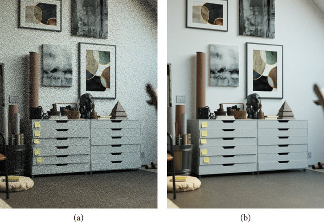


*Figure 13.6: Comparison of the `RandomWalkIntegrator` and the `SimplePathIntegrator`. (a) Scene rendered with 64 pixel samples using the `RandomWalkIntegrator`. (b) Rendered with 64 pixel samples and the `SimplePathIntegrator`. The `SimplePathIntegrator` gives an image that is visibly much improved, thanks to using more effective `BSDF` and light sampling techniques. Here, mean squared error (MSE) is reduced by a factor of 101. Even though rendering time was 7.8× longer, the overall improvement in Monte Carlo efficiency was still 12.8×. (Scene courtesy of Angelo Ferretti.)*

〈SimplePathIntegrator Definition〉 ≡ 826

```text
class SimplePathIntegrator : public RayIntegrator {
  public:
    〈SimplePathIntegrator Public Methods〉
  private:
    〈SimplePathIntegrator Private Members 827〉
};
```

The constructor sets the following member variables from provided parameters, so it is not included here. Similar to the `RandomWalkIntegrator`, `maxDepth` caps the maximum path length.2

The `sampleLights` member variable determines whether lights’ `SampleLi()` methods should be used to sample direct illumination or whether illumination should only be found by rays randomly intersecting emissive surfaces, as was done in the `RandomWalkIntegrator`. In a similar fashion, `sampleBSDF` determines whether `BSDFs`’ `Sample_f()` methods should be used to sample directions

or whether uniform directional sampling should be used. Both are true by default. A `UniformLightSampler` is always used for sampling a light; this, too, is an instance where this integrator opts for simplicity and a lower likelihood of bugs in exchange for lower efficiency.

```text
    RandomWalkIntegrator 33
    RayIntegrator 28
    SimplePathIntegrator 826
    UniformLightSampler 782
```

〈SimplePathIntegrator Private Members〉 ≡ 826

```rust
   max_depth: i32,
   sample_lights: bool,
   sample_bsdf: bool,
   light_sampler: UniformLightSampler,
```

As a `RayIntegrator`, this integrator provides a `Li()` method that returns an estimate of the radiance along the provided ray. It does not provide the capability of initializing a `VisibleSurface` at the first intersection point, so the corresponding parameter is ignored.

〈SimplePathIntegrator Method Definitions〉 ≡ 827

```text
SampledSpectrum SimplePathIntegrator::Li(RayDifferential ray,
        SampledWavelengths &lambda, Sampler sampler,
        ScratchBuffer &scratchBuffer, VisibleSurface *) const {
    〈Estimate radiance along ray using simple path tracing 827〉
}
```

A number of variables record the current state of the path. L is the current estimated scattered radiance from the running total of and ray is updated after each surface intersection to be the next ray to be traced. `specularBounce` records if the last outgoing path direction sampled was due to specular reflection; the need to track this will be explained shortly.

The `beta` variable holds the path throughput weight, which is defined as the factors of the throughput function T (pi−1)—that is, the product of the `BSDF` values and cosine terms for the vertices generated so far, divided by their respective sampling PDFs:

Thus, the product of `beta` with scattered light from direct lighting from the final vertex of the path gives the contribution for a path. (This quantity will reoccur many times in the following few chapters, and we will consistently refer to it as `beta`.) Because the effect of earlier path vertices is aggregated in this way, there is no need to store the positions and `BSDFs` of all the vertices of the path—only the last one.

〈Estimate radiance along ray using simple path tracing〉 ≡ 827

```rust
    let mut l = SampledSpectrum::new(0.0);
    let mut beta = SampledSpectrum::new(1.0);
    let mut specular_bounce = true;
    let mut depth = 0;
    while !beta.is_zero() {
        // 〈Find next SimplePathIntegrator vertex and accumulate contribution〉
    }
    return l;
```

Each iteration of the while loop accounts for an additional segment of a path, corresponding to a term of P (pi)’s sum.

〈Find next SimplePathIntegrator vertex and accumulate contribution〉 ≡ 827

- 〈Intersect ray with scene 828〉
- 〈Account for infinite lights if ray has no intersection 828〉
- 〈Account for emissive surface if light was not sampled 828〉
- 〈End path if maximum depth reached 829〉
- 〈Get BSDF and skip over medium boundaries 828〉
- 〈Sample direct illumination if sampleLights is true 829〉
- 〈Sample outgoing direction at intersection to continue path 830〉
```text
    RayDifferential 96
    RayIntegrator 28
    SampledSpectrum 171
    SampledWavelengths 173
    Sampler 469
    ScratchBuffer 1078
    UniformLightSampler 782
    VisibleSurface 245
```

The first step is to find the intersection of the ray for the current segment with the scene geometry.

〈Intersect ray with scene〉 ≡ 827

```rust
   let si: Option<ShapeIntersection> = self.intersect(ray);
```

If there is no intersection, then the ray path comes to an end. Before the accumulated path radiance estimate can be returned, however, in some cases radiance from infinite light sources is added to the path’s radiance estimate, with contribution scaled by the accumulated `beta` factor.

If `sampleLights` is false, then emission is only found when rays happen to intersect emitters, in which case the contribution of infinite area lights must be added to rays that do not intersect any geometry. If it is true, then the integrator calls the `Light` `SampleLi()` method to estimate direct illumination at each path vertex. In that case, infinite lights have already been accounted for, except in

the case of a specular `BSDF` at the previous vertex. Then, `SampleLi()` is not useful since only the specular direction scatters light. Therefore, `specularBounce` records whether the last `BSDF` was perfect specular, in which case infinite area lights must be included here after all.

〈Account for infinite lights if ray has no intersection〉 ≡ 827

```rust
   if si.is_none() {
        if !self.sample_lights || specular_bounce {
            for light in &self.infinite_lights {
                l += beta * light.le(ray, lambda);
            }
        }
        break;
   }
```

If the ray hits an emissive surface, similar logic governs whether its emission is added to the path’s radiance estimate.

〈Account for emissive surface if light was not sampled〉 ≡ 827

```rust
   let isect = si.as_ref().unwrap().intr;
   if !self.sample_lights || specular_bounce {
        l += beta * isect.le(-ray.d, lambda);
   }
```

The next step is to find the `BSDF` at the intersection point. A special case arises when an unset `BSDF` is returned by the `SurfaceInteraction`’s `GetBSDF()` method. In that case, the current surface should have no effect on light. pbrt uses such surfaces to represent transitions between participating media, whose boundaries are themselves optically inactive (i.e., they have the same index of refraction on both sides). Since the `SimplePathIntegrator` ignores media, it simply skips over such surfaces without counting them as scattering events in the depth counter.

〈Get BSDF and skip over medium boundaries〉 ≡ 827, 834, 884

```rust
   let bsdf = isect.get_bsdf(ray, lambda, camera, &mut scratch_buffer, sampler);
   if bsdf.is_none() {
        isect.skip_intersection(&mut ray, si.as_ref().unwrap().t_hit);
        continue;
   }
   let bsdf = bsdf.unwrap();
```

```text
    BSDF 544
    Integrator::infiniteLights 23
    Integrator::Intersect() 23
    Light 740
    Light::Le() 743
    Ray::d 95
    ShapeIntersection 266
    ShapeIntersection::intr 266
```

```text
    ShapeIntersection::tHit 266
    SimplePathIntegrator::sampleLights 827
    SurfaceInteraction 138
    SurfaceInteraction::GetBSDF() 682
    SurfaceInteraction::SkipIntersection() 643
```

Otherwise we have a valid surface intersection and can go ahead and increment depth. The path is then terminated if it has reached the maximum depth.

〈End path if maximum depth reached〉 ≡ 827,834

```rust
   if depth == self.max_depth {
        break;
   }
   depth += 1;
```

If explicit light sampling is being performed, then the first step is to use the `UniformLightSampler` to choose a single light source. (Recall from Section 12.6 that sampling only one of the scene’s light sources can still give a valid estimate of the effect of all of them, given suitable weighting.)

〈Sample direct illumination if sampleLights is true〉 ≡ 827

```rust
   let wo = -ray.d;
   if self.sample_lights {
        if let Some(sampled_light) = self.light_sampler.sample(sampler.get_1d()) {
            // 〈Sample point on sampledLight to estimate direct illumination〉
        }
   }
```

Given a light source, a call to `SampleLi()` yields a sample on the light. If the light sample is valid, a direct lighting calculation is performed.

〈Sample point on sampledLight to estimate direct illumination〉 ≡ 829

```rust
   let u_light = sampler.get_2d();
   if let Some(ls) = sampled_light.light.sample_li(isect, u_light, lambda) {
       if ls.l.is_nonzero() && ls.pdf > 0.0 {
           // 〈Evaluate BSDF for light and possibly add scattered radiance〉
       }
   }
```

```text
    AbsDot() 90
    BSDF::f() 545
    Integrator 22
    Integrator::Unoccluded() 830
```

```text
    Light::SampleLi() 741
    LightLiSample 743
    LightLiSample::L 743
    LightLiSample::pdf 743
    LightLiSample::pLight 743
    LightLiSample::wi 743
    Point2f 92
    Ray::d 95
    SampledLight 782
    SampledLight::light 782
    SampledLight::p 782
    SampledSpectrum 171
    Sampler::Get1D() 470
    Sampler::Get2D() 470
    SimplePathIntegrator::lightSampler 827
    SimplePathIntegrator::maxDepth 827
    SimplePathIntegrator::sampleLights 827
    SurfaceInteraction::shading::n 139
    UniformLightSampler 782
    UniformLightSampler::Sample() 783
    Vector3f 86
```

Returning to the path tracing estimator in Equation (13.7), we have the path throughput weight in `beta`, which corresponds to the term in parentheses there. A call to `SampleLi()` yields a sample on the light. Because the light sampling methods return samples that are with respect to solid angle and not area, yet another Jacobian correction term is necessary, and the estimator becomes

where pl is the solid angle density that the chosen light l would use to sample the direction ωi and p(l) is the discrete probability of sampling the light l (recall Equation (12.2)) product gives the full probability of the light sample.

Before tracing the shadow ray to evaluate the visibility factor V, it is worth checking if the `BSDF` is zero for the sampled direction, in which case that computational expense is unnecessary.

〈Evaluate BSDF for light and possibly add scattered radiance〉 ≡ 829

```rust
   let wi = ls.wi;
   let f = bsdf.f(wo, wi) * abs_dot(wi, isect.shading.n);
   if f.is_nonzero() && self.unoccluded(isect, ls.p_light) {
        l += beta * f * ls.l / (sampled_light.p * ls.pdf);
   }
```

`Unoccluded()` is a convenience method provided in the `Integrator` base class.

〈Integrator Public Methods〉 +≡ 22

```rust
   fn unoccluded(&self, p0: &Interaction, p1: &Interaction) -> bool {
        !self.intersect_p(p0.spawn_ray_to(p1), 1.0 - SHADOW_EPSILON)
   }
```

To sample the next path vertex, the direction of the ray leaving the surface is found either by calling the `BSDF`’s sampling method or by sampling uniformly, depending on the `sampleBSDF` parameter.

〈Sample outgoing direction at intersection to continue path〉 ≡ 827

```rust
   if self.sample_bsdf {
        // 〈Sample BSDF for new path direction〉
   } else {
        // 〈Uniformly sample sphere or hemisphere to get new path direction〉
   }
```

If `BSDF` sampling is being used to sample the new direction, the `Sample_f()` method gives a direction and the associated `BSDF` and PDF values. `beta` can then be updated according to Equation (13.8).

〈Sample BSDF for new path direction〉 ≡ 830

```rust
   let u = sampler.get_1d();
   if let Some(bs) = bsdf.sample_f(wo, u, sampler.get_2d()) {
       beta *= bs.f * abs_dot(bs.wi, isect.shading.n) / bs.pdf;
       specular_bounce = bs.is_specular();
       ray = isect.spawn_ray(bs.wi);
   } else {
       break;
   }
```

Otherwise, the fragment 〈Uniformly sample sphere or hemisphere to get new path direction〉 uniformly samples a new direction for the ray leaving the surface. It goes through more care than the `RandomWalkIntegrator` did: for example, if the surface is reflective but not transmissive, it makes sure that the sampled direction is in the hemisphere where light is scattered. We will not include that fragment here, as it has to handle a number of such cases, but there is not much that is interesting about how it does so.

```text
    AbsDot() 90
    BSDF::Sample_f() 545
    BSDFSample 541
    BSDFSample::f 541
    BSDFSample::IsSpecular() 541
    BSDFSample::pdf 541
```

```text
    BSDFSample::wi 541
    BVHLightSampler 796
    Float 23
    GBufferFilm 253
    Integrator::IntersectP() 24
    Interaction 136
    Interaction::SpawnRayTo() 383
    LightSampler 781
    PathIntegrator 833
    RandomWalkIntegrator 33
    Sampler::Get1D() 470
    Sampler::Get2D() 470
    ShadowEpsilon 383
    SimplePathIntegrator 826
    SimplePathIntegrator::sampleBSDF 827
    SurfaceInteraction::shading::n 139
    SurfaceInteraction::SpawnRay() 645
    VisibleSurface 245
```

## 13.4 A BETTER PATH TRACER

The `PathIntegrator` is based on the same path tracing approach as the `SimplePathIntegrator` but incorporates a number of improvements. They include these:

- The direct lighting calculation is performed by sampling both the `BSDF` and the sampled light source and weighting both samples using multiple importance sampling. This approach can substantially reduce variance compared to sampling the light alone.
- Any `LightSampler` can be used, which makes it possible to use effective light sampling algorithms like the one implemented in `BVHLightSampler` to choose lights.
- It initializes the `VisibleSurface` when it is provided, giving geometric information about the first intersection point to `Film` implementations like `GBufferFilm`.
- Russian roulette is used to terminate paths, which can significantly boost the integrator’s efficiency.
- A technique known as path regularization can be applied in order to reduce variance from difficult-to-sample paths.

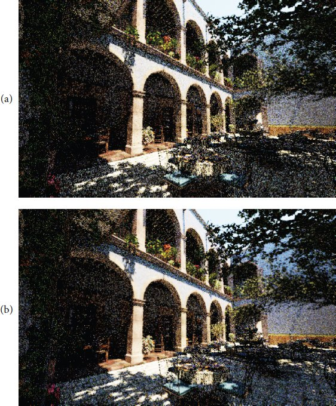


*Figure 13.7: Comparison of the `SimplePathIntegrator` and the `PathIntegrator`. (a) Rendered using the `SimplePathIntegrator` with 64 samples per pixel. (b) The `PathIntegrator`, also with 64 samples per pixel. Once again, improving the underlying sampling algorithms leads to a substantial reduction in error. Not only is MSE improved by a factor of 1.97, but execution time is 4.44× faster, giving an overall efficiency improvement of 8.75×. (Scene courtesy of Guillermo M. Leal Llaguno.)*

While these additions make its implementation more complex, they also substantially improve efficiency; see Figure 13.7 for a comparison of the two.

The most important of these differences is how the direct lighting calculation is performed. In the `SimplePathIntegrator`, a light was chosen with uniform probability and then that light sampled a direction; the corresponding estimator was given by Equation (13.9). More generally, the path contribution estimator can be expressed in terms of an arbitrary directional probability distribution p,

which gives

```text
    PathIntegrator 833
    SimplePathIntegrator 826
```

It may seem that using only a sampling PDF that matches the Le factor to sample these directions, as done by the `SimplePathIntegrator`, would be a good strategy; after all, the radiance Le can then be expected to be nonzero for the sampled direction. If we instead drew samples using the `BSDF`’s sampling distribution, we might choose directions that did not intersect a light source at all, finding no emitted radiance after incurring the expense of tracing a ray in the hope of intersecting a light.

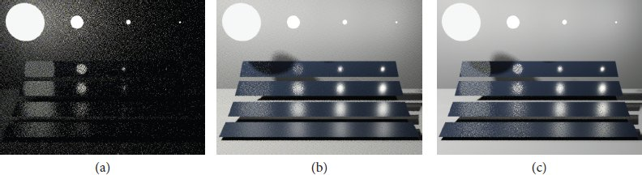


*Figure 13.8: Four surfaces ranging from very smooth (top) to very rough (bottom) illuminated by spherical light sources of decreasing size and rendered with different sampling techniques (modeled after a scene by Eric Veach). (a) `BSDF` sampling, (b) light sampling, and (c) both techniques combined using MIS. Sampling the `BSDF` is generally more effective for highly specular materials and large light sources, as illumination is coming from many directions, but the `BSDF`’s value is large for only a few of them (top left reflection). The converse is true for small sources and rough materials (bottom right reflection), where sampling the light source is more effective.*

However, there are cases where sampling the `BSDF` can be the more effective strategy. For a very smooth surface, the `BSDF` is nonzero for a small set of directions. Sampling the light source will be unlikely to find directions that have a significant effect on scattering from the surface, especially if the light source is large and close by. Even worse, when such a light sample happens to lie in the `BSDF` lobe, an estimate with large magnitude will be the result due to the combination of a high contribution from the numerator and a small value for the PDF in the denominator. The estimator has high variance.

*Figure 13.8 shows a variety of cases where each of these sampling methods is much better than the other. In this scene, four rectangular surfaces ranging from very smooth (top) to very rough (bottom) are illuminated by spherical light sources of decreasing size. Figures 13.8(a) and (b) show the `BSDF` and light sampling strategies on their own. As the example illustrates, sampling the `BSDF` is much more effective when it takes on large values on a narrow set of directions that is much smaller than the set of directions that would be obtained by sampling the light sources. This case is most visible in the top left reflection of a large light source in a low-roughness surface. On the other hand, sampling the light sources can be considerably more effective in the opposite case—when the light source is small and the `BSDF` lobe is less concentrated (this case is most visible in the bottom right reflection).*

Taking a single sample with each sampling technique and averaging the estimators would be of limited benefit. The resulting estimator would still have high variance in cases where one of the sampling strategies was ineffective and that strategy happened to sample a direction with nonzero contribution.

This situation is therefore a natural for the application of multiple importance sampling—we have multiple sampling techniques, each of which is sometimes effective and sometimes not. That approach is used in the `PathIntegrator` with one light sample ωl ~ pl and one `BSDF` sample ωb ~ pb, giving the estimator

```text
    PathIntegrator 833
```

where the surface intersection points corresponding to the two sampled directions are respectively denoted pl and pb and each term includes a corresponding multiple importance sampling (MIS) weight wl or wb that can be computed, for example, using the balance heuristic from Equation (2.14) or the power heuristic from Equation (2.15). Figure 13.8(c) shows the effectiveness of combining these two sampling techniques with multiple importance sampling.

With that context established, we can start the implementation of the `PathIntegrator`. It is another `RayIntegrator`.

〈PathIntegrator Definition〉 ≡ 833

```text
class PathIntegrator : public RayIntegrator {
  public:
    〈PathIntegrator Public Methods〉
  private:
    〈PathIntegrator Private Methods〉
    〈PathIntegrator Private Members 833〉
};
```

Three member variables affect the `PathIntegrator`’s operation: a maximum path depth; the `lightSampler` used to sample a light source; and `regularize`, which controls whether path regularization is used.

〈PathIntegrator Private Members〉 ≡ 833

```rust
   max_depth: i32,
   light_sampler: LightSampler,
   regularize: bool,
```

The form of the `Li()` method is similar to `SimplePathIntegrator::Li()`.

〈PathIntegrator Method Definitions〉 ≡ 833

```text
SampledSpectrum PathIntegrator::Li(RayDifferential ray,
        SampledWavelengths &lambda, Sampler sampler,
        ScratchBuffer &scratchBuffer, VisibleSurface *visibleSurf) const {
    〈Declare local variables for PathIntegrator::Li() 833〉
    〈Sample path from camera and accumulate radiance estimate 834〉
}
```

The L, `beta`, and depth variables play the same role as the corresponding variables did in the `SimplePathIntegrator`.

〈Declare local variables for PathIntegrator::Li()〉 ≡ 833

```rust
   let mut l = SampledSpectrum::new(0.0);
   let mut beta = SampledSpectrum::new(1.0);
   let mut depth: i32 = 0;
```

Also similarly, each iteration of the while loop traces a ray to find its closest intersection and its `BSDF`. Note that a number of code fragments from the `SimplePathIntegrator` are reused here and in what follows to define the body of the while loop. The loop continues until either the maximum path length is reached or the path is terminated via Russian roulette.

```text
    LightSampler 781
    PathIntegrator 833
    RayDifferential 96
    RayIntegrator 28
    SampledSpectrum 171
    SampledWavelengths 173
    Sampler 469
    ScratchBuffer 1078
    SimplePathIntegrator 826
    SimplePathIntegrator::Li() 827
    VisibleSurface 245
```

〈Sample path from camera and accumulate radiance estimate〉 ≡ 833

```rust
   loop {
        // 〈Trace ray and find closest path vertex and its BSDF〉
        // 〈End path if maximum depth reached〉
        // 〈Sample direct illumination from the light sources〉
        // 〈Sample BSDF to get new path direction〉
        // 〈Possibly terminate the path with Russian roulette〉
   }
   return l;
```

We will defer discussing the implementation of the first fragment used below, 〈Add emitted light at intersection point or from the environment〉, until later in this section after more details of the implementation of the MIS direct lighting calculation have been introduced.

〈Trace ray and find closest path vertex and its BSDF〉 ≡ 834

```rust
   let si = self.intersect(ray);
   // 〈Add emitted light at intersection point or from the environment〉
   let isect = si.as_ref().unwrap().intr;
   // 〈Get BSDF and skip over medium boundaries〉
   // 〈Initialize visibleSurf at first intersection〉
   // 〈Possibly regularize the BSDF〉
```

If the `Film` being used takes a `VisibleSurface`, then a non-`nullptr` `VisibleSurface` * is passed to the `Li()` method. It is initialized at the first intersection.

〈Initialize visibleSurf at first intersection〉 ≡ 834, 884

```rust
   if depth == 0 {
        if let Some(vs) = visible_surf.as_mut() {
            // 〈Estimate BSDF’s albedo〉
            *vs = VisibleSurface::new(isect, albedo, lambda);
        }
   }
```

The only quantity that is not immediately available from the `SurfaceInteraction` is the albedo of the surface, which is computed here as the hemispherical-directional reflectance, Equation (4.12). Recall that the `BSDF::rho()` method estimates this value using Monte Carlo integration. Here, a set of 16 precomputed Owen-scrambled Halton points in arrays `ucRho` and `uRho`, not included in the text, are used for the estimate.

The use of Monte Carlo with this many samples is somewhat unsatisfying. The computed albedo is most commonly used for image-space denoising algorithms after rendering; most of these start by dividing the final color at each pixel by the first visible surface’s albedo in order to approximate the incident illumination alone. It is therefore important that the albedo value itself not have very much error. However, the albedo can be computed analytically for some `BSDFs` (e.g., the ideal Lambertian BRDF). In those cases, executing both the `BSDF` sampling and evaluation algorithms repeatedly is wasteful. An exercise at the end of the chapter discusses this matter further.

〈Estimate BSDF’s albedo〉 ≡ 834

```rust
   // 〈Define sample arrays ucRho and uRho for reflectance estimate〉
   let albedo = bsdf.rho(isect.wo, &uc_rho, &u_rho);
```

The next task is to sample a light source to find a direction ωi to use to estimate the first term of Equation (13.10). However, if the `BSDF` is purely specular, there is no reason to do this work, since the value of the `BSDF` for a sampled point on a light will certainly be zero.

```text
    BSDF::rho() 546
    Integrator::Intersect() 23
    Interaction::wo 137
    SampledSpectrum 171
    ShapeIntersection 266
    ShapeIntersection::intr 266
    SurfaceInteraction 138
    VisibleSurface 245
```

〈Sample direct illumination from the light sources〉 ≡ 834

```rust
   if bsdf.flags().is_non_specular() {
        let ld = self.sample_ld(isect, &bsdf, lambda, sampler);
        l += beta * ld;
   }
```

Although `SampleLd()` is only called once and thus could be expanded inline in the `Li()` method, there are multiple points along the way where it may return early. We therefore prefer a function here, as it avoids deeply nested if statements that would be needed otherwise.

〈PathIntegrator Method Definitions〉 +≡ 835

```text
SampledSpectrum PathIntegrator::SampleLd(const SurfaceInteraction &intr,
        const BSDF *bsdf, SampledWavelengths &lambda, Sampler sampler) const {
    〈Initialize LightSampleContext for light sampling 835〉
    〈Choose a light source for the direct lighting calculation 836〉
    〈Sample a point on the light source for direct lighting 836〉
    〈Evaluate BSDF for light sample and check light visibility 836〉
    〈Return light’s contribution to reflected radiance 837〉
}
```

A `LightSampleContext` is necessary both for choosing a specific light source and for sampling a point on it. One is initialized using the constructor that takes a `SurfaceInteraction`.

〈Initialize LightSampleContext for light sampling〉 ≡ 835

```rust
   let mut ctx = LightSampleContext::new(intr);
   // 〈Try to nudge the light sampling position to correct side of the surface〉
```

If the surface is purely reflective or purely transmissive, then the reference point used for sampling pi is shifted slightly so that it lies on the side of the surface from which the outgoing ray will leave the intersection point toward the light. Doing so helps avoid a subtle error that is the result of the combination of floating-point round-off error in the computed intersection point and a ray that

intersects an emitter that does not have a completely absorbing `BSDF`. The problem is illustrated in Figure 13.9.

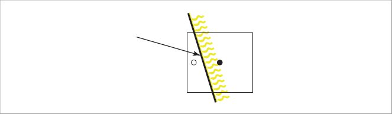


*Figure 13.9: The `LightSampleContext` stores the error bounds around the computed intersection point pi. Typically, the center of these bounds (filled circle) is used as the reference point for sampling a point on the light source. If a ray intersects the non-emissive side of a one-sided light, the light’s `BSDF` is nonzero, and if the center of the pi bounds is on the emissive side of the light, then it may seem that the intersection point is illuminated by the light. The result is an occasional bright pixel on the back side of light sources. Offsetting the reference point to the side of the surface from which the outgoing ray will leave (open circle) works around this problem.*

```text
    BSDF 544
    BSDF::Flags() 544
    BxDFFlags::IsNonSpecular() 539
    LightSampleContext 741
    PathIntegrator::SampleLd() 835
    SampledSpectrum 171
    SampledWavelengths 173
    Sampler 469
    SurfaceInteraction 138
```

〈Try to nudge the light sampling position to correct side of the surface〉 ≡ 835, 886

```rust
   let flags = bsdf.flags();
   if flags.is_reflective() && !flags.is_transmissive() {
        ctx.pi = intr.offset_ray_origin(intr.wo);
   } else if flags.is_transmissive() && !flags.is_reflective() {
        ctx.pi = intr.offset_ray_origin(-intr.wo);
   }
```

Next, the `LightSampler` selects a light. One thing to note in the implementation here is that two more dimensions are consumed from the `Sampler` even if the `LightSampler` does not return a valid light. This is done in order to keep the allocation of `Sampler` dimensions consistent across all the pixel samples. (Recall the discussion of this issue in Section 8.3.)

〈Choose a light source for the direct lighting calculation〉 ≡ 836

```text
Float u = sampler.Get1D();
pstd::optional<SampledLight> sampledLight = lightSampler.Sample(ctx, u);
Point2f uLight = sampler.Get2D();
if (!sampledLight) return {};
```

Sampling a direction with the light proceeds using `Light::SampleLi()`, though here a true value is passed for its `allowIncompletePDF` parameter. Because we will use a second sampling technique, `BSDF` sampling, for the estimator in Equation (13.10), and that technique has nonzero probability of sampling all directions ωi where the integrand is nonzero, the light sampling distribution may not include directions where the light’s emission is relatively low. (The motivation for this was discussed in Section 2.2.3 in the context of MIS compensation.) Given a light sample, it is worth checking for various cases that require no further processing here. As an example, consider a spotlight where the intersection point is outside of its emission cone; the `LightLiSample` will have a zero radiance value in that case. It is worthwhile to find that there is no incident radiance before incurring the cost of evaluating the `BSDF`.

〈Sample a point on the light source for direct lighting〉 ≡ 835

```rust
   let light = sampled_light.light;
   let ls = light.sample_li(ctx, u_light, lambda, true);
   let ls = match ls {
        Some(ls) if ls.l.is_nonzero() && ls.pdf != 0.0 => ls,
        _ => return SampledSpectrum::default(),
   };
```

A shadow ray is only traced if the `BSDF` for the sampled direction is nonzero. It is not unusual for the `BSDF` to be zero here: for example, given a surface that is reflective but not transmissive, any sampled direction that is on the other side of the surface than the incident ray will have zero contribution.

〈Evaluate BSDF for light sample and check light visibility〉 ≡ 835

```rust
   let wo = intr.wo;
   let wi = ls.wi;
   let f = bsdf.f(wo, wi) * abs_dot(wi, intr.shading.n);
   if !f.is_nonzero() || !self.unoccluded(intr, ls.p_light) {
        return SampledSpectrum::default();
   }
```

```text
    AbsDot() 90
    BSDF::f() 545
    BSDF::Flags() 544
    BxDFFlags 539
    BxDFFlags::IsReflective() 539
    BxDFFlags::IsTransmissive() 539
    Float 23
```

```text
    Integrator::Unoccluded() 830
    Interaction::OffsetRayOrigin() 382
    Interaction::wo 137
    Light 740
    Light::SampleLi() 741
    LightLiSample 743
    LightLiSample::L 743
    LightLiSample::pdf 743
    LightLiSample::pLight 743
    LightLiSample::wi 743
    LightSampleContext::pi 742
    LightSampler 781
    LightSampler::Sample() 781
    PathIntegrator::lightSampler 833
    Point2f 92
    SampledLight 782
    SampledLight::light 782
    SampledSpectrum 171
    Sampler 469
    Sampler::Get1D() 470
    Sampler::Get2D() 470
    SurfaceInteraction::shading::n 139
    Vector3f 86
```

The light sample’s contribution can now be computed; recall that the returned value corresponds to the first term of Equation (13.10), save for the β factor. The case of a light that is described by a delta distribution receives special treatment here; recall from Section 12.1 that in that case there is an implied delta distribution in the emitted radiance value returned from `SampleLi()` as well as the PDF and that they cancel out when the estimator is evaluated. Further, `BSDF` sampling is unable to generate a light sample and therefore we must not try to apply multiple importance sampling but should evaluate the standard estimator, Equation (13.9), instead. If we do not have a delta distribution light source, then the value of the `BSDF`’s PDF for sampling the direction ωi is found by calling `BSDF::PDF()` and the MIS weight is computed using the power heuristic. (See Figure 13.10 for a comparison between the balance heuristic and power heuristic for this computation.)

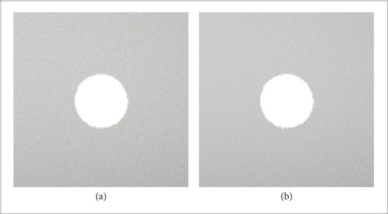


*Figure 13.10: Comparison of the Balance and Power Heuristics for Direct Lighting. A zoomed-in region of Figure 13.8 is shown here. (a) Rendered using the balance heuristic to weight `BSDF` and light samples in the direct lighting calculation. (b) Rendered using the power heuristic. The pixels behind the light source have a visible reduction in noise.*

〈Return light’s contribution to reflected radiance〉 ≡ 835

```text
Float p_l = sampledLight->p * ls->pdf;
if (IsDeltaLight(light.Type()))
    return ls->L * f / p_l;
else {
    Float p_b = bsdf->PDF(wo, wi);
    Float w_l = PowerHeuristic(1, p_l, 1, p_b);
    return w_l * ls->L * f / p_l;
}
```

```text
   BSDF::PDF() 546
   BSDF::Sample_f() 545
   BSDFSample 541
   BSDFSample::eta 541
   BSDFSample::flags 541
   BSDFSample::wi 541
   Float 23
   IsDeltaLight() 741
   Light::Type() 740
   LightLiSample::L 743
   LightLiSample::pdf 743
   PowerHeuristic() 66
   Ray::d 95
   SampledLight::p 782
```

```text
   Sampler::Get1D() 470
   Sampler::Get2D() 470
   SurfaceInteraction::SpawnRay() 645
   Vector3f 86
```

Returning now to the `Li()` method implementation, the next step is to sample the `BSDF` at the intersection to get an outgoing direction for the next ray to trace. That ray will be used to sample indirect illumination as well as for the `BSDF` sample for the direct lighting estimator.

〈Sample BSDF to get new path direction〉 ≡ 834

```text
Vector3f wo = -ray.d;
Float u = sampler.Get1D();
pstd::optional<BSDFSample> bs =
    bsdf.Sample_f(wo, u, sampler.Get2D());
if (!bs) break;
〈Update path state variables after surface scattering 838〉
ray = isect.SpawnRay(ray, bsdf, bs->wi, bs->flags, bs->eta);
```

In addition to the path throughput weight `beta`, a number of additional values related to the path are maintained, as follows: `p_b` is the PDF for sampling the direction `bs->wi`; this value is needed for the MIS-based direct lighting estimate. One nit comes from `BSDFs` like the `LayeredBxDF` that return a `BSDFSample` where the f and pdf are only proportional to their true values. In that case, an explicit call to `BSDF::PDF()` is required to get an estimate of the true PDF. As in the `SimplePathIntegrator`, `specularBounce` tracks whether the last scattering event was from a perfect specular surface. `anyNonSpecularBounces` tracks whether any scattering event along the ray’s path has been non-perfect specular. This value is used for path regularization if it is enabled. `etaScale` is the accumulated product of scaling factors that have been applied to `beta` due to rays being transmitted between media of different indices of refraction—a detail that is discussed in Section 9.5.2. This value will be used in the Russian roulette computation.

Finally, `prevIntrCtx` stores geometric information about the intersection point from which the sampled ray is leaving. This value is also used in the MIS computation for direct lighting.

〈Update path state variables after surface scattering〉 ≡ 837

```text
beta *= bs->f * AbsDot(bs->wi, isect.shading.n) / bs->pdf;
p_b = bs->pdfIsProportional ? bsdf.PDF(wo, bs->wi) : bs->pdf;
specularBounce = bs->IsSpecular();
anyNonSpecularBounces |= !bs->IsSpecular();
if (bs->IsTransmission()) etaScale *= Sqr(bs->eta);
prevIntrCtx = si->intr;
```

〈Declare local variables for PathIntegrator::Li()〉 +≡ 833

```text
Float p_b, etaScale = 1;
bool specularBounce = false, anyNonSpecularBounces = false;
LightSampleContext prevIntrCtx;
```

The new ray will account for indirect illumination at the intersection point in the following execution of the while loop. Returning now to the 〈Add emitted light at intersection point or from the environment〉 fragment at the start of the loop, we can see how the ray from the previous iteration of the while loop can take care of the `BSDF` sample in Equation (13.10). The ray’s direction was chosen by sampling the `BSDF`, and so if it happens to hit a light source, then we have everything we need to evaluate the second term of the estimate other than the MIS weight wb(ω). If the ray does not hit a light source, then that term is zero for the `BSDF` sample and there is no further work to do. There are two cases to handle: infinite lights for rays that do not intersect any geometry, and surface emission for rays that do. In the first case, the ray path can terminate once lights have been considered.

〈Add emitted light at intersection point or from the environment〉 ≡ 834

```text
if (!si) {
    〈Incorporate emission from infinite lights for escaped ray 839〉
    break;
}
〈Incorporate emission from surface hit by ray〉
```

```text
   AbsDot() 90
```

```text
   BSDF::PDF() 546
   BSDFSample 541
   BSDFSample::eta 541
   BSDFSample::f 541
   BSDFSample::IsSpecular() 541
   BSDFSample::IsTransmission() 541
   BSDFSample::pdf 541
   BSDFSample::pdfIsProportional 541
   BSDFSample::wi 541
   Float 23
   LayeredBxDF 895
   LightSampleContext 741
   ShapeIntersection::intr 266
   SimplePathIntegrator 826
   Sqr() 1034
   SurfaceInteraction::shading::n 139
```

For the initial ray from the camera or after a perfect specular scattering event, emitted radiance should be included in the path without any MIS weighting, since light sampling was not performed at the previous vertex of the path. At this point in execution, `beta` already includes the `BSDF`, cosine factor, and PDF value from the previous scattering event, so multiplying `beta` by the emitted radiance gives the correct contribution. 〈Incorporate emission from infinite lights for escaped ray〉 ≡ 838

```rust
   for light in &self.infinite_lights {
       let le = light.le(ray, lambda);
       if depth == 0 || specular_bounce {
            l += beta * le;
       } else {
            // 〈Compute MIS weight for infinite light〉
            l += beta * w_b * le;
       }
   }
```

Otherwise, it is necessary to compute the MIS weight wb. `p_b` gives us the `BSDF`’s PDF from the previous scattering event, so all we need is the PDF for the ray’s direction from sampling the light. This value is given by the product of the probability of sampling the light under consideration times the probability the light returns for sampling the direction.

Note that the `PDF_Li()` method is passed a true value for `allowIncompletePDF` here, again reflecting the fact that because `BSDF` sampling is capable of sampling all valid directions, it is not required that light sampling do so as well. 〈Compute MIS weight for infinite light〉 ≡ 839

```text
Float p_l = lightSampler.PMF(prevIntrCtx, light) *
           light.PDF_Li(prevIntrCtx, ray.d, true);
Float w_b = PowerHeuristic(1, p_b, 1, p_l);
```

The code for the case of a ray hitting an emissive surface is in the fragment 〈Incorporate emission from surface hit by ray〉. It is almost the same as the infinite light case, so we will not include it here. The final issue is Russian roulette–based path termination. As outlined in Section 13.2.1, the task is easy: we compute a termination probability q however we like, make a random choice as to whether to terminate the path, and update `beta` if the path is not terminated so that all subsequent P (pi) terms will be scaled appropriately.

However, the details of how q is set can make a big difference.3 In general, it is a good idea for the termination probability to be based on the path throughput weight; in this way, if the `BSDF`’s value is small, it is more likely that the path will be terminated. Further, if the path is not terminated, then the scaling factor will generally cause `beta` to have a value around 1. Thus, all rays that are traced tend to make the same contribution to the image, which improves efficiency. Another issue is that it is best if the `beta` value used to compute q does not include radiance scaling due to refraction. Consider a ray that passes through a glass object with a relative index of refraction of 1.5: when it enters the object, `beta` will pick up a factor of 1/1.52 ≈ 0.44, but when it exits, that factor will cancel and `beta` will be back to 1. For ray paths that would exit, to have terminated them after the first refraction would be the wrong decision. Therefore, `etaScale` tracks those factors in `beta` so that they can be removed. The image in Figure 13.11 shows the increase in noise if this effect is not corrected for.

```text
   Float 23
```

```text
   Integrator::infiniteLights 23
   Light::Le() 743
   Light::PDF_Li() 743
   LightSampler::PMF() 782
   PathIntegrator::lightSampler 833
   PowerHeuristic() 66
   Ray::d 95
   SampledSpectrum 171
```

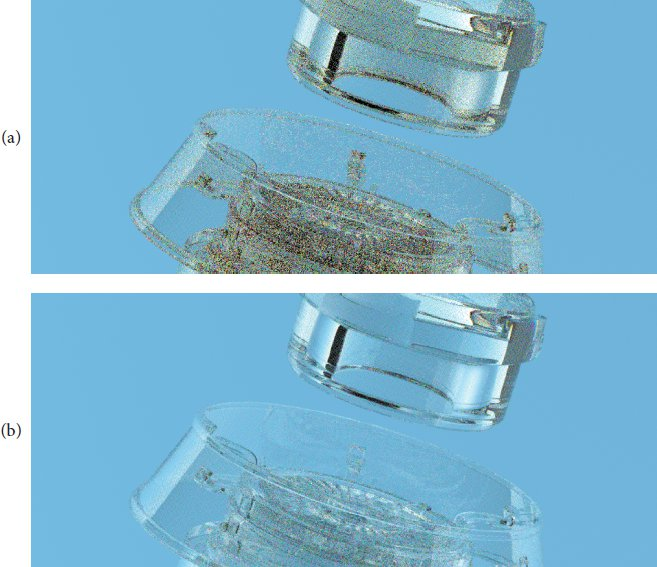


*Figure 13.11: The Effect of Including Radiance Scaling Due to Transmission in the Russian Roulette Probability q. (a) If `etaScale` is not included in the probability, then some rays that would have passed through the glass object are terminated unnecessarily, leading to noise in the corresponding parts of the image. (b) Including `etaScale` in the computation of q fixes this issue. (Transparent Machines scene courtesy of Beeple.)*

Finally, note that the termination probability is set according to the maximum component value of `rrBeta` rather than, for example, its average.

Doing so gives better results when surface reflectances are highly saturated and some of the wavelength samples have much lower `beta` values than others, since it prevents any of the `beta` components from going above 1 due to Russian roulette.

〈Possibly terminate the path with Russian roulette〉 ≡ 834

```text
SampledSpectrum rrBeta = beta * etaScale;
if (rrBeta.MaxComponentValue() < 1 && depth > 1) {
    Float q = std::max<Float>(0, 1 - rrBeta.MaxComponentValue());
    if (sampler.Get1D() < q) break;
    beta /= 1 - q;
}
```

Recall that Russian roulette only increases variance. Because it terminates some paths, this must be so, as the final image includes less information when it is applied. However, it can improve efficiency by allowing the renderer to focus its efforts on tracing rays that make the greatest contribution to the final image. Table 13.1 presents measurements of efficiency improvements from Russian roulette for a number of scenes.

```text
    Float 23
    SampledSpectrum 171
    SampledSpectrum::MaxComponentValue() 172
    Sampler::Get1D() 470
```

*Table 13.1: Monte Carlo Efficiency Benefits from Russian Roulette. Measurements of MSE and rendering time when using Russian roulette. All values reported are relative to rendering the same scene without Russian roulette. As expected, MSE increases to varying degrees due to ray termination, but the performance benefit more than makes up for it, leading to an increase in Monte Carlo efficiency.*

```text
    Scene                                                      MSE                 Time                Efficiency
    Kroken (Figure 13.4)                                       1.31                0.261               2.92
    Watercolor (Figure 13.6)                                   1.19                0.187               4.51
    San Miguel (Figure 13.7)                                   1.00                0.239               4.17
    BMW M6 (Figure 13.12)                                      1.00                0.801               1.25
```


*Figure 13.12: Image with High Variance Due to Difficult-to-Sample Indirect Lighting. The environment map illuminating the scene includes the sun, which is not only bright but also subtends a small solid angle. When an indirect lighting sample hits a specular surface and reflects to the sun’s direction, variance spikes in the image result because its contribution is not sampled well. (Car model courtesy of tyrant monkey, via Blend Swap.)*

### 13.4.1 PATH REGULARIZATION

Scenes with concentrated indirect lighting can pose a challenge to the path-tracing algorithm: the problem is that if the incident indirect radiance at a point has substantial variation but `BSDF` sampling is being used to generate the direction of indirect rays, then the sampling distribution may be a poor match for the integrand. Variance spikes then occur when the ratio f (x)/p(x) in the Monte Carlo estimator is large. Figure 13.12 shows an example of this issue. The car is illuminated by a sky environment map where a bright sun occupies a small number of pixels. Consider sampling indirect lighting at a point on the ground near one of the wheels: the ground material is fairly diffuse, so any direction will be

sampled with equal (cosine-weighted) probability. Rarely, a direction will be sampled that both hits the highly specular wheel and then also reflects to a direction where the sun is visible. This is the cause of the bright pixels on the ground. (The lighting in the car interior is similarly difficult to sample, since the glass prevents light source sampling; the variance spikes there follow.)

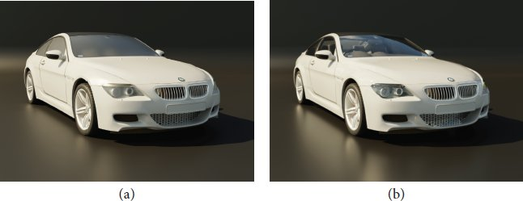


*Figure 13.13: Scene from Figure 13.12 with Roughened `BSDFs`. (a) Increasing the roughness of all the `BSDFs` eliminates the variance spikes by allowing the use of MIS at all indirect ray intersection points, though this substantially changes the appearance of the scene. (Note that the car paint is duller and the window glass and headlight covers have the appearance of frosted glass.) (b) Roughening `BSDFs` only after the first non-specular scattering event along the path preserves visual detail while reducing the error from difficult light paths. (Car model courtesy of tyrant monkey, via Blend Swap.)*

Informally, the idea behind path regularization is to blur the function being integrated in the case that it cannot be sampled effectively (or cannot be sampled in the first place). See Figure 13.13, which shows the same scene, but with all the `BSDFs` made more rough: perfect specular surfaces are glossy specular, and glossy specular surfaces are more diffuse. Although the overall characteristics of the image are quite different, the high variance on the ground has been eliminated: when an indirect lighting ray hits one of the wheels, it is now possible to use a lower variance MIS-based direct lighting calculation in place of following whichever direction is dictated by the law of specular reflection. Blurring all the `BSDFs` in this way is an undesirable solution, but there is no need to do so for the camera rays or for rays that have only undergone perfect specular scattering: in those cases, we would like to leave the scene as it was specified. We can consider non-specular scattering itself to be a sort of blurring of the incident light, such that blurring the scene that is

encountered after it occurs is less likely to be objectionable—thus the motivation to track this case via the `anyNonSpecularBounces` variable.

〈Possibly regularize the BSDF〉 ≡ 834, 884

```text
if (regularize && anyNonSpecularBounces) bsdf.Regularize();
```

The `BSDF` class provides a `Regularize()` method that forwards the request on to its `BxDF`.

〈BSDF Public Methods〉 +≡ 544

```text
void Regularize() { bxdf.Regularize(); }
```

The `BxDF` interface in turn requires the implementation of a `Regularize()` method. For `BxDFs` that are already fairly broad (e.g., the `DiffuseBxDF`), the corresponding method implementation is empty. 〈BxDF Interface〉 +≡ 538

```text
void Regularize();
```

```text
   BSDF::bxdf 544
   BSDF::Regularize() 842
   BxDF::Regularize() 842
   DiffuseBxDF 546
   PathIntegrator::regularize 833
```

However, both the `DielectricBxDF` and `ConductorBxDF` can be nearly specular or perfect specular, depending on how smooth their microfacet distribution is. Therefore, their `Regularize()` method implementations do adjust their scattering properties, through a call to yet one more method named `Regularize()`, this one implemented by the `TrowbridgeReitzDistribution`. 〈DielectricBxDF Public Methods〉 +≡ 563

```text
void Regularize() { mfDistrib.Regularize(); }
```

Unless the surface is already fairly rough, the `TrowbridgeReitzDistribution`’s `Regularize()` method doubles the α parameters and then clamps them—to ensure both that perfect specular

surfaces with a roughness of zero become non-perfect specular and that surfaces are not excessively roughened. 〈TrowbridgeReitzDistribution Public Methods〉 +≡ 575

```text
void Regularize() {
    if (alpha_x < 0.3f) alpha_x = Clamp(2 * alpha_x, 0.1f, 0.3f);
    if (alpha_y < 0.3f) alpha_y = Clamp(2 * alpha_y, 0.1f, 0.3f);
}
```

## FURTHER READING

The first application of Monte Carlo to global illumination for creating synthetic images that we are aware of was described in Tregenza’s paper on lighting design (Tregenza 1983). Cook’s distribution ray-tracing algorithm computed glossy reflections, soft shadows from area lights, motion blur, and depth of field with Monte Carlo sampling (Cook et al. 1984; Cook 1986), although the general form of the light transport equation was not stated until papers by Kajiya (1986) and Immel, Cohen, and Greenberg (1986). Kajiya (1986) introduced the general-purpose path-tracing algorithm. Other important early work on Monte Carlo in rendering includes Shirley’s Ph.D. thesis (1990) and a paper by Kirk and Arvo (1991) on sources of bias in rendering algorithms. Fundamental theoretical work on light transport has been done by Arvo (1993, 1995a), who investigated the connection between rendering algorithms in graphics and previous work in transport theory, which applies classical physics to particles and their interactions to predict their overall behavior. Our description of the path integral form of the LTE follows the framework in Veach’s Ph.D. thesis, which has thorough coverage of different forms of the LTE and its mathematical structure (Veach 1997). The next event estimation technique that corresponds to the direct lighting computation in path tracing was first introduced by Coveyou et al. (1967), in the context of neutron transport.

Russian roulette was introduced to graphics by Arvo and Kirk (1990). Hall and Greenberg (1983) had previously suggested adaptively terminating ray trees by not tracing rays with less than some minimum contribution. Arvo and Kirk’s technique is unbiased, although in some situations bias and less noise may be the more desirable artifact.

```text
   Clamp() 1033
   ConductorBxDF 560
   DielectricBxDF 563
   DielectricBxDF::mfDistrib 563
   PathIntegrator 833
   TrowbridgeReitzDistribution 575
   TrowbridgeReitzDistribution::alpha_x 575
   TrowbridgeReitzDistribution::alpha_y 575
   TrowbridgeReitzDistribution::Regularize() 843
```

The Russian roulette termination probability computed in the `PathIntegrator` is largely determined by the albedo of the surface at the last scattering event; that approach was first introduced by Szesci et al. (2003). This is a reasonable way to set the probability, but better is to set the termination probability that also accounts for the incident lighting at a point: it would be better to terminate paths more aggressively in darker parts of the scene and less aggressively in brighter parts. Vorba and Křivánek described an approach for doing so based on an approximation of the lighting in the scene (Vorba and Křivánek 2016). They further applied splitting to the problem, increasing the number of paths in important regions. Control variates is a Monte Carlo technique based on finding an approximation to the integrand that is efficient to evaluate and then applying Monte Carlo to integrate the difference between the approximation and the true integrand. The variance of the resulting estimator then is dependent on the difference. This approach was first applied to rendering by Lafortune and Willems (1994, 1995). Recent work in this area includes Rousselle et al. (2016), who made use of correlations between nearby pixels to define control variates. (Their paper also has comprehensive coverage of other applications of control variates to rendering after Lafortune and Willems’s work.) Müller et al. (2020) have demonstrated the effectiveness of neural networks for computing control variates for rendering. Crespo et

al. (2021) fit polynomials to the samples taken in each pixel and used them as control variates, showing reduction in error in pixels where the integrand was smooth. One approach to improving the performance of path tracing is to reuse computation across nearby points in the scene. Irradiance caching (Ward et al. 1988; Ward 1994) is one such technique. It is based on storing the irradiance due to indirect illumination at a sparse set of points on surfaces in the scene; because indirect lighting is generally slowly changing, irradiance can often be safely interpolated. Tabellion and Lamorlette (2004) described a number of additional improvements to irradiance caching that made it viable for rendering for movie productions. Křivánek and collaborators generalized irradiance caching to radiance caching, where a more complex directional distribution of incident radiance is stored, so that more accurate shading from glossy surfaces is possible (Křivánek et al. 2005). Schwarzhaupt et al. have proposed a better way of assessing the validity of a cache point using a second-order expansion of the incident lighting (Schwarzhaupt et al. 2012) and Zhao et al. (2019) have developed a number of improvements that are especially useful for glossy scenes. Ren et al. (2013) first applied neural networks to represent the radiance distribution in a scene for rendering; more recently, Müller et al. (2021) trained a fully connected 7-layer network to represent radiance during rendering and demonstrated both high performance and accurate indirect illumination.

Improved Estimators and Sampling Algorithms A number of approaches have been developed to sample from the product distribution of the `BSDF` and light source for direct lighting (Burke et al. 2005; Cline et al. 2006). Product sampling can give better results than MIS-weighted light and `BSDF` samples when neither of those distributions matches the true product well. Clarberg, Rousselle, and collaborators developed techniques based on representing `BSDFs` and illumination in the wavelet basis and efficiently sampling from their product (Clarberg et al. 2005; Rousselle et al. 2008; Clarberg and Akenine-Möller 2008a). Efficiency of the direct lighting calculation can be further improved by sampling from the triple product distribution of `BSDF`, illumination, and visibility; this issue was investigated by Ghosh and Heidrich (2006) and

Clarberg and Akenine-Möller (2008b). Wang and Åkerlund (2009) introduced an approximation to the indirect illumination that is used in the light sampling distribution with these approaches. More recently, Belcour et al. (2018) derived approaches for integrating the spherical harmonics over polygonal domains and demonstrated their application to product sampling. Hart et al. (2020) showed how simple warps of uniform random samples can be used for product sampling. Peters (2021b) has shown use of linearly transformed cosines (Heitz et al. 2016a) with a new algorithm for sampling polygonal light sources to perform product sampling. Subr et al. (2014) analyzed the combination of multiple importance sampling and jittered sampling for direct lighting calculations and proposed techniques that improve convergence rates. Heitz et al. (2018) applied ratio estimators to direct illumination computations, which allows the use of analytic techniques for computing unshadowed direct illumination and then computing the correct result in expectation after tracing a shadow ray. They showed the effectiveness of this approach with sophisticated models for analytic illumination from area lights (Heitz et al. 2016a; Dupuy et al. 2017) and noted a number of benefits of this formulation in comparison to control variates. Another approach for applying analytic techniques to direct lighting was described by Billen and Dutré (2016) and Salesin and Jarosz (2019), who integrated one dimension of the integral analytically. Path regularization was introduced by Kaplanyan and Dachsbacher (2013). Our implementation applies an admittedly ad hoc roughening to all non-diffuse `BSDFs`, while they only applied regularization to Dirac delta distributions and replaced them with a function designed to not lose energy, as ours may. See also Bouchard et al. (2013), who incorporated regularization as one of the sampling strategies to use with MIS. A principled approach to regularization for microfacet-based `BSDFs` was developed by Jendersie and Grosch (2019). Weier et al. (2021) have recently developed a path regularization approach based on learning regularization parameters with a variety of scenes and differentiable rendering.

A number of specialized sampling techniques have been developed for especially tricky scattering problems. Wang et al. (2020b) developed methods to render scattering paths that exclusively exhibit specular light transport, including those that start at pinhole cameras and end at point light sources. Such light-carrying paths cannot be sampled directly using the incremental path sampling approach used in pbrt. Loubet et al. (2020) showed how to efficiently render caustics in a path tracer by constructing a data structure that records which triangles may cast caustics in a region of space and then directly sampling a specular light path from the light to the triangle to a receiving point. Zeltner et al. (2020) found caustic paths using a equation-solving iteration with random initialization, which requires precautions when reasoning about the probability of a generated sample.

Path Guiding The `PathIntegrator` samples the `BSDF` in order to sample indirect illumination, though for scenes where the indirect illumination varies significantly as a function of direction, this is not an ideal approach. A family of approaches that have come to be known as path guiding have been developed to address this problem; all share the idea of building a data structure that represents the indirect illumination in the scene and then using it to draw samples. Early work in this area was done by Lafortune and Willems (1995), who used a 5D tree to represent the scene radiance distribution, and Jensen (1995), who traced samples from the light sources (“photons”) and used them to do the same. Hey and Purgathofer (2002a) developed an improved approach based on photons and Pegoraro et al. (2008a) applied the theory of sequential Monte Carlo to this problem. An early path guiding technique based on adapting the distribution of uniform random samples to better sample important paths was described by Cline et al. (2008).

```text
   PathIntegrator 833
```

Vorba et al. (2014) applied a parametric representation based on Gaussian mixture models (GMMs) that are learned over the course of rendering for path guiding and Herholz et al. (2016) also included the BRDF in GMMs, demonstrating better performance in scenes with non-diffuse `BSDFs`. Ruppert et al. (2020) described a number of further improvements, applying

the von Mises–Fisher distribution for their parametric model, improving the robustness of the fitting algorithm, and accounting for parallax, which causes the directional distribution of incident radiance to vary over volumes of space. A path guiding technique developed by Müller and collaborators (Müller et al. 2017; Müller 2019) has seen recent adoption. It is based on an adaptive spatial decomposition using an octree where each octree leaf node stores an adaptive directional decomposition of incident radiance. Both of these decompositions are refined as more samples are taken and are used for sampling ray directions. This approach was generalized to include product sampling with the `BSDF` by Diolatzis et al. (2020), who used Heitz et al.’s (2016a) linearly transformed cosines representation to do so. A challenge with path guiding is that the Monte Carlo estimator generally includes variance due to factors not accounted for by the path guiding algorithm. Rath et al. (2020) considered this issue and developed an approach for accounting for this variance in the function that is learned for guiding. Reibold et al. (2018) described a path guiding method based on storing entire ray paths and then defining a PDF for path guiding using Gaussian distributions around them in path space. Machine learning approaches have also been applied to path guiding: Dahm and Keller (2017) investigated the connections between light transport and reinforcement learning and Müller et al. and Zheng and Zwicker both used neural nets to learn the illumination in the scene and applied them to importance sampling (Müller et al. 2019; Zheng and Zwicker 2019). A scene-independent approach was described by Bako et al. (2019), who trained a neural net to take a local neighborhood of sample values and reconstruct the incident radiance function to use for path guiding. Deep reinforcement learning has been applied to this problem by Huo et al. (2020). Zhu et al. (2021) recently introduced a path guiding approach based on storing directional samples in a quadtree and applying a neural network to generate sampling distributions from such quadtrees. They further generated quadtree samples using paths both from the camera and from the

light sources and showed that doing so further reduces error in challenging lighting scenarios.

Photon Mapping The general idea of tracing light-carrying paths from light sources was first investigated by Arvo (1986), who stored light in texture maps on surfaces and rendered caustics. Heckbert (1990b) built on this approach to develop a general ray-tracing-based global illumination algorithm, and Dutré et al. (1993) and Pattanaik and Mudur (1995) developed early particle-tracing techniques. Christensen (2003) surveyed applications of adjoint functions and importance to solving the LTE and related problems. Jensen (1995) developed the photon mapping algorithm, which introduced the key innovation of storing light contributions in a general 3D data structure. Important early improvements to the photon mapping method are described in follow-up papers and a book by Jensen (1996, 1997, 2001). Herzog et al. (2007) described an approach based on storing all the visible points as seen from the camera and splatting photon contributions to them. Hachisuka et al. (2008) developed the progressive photon mapping algorithm, which builds on that representation; stochastic progressive photon mapping (SPPM) was subsequently developed by Hachisuka and Jensen (2009). (The online edition of this book includes an implementation of the SPPM algorithm.) The question of how to find the most effective set of photons for photon mapping is an important one: light-driven particle-tracing algorithms do not work well for all scenes (consider, for example, a complex building model with lights in every room but where the camera sees only a single room). Recent techniques for improved photon sampling include the work of Grittmann et al., who adapted the primary sample space distribution of samples in order to more effectively generate photon paths (Grittmann et al. 2018). Conty Estevez and Kulla described an adaptive photon shooting algorithm that has been used in production (2020). Both papers survey previous work in that area.

Bidirectional Path Tracing

Bidirectional path tracing constructs paths starting both from the camera and from the lights and then forms connections between them. Doing so can be an effective way to sample some light-carrying paths. This technique was independently developed by Lafortune and Willems (1993) and Veach and Guibas (1994). The development of multiple importance sampling was integral to the effectiveness of bidirectional path tracing (Veach and Guibas 1995). Lafortune and Willems (1996) showed how to apply bidirectional path tracing to rendering participating media. (An implementation of bidirectional path tracing is included in the online edition of the book; many additional references to related work are included there.) Simultaneous work by Hachisuka et al. (2012) and Georgiev et al. (2012) provided a unified framework for both photon mapping and bidirectional path tracing. (This approach is often called either unified path sampling (UPS) or vertex connection and merging (VCM), after respective terminology in those two papers.) Their approaches allowed photon mapping to be included in the path space formulation of the light transport equation, which in turn made it possible to derive light transport algorithms that use both approaches to generate paths and combine them using multiple importance sampling.

Metropolis Sampling Veach and Guibas (1997) first applied the Metropolis sampling algorithm to solving the light transport equation. They demonstrated how this method could be applied to image synthesis and showed that the result was a light transport algorithm that was robust to traditionally difficult lighting configurations (e.g., light shining through a slightly ajar door). Pauly, Kollig, and Keller (2000) generalized the Metropolis light transport (MLT) algorithm to include volume scattering. Pauly’s thesis (Pauly 1999) described the theory and implementation of bidirectional and Metropolis-based algorithms for volume light transport. MLT algorithms generally are unable to take advantage of the superior convergence rates offered by well-distributed sample values. Bitterli and Jarosz present a hybrid light transport algorithm that uses path tracing by default but with the integrand partitioned so that only high-variance samples are handled instead by Metropolis sampling (Bitterli and Jarosz 2019). In this way, the benefits of both algorithms are available, with

Metropolis available to sample tricky paths and path tracing with well-distributed sample points efficiently taking care of the rest. Kelemen et al. (2002) developed the “primary sample space MLT” formulation of Metropolis light transport, which is much easier to implement than Veach and Guibas’s original formulation. That approach is implemented in the online edition of this book, including the “multiplexed MLT” improvement developed by Hachisuka et al. (2014). Inverting the sampling functions that convert primary sample space samples to light paths makes it possible to develop MLT algorithms that operate both in primary sample space and in path space, the basis of Veach and Guibas’s original formulation of MLT. Pantaleoni (2017) used such inverses to improve the distribution of samples and to develop new light transport algorithms, and Otsu et al. (2017) developed a novel approach that applies mutations in both spaces. Bitterli et al. (2018a) used this approach to apply reversible jump Markov chain Monte Carlo to light transport and to develop new sampling techniques. See Šik and Křivánek’s article for a comprehensive survey of the application of Markov chain sampling algorithms to light transport (Šik and Křivánek 2018).

Other Rendering Approaches A number of algorithms have been developed based on a first phase of computation that traces paths from the light sources to create so-called virtual lights, where these lights are then used to approximate indirect illumination during a second phase. The principles behind this approach were first introduced by Keller’s work on instant radiosity (Keller 1997). The more general instant global illumination algorithm was developed by Wald, Benthin, and collaborators (Wald et al. 2002, 2003; Benthin et al. 2003). See Dachsbacher et al.’s survey (2014) for a summary of work in this area. Building on the virtual point lights concept, Walter and collaborators (2005, 2006) developed lightcuts, which are based on creating thousands of virtual point lights and then building a hierarchy by progressively clustering nearby ones together. When a point is being shaded, traversal of the light

hierarchy is performed by computing bounds on the error that would result from using clustered values to illuminate the point versus continuing down the hierarchy, leading to an approach with both guaranteed error bounds and good efficiency. A similar hierarchy is used by Yuksel and Yuksel (2017) for determining the illumination from volumetric emitters. Bidirectional lightcuts (Walter et al. 2012) trace longer subpaths from the camera to obtain a family of light connection strategies; combining the strategies using multiple importance sampling eliminates bias artifacts that are commonly produced by virtual point light methods. Jakob and Marschner (2012) expressed light transport involving specular materials as an integral over a high-dimensional manifold embedded in path space. A single light path corresponds to a point on the manifold, and nearby paths are found using a local parameterization that resembles Newton’s method; they applied a Metropolis-type method through this parameterization to explore the neighborhood of challenging specular and near-specular configurations. Hanika et al. (2015a) applied an improved version of the local path parameterization in a pure Monte Carlo context to estimate the direct illumination through one or more dielectric boundaries; this leads to significantly better convergence when rendering glass-enclosed objects or surfaces covered with water droplets. Kaplanyan et al. (2014) observed that the path contribution function is close to being separable when paths are parameterized using the endpoints and the half-direction vectors at intermediate vertices, which are equal to the microfacet normals in the context of microfacet reflectance models. Performing Metropolis sampling in this half-vector domain leads to a method that is particularly good at rendering glossy interreflection. An extension by Hanika et al. (2015b) improves the robustness of this approach and proposes an optimized scheme to select mutation sizes to reduce sample clumping in image space. Another interesting approach was developed by Lehtinen and collaborators, who considered rendering from the perspective of computing gradients of the image (Lehtinen et al. 2013, Manzi et al. 2014). Their insight was that, ideally, most samples from the path space should be taken around

discontinuities and not in smooth regions of the image. They then developed a measurement contribution function for Metropolis sampling that focused samples on gradients and then reconstructed high-quality final images from horizontal and vertical gradient images and a coarse, noisy image. More recently, Kettunen et al. (2015) showed how this approach could be applied to regular path tracing without Metropolis sampling. Manzi et al. (2015) showed its application to bidirectional path tracing and Sun et al. (2017) applied it to vertex connection and merging. Petitjean et al. (2018) used gradient domain techniques to improve spectral rendering. Hua et al. (2019) have written a comprehensive survey of work in this area. Hair is particularly challenging to render; not only is it extremely geometrically complex but multiple scattering among hair also makes a significant contribution to its final appearance. Traditional light transport algorithms often have difficulty handling this case well. See the papers by Moon and Marschner (2006), Moon et al. (2008), and Zinke et al. (2008) for recent work in specialized rendering algorithms for hair. Yan et al. (2017b) have recently demonstrated the effectiveness of models based on diffusion in addressing this problem. While the rendering problem as discussed so far has been challenging enough, Jarabo et al. (2014a) showed the extension of the path integral to not include the steady-state assumption—that is, accounting for the noninfinite speed of light. Time ends up being extremely high frequency, which makes rendering challenging; they showed successful application of density estimation to this problem. EXERCISES

➋ 13.1 To further improve efficiency, Russian roulette can be applied to skip tracing many of the shadow rays that make a low contribution to the final image: to implement this approach, tentatively compute the potential contribution of each shadow ray to the final overall radiance value before tracing the ray. If the contribution is below some threshold, apply Russian roulette to possibly skip tracing the ray. Measure the effect your scheme has on Monte Carlo efficiency for a number of test scenes. ➋ 13.2 Read Veach’s description of efficiency-optimized Russian roulette, which adaptively chooses a threshold for applying Russian roulette (Veach 1997; Section 10.4.1). Implement this algorithm in pbrt, and evaluate its effectiveness in comparison to manually setting these thresholds. ➋ 13.3 If a scene has an object with a material that causes all but one of the wavelengths in `SampledWavelengths` to be terminated (e.g., due to dispersion), then rays may often

undergo a number of scattering events before they hit such an object. In pbrt’s current implementation, the path’s radiance estimate is divided by the wavelength PDF values once, in the `PixelSensor::ToSensorRGB()` method. An implication of this design is that all the lighting calculations along the path are affected by the termination of wavelengths, and not just the ones after it happens. The result is an increase in color noise in such images.

Modify one or more integrators to instead perform this division by the current set of wavelength PDFs each time the radiance estimate being calculated is updated and not in `PixelSensor::ToSensorRGB()`. Verify that the same image is computed for scenes without wavelength termination (other than minor differences due to round-off error). Is there any change in performance? Find a scene where this change improves the result and measure the reduction in MSE.

```text
             BSDF 544
             BSDF::rho() 546
             BxDF 538
             PathIntegrator 833
             PixelSensor::ToSensorRGB() 238
             SampledWavelengths 173
             VisibleSurface 245
```

➋ 13.4 Measure how much time is spent in Monte Carlo evaluation in the `BSDF::rho()` method when `VisibleSurfaces` are being initialized in the `PathIntegrator`. Do so for both simple and complex scenes that include a variety of `BSDF` models. Then, improve the `BSDF` interface so that each `BxDF` can provide its own `rho()` implementation, possibly returning either an approximation or the closed-form reflectance. How much does performance improve as a result of your changes? ➌ 13.5 Implement a technique for generating samples from the product of the light and `BSDF` distributions; see for example the papers by Burke et al. (2005), Cline et al. (2006), Clarberg et al. (2005), Rousselle et al. (2008), and Hart et al. (2020). Compare the effectiveness of the approach you implement to the direct lighting calculation currently implemented in pbrt. Investigate how scene complexity (and, thus, how expensive shadow rays are to trace) affects the Monte Carlo efficiency of the two techniques. ➋ 13.6 Clarberg and Akenine-Möller (2008b) and Popov et al. (2013) both described algorithms that perform visibility caching—computing and interpolating information about light source visibility at points in the scene. Implement one of these methods and use it to improve the direct lighting calculation in pbrt. What sorts of scenes is it particularly effective for? Are there scenes for which it does not help? ➌ 13.7 Modify pbrt so that the user can flag certain objects in the scene as being important sources of indirect lighting, and modify the `PathIntegrator` to sample points on those surfaces according to dA to generate some of the vertices in the paths it generates. Use multiple importance sampling to compute weights for the path samples, incorporating the probability that they would have been sampled both with `BSDF` sampling and with this area sampling. How much can this approach reduce variance and improve efficiency for scenes with substantial indirect lighting? How much can it hurt if the user flags surfaces that make little or no contribution or if

multiple importance sampling is not used? Investigate generalizations of this approach that learn which objects are important sources of indirect lighting as rendering progresses so that the user does not need to supply this information ahead of time. ➌ 13.8 Implement a path guiding algorithm such as the one developed by Müller and collaborators (Müller et al. 2017; Müller 2019) or Reibold et al. (2018). How much does your approach reduce error for scenes with highly varying indirect lighting? What is its effect on scenes with smoother lighting?

```text
     PathIntegrator 833
```

_________________ 1 Indeed, this sort of series expansion and inversion can be used in the general case, where quantities like the `BSDF` are expressed in terms of general operators that map incident radiance functions to exitant radiance functions. This approach forms the foundation for applying sophisticated tools from analysis to the light transport problem. See Arvo’s thesis (Arvo 1995a) and Veach’s thesis (Veach 1997) for further information. 2 “Depth” is something of a misnomer in that this integrator constructs the path iteratively rather than recursively as the `RandomWalkIntegrator` did. Nevertheless, here and in the following integrators, we will continue to describe the path length in this way. 3 By this we mean that this is a place where the current version of pbrt does markedly better than previous ones.
