# Chapter 14: Light Transport II: Volume

## Volume Light Transport (wgpu)

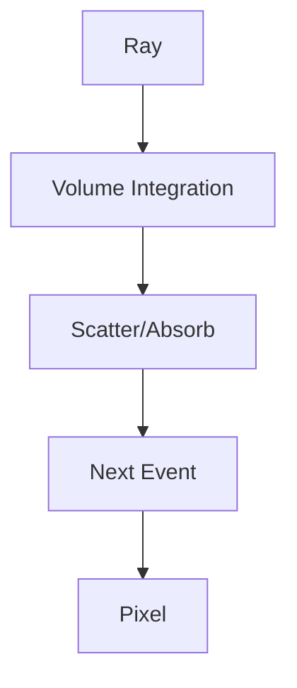


The abstractions for representing participating media that were introduced in Chapter 11 describe how media scatter light but they do not provide the capability of simulating the global effects of light transport in a scene. The situation is similar to that with BSDFs: they describe local effects, but it was necessary to start to introduce integrators in Chapter 13 that accounted for direct lighting and interreflection in order to render images. This chapter does the same for volumetric scattering.

We begin with the introduction of the equation of transfer, which generalizes the light transport equation to describe the equilibrium distribution of radiance in scenes with participating media. Like the transmittance equations in Section 11.2, the equation of transfer has a null-scattering generalization that allows sampling of heterogeneous media for unbiased integration. We will also introduce a path integral formulation of it that generalizes the surface path integral from Section 13.1.4.

Following sections discuss implementations of solutions to the equation of transfer. Section 14.2 introduces two Integrators that use Monte Carlo integration to solve the full equation of transfer, making it possible to render scenes with complex volumetric effects. Section 14.3 then describes the implementation of LayeredBxDF, which solves a 1D specialization of the equation of transfer to model scattering from layered materials at surfaces.

## 14.1 THE EQUATION OF TRANSFER

The equation of transfer is the fundamental equation that governs the behavior of light in a medium that absorbs, emits, and scatters radiation. It accounts for all the volume scattering processes described in Chapter 11—absorption, emission, in scattering, and out scattering—to give an equation that describes the equilibrium distribution of radiance. The light transport equation is in fact a special case of it, simplified by the lack of participating media and specialized for scattering from surfaces. (We will equivalently refer to the equation of transfer as the volumetric light transport equation.) Integrator 22 LayeredBxDF 895

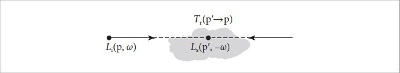

*Figure 14.1: The equation of transfer gives the incident radiance at point Li(p, ω) accounting for the effect of participating media. At each point p′ along the ray, the source function Ls(p′, −ω) gives the differential radiance added at the point due to scattering and emission. This radiance is then attenuated by the beam transmittance Tr(p′ → p) from the point p′ to the ray’s origin.*

In its most basic form, the equation of transfer is an integro-differential equation that describes how the radiance along a beam changes at a point in space. It can be derived by subtracting the effects of the scattering processes that reduce energy along a beam (absorption and out scattering) from the processes that increase energy along it (emission and in scattering). To start, recall the source function Ls from Section 11.1.4: it gives the change in radiance at a point p in a direction ω due to emission and in-scattered light from other points in the medium:

The source function accounts for all the processes that add radiance to a ray. The attenuation coefficient, σt(p, ω), accounts for all processes that reduce radiance at a point: absorption and out scattering. The differential equation that describes its effect, Equation (11.4), is dLo(p, ω) = −σt(p, ω) Li(p, −ω) dt. The overall differential change in radiance at a point p′ = p + tω along a ray is found by adding these two effects together to get the integro-differential form of the equation of transfer:1

(The σt modulation of the source function accounts for the medium’s density at the point.)

With suitable boundary conditions, this equation can be transformed to a pure integral equation that describes the effect of participating media from the infinite number of points along a ray. For example, if we assume that there are no surfaces in the scene so that the rays are never blocked and have an infinite length, the integral equation of transfer is

(See Figure 14.1.) The meaning of this equation is reasonably intuitive: it just says that the radiance arriving at a point from a given direction is determined by accumulating the radiance added at all points along the ray. The amount of added radiance at each point along the ray that reaches the ray’s origin is reduced by the beam transmittance to the point.

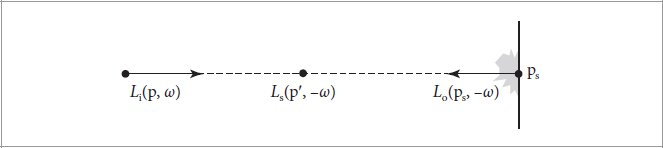

*Figure 14.2: For a finite ray that intersects a surface, the incident radiance, Li(p, ω), is equal to the outgoing radiance from the surface, Lo(ps, −ω), times the beam transmittance to the surface plus the added radiance from all points along the ray from p to ps.*

More generally, if there are reflecting or emitting surfaces in the scene, rays do not necessarily have infinite length and the first surface that a ray hits affects its radiance, adding outgoing radiance from the surface at the point and preventing radiance from points along the ray beyond the intersection point from contributing to radiance at the ray’s origin. If a ray (p, ω) intersects a surface at some point ps at a parametric distance t along the ray, then the integral equation of transfer is

where p′ = p + t′ω are points along the ray (Figure 14.2). This equation describes the two effects that contribute to radiance along the ray. First, reflected radiance back along the ray from the surface is given by

the Lo term, which gives the emitted and reflected radiance from the surface. This radiance may be attenuated by the participating media; the beam transmittance from the ray origin to the point ps accounts for this. The second term accounts for the added radiance along the ray due to volumetric scattering and emission up to the point where the ray intersects the surface; points beyond that one do not affect the radiance along the ray.

### 14.1.1 NULL-SCATTERING EXTENSION

In Section 11.2.1 we saw the value of null scattering, which made it possible to sample from a modified transmittance equation and to compute unbiased estimates of the transmittance between two points using algorithms like delta tracking and ratio tracking. Null scattering can be applied in a similar way to the equation of transfer, giving similar benefits. In order to simplify notation in the following, we will assume that the various scattering coefficients σ do not vary as a function of direction. As before, we will also assume that the null-scattering coefficient σn is nonnegative and has been set to homogenize the medium’s density to a fixed majorant σmaj = σn + σt. Neither of these simplifications affect the course of the following derivations; both generalizations could be easily reintroduced. A null-scattering generalization of the equation of transfer can be found using the relationship σt = σmaj − σn from Equation (11.11). If that substitution is made in the integro-differential equation of transfer, Equation (14.1), and the boundary condition of a surface at distance t along the ray is applied, then the result can be transformed into the pure integral equation

where p′ = p + t′ω, as before, and we have introduced Tmaj to denote the majorant transmittance that accounts for both regular attenuation and null scattering. Using the same convention as before that d = ‖p − p′‖ is the distance between points p and p′, it is

The null-scattering source function Ln is the source function Ls from Equation (11.3) plus a new third term:

Because it includes attenuation due to null scattering, Tmaj is always less than or equal to the actual transmittance. Thus, the product TmajLo in Equation (14.3) may be less than the actual contribution of radiance leaving the surface, TrLo. However, any such deficiency is made up for by the last term of Equation (14.5).

### 14.1.2 EVALUATING THE EQUATION OF TRANSFER

The Tmaj factor in the null-scattering equation of transfer gives a convenient distribution for sampling distances t along the ray in the medium that leads to the volumetric path-tracing algorithm, which we will now describe. (The algorithm we will arrive at is sometimes described as using delta tracking to solve the equation of transfer, since that is the sampling technique it uses for finding the locations of absorption and scattering events.) If we assume for now that there is no geometry in the scene, then the null-scattering equation of transfer, Equation (14.3), simplifies to

Thanks to null scattering having made the majorant medium homogeneous, σmajTmaj can be sampled exactly. The first step in the path-tracing algorithm is to sample a point p′ from its distribution, giving the estimator

From Section A.4.2, we know that the probability density function (PDF) for sampling a distance t from the exponential distribution is , and so the estimator simplifies to

What is left is to evaluate Ln.

Because σmaj = σa + σs + σn, the initial σ factors in each term of Equation (14.5) can be considered to be three probabilities that sum to 1. If one of the three terms is randomly selected according to its probability and the rest of the term is evaluated without that factor, the expected value of the result is equal to Ln. Considering how to evaluate each of the terms:

If the σa term is chosen, then the emission at Le(p′, ω) is returned and sampling terminates. For the σs term, the integral over the sphere of directions must be estimated. A direction ω′ is sampled from some distribution and recursive evaluation of Li(p′, ω′) then proceeds, weighted by the ratio of the phase function and the probability of sampling the direction ω′. If the null-scattering term is selected, Li(p′, ω) is to be evaluated, which can be handled recursively as well. For the full equation of transfer that includes scattering from surfaces, both the surface-scattering term and the integral over the ray’s extent lead to recursive evaluation of the equation of transfer. In the context of path tracing, however, we would like to only evaluate one of the terms in order to avoid an exponential increase in work. We will therefore start by defining a probability q of estimating the surface-scattering term; volumetric scattering is evaluated otherwise. Given such a q, the Monte Carlo estimator

gives Li(p, ω) in expectation. A good choice for q is that it be equal to Tmaj(ps → p). Surface scattering is then evaluated with a probability proportional to the transmittance to the surface and the ratio Tmaj/q is equal to 1, leaving just the Lo factor. Furthermore, a sampling trick can be used to choose between the two terms: if a sample t′ ∈ [0, ∞) is taken from σmajTmaj’s distribution, then the probability that t′ > t is equal to Tmaj(ps → p). (This can be shown by integrating Tmaj’s PDF to find its cumulative distribution function (CDF) and then considering the value of its CDF at t.) Using this technique and

then making the same simplifications that brought us to Equation (14.6), we arrive at the estimator

From this point, outgoing radiance from a surface can be estimated using techniques that were introduced in Chapter 13, and Ln can be estimated as described earlier.

### 14.1.3 SAMPLING THE MAJORANT TRANSMITTANCE

We have so far presented volumetric path tracing with the assumption that σmaj is constant along the ray and thus that Tmaj is a single exponential function. However, those assumptions are not compatible with the segments of piecewise-constant majorants that Medium implementations provide with their RayMajorantIterators. We will now resolve this incompatibility.

*Figure 14.3 shows example majorants along a ray, the optical thickness that they integrate to, and the resulting majorant transmittance function. The transmittance function is continuous and strictly decreasing, though at a rate that depends on the majorant at each point along the ray. If integration starts from t = 0, and we denote the ith segment’s majorant as and its endpoint as pi, the transmittance can be written as*

where is the transmittance function for the ith segment and the point p′ is the endpoint of the nth segment. (This relationship uses the multiplicative property of transmittance from Equation (11.6).) Given the general task of estimating an integral of the form

```text
    Medium 714
```

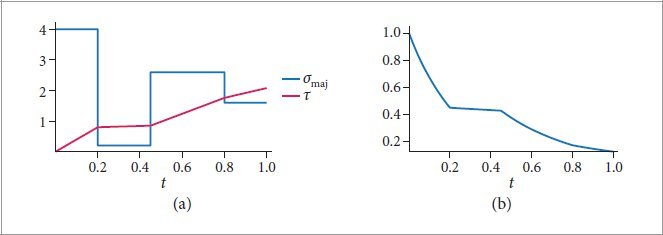

*Figure 14.3: (a) Given piecewise-constant majorants defined over segments along a ray, the corresponding optical thickness τ is a piecewise-linear function. (b) Exponentiating the negative optical thickness gives the transmittance at each point along the ray. The transmittance function is continuous and decreasing, but has a first derivative discontinuity at transitions between segments.*

with p′ = p + t′ω and , it is useful to rewrite the integral to be over the individual majorant segments, which gives

Note that each term’s contribution is modulated by the transmittances and majorants from the previous segments. The form of Equation (14.8) hints at a sampling strategy: we start by sampling a value from distribution p1; if is less than t1, then we evaluate the estimator at the sampled point p′:

Applying the same ideas that led to Equation (14.7), we otherwise continue and consider the second term, drawing a sample from distribution,

starting at t1. If the sampled point is before the segment’s endpoint, ,

then we have the estimator Because the probability that is equal to , the estimator for the second term again simplifies to f (p′). Otherwise, following this sampling strategy for subsequent segments similarly leads to the same simplified estimator in the end. It can furthermore be shown that the probability that no sample is generated in any of the segments is equal to the full majorant transmittance from 0 to t, which is exactly the probability required for the surface/volume estimator of Equation (14.7). The SampleT_maj() function implements this sampling strategy, handling the details of iterating over RayMajorantSegments and sampling them. Its functionality will be used repeatedly in the following volumetric integrators. 〈Medium Sampling Functions〉 ≡ template <typename F> SampledSpectrum SampleT_maj(Ray ray, Float tMax, Float u, RNG &rng, const SampledWavelengths &lambda, F callback);

In addition to a ray and an endpoint along it specified by tMax, SampleT_maj() takes a single uniform sample and an RNG to use for generating any necessary additional samples. This allows it to use a well-distributed value from a Sampler for the first sampling decision along the ray while it avoids consuming a variable and unbounded number of sample dimensions if more are needed (recall the discussion of the importance of consistency in sample dimension consumption in Section 8.3). The provided SampledWavelengths play their usual role, though the first of them has additional meaning: for media with scattering properties that vary with wavelength, the majorant at the first wavelength is used for sampling. The alternative would be to sample each wavelength independently, though that would cause an explosion in samples to be evaluated in the context of algorithms like path tracing. Sampling a single wavelength can work well

for evaluating all wavelengths’ contributions if multiple importance sampling (MIS) is used; this topic is discussed further in Section 14.2.2. A callback function is the last parameter passed to SampleT_maj(). This is a significant difference from pbrt’s other sampling methods, which all generate a single sample (or sometimes, no sample) each time they are called. When sampling media that has null scattering, however, often a succession of samples are needed along the same ray. (Delta tracking, described in Section 11.2.1, is an example of such an algorithm.) The provided callback function is therefore invoked by SampleT_maj() each time a sample is taken. After the callback processes the sample, it should return a Boolean value that indicates whether sampling should recommence starting from the provided sample. With this implementation approach, SampleT_maj() can maintain state like the RayMajorantIterator between samples along a ray, which improves efficiency. The signature of the callback function should be the following: bool callback(Point3f p, MediumProperties mp, SampledSpectrum sigma_maj, SampledSpectrum T_maj)

Each invocation of the callback is passed a sampled point along the ray, the associated MediumProperties and σmaj for the medium at that point, and the majorant transmittance Tmaj. The first time callback is invoked, the majorant transmittance will be from the ray origin to the sample; any subsequent invocations give the transmittance from the previous sample to the current one. After sampling concludes, SampleT_maj() returns the majorant transmittance Tmaj from the last sampled point in the medium (or the ray origin, if no samples were generated) to the ray’s endpoint (see Figure 14.4). As if all of this was not sufficiently complex, the implementation of SampleT_maj() starts out with some tricky C++ code. There is a second variant of SampleT_maj() we will introduce shortly that is templated based on the concrete type of Medium being sampled. In order to call the

appropriate template specialization, we must determine which type of Medium the ray is passing through. Conceptually, we would like to do something like the following, using the TaggedPointer::Is() method: Float 23 Medium 714 MediumProperties 718 Ray 95 RayMajorantSegment 718 RNG 1054 SampledSpectrum 171 SampledWavelengths 173 Sampler 469

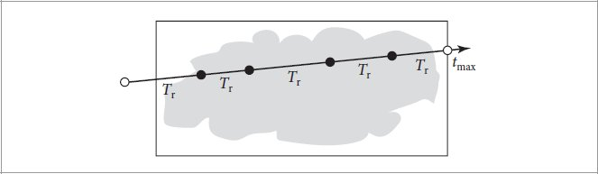

*Figure 14.4: In addition to calling a provided callback function at sampled points in the medium, shown here as filled circles, the SampleT_maj() function returns the majorant transmittance Tmaj from the last sampled point to the provided tmax value.*

if (ray.medium.Is<HomogeneousMedium>()) SampleT_maj<HomogeneousMedium>(ray, tMax, u,rng, lambda, func); else if (ray.medium.Is<UniformGridMedium>()) . . .

However, enumerating all the media that are implemented in pbrt in the SampleT_maj() function is undesirable: that would add an unexpected and puzzling additional step for users who wanted to extend the system with a new Medium. Therefore, the first SampleT_maj() function uses the dynamic dispatch capability of the Medium’s TaggedPointer along with a generic lambda function, sample, to determine the Medium’s type. TaggedPointer::Dispatch() ends up passing the Medium pointer back to sample; because the parameter is declared as auto, it then takes on the actual type of the medium when it is invoked. Thus, the following function has equivalent functionality to the code above but naturally handles all the media that are listed in the Medium class declaration without further modification. 〈Medium Sampling Function Definitions〉 +≡ template <typename F> SampledSpectrum SampleT_maj(Ray ray, Float tMax, Float u, RNG &rng, const SampledWavelengths &lambda, F callback) { auto sample = [&](auto medium) { using M = typename std::remove_reference_t<decltype(*medium)>; return SampleT_maj<M>(ray, tMax, u, rng, lambda, callback); }; return ray.medium.Dispatch(sample); }

With the concrete type of the medium available, we can proceed with the second instance of SampleTmaj(), which can now be specialized based on that type. 〈Medium Sampling Function Definitions〉 +≡ template <typename ConcreteMedium, typename F> SampledSpectrum SampleT_maj(Ray ray, Float tMax, Float u, RNG &rng,

const SampledWavelengths &lambda, F callback) { 〈Normalize ray direction and update tMax accordingly 861〉 〈Initialize MajorantIterator for ray majorant sampling 861〉 〈Generate ray majorant samples until termination 861〉 }

```text
   Float 23
   Medium 714
   Ray 95
   Ray::medium 95
   RNG 1054
   SampledSpectrum 171
   SampledWavelengths 173
   SampleT_maj() 859
   TaggedPointer 1073
   TaggedPointer::Dispatch() 1075
   TaggedPointer::Is() 1074
```

The function starts by normalizing the ray’s direction so that parametric distance along the ray directly corresponds to distance from the ray’s origin. This simplifies subsequent transmittance computations in the remainder of the function. Since normalization scales the direction’s length, the tMax endpoint must also be updated so that it corresponds to the same point along the ray. 〈Normalize ray direction and update tMax accordingly〉 ≡ 860

tMax *= Length(ray.d); ray.d = Normalize(ray.d);

Since the actual type of the medium is known and because all Medium implementations must define a MajorantIterator type (recall Section 11.4.1), the medium’s iterator type can be directly declared as a stack-allocated variable. This gives a number of benefits: not only is the expense of dynamic allocation avoided, but subsequent calls to the iterator’s Next() method in this function are regular method calls that can even be expanded inline by the compiler; no dynamic dispatch is necessary for them. An additional benefit of knowing the medium’s type is that the appropriate

SampleRay() method can be called directly without incurring the cost of dynamic dispatch here. 〈Initialize MajorantIterator for ray majorant sampling〉 ≡ 860

```rust
   ConcreteMedium *medium = ray.medium.Cast<ConcreteMedium>();
   typename ConcreteMedium::MajorantIterator iter =
         medium->SampleRay(ray, tMax, lambda);
```

With an iterator initialized, sampling along the ray can proceed. The T_maj variable declared here tracks the accumulated majorant transmittance from the ray origin or the previous sample along the ray (depending on whether a sample has yet been generated). 〈Generate ray majorant samples until termination〉 ≡ 860

SampledSpectrum T_maj(1.f); bool done = false; while (!done) { 〈Get next majorant segment from iterator and sample it 861〉 } return SampledSpectrum(1.f);

If the iterator has no further majorant segments to provide, then sampling is complete. In this case, it is important to return any majorant transmittance that has accumulated in T_maj; that represents the remaining transmittance to the ray’s endpoint. Otherwise, a few details are attended to before sampling proceeds along the segment. 〈Get next majorant segment from iterator and sample it〉 ≡ 861

pstd::optional<RayMajorantSegment> seg = iter.Next(); if (!seg) return T_maj; 〈Handle zero-valued majorant for current segment 862〉 〈Generate samples along current majorant segment 862〉

If the majorant has the value 0 in the first wavelength, then there is nothing to sample along the segment. It is important to handle this case, since otherwise the subsequent call to SampleExponential() in this function would return an infinite value that would subsequently lead to not-a-number values. Because the other wavelengths may not themselves have zero-valued majorants, we must still update T_maj for the segment’s majorant

transmittance even though the transmittance for the first wavelength is unchanged.

```text
   Length() 88
   Medium::SampleRay() 719
   Normalize() 88
   Ray::d 95
   Ray::medium 95
   RayMajorantIterator::Next() 719
   RayMajorantSegment 718
   SampledSpectrum 171
```

〈Handle zero-valued majorant for current segment〉 ≡ 861

if (seg->sigma_maj[0] == 0) { Float dt = seg->tMax - seg->tMin; 〈Handle infinite dt for ray majorant segment 862〉 T_maj *= FastExp(-dt * seg->sigma_maj); continue; }

One edge case must be attended to before the exponential function is called. If tMax holds the IEEE floating-point infinity value, then dt will as well; it then must be bumped down to the largest finite Float. This is necessary because with floating-point arithmetic, zero times infinity gives a not-a-number value (whereas any nonzero value times infinity gives infinity). Otherwise, for any wavelengths with zero-valued sigma_maj, not-a-number values would be passed to FastExp(). 〈Handle infinite dt for ray majorant segment〉 ≡ 862

if (IsInf(dt)) dt = std::numeric_limits<Float>::max();

The implementation otherwise tries to generate a sample along the current segment. This work is inside a while loop so that multiple samples may be generated along the segment. 〈Generate samples along current majorant segment〉 ≡ 861

Float tMin = seg->tMin; while (true) { 〈Try to generate sample along current majorant segment 862〉 }

In the usual case, a distance is sampled according to the PDF . Separate cases handle a sample that is within the current majorant segment and one that is past it. One detail to note in this fragment is that as soon as the uniform sample u has been used, a replacement is immediately generated using the provided RNG. In this way, the method maintains the invariant that u is always a valid independent sample value. While this can lead to a single excess call to RNG::Uniform() each time SampleT_maj() is called, it ensures the initial u value provided to the method is used only once. 〈Try to generate sample along current majorant segment〉 ≡ 862

Float t = tMin + SampleExponential(u, seg->sigma_maj[0]); u = rng.Uniform<Float>(); if (t < seg->tMax) { 〈Call callback function for sample within segment 863〉 } else { 〈Handle sample past end of majorant segment 863〉 }

For a sample within the segment’s extent, the final majorant transmittance to be passed to the callback is found by accumulating the transmittance from tMin to the sample point. The rest of the necessary medium properties can be found using SamplePoint(). If the callback function returns false to indicate that sampling should conclude, then we have a doubly nested while loop to break out of; a break statement takes care of the inner one, and setting done to true causes the outer one to terminate.

```text
   FastExp() 1036
   Float 23
   IsInf() 363
   RayMajorantSegment::sigma_maj 718
   RayMajorantSegment::tMax 718
   RayMajorantSegment::tMin 718
   RNG::Uniform<Float>() 1056
   SampleExponential() 1003
```

If true is returned by the callback, indicating that sampling should restart at the sample that was just generated, then the accumulated transmittance is reset to 1 and tMin is updated to be at the just-taken sample’s position.

〈Call callback function for sample within segment〉 ≡ 862

T_maj *= FastExp(-(t - tMin) * seg->sigma_maj); MediumProperties mp = medium->SamplePoint(ray(t), lambda); if (!callback(ray(t), mp, seg->sigma_maj, T_maj)) { done = true; break; } T_maj = SampledSpectrum(1.f); tMin = t;

If the sampled distance t is past the end of the segment, then there is no medium interaction along it and it is on to the next segment, if any. In this case, majorant transmittance up to the end of the segment must be accumulated into T_maj so that the complete majorant transmittance along the ray is provided with the next valid sample (if any). 〈Handle sample past end of majorant segment〉 ≡ 862

Float dt = seg->tMax - tMin; T_maj *= FastExp(-dt * seg->sigma_maj); break;

⋆ 14.1.4 GENERALIZED PATH SPACE

Just as it was helpful to express the light transport equation (LTE) as a sum over paths of scattering events, it is also helpful to express the null-scattering integral equation of transfer in this form. Doing so makes it possible to apply variance reduction techniques like multiple importance sampling and is a prerequisite for constructing participating medium-aware bidirectional integrators. Recall how, in Section 13.1.4, the surface form of the LTE was repeatedly substituted into itself to derive the path space contribution function for a path of length n

where the throughput T(pn) was defined as

This previous definition only works for surfaces, but using a similar approach of substituting the integral equation of transfer, a medium-aware path integral can be derived. The derivation is laborious and we will just present the final result here. (The “Further Reading” section has a pointer to the full derivation.) FastExp() 1036 Float 23 Medium::SamplePoint() 717 MediumProperties 718 RayMajorantSegment::sigma_maj 718 RayMajorantSegment::tMax 718 SampledSpectrum 171 Previously, integration occurred over a Cartesian product of surface locations An. Now, we will need a formal way of writing down an integral over an arbitrary sequence of each of 2D surface locations A, 3D positions in a participating medium V where actual scattering occurs, and 3D positions in a participating medium V∅ where null scattering occurs. (The two media V and V∅ represent the same volume of space with the same scattering properties, but we will find it handy to distinguish between them in the following.) First, we will focus only on a specific arrangement of n surface and medium vertices encoded in a configuration vector c. The associated set of paths is given by a Cartesian product of surface locations and medium locations,

The set of all paths of length n is the union of the above sets over all possible configuration vectors:

Next, we define a measure, which provides an abstract notion of the volume of a subset D ⊆ Pn that is essential for integration. The measure we will use simply sums up the product of surface area and volume associated with the individual vertices in each of the path spaces of specific configurations.

The measure for null-scattering vertices dV∅ incorporates a Dirac delta distribution to limit integration to be along the line between successive real-scattering vertices.

The generalized path contribution can now be written as

where

Due to the measure defined earlier, the generalized path contribution is a sum of many integrals considering all possible sequences of surface, volume, and null-scattering events. The full set of path vertices pi include both null- and real-scattering events. We will find it useful to use ri to denote the subset of them that represent real scattering (see Figure 14.5). Note a given real-scattering vertex ri will generally have a different index value in the full path.

The path throughput function can then be defined as:

It now refers to a generalized scattering distribution function and generalized geometric term Ĝ. The former simply falls back to the BSDF, phase function (multiplied by σs), or a factor that enforces the ordering of null-scattering vertices, depending on the type of the vertex pi. Note that the first two products in Equation (14.11) are over all vertices but the third is only over real-scattering vertices.

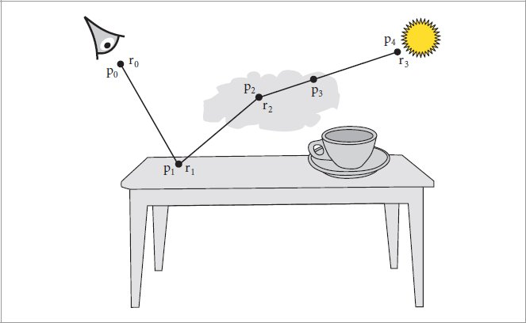

*Figure 14.5: In the path space framework, a path is defined by a set of n vertices pi that have an emitter at one endpoint and a sensor at the other, where intermediate vertices represent scattering events, including null scattering. The subset of m vertices that represent real scattering events are labeled ri.*

The scattering distribution function is defined by

Here, H is the Heaviside function, which is 1 if its parameter is positive and 0 otherwise. Equation (13.2) in Section 13.1.3 originally defined the geometric term G

as A generalized form of this geometric term is given by

where

incorporates the absolute angle cosine between the connection segment and the normal direction when the underlying vertex p is located on a surface. Note that Cp is only evaluated for real-scattering vertices ri, so the case of p ∈ V∅ does not need to be considered.

Similar to integrating over the path space for surface scattering, the Monte Carlo estimator for the path contribution function can be defined for a path pn of n path vertices pi. The resulting Monte Carlo estimator is

where p(pn) is the probability of sampling the path pn with respect to the generalized path space measure. Following Equation (13.8), we will also find it useful to define the volumetric path throughput weight

⋆ 14.1.5 EVALUATING THE VOLUMETRIC PATH INTEGRAL

The Monte Carlo estimator of the null-scattering path integral from Equation (14.14) allows sampling path vertices in a variety of ways; it is not necessary to sample them incrementally from the camera as in path tracing, for example. We will now reconsider sampling paths via path tracing under the path integral framework to show its use. For simplicity, we will consider scenes that have only volumetric scattering here. The volumetric path-tracing algorithm from Section 14.1.2 is based on three sampling operations: sampling a distance along the current ray to a scattering event, choosing which type of interaction happens at that point, and then sampling a new direction from that point if the path has not been terminated. We can write the corresponding Monte Carlo estimator for the

generalized path contribution function from Equation (14.14) with the path probability p(pn) expressed as the product of three probabilities:

- pmaj(pi+1|pi, ωi): the probability of sampling the point pi+1 along the direction ωi from the point pi.
- pe(pi): the discrete probability of sampling the type of scattering event—absorption, real-, or null-scattering—that was chosen at pi.
- pω(ω′|ri, ωi): the probability of sampling the direction ω′ after a regular scattering event at point ri with incident direction ωi.

For an n vertex path with m real-scattering vertices, the resulting estimator is

where ωi denotes the direction from pi to pi+1 and where the Ĝ factor in the denominator accounts for the change of variables from sampling with respect to solid angle to sampling with respect to the path space measure. We consider each of the three sampling operations in turn, starting with distance sampling, which has density pmaj. Assuming a single majorant σmaj, we find that pmaj has density , and the exponential factors cancel out the Tmaj factors in , each one leaving behind a 1/σmaj factor. Expanding out and simplifying, including eliminating the Ĝ factors, all of which also cancel out, we have the estimator

Consider next the discrete choice among the three types of scattering event. The probabilities pe are all of the form σ{a,s,n}/σmaj, according to which type of scattering event was chosen at each vertex. The (σmaj)n factor in Equation

(14.17) cancels, leaving us with

The first n − 1 σ{a,s,n} factors must be either real or null scattering, and the last must be σa, given how the path was sampled. Thus, the estimator is equivalent to

Because we are for now neglecting surface scattering, represents either regular volumetric scattering or null scattering. Recall from Equation (14.12) that includes a σs or σn factor in those respective cases, which cancels out all the corresponding factors in the σ{s,n} product in the denominator. Further, note that the Heaviside function for null scattering’s function is always 1 given how vertices are sampled with path tracing, so we can also restrict ourselves to the remaining m real-scattering events in the numerator. Our estimator simplifies to

The σa factor in the path space emission function, Equation (14.10), cancels the remaining σa(pn). We are left with the emission Le(pn → pn−1) at the last vertex scaled by the product of ratios of phase function values and sampling probabilities as the estimator’s value, just as we saw in Section 14.1.2. 14.2 VOLUME SCATTERING INTEGRATORS

The path space expression of the null-scattering equation of transfer allows a variety of sampling techniques to be applied to the light transport problem. This section defines two integrators that are based on path tracing starting from the camera.

First is the SimpleVolPathIntegrator, which uses simple sampling techniques, giving an implementation that is short and easily verified. This integrator is particularly useful for computing ground-truth results when debugging more sophisticated volumetric sampling and integration algorithms. The VolPathIntegrator is defined next. This integrator is fairly complex, but it applies state-of-the-art sampling techniques to volume light transport while handling surface scattering similarly to the PathIntegrator. It is pbrt’s default integrator and is also the template for the wavefront integrator in Chapter 15.

```text
    PathIntegrator 833
    RandomWalkIntegrator 33
    VolPathIntegrator 877
```

### 14.2.1 A SIMPLE VOLUMETRIC INTEGRATOR

The SimpleVolPathIntegrator implements a basic volumetric path tracer, following the sampling approach described in Section 14.1.2. Its Li() method is under 100 lines of code, none of them too tricky. However, with this simplicity comes a number of limitations. First, like the RandomWalkIntegrator, it does not perform any explicit light sampling, so it requires that rays are able to randomly intersect the lights in the scene. Second, it does not handle scattering from surfaces. An error message is therefore issued if it is used with a scene that contains delta distribution light sources or has surfaces with nonzero-valued BSDFs. (These defects are all addressed in the VolPathIntegrator discussed in Section 14.2.2.) Nevertheless, this integrator is capable of rendering complex volumetric effects; see Figure 14.6.

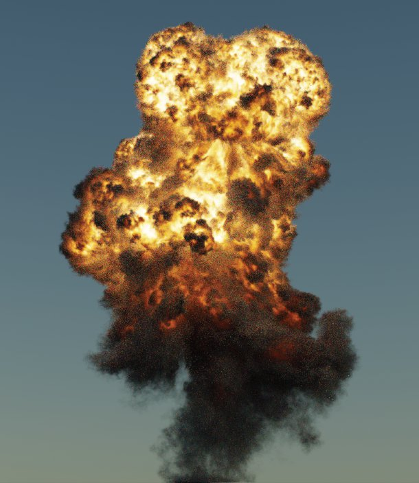

*Figure 14.6: Explosion Rendered Using the SimpleVolPathIntegrator. With 256 samples per pixel, this integrator gives a reasonably accurate rendering of the volumetric model, though there are variance spikes in some pixels (especially visible toward the bottom of the volume) due to error from the integrator not directly sampling the scene’s light sources. The VolPathIntegrator, which uses more sophisticated sampling strategies, renders this scene with 1,288 times lower MSE; it is discussed in Section 14.2.2. (Scene courtesy of Jim Price.)*

〈SimpleVolPathIntegrator Definition〉 ≡

class SimpleVolPathIntegrator : public RayIntegrator { public: 〈SimpleVolPathIntegrator Public Methods〉 private: 〈SimpleVolPathIntegrator Private Members 869〉 };

```text
   RayIntegrator 28
   SimpleVolPathIntegrator 868
   VolPathIntegrator 877
```

This integrator’s only parameter is the maximum path length, which is set via a value passed to the constructor (not included here). 〈SimpleVolPathIntegrator Private Members〉 ≡ 868

```rust
   int maxDepth;
```

The general form of the Li() method follows that of the PathIntegrator.

〈SimpleVolPathIntegrator Method Definitions〉 ≡ SampledSpectrum SimpleVolPathIntegrator::Li(RayDifferential ray, SampledWavelengths &lambda, Sampler sampler, ScratchBuffer &buf, VisibleSurface *) const { 〈Declare local variables for delta tracking integration 869〉 〈Terminate secondary wavelengths before starting random walk 869〉 while (true) { 〈Estimate radiance for ray path using delta tracking 870〉 } return L; }

A few familiar variables track the path state, including L to accumulate the radiance estimate for the path. For this integrator, beta, which tracks the path throughput weight, is just a single Float value, since the product of

ratios of phase function values and sampling PDFs from Equation (14.19) is a scalar value. 〈Declare local variables for delta tracking integration〉 ≡ 869

SampledSpectrum L(0.f); Float beta = 1.f; int depth = 0;

Media with scattering properties that vary according to wavelength introduce a number of complexities in sampling and evaluating Monte Carlo estimators. We will defer addressing them until we cover the VolPathIntegrator. The SimpleVolPathIntegrator instead estimates radiance at a single wavelength by terminating all but the first wavelength sample. Here is a case where we have chosen simplicity over efficiency for this integrator’s implementation: we might instead have accounted for all wavelengths until the point that spectrally varying scattering properties were encountered, enjoying the variance reduction benefits of estimating all of them for scenes where doing so is possible. However, doing this would have led to a more complex integrator implementation.

```text
   Float 23
   PathIntegrator 833
   RayDifferential 96
   SampledSpectrum 171
   SampledWavelengths 173
   SampledWavelengths::TerminateSecondary() 174
   Sampler 469
   SampleT_maj() 859
   ScratchBuffer 1078
   VisibleSurface 245
   VolPathIntegrator 877
```

〈Terminate secondary wavelengths before starting random walk〉 ≡ 869

lambda.TerminateSecondary();

The first step in the loop is to find the ray’s intersection with the scene geometry, if any. This gives the parametric distance t beyond which no samples should be taken for the current ray, as the intersection either

represents a transition to a different medium or a surface that occludes farther-away points. The scattered and terminated variables declared here will allow the lambda function that is passed to SampleT_maj() to report back the state of the path after sampling terminates. 〈Estimate radiance for ray path using delta tracking〉 ≡ 869

pstd::optional<ShapeIntersection> si = Intersect(ray); bool scattered = false, terminated = false; if (ray.medium) { 〈Initialize RNG for sampling the majorant transmittance 870〉 〈Sample medium using delta tracking 870〉 } 〈Handle terminated and unscattered rays after medium sampling 872〉

An RNG is required for the call to the SampleT_maj() function. We derive seeds for it based on two random values from the sampler, hashing them to convert Floats into integers.

〈Initialize RNG for sampling the majorant transmittance〉 ≡ 870, 880

```rust
   uint64_t hash0 = Hash(sampler.Get1D());
   uint64_t hash1 = Hash(sampler.Get1D());
   RNG rng(hash0, hash1);
```

With that, a call to SampleT_maj() starts the generation of samples according to σmajTmaj. The Sampler is used to generate the first uniform sample u that is passed to the method; recall from Section 14.1.3 that subsequent ones will be generated using the provided RNG. In a similar fashion, the Sampler is used for the initial value of uMode here. It will be used to choose among the three types of scattering event at the first sampled point. For uMode as well, the RNG will provide subsequent values. In this case, the transmittance that SampleT_maj() returns for the final segment is unneeded, so it is ignored. 〈Sample medium using delta tracking〉 ≡ 870

Float tMax = si ? si->tHit : Infinity; Float u = sampler.Get1D(); Float uMode = sampler.Get1D(); SampleT_maj(ray, tMax, u, rng, lambda,

```rust
        [&](Point3f p, MediumProperties mp, SampledSpectrum sigma_maj,
            SampledSpectrum T_maj) {
            〈Compute medium event probabilities for interaction 870〉
      〈Randomly sample medium scattering event for delta tracking 871〉
```

```rust
        });
```

For each sample returned by SampleT_maj(), it is necessary to select which type of scattering it represents. The first step is to compute the probability of each possibility. Because we have specified σn such that it is nonnegative and σa + σs + σn = σmaj, the null-scattering probability can be found as one minus the other two probabilities. A call to std::max() ensures that any slightly negative values due to floating-point round-off error are clamped at zero.

```text
   Float 23
   Hash() 1042
   Infinity 361
   Integrator::Intersect() 23
   MediumProperties 718
   MediumProperties::sigma_a 718
   MediumProperties::sigma_s 718
   Point3f 92
   Ray::medium 95
   RNG 1054
   SampledSpectrum 171
   Sampler 469
   Sampler::Get1D() 470
   SampleT_maj() 859
   ShapeIntersection 266
   ShapeIntersection::tHit 266
```

〈Compute medium event probabilities for interaction〉 ≡ 870, 880

Float pAbsorb = mp.sigma_a[0] / sigma_maj[0]; Float pScatter = mp.sigma_s[0] / sigma_maj[0]; Float pNull = std::max<Float>(0, 1 - pAbsorb - pScatter);

A call to SampleDiscrete() then selects one of the three terms of Ln using the specified probabilities. 〈Randomly sample medium scattering event for delta tracking〉 ≡ 870

```rust
   int mode = SampleDiscrete({pAbsorb, pScatter, pNull}, uMode);
   if (mode == 0) {
       〈Handle absorption event for medium sample 871〉
   } else if (mode == 1) {
       〈Handle regular scattering event for medium sample 871〉
   } else {
       〈Handle null-scattering event for medium sample 872〉
   }
```

If absorption is chosen, the path terminates. Any emission is added to the radiance estimate, and evaluation of Equation (14.19) is complete. The fragment therefore sets terminated to indicate that the path is finished and returns false from the lambda function so that no further samples are generated along the ray. 〈Handle absorption event for medium sample〉 ≡ 871

L += beta * mp.Le; terminated = true; return false;

For a scattering event, beta is updated according to the ratio of phase function and its directional sampling probability from Equation (14.19). 〈Handle regular scattering event for medium sample〉 ≡ 871

〈Stop path sampling if maximum depth has been reached 871〉 〈Sample phase function for medium scattering event 871〉 〈Update state for recursive evaluation of Li 872〉

The counter for the number of scattering events is only incremented for real-scattering events; we do not want the number of null-scattering events to affect path termination. If this scattering event causes the limit to be reached, the path is terminated. 〈Stop path sampling if maximum depth has been reached〉 ≡ 871, 882

```rust
   if (depth++ >= maxDepth) {
        terminated = true;
        return false;
   }
```

If the path is not terminated, then a new direction is sampled from the phase function’s distribution.

〈Sample phase function for medium scattering event〉 ≡ 871

Point2f u{rng.Uniform<Float>(), rng.Uniform<Float>()}; pstd::optional<PhaseFunctionSample> ps = mp.phase.Sample_p(-ray.d, u); if (!ps) { terminated = true; return false; }

```text
   Float 23
   MediumProperties::Le 718
   MediumProperties::phase 718
   PhaseFunction::Sample_p() 711
   PhaseFunctionSample 711
   Point2f 92
   Ray::d 95
   RNG::Uniform<Float>() 1056
   SampleDiscrete() 70
   SimpleVolPathIntegrator::maxDepth 869
```

Given a sampled direction, the beta factor must be updated. Volumetric path-tracing implementations often assume that the phase function sampling distribution matches the phase function’s actual distribution and dispense with beta entirely since it is always equal to 1. This variation is worth pausing to consider: in that case, emitted radiance at the end of the path is always returned, unscaled. All of the effect of transmittance, phase functions, and so forth is entirely encapsulated in the distribution of how often various terms are evaluated and in the distribution of scattered ray directions. pbrt does not impose the requirement on phase functions that their importance sampling technique be perfect, though this is the case for the Henyey–Greenstein phase function in pbrt.

Be it with beta or without, there is no need to do any further work along the current ray after a scattering event, so after the following code updates the path state to account for scattering, it too returns false to direct that no further samples should be taken along the ray. 〈Update state for recursive evaluation of Li〉 ≡ 871

```rust
   beta *= ps->p / ps->pdf;
   ray.o = p;
   ray.d = ps->wi;
```

```rust
   scattered = true;
   return false;
```

Null-scattering events are ignored, so there is nothing to do but to return true to indicate that additional samples along the current ray should be taken. Similar to the real-scattering case, this can be interpreted as starting a recursive evaluation of Equation (14.3) from the current sampled position without incurring the overhead of actually doing so. Since this is the only case that may lead to another invocation of the lambda function, uMode must be refreshed with a new uniform sample value in case another sample is generated. 〈Handle null-scattering event for medium sample〉 ≡ 871

uMode = rng.Uniform<Float>(); return true;

If the path was terminated due to absorption, then there is no more work to do in the Li() method; the final radiance value can be returned. Further, if the ray was scattered, then there is nothing more to do but to restart the while loop and start sampling the scattered ray. Otherwise, the ray either underwent no scattering events or only underwent null scattering. 〈Handle terminated and unscattered rays after medium sampling〉 ≡ 870

if (terminated) return L; if (scattered) continue; 〈Add emission to surviving ray 872〉 〈Handle surface intersection along ray path 873〉

If the ray is unscattered and unabsorbed, then any emitters it interacts with contribute radiance to the path. Either surface emission or emission from infinite light sources is accounted for, depending on whether an intersection with a surface was found. Further, if the ray did not intersect a surface, then the path is finished and the radiance estimate can be returned. 〈Add emission to surviving ray〉 ≡ 872

if (si) L += beta * si->intr.Le(-ray.d, lambda); else { for (const auto &light : infiniteLights) L += beta * light.Le(ray, lambda); return L;

```rust
   }
```

```text
    Float 23
    Integrator::infiniteLights 23
    Light::Le() 743
    PhaseFunctionSample::p 711
    PhaseFunctionSample::pdf 711
    PhaseFunctionSample::wi 711
    Ray::d 95
    Ray::o 95
    RNG::Uniform<Float>() 1056
    ShapeIntersection::intr 266
    SurfaceInteraction::Le() 762
```

It is still necessary to consider surface intersections, even if scattering from them is not handled by this integrator. There are three cases to consider: If the surface has no BSDF, it represents a transition between different types of participating media. A call to SkipIntersection() moves the ray past the intersection and updates its medium appropriately. If there is a valid BSDF and that BDSF also returns a valid sample from Sample_f(), then we have a BSDF that scatters; an error is issued and rendering stops. A valid but zero-valued BSDF is allowed; such a BSDF should be assigned to area light sources in scenes to be rendered using this integrator. 〈Handle surface intersection along ray path〉 ≡ 872

BSDF bsdf = si->intr.GetBSDF(ray, lambda, camera, buf, sampler); if (!bsdf) si->intr.SkipIntersection(&ray, si->tHit); else { 〈Report error if BSDF returns a valid sample〉 }

⋆ 14.2.2 IMPROVING THE SAMPLING TECHNIQUES

The VolPathIntegrator adds three significant improvements to the approach implemented in SimpleVolPathIntegrator: it supports

scattering from surfaces as well as from volumes; it handles spectrally varying medium scattering properties without falling back to sampling a single wavelength; and it samples lights directly, using multiple importance sampling to reduce variance when doing so. The first improvement— including surface scattering—is mostly a matter of applying the ideas of Equation (14.7), sampling distances in volumes but then choosing surface scattering if the sampled distance is past the closest intersection. For the other two, we will here discuss the underlying foundations before turning to their implementation.

Chromatic Media We have thus far glossed over some of the implications of spectrally varying medium properties. Because pbrt uses point-sampled spectra, they introduce no complications in terms of evaluating things like the modified path throughput or the path throughput weight β(pn): given a set of path vertices, such quantities can be evaluated for all the wavelength samples simultaneously using the SampledSpectrum class.

The problem with spectrally varying medium properties comes from sampling. Consider a wavelength-dependent function fλ(x) that we would like to integrate at n wavelengths λi. If we draw samples from a wavelength-dependent PDF based on the first wavelength and then evaluate

f at all the wavelengths, we have the estimators Even if the PDF that was used for sampling matches well, it may be a poor match for f at the other wavelengths. It may not even be a valid PDF for them, if it is zero-valued where the function is nonzero. However, falling back to integrating a single wavelength at a time would be unfortunately inefficient, as shown in Section 4.5.4.

```text
   BSDF 544
   SampledSpectrum 171
   ShapeIntersection::intr 266
   ShapeIntersection::tHit 266
   SimpleVolPathIntegrator 868
   SurfaceInteraction::GetBSDF() 682
   SurfaceInteraction::SkipIntersection() 643
```

This problem of a single sampling PDF possibly mismatched with a wavelength-dependent function comes up repeatedly in volumetric path tracing. For example, sampling the majorant transmittance at one wavelength may be a poor approach for sampling it at others. That could be handled by selecting a majorant that bounds all wavelengths’ extinction coefficients, but such a majorant would lead to many null-scattering events at wavelengths that could have used a much lower majorant, which would harm performance. The path tracer’s choice among absorption, real scattering, and null scattering at a sampled point cannot be sidestepped in a similar way: different wavelengths may have quite different probabilities for each of these types of medium interaction, yet with path tracing the integrator must choose only one of them. Splitting up the computation to let each wavelength choose individually would be nearly as inefficient as only considering a single wavelength at a time. However, if a single type of interaction is chosen based on a single wavelength and we evaluate the modified path contribution function for all wavelengths, we could have arbitrarily high variance in the other wavelengths. To see why, note how all the σ{s,n} factors that came from the pe(pi) factors in Equation (14.18) canceled out to give the delta-tracking estimator, Equation (14.19). In the spectral case, if, for example, real scattering is chosen based on a wavelength λ’s scattering coefficient σs and if a wavelength λ′ has scattering coefficient , then the final estimator for λ′ will include a factor of that can be arbitrarily large. The fact that SampleT_maj() nevertheless samples according to a single wavelength’s majorant transmittance suggests that there is a solution to this problem. That solution, yet again, is multiple importance sampling. In this case, we are using a single sampling technique rather than MIS-weighting multiple techniques, so we use the single-sample MIS estimator from

Equation (2.16), which here gives where q is the discrete probability of sampling using the wavelength λ1, here uniform at 1/n with n the number of spectral samples.

The balance heuristic is optimal for single-sample MIS. It gives the MIS weight

which gives the estimator

See Figure 14.7 for an example that shows the benefits of MIS for chromatic media.

Direct Lighting Multiple importance sampling is also at the heart of how the VolPathIntegrator samples direct illumination. As with the PathIntegrator, we would like to combine the strategies of sampling the light sources with sampling the BSDF or phase function to find light-carrying paths and then to weight the contributions of each sampling technique using MIS. Doing so is more complex than it is in the absence of volumetric scattering, however, because not only does the sampling distribution used at the last path vertex differ (as before) but the VolPathIntegrator also uses ratio tracking to estimate the transmittance along the shadow ray. That is a different distance sampling technique than the delta-tracking approach used when sampling ray paths, and so it leads to a different path PDF.

```text
   PathIntegrator 833
   SampleT_maj() 859
   VolPathIntegrator 877
```

In the following, we will say that the two path-sampling techniques used in the VolPath Integrator are unidirectional path sampling and light path sampling; we will write their respective path PDFs as pu and pl. The first corresponds to the sampling approach from Section 14.1.5, with delta tracking used to find real-scattering vertices and with the phase function or BSDF sampled to find the new direction at each vertex. Light path sampling follows the same approach up to the last real-scattering vertex before the light vertex; there, the light selects the direction and then ratio tracking gives the transmittance along the last path segment. (See Figure 14.8.)

Given a path pn−1, both approaches share the same path throughput weight β up to the vertex pn−1 and the same path PDF up to that vertex, pu(pn−1).2


*Figure 14.7: Chromatic Volumetric Media. (a) When rendered without spectral MIS, variance is high. (b) Results are much better with spectral MIS, as implemented in the VolPathIntegrator. For this scene, MSE is reduced by a factor of 149. (Scene courtesty of Jim Price.)*

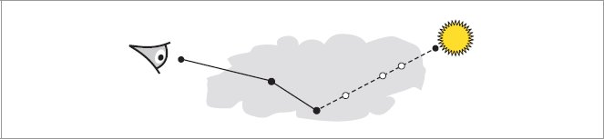

*Figure 14.8: In the direct lighting calculation, at each path vertex a point is sampled on a light source and a shadow ray (dotted line) is traced. The VolPathIntegrator uses ratio tracking to compute the transmittance along the ray by accumulating the product σn/σmaj at sampled points along the ray (open circles). For the MIS weight, it is necessary to be able not only to compute the PDF for sampling the corresponding direction at the last path vertex but also to compute the probability of generating these samples using delta tracking, since that is how the path would be sampled with unidirectional path sampling.*

```text
   VolPathIntegrator 877
```

For the full PDF for unidirectional path sampling, at the last scattering vertex we have the probability of scattering, σs(pn−1)/σmaj times the directional probability for sampling the new direction pω(ωn), which is given by the sampling strategy used for the BSDF or phase function. Then, for the path to find an emitter at the vertex pn, it must have only sampled null-scattering vertices between pn−1 and pn; absorption or a real-scattering vertex preclude making it to pn. Using the results from Section 14.1.5, we can find that the path PDF between two points pi and pj with m intermediate null-scattering vertices

indexed by k is given by the product of for all null-scattering vertices. The σmaj factors cancel and the null-scattering path probability is

The full unidirectional path probability is then given by

For light sampling, we again have the discrete probability σs(pn−1)/σmaj for scattering at pn−1 but the directional PDF at the vertex is determined by the light’s sampling distribution, which we will denote by pl,ω(ωn). The only missing piece is the PDF of the last segment (the shadow ray), where ratio tracking is used. In that case, points are sampled according to the majorant transmittance and so the PDF for a path sampled between points pi and pj with m intermediate vertices is

and the full light sampling path PDF is given by

The VolPathIntegrator samples both types of paths according to the first wavelength λ1 but evaluates these PDFs at all wavelengths so that MIS over wavelengths can be used. Given the path pn sampled using unidirectional path sampling and then the path sampled using light path sampling, the two-sample MIS estimator is

Note that because the paths share the same vertices for all of pn−1, not only do the two factors share common factors, but and do as well, following Equations (14.21) and (14.23).

```text
   VolPathIntegrator 877
```

In this case, the MIS weights can account not only for the differences between unidirectional and light path sampling but also for the different per-wavelength probabilities for each sampling strategy. For example, with

the balance heuristic, the MIS weight for the unidirectional strategy works out to be

with m the number of spectral samples. The MIS weight for light sampling is equivalent, but with the function in the numerator replaced with .

⋆ 14.2.3 IMPROVED VOLUMETRIC INTEGRATOR

The VolPathIntegrator pulls together all of these ideas to robustly handle both surface and volume transport. See Figures 14.9 and 14.10 for images rendered with this integrator that show off the visual complexity that comes from volumetric emission, chromatic media, and multiple scattering in participating media. 〈VolPathIntegrator Definition〉 ≡ class VolPathIntegrator : public RayIntegrator { public: 〈VolPathIntegrator Public Methods〉 private: 〈VolPathIntegrator Private Methods〉 〈VolPathIntegrator Private Members 877〉 };

As with the other Integrator constructors that we have seen so far, the VolPathIntegrator constructor does not perform any meaningful computation, but just initializes member variables with provided values. These three are all equivalent to their parallels in the Path Integrator.

〈VolPathIntegrator Private Members〉 ≡ 877

int maxDepth; LightSampler lightSampler; bool regularize;

LightSampler 781 PathIntegrator 833 RayIntegrator 28 VolPathIntegrator 877


*Figure 14.9: Volumetric Emission inside Lightbulbs. The flames in each lightbulb are modeled with participating media and rendered with the VolPathIntegrator. (Scene courtesy of Jim Price.)*


*Figure 14.10: Volumetric Scattering in Liquid. Scattering in the paint-infused water is modeled with participating media and rendered with the VolPathIntegrator. (Scene courtesy of Angelo Ferretti.)*

〈VolPathIntegrator Method Definitions〉 ≡ SampledSpectrum VolPathIntegrator::Li(RayDifferential ray, SampledWavelengths &lambda, Sampler sampler, ScratchBuffer &scratchBuffer, VisibleSurface *visibleSurf) const { 〈Declare state variables for volumetric path sampling 879〉 while (true) { 〈Sample segment of volumetric scattering path 879〉

} return L; }

```text
   RayDifferential 96
   SampledSpectrum 171
   SampledWavelengths 173
   Sampler 469
   ScratchBuffer 1078
   VisibleSurface 245
   VolPathIntegrator 877
```

There is a common factor of in the denominator of the first term of the two-sample MIS estimator, Equation (14.24), and the numerator of the MIS weights, Equation (14.25). There is a corresponding factor in the second term of the estimator and in the wl weight. It is tempting to cancel these out; in that case, the path state to be tracked by the integrator would consist of and the wavelength-dependent probabilities pu(pn) and pl(pn). Doing so is mathematically valid and would provide all the quantities necessary to evaluate Equation (14.24), but suffers from the problem that the quantities involved may overflow or underflow the range of representable floating-point values. To understand the problem, consider a highly specular surface—the BSDF will have a large value for directions around its peak, but the PDF for sampling those directions will also be large. That causes no problems in the PathIntegrator, since its beta variable tracks their ratio, which ends up being close to 1. However, with maintained independently, a series of specular bounces could lead to overflow. (Many null-scattering events along a path can cause similar problems.) Therefore, the VolPathIntegrator tracks the path throughput weight for the sampled path

which is numerically well behaved. Directly tracking the probabilities pu(pn) and pl(pn) would also stress the range of floating-point numbers, so instead it tracks the rescaled path probabilities

where ppath(pn) is the probability for sampling the current path. It is equal to the light path probability for paths that end with a shadow ray from light path sampling and the unidirectional path probability otherwise. (Later in the implementation, we will take advantage of the fact that these two probabilities are the same until the last scattering vertex, which in turn implies that whichever of them is chosen for ppath does not affect the values of and .) These rescaled path probabilities are all easily incrementally updated during path sampling. If , then MIS weights like those in Equation (14.25) can be found with

and similarly for wl when .

The remaining variables in the following fragment have the same function as the variables of the same names in the PathIntegrator.

〈Declare state variables for volumetric path sampling〉 ≡ 878

SampledSpectrum L(0.f), beta(1.f), r_u(1.f), r_l(1.f); bool specularBounce = false, anyNonSpecularBounces = false; int depth = 0; Float etaScale = 1;

The while loop for each ray segment starts out similarly to the corresponding loop in the SimpleVolPathIntegrator: the integrator traces a ray to find a tmax value at the closest surface intersection before sampling the medium, if any, between the ray origin and the intersection point.

```text
   Float 23
   Integrator::Intersect() 23
   PathIntegrator 833
   Ray::medium 95
```

```text
   SampledSpectrum 171
   ShapeIntersection 266
   SimpleVolPathIntegrator 868
```

〈Sample segment of volumetric scattering path〉 ≡ 878

pstd::optional<ShapeIntersection> si = Intersect(ray); if (ray.medium) { 〈Sample the participating medium 880〉 } 〈Handle surviving unscattered rays 884〉

The form of the fragment for sampling the medium is similar as well: tMax is set using the ray intersection t, if available, and an RNG is prepared before medium sampling proceeds. If the path is terminated or undergoes real scattering in the medium, then no further work is done to sample surface scattering at a ray intersection point. 〈Sample the participating medium〉 ≡ 879

bool scattered = false, terminated = false; Float tMax = si ? si->tHit : Infinity; 〈Initialize RNG for sampling the majorant transmittance 870〉 SampledSpectrum T_maj = SampleT_maj(ray, tMax, sampler.Get1D(), rng, lambda, [&](Point3f p, MediumProperties mp, SampledSpectrum sigma_maj, SampledSpectrum T_maj) { 〈Handle medium scattering event for ray 880〉 }); 〈Handle terminated, scattered, and unscattered medium rays 883〉

Given a sampled point p′ in the medium, the lambda function’s task is to evaluate the Ln source function, taking care of the second case of Equation (14.7). 〈Handle medium scattering event for ray〉 ≡ 880

〈Add emission from medium scattering event 880〉 〈Compute medium event probabilities for interaction 870〉 〈Sample medium scattering event type and update path 881〉

A small difference from the SimpleVolPathIntegrator is that volumetric emission is added at every point that is sampled in the medium rather than only when the absorption case is sampled. There is no reason not to do so,

since emission is already available via the MediumProperties passed to the lambda function. 〈Add emission from medium scattering event〉 ≡ 880

if (depth < maxDepth && mp.Le) { 〈Compute β′ at new path vertex 880〉 〈Compute rescaled path probability for absorption at path vertex 881〉 〈Update L for medium emission 881〉 }

In the following, we will sometimes use the notation [pn + p′] to denote the path pn with the vertex p′ appended to it. Thus, for example, pn = [pn−1 + pn]. The estimator that gives the contribution for volumetric emission at p′ is then

```text
   Float 23
   Infinity 361
   MediumProperties 718
   MediumProperties::Le 718
   Point3f 92
   RNG 1054
   SampledSpectrum 171
   Sampler::Get1D() 470
   SampleT_maj() 859
   ShapeIntersection::tHit 266
   SimpleVolPathIntegrator 868
   VolPathIntegrator::maxDepth 877
```

beta holds β(pn), so we can incrementally compute β([pn + p′]) by

From Section 14.1.5, we know that . Because we are always sampling absorption (at least as far as including emission goes), pe is 1 here.

〈Compute β′ at new path vertex〉 ≡ 880

Float pdf = sigma_maj[0] * T_maj[0]; SampledSpectrum betap = beta * T_maj / pdf;

Even though this is the only sampling technique for volumetric emission, different wavelengths may sample this vertex with different probabilities, so it is worthwhile to apply MIS over the wavelengths’ probabilities. With r_u storing the rescaled unidirectional probabilities up to the previous path vertex, the rescaled path probabilities for sampling the emissive vertex, r_e, can be found by multiplying r_u by the per-wavelength pmaj probabilities and dividing by the probability for the wavelength that was used for sampling p′, which is already available in pdf. (Note that in monochromatic media, these ratios are all 1.) 〈Compute rescaled path probability for absorption at path vertex〉 ≡ 880

SampledSpectrum r_e = r_u * sigma_maj * T_maj / pdf;

Here we have a single-sample MIS estimator with balance heuristic weights given by

The absorption coefficient and emitted radiance for evaluating Equation (14.28) are available in MediumProperties and the SampledSpectrum::Average() method conveniently computes the average of rescaled probabilities in the denominator of Equation (14.29). 〈Update L for medium emission〉 ≡ 880

if (r_e) L += betap * mp.sigma_a * mp.Le / r_e.Average();

Briefly returning to the initialization of betap and r_e in the previous fragments: it may seem tempting to cancel out the T_maj factors from them, but note how the final estimator does not perform a component-wise division of these two quantities but instead divides by the average of the rescaled probabilities when computing the MIS weight. Thus, performing such cancellations would lead to incorrect results.3 After emission is handled, the next step is to determine which term of Ln to evaluate; this follows the same approach as in the SimpleVolPathIntegrator.

〈Sample medium scattering event type and update path〉 ≡ 880

Float um = rng.Uniform<Float>(); int mode = SampleDiscrete({pAbsorb, pScatter, pNull}, um); if (mode == 0) { 〈Handle absorption along ray path 881〉 } else if (mode == 1) { 〈Handle scattering along ray path 882〉 } else { 〈Handle null scattering along ray path 883〉 }

As before, the ray path is terminated in the event of absorption. Since any volumetric emission at the sampled point has already been added, there is nothing to do but handle the details associated with ending the path.

```text
   Float 23
   MediumProperties 718
   MediumProperties::Le 718
   MediumProperties::sigma_a 718
   RNG::Uniform() 1055
   SampleDiscrete() 70
   SampledSpectrum 171
   SampledSpectrum::Average() 172
```

〈Handle absorption along ray path〉 ≡ 881

terminated = true; return false;

For a real-scattering event, a shadow ray is traced to a light to sample direct lighting, and the path state is updated to account for the new ray. A false value returned from the lambda function prevents further sample generation along the current ray. 〈Handle scattering along ray path〉 ≡ 881

〈Stop path sampling if maximum depth has been reached 871〉 〈Update beta and r_u for real-scattering event 882〉 if (beta && r_u) { 〈Sample direct lighting at volume-scattering event 882〉 〈Sample new direction at real-scattering event 882〉 } return false;

The PDF for real scattering at this vertex is the product of the PDF for sampling its distance along the ray, , and the probability for sampling real scattering, σs(p′)/σmaj. The σmaj values cancel.

Given the PDF value, beta can be updated to include Tmaj along the segment up to the new vertex divided by the PDF. The rescaled probabilities are computed in the same way as the path sampling PDF before being divided by it, following Equation (14.26). The rescaled light path probabilities will be set shortly, after a new ray direction is sampled. 〈Update beta and r_u for real-scattering event〉 ≡ 882

Float pdf = T_maj[0] * mp.sigma_s[0]; beta *= T_maj * mp.sigma_s / pdf; r_u *= T_maj * mp.sigma_s / pdf;

Direct lighting is handled by the SampleLd() method, which we will defer until later in this section. 〈Sample direct lighting at volume-scattering event〉 ≡ 882

MediumInteraction intr(p, -ray.d, ray.time, ray.medium, mp.phase); L += SampleLd(intr, nullptr, lambda, sampler, beta, r_u);

Sampling the phase function gives a new direction at the scattering event. 〈Sample new direction at real-scattering event〉 ≡ 882

Point2f u = sampler.Get2D(); pstd::optional<PhaseFunctionSample> ps = intr.phase.Sample_p(-ray.d, u); if (!ps || ps->pdf == 0) terminated = true; else { 〈Update ray path state for indirect volume scattering 883〉 }

```text
   Float 23
   MediumInteraction 141
   MediumInteraction::phase 141
   MediumProperties::phase 718
   MediumProperties::sigma_s 718
   PhaseFunction::Sample_p() 711
   PhaseFunctionSample 711
```

```text
   PhaseFunctionSample::pdf 711
   Point2f 92
   Ray::d 95
   Ray::medium 95
   Ray::time 95
   Sampler::Get2D() 470
   VolPathIntegrator::SampleLd() 886
```

There is a bit of bookkeeping to take care of after a real-scattering event. We can now incorporate the phase function value into beta, which completes the contribution of from Equation (14.12). Because both unidirectional path sampling and light path sampling use the same set of sampling operations up to a real-scattering vertex, an initial value for the rescaled light path sampling probabilities r_l comes from the value of the rescaled unidirectional probabilities before scattering. It is divided by the directional PDF from for this vertex here. The associated directional PDF for light sampling at this vertex will be incorporated into r_l later. There is no need to update r_u here, since the scattering direction’s probability is the same for all wavelengths and so the update factor would always be 1. At this point, the integrator also updates various variables that record the scattering history and updates the current ray. 〈Update ray path state for indirect volume scattering〉 ≡ 882

beta *= ps->p / ps->pdf; r_l = r_u / ps->pdf; prevIntrContext = LightSampleContext(intr); scattered = true; ray.o = p; ray.d = ps->wi; specularBounce = false; anyNonSpecularBounces = true;

If the ray intersects a light source, the LightSampleContext from the previous path vertex will be needed to compute MIS weights; prevIntrContext is updated to store it after each scattering event, whether in a medium or on a surface. 〈Declare state variables for volumetric path sampling〉 +≡ 878

LightSampleContext prevIntrContext;

If null scattering is selected, the updates to beta and the rescaled path sampling probabilities follow the same form as we have seen previously: the former is given by Equation (14.11) and the latter with a pe = σn/σmaj factor where, as with real scattering, the σmaj cancels with a corresponding factor from the pmaj probability (Section 14.1.5).

In this case, we also must update the rescaled path probabilities for sampling this path vertex via light path sampling, which samples path vertices according to pmaj.

This fragment concludes the implementation of the lambda function that is passed to the SampleT_maj() function.

〈Handle null scattering along ray path〉 ≡ 881

SampledSpectrum sigma_n = ClampZero(sigma_maj - mp.sigma_a -mp.sigma_s); Float pdf = T_maj[0] * sigma_n[0]; beta *= T_maj * sigma_n / pdf; if (pdf == 0) beta = SampledSpectrum(0.f); r_u *= T_maj * sigma_n / pdf; r_l *= T_maj * sigma_maj / pdf; return beta && r_u;

Returning to the Li() method immediately after the SampleT_maj() call, if the path terminated due to absorption, it is only here that we can break out and return the radiance estimate to the caller of the Li() method. Further, it is only here that we can jump back to the start of the while loop for rays that were scattered in the medium.

```text
   Float 23
   LightSampleContext 741
   MediumProperties::sigma_a 718
   MediumProperties::sigma_s 718
   PhaseFunctionSample::p 711
   PhaseFunctionSample::pdf 711
   PhaseFunctionSample::wi 711
   Ray::d 95
   Ray::o 95
   SampledSpectrum 171
```

〈Handle terminated, scattered, and unscattered medium rays〉 ≡ 880

```rust
   if (terminated || !beta || !r_u) return L;
   if (scattered) continue;
```

With those cases taken care of, we are left with rays that either underwent no scattering events in the medium or only underwent null scattering. For those cases, both the path throughput weight β and the rescaled path probabilities must be updated. β takes a factor of Tmaj to account for the transmittance from either the last null-scattering event or the ray’s origin to the ray’s tmax position. The rescaled unidirectional and light sampling probabilities also take the same Tmaj, which corresponds to the final factors outside of the parenthesis in the definitions of pnull and pratio.

〈Handle terminated, scattered, and unscattered medium rays〉 +≡ 880

beta *= T_maj / T_maj[0]; r_u *= T_maj / T_maj[0]; r_l *= T_maj / T_maj[0];

There is much more to do for rays that have either escaped the scene or have intersected a surface without medium scattering or absorption. We will defer discussion of the first following fragment, 〈Add emitted light at volume path vertex or from the environment〉, until later in the section when we discuss the direct lighting calculation. A few of the others are implemented reusing fragments from earlier integrators. 〈Handle surviving unscattered rays〉 ≡ 879

〈Add emitted light at volume path vertex or from the environment 890〉 〈Get BSDF and skip over medium boundaries 828〉 〈Initialize visibleSurf at first intersection 834〉 〈Terminate path if maximum depth reached 884〉 〈Possibly regularize the BSDF 842〉 〈Sample illumination from lights to find attenuated path contribution 884〉 〈Sample BSDF to get new volumetric path direction 884〉 〈Account for attenuated subsurface scattering, if applicable〉 〈Possibly terminate volumetric path with Russian roulette 885〉

As with the PathIntegrator, path termination due to reaching the maximum depth only occurs after accounting for illumination from any emissive surfaces that are intersected. 〈Terminate path if maximum depth reached〉 ≡ 884

```rust
   if (depth++ >= maxDepth)
       return L;
```

Sampling the light source at a surface intersection is handled by the same SampleLd() method that is called for real-scattering vertices in the medium. As with medium scattering, the LightSampleContext corresponding to this scattering event is recorded for possible later use in MIS weight calculations. 〈Sample illumination from lights to find attenuated path contribution〉 ≡ 884

if (IsNonSpecular(bsdf.Flags())) L += SampleLd(isect, &bsdf, lambda, sampler, beta, r_u); prevIntrContext = LightSampleContext(isect);

```text
   BSDF::Flags() 544
   BSDF::Sample_f() 545
   BSDFSample 541
   BxDFFlags::IsNonSpecular() 539
   Float 23
   Interaction::wo 137
   LightSampleContext 741
   PathIntegrator 833
   Sampler::Get1D() 470
   Sampler::Get2D() 470
   Vector3f 86
   VolPathIntegrator::maxDepth 877
   VolPathIntegrator::SampleLd() 886
```

The logic for sampling scattering at a surface is very similar to the corresponding logic in the PathIntegrator. 〈Sample BSDF to get new volumetric path direction〉 ≡ 884

Vector3f wo = isect.wo; Float u = sampler.Get1D(); pstd::optional<BSDFSample> bs = bsdf.Sample_f(wo, u, sampler.Get2D()); if (!bs) break; 〈Update beta and rescaled path probabilities for BSDF scattering 885〉 〈Update volumetric integrator path state after surface scattering 885〉

Given a BSDF sample, β is first multiplied by the value of the BSDF, which takes care of from Equation (14.12). This is also a good time to

incorporate the cosine factor from the Cp factor of the generalized geometric term, Equation (14.13). Updates to the rescaled path probabilities follow how they were done for medium scattering: first, there is no need to update r_u since the probabilities are the same over all wavelengths. The rescaled light path sampling probabilities are also initialized from r_u, here also with only the factor included. The other factors in r_l will only be computed and included if the ray intersects an emitter; otherwise r_l is unused. One nit in updating r_l is that the BSDF and PDF value returned in the BSDFSample may only be correct up to a (common) scale factor. This case comes up with sampling techniques like the random walk used by the LayeredBxDF that is described in Section 14.3.2. In that case, a call to BSDF::PDF() gives an independent value for the PDF that can be used.

〈Update beta and rescaled path probabilities for BSDF scattering〉 ≡ 884

beta *= bs->f * AbsDot(bs->wi, isect.shading.n) / bs->pdf; if (bs->pdfIsProportional) r_l = r_u / bsdf.PDF(wo, bs->wi);

```rust
   else
          r_l = r_u / bs->pdf;
```

A few additional state variables must be updated after surface scattering, as well. 〈Update volumetric integrator path state after surface scattering〉 ≡ 884

specularBounce = bs->IsSpecular(); anyNonSpecularBounces |= !bs->IsSpecular(); if (bs->IsTransmission()) etaScale *= Sqr(bs->eta); ray = isect.SpawnRay(ray, bsdf, bs->wi, bs->flags, bs->eta);

```text
   AbsDot() 90
   BSDF::PDF() 546
   BSDFSample 541
   BSDFSample::eta 541
   BSDFSample::f 541
   BSDFSample::flags 541
   BSDFSample::IsSpecular() 541
   BSDFSample::IsTransmission() 541
   BSDFSample::pdf 541
   BSDFSample::pdfIsProportional 541
   BSDFSample::wi 541
   Float 23
   LayeredBxDF 895
   SampledSpectrum 171
   SampledSpectrum::Average() 172
   SampledSpectrum::MaxComponentValue() 172
   Sampler::Get1D() 470
   Sqr() 1034
   SurfaceInteraction::shading::n 139
   SurfaceInteraction::SpawnRay() 645
   VolPathIntegrator 877
```

Russian roulette follows the same general approach as before, though we scale beta by the accumulated effect of radiance scaling for transmission that is encoded in etaScale and use the balance heuristic over wavelengths. If the Russian roulette test passes, beta is updated with a factor that accounts for the survival probability, 1 - q.

〈Possibly terminate volumetric path with Russian roulette〉 ≡ 884

SampledSpectrum rrBeta = beta * etaScale / r_u.Average();

```rust
   Float uRR = sampler.Get1D();
   if (rrBeta.MaxComponentValue() < 1 && depth > 1) {
       Float q = std::max<Float>(0, 1 - rrBeta.MaxComponentValue());
       if (uRR < q) break;
       beta /= 1 - q;
   }
```

Estimating Direct Illumination All that remains in the VolPathIntegrator’s implementation is direct illumination. We will start with the SampleLd() method, which is called to estimate scattered radiance due to direct illumination by sampling a light source, both at scattering points in media and on surfaces. (It is responsible for computing the second term of Equation (14.24).) The purpose of most of its parameters should be evident. The last, r_p, gives the rescaled path probabilities up to the vertex intr. (A separate variable named r_u will be used in the function’s implementation, so a new name is needed here.) 〈VolPathIntegrator Method Definitions〉 +≡ SampledSpectrum VolPathIntegrator::SampleLd(const Interaction &intr, const BSDF *bsdf, SampledWavelengths &lambda, Sampler sampler, SampledSpectrum beta, SampledSpectrum r_p) const { 〈Estimate light-sampled direct illumination at intr 886〉 }

The overall structure of this method’s implementation is similar to the PathIntegrator’s SampleLd() method: a light source and a point on it are sampled, the vertex’s scattering function is evaluated, and then the light’s visibility is determined. Here we have the added complexity of needing to compute the transmittance between the scattering point and the point on the light rather than finding a binary visibility factor, as well as the need to compute spectral path sampling weights for MIS. 〈Estimate light-sampled direct illumination at intr〉 ≡ 886

〈Initialize LightSampleContext for volumetric light sampling 886〉 〈Sample a light source using lightSampler 886〉 〈Sample a point on the light source 887〉

```rust
   〈Evaluate BSDF or phase function for light sample direction 887〉
   〈Declare path state variables for ray to light source 887〉
   while (lightRay.d != Vector3f(0, 0, 0)) {
       〈Trace ray through media to estimate transmittance 888〉
   }
   〈Return path contribution function estimate for direct lighting 890〉
```

Because it is called for both surface and volumetric scattering path vertices, SampleLd() takes a plain Interaction to represent the scattering point. Some extra care is therefore needed when initializing the LightSampleContext: if scattering is from a surface, it is important to interpret that interaction as the SurfaceInteraction that it is so that the shading normal is included in the LightSampleContext. This case also presents an opportunity, as was done in the PathIntegrator, to shift the light sampling point to avoid incorrectly sampling self-illumination from area lights.

```text
   BSDF 544
   BSDF::operator bool() 544
   Float 23
   Interaction 136
   Interaction::AsSurface() 138
   Light 740
   LightSampleContext 741
   LightSampler::Sample() 781
   PathIntegrator 833
   PathIntegrator::SampleLd() 835
   Point2f 92
   Ray::d 95
   SampledLight 782
   SampledLight::light 782
   SampledSpectrum 171
   SampledWavelengths 173
   Sampler 469
   Sampler::Get1D() 470
   Sampler::Get2D() 470
   SurfaceInteraction 138
   Vector3f 86
```

〈Initialize LightSampleContext for volumetric light sampling〉 ≡ 886

```rust
   LightSampleContext ctx;
   if (bsdf) {
         ctx = LightSampleContext(intr.AsSurface());
```

```rust
    〈Try to nudge the light sampling position to correct side of the surface 836〉
```

```rust
   }
   else ctx = LightSampleContext(intr);
```

Sampling a point on the light follows in the usual way. Note that the implementation is careful to consume the two sample dimensions from the Sampler regardless of whether sampling a light was successful, in order to keep the association of sampler dimensions with integration dimensions fixed across pixel samples. 〈Sample a light source using lightSampler〉 ≡ 886

Float u = sampler.Get1D(); pstd::optional<SampledLight> sampledLight = lightSampler.Sample(ctx, u); Point2f uLight = sampler.Get2D(); if (!sampledLight) return SampledSpectrum(0.f); Light light = sampledLight->light;

The light samples a direction from the reference point in the usual manner. The true value passed for the allowIncompletePDF parameter of Light::SampleLi() indicates the use of MIS here.

〈Sample a point on the light source〉 ≡ 886

pstd::optional<LightLiSample> ls = light.SampleLi(ctx, uLight, lambda, true); if (!ls || !ls->L || ls->pdf == 0) return SampledSpectrum(0.f); Float lightPDF = sampledLight->p * ls->pdf;

As in PathIntegrator::SampleLd(), it is worthwhile to evaluate the BSDF or phase function before tracing the shadow ray: if it turns out to be zero-valued for the direction to the light source, then it is possible to exit early and perform no further work. 〈Evaluate BSDF or phase function for light sample direction〉 ≡ 886

Float scatterPDF; SampledSpectrum f_hat; Vector3f wo = intr.wo, wi = ls->wi; if (bsdf) { 〈Update f_hat and scatterPDF accounting for the BSDF 887〉

```rust
   } else {
    〈Update f_hat and scatterPDF accounting for the phase function 887〉
```

```rust
   }
   if (!f_hat) return SampledSpectrum(0.f);
```

```text
   AbsDot() 90
   BSDF::f() 545
   BSDF::operator bool() 544
   BSDF::PDF() 546
   Float 23
   Hash() 1042
   Interaction::AsMedium() 137
   Interaction::AsSurface() 138
   Interaction::SpawnRayTo() 383
   Interaction::wo 137
   Light::SampleLi() 741
   LightLiSample 743
   LightLiSample::L 743
   LightLiSample::pdf 743
   LightLiSample::pLight 743
   LightLiSample::wi 743
   MediumInteraction::phase 141
   PathIntegrator::SampleLd() 835
   PhaseFunction 710
   PhaseFunction::p() 710
   PhaseFunction::PDF() 711
   Ray 95
   Ray::d 95
   Ray::o 95
   RNG 1054
   SampledLight::p 782
   SampledSpectrum 171
   SurfaceInteraction::shading::n 139
   Vector3f 86
```

The f_hat variable that holds the value of the scattering function is slightly misnamed: it also includes the cosine factor for scattering from surfaces and does not include the σs for scattering from participating media, as that has already been included in the provided value of beta. 〈Update f_hat and scatterPDF accounting for the BSDF〉 ≡ 887

f_hat = bsdf->f(wo, wi) * AbsDot(wi, intr.AsSurface().shading.n);

scatterPDF = bsdf->PDF(wo, wi); 〈Update f_hat and scatterPDF accounting for the phase function〉 ≡ 887

PhaseFunction phase = intr.AsMedium().phase; f_hat = SampledSpectrum(phase.p(wo, wi)); scatterPDF = phase.PDF(wo, wi);

A handful of variables keep track of some useful quantities for the ray-tracing and medium sampling operations that are performed to compute transmittance. T_ray holds the transmittance along the ray and r_u and r_l respectively hold the rescaled path probabilities for unidirectional sampling and light sampling, though only along the ray. Maintaining these values independently of the full path contribution and PDFs facilitates the use of Russian roulette in the transmittance computation. 〈Declare path state variables for ray to light source〉 ≡ 886

Ray lightRay = intr.SpawnRayTo(ls->pLight); SampledSpectrum T_ray(1.f), r_l(1.f), r_u(1.f); RNG rng(Hash(lightRay.o), Hash(lightRay.d));

SampleLd() successively intersects the shadow ray with the scene geometry, returning zero contribution if an opaque surface is found and otherwise sampling the medium to estimate the transmittance up to the intersection. For intersections that represent transitions between different media, this process repeats until the ray reaches the light source. For some scenes, it could be more efficient to instead first check that there are no intersections with opaque surfaces before sampling the media to compute the transmittance. With the current implementation, it is possible to do wasted work estimating transmittance before finding an opaque surface farther along the ray. 〈Trace ray through media to estimate transmittance〉 ≡ 886

pstd::optional<ShapeIntersection> si = Intersect(lightRay, 1-ShadowEpsilon); 〈Handle opaque surface along ray’s path 888〉 〈Update transmittance for current ray segment 888〉 〈Generate next ray segment or return final transmittance 889〉

If an intersection is found with a surface that has a non-nullptr Material, the visibility term is zero and the method can return immediately.

〈Handle opaque surface along ray’s path〉 ≡ 888

if (si && si->intr.material) return SampledSpectrum(0.f);

Otherwise, if participating media is present, SampleT_maj() is called to sample it along the ray up to whichever is closer—the surface intersection or the sampled point on the light. 〈Update transmittance for current ray segment〉 ≡ 888

if (lightRay.medium) { Float tMax = si ? si->tHit : (1 - ShadowEpsilon); Float u = rng.Uniform<Float>(); SampledSpectrum T_maj = SampleT_maj(lightRay, tMax, u, rng, lambda, [&](Point3f p, MediumProperties mp, SampledSpectrum sigma_maj, SampledSpectrum T_maj) { 〈Update ray transmittance estimate at sampled point 888〉

}); 〈Update transmittance estimate for final segment 889〉 }

For each sampled point in the medium, the transmittance and rescaled path probabilities are updated before Russian roulette is considered.

```text
   Float 23
   Integrator::Intersect() 23
   Material 674
   MediumProperties 718
   Point3f 92
   Ray::medium 95
   RNG::Uniform<Float>() 1056
   SampledSpectrum 171
   SampleT_maj() 859
   ShadowEpsilon 383
   ShapeIntersection 266
   ShapeIntersection::intr 266
   ShapeIntersection::tHit 266
   SurfaceInteraction::material 398
```

〈Update ray transmittance estimate at sampled point〉 ≡ 888

〈Update T_ray and PDFs using ratio-tracking estimator 889〉 〈Possibly terminate transmittance computation using Russian roulette 889〉

```rust
   return true;
```

In the context of the equation of transfer, using ratio tracking to compute transmittance can be seen as sampling distances along the ray according to the majorant transmittance and then only including the null-scattering component of the source function Ln to correct any underestimate of transmittance from Tmaj. Because only null-scattering vertices are sampled along transmittance rays, the logic for updating the transmittance and rescaled path probabilities at each vertex exactly follows that in the 〈Handle null scattering along ray path〉 fragment. 〈Update T_ray and PDFs using ratio-tracking estimator〉 ≡ 888

SampledSpectrum sigma_n = ClampZero(sigma_maj - mp.sigma_a -mp.sigma_s); Float pdf = T_maj[0] * sigma_maj[0]; T_ray *= T_maj * sigma_n / pdf; r_l *= T_maj * sigma_maj / pdf; r_u *= T_maj * sigma_n / pdf;

Russian roulette is used to randomly terminate rays with low transmittance. A natural choice might seem to be setting the survival probability equal to the transmittance—along the lines of how Russian roulette is used for terminating ray paths from the camera according to β. However, doing so would effectively transform ratio tracking to delta tracking, with the transmittance always equal to zero or one. The implementation therefore applies a less aggressive termination probability, only to highly attenuated rays. In the computation of the transmittance value used for the Russian roulette test, note that an MIS weight that accounts for both the unidirectional and light sampling strategies is used, along the lines of Equation (14.27). 〈Possibly terminate transmittance computation using Russian roulette〉 ≡ 888

SampledSpectrum Tr = T_ray / (r_l + r_u).Average(); if (Tr.MaxComponentValue() < 0.05f) { Float q = 0.75f; if (rng.Uniform<Float>() < q) T_ray = SampledSpectrum(0.);

```rust
        else
            T_ray /= 1 - q;
   }
```

After the SampleT_maj() call returns, the transmittance and rescaled path probabilities all must be multiplied by the T_maj returned from SampleT_maj() for the final ray segment. (See the discussion for the earlier 〈Handle terminated, scattered, and unscattered medium rays〉 fragment for why each is updated as it is.) 〈Update transmittance estimate for final segment〉 ≡ 888

T_ray *= T_maj / T_maj[0]; r_l *= T_maj / T_maj[0]; r_u *= T_maj / T_maj[0];

```text
   Float 23
   Interaction::SpawnRayTo() 383
   LightLiSample::pLight 743
   MediumProperties::sigma_a 718
   MediumProperties::sigma_s 718
   RNG::Uniform<Float>() 1056
   SampledSpectrum 171
   SampledSpectrum::Average() 172
   SampledSpectrum::ClampZero() 172
   SampledSpectrum::MaxComponentValue() 172
   ShapeIntersection::intr 266
```

If the transmittance is zero (e.g., due to Russian roulette termination), it is possible to return immediately. Furthermore, if there is no surface intersection, then there is no further medium sampling to be done and we can move on to computing the scattered radiance from the light. Alternatively, if there is an intersection, it must be with a surface that represents the boundary between two media; the SpawnRayTo() method call returns the continuation ray on the other side of the surface, with its medium member variable set appropriately. 〈Generate next ray segment or return final transmittance〉 ≡ 888

if (!T_ray) return SampledSpectrum(0.f); if (!si) break; lightRay = si->intr.SpawnRayTo(ls->pLight);

After the while loop terminates, we can compute the final rescaled path probabilities, compute MIS weights, and return the final estimate of the path contribution function for the light sample. The r_p variable passed in to SampleLd() stores the rescaled path probabilities for unidirectional sampling of the path up to the vertex where direct lighting is being computed—though here, r_u and r_l have been rescaled using the light path sampling probability, since that is how the vertices were sampled along the shadow ray. However, recall from Equations (14.21) and (14.23) that for the path up to the scattering vertex. Thus, r_p can be interpreted as being rescaled using . This allows multiplying r_l and r_u by r_p to compute final rescaled path probabilities. If the light source is described by a delta distribution, only the light sampling technique is applicable; there is no chance of intersecting such a light via sampling the BSDF or phase function. In that case, we still apply MIS using all the wavelengths’ individual path PDFs in order to reduce variance in chromatic media. For area lights, we are able to use both light source and the scattering function samples, giving two primary sampling strategies, each of which has a separate weight for each wavelength. 〈Return path contribution function estimate for direct lighting〉 ≡ 886

r_l *= r_p * lightPDF; r_u *= r_p * scatterPDF; if (IsDeltaLight(light.Type())) return beta * f_hat * T_ray * ls->L / r_l.Average();

```rust
   else
          return beta * f_hat * T_ray * ls->L / (r_l + r_u).Average();
```

With SampleLd() implemented, we will return to the fragments in the Li() method that handle the cases where a ray escapes from the scene and possibly finds illumination from infinite area lights, as well as where a ray intersects an emissive surface. These handle the first term in the direct lighting MIS estimator, Equation (14.24). 〈Add emitted light at volume path vertex or from the environment〉 ≡ 884

if (!si) { 〈Accumulate contributions from infinite light sources 890〉 break; } SurfaceInteraction &isect = si->intr; if (SampledSpectrum Le = isect.Le(-ray.d, lambda); Le) { 〈Add contribution of emission from intersected surface〉 }

As with the PathIntegrator, if the previous scattering event was due to a delta-distribution scattering function, then sampling the light is not a useful strategy. In that case, the MIS weight is only based on the per-wavelength PDFs for the unidirectional sampling strategy.

```text
   Integrator::infiniteLights 23
   IsDeltaLight() 741
   Light::Le() 743
   Light::Type() 740
   LightLiSample::L 743
   Ray::d 95
   SampledSpectrum 171
   SampledSpectrum::Average() 172
   ShapeIntersection::intr 266
   SurfaceInteraction 138
   SurfaceInteraction::Le() 762
```

〈Accumulate contributions from infinite light sources〉 ≡ 890

for (const auto &light : infiniteLights) { if (SampledSpectrum Le = light.Le(ray, lambda); Le) { if (depth == 0 || specularBounce) L += beta * Le / r_u.Average();

```rust
            else {
         〈Add infinite light contribution using both PDFs with MIS 891〉
```

```rust
            }
       }
   }
```

Otherwise, the MIS weight should account for both sampling techniques. At this point, r_l has everything but the probabilities for sampling the light itself. (Recall that we deferred that when initializing r_l at the real-scattering vertex earlier.) After incorporating that factor, all that is left is to compute the final weight, accounting for both sampling strategies. 〈Add infinite light contribution using both PDFs with MIS〉 ≡ 890

Float lightPDF = lightSampler.PMF(prevIntrContext, light) * light.PDF_Li(prevIntrContext, ray.d, true); r_l *= lightPDF; L += beta * Le / (r_u + r_l).Average();

The work done in the 〈Add contribution of emission from intersected surface〉 fragment is very similar to that done for infinite lights, so it is not included here.

## 14.3 SCATTERING FROM LAYERED MATERIALS

In addition to describing scattering from larger-scale volumetric media like clouds or smoke, the equation of transfer can be used to model scattering at much smaller scales. The Layered BxDF applies it to this task, implementing a reflection model that accounts for scattering from two interfaces that are represented by surfaces with independent BSDFs and with a medium between them. Monte Carlo can be applied to estimating the integrals that describe the aggregate scattering behavior, in a way similar to what is done in light transport algorithms. This approach is effectively the generalization of the technique used to sum up aggregate scattering from a pair of perfectly smooth dielectric interfaces in the ThinDielectricBxDF in Section 9.5.1.

Modeling surface reflectance as a composition of layers makes it possible to describe a variety of surfaces that are not well modeled by the BSDFs presented in Chapter 9. For example, automobile paint generally has a smooth reflective “clear coat” layer applied on top of it; the overall appearance of the paint is determined by the combination of light scattering from the layer’s interface as well as light scattering from the paint. (See Figure 14.11.) Tarnished metal can be modeled by an underlying metal BRDF with a thin scattering medium on top of it; it is again the aggregate result of a variety of light scattering paths that determines the overall appearance of the surface.

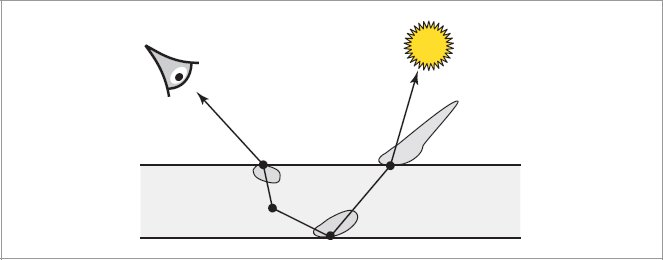

*Figure 14.11: Scattering from Layered Surfaces. Surface reflection can be modeled with a series of layers, where each interface between media is represented with a BSDF and where the media between layers may itself both absorb and scatter light. The aggregate scattering from such a configuration can be determined by finding solutions to the equation of transfer.*

```text
    Float 23
    Light::PDF_Li() 743
    LightSampler::PMF() 782
    Ray::d 95
    SampledSpectrum::Average() 172
    ThinDielectricBxDF 567
```

```text
    VolPathIntegrator::lightSampler 877
```

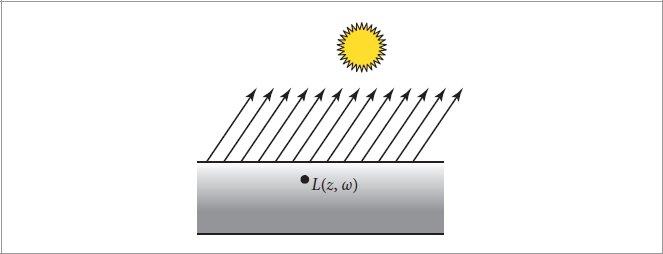

*Figure 14.12: Setting for the One-Dimensional Equation of Transfer. If the properties of the medium only vary in one dimension and if the incident illumination is uniform over its boundary, then the equilibrium radiance distribution varies only with depth z and direction ω and a 1D specialization of the equation of transfer can be used.*

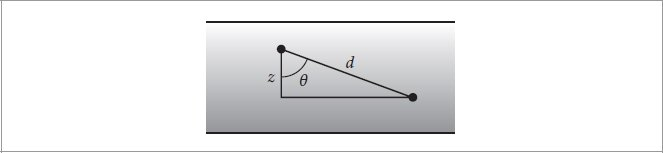

*Figure 14.13: Transmittance in 1D. The distance between two depths d is given by the z distance between them divided by the cosine of the ray’s angle with respect to the z axis, θ. The transmittance follows.*

With general layered media, light may exit the surface at a different point than that at which it entered it. The LayeredBxDF does not model this effect but instead assumes that light enters and exits at the same point on the surface. (As a BxDF, it is unable to express any other sort of scattering, anyway.) This is a reasonable approximation if the distance between the two interfaces is relatively small. This approximation makes it possible to use a simplified 1D version of the equation of transfer. After deriving this variant, we will show its application to evaluating and sampling such BSDFs.

### 14.3.1 THE ONE-DIMENSIONAL EQUATION OF TRANSFER

Given plane-parallel 3D scattering media where the scattering properties are homogeneous across planes and only vary in depth, and where the incident illumination does not vary as a function of position over the medium’s planar boundary, the equations that describe scattering can be written in terms of 1D functions over depth (see Figure 14.12).

In this setting, the various quantities are more conveniently expressed as functions of depth z rather than of distance t along a ray. For example, if the extinction coefficient is given by σt(z), then the transmittance between two depths z0 and z1 for a ray with direction ω is

```text
    BxDF 538
```

See Figure 14.13. This definition uses the fact that if a ray with direction ω travels a distance t, then the change in z is tωz.

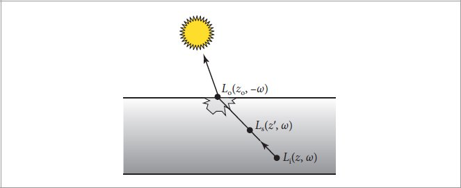

*Figure 14.14: The 1D specialization of the equation of transfer from Equation (14.31) expresses the incident radiance Li at a depth z as the sum of attenuated radiance Lo from the interface that is visible along the ray and the transmission-modulated source function Ls integrated over z.*

In the case of a homogeneous medium,

The 1D equation of transfer can be found in a similar fashion. It says that at points inside the medium the incident radiance at a depth z in direction ω is given by

where zi is the depth of the medium interface that the ray from z in direction ω intersects. (See Figure 14.14.) At boundaries, the incident radiance function is given by Equation (14.31) for directions ω that point into the medium. For directions that point outside it, incident radiance is found by integrating illumination from the scene.

The scattering from an interface at a boundary of the medium is given by the incident radiance modulated by the boundary’s BSDF,

If we also assume there is no volumetric emission (as we will do in the LayeredBxDF), the source function in Equation (14.31) simplifies to

The LayeredBxDF further assumes that σt is constant over all wavelengths in the medium, which means that null scattering is not necessary for sampling distances in the medium. Null scattering is easily included in the 1D simplification of the equation of transfer if necessary, though we will not do so here. For similar reasons, we will also not derive its path integral form in 1D, though it too can be found with suitable simplifications to the approach that was used in Section 14.1.4. The “Further Reading” section has pointers to more details.

```text
    LayeredBxDF 895
```

### 14.3.2 LAYERED BxDF

The equation of transfer describes the equilibrium distribution of radiance, though our interest here is in evaluating and sampling the BSDF that represents all the scattering from the layered medium. Fortunately, these two things can be connected. If we would like to evaluate the BSDF for a pair of directions ωo and ωi, then we can define an incident radiance function from a virtual light source from ωi as

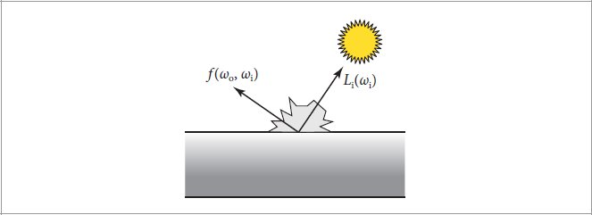

*Figure 14.15: If a medium is illuminated with a virtual light source of the form of Equation (14.34), then the radiance leaving the surface in the direction ωo is equivalent to the layered surface’s BSDF, f (ωo, ωi).*

If a 1D medium is illuminated by such a light, then the outgoing radiance Lo(ωo) at the medium’s interface is equivalent to the value of the BSDF, f (ωo, ωi) (see Figure 14.15). One way to understand why this is so is to consider using such a light with the surface reflection equation:

Thus, integrating the equation of transfer with such a light allows us to evaluate and sample the corresponding BSDF. However, this means that unlike all the BxDF implementations from Chapter 9, the values that LayeredBxDF returns from methods like f() and PDF() are stochastic. This is perfectly fine in the context of all of pbrt’s Monte Carlo–based techniques and does not affect the correctness of other estimators that use these values; it is purely one more source of error that can be controlled in a predictable way by increasing the number of samples. The LayeredBxDF allows the specification of only two interfaces and a homogeneous participating medium between them. Figure 14.16 illustrates the geometric setting. Surfaces with more layers can be modeled using a LayeredBxDF where one or both of its layers are themselves LayeredBxDFs. (An exercise at the end of the chapter discusses a more efficient approach for supporting additional layers.) The types of BxDFs at both interfaces can be provided as template parameters. While the user of a LayeredBxDF is free to provide a BxDF for both of these types (in which case pbrt’s regular dynamic dispatch mechanism will be used), performance is better if they are specific BxDFs and the compiler can generate a specialized implementation. This approach is used for the CoatedDiffuseBxDF and the CoatedConductorBxDF that are defined in Section 14.3.3. (The meaning of the twoSided template parameter will be explained in a few pages, where it is used.) BxDF 538 CoatedConductorBxDF 909 CoatedDiffuseBxDF 909

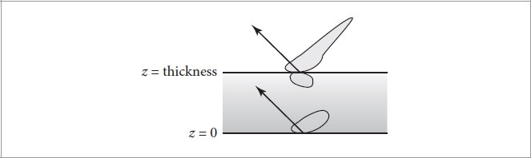

*Figure 14.16: Geometric Setting for the LayeredBxDF. Scattering is specified by two interfaces with associated BSDFs where the bottom one is at z = 0 and there is a medium of user-specified thickness between the two interfaces.*

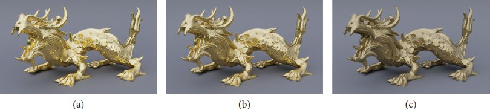

*Figure 14.17: Effect of Varying Medium Thickness with the LayeredBxDF. (a) Dragon with surface reflectance modeled by a smooth conductor base layer and a dielectric interface above it. (b) With a scattering layer with albedo 0.7 and thickness 0.15 between the interface and the conductor, the reflection of the conductor is slightly dimmed. (c) With a thicker scattering layer of thickness 0.5, the conductor is much more attenuated and the overall reflection is more diffuse. (Dragon model courtesy of the Stanford Computer Graphics Laboratory.)*

〈LayeredBxDF Definition〉 ≡ template <typename TopBxDF, typename BottomBxDF, bool twoSided> class LayeredBxDF { public: 〈LayeredBxDF Public Methods 897〉 private: 〈LayeredBxDF Private Methods 896〉

〈LayeredBxDF Private Members 895〉 };

In addition to BxDFs for the two interfaces, the LayeredBxDF maintains member variables that describe the medium between them. Rather than have the user specify scattering coefficients, which can be unintuitive to set manually, it assumes a medium with σt = 1 and leaves it to the user to specify both the thickness of the medium and its scattering albedo. Figure 14.17 shows the effect of varying the thickness of the medium between a conductor base layer and a dielectric interface.

```text
   BottomBxDF 895
   BxDF 538
   Float 23
   SampledSpectrum 171
   TopBxDF 895
```

〈LayeredBxDF Private Members〉 ≡ 895

TopBxDF top; BottomBxDF bottom; Float thickness, g; SampledSpectrum albedo;

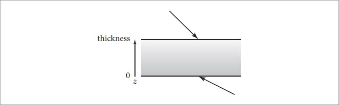

*Figure 14.18: If the incident ray intersects the layer at z = thickness, then the top layer is the same as is specified in the LayeredBxDF::top member variable. However, if it intersects the surface from the other direction at z = 0, we will find it useful to treat the z = 0 layer as the top one and the other as the bottom. The TopOrBottomBxDF class helps with related bookkeeping.*

Two parameters control the Monte Carlo estimates. maxDepth has its usual role in setting a maximum number of scattering events along a path and

nSamples controls the number of independent samples of the estimators that are averaged. Because additional samples in this context do not require tracing more rays or evaluating textures, it is more efficient to reduce any noise due to the stochastic BSDF by increasing this sampling rate rather than increasing the pixel sampling rate if a higher pixel sampling rate is not otherwise useful. 〈LayeredBxDF Private Members〉 +≡ 895

int maxDepth, nSamples;

We will find it useful to have a helper function Tr() that returns the transmittance for a ray segment in the medium with given direction w that passes through a distance dz in z, following Equation (14.30) with σt = 1.

〈LayeredBxDF Private Methods〉 ≡ 895

static Float Tr(Float dz, Vector3f w) { return FastExp(-std::abs(dz / w.z)); }

Although the LayeredBxDF is specified in terms of top and bottom interfaces, we will find it useful to exchange the “top” and “bottom” as necessary to have the convention that the interface that the incident ray intersects is defined to be the top one. (See Figure 14.18.) A helper class, TopOrBottomBxDF, manages the logic related to these possibilities. As its name suggests, it stores a pointer to one (and only one) of two BxDF types that are provided as template parameters. 〈TopOrBottomBxDF Definition〉 ≡ template <typename TopBxDF, typename BottomBxDF> class TopOrBottomBxDF { public: 〈TopOrBottomBxDF Public Methods 897〉 private: const TopBxDF *top = nullptr; const BottomBxDF *bottom = nullptr; };

```text
   BottomBxDF 895
```

```text
   FastExp() 1036
   Float 23
   LayeredBxDF::top 895
   TopBxDF 895
   TopOrBottomBxDF 896
   Vector3f 86
```

TopOrBottomBxDF provides the implementation of a number of BxDF methods like f(), where it calls the corresponding method of whichever of the two BxDF types has been provided.

In addition to f(), it has similar straightforward Sample_f(), PDF(), and Flags() methods, which we will not include here.

〈TopOrBottomBxDF Public Methods〉 ≡ 896

SampledSpectrum f(Vector3f wo, Vector3f wi, TransportMode mode) const { return top ? top->f(wo, wi, mode) : bottom->f(wo, wi, mode); }

BSDF Evaluation The BSDF evaluation method f() can now be implemented; it returns an average of the specified number of independent samples. 〈LayeredBxDF Public Methods〉 ≡ 895

SampledSpectrum f(Vector3f wo, Vector3f wi, TransportMode mode) const { SampledSpectrum f(0.); 〈Estimate LayeredBxDF value f using random sampling 897〉 return f / nSamples; }

There is some preliminary computation that is independent of each sample taken to estimate the BSDF’s value. A few fragments take care of it before the random estimation begins. 〈Estimate LayeredBxDF value f using random sampling〉 ≡ 897

〈Set wi and wi for layered BSDF evaluation 898〉 〈Determine entrance interface for layered BSDF 898〉 〈Determine exit interface and exit z for layered BSDF 898〉 〈Account for reflection at the entrance interface 898〉

```rust
   〈Declare RNG for layered BSDF evaluation 899〉
   for (int s = 0; s < nSamples; ++s) {
       〈Sample random walk through layers to estimate BSDF value 899〉
   }
```

With this BSDF, layered materials can be specified as either one- or two-sided via the twoSided template parameter. If a material is one-sided, then the shape’s surface normal is used to determine which interface an incident ray enters. If it is in the same hemisphere as the surface normal, it enters the top interface and otherwise it enters the bottom. This configuration is especially useful when both interfaces are transmissive and have different BSDFs. For two-sided materials, the ray always enters the top interface. This option is useful when the bottom interface is opaque as is the case with the CoatedDiffuseBxDF, for example. In this case, it is usually desirable for scattering from both layers to be included, no matter which side the ray intersects.

```text
   BxDF::f() 539
   CoatedDiffuseBxDF 909
   LayeredBxDF::nSamples 896
   SampledSpectrum 171
   TopOrBottomBxDF::bottom 896
   TopOrBottomBxDF::top 896
   TransportMode 571
   Vector3f 86
```

One way to handle these options in the f() method would be to negate both directions and make a recursive call to f() if ωo points below the surface and the material is two-sided. However, that solution is not a good one for the GPU, where it is likely to introduce thread divergence. (This topic is discussed in more detail in Section 15.1.1.) Therefore, both directions are negated at the start of the method and no recursive call is made in this case, which gives an equivalent result. 〈Set wi and wi for layered BSDF evaluation〉 ≡ 897

if (twoSided && wo.z < 0) { wo = -wo; wi = -wi;

```rust
   }
```

The next step is to determine which of the two BxDFs is the one that is encountered first by the incident ray. The sign of ωo’s z component in the reflection coordinate system gives the answer. 〈Determine entrance interface for layered BSDF〉 ≡ 897

TopOrBottomBxDF<TopBxDF, BottomBxDF> enterInterface; bool enteredTop = twoSided || wo.z > 0; if (enteredTop) enterInterface = &top; else enterInterface = &bottom;

It is also necessary to determine which interface ωi exits. This is determined both by which interface ωo enters and by whether ωo and ωi are in the same hemisphere. We end up with an unusual case where the EXCLUSIVE-OR operator comes in handy. Along the way, the method also stores which interface is the one that ωi does not exit from. As random paths are sampled through the layers and medium, the implementation will always choose reflection from this interface and not transmission, as choosing the latter would end the path without being able to scatter out in the ωi direction. The same logic then covers determining the z depth at which the ray path will exit the surface. 〈Determine exit interface and exit z for layered BSDF〉 ≡ 897

TopOrBottomBxDF<TopBxDF, BottomBxDF> exitInterface, nonExitInterface; if (SameHemisphere(wo, wi) ^ enteredTop) { exitInterface = &bottom; nonExitInterface = &top; } else { exitInterface = &top; nonExitInterface = &bottom; } Float exitZ = (SameHemisphere(wo, wi) ^ enteredTop) ? 0 : thickness;

If both directions are on the same side of the surface, then part of the BSDF’s value is given by reflection at the entrance interface. This can be evaluated directly by calling the interface’s BSDF’s f() method. The resulting value must be scaled by the total number of samples taken to

estimate the BSDF in this method, since the final returned value is divided by nSamples.

〈Account for reflection at the entrance interface〉 ≡ 897

if (SameHemisphere(wo, wi)) f = nSamples * enterInterface.f(wo, wi, mode);

```text
   BottomBxDF 895
   BxDF 538
   BxDF::f() 539
   Float 23
   LayeredBxDF::bottom 895
   LayeredBxDF::nSamples 896
   LayeredBxDF::thickness 895
   LayeredBxDF::top 895
   LayeredBxDF::twoSided 895
   SameHemisphere() 538
   TopBxDF 895
   TopOrBottomBxDF 896
```

pbrt’s BxDF interface does not include any uniform sample values as parameters to the f() method; there is no need for them for any of the other BxDFs in the system. In any case, an unbounded number of uniform random numbers are required for sampling operations when evaluating layered BSDFs. Therefore, f() initializes an RNG and defines a convenience lambda function that returns uniform random sample values. This does mean that the benefits of sampling with well-distributed point sets are not present here; an exercise at the end of the chapter returns to this issue. The RNG is seeded carefully: it is important that calls to f() with different directions have different seeds so that there is no risk of errors due to correlation between the RNGs used for multiple samples in a pixel or across nearby pixels. However, we would also like the samples to be deterministic so that any call to f() with the same two directions always has the same set of random samples. This sort of reproducibility is important for debugging so that errors appear consistently across multiple runs of the program. Hashing the two provided directions along with the system-wide seed addresses all of these concerns.

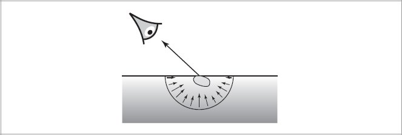

*Figure 14.19: The effect of light that scatters between the interface layers is found by integrating the product of the cosine-weighted BTDF at the entrance interface with the incident radiance from the medium, Equation (14.35).*

〈Declare RNG for layered BSDF evaluation〉 ≡ 897

RNG rng(Hash(GetOptions().seed, wo), Hash(wi)); auto r = [&rng]() { return std::min<Float>(rng.Uniform<Float>(), OneMinusEpsilon); };

In order to find the radiance leaving the interface in the direction ωo, we need to integrate the product of the cosine-weighted BTDF at the interface with the incident radiance from inside the medium,

where is the hemisphere inside the medium (see Figure 14.19). The implementation uses the standard Monte Carlo estimator, taking a sample ω′ from the BTDF and then proceeding to estimate Li.

〈Sample random walk through layers to estimate BSDF value〉 ≡ 897

〈Sample transmission direction through entrance interface 900〉 〈Sample BSDF for virtual light from wi 900〉 〈Declare state for random walk through BSDF layers 901〉 for (int depth = 0; depth < maxDepth; ++depth) { 〈Sample next event for layered BSDF evaluation random walk 901〉 }

```text
   BasicPBRTOptions::seed 1031
```

```text
   Float 23
   GetOptions() 1032
   Hash() 1042
   LayeredBxDF::maxDepth 896
   OneMinusEpsilon 470
   RNG 1054
   RNG::Uniform<Float>() 1056
```

Sampling the direction ω′ is a case where it is useful to be able to specify to Sample_f() that only transmission should be sampled.

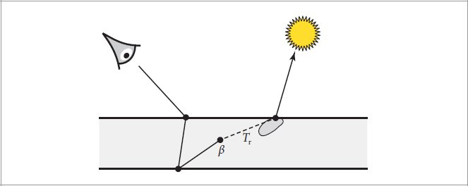

*Figure 14.20: Illumination Contribution from the Virtual Light Source. At a path vertex, the contribution of the virtual light source is given by the product of the path throughput weight β that accounts for previous scattering along the path, the scattering at the vertex, the transmittance Tr to the exit interface, and the effect of the BTDF at the interface.*

〈Sample transmission direction through entrance interface〉 ≡ 899

Float uc = r(); pstd::optional<BSDFSample> wos = enterInterface.Sample_f(wo, uc, Point2f(r(), r()), mode, BxDFReflTransFlags::Transmission); if (!wos || !wos->f || wos->pdf == 0 || wos->wi.z == 0) continue;

The task now is to compute a Monte Carlo estimate of the 1D equation of transfer, Equation (14.31). Before discussing how it is sampled, however, we will first consider some details related to the lighting calculation with the virtual light source. At each vertex of the path, we will want to compute the incident illumination due to the light. As shown in Figure 14.20, there

are three factors in the light’s contribution: the value of the phase function or interface BSDF for a direction ω, the transmittance between the vertex and the exit interface, and the value of the interface’s BTDF for the direction from −ω to ωi.

Each of these three factors could be used for sampling; as before, one may sometimes be much more effective than the others. The LayeredBxDF implementation uses two of the three—sampling the phase function or BRDF at the current path vertex (as appropriate) and sampling the BTDF at the exit interface—and then weights the results using MIS. There is no reason to repeatedly sample the exit interface BTDF at each path vertex since the direction ωi is fixed. Therefore, the following fragment samples it once and holds on to the resulting BSDFSample. Note that the negation of the TransportMode parameter value mode is taken for the call to Sample_f(), which is important to reflect the fact that this sampling operation is following the reverse path with respect to sampling in terms of ωo. This is an important detail so that the underlying BxDF can correctly account for non-symmetric scattering; see Section 9.5.2.

```text
   BSDFSample 541
   BSDFSample::f 541
   BSDFSample::pdf 541
   BSDFSample::wi 541
   BxDF 538
   BxDF::Sample_f() 540
   BxDFReflTransFlags::Transmission 540
   Float 23
   Point2f 92
```

〈Sample BSDF for virtual light from wi〉 ≡ 899

uc = r(); pstd::optional<BSDFSample> wis = exitInterface.Sample_f(wi, uc, Point2f(r(), r()), !mode, BxDFReflTransFlags::Transmission); if (!wis || !wis->f || wis->pdf == 0 || wis->wi.z == 0) continue;

Moving forward to the random walk estimation of the equation of transfer, the implementation maintains the current path throughput weight beta, the

depth z of the last scattering event, and the ray direction w. 〈Declare state for random walk through BSDF layers〉 ≡ 899

SampledSpectrum beta = wos->f * AbsCosTheta(wos->wi) / wos->pdf; Float z = enteredTop ? thickness : 0; Vector3f w = wos->wi; HGPhaseFunction phase(g);

We can now move to the body of the inner loop over scattering events along the path. After a Russian roulette test, a distance is sampled along the ray to determine the next path vertex either within the medium or at whichever interface the ray intersects. 〈Sample next event for layered BSDF evaluation random walk〉 ≡ 899

〈Possibly terminate layered BSDF random walk with Russian roulette 901〉 〈Account for media between layers and possibly scatter 901〉 〈Account for scattering at appropriate interface 903〉

It is worth considering terminating the path as the path throughput weight becomes low, though here the termination probability is set less aggressively than it was in the Path Integrator and VolPathIntegrator. This reflects the fact that each bounce here is relatively inexpensive, so doing more work to improve the accuracy of the estimate is worthwhile. 〈Possibly terminate layered BSDF random walk with Russian roulette〉 ≡ 901

if (depth > 3 && beta.MaxComponentValue() < 0.25f) { Float q = std::max<Float>(0, 1 -beta.MaxComponentValue()); if (r() < q) break; beta /= 1 - q; }

The common case of no scattering in the medium is handled separately since it is much simpler than the case where volumetric scattering must be considered. 〈Account for media between layers and possibly scatter〉 ≡ 901

if (!albedo) { 〈Advance to next layer boundary and update beta for transmittance 901〉

} else {

```rust
        〈Sample medium scattering for layered BSDF evaluation 902〉
   }
```

```text
   AbsCosTheta() 107
   BSDFSample::f 541
   BSDFSample::pdf 541
   BSDFSample::wi 541
   Float 23
   HGPhaseFunction 713
   LayeredBxDF::albedo 895
   LayeredBxDF::thickness 895
   LayeredBxDF::Tr() 896
   PathIntegrator 833
   SampledSpectrum 171
   SampledSpectrum::MaxComponentValue() 172
   Vector3f 86
   VolPathIntegrator 877
```

If there is no medium scattering, then only the first term of Equation (14.31) needs to be evaluated. The path vertices alternate between the two interfaces. Here beta is multiplied by the transmittance for the ray segment through the medium; the Lo factor is found by estimating Equation (14.32), which will be handled shortly. 〈Advance to next layer boundary and update beta for transmittance〉 ≡ 901

z = (z == thickness) ? 0 : thickness; beta *= Tr(thickness, w);

If the medium is scattering, we only sample one of the two terms of the 1D equation of transfer, choosing between taking a sample inside the medium and scattering at the other interface. A change in depth Δz can be perfectly sampled from the 1D beam transmittance, Equation (14.30). Since σt = 1,

the PDF is Given a depth z′ found by adding or subtracting Δz from the current depth z according to the ray’s direction, medium scattering is chosen if z′ is inside the medium and surface scattering is chosen otherwise. (The sampling scheme is thus similar to how the VolPathIntegrator chooses between medium and surface scattering.) In the case of scattering from an interface,

the Clamp() call effectively forces z to lie on whichever of the two interfaces the ray intersects next. 〈Sample medium scattering for layered BSDF evaluation〉 ≡ 901

Float sigma_t = 1; Float dz = SampleExponential(r(), sigma_t / std::abs(w.z)); Float zp = w.z > 0 ? (z + dz) : (z - dz); if (0 < zp && zp < thickness) { 〈Handle scattering event in layered BSDF medium 902〉 continue; } z = Clamp(zp, 0, thickness);

If z′ is inside the medium, we have the estimator

Both the exponential factors and |ωz| factors in Tr and p(Δz) cancel, and we are left with simply the source function Ls(z′, −ω), which should be scaled by the path throughput. The following fragment adds an estimate of its value to the sum in f.

〈Handle scattering event in layered BSDF medium〉 ≡ 902

〈Account for scattering through exitInterface using wis 902〉 〈Sample phase function and update layered path state 903〉 〈Possibly account for scattering through exitInterface 903〉

For a scattering event inside the medium, it is necessary to add the contribution of the virtual light source to the path radiance estimate and to sample a new direction to continue the path. For the MIS lighting sample based on sampling the interface’s BTDF, the outgoing direction from the path vertex is predetermined by the BTDF sample wis; all the factors of the path contribution are easily evaluated and the MIS weight is found using the PDF for the other sampling technique, sampling the phase function.

```text
   BSDFSample::f 541
   BSDFSample::pdf 541
   BSDFSample::wi 541
   BxDF::Flags() 538
   BxDFFlags::IsSpecular() 539
```

```text
   Clamp() 1033
   Float 23
   HGPhaseFunction::p() 713
   HGPhaseFunction::PDF() 714
   LayeredBxDF::albedo 895
   LayeredBxDF::thickness 895
   LayeredBxDF::Tr() 896
   PowerHeuristic() 66
   SampleExponential() 1003
   VolPathIntegrator 877
```

〈Account for scattering through exitInterface using wis〉 ≡ 902

Float wt = 1; if (!IsSpecular(exitInterface.Flags())) wt = PowerHeuristic(1, wis->pdf, 1, phase.PDF(-w, -wis->wi)); f += beta * albedo * phase.p(-w, -wis->wi) * wt * Tr(zp -exitZ, wis->wi) * wis->f / wis->pdf;

The second sampling strategy for the virtual light is based on sampling the phase function and then connecting to the virtual light source through the exit interface. Doing so shares some common work with sampling a new direction for the path, so the implementation takes the opportunity to update the path state after sampling the phase function here. 〈Sample phase function and update layered path state〉 ≡ 902

Point2f u{r(), r()}; pstd::optional<PhaseFunctionSample> ps = phase.Sample_p(-w, u); if (!ps || ps->pdf == 0 || ps->wi.z == 0) continue; beta *= albedo * ps->p / ps->pdf; w = ps->wi; z = zp;

There is no reason to try connecting through the exit interface if the current ray direction is pointing away from it or if its BSDF is perfect specular. 〈Possibly account for scattering through exitInterface〉 ≡ 902

if (((z < exitZ && w.z > 0) || (z > exitZ && w.z < 0)) && !IsSpecular(exitInterface.Flags())) { 〈Account for scattering through exitInterface 903〉 }

If there is transmission through the interface, then because beta has already been updated to include the effect of scattering at z′, only the transmittance to the exit, MIS weight, and BTDF value need to be evaluated to compute the light’s contribution. One important detail in the following code is the ordering of arguments to the call to f() in the first line: due to the non-reciprocity of BTDFs, swapping these would lead to incorrect results.4 〈Account for scattering through exitInterface〉 ≡ 903

SampledSpectrum fExit = exitInterface.f(-w, wi, mode); if (fExit) { Float exitPDF = exitInterface.PDF(-w, wi, mode, BxDFReflTransFlags::Transmission); Float wt = PowerHeuristic(1, ps->pdf, 1, exitPDF); f += beta * Tr(zp - exitZ, ps->wi) * fExit * wt; }

If no medium scattering event was sampled, the next path vertex is at an interface. In this case, the transmittance along the ray can be ignored: as before, the probability of evaluating the first term of Equation (14.31) has probability equal to Tr and thus the two Tr factors cancel, leaving us only needing to evaluate scattering at the boundary, Equation (14.32). The details differ depending on which interface the ray intersected.

```text
   BxDF::f() 539
   BxDF::Flags() 538
   BxDF::PDF() 541
   BxDFFlags::IsSpecular() 539
   BxDFReflTransFlags 540
   Float 23
   HGPhaseFunction::Sample_p() 714
   LayeredBxDF::albedo 895
   LayeredBxDF::Tr() 896
   PhaseFunctionSample 711
   PhaseFunctionSample::p 711
   PhaseFunctionSample::pdf 711
   PhaseFunctionSample::wi 711
   Point2f 92
   PowerHeuristic() 66
   SampledSpectrum 171
```

〈Account for scattering at appropriate interface〉 ≡ 901

```rust
   if (z == exitZ) {
       〈Account for reflection at exitInterface 904〉
   } else {
       〈Account for scattering at nonExitInterface〉
   }
```

If the ray intersected the exit interface, then it is only necessary to update the path throughput: no connection is made to the virtual light source since transmission through the exit interface to the light is accounted for by the lighting computation at the previous vertex. This fragment samples only the reflection component of the path here, since a ray that was transmitted outside the medium would end the path. 〈Account for reflection at exitInterface〉 ≡ 903

Float uc = r(); pstd::optional<BSDFSample> bs = exitInterface.Sample_f( -w, uc, Point2f(r(), r()), mode, BxDFReflTransFlags::Reflection); if (!bs || !bs->f || bs->pdf == 0 || bs->wi.z == 0) break; beta *= bs->f * AbsCosTheta(bs->wi) / bs->pdf; w = bs->wi;

The 〈Account for scattering at nonExitInterface〉 fragment handles scattering from the other interface. It applies MIS to compute the contribution of the virtual light and samples a new direction with a form very similar to the case of scattering within the medium, just with the phase function replaced by the BRDF for evaluation and sampling. Therefore, we have not included its implementation here.

BSDF Sampling The implementation of Sample_f() is generally similar to f(), so we will not include its implementation here, either. Its task is actually simpler: given the initial direction ωo at one of the layer’s boundaries, it follows a random walk of scattering events through the layers and the medium, maintaining both the path throughput and the product of PDFs for each of the sampling decisions. When the random walk exits the medium, the outgoing direction is the sampled direction that is returned in the BSDFSample.

With this approach, it can be shown that the ratio of the path throughput to the PDF is equal to the ratio of the actual value of the BSDF and its PDF for the sampled direction (see the “Further Reading” section for details). Therefore, when the weighted path throughput is multiplied by the ratio of BSDFSample::f and BSDFSample::pdf, the correct weighting term is applied. (Review, for example, the fragment 〈Update path state variables after surface scattering〉 in the PathIntegrator.) However, an implication of this is that the PDF value returned by Sample_f() cannot be used to compute the multiple importance sampling weight if the sampled ray hits an emissive surface; in that case, an independent estimate of the PDF must be computed via a call to the PDF() method. The BSDFSample::pdfIsProportional member variable flags this case and is set by Sample_f() here.

PDF Evaluation The PDF p(ωo, ωi) that corresponds to a LayeredBxDF’s BSDF can be expressed as an infinite sum. For example, consider the case of having a bottom layer that reflects light with BRDF and a top layer that both reflects light with BRDF and transmits it with BTDF , with an overall BSDF . If those BSDFs have associated PDFs p and if scattering in the medium is neglected, then the overall PDF is AbsCosTheta() 107 BSDFSample 541 BSDFSample::f 541 BSDFSample::pdf 541 BSDFSample::pdfIsProportional 541 BSDFSample::wi 541 BxDF::Sample_f() 540 BxDFReflTransFlags::Reflection 540 Float 23 PathIntegrator 833 Point2f 92

The first term gives the contribution for the PDF at the top interface and the second is the PDF for directions ωi that were sampled via transmission through the top interface, scattering at the bottom, and then transmission back out in direction ωi. Note the coupling of directions between the PDF factors in the integrand: the negation of the initial transmitted direction ω′ gives the first direction for evaluation of the base PDF , and so forth (see Figure 14.21). Subsequent terms of this sum account for light that is reflected back downward at the top interface instead of exiting the layers, and expressions of a similar form can be found for the PDF if the base layer is also transmissive.

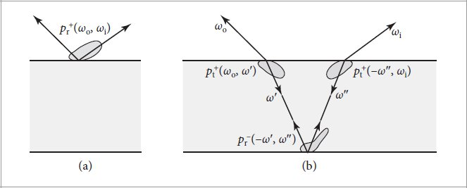

*Figure 14.21: The First Two Terms of the Infinite Sum that Give a Layered BSDF’s PDF. (a) The PDF of the reflection component of the interface’s BSDF accounts for light that scatters without entering the layers. (b) The second term is given by a double integral over directions. A direction ω′ pointing into the medium is sampled; it gives the second direction for the interface’s BTDF PDF and its negation gives one of the two directions for . A second direction ω″ is used for as well as for a second evaluation of .*

It is possible to compute a stochastic estimate of the PDF by applying Monte Carlo to the integrals and by terminating the infinite sum using

Russian roulette. For example, for the integral in Equation (14.36), we have

the estimator where ω′ is sampled from some distribution p1 and ω″ from a distribution p2. There is great freedom in choosing the distributions p1 and p2. However, as with algorithms like path tracing, care must be taken if some of the PDFs are Dirac delta distributions. For example, if the bottom layer is perfect specular, then will always be zero unless ω″ was sampled according to its PDF.

Consider what happens if ω′ is sampled using ’s sampling method, conditioned on ωo, and if ω″ is sampled using ’s sampling method, conditioned on ωi: the first and last probabilities in the numerator cancel with the probabilities in the denominator, and we are left simply with as the estimate; the effect of in the PDF is fully encapsulated by the distribution of directions used to evaluate . A stochastic estimate of the PDF can be computed by following a random walk in a manner similar to the f() method, just with phase function and BSDF evaluation replaced with evaluations of the corresponding PDFs. However, because the PDF() method is only called to compute PDF values that are used for computing MIS weights, the implementation here will return an approximate PDF; doing so does not invalidate the MIS estimator.5 〈LayeredBxDF Public Methods〉 +≡ 895

Float PDF(Vector3f wo, Vector3f wi, TransportMode mode, BxDFReflTransFlags sampleFlags = BxDFReflTransFlags::All) const { 〈Set wo and wi for layered BSDF evaluation〉 〈Declare RNG for layered PDF evaluation 906〉 〈Update pdfSum for reflection at the entrance layer 906〉 for (int s = 0; s < nSamples; ++s) { 〈Evaluate layered BSDF PDF sample 906〉 } 〈Return mixture of PDF estimate and constant PDF 908〉 }

It is important that the RNG for the PDF() method is seeded differently than it is for the f() method, since it will often be called with the same pair of directions as are passed to f(), and we would like to be certain that there is no correlation between the results returned by the two of them. 〈Declare RNG for layered PDF evaluation〉 ≡ 906

RNG rng(Hash(GetOptions().seed, wi), Hash(wo)); auto r = [&rng]() { return std::min<Float>(rng.Uniform<Float>(), OneMinusEpsilon); };

If both directions are on the same side of the surface, then part of the full PDF is given by the PDF for reflection at the interface (this was the first term of Equation (14.36)). This component can be evaluated non-stochastically, assuming that the underlying PDF() methods are not themselves stochastic. 〈Update pdfSum for reflection at the entrance layer〉 ≡ 906

bool enteredTop = twoSided || wo.z > 0; Float pdfSum = 0; if (SameHemisphere(wo, wi)) { auto reflFlag = BxDFReflTransFlags::Reflection; pdfSum += enteredTop ? nSamples * top.PDF(wo, wi, mode, reflFlag) : nSamples * bottom.PDF(wo, wi, mode, reflFlag); }

The more times light has been scattered, the more isotropic its directional distribution tends to become. We can take advantage of this fact by evaluating only the first term of the stochastic PDF estimate and modeling the remaining terms with a uniform distribution. We further neglect the effect of scattering in the medium, again under the assumption that if it is significant, a uniform distribution will be a suitable approximation.

```text
   BasicPBRTOptions::seed 1031
   BxDF::PDF() 541
   BxDFReflTransFlags 540
   BxDFReflTransFlags::Reflection 540
   Float 23
   GetOptions() 1032
   Hash() 1042
   LayeredBxDF::bottom 895
```

```text
   LayeredBxDF::nSamples 896
   LayeredBxDF::top 895
   OneMinusEpsilon 470
   RNG 1054
   RNG::Uniform<Float>() 1056
   SameHemisphere() 538
   TransportMode 571
   Vector3f 86
```

〈Evaluate layered BSDF PDF sample〉 ≡ 906

if (SameHemisphere(wo, wi)) { 〈Evaluate TRT term for PDF estimate 907〉 } else { 〈Evaluate TT term for PDF estimate〉 }

If both directions are on the same side of the interface, then the remaining PDF integral is the double integral of the product of three PDFs that we considered earlier. We use the shorthand “TRT” for this case, corresponding to transmission, then reflection, then transmission. 〈Evaluate TRT term for PDF estimate〉 ≡ 906

TopOrBottomBxDF<TopBxDF, BottomBxDF> rInterface, tInterface; if (enteredTop) { rInterface = &bottom; tInterface = &top; } else { rInterface = &top; tInterface = &bottom; } 〈Sample tInterface to get direction into the layers 907〉 〈Update pdfSum accounting for TRT scattering events 907〉

We will apply two sampling strategies. The first is sampling both directions via tInterface, once conditioned on ωo and once on ωi—effectively a bidirectional approach. The second is sampling one direction via tInterface conditioned on ωo and the other via rInterface conditioned on the first sampled direction. These are then combined using multiple importance sampling. After canceling factors and introducing an MIS weight w(ω″), Equation (14.37) simplifies to

which is the estimator for both strategies.

Both sampling methods will use the wos sample while only one uses wis. 〈Sample tInterface to get direction into the layers〉 ≡ 907

auto trans = BxDFReflTransFlags::Transmission; pstd::optional<BSDFSample> wos, wis; wos = tInterface.Sample_f(wo, r(), {r(), r()}, mode, trans); wis = tInterface.Sample_f(wi, r(), {r(), r()}, !mode, trans);

If tInterface is perfect specular, then there is no need to try sampling or to apply MIS. The PDF is all that remains from Equation (14.38). 〈Update pdfSum accounting for TRT scattering events〉 ≡ 907

if (wos && wos->f && wos->pdf > 0 && wis && wis->f && wis->pdf > 0) { if (!IsNonSpecular(tInterface.Flags())) pdfSum += rInterface.PDF(-wos->wi, -wis->wi, mode); else { 〈Use multiple importance sampling to estimate PDF product 907〉 } }

Otherwise, we sample from as well. If that sample is from a perfect specular component, then again there is no need to use MIS and the estimator is just .

```text
   BottomBxDF 895
   BSDF::Sample_f() 545
   BSDFSample 541
   BSDFSample::f 541
   BSDFSample::pdf 541
   BSDFSample::wi 541
   BxDF::Flags() 538
   BxDF::PDF() 541
   BxDFFlags::IsNonSpecular() 539
   BxDFReflTransFlags 540
   TopBxDF 895
   TopOrBottomBxDF 896
```

〈Use multiple importance sampling to estimate PDF product〉 ≡ 907

pstd::optional<BSDFSample> rs = rInterface.Sample_f(-wos->wi, r(), {r(), r()}, mode); if (rs && rs->f && rs->pdf > 0) { if (!IsNonSpecular(rInterface.Flags()))

```rust
            pdfSum += tInterface.PDF(-rs->wi, wi, mode);
        else {
            〈Compute MIS-weighted estimate of Equation (14.38) 908〉
        }
   }
```

If neither interface has a specular sample, then both are combined. For the first sampling technique, the second factor cancels out as well and the estimator is times the MIS weight. 〈Compute MIS-weighted estimate of Equation (14.38)〉 ≡ 907

Float rPDF = rInterface.PDF(-wos->wi, -wis->wi, mode); Float wt = PowerHeuristic(1, wis->pdf, 1, rPDF); pdfSum += wt * rPDF;

Similarly, for the second sampling technique, we are left with a PDF to evaluate and then weight using MIS. 〈Compute MIS-weighted estimate of Equation (14.38)〉 +≡ 907

Float tPDF = tInterface.PDF(-rs->wi, wi, mode); wt = PowerHeuristic(1, rs->pdf, 1, tPDF); pdfSum += wt * tPDF;

The 〈Evaluate TT term for PDF estimate〉 fragment is of a similar form, so it is not included here. The final returned PDF value has the PDF for uniform spherical sampling, 1/4π, mixed with the estimate to account for higher-order terms. 〈Return mixture of PDF estimate and constant PDF〉 ≡ 906

return Lerp(0.9f, 1 / (4 * Pi), pdfSum / nSamples);

### 14.3.3 COATED DIFFUSE AND COATED CONDUCTOR MATERIALS

Adding a dielectric interface on top of both diffuse materials and conductors is often useful to model surface reflection. For example, plastic can be modeled by putting such an interface above a diffuse material, and coated metals can be modeled by adding such an interface as well. In both cases, introducing a scattering layer can model effects like tarnish or weathering. Figure 14.22 shows the dragon model with a few variations of these.

pbrt provides both the CoatedDiffuseBxDF and the CoatedConductorBxDF for such uses. There is almost nothing to their implementations other than a public inheritance from LayeredBxDF with the appropriate types for the two interfaces. 〈CoatedDiffuseBxDF Definition〉 ≡ class CoatedDiffuseBxDF : public LayeredBxDF<DielectricBxDF, DiffuseBxDF, true> { public: 〈CoatedDiffuseBxDF Public Methods〉 };

〈CoatedConductorBxDF Definition〉 ≡ class CoatedConductorBxDF : public LayeredBxDF<DielectricBxDF, ConductorBxDF, true> { public: 〈CoatedConductorBxDF Public Methods〉 };

```text
   BSDFSample::pdf 541
   BSDFSample::wi 541
   BxDF::PDF() 541
   Float 23
   LayeredBxDF 895
   LayeredBxDF::nSamples 896
   Lerp() 72
   Pi 1033
   PowerHeuristic() 66
```

There are also corresponding Material implementations, CoatedDiffuseMaterial and CoatedConductorMaterial. Their implementations follow the familiar pattern of evaluating textures and then initializing the corresponding BxDF, and they are therefore not included here.


*Figure 14.22: A Variety of Effects That Can Be Achieved Using Layered Materials. (a) Dragon model with a blue diffuse BRDF. (b) The effect of adding a smooth dielectric interface on top of the diffuse BRDF. In addition to the specular highlights, note how the color has become more saturated, which is due to multiple scattering from paths that reflected back into the medium from the exit interface. (c) The effect of roughening the interface. The surface appears less shiny, but the blue remains more saturated. (Dragon model courtesy of the Stanford Computer Graphics Laboratory.)*

## FURTHER READING

Lommel (1889) first derived the equation of transfer. Not only did he derive this equation, but he also solved it in some simplified cases in order to estimate reflection functions from real-world surfaces (including marble and paper), and he compared his solutions to measured reflectance data from these surfaces. The equation of transfer was independently found by Khvolson (1890) soon afterward; see Mishchenko (2013) for a history of early work in the area. Seemingly unaware of Lommel’s work, Schuster (1905) was the next researcher in radiative transfer to consider the effect of multiple scattering. He used the term self-illumination to describe the fact that each part of the medium is illuminated by every other part of the medium, and he derived differential equations that described reflection from a slab along the normal direction, assuming the presence of isotropic scattering. The conceptual framework that he developed remains essentially unchanged in the field of radiative transfer. Soon thereafter, Schwarzschild (1906) introduced the concept of radiative equilibrium, and Jackson (1910) expressed Schuster’s equation in integral form, also noting that “the obvious physical mode of solution is Liouville’s method of successive substitutions” (i.e., a Neumann series solution).

Finally, King (1913) completed the rediscovery of the equation of transfer by expressing it in the general integral form. Books by Chandrasekhar (1960), Preisendorfer (1965, 1976), and van de Hulst (1980) cover volume light transport in depth. D’Eon’s book (2016) extensively discusses scattering problems, including both analytic and Monte Carlo solutions, and contains many references to related work in other fields. The equation of transfer was introduced to graphics by Kajiya and Von Herzen (1984). Arvo (1993) made essential connections between previous formalizations of light transport in graphics and the equation of transfer as well as to the field of radiative transfer in general. Pauly et al. (2000) derived the generalization of the path integral form of the light transport equation for the volume-scattering case; see also Chapter 3 of Jakob’s Ph.D. thesis (2013) for a full derivation.

```text
   ConductorBxDF 560
   DielectricBxDF 563
   DiffuseBxDF 546
   LayeredBxDF 895
   Material 674
```

The integral null-scattering volume light transport equation was derived by Galtier et al. (2013) in the field of radiative transfer; Eymet et al. (2013) described the generalization to include scattering from surfaces. This approach was introduced to graphics by Novák et al. (2014). Miller et al. (2019) derived its path integral form, which made it possible to apply powerful variance reduction techniques based on multiple importance sampling.

Volumetric Path Tracing von Neumann’s original description of the Monte Carlo algorithm was in the context of neutron transport problems (Ulam et al. 1947); his technique included the algorithm for sampling distances from an exponential distribution (our Equation (A.2)), uniformly sampling 3D directions via uniform sampling of cos θ (as implemented in SampleUniformSphere()), and randomly choosing among scattering events as described in Section 14.1.2.

Rushmeier (1988) was the first to use Monte Carlo to solve the volumetric light transport equation in a general setting. Szirmay-Kalos et al. (2005) precomputed interactions between sample points in the medium in order to more quickly compute multiple scattering. Kulla and Fajardo (2012) proposed a specialized sampling technique that is effective for light sources inside participating media. (This technique was first introduced in the field of neutron transport by Kalli and Cashwell (1977).) Georgiev et al. (2013) made the observation that incremental path sampling can generate particularly bad paths in participating media. They proposed new multi-vertex sampling methods that better account for all the relevant terms in the equation of transfer. Sampling direct illumination from lights at points inside media surrounded by an interface is challenging; traditional direct lighting algorithms are not applicable at points inside the medium, as refraction through the interface will divert the shadow ray’s path. Walter et al. (2009) considered this problem and developed algorithms to efficiently find paths to lights accounting for this refraction. More recent work on this topic was done by Holzschuch (2015) and Koerner et al. (2016). Weber et al. (2017) developed an approach for more effectively sampling direct lighting in forward scattering media by allowing multiple scattering events along the path to the light. Szirmay-Kalos et al. (2017) first showed the use of the integral null-scattering volume light transport equation for rendering scattering inhomogeneous media. Kutz et al. (2017) subsequently applied it to efficient rendering of spectral media and Szirmay-Kalos et al. (2018) developed improved algorithms for sampling multiple scattering. After deriving the path integral formulation, Miller et al. (2019) used it to show the effectiveness of combining a variety of sampling techniques using multiple importance scattering, including bidirectional path tracing. The visual appearance of high-albedo objects like clouds is striking, but many bounces may be necessary for good results. Wrenninge et al. (2013) described an approximation where after the first few bounces, the scattering coefficient, the attenuation coefficient for shadow rays, and the eccentricity of the phase function are all progressively reduced. Kallweit et al. (2017)

applied neural networks to store precomputed multiple scattering solutions for use in rendering highly scattering clouds.

```text
   SampleUniformSphere() 1016
```

Pegoraro et al. (2008b) developed a Monte Carlo sampling approach for rendering participating media that used information from previous samples to guide future sampling. More recent work in volumetric path guiding by Herholz et al. applied product sampling based on the phase function and an approximation to the light distribution in the medium (Herholz et al. 2019). Wrenninge and Villemin (2020) developed a volumetric product sampling approach based on adapting the majorant to account for important regions of the integrand and then randomly selecting among candidate samples based on weights that account for factors beyond transmittance. Villeneuve et al. (2021) have also developed algorithms for product sampling in media, accounting for the surface normal at area light sources, transmittance along the ray, and the phase function. Volumetric emission is not handled efficiently by the VolPathIntegrator, as there is no specialized sampling technique to account for it. Villemin and Hery (2013) precomputed tabularized CDFs for sampling volumetric emission, and Simon et al. (2017) developed further improvements, including integrating emission along rays and using the sampled point in the volume solely to determine the initial sampling direction, which gives better results in dense media. The one-dimensional volumetric light transport algorithms implemented in LayeredBxDF are based on Guo et al.’s approach (2018).

Other Light Transport Algorithms Blinn (1982b) first used basic volume scattering algorithms for computer graphics. Rushmeier and Torrance (1987) used finite-element methods for rendering participating media. Other early work in volume scattering for computer graphics includes work by Max (1986); Nishita, Miyawaki, and Nakamae (1987); Bhate and Tokuta’s approach based on spherical harmonics (Bhate and Tokuta 1992), and Blasi et al.’s two-pass Monte Carlo algorithm, where the first pass shoots energy from the lights and stores it in a grid and the second pass does final rendering using the grid to

estimate illumination at points in the scene (Blasi, Saëc, and Schlick 1993). Glassner (1995) provided a thorough overview of this topic and early applications of it in graphics, and Max’s survey article (Max 1995) also covers early work well. See Cerezo et al. (2005) for an extensive survey of approaches to rendering participating media up through 2005. One important application of volume scattering algorithms in computer graphics has been simulating atmospheric scattering. Work in this area includes early papers by Klassen (1987) and Preetham et al. (1999), who introduced a physically rigorous and computationally efficient atmospheric and sky-lighting model. Haber et al. (2005) described a model for twilight, and Hošek and Wilkie (2012, 2013) developed a comprehensive model for sky- and sunlight. Bruneton evaluated the accuracy and efficiency of a number of models for atmospheric scattering (Bruneton 2017). A sophisticated model that accurately accounts for polarization, observers at arbitrary altitudes, and the effect of atmospheric scattering for objects at finite distances was recently introduced by Wilkie et al. (2021). Jarosz et al. (2008a) first extended the principles of irradiance caching to participating media. Marco et al. (2018) described a state-of-the-art algorithm for volumetric radiance caching based on Schwarzhaupt et al.’s surface-based second-order derivatives (Schwarzhaupt et al. 2012). Jensen and Christensen (1998) were the first to generalize the photon-mapping algorithm to participating media. Knaus and Zwicker (2011) showed how to render participating media using stochastic progressive photon mapping (SPPM). Jarosz et al. (2008b) had the important insight that expressing the scattering integral over a beam through the medium as the measurement to be evaluated could make photon mapping’s rate of convergence much higher than if a series of point photon estimates was instead taken along each ray. Section 5.6 of Hachisuka’s thesis (2011) and Jarosz et al. (2011a, 2011b) showed how to apply this approach progressively. For another representation, see Jakob et al. (2011), who fit a sum of anisotropic Gaussians to the equilibrium radiance distribution in participating media.

```text
   LayeredBxDF 895
   VolPathIntegrator 877
```

Many of the other bidirectional light transport algorithms discussed in the “Further Reading” section of Chapter 13 also have generalizations to account for participating media. See also Jarosz’s thesis (2008), which has extensive background on this topic and includes a number of important contributions. Some researchers have had success in deriving closed-form expressions that describe scattering along unoccluded ray segments in participating media; these approaches can be substantially more efficient than integrating over a series of point samples. See Sun et al. (2005), Pegoraro and Parker (2009), and Pegoraro et al. (2009, 2010, 2011) for examples of such methods. (Remarkably, Pegoraro and collaborators’ work provides a closed-form expression for scattering from a point light source along a ray passing through homogeneous participating media with anisotropic phase functions.)

Subsurface Scattering Subsurface scattering models based on volumetric light transport were first introduced to graphics by Hanrahan and Krueger (1993), although their approach did not attempt to simulate light that entered the object at points other than at the point being shaded. Dorsey et al. (1999) applied photon maps to simulating subsurface scattering that did include this effect, and Pharr and Hanrahan (2000) introduced an approach based on computing BSSRDFs for arbitrary scattering media with an integral over the medium’s depth. The diffusion approximation has been shown to be an effective way to model highly scattering media for rendering. It was first introduced to graphics by Kajiya and Von Herzen (1984), though Stam (1995) was the first to clearly identify many of its advantages for rendering. A solution of the diffusion approximation based on dipoles was developed by Farrell et al. (1992); that approach was applied to BSSRDF modeling for rendering by Jensen et al. (2001b). Subsequent work by Jensen and Buhler (2002) improved the efficiency of that method. A more accurate solution based on photon beam diffusion was developed by Habel et al. (2013). (The online edition of this book includes the implementation of a BSSRDF model based on photon beam diffusion as well as many more references to

related work.) Rendering realistic human skin is a challenging problem; this problem has driven the development of a number of new methods for rendering subsurface scattering after the initial dipole work as issues of modeling the layers of skin and computing more accurate simulations of scattering between layers have been addressed. For a good overview of these issues, see Igarashi et al.’s (2007) survey on the scattering mechanisms inside skin and approaches for measuring and rendering skin. Notable research in this area includes papers by Donner and Jensen (2006), d’Eon et al. (2007), Ghosh et al. (2008), and Donner et al. (2008). Donner’s thesis includes a discussion of the importance of accurate spectral representations for high-quality skin rendering (Donner 2006, Section 8.5). See Gitlina et al. (2020) for recent work in the measurement of the scattering properties of skin and fitting it to a BSSRDF model. An alternative to BSSRDF-based approaches to subsurface scattering is to apply the same volumetric Monte Carlo path-tracing techniques that are used for other scattering media. This approach is increasingly used in production (Chiang et al. 2016b). See Wrenninge et al. (2017) for a discussion of such a model designed for artistic control and expressiveness. Křivánek and d’Eon introduced the theory of zero-variance random walks for path-traced subsurface scattering, applying Dwivedi’s sampling technique (1982a; 1982b) to guide paths to stay close to the surface while maintaining an unbiased estimator (Křivánek and d’Eon 2014). Meng et al. (2016) developed further improvements to this approach, including strategies that handle back-lit objects more effectively. More recent work on zero-variance theory by d’Eon and Křivánek (2020) includes improved results with isotropic scattering and new sampling schemes that further reduce variance. Leonard et al. (2021) applied machine learning to subsurface scattering, training conditional variational auto-encoders to sample scattering, to model absorption probabilities, and to sample the positions of ray paths in spherical regions. They then used these capabilities to implement an efficient sphere-tracing algorithm.

Generalizations

Moon et al. (2007) made the important observation that some of the assumptions underlying the use of the equation of transfer—that the scattering particles in the medium are not too close together so that scattering events can be considered to be statistically independent—are not in fact true for interesting scenes that include small crystals, ice, or piles of many small glass objects. They developed a new light transport algorithm for these types of discrete random media based on composing precomputed scattering solutions. (See also concurrent work by Lee and O’Sullivan (2007) on composing scattering solutions.) Further work on rendering such materials was done by Müller et al. (2016), Guo et al. (2019), and Zhang and Zhao (2020). Non-exponential media have distributions of interactions that are not described by an exponential distribution. They arise from media that have correlation in the distribution of their particles. The assumption of uncorrelated media that we adopted in Chapter 11 and have used throughout this chapter can immediately be understood to be at minimum not quite right by considering the fact that there must be a minimum distance between any two particles; thus, the distribution cannot be perfectly uncorrelated. In practice, media with even more significant correlations are common; a variety of physical effects that lead to them are described by Bitterli et al. (2018b). Both d’Eon (2018) and Jarabo et al. (2018) developed generalizations of the equation of transfer that allow non-exponential media. Bitterli et al. (2018b) presented a more general path integral form of it that maintains reciprocity and allows heterogeneous media. Jakob et al. (2010) derived a generalized transfer equation that describes scattering by distributions of oriented particles. They proposed a microflake scattering model as a specific example of a particle distribution (where a microflake is the volumetric analog of a micro-facet on a surface) and showed a number of ways of solving this equation based on Monte Carlo, finite elements, and a dipole model. More recently, Heitz et al. (2015) derived a generalized microflake distribution, which is considerably more efficient to sample and evaluate. Their model quantifies the local scattering properties using projected areas observed from different directions, which adds a well-defined notion of volumetric level of detail. Zhao et al. (2016) and Loubet and Neyret (2018) developed techniques for downsampling microflake distributions while still maintaining their visual appearance.

The equation of transfer assumes that the index of refraction of a medium will only change at discrete boundaries, though many actual media have continuously varying indices of refraction. Ament et al. (2014) derived a variant of the equation of transfer that allows for this case and applied photon mapping to render images with it. Pediredla et al. (2020) further investigated this topic and developed an unbiased rendering algorithm for such media based on path tracing. Handling fluorescence in the context of volumetric scattering introduces a number of complexities discussed by Mojzík et al. (2018), who also derived a fluorescence-aware sampling algorithm.

## EXERCISES

➋ 14.1 Replace ratio tracking in the VolPathIntegrator::SampleLd() method with delta tracking. After you confirm that your changes converge to the correct result, measure the difference in performance and MSE in order to compare the Monte Carlo efficiency of the two approaches for a variety of volumetric data sets. Do you find any cases where delta tracking is more efficient? If so, can you explain why? ➋ 14.2 Residual ratio tracking can compute transmittance more efficiently than ratio tracking in dense media; it is based on finding lower bounds of σt in regions of space, analytically computing that portion of the transmittance, and then using ratio tracking for the remaining variation (Novák et al. 2014). Implement this approach in pbrt and measure its effectiveness. Note that you will need to make modifications to both the Medium’s RayMajorantSegment representation and the implementation of the VolPathIntegrator in order to do so. ➋ 14.3 The current implementation of SampleT_maj() consumes a new uniform random value for each RayMajorantSegment returned by the medium’s iterator. Its sampling operation can alternatively be implemented using a single uniform value to sample a total optical thickness and then finding the point along the ray where that optical thickness has been accumulated. Modify SampleT_maj() to implement that approach and measure rendering performance. Is there a benefit compared to the current implementation? ➌ 14.4 It is not possible to directly sample emission in volumes with the current Medium interface. Thus, integrators are left to include emission only when their random walk through a medium happens to find a part of it that is emissive. This approach can be quite inefficient, especially for localized bright emission. Add methods to the Medium interface that allow for sampling emission and modify the direct lighting calculation in the VolPathIntegrator to use them. For inspiration, it may be worthwhile to read the papers by Villemin and Hery (2013) and Simon et al. (2017) on Monte Carlo sampling of 3D emissive volumes. Measure the improvement in efficiency with your approach. Are there any cases where it hurts performance? ➌ 14.5 While sampling distances in participating media according to the majorant is much more effective than sampling uniformly, it does not account for other factors that vary along the ray, such as the scattering coefficient and phase function or variation

in illumination from light sources. Implement the approach described by Wrenninge and Villemin (2020) on product sampling based on adapting the majorant to account for multiple factors in the integrand and then randomly selecting among weighted sample points. (You may find weighted reservoir sampling (Section A.2) a useful technique to apply in order to avoid the storage costs of maintaining the candidate samples.) Measure the performance of your implementation as well as how much it improves image quality for tricky volumetric scenes. ➋ 14.6 Add the capability to specify a bump or normal map for the bottom interface in the LayeredBxDF. (The current implementation applies bump mapping at the top interface only.) Render images that show the difference between perturbing the normal at the top interface and having a smooth bottom interface and vice versa. ➋ 14.7 Investigate the effect of improving the sampling patterns used in the LayeredBxDF— for example, by replacing the uniform random numbers used with low-discrepancy points. You may need to pass further information through the BSDF evaluation routines to do so, such as the current pixel, pixel sample, and current ray depth. Measure how much error is reduced by your changes as well as their performance impact.

```text
                          LayeredBxDF 895
                          Medium 714
                          RayMajorantSegment 718
                          SampleT_maj() 859
                          VolPathIntegrator 877
                          VolPathIntegrator::SampleLd() 886
```

➌ 14.8 Generalize the LayeredBxDF to allow the specification of an arbitrary number of layers with different media between them. You may want to review the improved sampling techniques for this case that were introduced by Gamboa et al. (2020). Verify that your implementation gives equivalent results to nested application of the LayeredBxDF and measure the efficiency difference between the two approaches.

```text
     LayeredBxDF 895
```

_________________ 1 It is an integro-differential equation due to the integral over the sphere in the source function. 2 Strictly speaking, two such paths ending at the same point on a light may have a different number of vertices due to different numbers of null-scattering vertices along the last segment. To simplify notation, we will here describe both as n vertex paths with pn the point on the light and pn−1 the scattering vertex immediately before it; we will index intermediate vertices on the last segment independently. 3 This misconception periodically played a role in our initial development of this integrator. 4 As was learned, painfully, during the implementation of this BxDF. 5 It is admittedly unfriendly to provide an implementation of a method with a name that very clearly indicates that it should return a valid PDF and yet does not in fact do that, and to justify this with the fact that doing so is fine due to the current usage of the function. This represents a potentially gnarly bug lying in wait for someone in the future who might not expect this when extending the system. For that, our apologies in advance.
