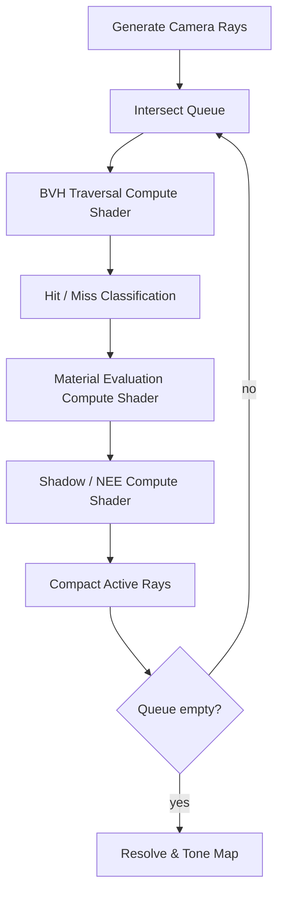
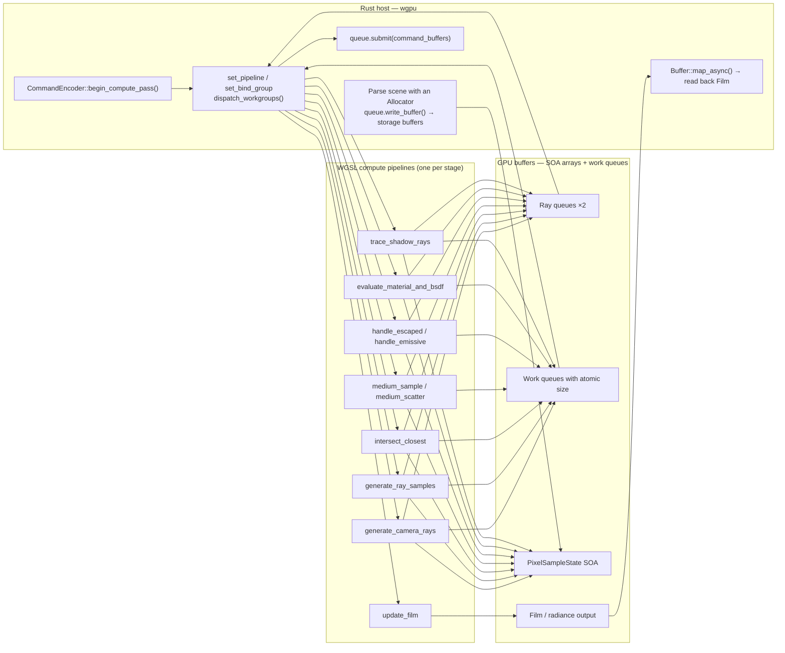
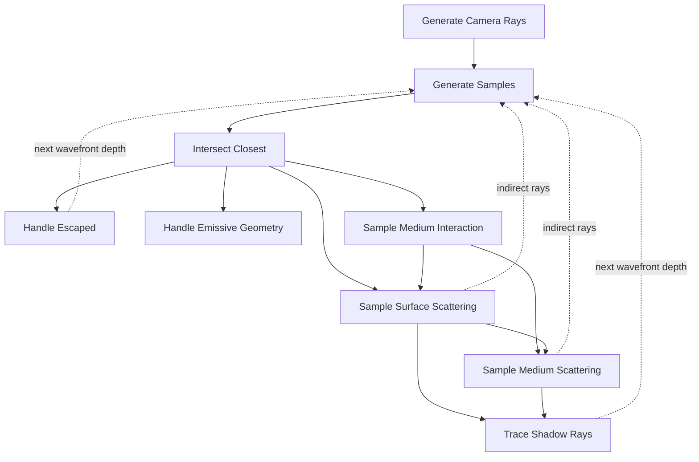
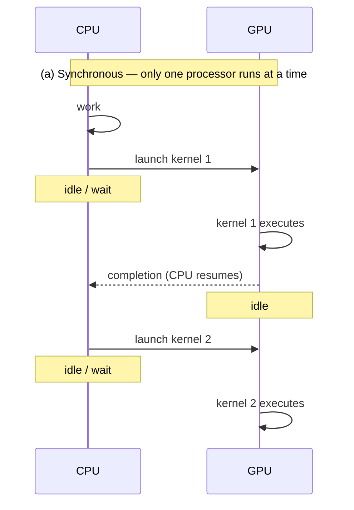
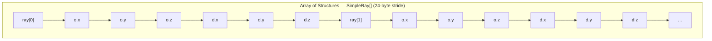
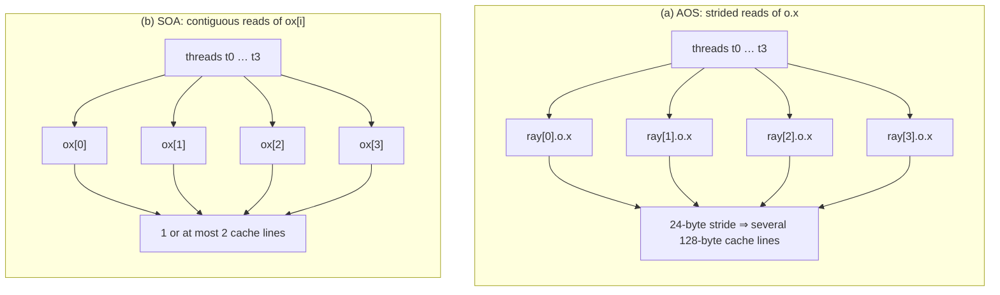
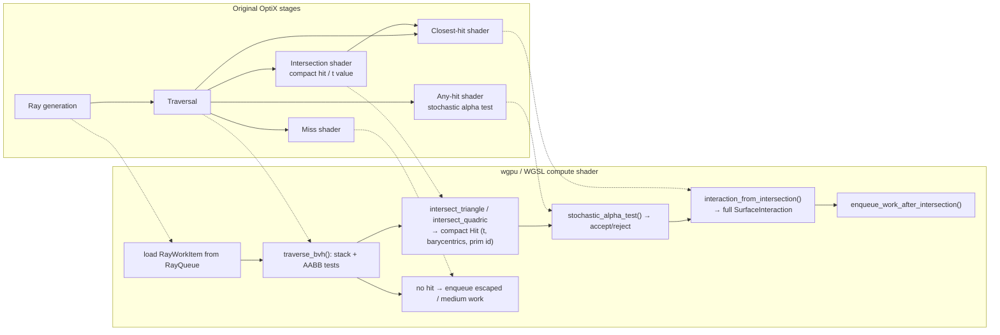

# Chapter 15: Wavefront Rendering on GPUs

<!-- interactive-nav -->
## Contents

- [Wavefront Path Tracing on GPU (wgpu)](#wavefront-path-tracing-on-gpu-wgpu)
- [15.1 MAPPING PATH TRACING TO THE GPU](#151-mapping-path-tracing-to-the-gpu)
  - [15.1.1 Basic GPU Architecture](#1511-basic-gpu-architecture)
  - [15.1.2 Structuring Rendering Computation](#1512-structuring-rendering-computation)
  - [15.1.3 System Overview](#1513-system-overview)
- [15.2 IMPLEMENTATION FOUNDATIONS](#152-implementation-foundations)
  - [15.2.1 Execution and Memory Space Specification](#1521-execution-and-memory-space-specification)
  - [15.2.2 Launching Compute Shaders on the GPU](#1522-launching-compute-shaders-on-the-gpu)
  - [15.2.3 Structure-of-Arrays Layout](#1523-structure-of-arrays-layout)
  - [15.2.4 Work Queues](#1524-work-queues)
- [15.3 PATH TRACER IMPLEMENTATION](#153-path-tracer-implementation)
  - [15.3.1 Work Launch](#1531-work-launch)
  - [15.3.2 The `Render()` Method](#1532-the-render-method)
  - [15.3.3 Generating Camera Rays](#1533-generating-camera-rays)
  - [15.3.4 Loop over Ray Depths](#1534-loop-over-ray-depths)
  - [15.3.5 Sample Generation](#1535-sample-generation)
  - [15.3.6 Intersection Testing](#1536-intersection-testing)
  - [15.3.7 Participating Media](#1537-participating-media)
  - [15.3.8 Ray-Found Emission](#1538-ray-found-emission)
  - [15.3.9 Surface Scattering](#1539-surface-scattering)
  - [15.3.10 Shadow Rays](#15310-shadow-rays)
  - [15.3.11 Updating the Film](#15311-updating-the-film)
- [FURTHER READING](#further-reading)
- [EXERCISES](#exercises)
- [Notes](#notes)

---

## Wavefront Path Tracing on GPU (wgpu)

> **A note on this edition.** The original chapter described pbrt's CUDA/OptiX GPU backend and used C++17 host code with `__host__ __device__` functions. This edition keeps every idea, algorithm, data structure, and design trade-off but expresses them with **wgpu** (the safe Rust implementation of WebGPU) and **WGSL** compute shaders. Where the original book launched a *kernel*, we now encode a *compute pass* and dispatch a WGSL entry point; where it used CUDA's unified memory, we use storage buffers that the CPU initializes and the GPU reads and writes; where it used OptiX's programmable ray-tracing pipeline, we traverse a BVH in WGSL itself. Section 15.2.1 gives the full translation table.

One of the major changes in pbrt for this edition of the book is the addition of support for rendering on GPUs as well as on CPUs. Between the substantial computational capabilities that GPUs offer and the recent availability of custom hardware units for efficient ray intersection calculations, the GPU is a compelling target for ray tracing. For example, the image in Figure 15.1 takes 318.6 seconds to render with pbrt on a 2020-era high-end GPU at 1500 × 1500 resolution with 2048 samples per pixel. On an 8-core CPU, it takes 11,983 seconds to render with the same settings—over 37 times longer. Even on a high-end 32-core CPU, it takes 2,669 seconds to render (still over 8 times longer).<sup>1</sup>

pbrt's GPU rendering path offers only a single integration algorithm: volumetric path tracing, following the algorithms used in the CPU-based `VolPathIntegrator` described in Section 14.2.3. It otherwise supports all of pbrt's functionality, using the same classes and functions that have been presented in the preceding 14 chapters. This chapter will therefore not introduce any new rendering algorithms but instead will focus on topics like parallelism and data layout in memory that are necessary to achieve good performance on GPUs.

The integrator described in this chapter, `WavefrontPathIntegrator`, is structured using a wavefront architecture—effectively, many rays are processed simultaneously, with rendering work organized in queues that collect related tasks to be processed together. ("Wavefront" in this context will be defined more precisely in Section 15.1.2.) Some of the code discussed in this chapter makes more extensive use of advanced language features than we have generally used in previous chapters. The wgpu port uses Rust generics, `bytemuck`-friendly `#[repr(C)]` structs, and pipeline specialization instead of C++ templates; while we have tried not to use such features unnecessarily, we will see that in some cases they make it possible to generate highly specialized code that runs much more efficiently than if their capabilities are not used. We had previously sidestepped many low-level optimizations due to their comparatively small impact on CPUs. Such implementation-level decisions can, however, change rendering performance by orders of magnitude when targeting GPUs.

<details>
<summary>Figure 15.1 — Scene used for the CPU-versus-GPU benchmark (pictorial)</summary>


*Figure 15.1: Scene used for CPU versus GPU ray tracing performance comparison. (Scene courtesy of Angelo Ferretti.)*

</details>

<details>
<summary>Cross-references</summary>

`VolPathIntegrator` 877 · `WavefrontPathIntegrator` 939

</details>

The `WavefrontPathIntegrator` imposes three requirements on a GPU platform:

1. It must support a unified address space, where the CPU and GPU can both access the GPU's memory, using pointers that are consistent on both types of processor. This capability is integral to being able to parse the scene description and initialize the scene representation on the CPU, including initializing pointer-based data structures there, before the same data structures are then used in code that runs on the GPU.
2. The GPU compilation infrastructure must be compatible with the language that the rest of pbrt is implemented in (C++17 in the original book). This makes it possible to use the same class and function implementations on both types of processor.
3. The GPU must have support for ray tracing, either in hardware or in vendor-supplied software. (pbrt's existing acceleration structures would not be efficient on the GPU in their present form.)

<details>
<summary>Cross-references</summary>

`WavefrontPathIntegrator` 939

</details>

The attentive reader will note that CPUs themselves fulfill all of those requirements, the third potentially via pbrt's acceleration structures from Chapter 7. Therefore, pbrt makes it possible to execute the `WavefrontPathIntegrator` on CPUs as well; it is used if the `--wavefront` command-line option is provided. However, the wavefront organization is usually not a good fit for CPUs and performance is almost always worse than if the `VolPathIntegrator` is used instead. Nonetheless, the CPU wavefront path is useful for debugging and testing the `WavefrontPathIntegrator` implementation on systems that do not have suitable GPUs.

At this writing, the only GPUs that provide all three of these capabilities are based on NVIDIA's CUDA platform, so NVIDIA's GPUs are the only ones that pbrt currently supports. We hope that it will be possible to support others in the future. Around two thousand lines of platform-specific code are required to handle low-level details like allocating unified memory, launching work on the GPU, and performing ray intersections on the GPU. As usual, we will not include platform-specific code in the book, but see the `gpu/` directory in the pbrt source code distribution for its implementation. The wgpu port replaces that entire layer with roughly the same amount of Rust: buffer allocation and `queue.write_buffer()` uploads, `CommandEncoder` compute passes, and WGSL BVH traversal. WebGPU does not (yet) expose hardware ray tracing, so the third requirement is satisfied in software; this is a deliberate, portable trade-off, and Section 15.3.6 explains how the OptiX shader stages map onto WGSL functions.

The overall flow through the wavefront integrator, and the way the host drives it, are summarized in the two diagrams below. The first is the logical dataflow of rays and queues; the second is the corresponding wgpu compute pipeline as it is encoded by Rust on the host.





## 15.1 MAPPING PATH TRACING TO THE GPU

Achieving good performance on GPUs requires some care in how computation is organized and how data is laid out in memory. We will start with an overview of how GPUs work and the ways in which they differ from CPUs. This foundation makes it possible to discuss the design space of GPU ray tracers. After summarizing some of the alternatives, we give an overview of the design of the wavefront path integrator, which subsequent sections will delve into more deeply.

### 15.1.1 BASIC GPU ARCHITECTURE

The performance difference between CPUs and GPUs stems from a fundamental difference in the computations that they are designed for. CPUs have long been designed to minimize latency—to run a single thread of computation as efficiently as possible, finishing its work as quickly as possible. (This has somewhat changed with the advent of multicore CPUs, though each core remains latency optimized.) In contrast, GPUs target throughput: they are designed to work on many computations in parallel and finish all of them quickly, which is a different thing than finishing any one of them as quickly as possible.

The focus on throughput allows GPUs to devote much less space on the chip for caches, branch prediction hardware, out-of-order execution units, and other features that have been invented to improve single-thread performance on CPUs. Thus, given a fixed amount of chip area, GPUs are able to provide many more of the arithmetic logic units (ALUs) that actually perform computation than a CPU provides. Yet, more ALUs do not necessarily deliver more performance: they must be kept occupied doing useful work.

An ALU cannot perform computation if the input values it requires are not available. On current processors, reading a value from memory consumes a few hundred processor cycles, and so it is important to avoid the situation where a processor remains idle while it waits for the completion of such read operations—substantial amounts of potential computation might be lost. CPUs and GPUs approach this problem quite differently. Understanding each helps illuminate their philosophical differences.

<details>
<summary>Cross-references</summary>

`VolPathIntegrator` 877 · `WavefrontPathIntegrator` 939

</details>

CPUs apply a barrage of techniques to this task. They feature a relatively large amount of onchip memory in the form of caches; if a memory request targets a location that is already present in a cache, the result can be returned much more quickly than reading from dynamic random access memory (DRAM). Cache memory access typically takes from a handful of cycles to at most a few tens of them. When it is necessary to wait for a memory read, CPUs also use out-of-order execution, continuing to execute the program's instructions past the read instruction. Dependencies are carefully tracked during this process, and operations that are independent of pending computations can execute out of order. The CPU may also execute instructions speculatively, ready to roll back their effects if it turns out they should not have run. If all of that does not suffice, another thread may be available, ready to start executing—modern CPUs generally use hyperthreading to switch to another thread in the event of a stall. This thread switch can be performed without any overhead, which is much better than the thousands of processor cycles it takes for the operating system to perform a context switch.

GPUs instead focus on a single mechanism to address such latencies: much more aggressive thread switching, over many more threads than are used for hyperthreading on CPUs. If one thread reads from memory, a GPU will just switch to another, saving all of the complexity and chip area required for out-of-order execution logic. If that other thread issues a read, then yet another is scheduled. Given enough threads and computation between memory accesses, such an approach is sufficient to keep the ALUs fed with useful work while avoiding long periods of inactivity.

An implication of this design is that GPUs require much more parallelism than CPUs to run at their peak potential. While tens of threads—or at most a few hundred—suffice to fully utilize a modern multicore CPU, a GPU may require tens of thousands of them. Path tracing fortunately involves millions of independent calculations (one per pixel sample), which makes it a good fit for throughput-oriented architectures like GPUs.

**Thread Execution.** GPUs contain an array of independent processors, numbered from the tens up to nearly a hundred at writing. We will not often need to consider these in the following, but will denote them as processors when we do.<sup>2</sup> Each one typically executes 32 or 64 threads concurrently, with as many as a thousand threads available to be scheduled.

The execution model of GPUs centers around the concept of a *kernel*, which refers to a GPU-targeted function that is executed by a specified number of threads. Parameters passed to the kernel are forwarded to each thread; a thread index provides the information needed to distinguish one thread from another. Launching a kernel refers to the operation that informs the GPU that a particular kernel function should be executed concurrently. This differs from an ordinary function call in the sense that the kernel will complete asynchronously at some later point. Frameworks like CUDA provide extensive API functionality to wait for the conclusion of such asynchronous computation, or to enforce ordering constraints between multiple separate kernel launches. In wgpu, the analogue is a `CommandEncoder` that records compute passes into a command buffer: within one pass, dispatches execute in order over the same bind groups, and submitting the command buffer to the `Queue` makes the whole sequence run asynchronously. Launching vast numbers of threads on the GPU is extremely efficient, so there is no need to amortize this cost using a thread pool, as is done in pbrt's `ThreadPool` class for CPU parallelism.

Kernels may be launched both from the CPU and from the GPU, though pbrt only does the former. In contrast to an ordinary function call, a kernel launch cannot return any values to the caller. Kernels therefore must write their results to memory before exiting.

An important hardware simplification that distinguishes CPUs and GPUs is that GPUs bundle multiple threads into what we will refer to as a thread group.<sup>3</sup> This group (32 threads on most current GPUs) executes instructions together, which means that a single instruction decoder can be shared by the group instead of requiring one for each executing thread. Consequently, silicon die area that would ordinarily be needed for instruction decoding can be dedicated to improving parallelism in the form of additional ALUs. In WGSL a thread group is a *workgroup*, whose size is declared with `@workgroup_size(64)` on the entry point; WebGPU implementations map it to the hardware's wavefront or warp (typically 32 or 64 invocations). Most GPU programming models further organize thread groups into larger aggregations—though these are not used in pbrt's GPU implementation, so we will not discuss them further here.

While the hardware simplifications enabled by thread groups allow for additional parallelism, the elimination of per-thread instruction decoders also brings limitations that can have substantial performance implications. Efficient GPU implementation of algorithms requires a thorough understanding of them. Although the threads in a thread group are free to work independently, just as the threads on different CPU cores are, the more that they follow similar paths through the program, the better performance will be achieved. This is a different performance model than for CPUs and can be a subtle point to consider when optimizing code: performance is not just a consequence of the computation performed by an individual thread, but also how often that same computation is performed at the same time with other threads within the same group.

For example, consider this simple block of code:

```wgsl
if condition {
    a();
} else {
    b();
}
```

Executed on a CPU, the processor will test the condition and then execute either `a()` or `b()` depending on the condition's value. On a GPU, the situation is more complex: if all the threads in a thread group follow the same control flow path, then execution proceeds as it does on a CPU. However, if some threads need to evaluate `a()` and some `b()`, then the GPU will execute both functions' instructions with a subset of the threads disabled for each one. These disabled threads represent a wasted opportunity to perform useful work.

In the worst case, a computation could be serialized all the way down to the level of individual threads, resulting in a 32× loss of performance that would largely negate the benefits of the GPU. Algorithms like path tracing are especially susceptible to this type of behavior, which is a consequence of the physical characteristics of light: when a beam of light interacts with an object, it will tend to spread out and eventually reach every part of the environment with nonzero probability. Suppose that a bundle of rays is processed by a thread group: due to this property, an initially coherent computation could later encounter many different shapes and materials that are implemented in different parts of the system. Additional work is necessary to reorder computation into coherent groups to avoid such degenerate behavior.

The implementation of the `FloatMixTexture::Evaluate()` method from Section 10.3.3 can be better understood with thread groups in mind. Its body was:

```wgsl
fn evaluate_mix(ctx: TextureEvalContext) -> f32 {
    let amt = amount.evaluate(ctx);
    var t1 = 0.0;
    var t2 = 0.0;
    if amt != 1.0 { t1 = tex1.evaluate(ctx); }
    if amt != 0.0 { t2 = tex2.evaluate(ctx); }
    return (1.0 - amt) * t1 + amt * t2;
}
```

A more natural implementation might have been the following, which computes the same result in the end:

```wgsl
fn evaluate_mix(ctx: TextureEvalContext) -> f32 {
    let amt = amount.evaluate(ctx);
    if amt == 0.0 { return tex1.evaluate(ctx); }
    if amt == 1.0 { return tex2.evaluate(ctx); }
    return (1.0 - amt) * tex1.evaluate(ctx) + amt * tex2.evaluate(ctx);
}
```

<details>
<summary>Cross-references</summary>

`FloatMixTexture::Evaluate()` 659

</details>

Considered under the lens of GPU execution, we can see the benefit of the first implementation. If some of the threads have a value of `0` for `amt`, some have a value of `1`, and the rest have a value in between, then the second implementation will execute the code for evaluating `tex1` and `tex2` twice, for a different subset of threads for each time.<sup>4</sup> With the first implementation, all of the threads that need to evaluate `tex1` do so together, and similarly for `tex2`.

We will say that execution across a thread group is *converged* when all of the threads follow the same control flow path through the program, and that it has become *divergent* at points in the program execution where some threads follow one path and others follow another through the program code. Some divergence is inevitable, but the less there is the better. Convergence can be improved both by writing individual blocks of code to minimize the number of separate control paths and by sorting work so that all of the threads in a thread block do the same thing. This latter idea will come up repeatedly in Section 15.3 when we discuss the set of compute shaders that the `WavefrontPathIntegrator` executes.

One implication of thread groups is that techniques like Russian roulette may have a different performance impact on a CPU than on a GPU. With pbrt's CPU integrators, if a ray path is terminated with Russian roulette, the CPU thread can immediately go on to start work on a new path. Depending on how the rendering computation is mapped to threads on a GPU, terminating one ray path may not have the same benefit if it just leads to an idle thread being carried along with an otherwise still-active thread group.

**Memory Hierarchy.** Large differences in the memory system architectures of CPUs and GPUs further affect how a system should be structured to run efficiently on each type of processor. Table 15.1 summarizes some relevant quantities for a representative modern CPU and GPU that at the time of this writing have roughly the same cost. Two differences are immediately apparent: the peak memory bandwidth and number of TFLOPS (trillions of floating point operations per second) are both approximately ten times higher on the GPU. It is also clear that neither processor is able to reach its peak performance solely by operating on values stored in memory. For example, the 3.8 TFLOPS that the CPU is capable of would require 15.2 TB/s of memory bandwidth if each 4-byte floating-point value operated on was to be read from memory:

$$\frac{3.8\times10^{12}\ \text{FLOP/s}}{4\ \text{byte}} = 15.2\times10^{12}\ \text{byte/s} = 15.2\ \text{TB/s}.$$

Consequently, we can see that the performance of a computation such as iterating over a large array, reading each value, squaring it, and writing the result back to memory would not be limited by the processor's computational capabilities but would be limited by the memory bandwidth. We say that such computations are *bandwidth limited*. A useful measurement of a computation is its *arithmetic intensity*, which is usually measured as the number of floating-point operations performed per byte of memory accessed. Dividing peak TFLOPS by peak memory bandwidth gives a measurement of how much arithmetic intensity a processor requires to achieve its peak performance. For this CPU, we can see that it is roughly 38 floating-point operations (FLOPS) per byte, or 152 FLOPS for every 4-byte float read from memory. For the GPU, the values are 38.5 and 154, respectively—remarkably, almost exactly the same. Given such arithmetic intensity requirements, it is easy to become bandwidth limited.

**Table 15.1: Key properties of a representative modern CPU and GPU.** These CPU and GPU have approximately the same cost at time of writing but provide their computational capabilities using very different architectures. This table summarizes some of their most important characteristics, and Table 15.2 adds per-processor quantities.

| Property | AMD 3970x CPU | NVIDIA 3090 RTX GPU |
|---|---:|---:|
| Processors | 32 | 82 |
| Peak single-precision TFLOPS | 3.8 | 36 |
| Peak memory bandwidth | ~100 GiB/s | 936 GiB/s |

**Table 15.2: Key properties of the example CPU and GPU processors.** For the CPU, "maximum available threads" is the number that can be switched to without incurring the cost of an operating system thread switch; the number of CPU registers here is the total available for out-of-order execution, which is many more than are visible through the instruction set. The L2 cache on the GPU is shared across all processors and the L3 cache on the CPU is shared across four processors; here we report those cache sizes divided by the number of processors that share them.

| Property | AMD 3970x CPU | NVIDIA 3090 RTX GPU |
|---|---:|---:|
| Concurrently executing threads | 1 | 32 |
| Maximum available threads | 2 | 1,024 |
| Float operations per cycle & thread | 32 | 2 |
| Registers | 160 (float) | 65,536 |
| L1 cache | 32 KiB (data) | 128 KiB |
| L2 cache | 512 KiB | ~75 KiB |
| L3 cache | 4 MiB | none |

Therefore, there must be some combination of reuse of each value read from memory and reuse of intermediate computed values that are stored in onchip memory in order to reach peak floating-point performance. Both the processors' register files and cache hierarchies are integral to keeping them working productively by making some values available from faster on-chip memory, though their effect is quite different on the two types of architecture.

To understand the differences, it is illuminating to compare the two in terms of their cache size with respect to the number of threads that they are running. (Space in the caches is not explicitly allocated to threads, though this is still a useful thought exercise.) This CPU runs one thread at a time on each core, with a second ready for hyperthreading, giving 16 KiB of L1 cache, 256 KiB of L2, and 2 MiB of L3 cache for each of the two threads. This is enough memory to give a fairly wide window for the reuse of previous values and is enough that, for example, we do not need to worry about how big the `SurfaceInteraction` structure is (it is just under 256 bytes); it fits comfortably in the caches close to the processor. These generous cache hierarchies can be a great help to programmers, leaving them with the task of making sure their programs have some locality in their memory accesses but often allowing them not to worry over it too much further.

<details>
<summary>Cross-references</summary>

`SurfaceInteraction` 138

</details>

The GPU runs thread groups of 32 threads, with as many as 31 additional thread groups ready to switch to, for a total of 1,024 threads afoot. We are left with 128 bytes of L1 cache and 75 bytes of L2 per thread, meaning factors of 128× and 3500× less than the CPU, respectively. If the GPU threads are accessing independent memory locations, we are left with a very small window of potential data reuse that can be served by the caches. Thus, structuring GPU computation so that threads access the same locations in memory as much as possible can significantly improve performance by making the caches more effective.

GPUs partially make up for their small caches with large register files; for the one in this comparison there are 65,536 32-bit registers for each GPU processor, giving 64 or more for each thread. (Note that this register file actually has twice as much total storage as the processor's L1 cache.) If a computation can be structured such that it fits into its allocation of registers and has limited memory traffic (especially reads that are different than other threads'), then its computation can achieve high performance on the GPU. The allocation of registers to a kernel must be determined at compile time; this presents a balance for the compiler to strike. On one hand, allocating more registers to a kernel gives it more on-chip storage and, in turn, generally reduces the amount of memory bandwidth that it requires. However, the more registers that are allocated to a kernel, the fewer threads can be scheduled on a processor. For the example GPU, allocating 64 registers for each thread of a kernel means that 1,024 threads can run on a processor at once. 128 registers per thread means just 512 threads, and so forth. The fewer threads that are running, the more difficult it is to hide memory latency via thread switching, and performance may suffer when all threads are stalled waiting for memory reads. The effect of these constraints is that reducing the size of objects can significantly improve performance on the GPU: doing so reduces the amount of bandwidth consumed when reading them from memory (and so may improve performance if a computation is bandwidth limited) and can reduce the number of registers consumed to store them after they have been loaded, potentially allowing more threads and thus more effective latency hiding. This theme will come up repeatedly later in the chapter.

The coherence of the memory locations accessed by the threads in a thread group affects performance as well. A reasonable model for thinking about this is in terms of the processor's cache lines. A common GPU cache line size is 128 bytes. The cost of a memory access by the threads in a thread group is related to the total number of cache lines that the threads access. The best case is that they all access the same cache line, for a location that is already in the cache. (Thus with a 128-byte cache line size, 32 threads accessing successive cache line–aligned 4-byte values such as floats access a single cache line.) Performance remains reasonable if the locations accessed correspond to a small number of cache lines that are already in the cache. An entire cache line must be read for a cache miss. Here as well, the coherence of the locations accessed by the threads has a big impact on performance: if all locations are in a single cache line, then a single memory read can be performed. If all 32 threads access locations that lie in different cache lines, then 32 independent memory reads are required; not only is there a significant bandwidth cost to reading so much data, but there is much more memory latency—likely more than can be effectively hidden. Thus, another important theme in the following implementation will be organizing data structures and computation in order to improve the coherence of memory locations accessed by the threads in a thread group.

A final issue related to memory performance arises due to the various different types of memory that can be referenced by a computation. The GPU has its own device memory, distinct from the host memory used by the CPU. Each GPU processor offers a small high-performance shared memory that can be used by the threads running on it.<sup>5</sup> It is best interpreted as a manually managed cache. Shared memory and L1 and L2 caches provide much higher bandwidth and lower latency than device memory, while host memory is the most expensive for the GPU to access. Optimally placing and, if necessary, moving data in memory during multiple phases of a computation requires expertise and extra engineering effort. The original pbrt sidesteps this issue using *managed memory*, which exists in a unified address space that can be accessed from both CPU and GPU, with a physical location that is undecided and can migrate on demand. In wgpu we make the placement explicit instead: scene data is uploaded once into `STORAGE | COPY_DST` buffers with `queue.write_buffer()`, kernels communicate exclusively through storage buffers (and workgroup-shared memory where useful), and only the final `Film` buffer is mapped back to the host with `Buffer::map_async()`. The extra engineering is modest, and the control over bandwidth is often worth it. In the following implementation, as host code is dispatching compute shaders, it is important that it does not inadvertently read GPU buffers, which would harm performance—and in wgpu such a read requires an explicit, synchronizing map operation.

### 15.1.2 STRUCTURING RENDERING COMPUTATION

With these factors that affect GPU performance in mind, we can consider various ways of structuring pbrt's rendering computation so that it is suitable for the GPU. First, consider applying the same parallelism decomposition that is used in the `ImageTileIntegrator`: assigning each tile of the image to a thread that is then responsible for evaluating its pixel samples. Such an approach is hopeless from the start. Not only is it unlikely to provide a sufficient number of threads to fill the GPU, but the effect of the load imbalance among tiles is exacerbated when the threads execute in groups. (Recall Figure 1.17, the histogram of time spent rendering image tiles in Figure 1.11.) Since a thread group continues executing until all of its threads have finished, performance is worse if the long-running threads are spread across many different thread groups versus all together in fewer.

Another natural approach might be to assign each pixel sample to a thread, launching as many threads as there are pixel samples, and to have each thread execute the same code as runs on the CPU to evaluate a pixel sample. Each thread's task then would be to generate a camera ray, find the closest intersection, evaluate the material and textures at the intersection point, and so forth. This is known as the *megakernel* approach, since a single large kernel is responsible for all rendering computation for a ray. This approach provides more than sufficient parallelism to the GPU, but suffers greatly from execution divergence. While the computation may remain converged until intersections are found, if different rays hit objects with different materials, or the same material but with different textures, their execution will diverge and performance will quickly deteriorate. Even if the camera rays all hit objects with the same material, coherence will generally be lost with tracing the first batch of indirect rays: some may find no intersection and leave the scene, others may hit objects with various materials, and yet others may end up scattering in participating media. Each different case leads to execution divergence. Even if all the threads end up sampling a light BVH, for instance, they may not do so at the same time and thus that code may be executed multiple times, just as was the case for the inferior approach of implementing the `FloatMixTexture::Evaluate()` method. We can expect that over time all of the threads will fully diverge, leading to processing that is less efficient than it could be by a factor of the number of threads in a thread group.

The performance of a megakernel ray tracer can be improved with the addition of work scheduling and reordering within the executing kernels. Such a megakernel ray tracer can be seen as what is effectively a thread group–wide state machine that successively chooses an operation to perform: "generate camera rays," "find closest intersections," "evaluate and sample diffuse BSDFs," "sample the light BVH," and so forth. It might choose among operations based on how many threads would like to perform the corresponding operation. This approach can greatly improve execution convergence. For example, if only a single thread is waiting to evaluate and sample diffuse BSDFs, that work can be deferred while other threads trace rays and do other rendering work. Perhaps some of those rays will intersect diffuse surfaces, adding themselves to the tally of threads that need to do that operation. When that operation is eventually selected, it can be done for the benefit of more threads, redundant executions saved.

Direct implementation of the megakernel approach does have disadvantages. The megakernels themselves may be comprised of a large amount of code (effectively, everything that the renderer needs to do), which can lead to long compilation times depending on the sophistication of the ray tracer. They are further limited to finding shared work among the threads in a thread group or, at most, the threads running on a single GPU processor. It therefore may not be possible to achieve an optimal degree of thread convergence. Nevertheless, the approach is a good one, and is the most common one for real-time ray tracers today.

<details>
<summary>Cross-references</summary>

`Film` 244 · `FloatMixTexture` 659 · `ImageTileIntegrator` 24

</details>

The other main GPU ray tracer architecture is termed *wavefront*. A wavefront ray tracer separates the main operations into separate kernels, each one operating on many pixel samples in parallel: for example, there might be one kernel that generates camera rays, another that finds ray intersections, perhaps one to evaluate diffuse materials and another to evaluate dielectrics, and so forth. The kernels are organized in a dataflow architecture, where each one may enqueue additional work to be performed in one or more subsequent kernels. A significant advantage of the wavefront approach is that execution in each kernel can start out fully converged: the diffuse-material kernel is invoked for only the intersection points with a diffuse material, and so forth. While the execution may diverge within the kernel, regularly starting out with converged execution can greatly aid performance, especially for systems with a wide variety of materials, BSDFs, lights, and so forth.

Another advantage of the wavefront approach is that different numbers of registers can be allocated to different kernels. Thus, simple kernels can use fewer registers and reap benefits in more effective latency hiding, and it is only the more complex kernels that incur the costs of that trade-off. In wgpu this is especially natural: each WGSL entry point gets its own pipeline, so the compiler can allocate registers (and shared memory) per pipeline rather than for a single monolithic shader. In contrast, the register allocation for a megakernel must be made according to the worst case across the entire set of rendering computation.

However, wavefront ray tracers pay a cost in bandwidth. Because data does not persist onchip between kernel launches, each kernel must read all of its inputs from memory and then write its results back to it. In contrast, megakernels can often keep intermediate information on-chip. The performance of a wavefront ray tracer is more likely than a megakernel to be limited by the amount of memory bandwidth and not the GPU's computational capabilities. This is an undesirable state of affairs since it is projected that bandwidth will continue to grow more slowly than computation in future processor architectures.

The recent addition of hardware ray-tracing capabilities to GPUs has led to the development of graphics programming interfaces that allow the user to specify which kernels to run at various stages of ray tracing. This gives an alternative to the megakernel and wavefront approaches that avoids many of their respective disadvantages. With these APIs, the user not only provides single kernels for operations like generating initial rays, but can also specify multiple kernels to run at ray intersection points—where the kernel that runs at a given point might be determined based on an object's material, for example. Scheduling computation and orchestrating the flow of data between stages is not the user's concern, and the GPU's hardware and software has the opportunity to schedule work in a way that is tuned to the hardware architecture. (The semantics of these APIs are discussed further in Section 15.3.6.) WebGPU does not expose such an interface, so the wgpu port is firmly in the wavefront camp: it fuses stages where profitable and relies on WGSL BVH traversal, but it cannot delegate scheduling to fixed-function ray-tracing hardware.

### 15.1.3 SYSTEM OVERVIEW

This version of pbrt adopts the wavefront approach for its GPU rendering path, although some of its kernels fuse together multiple stages of the ray-tracing computation in order to reduce the amount of memory traffic that is used. We found this approach to be a good fit given the variety of materials, BxDFs, and light sources that pbrt supports. Further, rendering features like volume scattering fit in nicely: we can skip the corresponding kernels entirely if the scene does not include those effects. Figure 15.2 gives an overview of the kernels used and the queues between them; the arrows correspond to queues on which one shader may enqueue work for subsequent shaders. After camera rays have been generated, the subsequent shaders execute once for each ray depth up to the maximum depth.



*Figure 15.2: Overview of the kernels used in the wavefront integrator. Solid arrows are queues on which a kernel may enqueue work for subsequent kernels; dashed arrows feed indirect rays back for the next wavefront depth. After camera rays have been generated, the subsequent kernels execute once for each ray depth up to the maximum depth. (Redrawn from the book's schematic.)*

As with the CPU-targeted integrators, a `BasicScene` parses the scene description and stores various entities that represent scene components. When the wavefront integrator is being used, the parsed scene is then passed to the `RenderWavefront()` function, which is defined in the file `wavefront/wavefront.cpp`. Beyond some housekeeping, its main task is to allocate an instance of the `WavefrontPathIntegrator` class and to call its `Render()` method. Since the housekeeping is not very interesting, we will not include its implementation here. The `WavefrontPathIntegrator` constructor converts many of the entities in the `BasicScene` to pbrt objects in the same way as is done for the CPU renderer: all the lights are converted to corresponding instances of the `Light` classes, and similarly for the camera, film, sampler, light sampler, media, materials, and textures. One important difference, however, is that the `Allocator` that is provided for them allocates GPU-visible storage so that it can be initialized on the CPU and accessed by the GPU. Another difference is that only some shapes are handled with pbrt's `Shape` implementations. Shapes like triangles that have native support from the GPU's ray intersection hardware are instead handled using that hardware. Finally, image map textures use a specialized implementation that uses the GPU's texturing hardware for texture lookups.

<details>
<summary>Cross-references</summary>

`Allocator` 40 · `BasicScene` 1134 · `BxDF` 538 · `Shape` 261 · `WavefrontPathIntegrator` 939 · `WavefrontPathIntegrator::Render()` 941

</details>

Once the scene representation is ready, a call to `WavefrontPathIntegrator::Render()` starts the rendering process. The details of the implementation of that method will be the subject of the following sections of this chapter, but Figure 15.2 gives an overview of the compute shaders it launches.<sup>6</sup> The sequence of computations is similar to that of the `VolPathIntegrator::Li()` method, though decomposed into shaders. Queues are used to buffer work between shaders: each shader can push work onto one or more queues to be processed in subsequent shaders.

Rendering starts with a shader that generates camera rays for a number of pixel samples (typically, a million or so). Given camera rays, the loop up to the maximum ray depth can begin. Each time through the loop, the following shaders are executed:

1. Samples for use with the ray are generated using the `Sampler` and stored in memory for use in later shaders.
2. The closest intersection of each ray is found with the scene geometry. The shader that finds these intersections pushes work onto a variety of queues to be processed by other shaders, including a queue for rays that escape the scene, one for rays that hit emissive geometry, and another for rays that pass through participating media. Rays that intersect surfaces are pushed onto queues that partition work based on material types.
3. Rays passing through participating media are then processed, possibly leading to a shadow ray and an indirect ray being enqueued if the ray scatters.
4. Unscattered rays that were earlier found to have intersected a surface are pushed on to the same variety of queues as are used in the intersection shader for rays not passing through media.
5. Rays that have intersected emissive geometry and rays that have left the scene are handled by two shaders that both update rays' radiance estimates to incorporate the effect of emission found by such rays.
6. Each material is then handled individually, with separate shaders specialized based on the material type. Textures are evaluated to initialize a `BSDF` and a light is sampled. This, too, leads to indirect and shadow rays being enqueued.
7. A final shader traces shadow rays and incorporates their contributions into the rays' radiance estimates, including accounting for absorption along rays in participating media.

Until the maximum ray depth, the loop then starts again with the queued indirect rays replacing the camera rays as the rays to trace next.

## 15.2 IMPLEMENTATION FOUNDATIONS

Before we discuss the implementation of the wavefront integrator and the details of its kernels, we will start by discussing some of the lower-level capabilities that it is built upon, as well as the abstractions that we use to hide the details of platform-specific APIs.

### 15.2.1 EXECUTION AND MEMORY SPACE SPECIFICATION

If you have perused the pbrt source code, you will have noticed that the signatures of many functions include a `PBRT_CPU_GPU`. We have elided all of these from the book text thus far in the interests of avoiding distraction. Now we must pay closer attention to them. When pbrt is compiled with GPU support, the compiler must know whether each function in the system is intended for CPU execution only, GPU execution only, or execution on both types of processor. In some cases, a function may only be able to run on one of the two—for example, if it uses low-level functionality that the other type of processor does not support. In other cases, it may be possible for it to run on both, though it may not make sense to do so.

<details>
<summary>Cross-references</summary>

`BSDF` 544 · `Sampler` 469 · `VolPathIntegrator::Li()` 878

</details>

For example, an object constructor that does extensive serial processing would be unsuited to the GPU. `PBRT_CPU_GPU` hides the platform-specific details of how these characteristics are indicated. (With CUDA, it turns into a `__host__ __device__` specifier.) There is also a `PBRT_GPU` macro, which signifies that a function can only be called from GPU code. These macros are all defined in the file `pbrt.h`. If no specifier is provided, a function can only be called from code that is running on the CPU. These specifiers can be used with variable declarations as well, to similar effect. pbrt only makes occasional use of them for that, mostly using managed memory for such purposes. (There is also a `PBRT_CONST` variable qualifier that is used to define large constant arrays in a way that makes them accessible from both CPU and GPU.) In addition to informing the compiler of which processors to compile functions for, having these specifiers in the signatures of functions allows the compiler to determine whether a function call is valid: a CPU-only function that directly calls a GPU-only function, or vice versa, leads to a compile time error.

**How this maps to wgpu.** WebGPU has no single-source, two-target language: host code is Rust and device code is WGSL, compiled separately. The role of `PBRT_CPU_GPU` is therefore played by the Rust/WGSL split itself, plus the bind-group interface between them:

| Original concept | wgpu equivalent |
|---|---|
| `PBRT_CPU_GPU` (`__host__ __device__`) | Rust function on the host and/or an ordinary WGSL `fn` compiled into a pipeline; shared *data*, not shared *code*, is the interface |
| `PBRT_GPU` | A WGSL `fn`/entry point — callable only from device code |
| No specifier (CPU only) | Ordinary Rust code that never appears in a shader module |
| `PBRT_CONST` constant arrays | `const` arrays in WGSL, or a read-only `uniform`/`storage` buffer uploaded with `queue.write_buffer()` |
| Compile-time call validation | Rust's type checker plus wgpu pipeline/bind-group validation; a mismatched `#[repr(C)]` layout or binding is caught before submission |
| Managed memory | Storage buffers visible to both sides; the host initializes them with `queue.write_buffer()` and only maps them back explicitly |

The practical consequence is that we must be deliberate about *where* a value lives. A scalar computed on the host is copied into a uniform buffer; an array shared by many invocations becomes a storage buffer with `STORAGE | COPY_DST` usage. For example:

```rust
#[repr(C)]
#[derive(Clone, Copy, bytemuck::Pod, bytemuck::Zeroable)]
pub struct RenderUniforms {
    pub resolution: [u32; 2],
    pub samples_per_pixel: u32,
    pub max_depth: u32,
}

let uniforms = RenderUniforms {
    resolution: [1500, 1500],
    samples_per_pixel: 2048,
    max_depth: 8,
};
ctx.queue.write_buffer(&uniform_buffer, 0, bytemuck::bytes_of(&uniforms));
```

```wgsl
struct RenderUniforms {
    resolution: vec2u,
    samples_per_pixel: u32,
    max_depth: u32,
};
@group(0) @binding(0) var<uniform> uniforms: RenderUniforms;
```

`#[repr(C)]` plus `Pod`/`Zeroable` is the Rust analogue of the careful, identical layout that `PBRT_CONST` and the CUDA specifiers guaranteed across the two compilers.

### 15.2.2 LAUNCHING COMPUTE SHADERS ON THE GPU

pbrt also provides functions that abstract the platform-specific details of launching kernels on the GPU. These are all defined in the files `gpu/util.h` and `gpu/util.cpp`. In the wgpu port they live in a small `gpu` module of the Rust crate.

The most important of them is `GPUParallelFor()`, which launches a specified number of GPU threads and invokes the provided kernel function for each one, passing it an index ranging from zero up to the total number of threads. The index values passed always span a contiguous range for all of the threads in a thread group. This is an important property in that, for example, indexing into a float array using the index leads to contiguous memory accesses. This function is the GPU analog to `ParallelFor()`, with the differences that it always starts iteration from zero, rather than taking a 1D range, and that it takes a description string that describes the kernel's functionality. Its implementation includes code that tracks the total time each kernel spends executing on the GPU, which makes it possible to print a performance breakdown after rendering completes using the provided description string.

The original declaration was:

```wgsl
// Conceptual signature (the host-side wrapper is Rust; see below).
// GPUParallelFor(description, nItems, func) -> void
```

A simple example of its usage is below: the callback function `func` is invoked with a single integer argument, corresponding to the item index that it is responsible for. Note also that a `PBRT_GPU` specifier is necessary for the lambda function to indicate that it will be invoked from GPU code.

```wgsl
@group(0) @binding(0) var<storage, read_write> array: array<f32>;

@compute @workgroup_size(64)
fn initialize_array(@builtin(global_invocation_id) gid: vec3u) {
    let i = gid.x;                         // index in [0, nItems)
    if i >= arrayLength(&array) { return; } // guards the final pass
    array[i] = f32(i);
}
```

The `PBRT_CPU_GPU_LAMBDA` macro in the original book supplied the specifier and hid platform details; in wgpu the corresponding host-side wrapper is:

```rust
pub const WORKGROUP_SIZE: u32 = 64;

pub fn gpu_parallel_for(
    ctx: &GpuContext,
    desc: &str,
    n_items: u32,
    pipeline: &wgpu::ComputePipeline,
    bind_group: &wgpu::BindGroup,
    encoder: &mut wgpu::CommandEncoder,
) {
    let mut pass = encoder.begin_compute_pass(&wgpu::ComputePassDescriptor {
        label: Some(desc), // the description string doubles as the timing label
        ..Default::default()
    });
    pass.set_pipeline(pipeline);
    pass.set_bind_group(0, bind_group, &[]);
    let groups = n_items.div_ceil(WORKGROUP_SIZE);
    pass.dispatch_workgroups(groups, 1, 1);
}
```

<details>
<summary>Cross-references</summary>

`GPUParallelFor()` 929 · `ParallelFor()` 1107

</details>

We do not provide a variant analogous to `ParallelFor2D()` for iterating over a 2D array, though it would be easy to do so; pbrt just has no need for such functionality.

<details>
<summary>Figure 15.3 — Synchronous versus asynchronous CPU/GPU execution (redrawn from the book's timing chart)</summary>



```mermaid
sequenceDiagram
    participant C as CPU
    participant G as GPU
    Note over C,G: (b) Asynchronous — both processors stay busy
    C->>G: launch kernel 1
    C->>G: launch kernel 2
    C->>G: launch kernel 3
    Note over C: continues enqueuing work; never stalls
    G->>G: kernel 1 executes
    G->>G: kernel 2 executes
    G->>G: kernel 3 executes
    Note over G: never waits for the next batch
```

*Figure 15.3: Comparison of synchronous and asynchronous CPU/GPU execution. (a) If the two processors are synchronous, only one is ever executing: the CPU stalls after launching a kernel, and the GPU is idle after a kernel finishes until the CPU resumes and launches another. (b) With the asynchronous model, the CPU continues execution after launching each kernel and is able to enqueue more of them while the GPU is working on earlier ones; in turn, the GPU does not need to wait for the next batch of work to do.*

</details>

Although execution is serialized between successive calls to `GPUParallelFor()`, it is important to be aware that the execution of the CPU and GPU are decoupled. When a call to `GPUParallelFor()` returns on the CPU, the corresponding threads on the GPU often will not even have been launched, let alone completed. Work on the GPU proceeds asynchronously. In wgpu this is explicit: `begin_compute_pass()` only *records* commands, and nothing runs until `queue.submit()` is called. While this execution model thus requires explicit synchronization operations between the two processors, it is important for achieving high performance. Consider the two alternatives illustrated in Figure 15.3; automatically synchronizing execution of the two processors would mean that only one of them could be running at a given time.

An implication of this model is that the CPU must be careful about when it reads values from memory that were computed on the GPU. For example, if the implementation had code that tried to read the final image immediately after launching the last rendering shader, it would almost certainly read an incomplete result. We therefore require a mechanism so that the CPU can wait for all the previous work to complete. This capability is provided by `GPUWait()`. Again, the implementation is not included here, as it is based on platform-specific functionality.

```rust
pub fn gpu_wait(ctx: &GpuContext) {
    // Block until all previously submitted command buffers have completed.
    ctx.device.poll(wgpu::PollType::Wait {
        submission_index: None,
        timeout: None,
    });
}

// Reading a GPU-computed value always follows submission + wait:
pub async fn read_film(ctx: &GpuContext, buffer: &wgpu::Buffer) -> Vec<u8> {
    let slice = buffer.slice(..);
    let fut = slice.map_async(wgpu::MapMode::Read, ..);
    ctx.device.poll(wgpu::PollType::Wait { submission_index: None, timeout: None });
    fut.await.unwrap();
    let data = slice.get_mapped_range();
    let out = data.to_vec();
    drop(data);
    buffer.unmap();
    out
}
```

Note that the map operation itself enforces the necessary ordering in wgpu; the explicit `poll` merely makes the wait synchronous, which is useful when matching the book's `GPUWait()` semantics.

### 15.2.3 STRUCTURE-OF-ARRAYS LAYOUT

<details>
<summary>Cross-references</summary>

`ParallelFor2D()` 1108 · `PBRT_CPU_GPU` 928

</details>

As discussed earlier, the thread group execution model of GPUs affects the pattern of memory accesses that program execution generates. A consequence is that the way in which data is laid out in memory can have a meaningful effect on performance. To understand the issue, consider the following definition of a ray structure:

```wgsl
struct SimpleRay {
    o: vec3f, // Point3f origin
    d: vec3f, // Vector3f direction
};
```

Now consider a shader that takes a queue of `SimpleRay`s as input. Such a shader might be responsible for finding the closest intersection along each ray, for example. A natural representation of the queue would be an array of `SimpleRay`s. (This layout is termed *array of structures*, and is sometimes abbreviated as `AOS`.) Such a queue would be laid out in memory as shown in Figure 15.4, where each `SimpleRay` occupies a contiguous region of memory with its elements stored in consecutive locations.



*Figure 15.4: Memory layout of an array of `SimpleRay` structures. The elements of each ray are consecutive in memory, so successive rays are separated by `sizeof(SimpleRay)` (24 bytes, assuming 4-byte floats).*

Now consider what happens when the threads in a thread group read their corresponding ray into memory. If the pointer to the array is `rays` and the index passed to each thread's function is `i`, then each thread might start out by reading its ray using code like `let r = rays[i];`. The generated code would typically load each component of the origins and directions individually. Figure 15.5(a) illustrates the distribution of memory locations accessed when each thread in a thread group loads the `x` component of its ray origin: the locations span many cache lines, which in turn incurs a performance cost.

An alternative layout is termed *structure of arrays*, or `SOA`. The idea behind this approach is to effectively transpose the layout of the object in memory, storing all the origins' `x` components contiguously in an array of floats, then all the origins' `y` components in another array, and so forth. WGSL permits only one runtime-sized array per storage binding, so the idiomatic representation is one binding per member:

```wgsl
@group(0) @binding(0) var<storage, read> ox: array<f32>;
@group(0) @binding(1) var<storage, read> oy: array<f32>;
@group(0) @binding(2) var<storage, read> oz: array<f32>;
@group(0) @binding(3) var<storage, read> dx: array<f32>;
@group(0) @binding(4) var<storage, read> dy: array<f32>;
@group(0) @binding(5) var<storage, read> dz: array<f32>;
```

If the threads in a thread group want to load the `x` component of their ray's origin, the expression `ox[i]` suffices to load that value. The locations accessed are contiguous in memory and span many fewer cache lines (Figure 15.5(b)).



*Figure 15.5: Effect of memory layout on read coherence. (a) When the threads in a thread group load the `x` component of their ray origin with an array-of-structures layout, each thread reads from a location offset by `sizeof(SimpleRay)` from the previous one (24 bytes), so multiple cache lines must be accessed. (b) With structure-of-arrays layout, the threads access contiguous locations, corresponding to 1 or at most 2 cache-line accesses depending on alignment. Performance is generally much better.*

However, this performance benefit comes at a cost of making the code more unwieldy. Loading an entire ray with this approach requires indexing into each of the constituent arrays:

```wgsl
let r = SimpleRay(vec3f(ox[i], oy[i], oz[i]), vec3f(dx[i], dy[i], dz[i]));
```

Even more verbose manual indexing is required for the task of writing a ray out to memory in `SOA` format; the cleanliness of the `AOS` array syntax has been lost. In order to avoid such complexity, the original code makes extensive use of `SOA` template types that make it possible to work with `SOA` data using syntax that is the same as array indexing with an array of structures data layout. For any type that has an `SOA` template specialization (e.g., pbrt's regular `Ray` class), we are able to write code like the following:

```wgsl
var rays = SoaRay(1024);   // host-side helper allocates the six arrays
let index = /* … */;
let r = rays.get(index);   // loads all six fields
rays.set(index, transform(r));
```

Both loads from and stores to the array are expressed with ordinary indexing syntax at the host level. On the device we still write the individual buffer accesses, but the boilerplate can be generated. While it is straightforward programming to implement such `SOA` containers, doing so is rather tedious, especially if one has many types to lay out in `SOA`. Therefore, pbrt includes a small utility program, `soac` (structure of arrays compiler), that automates this process. Its source code is in the file `cmd/soac.cpp` in the pbrt distribution. We will not discuss its implementation here, but we will describe its usage as well as the form of the `SOA` type definitions that it generates. In the wgpu port, the same job is done by a small build script / derive macro that reads the `.soa` specifications and emits both the Rust `#[repr(C)]` containers and the matching WGSL binding declarations.

`soac` takes structure specifications in a custom format of the following form: `flat Float; soa Point2f { Float x, y; };`. Here, `flat` specifies that the following type should be stored directly in arrays, while `soa` specifies a structure. Although not shown here, `soa` structures can themselves hold other `soa` structure types. See the files `pbrt.soa` and `wavefront/workitems.soa` in the pbrt source code for more examples. This format is easy to parse and is sufficient to provide the information necessary to generate pbrt's `SOA` type definitions. A more bulletproof solution (and one that would avoid the need for writing the code to parse a custom format) would be to modify a C++ compiler to optionally emit `SOA` type definitions for types it has already parsed. Of course, that is a more complex approach to implement than `soac` was. In the wgpu port, a Rust procedural macro gets close to that ideal: it can see the Rust type definition and derive its storage-buffer representation directly.

When pbrt is compiled, `soac` is invoked to generate header files based on the `*.soa` specifications. For example, `pbrt.soa` is turned into `pbrt_soa.h`, which can be found in pbrt's build directory after the system has been compiled. For each `soa` type defined in a specification file, `soac` generates an `SOA` template specialization. Here is the one for `Point2f`, expressed in the Rust/wgpu port (here we have brought automatically generated code into the book text for dissection, which is the opposite flow from all the other code in the text):

```rust
#[repr(C)]
#[derive(Clone, Copy, Default, bytemuck::Pod, bytemuck::Zeroable)]
pub struct Point2f {
    pub x: f32,
    pub y: f32,
}

pub struct SoaPoint2f {
    pub n_alloc: usize,
    pub x: Vec<f32>,
    pub y: Vec<f32>,
}

impl SoaPoint2f {
    pub fn new(n: usize) -> Self {
        // Each member gets its own contiguous array, just like the C++ constructor's
        // alloc.allocate_object<Float>(n) calls. `this->` in the original disambiguated
        // members from constructor parameters; Rust's `self.` makes this explicit.
        Self { n_alloc: n, x: vec![0.0; n], y: vec![0.0; n] }
    }

    pub fn get(&self, i: usize) -> Point2f {
        Point2f { x: self.x[i], y: self.y[i] }
    }

    pub fn set(&mut self, i: usize, p: Point2f) {
        self.x[i] = p.x;
        self.y[i] = p.y;
    }
}
```

The `SOA` class's members store the array size and the individual member pointers. The original `PBRT_RESTRICT` qualifier informed the compiler that no other pointer would point to these arrays, which can allow it to generate more efficient code. In WGSL, separate storage bindings are non-aliasing by construction, so we obtain the same optimization without an explicit qualifier.

It is easy to generate a method that allows indexing into the `SOA` arrays to read values. Note that the generated code requires that the class has a default constructor and that it can directly initialize the class's member variables. In the event that they are private, the class should use a `friend` declaration to make them available to its `SOA` specialization; the Rust port keeps the fields `pub` or places the generated module in the same module scope for the same reason.

It is less obvious how to support assignment of values using the regular array indexing syntax. `soac` provided this capability through the indirection of an auxiliary class, `GetSetIndirector`. When `operator[]` was called with a non-const `SOA` object, it returned an instance of that class, recording both a pointer to the `SOA` object and the index value. Assignment was then handled by its `operator=`, distributing the value to each member array; a conversion operator handled reads from a non-const `SOA` object. In Rust/WGSL we have no need for this proxy: `set(i, p)` distributes the fields directly, and device code writes each member buffer explicitly:

```wgsl
ox[i] = p.x;
oy[i] = p.y;
```

The original expansion `p[i] = Point2f(…)` was equivalent to `(p.operator[](i)).operator=(Point2f(…))`; the proxy existed solely to keep the `AOS` indexing syntax while storing `SOA` data.

<details>
<summary>Cross-references</summary>

`GetSetIndirector` 934 · `Point2f` 92 · `SOA` 932 · `SOA<Point2f>::x` 933 · `SOA<Point2f>::y` 933 · `Allocator` 40 · `Float` 23 · `PBRT_RESTRICT` 933 · `std::pmr::polymorphic_allocator::allocate_object()` 41

</details>

We conclude with a caveat: `SOA` layout is effective if access is coherent, but can be detrimental if it is not. If threads are accessing an array of some structure type in an incoherent fashion, then `AOS` may be a better choice: in that case, although each thread's initial access to the structure may incur a cache miss, its subsequent accesses may be efficient if nearby values in the structure are still in the cache. Conversely, incoherent access to `SOA` data may incur a miss for each access to each structure member, polluting the cache by bringing in many unnecessary values that are not accessed by any other threads.

### 15.2.4 WORK QUEUES

Our last bit of groundwork before getting back into rendering will be to define two classes that manage the input and output of kernels in the ray-tracing pipeline. Both were defined in the file `wavefront/workqueue.h`.

First is `WorkQueue`, which represents a queue of objects of a specified type, `WorkItem`. The items in the queue are stored in `SOA` layout; this is achieved by publicly inheriting from the `SOA` template class for the item type. This inheritance also allows the items in the work queue to be indexed using regular array indexing syntax, via the `SOA` public methods. In the wgpu port a work queue is a `Soa<WorkItem>` container plus a GPU-side atomic counter:

```wgsl
@group(0) @binding(0) var<storage, read_write> queue_size: atomic<u32>;

struct QueueUniforms { capacity: u32, };
@group(0) @binding(1) var<uniform> q: QueueUniforms;

fn queue_size_get() -> u32 {
    return atomicLoad(&queue_size);
}
fn queue_reset() {
    atomicStore(&queue_size, 0u);
}
fn push_ray(r: RayWorkItem) -> u32 {
    let slot = atomicAdd(&queue_size, 1u);
    if slot >= q.capacity { return 0xffffffffu; }
    ray_o[slot] = r.ray.o;
    ray_d[slot] = r.ray.d;
    // … store the remaining SOA members …
    return slot;
}
```

The constructor takes the maximum number of objects that can be stored in the queue as well as an allocator, but leaves the actual allocation to the `SOA` base class:

```rust
pub struct WorkQueue<T> {
    pub items: Soa<T>,
    pub size_buffer: wgpu::Buffer, // holds a single atomic<u32>
    pub capacity: u32,
}
impl<T> WorkQueue<T> {
    pub fn new(n: u32) -> Self {
        Self {
            items: Soa::new(n as usize),
            size_buffer: /* create STORAGE | COPY_DST buffer of 4 bytes */,
            capacity: n,
        }
    }
    pub fn size(&self) -> u32 { /* atomicLoad on device; see ForAllQueued */ 0 }
}
```

There is only a single private member variable: the number of objects stored in the queue. It was represented using a platform-specific atomic type (a `std::atomic` when `WorkQueue`s were used on the CPU). Simple methods return the size of the queue and reset it so that it stores no items — `atomicLoad`/`atomicStore` in WGSL, with *relaxed* memory ordering implied for these counters.

An item is added to the queue by finding a slot for it via `AllocateEntry()` (the `atomicAdd` above). We implement that functionality separately so that `WorkQueue` subclasses can implement their own methods for adding items if further processing is needed. In this case, all that needs to be done is to store the provided value in the specified spot using the `SOA` indexing operator.

```rust
pub fn push(queue: &mut WorkQueue<RayWorkItem>, w: RayWorkItem) -> u32 {
    let index = allocate_entry(queue); // atomicAdd on the GPU
    queue.items.set(index as usize, w);
    index
}
```

When a slot is claimed for a new item, the size member variable is incremented using an atomic operation, and so it is fine if multiple threads are concurrently adding items to the queue without any further coordination. Returning to how threads access memory, we would do well to allocate consecutive slots for all of the threads in a thread group that are adding entries to a queue. Given the `SOA` layout of the queue, such an allocation leads to writes to consecutive memory locations, with corresponding performance benefits. A plain `atomicAdd` per invocation does not provide that guarantee, since each thread calls it independently. A common way to implement atomic addition in the presence of thread groups is to aggregate the operation over all the active threads in the group and to perform a single addition for all of them, doling out corresponding individual results back to the individual threads. The wgpu analogue uses workgroup-shared memory to reserve one contiguous block per workgroup:

```wgsl
var<workgroup> wg_base: u32;
var<workgroup> wg_active: u32;

fn push_block_reservation(@builtin(local_invocation_id) lid: vec3u) -> u32 {
    // wg_active holds the number of active invocations in this workgroup;
    // invocation 0 performs a single aggregated atomic for the whole group.
    if lid.x == 0u {
        wg_base = atomicAdd(&queue_size, wg_active);
    }
    workgroupBarrier();
    return wg_base + prefix_within_workgroup(lid.x); // local prefix sum
}
```

Our code assumes such an implementation; on a platform where the assumption is incorrect, it would be worthwhile to use a different mechanism that did give that result.

<details>
<summary>Cross-references</summary>

`Allocator` 40 · `SOA` 932 · `WorkQueue` 935 · `WorkQueue::size` 935

</details>

`ForAllQueued()` makes it easy to apply a function to all of the items stored in a `WorkQueue` in parallel. The provided callback function is passed the `WorkItem` that it is responsible for. In wgpu the callback is a WGSL entry point bound to the queue's buffers, and the host wrapper encodes one dispatch for the maximum possible number of items:

```rust
pub fn for_all_queued(
    ctx: &GpuContext,
    desc: &str,
    queue: &WorkQueue<RayWorkItem>,
    pipeline: &wgpu::ComputePipeline,
    encoder: &mut wgpu::CommandEncoder,
) {
    // Launch threads for the maximum number of items, not the current size:
    // reading the atomic count back to the host would force a GPU→CPU sync.
    gpu_parallel_for(ctx, desc, queue.capacity, pipeline, &queue.bind_group, encoder);
}
```

```wgsl
@compute @workgroup_size(64)
fn process_queue(@builtin(global_invocation_id) gid: vec3u) {
    let index = gid.x;
    if index >= queue_size_get() { return; } // extras exit immediately
    let w = load_ray_work_item(index);
    process(w);
}
```

If the GPU is being used for rendering, a thread is launched for the maximum number of items that could be stored in the queue, rather than only for the number that are actually stored there. This stems from the fact that kernels are launched from the CPU but the number of objects actually in the queue is stored in GPU memory. Not only would it be inefficient to read the actual size of the queue back from GPU memory to the CPU for the call, but retrieving the correct value would require synchronization with the GPU, which would further harm performance. Therefore, a number of threads certain to be sufficient are launched and those that do not have an item to process exit immediately. Because thread creation is so inexpensive on GPUs, this approach does not introduce a meaningful amount of overhead. If it was a problem, it is also possible to launch kernels directly from the GPU, in which case exactly the correct number of threads could be launched; here we adopt the greater simplicity of always launching from the CPU. For CPU processing, there are no concerns about reading the size field, so precisely the right number of items to process can be passed to `ParallelFor()`.

We will also find it useful to have work queues that support multiple types of objects and maintain separate queues, one for each type. This functionality was provided by the `MultiWorkQueue`. Its definition was a variadic template specialization that took all of the types `Ts` it was to manage using a `TypePack`; internally it expanded to a set of per-type `WorkQueue` instances stored in a tuple. The ellipsis (`…`) in the original code was a C++ template pack expansion: it inserted the preceding element once for each specified template argument. A hypothetical `MultiWorkQueue<TypePack<A, B>>` would contain a tuple of the form `pstd::tuple<WorkQueue<A>, WorkQueue<B>>`. This and the following template-based transformations significantly reduced the amount of repetitive code. The `Get<T>()` method returned a queue for a particular work item, with the search through tuple items resolved at compile time and so incurring no additional runtime cost. The constructor took the maximum number of items and an allocator, plus a span of Boolean values indicating whether each type was actually present; saving memory for types that are not required is worthwhile when both the maximum number of items is large and the work item types themselves are large. `Size()` returned a queue's size, `Push()` appended an element, and `Reset()` reset all queues — all via pack expansion.

In the wgpu port these compile-time expansions become an array of queues indexed by an explicit, host-side enum, with the same properties:

```rust
#[derive(Clone, Copy, PartialEq, Eq)]
pub enum WorkKind { Diffuse, Dielectric, DiffuseTransmission, Subsurface, Universal }

pub struct MultiWorkQueue {
    queues: Vec<WorkQueue>,
    have_type: Vec<bool>,
}

impl MultiWorkQueue {
    pub fn get(&self, kind: WorkKind) -> &WorkQueue {
        &self.queues[kind as usize] // O(1), type-checked on the host by the enum
    }
    pub fn push(&mut self, kind: WorkKind, w: WorkItem) -> u32 {
        let q = &mut self.queues[kind as usize];
        q.items.set(/* slot from GPU counter */ 0, w);
        0
    }
    pub fn reset(&self, ctx: &GpuContext, encoder: &mut wgpu::CommandEncoder) {
        // One tiny compute pass per present queue, or a single pass with
        // one invocation per queue writing 0 to each atomic counter.
        for (q, present) in self.queues.iter().zip(&self.have_type) {
            if *present { q.reset_on_gpu(ctx, encoder); }
        }
    }
}
```

**Important:** queue resets are issued as GPU compute dispatches, never as host writes, so they cannot race with shaders that are still draining the queues from a previous depth.

<details>
<summary>Cross-references</summary>

`GPUParallelFor()` 929 · `MultiWorkQueue` 937 · `MultiWorkQueue::queues` 937 · `ParallelFor()` 1107 · `PBRT_GPU` 929 · `TypePack` 1071 · `WorkQueue` 935 · `WorkQueue::AllocateEntry()` 936 · `WorkQueue::size` 935 · `BasicPBRTOptions::useGPU` 1031 · `Options` 1032

</details>

## 15.3 PATH TRACER IMPLEMENTATION

With these utility classes in hand, we can turn to the `WavefrontPathIntegrator` class implementation. As mentioned earlier, its functionality matches that of the `VolPathIntegrator`, restructured to run with a wavefront architecture.

The `WavefrontPathIntegrator` class declaration is in the file `wavefront/integrator.h` and some of its implementation is in `wavefront/integrator.cpp`, though a number of its method implementations are distributed across separate source files in the `wavefront/` directory. While this is a different organization than we have used elsewhere in pbrt (where all the non-inline method definitions for a class defined in a file named `file.h` are in `file.cpp`), distributing them in this way reduces the time necessary to compile pbrt, since many of the methods make use of language features that can lead to long compile times. Spreading them out across multiple files allows multiple CPU cores to compile their implementations in parallel. The wgpu port does the same thing at the shader level: each stage is a separate WGSL module and hence a separate pipeline, which the driver can compile independently (and in parallel, with `Device::create_shader_module` / pipeline creation).

<details>
<summary>Cross-references</summary>

`Allocator` 40 · `MultiWorkQueue` 937 · `MultiWorkQueue::Get()` 937 · `VolPathIntegrator` 877 · `WorkQueue` 935 · `WorkQueue::Push()` 936 · `WorkQueue::Reset()` 935 · `WorkQueue::Size()` 935

</details>

The constructor converts the provided `BasicScene` into the objects that represent the scene for rendering. We will skip over the majority of its implementation here, however, as most of it just calls all the appropriate object `Create()` methods to allocate and initialize the corresponding objects (see Section C.3). All allocations are performed with allocators that use the provided memory resource. When rendering on the GPU, this leads to the use of GPU-visible storage buffers.

```rust
pub struct WavefrontPathIntegrator {
    // Scene objects initialized by the constructor
    pub filter: Filter,
    pub film: Film,
    pub sampler: Sampler,
    pub camera: Camera,
    pub infinite_lights: Vec<Light>, // kept separate for efficient iteration on escapes
    pub light_sampler: LightSampler,

    // Configuration
    pub max_depth: u32,
    pub samples_per_pixel: u32,
    pub regularize: bool,
    pub have_media: bool,
    pub initialize_visible_surface: bool,

    // Work batching
    pub scanlines_per_pass: u32,
    pub max_queue_size: u32,

    // Per-sample state and queues (all SOA / device-resident)
    pub pixel_sample_state: Soa<PixelSampleState>,
    pub ray_queues: [RayQueue; 2],
    pub escaped_ray_queue: Option<EscapedRayQueue>,
    pub hit_area_light_queue: HitAreaLightQueue,
    pub basic_eval_material_queue: MultiWorkQueue,
    pub universal_eval_material_queue: MultiWorkQueue,
    pub medium_sample_queue: MediumSampleQueue,
    pub medium_scatter_queue: MediumScatterQueue,
    pub shadow_ray_queue: ShadowRayQueue,

    // Intersection abstraction and GPU resources omitted here
    pub pipelines: Pipelines,
    pub ctx: GpuContext,
}
```

As with the CPU-based integrators, the infinite lights are stored independently so that they can be efficiently iterated over for rays that escape the scene. These are some of the key scene objects initialized in the constructor; there are also the familiar configuration options `maxDepth`, `samplesPerPixel`, and `regularize`.

In order to limit memory use, this integrator places a limit on the number of pixel samples that it works on at once. All told, each active pixel sample requires roughly 1,000 bytes of additional storage for its state variables and to ensure that all the queues have sufficient space for the work to be done for the ray. (The actual amount of storage varies based on the scene, as the constructor is careful not to allocate work queues for the volume scattering kernels if there is no participating media in the scene, for example.) The following fragment from the constructor sets a maximum number of active samples and then determines how many scanlines of pixels that corresponds to. That value in turn determines how many passes (of rendering that many scanlines) are necessary to cover the full image resolution. Finally, `scanlinesPerPass` is set with a new value that evens out the number of scanlines rendered in each pass. This can help with load balancing by avoiding having a small number of scanlines in the final pass.

```rust
let resolution = film.pixel_bounds().diagonal();
let max_samples = 1024usize * 1024;
scanlines_per_pass = (max_samples / resolution.x as usize).max(1);
let n_passes = (resolution.y as usize + scanlines_per_pass - 1) / scanlines_per_pass;
scanlines_per_pass = (resolution.y as usize + n_passes - 1) / n_passes;
max_queue_size = (resolution.x as u32) * scanlines_per_pass;
```

<details>
<summary>Cross-references</summary>

`Allocator` 40 · `BasicScene` 1134 · `Camera` 206 · `Film` 244 · `Filter` 515 · `Integrator` 22 · `Light` 740 · `LightSampler` 781 · `Sampler` 469 · `WavefrontPathIntegrator` 939

</details>

All the queues that are allocated to buffer work between kernels are also allocated to be able to store `maxQueueSize` individual work items. Thus, all queues are able to store one work item for each of the active pixel samples. This is a sufficient number, as none of the kernels in the current implementation ever push more than one item on a queue for each item processed. However, it may waste a substantial amount of memory. For example, there is a work queue for rays that hit emissive surfaces in the scene. It is rare that all the rays will hit emissive objects, yet there must be storage for all in case of that eventuality. The alternative, dynamically increasing the size of the queues when necessary, would be difficult to implement efficiently in the context of the massive parallelism on GPUs.

The `WavefrontPathIntegrator` does not use only queues to provide values to kernels and to communicate results. While the queue model is elegant, it can be inefficient if some values are computed early and not used until much later. For example, consider the `VisibleSurface` structure that is provided to `Film` implementations like the `GBufferFilm`: it is initialized at the first intersection after the camera, but then its value is not used again until the full ray path has been traced and the `Film::AddSample()` method is called at the end. `VisibleSurface` is, further, a relatively large structure. In a purely queue-based model, a substantial amount of memory bandwidth would be consumed passing it along from kernel to kernel until the end.

Therefore, the `PixelSampleState` structure is used for storing all such values. Various member variables will be added to it in what follows. The `WavefrontPathIntegrator` maintains an `SOA`-arranged array of `PixelSampleState`s, allocated to have `maxQueueSize` entries. Each sample's index into this array is carried through the rendering computation so that it is easy to determine which entry corresponds to a pixel sample being processed.

```wgsl
struct PixelSampleState {
    // Added in camera-ray generation
    p_pixel: vec2i,
    L: vec4f,               // SampledSpectrum (2 floats here) accumulated radiance
    lambda: vec4f,          // SampledWavelengths (2 × (λ, pdf))
    filter_weight: f32,
    visible_surface: VisibleSurface, // only initialized if needed by the Film
    camera_ray_weight: vec4f,
    samples: RaySamples,    // added in sample generation
};
@group(0) @binding(2) var<storage, read_write> pixel_sample_state: array<PixelSampleState>;
```

<details>
<summary>Cross-references</summary>

`PixelSampleState` 940 · `Film` 244 · `Film::AddSample()` 244 · `GBufferFilm` 253 · `VisibleSurface` 245 · `SOA` 932

</details>

### 15.3.1 WORK LAUNCH

Because the `WavefrontPathIntegrator` may be running either on the CPU or on the GPU, it provides methods for launching work that use the appropriate processor. Each selects the appropriate type of processor based on the renderer's configuration.

The first, `ParallelFor()`, selects between the types of two parallel for loops. The `Do()` method executes the provided function in a single thread. On the CPU, it is no different than a regular function call; on the GPU, however, it executes the provided function using `GPUParallelFor()` with a single-item loop. For reasons that should be clear by now, this is not a good way to do a meaningful amount of work on the GPU, but this capability is necessary for resetting counters, clearing queues, and the like.

```rust
impl WavefrontPathIntegrator {
    pub fn parallel_for<F>(&self, desc: &str, n_items: u32, func: F)
    where F: Fn(u32) {
        if self.ctx.use_gpu {
            // gpu_parallel_for encodes a compute pass for `func`'s pipeline
            self.ctx.gpu_parallel_for(desc, n_items, func);
        } else {
            (0..n_items).for_each(func);
        }
    }

    pub fn do_work<F>(&self, desc: &str, func: F)
    where F: FnOnce() {
        if self.ctx.use_gpu {
            // A single-invocation dispatch — used only for queue resets and such.
            self.ctx.gpu_parallel_for(desc, 1, |_| func());
        } else {
            func();
        }
    }
}
```

The corresponding WGSL entry point for a single-item reset looks like any other entry point; the host simply dispatches one workgroup of size 1:

```wgsl
@compute @workgroup_size(1)
fn reset_queues(@builtin(global_invocation_id) gid: vec3u) {
    if gid.x != 0u { return; }
    atomicStore(&next_ray_queue_size, 0u);
    atomicStore(&escaped_queue_size, 0u);
    atomicStore(&hit_area_light_queue_size, 0u);
    // … reset the other per-depth queues …
}
```

### 15.3.2 THE `Render()` METHOD

Rendering is initiated by a call to `Render()`. (Recall Figure 15.2 in Section 15.1.3, which summarizes the kernels that this method launches.) Similar to earlier integrators, it progressively takes more samples in all pixels until the requested number of samples have been taken. This method tracks how long rendering takes and returns the number of elapsed seconds; we have not included here the straightforward few lines of code that handle that.

<details>
<summary>Cross-references</summary>

`BasicPBRTOptions::useGPU` 1031 · `Bounds2::Diagonal()` 101 · `Bounds2i` 97 · `Film` 244 · `Film::PixelBounds()` 246 · `Float` 23 · `GPUParallelFor()` 929 · `Options` 1032 · `ParallelFor()` 1107 · `PBRT_GPU` 929 · `Sampler` 469 · `Sampler::SamplesPerPixel()` 469 · `Vector2i` 86 · `WavefrontPathIntegrator::film` 939

</details>

One subtlety is that the initialization of the `pixelBounds` variable at the start is important for rendering performance. It will be necessary to have this value later on in the implementation of `Render()`—though because the `Film` is stored in GPU memory, calling `PixelBounds()` after compute shaders have been dispatched could incur the overhead of copying data back to the CPU. We cache it (and the sample count) in local variables up front.

```rust
pub fn render(&mut self) -> f32 {
    let pixel_bounds = self.film.pixel_bounds();
    let resolution = pixel_bounds.diagonal();
    let samples_per_pixel = self.samples_per_pixel;

    for sample_index in 0..samples_per_pixel {
        for y0 in (pixel_bounds.p_min.y..pixel_bounds.p_max.y).step_by(self.scanlines_per_pass as usize) {
            // 1. Reset the queue that will hold camera rays, on the GPU.
            // 2. Generate camera rays for this scanline range.
            // 3. Trace rays and accumulate radiance up to the maximum depth.
            // 4. Update the film with the finished pixel samples.
            self.generate_camera_rays(y0, sample_index);
            self.trace_rays_and_estimate_radiance(sample_index);
            self.update_film();
        }
    }
    // return elapsed seconds
    0.0
}
```

By default, the number of samples taken in each pixel is the number determined by the `Sampler`; the value returned by its `SamplesPerPixel()` method is cached in a member variable for the same reason as `pixelBounds` is cached above. It is possible to limit rendering to a single specified sample index using the `--debugstart` command line option; that case is omitted here.

Given a sample index, the next step is to loop over the one or more chunks of scanlines and to evaluate a sample in each of their pixels. This code is also similar to the corresponding code in the `VolPathIntegrator`: evaluating each sample starts with generating a camera ray and then following it through multiple intersections until it is terminated or the maximum depth is reached. The key difference is that, here, these tasks are being performed for as many as a million or so pixel samples at a time.

Before the rays are generated, it is necessary to reset the work queue that will store them. We will need to maintain more than one ray queue: one for the set of rays currently being traced and another for the indirect rays that have been spawned to be traced at the next depth. The `CurrentRayQueue()` method returns the queue for the specified depth. When the GPU is being used for rendering, it is critically important that the `Reset()` method is called from the GPU and not the CPU; `Do()` is thus used here. Not only could resetting it from the CPU be inefficient, as doing so would involve the CPU writing to managed memory, but—given the asynchronous execution of the GPU—it would almost certainly be incorrect, potentially resetting a queue that was still in use by the code that was executing on the GPU.

```rust
let camera_ray_queue = self.current_ray_queue(0);
self.do_work("Reset ray queue", |q| camera_ray_queue.reset_on_gpu(&self.ctx, encoder));
self.generate_camera_rays(y0, sample_index);
```

The `RayQueue` adds a few convenience methods to `WorkQueue` that we will discuss in the following pages. The `WavefrontPathIntegrator` maintains a pair of ray queues, rather than allocating one for each ray depth up to the maximum. It manages them using double buffering: one stores the current active set of rays and should only be read from, while the other stores the rays enqueued to trace at the next depth and should only be written to. At each successive ray depth, the roles of the two queues are switched.

```rust
pub ray_queues: [RayQueue; 2],

pub fn current_ray_queue(&self, wavefront_depth: u32) -> &RayQueue {
    &self.ray_queues[(wavefront_depth & 1) as usize]
}
pub fn next_ray_queue(&self, wavefront_depth: u32) -> &RayQueue {
    &self.ray_queues[((wavefront_depth + 1) & 1) as usize]
}
```

<details>
<summary>Cross-references</summary>

`Bounds2::pMax` 98 · `Bounds2::pMin` 98 · `PBRT_CPU_GPU_LAMBDA` 930 · `RayQueue` 942 · `RayWorkItem` 947 · `VolPathIntegrator` 877 · `WavefrontPathIntegrator::CurrentRayQueue()` 943 · `WavefrontPathIntegrator::Do()` 941 · `WavefrontPathIntegrator::GenerateCameraRays()` 943 · `WavefrontPathIntegrator::samplesPerPixel` 939 · `WavefrontPathIntegrator::scanlinesPerPass` 940 · `WavefrontPathIntegrator::UpdateFilm()` 970 · `WorkQueue` 935 · `WorkQueue::Reset()` 935

</details>

### 15.3.3 GENERATING CAMERA RAYS

The two methods related to generating camera rays are implemented in the file `wavefront/camera.cpp`, not in `wavefront/integrator.cpp`, because templating the methods on some of the object types involved causes lengthy compile times; it is worthwhile to isolate the camera method implementations in their own source file. There are two `GenerateCameraRays()` methods. The first, which is called by `Render()`, determines the concrete type of the `Sampler` being used and then calls the second method, which is templated on the type of the sampler. This idea is something that we will see again in other methods: CPU code making a runtime determination of the types of objects involved in a computation, which allows the execution of code that is specialized for those types. This is especially beneficial to performance when running on the GPU.

The first method defines a lambda function, `generateRays`, and then invokes the tagged pointer's dynamic dispatch mechanism, which ends up calling the lambda using the concrete type of the `Sampler` (using the `DispatchCPU()` variant, since this code can only execute on the CPU). Using `auto` in the parameter declaration parameterizes the lambda by the sampler type, like a template function. A second detail is that we must filter out `MLTSampler`, which is only used by the `MLTIntegrator`, and `DebugMLTSampler`, a variant used for debugging. Those classes use vector methods like `push_back()` that are not supported in GPU code, so we must make clear to the compiler what we know in any case: those samplers will not be used here.

In wgpu there is no device-side dynamic dispatch, so the host selects the sampler kind once and binds the corresponding specialized pipeline:

```rust
pub enum SamplerKind { Halton, Sobol, ZSobol, Random }

impl WavefrontPathIntegrator {
    pub fn generate_camera_rays(&mut self, y0: u32, sample_index: u32) {
        let kind = self.sampler.concrete_kind(); // runtime choice on the host
        let pipeline = &self.pipelines.generate_camera_rays[kind as usize];
        // Bind sampler parameters (or a small per-type uniform) and the ray/state buffers.
        let bind_group = self.bind_groups.camera(kind, y0, sample_index);
        self.ctx.dispatch(pipeline, bind_group, self.max_queue_size, "Generate camera rays");
    }
}
```

With the concrete sampler type in hand, the specialized shader can be called. The sequence of operations performed for each camera ray again generally matches what we have seen before: after computing the pixel coordinates for the provided loop index, samples are generated, a set of wavelengths are sampled, and then the `Camera` generates the ray.

<details>
<summary>Cross-references</summary>

`RayQueue` 942 · `Sampler` 469 · `TaggedPointer` 1073 · `TaggedPointer::DispatchCPU()` 1076 · `WavefrontPathIntegrator::rayQueues` 943 · `WavefrontPathIntegrator::Render()` 941 · `WavefrontPathIntegrator::sampler` 939

</details>

```wgsl
@group(0) @binding(0) var<uniform> u: CameraUniforms; // includes y0, sample_index, pixel bounds,
                                                     // x resolution, and sampler parameters
@group(0) @binding(1) var<storage, read_write> camera_ray_o: array<vec3f>;
@group(0) @binding(2) var<storage, read_write> camera_ray_d: array<vec3f>;
@group(0) @binding(3) var<storage, read_write> camera_ray_lambda: array<vec4f>;
@group(0) @binding(4) var<storage, read_write> camera_ray_pixel_index: array<u32>;
@group(0) @binding(5) var<storage, read_write> camera_ray_size: atomic<u32>;
@group(0) @binding(6) var<storage, read_write> ps: array<PixelSampleState>;

@compute @workgroup_size(64)
fn generate_camera_rays(@builtin(global_invocation_id) gid: vec3u) {
    let pixel_index = gid.x;
    if pixel_index >= u.max_queue_size { return; }

    // Compute pixel coordinates; threads are assigned in scanline order.
    let p_pixel = vec2i(
        i32(u.pixel_bounds_min.x) + i32(pixel_index % u.x_resolution),
        i32(u.y0) + i32(pixel_index / u.x_resolution));
    ps[pixel_index].p_pixel = p_pixel;

    // Extra threads from a partially-filled final pass do nothing further.
    if (any(p_pixel < u.pixel_bounds_min) || any(p_pixel >= u.pixel_bounds_max)) { return; }

    // ConcreteSampler is known at pipeline-specialization time, so its state
    // lives in registers and StartPixelSample is a direct, inlined call.
    let lu = sampler_get_1d(pixel_index, 0u);
    let lambda = film_sample_wavelengths(lu);

    let camera_sample = get_camera_sample(pixel_index, p_pixel, lambda);
    let camera_ray = camera_generate_ray(camera_sample, lambda);

    ps[pixel_index].L = vec4f(0.0);
    ps[pixel_index].lambda = lambda;
    ps[pixel_index].filter_weight = camera_sample.filter_weight;
    if u.initialize_visible_surface {
        ps[pixel_index].visible_surface = VisibleSurface();
    }

    if camera_ray.valid {
        let slot = atomicAdd(&camera_ray_size, 1u);
        camera_ray_o[slot] = camera_ray.ray.o;
        camera_ray_d[slot] = camera_ray.ray.d;
        camera_ray_lambda[slot] = lambda;
        camera_ray_pixel_index[slot] = pixel_index;
        ps[pixel_index].camera_ray_weight = camera_ray.weight; // path sampling PDFs start at 1
    } else {
        ps[pixel_index].camera_ray_weight = vec4f(0.0);
    }
}
```

Given the pixel bounds of the film, the `pixelIndex` value is mapped to pixel coordinates, starting from the `(x, y)` lower bound given by the pixel bounds and `y0` value, respectively. Threads are then assigned to pixels in scanline order. Because the original `PBRT_GPU_LAMBDA` macro included `*this` in the lambda capture, various member variables such as `film` could be directly accessed; here the equivalent data arrives through bind groups and uniforms. Note that if we are just setting a single member variable of an `SOA` structure rather than assigning an entire structure value, then the member variable must be indexed and not the `pixelSampleState` structure itself; our storage-buffer representation does not offer whole-struct assignment syntax for a single field.

<details>
<summary>Cross-references</summary>

`Bounds2::pMax` 98 · `Bounds2::pMin` 98 · `Bounds2i` 97 · `Camera` 206 · `Film::PixelBounds()` 246 · `PBRT_CPU_GPU_LAMBDA` 930 · `PixelSampleState` 940 · `PixelSampleState::pPixel` 945 · `Point2i` 92 · `RayQueue` 942 · `Sampler` 469 · `WavefrontPathIntegrator` 939 · `WavefrontPathIntegrator::CurrentRayQueue()` 943 · `WavefrontPathIntegrator::film` 939 · `WavefrontPathIntegrator::maxQueueSize` 940 · `WavefrontPathIntegrator::ParallelFor()` 941 · `WavefrontPathIntegrator::pixelSampleState` 940

</details>

The pixel coordinates corresponding to a sample are our first addition to the `PixelSampleState` structure. If the image has been split into multiple spans of scanlines, then the number of parallel loop iterations in the final pass may be a few more than there are pixels left to be sampled. Rather than worry about this when specifying the number of threads to launch, we just check this condition in the shader: indices for out of bounds pixels return after initializing `PixelSampleState::pPixel` and do not enqueue any rays.

Next, samples are needed to generate the camera ray. Here we can see the value of specializing the shader based on the concrete sampler type. Reading the `Sampler` from a uniform buffer means all threads access the same memory locations, so it consumes little bandwidth; the real benefit comes from keeping the sampler's state in registers. As an additional bonus, there is no overhead for dynamic dispatch in the `StartPixelSample()` call: the sampler's type is known at pipeline creation, so the appropriate method can be called directly and inlined.

Wavelengths are sampled in precisely the same way as they are in most of the other integrators. The `CameraSample` can be initialized in the usual way and then it is on to call `Camera::GenerateRay()`. An alternative implementation approach would be to further specialize `GenerateCameraRays()` based on the type of the `Camera` being used; after all, it is the same for all pixel samples and so it is somewhat wasteful for all threads to perform the same computations for dynamic dispatch. We have found that in practice that alternative gives a negligible performance benefit, so our implementation here remains based on a uniform camera description.

One other thing to note is that the wavefront integrator path generates regular `Ray`s here and not `RayDifferential`s. Approximate differentials for filtering will be computed later, trading off superior antialiasing quality in exchange for higher performance from reduced memory bandwidth due to having less information associated with each ray. An exercise at the end of the chapter revisits this choice.

A few additional values that are stored in `PixelSampleState` can now be set. We avoid initializing the heavyweight `VisibleSurface` member if it is not going to be used by the `Film`; the `initializeVisibleSurface` flag records whether it is needed. Saving this memory bandwidth when possible is worth this easy check. Of these member variables, we will see `L` most often in what follows: it stores the accumulated radiance estimate for the ray path, which is provided to the `Film` after the path terminates.

If the `Camera` successfully generated a ray, it is pushed into the `RayQueue` along with its wavelengths and associated pixel index, which allows subsequent shaders to index into `pixelSampleState` to retrieve values associated with this ray. `RayQueue` provides a `PushCameraRay()` method for camera rays and `PushIndirectRay()` for scattered rays that sample indirect lighting. Doing so not only makes the code where work is pushed onto the queue slightly cleaner, but it also makes it possible to set some of the forthcoming `RayWorkItem` member variables to default values for camera rays without needing to specify default values here. (For example, `RayWorkItem` carries path sampling PDFs that are initialized to 1 for camera rays.)

We will start the definition of the `RayWorkItem` structure here:

```wgsl
struct RayWorkItem {
    ray: Ray,               // Ray ray
    depth: u32,             // int depth
    lambda: vec4f,          // SampledWavelengths lambda
    pixel_index: u32,       // int pixelIndex
    // Added for indirect rays:
    beta: vec4f,            // SampledSpectrum beta
    r_u: vec4f, r_l: vec4f, // rescaled path probabilities
    prev_intr_ctx: LightSampleContext,
    eta_scale: f32,
    specular_bounce: u32,
    any_non_specular_bounces: u32,
};
```

As would be expected from the parameters passed to `PushCameraRay()`, `RayWorkItem` stores a ray, its wavelengths, and an index into the integrator's `pixelSampleState` array from which additional data associated with the ray can be found.

<details>
<summary>Cross-references</summary>

`Camera` 206 · `Camera::GenerateRay()` 206 · `CameraRay` 207 · `CameraRay::ray` 207 · `CameraRay::weight` 207 · `CameraSample` 206 · `CameraSample::filterWeight` 206 · `Film` 244 · `Float` 23 · `GetCameraSample()` 516 · `PixelSampleState::cameraRayWeight` 946 · `PixelSampleState::filterWeight` 946 · `PixelSampleState::L` 946 · `PixelSampleState::lambda` 946 · `PixelSampleState::visibleSurface` 946 · `RayQueue` 942 · `RayQueue::PushCameraRay()` 947 · `RayQueue::PushIndirectRay()` 967 · `RayWorkItem` 947 · `SampledSpectrum` 171 · `SampledWavelengths` 173 · `VisibleSurface` 245 · `WavefrontPathIntegrator` 939 · `WavefrontPathIntegrator::camera` 939 · `WavefrontPathIntegrator::pixelSampleState` 940

</details>

The reader may have noted that `lambda` is both pushed to the ray queue and stored in the `PixelSampleState`, which is admittedly redundant, though there are good reasons for both. Its value must be stored in `PixelSampleState`, as it is required for updating the film, which is not scheduled using work queues but via a loop over the `PixelSampleState` values. However, if other kernels along the way accessed `lambda` via `PixelSampleState`, performance would be poor, since the initial correlation between the value of `pixelIndex` and threads in a thread group quickly becomes shuffled up over the course of rendering. Thus, reads from `PixelSampleState` would be highly incoherent. Because it is used in just about every kernel, `lambda` is also passed along throughout the queues of the wavefront integrator. Since it is in work queues, the loads and stores to read and save its value are coherent across the thread group, giving good performance.

### 15.3.4 LOOP OVER RAY DEPTHS

With the camera having seeded the ray queue with an initial set of rays, we can now turn to the loop that executes once for each successive set of ray intersection tests and shading calculations up until the maximum ray path length. One subtlety is that this loop is over "wavefront depth," which is different than the ray depth that has been tracked in other integrators. Here, the wavefront depth reflects the number of times that this loop has executed, tracing a batch of rays and processing their intersections. Each ray tracks its own depth, which is usually the same as the wavefront depth, though the depth of rays that hit invisible surfaces that delineate the boundaries between volumetric media is not incremented at those intersections (as in other integrators).

<details>
<summary>Cross-references</summary>

`PixelSampleState` 940 · `Ray` 95 · `SampledWavelengths` 173 · `WavefrontPathIntegrator` 939 · `WavefrontPathIntegrator::pixelSampleState` 940

</details>

This loop always runs on the CPU; when the GPU is used for rendering, it is responsible for dispatching the shaders that perform the rendering computation. An implication of this design and the decoupling of the CPU and GPU is that the CPU has no visibility into the state of the ray-tracing calculations on the GPU. For example, if all rays terminate after the first intersection, the CPU will continue submitting dispatches to execute the ray-tracing pipeline even though no work is passing through it. All the shaders would exit immediately, though there would be a cost from launching all of them and their determining that there is no work to be done. For many scenes this is not a problem, but it can harm this integrator's performance with high maximum ray depths. An exercise at the end of the chapter outlines some design alternatives.

```rust
let mut wavefront_depth = 0u32;
loop {
    // All queues except the current RayQueue must be cleared at the start.
    let next_queue = self.next_ray_queue(wavefront_depth);
    self.do_work("Reset queues before tracing rays", |_| {
        next_queue.reset_on_gpu(&self.ctx, encoder);
        self.reset_per_depth_queues(&self.ctx, encoder);
    });

    self.generate_ray_samples(wavefront_depth, sample_index);   // 15.3.5
    self.intersect_closest(wavefront_depth);                    // 15.3.6
    self.sample_medium_interaction(wavefront_depth);            // 15.3.7
    self.handle_escaped_rays();                                 // 15.3.8
    self.handle_emissive_intersection();                        // 15.3.8

    // The loop can only terminate after emissive surfaces are accounted for,
    // since the MIS-based direct lighting accounts for their contribution.
    if wavefront_depth == self.max_depth { break; }

    self.evaluate_materials_and_bsdfs(wavefront_depth);         // 15.3.9
    self.trace_shadow_rays(wavefront_depth);                    // 15.3.10
    wavefront_depth += 1;
}
```

Before surface scattering or emission is considered, the medium (if any) is sampled. If the medium scatters or absorbs the ray, then any surface intersection will be ignored. Only after medium sampling are rays that left the scene taken care of. In this way, rays passing through participating media that do not interact with it and then leave the scene can be processed at the same time as rays that left the scene but did not pass through media. The contribution of emissive surfaces to a sample's radiance value is also only added after medium sampling, since it should not be included if the medium scattered or absorbed the ray.

<details>
<summary>Cross-references</summary>

`PBRT_CPU_GPU_LAMBDA` 930 · `RayQueue` 942 · `Sampler` 469 · `VolPathIntegrator` 877 · `WavefrontPathIntegrator::Do()` 941 · `WavefrontPathIntegrator::GenerateRaySamples()` 949 · `WavefrontPathIntegrator::HandleEmissiveIntersection()` 957 · `WavefrontPathIntegrator::HandleEscapedRays()` 955 · `WavefrontPathIntegrator::NextRayQueue()` 943 · `WavefrontPathIntegrator::SampleMediumInteraction()` 954 · `WorkQueue::Reset()` 935

</details>

### 15.3.5 SAMPLE GENERATION

The first step in each loop iteration is to generate values for all the sample dimensions that may be required for sampling lighting if a scattering event is found along the ray, either in a participating medium or on a surface. Generating all of these samples ahead of time in a separate shader allows for specializing that shader based on the sampler type, giving the same performance benefits as were found in camera-ray generation.

The `GenerateRaySamples()` method is defined in the file `wavefront/samples.cpp`. Similar to camera rays, there is an initial dispatch method called in the main rendering loop that determines the actual `Sampler` type and invokes the appropriate specialization; because that dispatch method is nearly the same as the analog in camera-ray generation, we omit it here and turn directly to the specialized shader.

Unlike the CPU-only integrators, where sample dimensions are allocated implicitly based on the runtime sequence of `Get1D()` and `Get2D()` method calls, here dimensions are explicitly allocated, ensuring that unique dimensions are assigned to different uses of samples. Doing so imposes a coupling between this shader and the use of samples in following ones and also means that samples may be generated that are not actually used (e.g., if a perfect specular surface is intersected). These costs are worth paying in return for the performance benefits of generating samples in a specialized shader.

<details>
<summary>Cross-references</summary>

`BSDF` 544 · `ForAllQueued()` 936 · `Material` 674 · `PBRT_CPU_GPU_LAMBDA` 930 · `PixelSampleState` 940 · `RayQueue` 942 · `RayWorkItem` 947 · `Sampler` 469 · `WavefrontPathIntegrator::CurrentRayQueue()` 943 · `WavefrontPathIntegrator::EvaluateMaterialsAndBSDFs()` 959 · `WavefrontPathIntegrator::maxDepth` 939 · `WavefrontPathIntegrator::TraceShadowRays()` 969

</details>

```wgsl
struct RaySamples {
    direct: struct { u: vec2f, uc: f32 },      // light choice + point on light
    indirect: struct { uc: f32, rr: f32, u: vec2f }, // BSDF sample + Russian roulette
    have_media: bool,
    media: struct { u_dist: f32, u_mode: f32 },
};

@group(0) @binding(0) var<uniform> u: SampleUniforms; // sample_index, have_media, …
@group(0) @binding(1) var<storage, read> ray_pixel_index: array<u32>;
@group(0) @binding(2) var<storage, read> ray_depth: array<u32>;
@group(0) @binding(3) var<storage, read_write> ps: array<PixelSampleState>;
@group(0) @binding(4) var<storage, read_write> ray_queue_size: atomic<u32>;

@compute @workgroup_size(64)
fn generate_ray_samples(@builtin(global_invocation_id) gid: vec3u) {
    let index = gid.x;
    if index >= atomicLoad(&ray_queue_size) { return; }
    let w_depth = ray_depth[index];
    let pixel_index = ray_pixel_index[index];

    // First 5 dimensions generate the camera ray; 1 samples wavelengths;
    // 7 per depth (3 BSDF, 1 light, 2 light point, 1 RR); 2 more with media.
    var dimension = 6u + 7u * w_depth;
    if u.have_media != 0u { dimension += 2u * w_depth; }

    let p_pixel = ps[pixel_index].p_pixel;
    sampler_start_pixel_sample(pixel_index, u.sample_index, dimension);

    var rs: RaySamples;
    rs.direct.uc = sampler_get_1d(pixel_index, dimension);     // light choice
    rs.direct.u  = sampler_get_2d(pixel_index, dimension + 1u); // point on light
    // … remaining samples in rs, ordered to match VolPathIntegrator …
    rs.have_media = u.have_media != 0u;
    if rs.have_media {
        rs.media.u_dist = sampler_get_1d(pixel_index, dimension + 7u);
        rs.media.u_mode = sampler_get_1d(pixel_index, dimension + 8u);
    }

    ps[pixel_index].samples = rs;
}
```

<details>
<summary>Cross-references</summary>

`BSDF::Sample_f()` 545 · `Float` 23 · `PixelSampleState` 940 · `PixelSampleState::pPixel` 945 · `Point2f` 92 · `Point2i` 92 · `RaySamples` 950 · `RaySamples::direct` 950 · `RaySamples::direct::u` 950 · `RaySamples::direct::uc` 950 · `RayWorkItem::depth` 947 · `RayWorkItem::pixelIndex` 947 · `Sampler` 469 · `Sampler::Get1D()` 470 · `Sampler::Get2D()` 470 · `Sampler::StartPixelSample()` 469 · `TaggedPointer::Cast()` 1074 · `VolPathIntegrator` 877 · `WavefrontPathIntegrator::pixelSampleState` 940

</details>

The three sample dimensions for sampling the light source are available in the `direct` substructure, while the dimensions for `BSDF` sampling and Russian roulette are available in `indirect`. The `haveMedia` flag indicates whether medium samples have been stored, which makes it possible to save bandwidth when they are unset. We have carefully ordered the sample generation calls to match their use in the `VolPathIntegrator` so that the two integrators use the same sample values for their sampling tasks at each pixel sample.

Sample values are squirreled away in `PixelSampleState` rather than being passed along via work queues. This does mean that both storing sample values here and reading them in subsequent kernels is not done with coherent memory accesses, since a thread group's `pixelIndex` values will not necessarily be contiguous after the initial camera rays. However, because they are not used in many kernels, passing them along through work queues would entail multiple instances of reading them from one queue just to write them to another, which would be a waste of bandwidth. We have found that the current approach gives marginally better performance in practice.

One shortcoming of the approach implemented in this section is that samples are still generated for rays that do not intersect anything. A more optimized implementation might try to defer sample generation until the specific samples required were known, though the benefits are likely to be marginal: on the GPU, if the samples needed vary over the rays in a thread group, then—given the GPU's thread group execution model—there may be no savings from skipping the work for some threads if it is still needed by others. Further, sample generation is normally just a few percent of overall rendering time, and so anything more sophisticated is not worth bothering with, at least for pbrt's requirements.

### 15.3.6 INTERSECTION TESTING

Ray intersections are handled differently depending on whether the wavefront integrator is running on the CPU or the GPU. On the CPU, the ray queues are consumed using `ParallelFor()` calls and pbrt's regular acceleration structures from Chapter 7 are used to find intersections. On the GPU, platform-specific functionality is used to do so. In order to abstract the differences between these approaches (and to make it easier to add support for additional GPU architectures), ray intersection work done by the `WavefrontPathIntegrator` is handled by an implementation of the `WavefrontAggregate` class, which defines an interface that reflects the integrator's needs:

```wgsl
// Conceptual device-side interface; WGSL has no virtual functions, so the
// wgpu port selects the implementation by dispatching a different pipeline.
// fn bounds() -> Bounds3f;
// fn intersect_closest(maxRays, rayQ, escapedRayQ, hitAreaLightQ,
//                      basicMtlQ, universalMtlQ, mediumSampleQ, nextRayQ);
// fn intersect_shadow(maxRays, shadowRayQ, pixelSampleState);       // no media
// fn intersect_shadow_tr(maxRays, shadowRayQ, pixelSampleState);    // with media
```

The CPU implementation, `CPUAggregate`, is found in the source files `wavefront/aggregate.h` and `wavefront/aggregate.cpp`; the implementation for NVIDIA GPUs, `OptiXAggregate`, is in `gpu/aggregate.h` and `gpu/aggregate.cpp`. The `WavefrontPathIntegrator` stores a `WavefrontAggregate` in its `aggregate` member variable.

<details>
<summary>Cross-references</summary>

`Float` 23 · `ParallelFor()` 1107 · `PixelSampleState` 940 · `PixelSampleState::samples` 951 · `Point2f` 92 · `RaySamples` 950 · `RayWorkItem::pixelIndex` 947 · `WavefrontAggregate` 951 · `WavefrontPathIntegrator` 939 · `WavefrontPathIntegrator::pixelSampleState` 940

</details>

All `WavefrontAggregate`s must provide a method that returns the bounds of the entire scene. `IntersectClosest()` traces a set of rays and finds their closest surface intersections. Beyond the queue that provides the rays to be traced, a number of additional queues must be provided to it: further work for a ray may be added to multiple queues depending on the specifics of its surface intersection.

```rust
pub trait WavefrontAggregate {
    fn bounds(&self) -> Bounds3f;
    fn intersect_closest(
        &self,
        max_rays: u32,
        ray_q: &RayQueue,
        escaped_q: Option<&EscapedRayQueue>,
        hit_area_light_q: &HitAreaLightQueue,
        basic_mtl_q: &MultiWorkQueue,
        universal_mtl_q: &MultiWorkQueue,
        medium_sample_q: Option<&MediumSampleQueue>,
        next_ray_q: &RayQueue,
    );
}
```

The integrator's call to `IntersectClosest()` mostly passes the corresponding queues from its member variables, though `CurrentRayQueue()` and `NextRayQueue()` are necessary to get the appropriate instances. In order to discuss the responsibilities of `IntersectClosest()` implementations, we will focus on the CPU implementation. Its method starts with a parallel for loop over the items in the queue; a regular aggregate handles the ray intersection test, with different cases afterward for rays that have an intersection with a surface and rays that do not.

```rust
impl CPUAggregate {
    fn intersect_closest(&self, /* …queues… */) {
        parallel_for(0, ray_q.size(), |index| {
            let r = ray_q.get(index);
            match self.aggregate.intersect(&r.ray) {
                None => enqueue_work_after_miss(r, medium_sample_q, escaped_q),
                Some(si) => enqueue_work_after_intersection(
                    r, r.ray.medium, si.t_hit, si.intr,
                    medium_sample_q, next_ray_q, hit_area_light_q,
                    basic_mtl_q, universal_mtl_q),
            }
        });
    }
}
```

The details of enqueuing further work for rays that have no intersections are handled by `EnqueueWorkAfterMiss()`: if the ray is passing through participating media, it is enqueued for medium sampling, and otherwise it is enqueued for evaluating infinite light sources' contribution to its radiance, if there are any in the scene. Unlike many of the other functions in `wavefront/intersect.h`, it is simple enough that it barely merits its own function.

```rust
fn enqueue_work_after_miss(r: RayWorkItem, medium_q: Option<&mut MediumSampleQueue>,
                           escaped_q: Option<&mut EscapedRayQueue>) {
    if r.ray.medium.is_some() {
        medium_q.unwrap().push(r, f32::INFINITY);
    } else if let Some(q) = escaped_q {
        q.push(r);
    }
}
```

For rays that do intersect a surface, there is more to be done. `EnqueueWorkAfterIntersection()` handles all the following details. If the ray is passing through participating media, it is enqueued for medium sampling. Only if the ray is not absorbed or scattered in the medium sampling shader is work then queued for the surface intersection to be processed. If a ray with an associated intersection is not scattered or absorbed by participating media and hits an emissive surface, it is added to a queue so that the surface's scattered radiance will be added to the ray's radiance estimate. Rays hitting surfaces are also sorted by the surfaces' materials and the complexity of their textures into `basicEvalMaterialQueue` or `universalEvalMaterialQueue`, both of which are `MultiWorkQueue`s. (Section 15.3.9 describes how the material queues are organized.) Finally, rays that hit surfaces with no materials that represent medium transitions are pushed onto `nextRayQueue` to be continued in the next iteration, on the other side of the surface intersection with their `medium` member variable updated accordingly.

<details>
<summary>Cross-references</summary>

`Bounds3f` 97 · `CPUAggregate` 952 · `EnqueueWorkAfterIntersection()` 953 · `EnqueueWorkAfterMiss()` 953 · `EscapedRayQueue` 955 · `HitAreaLightQueue` 957 · `MaterialEvalQueue` 962 · `ParallelFor()` 1107 · `Primitive::Intersect()` 398 · `Ray::medium` 95 · `RayQueue` 942 · `RayWorkItem` 947 · `RayWorkItem::ray` 947 · `ShapeIntersection` 266 · `ShapeIntersection::intr` 266 · `ShapeIntersection::tHit` 266 · `WavefrontAggregate` 951 · `WavefrontAggregate::IntersectClosest()` 952 · `WavefrontPathIntegrator` 939 · `WavefrontPathIntegrator::aggregate` 952 · `WavefrontPathIntegrator::basicEvalMaterialQueue` 960 · `WavefrontPathIntegrator::CurrentRayQueue()` 943 · `WavefrontPathIntegrator::escapedRayQueue` 955 · `WavefrontPathIntegrator::hitAreaLightQueue` 957 · `WavefrontPathIntegrator::maxQueueSize` 940 · `WavefrontPathIntegrator::mediumSampleQueue` 954 · `WavefrontPathIntegrator::NextRayQueue()` 943 · `WavefrontPathIntegrator::universalEvalMaterialQueue` 960 · `WorkQueue::Size()` 935

</details>

**GPU ray intersections.** Following our custom of not including platform-specific code in the book text, we will not discuss pbrt's use of CUDA and the OptiX API for its GPU ray-tracing implementation, but we will summarize the abstractions currently used for GPU ray tracing. Current GPU ray intersection APIs follow a different model than the CPU-focused accelerators in Chapter 7. Those accelerators provide a fully procedural model, where the user calls functions that take a single ray and execute synchronously before returning their results. GPU ray tracing is based on a programmable pipeline, where some functionality is provided by the GPU vendor (either in hardware or in software), and some is provided by the user in the form of code that is executed at particular points in the pipeline. The user-supplied code is a series of shaders, each invoked in specific cases; in practice, many instances of these shaders run concurrently, following the GPU's thread group execution model.

Ray tracing starts with a *ray generation shader* responsible for generating a ray and submitting it to the GPU ray-tracing function. In pbrt's implementation, the ray generation shader retrieves the ray from the `RayQueue`. GPUs currently only have native support for intersecting rays with triangles. If a scene has no other types of shapes, then the intersection tests are handled entirely by the GPU's ray-tracing implementation. For other types of shapes, custom *intersection shaders* can be provided: the user specifies a shape's axis-aligned bounding box and associates an intersection shader with it. When a ray intersects that box, the intersection shader is invoked to determine if there is an intersection; if there is, both the parametric `t` value along the ray and a handful of additional user-defined values can be returned. pbrt uses custom intersection shaders for all the quadric shapes as well as for the `Bilinear Patch`. All follow the same pattern: for example, the intersection shader calls the previously defined `IntersectBilinearPatch()` function. Recall that in the event of an intersection, it returns a `BilinearIntersection`, not a full `SurfaceInteraction`. This design is intentional, as a `BilinearIntersection` is much smaller—just 3 floats. Returning a small representation of the intersection is beneficial for performance, as it reduces how much information must be written to memory.

Alpha testing adds an additional complication (recall the discussion of alpha textures in Section 7.1.1). An *any hit shader* is applied to any primitives with alpha textures, such as leaves with alpha masks. The any hit shader executes for all intersections with such primitives, before it is known if an intersection is the closest. Our implementation uses it to evaluate the alpha texture and apply a stochastic test, just like the `⟨Possibly ignore intersection based on stochastic alpha test⟩` fragment in the `GeometricPrimitive` class used by the CPU. If the test fails, then the GPU is instructed to ignore the intersection completely. Once ray intersection testing has been completed, one of two shaders is invoked. For rays that have no intersections, a *miss shader* is called; otherwise, a *closest hit shader* is invoked for processing at the intersection point. Now a full `SurfaceInteraction` is needed. All the shapes that are handled with custom intersection shaders have a method that converts their compact intersection representation to a `SurfaceInteraction`; for example, `BilinearPatch::InteractionFromIntersection()` for bilinear patches. The GPU reports the barycentric coordinates of triangle intersections, which are sufficient for `Triangle::InteractionFromIntersection()` to do its work. Given final intersections (or the determination that a ray does not intersect anything), additional work is enqueued using functions from `wavefront/intersection.h`, as is the case for the wavefront CPU ray-tracing aggregate.

**The wgpu translation.** WebGPU exposes no ray-tracing pipeline, so the wgpu port implements all of these stages inside a single WGSL compute shader that traverses a BVH. The conceptual shader stages survive as helper functions, preserving all of the information above:



```wgsl
struct BvhNode {
    bmin: vec3f, left: u32,
    bmax: vec3f, right: u32,
    prim_start: u32, prim_count: u32,
};
struct CompactHit { t: f32, u: f32, v: f32, prim_id: u32, kind: u32 };

@compute @workgroup_size(64)
fn intersect_closest(@builtin(global_invocation_id) gid: vec3u) {
    let index = gid.x;
    if index >= atomicLoad(&ray_queue_size) { return; }
    let r = load_ray_work_item(index);

    var stack: array<u32, 32>;
    var sp = 0u;
    stack[sp] = 0u; sp += 1u;
    var hit: CompactHit;
    hit.t = 1e30; hit.prim_id = 0xffffffffu;

    loop {
        if sp == 0u { break; }
        sp -= 1u;
        let node = bvh_nodes[stack[sp]];
        if !intersect_aabb(r.ray, node) { continue; }

        if node.prim_count > 0u {
            for (var i = 0u; i < node.prim_count; i = i + 1u) {
                let prim = primitives[node.prim_start + i];
                if prim.kind == PRI_TRIANGLE {
                    // GPU reports barycentric coordinates; enough for
                    // Triangle::InteractionFromIntersection().
                    hit = intersect_triangle(r.ray, prim, hit);
                } else {
                    // Quadric / bilinear patch: compact 3-float intersection,
                    // analogous to IntersectBilinearPatch().
                    hit = intersect_custom_primitive(r.ray, prim, hit);
                }
                if hit.prim_id == prim.id && prim.has_alpha {
                    // any-hit: evaluate alpha texture and apply stochastic test
                    if !stochastic_alpha_test(r.ray, prim, hit) { hit = CompactHit(1e30,0,0,0xffffffffu,0u); }
                }
            }
        } else {
            stack[sp] = node.left;  sp += 1u;
            stack[sp] = node.right; sp += 1u;
        }
    }

    if hit.prim_id == 0xffffffffu {
        // miss shader equivalent: medium sampling or escaped-ray handling
        enqueue_work_after_miss(index);
    } else {
        // closest hit: rebuild a full SurfaceInteraction, then enqueue work
        let si = interaction_from_intersection(r.ray, hit);
        enqueue_work_after_intersection(index, si);
    }
}
```

The compact-hit representation, the any-hit stochastic alpha test, the miss/closest-hit split, and the reconstruction of a full `SurfaceInteraction` are all preserved; only the fixed-function traversal hardware is replaced by the explicit BVH stack above.

<details>
<summary>Cross-references</summary>

`BilinearIntersection` 335 · `BilinearPatch` 328 · `BilinearPatch::InteractionFromIntersection()` 335 · `GeometricPrimitive` 399 · `IntersectBilinearPatch()` 332 · `Medium` 714 · `RayQueue` 942 · `SampleT_maj()` 859 · `SurfaceInteraction` 138 · `Triangle::InteractionFromIntersection()` 310 · `VolPathIntegrator` 877

</details>

### 15.3.7 PARTICIPATING MEDIA

In the interest of space, we will not walk through all the code for the shaders launched by the medium sampling method, `SampleMediumInteraction()`. Algorithmically, it matches the corresponding code in `VolPathIntegrator`, so we will just summarize the queues and types of work involved.

For any ray with a non-null `Medium`, the ray intersection code enqueues a `MediumSampleWorkItem` in the `mediumSampleQueue`. A first medium-related shader processes all the entries on this queue. Its task is to call the ray medium's `SampleT_maj()` method, adding emission at each sampled point before sampling one of absorption, real scattering, or null scattering. Absorption causes path termination; real scattering causes work to be added to another queue, `mediumScatterQueue`, that holds `MediumScatterWorkItem`s; and null scattering causes medium sampling to continue. The path throughput and path sampling PDFs are updated along the way. In the end, if the ray is neither scattered nor absorbed, then work is added to queues in the same manner as for rays that are not passing through media in the closest hit shader. A second shader is then launched to process all the medium scattering events in the `mediumScatterQueue`. The usual sampling process ensues: a light and then a point on it are sampled, path sampling PDFs are computed, and a shadow ray is enqueued. Next, the phase function is sampled to generate an indirect ray direction. Work for that ray is then added to the next wavefront depth's `RayQueue` via a call to `PushIndirectRay()`.

```wgsl
@compute @workgroup_size(64)
fn sample_medium_interaction(@builtin(global_invocation_id) gid: vec3u) {
    let index = gid.x;
    if index >= atomicLoad(&medium_sample_queue_size) { return; }
    let w = load_medium_sample_work_item(index);

    let t = sample_t_maj(w.ray, w.t_max, &w.u_dist);
    // Add emission at the sampled point, then choose among the three events.
    let mode = sample_medium_mode(w.medium, &w.u_mode);
    w.beta = w.beta * w.medium.weight(mode); // update throughput and PDFs

    if mode == MEDIUM_ABSORB {
        return; // path terminates
    } else if mode == MEDIUM_REAL_SCATTER {
        let slot = atomicAdd(&medium_scatter_queue_size, 1u);
        store_medium_scatter_work_item(slot, w, t);
    } else {
        // Null scattering: continue sampling this ray.
        enqueue_or_continue_medium(w, t);
    }
}

@compute @workgroup_size(64)
fn sample_medium_scatter(@builtin(global_invocation_id) gid: vec3u) {
    let index = gid.x;
    if index >= atomicLoad(&medium_scatter_queue_size) { return; }
    let w = load_medium_scatter_work_item(index);

    let sampled_light = light_sampler.sample(w.ctx, &w.u_light);
    let ls = sampled_light.light.sample_li(w.ctx, &w.u_light_point);
    let shadow = ShadowRayWorkItem(spawn_ray_to(w.pi, ls.p_light), 1.0 - SHADOW_EPSILON,
                                   w.lambda, w.beta * ls.L, w.r_u, w.r_l, w.pixel_index);
    let s = atomicAdd(&shadow_ray_queue_size, 1u);
    store_shadow_ray_work_item(s, shadow);

    let phase = w.medium.phase_function().sample_f(w.wo, &w.u_phase);
    next_ray_queue.push_indirect_ray(spawn_ray(w.pi, phase.wi), w.depth + 1u,
                                     w.beta * phase.f / phase.pdf, w.r_u, w.r_l,
                                     w.lambda, w.pixel_index);
}
```

<details>
<summary>Cross-references</summary>

`BilinearIntersection` 335 · `BilinearPatch` 328 · `BilinearPatch::InteractionFromIntersection()` 335 · `GeometricPrimitive` 399 · `IntersectBilinearPatch()` 332 · `Medium` 714 · `RayQueue` 942 · `SampleT_maj()` 859 · `SurfaceInteraction` 138 · `Triangle::InteractionFromIntersection()` 310 · `VolPathIntegrator` 877

</details>

### 15.3.8 RAY-FOUND EMISSION

Two kernels handle rays that may add emission to their radiance estimates due to their interaction with emissive entities. The first processes rays that have left the scene and the second handles rays that intersect emissive surfaces. `escapedRayQueue` is only allocated if the scene has one or more infinite area lights; there is otherwise no work to be done for such rays. Note that `HandleEscapedRays()` returns immediately if there is no queue and thus no infinite area lights, saving the cost of an unnecessary shader dispatch.

The work item for escaped rays stores the ray origin, direction, and depth as well as its wavelengths; the ray's associated pixel index makes it possible to add any found emission to its radiance estimate. To compute MIS weights, it must also provide rescaled path probabilities and geometric information about the previous path scattering vertex.

```wgsl
struct EscapedRayWorkItem {
    ray_o: vec3f, ray_d: vec3f,
    depth: u32,
    lambda: vec4f,
    pixel_index: u32,
    beta: vec4f,          // path throughput
    specular_bounce: u32, // only one bit is really needed
    r_u: vec4f, r_l: vec4f,
    prev_intr_ctx: LightSampleContext,
};

@compute @workgroup_size(64)
fn handle_escaped_rays(@builtin(global_invocation_id) gid: vec3u) {
    let index = gid.x;
    if index >= atomicLoad(&escaped_queue_size) { return; }
    let w = load_escaped_ray_work_item(index);

    var L = vec4f(0.0);
    for (var i = 0u; i < infinite_light_count; i = i + 1u) {
        let light = infinite_lights[i];
        let Le = light.Le(Ray(w.ray_o, w.ray_d), w.lambda);
        if any(Le > vec4f(0.0)) {
            if w.depth == 0u || w.specular_bounce != 0u {
                // Only the unidirectional PDF could have sampled this path.
                L += w.beta * Le / w.r_u.average();
            } else {
                let ctx = w.prev_intr_ctx;
                let light_choice_pdf = light_sampler.pmf(ctx, light);
                let r_l = w.r_l * light_choice_pdf * light.pdf_li(ctx, w.ray_d, true);
                L += w.beta * Le / (w.r_u + r_l).average();
            }
        }
    }
    if any(L > vec4f(0.0)) {
        ps[w.pixel_index].L = L + ps[w.pixel_index].L;
    }
}
```

The kernel's implementation parallels `⟨Accumulate contributions from infinite light sources⟩` in the `VolPathIntegrator`, just using the information about the ray from the `EscapedRayWorkItem`. The final result is added to the ray's associated `PixelSampleState::L` value, so long as `L` is nonzero. If it is zero, skipping the unnecessary update may not lead to fewer instructions being executed, given the GPU's execution model, but it will save memory bandwidth, which can be just as important to performance. The path throughput `beta` is needed to weight the light's contribution; further, whether or not the previous bounce was due to specular reflection must be tracked. Note that this value only requires a single bit; using a full 32-bit int is wasteful. A more optimized implementation might save some bandwidth by stealing one of the bits from `pixelIndex`, which does not need all 32 of them. If other types of scattering preceded the ray's escape, MIS weights are computed using both the light and unidirectional sampling PDFs, following the same approach as the corresponding fragment in the `VolPathIntegrator`.

The second kernel handles rays that intersect emissive surfaces; `HitAreaLightQueue` is a `WorkQueue` of `HitAreaLightWorkItem`s.

<details>
<summary>Cross-references</summary>

`EscapedRayQueue` 955 · `EscapedRayWorkItem` 955 · `ForAllQueued()` 936 · `PBRT_CPU_GPU_LAMBDA` 930 · `Point3f` 92 · `RayQueue` 942 · `RayQueue::PushIndirectRay()` 967 · `RayWorkItem` 947 · `SampledWavelengths` 173 · `Vector3f` 86 · `WavefrontPathIntegrator::escapedRayQueue` 955 · `WavefrontPathIntegrator::maxQueueSize` 940 · `WavefrontPathIntegrator::mediumScatterQueue` 954 · `WorkQueue` 935

</details>

```wgsl
struct HitAreaLightWorkItem {
    area_light: u32,        // Light (tagged pointer → pipeline index on the host)
    p: vec3f, n: vec3f, uv: vec2f, wo: vec3f,
    lambda: vec4f,
    depth: u32,
    beta: vec4f, r_u: vec4f, r_l: vec4f,
    prev_intr_ctx: LightSampleContext,
    specular_bounce: u32,
    pixel_index: u32,
};

@compute @workgroup_size(64)
fn handle_emissive_intersection(@builtin(global_invocation_id) gid: vec3u) {
    let index = gid.x;
    if index >= atomicLoad(&hit_area_light_queue_size) { return; }
    let w = load_hit_area_light_work_item(index);

    let Le = area_light_L(w.area_light, w.p, w.n, w.uv, w.wo, w.lambda);
    if !any(Le > vec4f(0.0)) { return; } // one-sided lights hit on their dark side

    var L = vec4f(0.0);
    if w.depth == 0u || w.specular_bounce != 0u {
        L = w.beta * Le / w.r_u.average();
    } else {
        // MIS-weighted radiance contribution from area light, paralleling
        // the escaped-ray case above and the VolPathIntegrator fragment.
        let ctx = w.prev_intr_ctx;
        let light_choice_pdf = light_sampler.pmf(ctx, w.area_light);
        let r_l = w.r_l * light_choice_pdf * area_light_pdf_li(w.area_light, ctx, w.wo, true);
        L = w.beta * Le / (w.r_u + r_l).average();
    }
    ps[w.pixel_index].L = L + ps[w.pixel_index].L;
}
```

The first step in the kernel is to compute the emitted radiance at the ray's intersection point. If there is none, the kernel can return immediately. Note that it thus could be beneficial if a `Light` method was added that did a quick conservative test for this case. Such a method could make it possible not to pay the cost of enqueuing work for cases such as a one-sided light source that was intersected on its non-emissive side. With the current implementation, that case is detected only here, costing both bandwidth for the queue work and execution divergence from the threads that return. (Such a method should be simple, deferring more complex tasks like performing texture lookups for surfaces that use image maps to modulate their emission, in order not to harm performance.) We also note that the call to `Light::L()` would be a potential source of execution divergence if pbrt had more than one `Light` implementation that could be used for emissive surfaces. Currently, there is only `DiffuseAreaLight`, so this is not a concern, but if there were more, it might be worthwhile to have a separate queue for each type of area light in order to avoid this divergence. Once again, the `specularBounce` member could be packed in elsewhere in order to save storage and reduce bandwidth requirements. The final weighted radiance value is accumulated in the ray's `PixelSampleState`.

<details>
<summary>Cross-references</summary>

`DiffuseAreaLight` 759 · `EscapedRayWorkItem` 955 · `ForAllQueued()` 936 · `HitAreaLightQueue` 957 · `HitAreaLightWorkItem` 957 · `HitAreaLightWorkItem::areaLight` 958 · `HitAreaLightWorkItem::lambda` 958 · `HitAreaLightWorkItem::n` 958 · `HitAreaLightWorkItem::p` 958 · `HitAreaLightWorkItem::uv` 958 · `HitAreaLightWorkItem::wo` 958 · `Light` 740 · `Light::L()` 743 · `LightSampleContext` 741 · `PBRT_CPU_GPU_LAMBDA` 930 · `SampledSpectrum` 171 · `WavefrontPathIntegrator::hitAreaLightQueue` 957 · `WavefrontPathIntegrator::maxQueueSize` 940 · `WorkQueue` 935

</details>

The queues for both of these kernels need to be reset at the start of each ray depth iteration, so we add the corresponding resets to the queue-resetting fragment defined earlier:

```rust
if let Some(q) = &self.escaped_ray_queue { q.reset_on_gpu(&self.ctx, encoder); }
self.hit_area_light_queue.reset_on_gpu(&self.ctx, encoder);
```

Having seen these two kernels, it is fair to ask: why not handle these cases immediately in the ray intersection and medium sampling kernels, rather than incurring the bandwidth costs of queuing up work there and then consuming it here? This is yet another trade-off of bandwidth versus execution convergence. Doing this work in separate kernels for only the cases where it is required means that the kernels both start execution fully converged, with all threads doing useful work. In the intersection and medium scattering kernels, we would generally expect that only a subset of the rays would leave the scene or intersect emissive surfaces. In that case, we would have control divergence and all rays in the thread group that did not intersect an emissive surface would incur a performance cost if even one of the others did. The optimal trade-off depends on both the complexity of the computation to be done in those cases and the amount of bandwidth offered by the GPU.

<details>
<summary>Cross-references</summary>

`HitAreaLightWorkItem::beta` 958 · `HitAreaLightWorkItem::depth` 958 · `HitAreaLightWorkItem::pixelIndex` 958 · `HitAreaLightWorkItem::r_u` 958 · `HitAreaLightWorkItem::specularBounce` 958 · `Light` 740 · `LightSampleContext` 741 · `Normal3f` 94 · `PixelSampleState` 940 · `Point2f` 92 · `Point3f` 92 · `SampledSpectrum` 171 · `SampledSpectrum::Average()` 172 · `SampledWavelengths` 173 · `Vector3f` 86 · `VolPathIntegrator` 877 · `WavefrontPathIntegrator::escapedRayQueue` 955 · `WavefrontPathIntegrator::hitAreaLightQueue` 957 · `WavefrontPathIntegrator::pixelSampleState` 940 · `WorkQueue::Reset()` 935

</details>

### 15.3.9 SURFACE SCATTERING

With the `WavefrontPathIntegrator`, the majority of rendering time is usually spent in the kernels responsible for surface scattering. These kernels are specialized by the surfaces' materials and, in turn, the type of `BxDF` that each material uses for the `BSDF` it returns. Starting from a ray–shape intersection, a surface-scattering kernel handles everything from normal and bump mapping to material evaluation, light and `BSDF` sampling, and queuing up shadow and indirect rays for later processing.

All of this starts with `Render()` calling `EvaluateMaterialsAndBSDFs()`, implemented in `wavefront/surfscatter.cpp`. With this method's implementation, we encounter a new idiom that orchestrates the kernel launches: a call to `ForEachType()`. In its use here, that function iterates over all of the types that a `Material` could be and calls a callback function for each one. Thus, if pbrt is extended with an additional material, adding that one to the list of materials that `Material` passes to the tagged pointer it inherits from automatically leads to a specialized kernel for that material being generated here. A lambda function is not sufficient to pass to `ForEachType()`, as it does not pass a value of the given type to the callback but instead invokes its function call operator, passing the type for use in a template specialization; therefore, we wrap the values needed for the material evaluation call in a small structure. `ForEachType()` invokes the callback for each material type, skipping `MixMaterial`, since all instances of it are resolved to one of the other material types before being enqueued for the surface-shading kernels (see Section 10.5.1).

```rust
pub struct EvaluateMaterialCallback<'a> {
    wavefront_depth: u32,
    integrator: &'a mut WavefrontPathIntegrator,
}

impl WavefrontPathIntegrator {
    pub fn evaluate_materials_and_bsdfs(&mut self, wavefront_depth: u32) {
        for material_kind in Material::types() {
            if material_kind == MaterialKind::Mix { continue; }
            let pipeline = &self.pipelines.evaluate_material[material_kind as usize];
            // Bind the matching material queue and texture-evaluator specialization.
            self.dispatch_material(pipeline, material_kind, wavefront_depth);
        }
    }
}
```

<details>
<summary>Cross-references</summary>

`BSDF` 544 · `BxDF` 538 · `EvaluateMaterialCallback` 959 · `ForEachType()` 1073 · `Material` 674 · `MixMaterial` 681 · `TaggedPointer` 1073 · `TaggedPointer::Types` 1073 · `WavefrontPathIntegrator` 939 · `WavefrontPathIntegrator::EvaluateMaterialAndBSDF()` 960

</details>

The `EvaluateMaterialAndBSDF()` method does not yet bring us to the point of launching kernels—two considerations are handled beforehand. First, the implementation skips launching the specialized method for any material types that are not present in the scene; such work queues will have no entries, so there is no reason to bother with them. This is handled using two arrays, `haveBasicEvalMaterial` and `haveUniversalEvalMaterial`, initialized in the constructor. (The two further distinguish the materials based on the complexity of their textures, a topic discussed immediately below.) Both arrays are indexed using the tagged pointer's `TypeIndex()` method, which returns an integer index for each representable type.

```rust
pub fn evaluate_material_and_bsdf(&mut self, material_kind: MaterialKind, depth: u32) {
    let index = material_kind as usize;
    if self.have_basic_eval_material[index] {
        self.evaluate_material_and_bsdf_impl(material_kind, TextureEvaluatorKind::Basic,
                                             &mut self.basic_eval_material_queue, depth);
    }
    if self.have_universal_eval_material[index] {
        self.evaluate_material_and_bsdf_impl(material_kind, TextureEvaluatorKind::Universal,
                                             &mut self.universal_eval_material_queue, depth);
    }
}
```

The `WavefrontPathIntegrator` maintains two work queues for materials, partitioning them based on the complexity of their textures. Each queue is a `MultiWorkQueue` with one entry for each material type. These give two more queues to add to the ones that are reset at the start of tracing rays at each wavefront depth.

Before continuing into the specialized method, we detour to discuss texture evaluation in the wavefront integrator in more detail. Recall that when the `Material` interface was introduced in Section 10.5, it included the notion of a `TextureEvaluator`. Methods like `GetBxDF()` and `GetBSSRDF()` were templated on this type, took an instance of it as a parameter, and used it to evaluate textures rather than calling their `Evaluate()` methods directly. There was no point in doing that for CPU rendering: there, a `UniversalTextureEvaluator` is always used, which immediately forwards requests to the textures. pbrt's full set of textures spans a wide range of complexity, however, ranging from trivial constant textures that return a fixed value to complex textures that evaluate noise functions to ones like `SpectrumMixTexture` that themselves recursively evaluate other textures.

<details>
<summary>Cross-references</summary>

`BasicTextureEvaluator` 961 · `Material` 674 · `Material::GetBSSRDF()` 676 · `Material::GetBxDF()` 674 · `MaterialEvalQueue` 962 · `MultiWorkQueue` 937 · `MultiWorkQueue::Reset()` 938 · `SpectrumMixTexture` 659 · `TaggedPointer` 1073 · `TaggedPointer::TypeIndex()` 1074 · `TextureEvaluator` 676 · `UniversalTextureEvaluator` 677 · `WavefrontPathIntegrator` 939 · `WavefrontPathIntegrator::basicEvalMaterialQueue` 960 · `WavefrontPathIntegrator::haveBasicEvalMaterial` 960 · `WavefrontPathIntegrator::haveUniversalEvalMaterial` 960 · `WavefrontPathIntegrator::universalEvalMaterialQueue` 960

</details>

Not only do more complex textures require more registers on the GPU, but the potential for unbounded recursion from the mixture textures requires that the compiler allocate resources to be prepared for that case. In turn, the performance of evaluating the simpler textures can be harmed due to choices the compiler has made for the more complex ones. Because the simpler textures are common, it is thus worthwhile to separate materials according to the complexity of their textures and to have separate kernels for the materials that only use the simpler ones.<sup>8</sup> Doing so can give further benefits from reducing control flow divergence. The `BasicTextureEvaluator` helps with this task.

We categorize constant textures and plain image map textures as "basic." Its `CanEvaluate()` method iterates over all provided textures and checks that each is one of those types. When material evaluation work is enqueued in `EnqueueWorkAfterIntersection()`, the material's `Material::CanEvaluateTextures()` method is called with a `BasicTextureEvaluator` to determine whether the work is valid for the basic material evaluation queues; if not, it goes on the appropriate universal queue. The texture types are easily checked with `TaggedPointer::Is()`. (The scene initialization code creates instances of `GPUFloatImageTexture` in place of `FloatImageTexture`s when GPU rendering is being used. That class uses platform-specific functionality to perform filtered texture look-ups more efficiently than executing `Image` methods would. `GPUSpectrumImageTexture` follows equivalently.)

Crucially, the evaluation method tries casting the texture to each of the supported types until it finds the correct one, then calls the corresponding evaluation method directly. In this way, the compiler can easily tell that the only texture evaluation methods that might be called are those for `FloatConstantTexture`, `FloatImageTexture`, and `GPUFloatImageTexture`, and it does not need to worry about resource allocation for evaluating the more complex texture types.

```wgsl
fn can_evaluate_basic(ftex: array<FloatTexture>, stex: array<SpectrumTexture>) -> bool {
    for (var i = 0u; i < arrayLength(&ftex); i = i + 1u) {
        let f = ftex[i];
        if f.valid && !f.is_constant() && !f.is_image() && !f.is_gpu_image() { return false; }
    }
    // … equivalent check over stex …
    return true;
}

fn basic_eval_float(tex: FloatTexture, ctx: TextureEvalContext) -> f32 {
    if tex.is_constant()   { return float_constant_evaluate(tex, ctx); }
    if tex.is_image()      { return float_image_evaluate(tex, ctx); }
    if tex.is_gpu_image()  { return gpu_float_image_evaluate(tex, ctx); }
    return 0.0;
}
```

With the motivation for `BasicTextureEvaluator` explained, it is possible to better understand why `ImageTextureBase` in Section 10.4.1 offers `scale` and `invert` parameters even though scale and mix textures could be used to achieve the same results. With that capability directly available in textures that can be evaluated by the `BasicTextureEvaluator`, the `UniversalTextureEvaluator` can be invoked less often. pbrt actually has a texture rewriting pass that, for example, converts a scale texture with a constant scale applied to an image texture to just an image texture, configured to apply that scale itself (see `SpectrumScaledTexture::Create()` for details).

<details>
<summary>Cross-references</summary>

`BasicTextureEvaluator` 961 · `EnqueueWorkAfterIntersection()` 953 · `FloatConstantTexture` 656 · `FloatConstantTexture::Evaluate()` 656 · `FloatImageTexture` 661 · `FloatTexture` 656 · `GPUFloatImageTexture` 961 · `ImageTextureBase` 661 · `MapType` 1072 · `Material` 674 · `MaterialEvalWorkItem` 962 · `MultiWorkQueue` 937 · `TaggedPointer` 1073 · `TaggedPointer::Cast()` 1074 · `TaggedPointer::Is()` 1074 · `TaggedPointer::Types` 1073 · `TextureEvalContext` 650 · `TypePack` 1071 · `UniversalTextureEvaluator` 677

</details>

The following definition of the `MaterialEvalQueue` type is admittedly complex. However, it is another key to pbrt's extensibility. For material and `BSDF` evaluation, we would like to have a `MultiWorkQueue` where there is a separate queue for each type of `Material` that pbrt supports, and where the type of the work items is the template class `MaterialEvalWorkItem`, specialized with each material type. While we could enumerate all the currently supported materials in template parameters, to do so would mean that adding a new material to the system would require editing an obscure part of the wavefront integrator implementation for it to be available there as well. Therefore, we go through some gymnastics in order to define the type of the `MultiWorkQueue` automatically:

1. The tagged pointer type that `Material` inherits from includes a type declaration, `Types`, holding a `TypePack` of all representable types.
2. We use the `MapType` functionality from Section B.4.3 to wrap each material type inside the forthcoming `MaterialEvalWorkItem` template class.
3. This gives the final `TypePack` of types to provide to `MultiWorkQueue`.

```rust
// Conceptual: MaterialEvalQueue = MultiWorkQueue< MapType<MaterialEvalWorkItem, Material::Types> >
// In wgpu, the same extensibility comes from iterating Material::types() at
// startup and creating one queue + one shader pipeline per concrete material.
pub struct MaterialEvalQueue {
    pub per_material: MultiWorkQueue, // indexed by MaterialKind
}
```

It is crucial to have a pointer to the material in `MaterialEvalWorkItem`. Note that this can be a pointer to a concrete material type such as `DiffuseMaterial`, due to `MaterialEvalWorkItem` being templated on the `ConcreteMaterial` type; this lets us avoid dynamic dispatch when calling the material's `GetDisplacement()` and `GetNormalMap()` methods. On the GPU this is realized by binding a material-specific buffer and dispatching a material-specific pipeline.

The `EvaluateMaterialAndBSDF()` method is parameterized both by the concrete type of material being evaluated and by a `TextureEvaluator`, allowing specializations based not only on material but also on the two types of `TextureEvaluator`. After some initialization work that includes getting a pointer to the `WorkQueue` for evaluation of `ConcreteMaterial`, the work items in the queue are processed in parallel.

```wgsl
@compute @workgroup_size(64)
fn evaluate_material_and_bsdf(@builtin(global_invocation_id) gid: vec3u) {
    let index = gid.x;
    if index >= atomicLoad(&material_eval_queue_size) { return; }
    let w = load_material_eval_work_item(index); // concrete material known at compile time

    // 1. Compute differentials for position and (u,v) at the intersection point.
    //    The wavefront integrator carries no ray differentials, so the camera's
    //    Approximate_dp_dxy() supplies approximate screen-space derivatives.
    var dpdx: vec3f; var dpdy: vec3f;
    var dudx = 0.0; var dudy = 0.0; var dvdx = 0.0; var dvdy = 0.0;
    approximate_dp_dxy(w.pi, w.n, w.time, u.samples_per_pixel, &dpdx, &dpdy);
    let dpdu = w.dpdu; let dpdv = w.dpdv;
    estimate_screen_space_change_in_uv(dpdx, dpdy, dpdu, dpdv, &dudx, &dudy, &dvdx, &dvdy);

    // 2. Compute the shading normal if bump or normal mapping is used.
    var ns = w.ns; var dpdus = w.dpdus; var dpdvs = w.dpdvs;
    let displacement = material_get_displacement(w.material);
    let normal_map = material_get_normal_map(w.material);
    if normal_map.valid {
        let bctx = w.get_normal_bump_eval_context(dudx, dudy, dvdx, dvdy);
        normal_map_eval(normal_map, bctx, &dpdus, &dpdvs);
        ns = normalize(cross(dpdus, dpdvs));
        ns = face_forward(ns, w.n);
    } else if displacement.valid {
        // bump map equivalent: BumpMap() using a NormalBumpEvalContext
        // built from the work item's member variables.
        bump_map(displacement, w.get_normal_bump_eval_context(dudx, dudy, dvdx, dvdy), &ns);
    }

    // 3. Get the BSDF. ConcreteBxDF is known, so stack-allocate it rather than
    //    using a ScratchBuffer — its state can live in registers.
    let lambda = w.lambda;
    let ctx = w.get_material_eval_context(dudx, dudy, dvdx, dvdy, ns, dpdus);
    var bxdf: ConcreteBxDF = material_get_bxdf(w.material, tex_eval, ctx, lambda);
    var bsdf = BSDF(ctx.ns, ctx.dpdus, &bxdf);
    if lambda.secondary_terminated() {
        ps[w.pixel_index].lambda = lambda; // keep the copy used for film update in sync
    }

    // 4. Regularize the BSDF if appropriate.
    if u.regularize != 0u && w.any_non_specular_bounces != 0u {
        bsdf.regularize();
    }

    // 5. Initialize VisibleSurface at the first intersection if necessary.
    if u.initialize_visible_surface != 0u && w.depth == 0u {
        init_visible_surface(w, &ps[w.pixel_index]);
    }

    // 6. Sample the BSDF and enqueue an indirect ray. Sample values come from
    //    RaySamples, and Sample_f<ConcreteBxDF> avoids dynamic dispatch.
    let ray_samples = ps[w.pixel_index].samples;
    let bsdf_sample = bsdf.sample_f(ConcreteBxDF, w.wo,
                                    ray_samples.indirect.uc, ray_samples.indirect.u);
    if bsdf_sample.valid {
        let wi = bsdf_sample.wi;
        var beta = w.beta * bsdf_sample.f * abs_dot(wi, ns) / bsdf_sample.pdf;
        var r_u = w.r_u;
        var r_l: vec4f;
        if bsdf_sample.pdf_is_proportional {
            r_l = r_u / bsdf.pdf(ConcreteBxDF, w.wo, bsdf_sample.wi);
        } else {
            r_l = r_u / bsdf_sample.pdf;
        }
        var eta_scale = w.eta_scale;
        if bsdf_sample.is_transmission() { eta_scale *= sqr(bsdf_sample.eta); }
        // Russian roulette using RaySamples.indirect.rr; if beta survives:
        if any(beta > vec4f(0.0)) {
            var ray = spawn_ray(w.pi, w.n, w.time, wi);
            if u.have_media != 0u {
                ray.medium = select(w.medium_interface.inside,
                                    w.medium_interface.outside, dot(ray.d, w.n) > 0.0);
            }
            let any_non_specular = !bsdf_sample.is_specular() || w.any_non_specular_bounces != 0u;
            next_ray_queue.push_indirect_ray(ray, w.depth + 1u,
                                             LightSampleContext(w.pi, w.n, ns),
                                             beta, r_u, r_l, lambda, eta_scale,
                                             bsdf_sample.is_specular(),
                                             any_non_specular, w.pixel_index);
        }
    }

    // 7. Sample a light and enqueue a shadow ray for direct lighting.
    let flags = bsdf.flags();
    if is_non_specular(flags) {
        let sampled_light = light_sampler.sample(ctx, &ray_samples.direct.uc);
        let ls = sampled_light.light.sample_li(ctx, &ray_samples.direct.u);
        let beta = w.beta * bsdf.f(w.wo, ls.wi) * abs_dot(ls.wi, ns);
        let light_pdf = ls.pdf * sampled_light.p;
        let bsdf_pdf = select(0.0, bsdf.pdf(ConcreteBxDF, w.wo, ls.wi),
                              is_delta_light(sampled_light.light.type()));
        let r_u = w.r_u * bsdf_pdf;
        let r_l = w.r_u * light_pdf;
        let ld = beta * ls.L; // tentative contribution if unoccluded
        let shadow = ShadowRayWorkItem(spawn_ray_to(w.pi, w.n, w.time, ls.p_light.pi, ls.p_light.n),
                                       1.0 - SHADOW_EPSILON, lambda, ld, r_u, r_l, w.pixel_index);
        push_shadow_ray(shadow);
    }
}
```

One difference from the `VolPathIntegrator` is that the wavefront integrator does not carry ray differentials with the rays it traces. Therefore, in order to compute filter widths for texture filtering, the `Camera`'s `Approximate_dp_dxy()` method is used to compute approximate differentials at the intersection point. While the resulting filter width estimates are less accurate if there has been specular reflection or transmission from curved surfaces, they usually work well in practice. Note that by declaring local variables `dpdu` and `dpdv` that store the surface's partial derivatives, we are able to reuse the `⟨Estimate screen-space change in (u, v)⟩` fragment to compute the `(u, v)` texture derivatives.

`MaterialEvalWorkItem` carries a variety of information about the local geometry of the ray–shape intersection that is copied from the `SurfaceInteraction` when material evaluation work is enqueued: `pi`, `n`, `dpdu`, `dpdv`, `time`, `depth`, `ns`, `dpdus`, `dpdvs`, `dndus`, `dndvs`, `uv`, plus `lambda`, `pixelIndex`, `anyNonSpecularBounces`, and `mediumInterface`. Before any further work is done, the effect of normal or bump mapping on the local shading geometry is found, if appropriate; a utility function initializes a `NormalBumpEvalContext` from appropriate values of its member variables.

<details>
<summary>Cross-references</summary>

`BumpMap()` 687 · `Camera::Approximate_dp_dxy()` 638 · `Float` 23 · `FloatTexture` 656 · `Image` 1079 · `Material::GetDisplacement()` 678 · `Material::GetNormalMap()` 677 · `MaterialEvalWorkItem` 962 · `MaterialEvalWorkItem::dpdu` 964 · `MaterialEvalWorkItem::dpdus` 964 · `MaterialEvalWorkItem::dpdv` 964 · `MaterialEvalWorkItem::material` 963 · `MaterialEvalWorkItem::n` 964 · `MaterialEvalWorkItem::ns` 964 · `MaterialEvalWorkItem::pi` 964 · `MaterialEvalWorkItem::time` 964 · `Normal3f` 94 · `NormalBumpEvalContext` 685 · `NormalMap()` 685 · `Point2f` 92 · `Point3f` 92 · `Point3fi` 1061 · `SurfaceInteraction` 138 · `Vector3f` 86 · `WavefrontPathIntegrator::camera` 939 · `WavefrontPathIntegrator::samplesPerPixel` 939

</details>

On the GPU, there are a few ways that there may be execution divergence here. First, if some of the threads in the thread group have normal maps or displacement textures and some do not, then all of them will pay the cost of executing the `NormalMap()` and `BumpMap()` functions. Second, some threads may have displacement textures and others may have normal maps, which will lead to execution divergence. Finally, the types of the `FloatTexture`s used for defining displacements may vary across the threads. Each of these factors could be used to sort work more finely, though we have not found this divergence to be too much of a problem in practice. The fragment that calls `BumpMap()` for bump mapping parallels the one for normal mapping, so it is not included here.

The `BSDF` is initialized here in a different way than in the `VolPathIntegrator`. Because the specialized method knows the material type, and because materials in pbrt must provide a type definition for their associated `BxDF`, it is possible to stack-allocate the `BxDF` here rather than use an instance of the `ScratchBuffer` class, and to call the material's `GetBxDF()` method directly rather than using dynamic dispatch through `Material::GetBSDF()`. The benefit from avoiding `ScratchBuffer` for BxDFs is significant: just as stack-allocating the concrete `Sampler` type in the camera ray generation and sample generation shaders made it possible for the `Sampler`'s member variables to be stored in GPU registers, this approach does the same for the `BxDF`.

The call to `GetBxDF()` may cause secondary wavelengths to be terminated—for example, in case of dispersion. It is therefore important that the stack-allocated `lambda` value both be used here and also be passed along to subsequent kernels, rather than the initial `SampledWavelengths` value from the `MaterialEvalWorkItem`. If the secondary wavelengths have been terminated, the copy of the `SampledWavelengths` for the path in `PixelSampleState` must be updated; note that the implementation here may end up writing `lambda` multiple times redundantly at subsequent intersections in that case.

BSDF regularization proceeds as before, only happening if the option has been enabled and a ray has undergone a non-specular scattering event. The `anyNonSpecularBounces` member variable is yet another single-bit quantity taking up 32 bits; a more bandwidth-efficient implementation would pack this value into a free bit elsewhere in the `MaterialEvalWorkItem`. We will omit the fragment that initializes the `VisibleSurface` at the first intersection, as it is not especially interesting or different than the corresponding code in the CPU-based rendering path.

There are two new things to see in the fragment that samples the `BSDF`. First, the sample values used come from the `RaySamples` object rather than from `Sampler` method calls. Second, because the `ConcreteBxDF` type is known here at compile time, it is possible to call the templated `BSDF::Sample_f()` variant that takes the `BxDF` type and thus avoids dynamic dispatch, calling the appropriate `BxDF` method implementation directly.

The path throughput and rescaled path probabilities are updated in the same manner as in the `VolPathIntegrator`'s `⟨Update volumetric integrator path state after surface scattering⟩` fragment. Only the unidirectional rescaled path probability needs to be passed in to this kernel, since the light path probability is initialized during its execution. The logic for updating the unidirectional rescaled path probability also follows that of the `VolPathIntegrator`, including how proportional `BSDF` samples such as those from the `LayeredBxDF` are handled; the call to `BSDF::PDF()` presents another opportunity to avoid dynamic dispatch given a compile-time known `BxDF`. The `etaScale` factor used in Russian roulette is also updated in the same manner as before.

<details>
<summary>Cross-references</summary>

`AbsDot()` 90 · `BSDF::Regularize()` 842 · `BSDF::Sample_f()` 545 · `BSDFSample` 541 · `BSDFSample::f` 541 · `BSDFSample::pdf` 541 · `BSDFSample::wi` 541 · `BxDF` 538 · `MaterialEvalWorkItem` 962 · `MaterialEvalWorkItem::anyNonSpecularBounces` 966 · `MaterialEvalWorkItem::beta` 967 · `MaterialEvalWorkItem::pixelIndex` 966 · `MaterialEvalWorkItem::r_u` 967 · `MaterialEvalWorkItem::wo` 966 · `PixelSampleState::samples` 951 · `RaySamples` 950 · `RaySamples::indirect::u` 951 · `RaySamples::indirect::uc` 951 · `SampledSpectrum` 171 · `Sampler` 469 · `Vector3f` 86 · `VolPathIntegrator` 877 · `WavefrontPathIntegrator::pixelSampleState` 940 · `WavefrontPathIntegrator::regularize` 939 · `BSDF::PDF()` 546 · `BSDFSample::eta` 541 · `BSDFSample::IsSpecular()` 541 · `BSDFSample::IsTransmission()` 541 · `BSDFSample::pdfIsProportional` 541 · `Dot()` 89 · `LayeredBxDF` 895 · `LightSampleContext` 741 · `MaterialEvalWorkItem::depth` 964 · `MaterialEvalWorkItem::etaScale` 967 · `MaterialEvalWorkItem::mediumInterface` 967 · `MaterialEvalWorkItem::n` 964 · `MaterialEvalWorkItem::pi` 964 · `MaterialEvalWorkItem::time` 964 · `MediumInterface` 715 · `Ray` 95 · `Ray::d` 95 · `Ray::medium` 95 · `RayQueue` 942 · `RayQueue::PushIndirectRay()` 967 · `RaySamples::indirect::rr` 951 · `SpawnRay()` 382 · `Sqr()` 1034

</details>

We will omit the `⟨Apply Russian roulette to indirect ray based on weighted path throughput⟩` fragment, which is almost exactly the same as the `VolPathIntegrator`'s `⟨Possibly terminate volumetric path with Russian roulette⟩`, other than the fact that in this case the sample value for the Russian roulette test comes from `RaySamples.indirect.rr`. For indirect rays, a ray is initialized and pushed onto the `RayQueue` for the next level of the ray tree. The `medium` member of the `Ray` must be set manually based on which side of the surface the ray starts in, so the `MediumInterface` at the intersection point is needed in `MaterialEvalWorkItem`. Indirect rays require a few additions to the `RayWorkItem` class including the current path throughput β, rescaled path probabilities, and the information necessary to compute MIS weights if the ray encounters emission.

The direct lighting calculation follows a similar path as in the `VolPathIntegrator`. We will omit the light choice and light sampling fragments, as they are essentially the same as corresponding fragments in earlier integrators: the first gives a `SampledLight` and the second calls `Light::SampleLi()` with it, giving a `LightLiSample`. The path throughput and path sampling weights are computed in the same way as in `VolPathIntegrator::SampleLd()`, though here it is again possible to use the templated `BSDF::PDF()` method that avoids dynamic dispatch overhead. We go ahead and compute `Ld`, which is the final weighted contribution that the shadow ray would give to the pixel sample's radiance estimate if it is unoccluded. If the ray is unoccluded and there are participating media in the scene, `Ld` may still be reduced due to the effect of extinction along the shadow ray; that factor is handled when the shadow ray is traced.

<details>
<summary>Cross-references</summary>

`AbsDot()` 90 · `BSDF::Flags()` 544 · `BSDF::PDF()` 546 · `BxDFFlags` 539 · `BxDFFlags::IsNonSpecular()` 539 · `Float` 23 · `Interaction::n` 137 · `Interaction::pi` 137 · `IsDeltaLight()` 741 · `Light::SampleLi()` 741 · `Light::Type()` 740 · `LightLiSample` 743 · `LightLiSample::L` 743 · `LightLiSample::pdf` 743 · `LightLiSample::pLight` 743 · `LightSampleContext` 741 · `MaterialEvalWorkItem::beta` 967 · `MaterialEvalWorkItem::n` 964 · `MaterialEvalWorkItem::pi` 964 · `MaterialEvalWorkItem::pixelIndex` 966 · `MaterialEvalWorkItem::r_u` 967 · `MaterialEvalWorkItem::time` 964 · `Ray` 95 · `RayWorkItem` 947 · `SampledLight` 782 · `SampledLight::p` 782 · `SampledSpectrum` 171 · `ShadowEpsilon` 383 · `ShadowRayWorkItem` 969 · `SpawnRayTo()` 382 · `VolPathIntegrator` 877 · `VolPathIntegrator::SampleLd()` 886 · `WavefrontPathIntegrator::shadowRayQueue` 969 · `WorkQueue::Push()` 936

</details>

### 15.3.10 SHADOW RAYS

The set of shadow rays to be traced after material evaluation and the direct lighting calculation in `EvaluateMaterialAndBSDF()` are stored in a `ShadowRayQueue`. A single `ShadowRayQueue` is maintained by the `WavefrontPathIntegrator`.

```wgsl
struct ShadowRayWorkItem {
    ray: Ray,
    t_max: f32,
    lambda: vec4f,
    Ld: vec4f, r_u: vec4f, r_l: vec4f,
    pixel_index: u32,
};
```

The work items store values that include the ray to be traced, its wavelengths, and tentative contribution `Ld`, as well as the rescaled path probabilities up to the ray's origin. The `WavefrontAggregate` interface includes two methods for tracing shadow rays: `IntersectShadow()`, which is called for scenes that have no participating media where only a binary visibility test is needed, and `IntersectShadowTr()` for scenes that do have media and where transmittance must be computed. A call to `TraceShadowRays()` leads to a call of the appropriate method; the shadow ray queue is reset immediately afterward.

The CPU implementation of `IntersectShadow()` processes items from the queue in parallel and calls its aggregate's `IntersectP()` method to determine if each ray is occluded. A call to `RecordShadowRayResult()`, another utility function shared by both CPU and GPU aggregates, takes care of the additional work after the intersection test has been resolved.

```rust
parallel_for(0, shadow_ray_queue.size(), |index| {
    let w = shadow_ray_queue.get(index);
    let hit = self.aggregate.intersect_p(&w.ray, w.t_max);
    record_shadow_ray_result(w, pixel_sample_state, hit);
});

fn record_shadow_ray_result(w: ShadowRayWorkItem, ps: &mut Soa<PixelSampleState>, found: bool) {
    if found { return; } // occluded: no further work
    let ld = w.Ld / (w.r_u + w.r_l).average();
    let l_pixel = ps.get(w.pixel_index).L;
    ps.set(w.pixel_index, PixelSampleState { L: l_pixel + ld, ..ps.get(w.pixel_index) });
}
```

If the ray was occluded, then no further work is necessary. Otherwise, the final MIS-weighted radiance is found by dividing by the two rescaled path probabilities and is then added to the running sum of the radiance estimate in `PixelSampleState`.

In the presence of participating media, there is more work to do for shadow rays. The computation proceeds just as in the latter two thirds of `VolPathIntegrator::SampleLd()`: the ray is successively intersected against the scene geometry, terminating if it hits an opaque surface. Otherwise a call to `SampleT_maj()` samples the medium, so that transmittance can be estimated using ratio tracking just as in `⟨Update transmittance for current ray segment⟩` in that method. Given the close similarities, we will not include that code for the wavefront integrator here.

```wgsl
@compute @workgroup_size(64)
fn intersect_shadow(@builtin(global_invocation_id) gid: vec3u) {
    let index = gid.x;
    if index >= atomicLoad(&shadow_ray_queue_size) { return; }
    let w = load_shadow_ray_work_item(index);
    var tr = vec4f(1.0);
    if u.have_media != 0u {
        // Successive intersections; terminate on an opaque surface.
        // SampleT_maj() + ratio tracking estimates transmittance (as in
        // VolPathIntegrator::SampleLd()), multiplying into tr.
        tr = trace_shadow_ray_with_media(w.ray, w.t_max, w.lambda);
    } else {
        if any_hit(w.ray, w.t_max) { return; } // binary visibility test
    }
    let ld = w.Ld * tr / (w.r_u + w.r_l).average();
    ps[w.pixel_index].L = ld + ps[w.pixel_index].L;
}
// The queue is reset by a subsequent single-invocation dispatch.
```

<details>
<summary>Cross-references</summary>

`Float` 23 · `PixelSampleState` 940 · `Ray` 95 · `SampledSpectrum` 171 · `SampledWavelengths` 173 · `ShadowRayQueue` 969 · `ShadowRayWorkItem` 969 · `SOA` 932 · `WavefrontAggregate` 951 · `WavefrontPathIntegrator` 939 · `WorkQueue` 935 · `Primitive::IntersectP()` 398 · `RecordShadowRayResult()` 970 · `SampledSpectrum::Average()` 172 · `SampleT_maj()` 859 · `ShadowRayWorkItem::Ld` 969 · `ShadowRayWorkItem::pixelIndex` 969 · `ShadowRayWorkItem::ray` 969 · `ShadowRayWorkItem::r_l` 969 · `ShadowRayWorkItem::r_u` 969 · `ShadowRayWorkItem::tMax` 969 · `VolPathIntegrator::SampleLd()` 886 · `WavefrontPathIntegrator::maxQueueSize` 940 · `WavefrontPathIntegrator::ParallelFor()` 941 · `WorkQueue::Size()` 935

</details>

### 15.3.11 UPDATING THE FILM

Each pixel sample's value is provided to the `Film` only after all of them are finished. One might wonder: why not push samples onto a queue whenever their ray paths terminate and add film samples sooner by periodically running a kernel that processes the items on the queue? There are two costs to such an approach: the first is that samples would be added to the film in an arbitrary order, so the accesses to values like `PixelSampleState::L` would be irregular across threads in thread groups, which could harm performance. The second cost is the unnecessary bandwidth that would be used to push work onto the queue and to process it. We know that every pixel sample taken at the start of tracing each path will eventually be added to the film, so there is no need to separately enumerate them. For both of these reasons, it is more efficient to use a plain `GPUParallelFor()` loop and process the `PixelSampleState` structures in order.

Recall that camera-ray generation sets `PixelSampleState::pPixel` for all the threads, but then exits immediately for threads corresponding to extra scanlines beyond the end of the image. Therefore, we must perform the same check of the pixel coordinates against the film bounds here, and not do any further processing for such pixels. The final radiance value is scaled by the camera ray weight returned by the `Camera` before it is provided to the `Film`.

A few more values read from `pixelSampleState` and we have everything that we need to call the `Film`'s `AddSample()` method. The implementation uses the `initializeVisibleSurface` member variable, set in the constructor, to distinguish between `Film` implementations that make use of the `VisibleSurface` and those that do not, in order to save the memory bandwidth of reading it if it will not be used.

```wgsl
@compute @workgroup_size(64)
fn update_film(@builtin(global_invocation_id) gid: vec3u) {
    let pixel_index = gid.x;
    if pixel_index >= u.max_queue_size { return; }
    let p_pixel = ps[pixel_index].p_pixel;
    if any(p_pixel < u.pixel_bounds_min) || any(p_pixel >= u.pixel_bounds_max) { return; }

    let Lw = ps[pixel_index].L * ps[pixel_index].camera_ray_weight;
    let lambda = ps[pixel_index].lambda;
    let filter_weight = ps[pixel_index].filter_weight;
    if u.initialize_visible_surface != 0u {
        // VisibleSurface must be loaded from SOA format into the regular
        // structure layout so a pointer can be passed to AddSample().
        let visible_surface = load_visible_surface(pixel_index);
        film_add_sample(p_pixel, Lw, lambda, &visible_surface, filter_weight);
    } else {
        film_add_sample(p_pixel, Lw, lambda, 0u, filter_weight);
    }
}
```

One interesting detail is that the `VisibleSurface` must be loaded from `SOA` format into the regular `VisibleSurface` structure layout so that a pointer to it can be passed to the `AddSample()` method; a pointer to its current in-memory representation does not correspond to the layout that this method expects.

<details>
<summary>Cross-references</summary>

`Film` 244 · `GPUParallelFor()` 929 · `ParallelFor()` 1107 · `PBRT_CPU_GPU_LAMBDA` 930 · `PixelSampleState` 940 · `PixelSampleState::L` 946 · `Bounds2::InsideExclusive()` 100 · `Camera` 206 · `Film::AddSample()` 244 · `Film::PixelBounds()` 246 · `Float` 23 · `GetSetIndirector` 934 · `PixelSampleState::cameraRayWeight` 946 · `PixelSampleState::filterWeight` 946 · `PixelSampleState::lambda` 946 · `PixelSampleState::pPixel` 945 · `PixelSampleState::visibleSurface` 946 · `Point2i` 92 · `SampledSpectrum` 171 · `SampledWavelengths` 173 · `VisibleSurface` 245 · `WavefrontPathIntegrator::film` 939 · `WavefrontPathIntegrator::pixelSampleState` 940

</details>

## FURTHER READING

Purcell et al. (2002, 2003) and Carr, Hall, and Hart (2002) were the first to map general-purpose ray tracers to graphics processors.

A classic paper by Aila and Laine (2009) carefully analyzed the performance of ray tracing on contemporary GPUs and developed improved traversal algorithms based on their insights. Follow-on work by Laine et al. (2013) discussed the benefits of the wavefront architecture for rendering systems that support a wide variety of materials, textures, and lights. (The use of a wavefront approach for the path tracer described in this chapter is motivated by Laine et al.'s insights.) Most work in performance optimization for GPU ray tracers analyzes the balance between improving thread execution and memory convergence versus the cost of reordering work to do so.<sup>10</sup> Influential early work includes Hoberock et al. (2009), who re-sorted a large number of intersection points to create coherent collections of work before executing their surface shaders. Novák et al. (2010) introduced path regeneration to start tracing new ray paths in threads that are otherwise idle due to ray termination. Wald (2011) and van Antwerpen (2011) both applied compaction, densely packing the active threads in thread groups. Lier et al. (2018b) considered the unconventional approach of distributing the work for a single ray across multiple GPU threads and showed performance benefits for incoherent rays. (This approach parallels how computation is often mapped to CPU SIMD units for high-performance ray tracing.) Reordering the rays to be traced can also improve performance by improving the coherence of memory accesses performed during intersection tests. Early work in this area was done by Garanzha and Loop (2010) and Costa et al. (2015). Meister et al. (2020) have recently examined ray reordering in the context of a GPU with hardware-accelerated intersection testing and found benefits from using it.

An alternative to taking an arbitrary set of rays and finding structure in them is to generate rays that are inherently coherent in the first place. Examples include the algorithms of Szirmay-Kalos and Purgathofer (1998) and Hachisuka (2005), which select a single direction for all indirect rays at each level, allowing the use of a rasterizer with parallel projection to trace them. More generally, adding structure to the sample values used for importance sampling can lead to coherence in the rays that are traced. Keller and Heidrich (2001) developed interleaved sampling patterns that reuse sample values at separated pixels in order to trade off sample coherence and variation, and Sadeghi et al. (2009) investigated the combination of interleaved sampling and using the same pseudo-random sequence at nearby pixels to increase ray coherence. Dufay et al. (2016) randomized samples using small random offsets so that nearby pixels still have similar sample values.

Efficient GPU-based construction of acceleration structures is challenging due to the degree of parallelism required; there has been much research on this topic. See Zhou et al. (2008), Lauterbach et al. (2009), Pantaleoni and Luebke (2010), Garanzha et al. (2011), Karras and Aila (2013), Domingues and Pedrini (2015), and Vinkler et al. (2016) for techniques for building kd-trees and BVHs on GPUs. See also the "Further Reading" section in Chapter 7 for additional discussion of algorithms for constructing and traversing acceleration structures on the GPU.

The relatively limited amount of on-chip memory that GPUs have can make it challenging to efficiently implement light transport algorithms that require more than a small amount of storage for each ray. (For example, even storing all the vertices of a pair of subpaths for a bidirectional path-tracing algorithm is much more than a thread could ask to keep onchip.) The paper by Davidovič et al. (2014) gives a thorough overview of these issues and previous work and includes a discussion of implementations of a number of sophisticated light transport algorithms on the GPU. Zellmann and Lang used compile time polymorphism in C++ to improve the performance of a GPU ray tracer (Zellmann and Lang 2017); our implementation in this chapter is based on similar ideas. Zhang et al. (2021) compared a number of approaches for dynamic function dispatch on GPUs and evaluated their performance.

Fewer papers have been written about the design of full ray-tracing–based rendering systems on the GPU than on the CPU. Notable papers in this area include Pantaleoni et al.'s (2010) description of PantaRay, which was used to compute occlusion and lighting by Weta Digital, and Keller et al.'s (2017) discussion of the architecture of the Iray rendering system. Bikker and van Schijndel (2013) described Brigade, which targets path-traced games, balancing work between the CPU and GPU and adapting the workload to maintain the desired frame rate.

**Ray-Tracing Hardware.** While all the stages of ray-tracing calculations—construction of the acceleration hierarchy, traversal of the hierarchy, and ray–primitive intersections, as well as shading, lighting, and integration calculations—can be implemented in software on GPUs, there has long been interest in designing specialized hardware for ray–primitive intersection tests and construction and traversal of the acceleration hierarchy for better performance. Deng et al.'s survey article has thorough coverage of hardware acceleration of ray tracing through 2017 (Deng et al. 2017); here, we will focus on early work and more recent developments. Early published work in this area includes a paper by Woop et al. (2005), who described the design of a "ray processing unit" (RPU). Aila and Karras (2010) described general architectural issues related to handling incoherent rays, as are common with global illumination algorithms. More recently, Shkurko et al. (2017) and Vasiou et al. (2019) have described a hardware architecture that is based on reordering ray intersection computation so that it exhibits predictable streaming memory accesses. Doyle et al. (2013) did early work on SAH BVH construction using specialized hardware. Viitanen et al. (2017, 2018) have done additional work in this area, designing architectures for efficient HLBVH construction for animated scenes and for high-quality SAH-based BVH construction. Imagination Technologies announced a mobile GPU that would use a ray-tracing architecture from Caustic (McCombe 2013), though it never shipped in volume. The NVIDIA Turing architecture (NVIDIA 2018) is the first GPU with hardware-accelerated ray tracing that has seen widespread adoption. The details of its ray-tracing hardware architecture are not publicly documented, though Sanzharov et al. (2020) have applied targeted benchmarks to measure its performance characteristics in order to develop hypotheses about its implementation.

## EXERCISES

**➊ 15.1** Modify `soac` so that the code it generates leaves objects in `AOS` layout in memory and recompile pbrt. (You will need to manually update a few places in the `WavefrontPathIntegrator` that only access a single field of a structure, as well.) How is performance affected by this change?

**➋ 15.2** pbrt's `SampledWavelengths` class stores two floats for each wavelength: one for the wavelength value and one for its PDF. This class is passed along between almost all kernels. Render a scene on the GPU and work out an estimate of the amount of bandwidth consumed in communicating these values between kernels. (You may need to make some assumptions to do so.) Then, implement an alternative `SOA` representation for `SampledWavelengths` that stores only two values: the `Float` sample used to originally sample the wavelengths and a Boolean value that indicates whether the secondary wavelengths have been terminated. You might use the sign bit to encode the Boolean value, or you might even try a 16-bit encoding, with the `[0, 1)` sample value quantized to 15 bits and the 16th used to indicate termination. Write code to encode `SampledWavelengths` to this representation when they are pushed to a queue and to decode this representation back to `SampledWavelengths` when work is read from the queue via a call to `Film::SampleWavelengths()` and then possibly a call to `SampledWavelengths::TerminateSecondary()`. Estimate how much bandwidth your improved representation saves. How is runtime performance affected? Can you draw any conclusions about whether your GPU is memory or bandwidth limited when running these kernels?

**➋ 15.3** The direct lighting code in the `EvaluateMaterialsAndBSDFs()` kernel may suffer from divergence in the `Light::SampleLi()` call if the scene has a variety of types of light source. Construct such a scene and then experiment with moving light sampling into a separate kernel, using a work queue to supply work to it and where the light samples are pushed onto a queue for the rest of the direct lighting computation. What is the effect on performance for your test scene? Is performance negatively impacted for scenes with just a single type of light?

**➌ 15.4** Add support for ray differentials to the `WavefrontPathIntegrator`, including both generating them for camera rays and computing updated differentials for reflected and refracted rays. (You will likely want to repurpose the code in the implementation of the `SurfaceInteraction` `SpawnRay()` method in Section 10.1.3.) After ensuring that texture filtering results match pbrt running on the CPU, measure the performance impact of your changes. How much performance is lost from the bandwidth used in passing ray differentials between kernels? Do any kernels have better performance? If so, can you explain why?

Next, implement one of the more space-efficient techniques for representing derivative information with rays that are described by Akenine-Möller et al. (2019). How do performance and filtering quality compare to ray differentials?

**➌ 15.5** The `WavefrontPathIntegrator`'s performance can suffer from scenes with very high maximum ray depths when there are few active rays remaining at high depths and, in turn, insufficient parallelism for the GPU to reach its peak capabilities. One approach to address this problem is path regeneration, which was described by Novák et al. (2010).

Following this approach, modify pbrt so that each ray traced handles its termination individually when it reaches the maximum depth. Execute a modified camera ray generation kernel each time through the main rendering loop so that additional pixel samples are taken and camera rays are generated until the current `RayQueue` is filled or there are no more samples to take. Note that you will have to handle `Film` updates in a different way than the current implementation—for example, via a work queue when rays terminate. You may also have to handle the case of multiple threads updating the same pixel sample. Finally, implement a mechanism for the GPU to notify the CPU when all rays have terminated so that it knows when to stop launching kernels.

With all that taken care of, measure pbrt's performance for a scene with a high maximum ray depth. (Scenes that include volumetric scattering with media with very high albedos are a good choice for this measurement.) How much is performance improved with your approach? How is performance affected for easier scenes with lower maximum depths that do not suffer from this problem?

**➌ 15.6** In pbrt's current implementation, the wavefront path tracer is usually slower than the `VolPathIntegrator` when running on the CPU. Render a few scenes using both approaches and benchmark pbrt's performance. Are any opportunities to improve the performance of the wavefront approach on the CPU evident?

Next, measure how performance changes as you increase or decrease the queue sizes (and consequently, the number of pixel samples that are evaluated in parallel). Performance may be suboptimal with the current value of `WavefrontPathIntegrator::maxQueueSize`, which leads to queues much larger than can fit in the on-chip caches. However, too small a queue size may offer insufficient parallelism or may lead to too little work being done in each `ParallelFor()` call, which may also hurt performance. Are there better default queue sizes for the CPU than the ones used currently?

**➌ 15.7** When the `WavefrontPathIntegrator` runs on the CPU, there is currently minimal performance benefit from organizing work in queues. However, the queues offer the possibility of making it easier to use SIMD instructions on the CPU: kernels might remove 8 work items at a time, for example, processing them together using the 8 elements of a 256-bit SIMD register. Implement this approach and investigate pbrt's performance. (You may want to consider using a language such as ispc (Pharr and Mark 2012) to avoid the challenges of manually writing code using SIMD intrinsics.)

**➌ 15.8** Implement a GPU ray tracer that is based on pbrt's class implementations from previous chapters but uses the GPU's ray-tracing API for scheduling rendering work instead of the wavefront-based architecture used in this chapter. (You may want to start by supporting only a subset of the full functionality of the `WavefrontPathIntegrator`.) Measure the performance of the two implementations and discuss their differences. You may find it illuminating to use a profiler to measure the bandwidth consumed by each implementation. Can you find cases where the wavefront integrator's performance is limited by available memory bandwidth but yours is not?

<details>
<summary>Cross-references</summary>

`Film` 244 · `Film::SampleWavelengths()` 246 · `Light::SampleLi()` 741 · `ParallelFor()` 1107 · `RayQueue` 942 · `SampledWavelengths` 173 · `SampledWavelengths::TerminateSecondary()` 174 · `SurfaceInteraction` 138 · `SurfaceInteraction::SpawnRay()` 645 · `VolPathIntegrator` 877 · `WavefrontPathIntegrator` 939 · `WavefrontPathIntegrator::EvaluateMaterialsAndBSDFs()` 959 · `WavefrontPathIntegrator::maxQueueSize` 940

</details>

## Notes

1. For these measurements, the GPU was an NVIDIA RTX 3090. The 8-core CPU was a 3.6 GHz Intel Core i9, and the 32-core CPU was a 3.7 GHz AMD Ryzen Threadripper 3970X.
2. These correspond to compute units on AMD GPUs, execution units on Intel GPUs, and streaming multiprocessors on NVIDIA GPUs.
3. This term corresponds to a subgroup in OpenCL and Vulkan, a warp in CUDA's model, and a wavefront on AMD GPUs; in WebGPU it is a *workgroup*.
4. This assumes that the compiler is unable to automatically restructure the code in the way that we have done manually. It might, but it might not; our experience has been that it is best not to expect too much of compilers in such ways, lest they disappoint.
5. Shared memory corresponds to local memory in OpenCL, thread group shared memory in DirectX Compute, and shared memory in CUDA; in WGSL it is `var<workgroup>`.
6. In describing the `WavefrontPathIntegrator` in the remainder of this chapter, we will frequently use the terminology of "launching kernels" to describe its operation, even though when it is running on the CPU, "launch" is just a function call, and a kernel is a regular class method.
7. Another alternative, array of structures of arrays, or AOSOA, offers a middle ground between `AOS` and `SOA` by repeatedly applying `SOA` with fixed-size (e.g., 32-element) arrays, collecting those in structures. This provides many of `SOA`'s benefits while further improving memory access locality.
8. We have found that this partitioning of texture evaluation work can give as much as a 20% improvement in rendering performance on current GPUs.
9. The explicit `SampledSpectrum` cast of the `L` value read from `pixelSampleState` is an unfortunate artifact of the `GetSetIndirector` used in the `SOA` classes. If the value read from the array is not immediately converted to a `SampledSpectrum`, then the compiler is left with what seems to be an attempt to multiply a `GetSetIndirector` type with a `SampledSpectrum`, leading to a syntax error.
10. Similar issues apply with packet or stream tracing on the CPU; see Section 16.2.3 for discussion of work on that topic.

<details>
<summary>Cross-references</summary>

`ThreadPool` 1102 · `WavefrontPathIntegrator` 939

</details>

---

[↑ Back to top](#contents)
