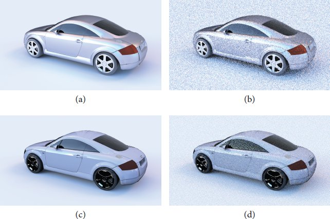
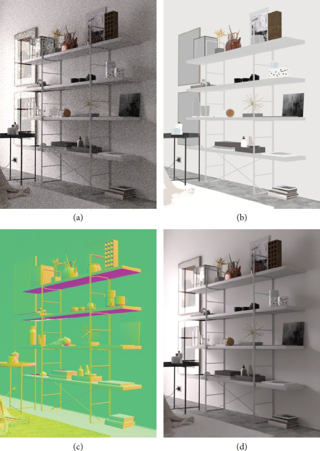

# Chapter 16: Retrospective and the Future

## Retrospective and the Future (wgpu)


In this concluding chapter, we begin with a review of how pbrt has changed over the years and discuss how improvements in computer hardware have affected its design and performance. We then outline some alternative architectures for rendering systems before we conclude with a brief retrospective of the system’s adoption and impact.

## 16.1 pbrt OVER THE YEARS

Over four editions of this book and the four versions of pbrt that have accompanied them, much has changed: while path tracing has been present since the start, it was not the default integration technique until the third edition. Furthermore, the first two editions devoted many pages to techniques like irradiance caching that reuse indirect lighting computation across nearby points in order to reduce rendering time. All of those techniques but for photon mapping are gone now, as sampling algorithms have improved and computers have become much faster, making path tracing and related approaches the most appropriate focus today.

There have been numerous improvements throughout the system over time—we have adopted more effective algorithms as they have been developed and as we ourselves have learned more about how to write a good renderer; notably, the techniques used for generating sampling patterns and for importance sampling BSDFs and light sources are substantially better now than they were at the start. Those improvements have brought added complexity: pbrt-v1, the first version of the system, was roughly 20,000 lines of code, excluding tabularized data and automatically generated source files for parsing. This version is just over 60,000 lines of code measured the same way, though some of the increase is due to the addition of a variety of new features, like subsurface scattering, volumetric light transport, the RealisticCamera, and the Curve and BilinearPatch shapes.

```text
    BilinearPatch 328
    Curve 346
    RealisticCamera 206
```

Through all the improvements to the underlying algorithms, the bones of the system have not changed very much—Integrators have always been at the core of solving the light transport equation, and many of the core interface types like Shapes, Lights, Cameras, Filters, and Samplers have all been there throughout with the same responsibilities, though there have been changes to their interfaces and operation along the way. Looking back at pbrt-v1 now, we can find plenty of snippets of code that are still present, unchanged since the start.



*Figure 16.1: Audi TT Car Model Lit by an Environment Map. (a) Reference image, rendered with pbrt-v1 with 64k samples per pixel. (b) Rendered with pbrt-v1 with 16 samples per pixel. (c) Reference image, rendered with pbrt-v4 with 64k samples per pixel. (d) Rendered with pbrt-v4 with 16 samples per pixel. (Some image differences due to changes in material models since pbrt-v1 are expected.) The reduction in noise from (b) to (d) is notable; all of it is due to improvements in sampling and Monte Carlo integration algorithms over pbrt’s lifetime. (Car model courtesy of Marko Dabrovic and Mihovil Odak.)*

To quantify the algorithmic improvements to pbrt, we resurrected pbrt-v1 and compared it to the version of pbrt described in this book, rendering the scene shown in Figure 16.1.1 The latest version of pbrt takes 1.47× longer than pbrt-v1 to render this scene using path tracing, but mean squared error (MSE) with respect to reference images is improved by over 4.42×. The net is a 3.05× improvement in Monte Carlo efficiency purely due to algorithmic improvements.

The changes in computers’ computational capabilities since pbrt-v1 have had even more of an impact on rendering performance. Much of the early development of pbrt in the late 1990s was on laptop computers that had a single-core 366 MHz Pentium II CPU. Some of the development of the latest version has been on a system that has 32 CPU cores, each one running at ten times the clock rate, 3.7 GHz.

```text
    CoatedDiffuseMaterial 909
```

A tenfold increase in processor clock speed does not tell the whole story about a CPU core’s performance: there have been many microarchitectural improvements over the years such as better branch predictors, more aggressive out-of-order execution, and multi-issue pipelines. Caches have

grown larger and compilers have improved as well. Data gathered by Rupp (2020) provides one measure of the aggregate improvement: from 1999 to late 2019, single-thread CPU performance as measured by the SPECInt benchmark (Standard Performance Evaluation Corporation 2006) has improved by over 40×. Though SPECInt and pbrt are not the same, we still estimate that, between improvements in single-thread performance and having 32× more cores available, the overall difference in performance between the two computers is well over a factor of 1,000.

The impact of a 1,000× speedup is immense. It means that what took an hour to render on that laptop we can now render in around three seconds. Conversely, a painfully slow hour-long rendering computation on the 32-core system today would take an intolerable 42 days on the laptop. Lest the reader feel sympathy for our having suffered with such slow hardware at the start, consider the IBM 4341 that Kajiya used for the first path-traced images: its floating-point performance was roughly 250× slower than that of our laptop’s CPU: around 0.2 MFLOPS for the 4341 (Dongarra 1984) versus around 50 for the Pentium II (Longbottom 2017). If we consider ray tracing on the GPU, where pbrt is generally 10–20× faster than on the 32-core CPU, we could estimate that we are now able to path trace images around 2,500,000× faster than Kajiya could—in other words, that pbrt on the GPU today can render in roughly ten seconds what his computer could do over the course of a year.

## 16.2 DESIGN ALTERNATIVES

pbrt represents a single point in the space of rendering system designs. The basic decisions we made early on—that ray tracing would be the geometric visibility algorithm used, that physical correctness would be a cornerstone of the system, that Monte Carlo would be the main approach used for numerical integration—all had pervasive implications for the system’s design.

There are many ways to write a renderer, and the best approach depends on many factors: is portability important, or can the system target a single type of computer system? Is interaction a requirement, or is the renderer a batch-mode system? Is time a constraint (e.g., a requirement to maintain a fixed frame rate), or must rendering continue until a particular quality level is reached? Must the system be able to render any scene no matter how complex, or can it impose limitations on the input?

Throughout the book, we have tried to always add an exercise at the end of the chapter when we have known that there was an important design alternative or where we made an implementation trade-off that would likely be made differently in a rendering system with different goals than pbrt. It is therefore worth reading the exercises even if you do not plan to do them. Going beyond the exercises, we will discuss a number of more radical design alternatives for path tracing–based rendering systems that are good to be aware of if you are designing a renderer yourself.

### 16.2.1 OUT-OF-CORE RENDERING

Given well-built acceleration structures, a strength of ray tracing is that the time spent on ray– primitive intersections grows slowly with added scene complexity. As such, the maximum complexity that a ray tracer can handle may be limited more by memory than by computation. Because rays may pass through many different regions of the scene over a short period of time, virtual memory often performs poorly when ray tracing complex scenes due to the resulting incoherent memory access patterns.

One way to increase the potential complexity that a renderer is capable of handling is to reduce the memory used to store the scene. For example, pbrt currently uses approximately 3.3 GB of memory to store the 24 million triangles and the BVHs in the landscape scene in Figure 7.2. This works out to an average of 148 bytes per triangle. We have previously written ray tracers that managed an average of 40 bytes per triangle for scenes like these, which represents a 3.7× reduction. Reducing memory overhead requires careful attention to memory use throughout the system. For example, in the aforementioned system, we had three different Triangle implementations, one using 8-bit uint8_ts to store vertex indices, one using 16-bit uint16_ts, and one using 32-bit uint32_ts. The smallest index size that was sufficient for the range of vertex indices in the mesh was chosen at run time. Deering’s paper on geometry compression (Deering 1995) and Ward’s packed color format (Ward 1992) are both good inspirations for thinking along these lines. See the “Further Reading” section in Chapter 7 for information about more memory-efficient representations of acceleration structures.

On-demand loading of geometry and textures can also reduce memory requirements if some parts of the scene are never needed when rendering from a particular viewpoint. An additional advantage of this approach is that rendering can often start more quickly than it would otherwise. Taking that a step further, one might cache textures (Peachey 1990) or geometry (Pharr and Hanrahan 1996), holding a fixed amount of it in memory and discarding that which has not been accessed recently when the cache is full. This approach is especially useful for scenes with much tessellated geometry, where a compact higher-level shape representation like a subdivision surface can explode into a large number of triangles: when available memory is low, some of this geometry can be discarded and regenerated later if needed. With the advent of economical flash memory storage offering gigabytes per second of read bandwidth, this approach is even more attractive.

The performance of such caches can be substantially improved by reordering the rays that are traced in order to improve their spatial and thus memory coherence (Pharr et al. 1997). An easier-to-implement and more effective approach to improving the cache’s behavior was described by Christensen et al. (2003), who wrote a ray tracer that uses simplified representations of the scene geometry in a geometry cache. More recently, Yoon et al. (2006), Budge et al. (2009), Moon et al. (2010), and Hanika et al. (2010) have developed improved approaches to this problem. See Rushmeier, Patterson, and Veerasamy (1993) for an early example of how to use simplified scene representations when computing indirect illumination.

Disney’s Hyperion renderer is an example of a renderer for feature films that maintains a large collection of active rays and then sorts them in order to improve the coherence of geometry and texture cache access. See the papers by Eisenacher et al. (2013) and Burley et al. (2018) for details of its implementation.

### 16.2.2 PRESHADED MICROPOLYGON GRIDS

Another form of complexity that is required for feature film production is in the form of surface shading; in contrast to pbrt’s fairly simple texture blending capabilities, production renderers typically provide procedural shading languages that make it possible to compute material parameters by combining multiple image maps and procedural patterns such as those generated by noise functions in user-provided shader programs. Evaluating these shaders can be a major component of rendering cost.

An innovative solution to this challenge has been implemented in Weta Digital’s Manuka renderer, which is described in a paper by Fascione et al. (2018). In a first rendering phase, Manuka tessellates all the scene geometry into grids of micropolygons, subpixel-sized triangles. (This approach is inspired by the Reyes rendering algorithm (Cook et al. 1987).) Procedural shaders are then evaluated at the polygon vertices and the resulting material parameters are stored.

```text
    Triangle 301
```

Path tracing then proceeds using these micropolygons. At each intersection point, no shader evaluation is necessary and the material parameters are interpolated from nearby vertices in order to instantiate a BSDF. Because micropolygons are subpixel sized, there is no visible error from not evaluating the surface shader at the actual intersection point.

If the total number of ray intersections to be shaded during rendering is larger than the number of micropolygons, this approach is generally beneficial. It offers additional benefits from exhibiting coherent texture image map accesses and from simultaneous evaluation of shaders at many vertices during the first phase, which makes the workload amenable to SIMD processing. Downsides of this approach include the issue that if a substantial amount of the scene’s geometry is occluded and never accessed during rendering, then the work to generate those micropolygon grids will have been wasted. It also causes startup time to increase due to the first phase of computation and thus a longer wait before initial pixel values can be displayed. Caching preshaded micropolygon grids can help.

A related approach is described by Munkberg et al. (2016), who cache shaded results in surface textures during rendering. These cached values can then be reused over multiple frames of an animation and used to accelerate rendering effects like depth of field.

### 16.2.3 PACKET TRACING

Early work on parallel tracing focused on multiprocessors (Cleary et al. 1983; Green and Paddon 1989; Badouel and Priol 1989) and clusters of computers (Parker et al. 1999; Wald et al. 2001a, 2001b, 2002, 2003).

More recently, as multi-core CPUs have become the norm and as CPUs have added computational capability through wider SIMD vector units, high-performance CPU ray-tracing research has focused on effectively using both multi-core and SIMD vector parallelism. Parallelizing ray tracing over multiple CPU cores in a single computer is not too difficult; the screen-space decomposition that pbrt uses is a common approach. Making good use of SIMD units is trickier; this is something that pbrt does not try to do in the interests of avoiding the corresponding code complexity.

SIMD widths of 8 to 16 32-bit floats are typical on current CPUs. Achieving the full potential performance of CPUs therefore requires using SIMD effectively. Achieving excellent utilization of SIMD vector units generally requires that the entire computation be expressed in a data parallel manner, where the same computation is performed on many data elements simultaneously. A natural way to extract data parallelism in a ray tracer is to have each processing core responsible for tracing n rays at a time, where n is at least the SIMD width. Each SIMD vector lane is then responsible for just a single ray, and each vector instruction performs a single scalar computation for each of the rays it is

responsible for. Thus, high SIMD utilization comes naturally, at least until some rays require different computations than others.

This approach, packet tracing, was first introduced by Wald et al. (2001a). It has since seen wide adoption. In a packet tracer, acceleration structure traversal algorithms are implemented so that they visit a node if any of the rays in the packet passes through it; primitives in the leaves are tested for intersection with all the rays in the packet, and so forth.

Reshetov et al. (2005) generalized packet tracing, showing that gathering up many rays from a single origin into a frustum and then using the frustum for acceleration structure traversal could lead to very high-performance ray tracing; they refined the frusta into subfrusta and eventually the individual rays as they reached lower levels of the tree. Reshetov (2007) later introduced a technique for efficiently intersecting a collection of rays against a collection of triangles in acceleration structure leaf nodes by generating a frustum around the rays and using it for first-pass culling. See Benthin and Wald (2009) for a technique to use ray frusta and packets for efficient shadow rays.

While packet tracing is effective for coherent collections of rays that mostly follow the same path through acceleration structures, it is much less effective for incoherent collections of rays, which are common with global illumination algorithms. To address this issue, Christensen et al. (2006), Ernst and Greiner (2008), Wald et al. (2008), and Dammertz et al. (2008) proposed only traversing a single ray through the acceleration structure at once but improving SIMD efficiency by simultaneously testing each ray against a number of bounding boxes at each step in the hierarchy. Fuetterling et al. extended such approaches to the 16-wide SIMD units that are available on some recent CPUs (Fuetterling et al. 2017).

Embree, described in a paper by Wald et al. (2014), is a high-performance open source rendering system that supports both packet tracing and highly efficient traversal of single rays on the CPU. See also the paper by Benthin et al. (2011) on the topic of finding a balance between these two approaches.

Another approach to the ray incoherence problem is to reorder small batches of incoherent rays to improve SIMD efficiency; representative work in this area includes papers by Mansson et al. (2007), Boulos et al. (2008), Gribble and Ramani (2008), and Tsakok (2009). More recently, Barringer and Akenine-Möller (2014) developed a SIMD ray-traversal algorithm that delivered substantial performance improvements given large numbers of rays.

Effectively applying SIMD to the rest of the rendering computation often requires sorting work to improve coherence; see for example Áfra et al.’s approach for sorting materials between pipeline stages to improve SIMD utilization (Áfra et al. 2016). Many of the same principles used for efficient GPU ray tracing discussed in the “Further Reading” section of Chapter 15 also apply.

These algorithms are often implemented with the SIMD vectorization made explicit: intersection functions are written to explicitly take some number of rays as a parameter rather than just a single ray, and so forth. In contrast, as we saw in Chapter 15, the parallelism in programs written for GPUs is generally implicit: code is written as if it operates on a single ray at a time, but the underlying hardware actually executes it in parallel.

It is possible to use the implicit model on CPUs as well. Parker et al.’s (2007) ray-tracing shading language is an example of compiling an implicitly data-parallel language to a SIMD instruction set on CPUs. See also Georgiev and Slusallek’s (2008) work, where generic programming techniques are used in C++ to implement a high-performance ray tracer with details like packets well hidden. ispc, described in a paper by Pharr and Mark (2012), provides a general-purpose “single program multiple data” (SPMD) language for CPU vector units that also provides this model. The MoonRay rendering system, which was developed at DreamWorks, uses ispc to target CPU SIMD units. The paper by Lee et al. (2017) describes its implementation and also discusses the important issue of maintaining data parallel computation when evaluating surface shaders.

If a rendering system can provide many rays for intersection tests at once, a variety of alternatives beyond packet tracing are possible. For example, Keller and Wächter (2011) and Mora (2011) described algorithms for intersecting a large number of rays against the scene geometry where there is no acceleration structure at all. Instead, primitives and rays are both recursively partitioned until small collections of rays and small collections of primitives remain, at which point intersection tests are performed. Improvements to this approach were described by Áfra (2012) and Nabata et al. (2013).

### 16.2.4 INTERACTIVE AND ANIMATION RENDERING

pbrt is very much a one-frame-at-a-time rendering system. Renderers that specifically target animation or allow the user to interact with the scene being rendered operate under a substantially different set of constraints, which leads to different designs.

Interactive rendering systems have the additional challenge that the scene to be rendered may not be known until shortly before it is time to render it, since the user is able to make changes to it. Fast algorithms for building or refitting acceleration structures are critical, and it may be necessary to limit the number of rays traced in order to reach a desired frame rate. The task, then, is to make the best image possible using a fixed number of rays, which requires the ability to allocate rays from a budget. As current hardware is generally not able to trace enough rays to generate noise-free path-traced images at real-time rates, such systems generally have denoising algorithms deeply integrated into their display pipeline as well.

A system that renders a sequence of images for an animation has the opportunity to reuse information temporally across frames, ranging from pixel values themselves to data structures that represent the distribution of light in the scene. An early application of this idea was described by Ghosh et al. (2006), who applied it to rendering glossy surfaces lit by environment light sources. Scherzer et al. (2011) provided a comprehensive survey of work in this area until 2011.

More recent examples of techniques that apply temporal reuse include the SVGF denoising algorithm (Schied et al. 2017, 2018), which reuses reprojected pixel colors across frames when appropriate, and the ReSTIR direct lighting technique (Bitterli et al. 2020), which reuses light samples across nearby pixels and frames of an animation to substantially improve the quality of direct lighting in scenes with many light sources. Other recent work in this area includes Dittebrandt et al.’s temporal sample reuse approach (2020), Hasselgren et al.’s temporal adaptive sampling and denoising algorithm (2020), and the extension of ReSTIR to path-traced indirect illumination by Ouyang et al. (2021).

### 16.2.5 SPECIALIZED COMPILATION

OptiX, which was described by Parker et al. (2010), has an interesting system structure: it is a combination of built-in functionality (e.g., for building acceleration structures and traversing rays through them) that can be extended by user-supplied code (e.g., for shape intersections and surface shading). Many renderers over the years have allowed user extensibility of this sort, usually through some kind of plug-in architecture. OptiX is distinctive in that it is built using a runtime compilation system that brings all of this code together before optimizing it.

Because the compiler has a view of the entire system when generating the final code, the resulting custom renderer can be automatically specialized in a variety of ways. For example, if the surface-shading code never uses the (u, v) texture coordinates, the code that computes them in the triangle shape intersection test can be optimized out as dead code. Or, if the ray’s time field is never accessed, then both the code that sets it and even the structure member itself can be eliminated. This approach allows a degree of specialization (and resulting performance) that would be difficult to achieve manually, at least for more than a single system variant.

An even more aggressive specialization approach is implemented in the Rodent system, which is described in a paper by Pérard-Gayot et al. (2019), who also cover previous work in specialization for graphics computations. Rodent specializes the entire renderer based on the provided scene description, eliminating unnecessary logic in order to improve performance.

## 16.3 EMERGING TOPICS

Rendering research continues to be a vibrant field, as should be evident by the length of the “Further Reading” sections at the conclusions of the previous chapters. In addition to the topics discussed earlier, there are two important emerging areas of rendering research that we have not covered in this book—inverse and differentiable rendering and the use of machine learning techniques in image synthesis. Work in these areas is progressing rapidly, and so we believe that it would be premature to include implementations of associated techniques in pbrt and to discuss them in the book text; whichever algorithms we chose would likely be obsolete in a year or two. However, given the amount of activity in these areas, we will briefly summarize the landscape of each.

### 16.3.1 INVERSE AND DIFFERENTIABLE RENDERING

This book has so far focused on forward rendering, in which rendering algorithms convert an input scene description (“x”) into a synthetic image (“y”) taken in the corresponding virtual world. Assuming that the underlying computation is consistent across runs, we can think of the entire process as the evaluation of an intricate function f : X → Y satisfying f (x) = y. The main appeal of physically based forward-rendering methods is that they account for global light transport effects, which improves the visual realism of the output y.

However, many applications instead require an inverse f−1(y) = x to infer a scene description x that is consistent with a given image y, which may be a real-world photograph. Examples of disciplines where such inverses are needed include autonomous driving, robotics, biomedical imaging, microscopy, architectural design, and many others.

Evaluating f−1 is a surprisingly difficult and ambiguous problem: for example, a bright spot on a surface could be alternatively explained by texture or shape variation, illumination from a light source, focused reflection from another object, or simply shadowing at all other locations. Resolving this ambiguity requires multiple observations of the scene and reconstruction techniques that account for the interconnected nature of light transport and scattering. In other words, physically based methods are not just desirable—they are a prerequisite.

Directly inverting f is possible in some cases, though doing so tends to involve drastic simplifying assumptions: consider measurements taken by an X-ray CT scanner, which require further processing to reveal a specimen’s interior structure. (X-rays are electromagnetic radiation just like visible light that are simply characterized by much shorter wavelengths in the 0.1–10nm range.) Standard methods for this reconstruction assume a purely absorbing medium, in which case a 3D density can be found using a single pass over all data. However, this approximate inversion leads to artifacts when dense bone or metal fragments reflect some of the X-rays.

The function f that is computed by a physically based renderer like pbrt is beyond the reach of such an explicit inversion. Furthermore, a scene that perfectly reproduces images seen from a given set of viewpoints may not exist at all. Inverse rendering methods therefore pursue a relaxed minimization problem of the form

where g : Y → ℝ refers to a loss function that quantifies the quality of a rendered image of the scene x. For example, the definition g(y′) = ‖y′ − y‖ could be used to measure the L2 distance to a reference image y. This type of optimization is often called analysis-by-synthesis due to the reliance on repeated simulation (synthesis) to gain understanding about an inverse problem. The approach easily generalizes to simultaneous optimization of multiple viewpoints. An extra regularization term R(x) depending only on the scene parameters is often added on the right hand side to encode prior knowledge about reasonable parameter ranges. Composition with further computation is also possible: for example, we could alternatively optimize g(f (N(w))), where x = N(w) is a neural network that produces the scene x from learned parameters w.

Irrespective of such extensions, the nonlinear optimization problem in Equation (16.1) remains too challenging to solve in one step and must be handled using iterative methods. The usual caveats about their use apply here: iterative methods require a starting guess and may not converge to the optimal solution. This means that selecting an initial configuration and incorporating prior information (valid parameter ranges, expected smoothness of the solution, etc.) are both important steps in any inverse rendering task. The choice of loss g : Y → ℝ and parameterization of the scene can also have a striking impact on the convexity of the optimization task (for example, direct optimization of triangle meshes tends to be particularly fragile, while implicit surface representations are better behaved).

Realistic scene descriptions are composed of millions of floating-point values that together specify the shapes, BSDFs, textures, volumes, light sources, and cameras. Each value contributes a degree of freedom to an extremely high-dimensional optimization domain (for example, a quadrilateral with a 768 × 768 RGB image map texture adds roughly 1.7 million dimensions to X). Systematic exploration of a space with that many dimensions is not possible, making gradient-based optimization the

method of choice for this problem. The gradient is invaluable here because it provides a direction of steepest descent that can guide the optimization toward higher-quality regions of the scene parameter space.

Let us consider the most basic gradient descent update equation for this problem:

where α denotes the step size. A single iteration of this optimization can be split into four individually simpler steps via the chain rule:

where Jf ∈ ℝm×n and Jg ∈ ℝ1×m are the Jacobian matrices of the rendering algorithm and loss function, and n and m respectively denote the number of scene parameters and rendered pixels. These four steps correspond to:

```rust
           1. Rendering an image of the scene x.
           2. Differentiating the loss function to obtain an image-space gradient vector δy. (A positive
              component in this vector indicates that increasing the value of the associated pixel in the
              rendered image would reduce the loss; the equivalent applies for a negative component.)
           3. Converting the image-space gradient δy into a parameter-space gradient δx.
           4. Taking a gradient step.
```

In practice, more sophisticated descent variants than the one in Equation (16.3) are often used for step 4—for example, to introduce per-variable momentum and track the variance of gradients, as is done in the commonly used Adam (Kingma and Ba 2014) optimizer. Imposing a metric on the optimization domain to pre-condition gradient steps can substantially accelerate convergence, as demonstrated by Nicolet et al. (2021) in the case of differentiable mesh optimization.

The third step evaluates the vector-matrix product δy · Jf, which is the main challenge in this sequence. At size m × n, the Jacobian Jf of the rendering algorithm is far too large to store or even compute, as both n and m could be in the range of multiple millions of elements. Methods in the emerging field of differentiable rendering therefore directly evaluate this product without ever constructing the matrix Jf. The remainder of this subsection reviews the history and principles of these methods.

For completeness, we note that a great variety of techniques have used derivatives to improve or accelerate the process of physically based rendering; these are discussed in “Further Reading” sections

throughout the book. In the following, we exclusively focus on parametric derivatives for inverse problems.

Inverse problems are of central importance in computer vision, and so it should be of no surprise that the origins of differentiable rendering as well as many recent advances can be found there: following pioneering work on OpenDR by Loper and Black (2014), a number of approximate differentiable rendering techniques have been proposed and applied to challenging inversion tasks. For example, Rhodin et al. (2015) reconstructed the pose of humans by optimizing a translucent medium composed of Gaussian functions. Kato et al. (2018) and Liu et al. (2019a) proposed different ways of introducing smoothness into the traditional rasterization pipeline. Laine et al. (2020) recently proposed a highly efficient modular GPU-accelerated rasterizer based on deferred shading followed by a differentiable antialiasing step. While rasterization-based methods can differentiate the rendering of directly lit objects, they cannot easily account for effects that couple multiple scene objects like shadows or inter-reflection.

Early work that used physically based differentiable rendering focused on the optimization of a small number of parameters, where there is considerable flexibility in how the differentiation is carried out. For example, Gkioulekas et al. (2013b) used stochastic gradient descent to reconstruct homogeneous media represented by a low-dimensional parameterization. Khungurn et al. (2015) differentiated a transport simulation to fit fabric parameters to the appearance in a reference photograph. Hašan and Ramamoorthi (2013) used volumetric derivatives to enable near-instant edits of path-traced heterogeneous media. Gkioulekas et al. (2016) studied the challenges of differentiating local properties of heterogeneous media, and Zhao et al. (2016) performed local gradient-based optimization to drastically reduce the size of heterogeneous volumes while preserving their appearance.

Besides the restriction to volumetric representations, a shared limitation of these methods is that they cannot efficiently differentiate a simulation with respect to the full set of scene parameters, particularly when n and m are large (in other words, they are not practical choices for the third step of the previous procedure). Subsequent work has adopted reverse-mode differentiation, which can simultaneously propagate derivatives to an essentially arbitrarily large number of parameters. (The same approach also powers training of neural networks, where it is known as backpropagation.)

Of particular note is the groundbreaking work by Li et al. (2018) along with their redner reference implementation, which performs reverse-mode derivative propagation using a hand-crafted implementation of the necessary derivatives. In the paper, the authors make the important observation that 3D scenes are generally riddled with visibility-induced discontinuities at object silhouettes, where the radiance function undergoes sudden changes. These are normally no problem in a Monte Carlo renderer, but they cause a severe problem following differentiation. To see why, consider a hypothetical integral that computes the average incident illumination at some position p. When computing the derivative of such a calculation, it is normally fine to exchange the order of differentiation and integration:

The left hand side is the desired answer, while the right hand side represents the result of differentiating the simulation code. Unfortunately, the equality generally no longer holds when Li(p, ω) is discontinuous in the ω argument being integrated. Li et al. recognized that an extra correction term must be added to account for how perturbations of the scene parameters x cause the discontinuities to shift. They resolved primary visibility by integrating out discontinuities via the pixel reconstruction filter and used a hierarchical data structure to place additional edge samples on silhouettes to correct for secondary visibility.

Building on the Reynolds transport theorem, Zhang et al. (2019) generalized this approach into a more general theory of differential transport that also accounts for participating media. (In that framework, the correction by Li et al. (2018) can also be understood as an application of the Reynolds transport theorem to a simpler 2D integral.) Zhang et al. also studied further sources of problematic discontinuities such as open boundaries and shading discontinuities and showed how they can also be differentiated without bias.

Gkioulekas et al. (2016) and Azinović et al. (2019) observed that the gradients produced by a differentiable renderer are generally biased unless extra care is taken to decorrelate the forward and differential computation (i.e., steps 1 and 3)—for example, by using different random seeds.

Manual differentiation of simulation code can be a significant development and maintenance burden. This problem can be addressed using tools for automatic differentiation (AD), in which case derivatives are obtained by mechanically transforming each step of the forward simulation code. See the excellent book by Griewank and Walther (2008) for a review of AD techniques. A curious aspect of differentiation is that the computation becomes unusually dynamic and problem-dependent: for example, derivative propagation may only involve a small subset of the program variables, which may not be known until the user launches the actual optimization.

Mirroring similar developments in the machine learning world, recent work on differentiable rendering has therefore involved combinations of AD with just-in-time (JIT) compilation to embrace the dynamic nature of this problem and take advantage of optimization opportunities. There are several noteworthy differences between typical machine learning and rendering workloads: the former tend to be composed of a relatively small number of arithmetically intense operations like matrix multiplications and convolutions, while the latter use vast numbers of simple arithmetic operations. Besides this difference, ray-tracing operations and polymorphism are ubiquitous in rendering code; polymorphism refers to the property that function calls (e.g., texture evaluation or BSDF sampling) can indirectly branch to many different parts of a large codebase. These differences have led to tailored AD/JIT frameworks for differentiable rendering.

The Mitsuba 2 system described by Nimier-David et al. (2019) traces the flow of computation in rendering algorithms while applying forward- or reverse-mode AD; the resulting code is then JIT-compiled into wavefront-style GPU kernels. Later work on the underlying Enoki just-in-time compiler added more flexibility: in addition to wavefront-style execution, the system can also generate megakernels with reduced memory usage. Polymorphism-aware optimization passes simplify the resulting kernels, which are finally compiled into vectorized machine code that runs on the CPU or GPU.

A fundamental issue of any method based on reverse-mode differentiation (whether using AD or hand-written derivatives) is that the backpropagation step requires access to certain intermediate

values computed by the forward simulation. The sequence of accesses to these values occurs in reverse order compared to the original program execution, which is inconvenient because they must either be stored or recomputed many times. The intermediate state needed to differentiate a realistic simulation can easily exhaust the available system memory, limiting performance and scalability.

Nimier-David et al. (2020) and Stam (2020) observed that differentiating a light transport simulation can be interpreted as a simulation in its own right, where a differential form of radiance propagates through the scene. This derivative radiation is “emitted” from the camera, reflected by scene objects, and eventually “received” by scene objects with differentiable parameters. This idea, termed radiative backpropagation, can drastically improve the scalability limitation mentioned above (the authors report speedups of up to 1000× compared to naive AD). Following this idea, costly recording of program state followed by reverse-mode differentiation can be replaced by a Monte Carlo simulation of the “derivative radiation.” The runtime complexity of the original radiative backpropagation method is quadratic in the length of the simulated light paths, which can be prohibitive in highly scattering media. Vicini et al. (2021) addressed this flaw and enabled backpropagation in linear time by exploiting two different flavors of reversibility: the physical reciprocity of light and the mathematical invertibility of deterministic computations in the rendering code.

We previously mentioned how visibility-related discontinuities can bias computed gradients unless precautions are taken. A drawback of the original silhouette edge sampling approach by Li et al. (2018) was relatively poor scaling with geometric complexity. Zhang et al. (2020) extended differentiable rendering to Veach’s path space formulation, which brings unique benefits in such challenging situations: analogous to how path space forward-rendering methods open the door to powerful sampling techniques, differential path space methods similarly enable access to previously infeasible ways of generating silhouette edges. For example, instead of laboriously searching for silhouette edges that are visible from a specific scene location, we can start with any triangle edge in the scene and simply trace a ray to find suitable scene locations. Zhang et al. (2021b) later extended this approach to a larger path space including volumetric scattering interactions.

Loubet et al. (2019) made the observation that discontinuous integrals themselves are benign: it is the fact that they move with respect to scene parameter perturbations that causes problems under differentiation. They therefore proposed a reparameterization of all spherical integrals that has the curious property that it moves along with each discontinuity. The integrals are then static in the new coordinates, which makes differentiation under the integral sign legal.

Bangaru et al. (2020) differentiated the rendering equation and applied the divergence theorem to convert a troublesome boundary integral into a more convenient interior integral, which they subsequently showed to be equivalent to a reparameterization. They furthermore identified a flaw in Loubet et al.’s method that causes bias in computed gradients and proposed a construction that finally enables unbiased differentiation of discontinuous integrals.

Differentiating under the integral sign changes the integrand, which means that sampling strategies that were carefully designed for a particular forward computation may no longer be appropriate for its derivative. Zeltner et al. (2021) investigated the surprisingly large space of differential rendering algorithms that results from differentiating standard constructions like importance sampling and MIS in different ways (for example, differentiation followed by importance sampling is not the same as importance sampling followed by differentiation). They also proposed a new sampling strategy specifically designed for the differential transport simulation. In contrast to ordinary rendering

integrals, their differentiated counterparts also contain both positive and negative-valued regions, which means that standard sampling approaches like the inversion method are no longer optimal from the viewpoint of minimizing variance. Zhang et al. (2021a) applied antithetic sampling to reduce gradient variance involving challenging cases that arise when optimizing the geometry of objects in scenes with glossy interreflection.

While differentiable rendering still remains challenging, fragile, and computationally expensive, steady advances continue to improve its practicality over time, leading to new applications made possible by this capability.

### 16.3.2 MACHINE LEARNING AND RENDERING

As noted by Hertzmann (2003) in a prescient early paper, machine learning offers effective approaches to many important problems in computer graphics, including regression and clustering. Yet until recently, application of ideas from that field was limited. However, just as in other areas of computer science, machine learning and deep neural networks have recently become an important component of many techniques at the frontiers of rendering research.

This work can be (roughly) organized into three broad categories that are progressively farther afield from the topics discussed in this book:

```rust
           1. Application of learned data structures, typically based on neural networks, to replace
              traditional data structures in traditional rendering algorithms.
           2. Using machine learning–based algorithms (often deep convolutional neural networks)
              to improve images generated by traditional rendering algorithms.
           3. Directly synthesizing photorealistic images using deep neural networks.
```

Early work in the first category includes Nowrouzezahrai et al. (2009), who used neural networks to encode spherical harmonic coefficients that represented the reflectance of dynamic objects; Dachsbacher (2011), who used neural networks to represent inter-object visibility; and Ren et al. (2013), who encoded scenes’ radiance distributions using neural networks.

Previous chapters’ “Further Reading” sections have discussed many techniques based on learned data structures, including approaches that use neural networks to represent complex materials (Rainer et al. 2019, 2020; Kuznetsov et al. 2021), complex light sources (Zhu et al. 2021), and the scene’s radiance distribution to improve sampling (Müller et al. 2019, 2020, 2021). Many other techniques based on caching and interpolating radiance in the scene can be viewed through the lens of learned data structures, spanning Vorba et al.’s (2014) use of Gaussian mixture models even to techniques like irradiance caching (Ward et al. 1988).

One challenge in using learned data structures with traditional rendering algorithms is that the ability to just evaluate a learned function is often not sufficient, since effective Monte Carlo integration generally requires the ability to draw samples from a matching distribution and to quantify their density. Another challenge is that online learning is often necessary, where the learned data structure is constructed while rendering proceeds rather than being initialized ahead of time. For interactive rendering of dynamic scenes, incrementally updating learned representations can be especially beneficial.

More broadly, it may be desirable to represent an entire scene with a neural representation; there is no requirement that the abstractions of meshes, BRDFs, textures, lights, and media be separately and explicitly encoded. Furthermore, learning the parameters to such representations in inverse rendering applications can be challenging due to the ambiguities noted earlier. At writing, neural radiance fields (NeRF) (Mildenhall et al. 2020) are seeing widespread adoption as a learned scene representation due to the effectiveness and efficiency of the approach. NeRF is a volumetric representation that gives radiance and opacity at a given point and viewing direction. Because it is based on volume rendering, it has the additional advantage that it avoids the challenges of discontinuities in the light transport integral discussed in the previous section.

In rendering, work in the second category—using machine learning to improve conventionally rendered images—began with neural denoising algorithms, which are discussed in the “Further Reading” section at the end of Chapter 5. These algorithms can be remarkably effective; as with many areas of computer vision, deep convolutional neural networks have rapidly become much more effective at this problem than previous non-learned techniques.

*Figure 16.2 shows an example of the result of using such a denoiser. Given a noisy image rendered with 32 samples per pixel as well as two auxiliary images that encode the surface albedo and surface normal, the denoiser is able to produce a noise-free image in a few tens of milliseconds. Given such results, the alternative of paying the computational cost of rendering a clean image by taking thousands of pixel samples is unappealing; doing so would take much longer, especially given that Monte Carlo error only decreases at a rate O(n−1/2) in the number of samples n. Furthermore, neural denoisers are usually effective at eliminating the noise from spiky high-variance pixels, which otherwise would require enormous numbers of samples to achieve acceptable error.*

Most physically based renderers today are therefore used with denoisers. This leads to an important question: what is the role of the renderer, if its output is to be consumed by a neural network? Given a denoiser, the renderer’s task is no longer to try to make the most accurate or visually pleasing image for a human observer, but is to generate output that is most easily converted by the neural network to the desired final representation. This question has deep implications for the design of both renderers and denoisers and is likely to see much attention in coming years. (For an example of recent work in this area, see the paper by Cho et al. (2021), who improved denoising by incorporating information directly from the paths traced by the renderer and not just from image pixels.)

The question of the renderer’s role is further provoked by neural post-rendering approaches that do much more than denoise images; a recent example is GANcraft, which converts low-fidelity blocky images of Minecraft scenes to be near-photorealistic (Hao et al. 2021). A space of techniques lies in between this extreme and less intrusive post-processing approaches like denoising: deep shading (Nalbach et al. 2017) synthesizes expensive effects starting from a cheaply computed set of G-buffers (normals, albedo, etc.). Granskog et al. (2020) improved shading inference using additional view-independent context extracted from a set of high-quality reference images. More generally, neural style transfer algorithms (Gatys et al. 2016) can be an effective way to achieve a desired visual style without fully simulating it in a renderer. Providing nuanced artistic control to such approaches remains an open problem, however.

In the third category, a number of researchers have investigated training deep neural networks to encode a full rendering algorithm that goes from a scene description to an image. See Hermosilla et al. (2019) and Chen et al. (2021) for recent work in this area. Images may also be synthesized without

using conventional rendering algorithms at all, but solely from characteristics learned from real-world images. A recent example of such a generative model is StyleGAN, which was developed by Karras et al. (2018, 2020); it is capable of generating high-resolution and photorealistic images of a variety of objects, including human faces, cats, cars, and interior scenes. Techniques based on segmentation maps (Chen and Koltun 2017; Park et al. 2019) allow a user to denote that regions of an image should be of general categories like “sky,” “water,” “mountain,” or “car” and then synthesize a realistic image that follows those categories. See the report by Tewari et al. (2020) for a comprehensive summary of recent work in such areas.



*Figure 16.2: Effectiveness of Modern Neural Denoising Algorithms for Rendering. (a) Noisy image rendered with 32 samples per pixel. (b) Feature buffer with the average surface albedo at each pixel. (c) Feature buffer with the surface normal at each pixel. (d) Denoised image. (Image denoised with the NVIDIA OptiX 7.3 denoiser.)*

## 16.4 THE FUTURE

Even after the massive increase in computational capability over the past two decades and many algorithmic improvements, rendering still remains far from a solved problem. Greater capabilities of renderers have translated into more complex scenes and more accurate simulation of light transport and scattering rather than rendering the same old thing, just faster. We believe that innovation in sampling and rendering algorithms will become increasingly important in the coming years, especially as further performance benefits from computer hardware improvements become increasingly hard-won as Moore’s law slows.

The recent addition of specialized ray-tracing hardware to GPUs has opened a new chapter for path tracing, broadening the set of developers who are able to consider using the technique. Innovation generally progresses at a rate related to the number of people working in an area and so we very much look forward to the new ideas that the real-time graphics community will bring to path tracing in the coming years.

## 16.5 CONCLUSION

The idea for pbrt was born in October 1999. Over the next five years, it evolved from a system designed only to support the students taking Stanford’s CS348b course to a robust, feature-rich, extensible rendering system. Since its inception, we have learned a great deal about what it takes to build a rendering system that does not just make pretty pictures but is one that other people enjoy using and modifying as well. What has been most difficult, however, is designing a large piece of software that others might enjoy reading. This has been a far more challenging (and rewarding) task than implementing any of the rendering algorithms themselves.

After its first publication, the book enjoyed widespread adoption in advanced graphics courses worldwide, which we found very gratifying. We were unprepared, however, for the impact that pbrt has had on rendering research. Writing a ray tracer from scratch is a formidable task (as so many students in undergraduate graphics courses can attest), and creating a robust physically based renderer is much harder still. We are proud that pbrt has lowered the barrier to entry for aspiring researchers in rendering, making it easier for researchers to experiment with and demonstrate the value of new ideas in rendering. We continue to be delighted to see papers in SIGGRAPH, the Eurographics Rendering Symposium, High Performance Graphics, and other graphics research venues that either build on pbrt to achieve their goals, or compare their images to pbrt as “ground truth.”

More recently, we have been delighted again to see the rapid adoption of path tracing and physically based approaches in practice for offline rendering and, recently as of this writing, games and interactive applications. Though we are admittedly unusual folk, it is a particular delight to see incredible graphics on a screen and marvel at the billions of pseudo-random (or quasi-random) samples taken, billions of rays traced, and the complex mathematics that went into each image passing by.

We would like to sincerely thank everyone who has built upon this work for their own research, to build a new curriculum, to create amazing movies or games, or just to learn more about rendering. We hope that this new edition continues to serve the graphics community in the same way that its predecessors have. _________________

1 This is an inexact comparison for many reasons. Among them: pbrt is now a spectral renderer, while before it used RGB for lighting calculations; materials like CoatedDiffuseMaterial now require stochastic evaluation; its sampling algorithms are much better, but more computationally intensive; and improvements to the geometric robustness of ray intersection computations have imposed some performance cost (Section 6.8.8). Nevertheless, we believe that the results are directionally valid.

## A SAMPLING ALGORITHMS

Chapter 2 provided an introduction to the principles of sampling and Monte Carlo integration that are most widely used in pbrt. However, a number of additional sampling techniques—the alias method, reservoir sampling, and rejection sampling—that are used only occasionally were not described there. This appendix introduces each of those techniques and then concludes with two sections that further apply the inversion method to derive sampling techniques for a variety of useful distributions.

A.1 THE ALIAS METHOD If many samples need to be generated from a discrete distribution, using the approach implemented in the SampleDiscrete() function would be wasteful: each generated sample would require O(n) computation. That approach could be improved to O(log n) time by computing a cumulative distribution function (CDF) table once and then using binary search to generate each sample, but there is another option that is even more efficient, requiring just O(1) time for each sample; that approach is the alias method.1

To understand how the alias method works, first consider the task of sampling from n discrete outcomes, each with equal probability. In that case, computing the value ⌊nξ⌋ gives a uniformly distributed index between 0 and n − 1 and the corresponding outcome can be selected—no further work is necessary. The alias method allows a similar searchless sampling method if the outcomes have arbitrary probabilities pi.

The alias method is based on creating n bins, one for each outcome. Bins are sampled uniformly and then two values stored in each bin are used to generate the final sample: if the ith bin was sampled, then qi gives the probability of sampling the ith outcome, and otherwise the alias is chosen; it is the index of a single alternative outcome. Though we will not include the proof here, it can be shown that this representation—the ith bin associated with the ith outcome and no more than a single alias per bin—is sufficient to represent arbitrary discrete probability distributions.

```rust
    SampleDiscrete() 70
```

*Table A.1: A Simple Alias Table. This alias table makes it possible to generate samples from the distribution of discrete probabilities {1/2, 1/4, 1/8, 1/8}. To generate a sample, an entry is first chosen with uniform probability. Given an entry i, its corresponding sample is chosen with probability qi and the sample corresponding to its alias index is chosen with probability 1 − qi.*

```text
         Index                                   qi                                           Alias Index
         1                                       1                                            n/a
         2                                       0.5                                          1
         3                                       0.5                                          1
         4                                       0.5                                          2
```

*Figure A.1: Graphical Representation of the Alias Table in Table A.1. One bin is allocated for each outcome and is filled by the outcome’s probability, up to 1/n. Excess probability is allocated to other bins that have probabilities less than 1/n and thus extra space.*

With the alias method, if the probabilities are all the same, then each bin’s probability qi is one, and it reduces to the earlier example with uniform probabilities. Otherwise, for outcomes i where the associated probability pi is greater than the average probability, the outcome i will be stored as the alias in one or more of the other bins. For outcomes i where the associated pi is less than the average probability, qi will be less than one and the alias will point to one of the higher-probability outcomes.

For a specific example, consider the probabilities pi = {1/2, 1/4, 1/8, 1/8}. A corresponding alias table is shown in Table A.1. It is possible to see that, for example, the first sample is chosen with probability 1/2: there is a 1/4 probability of choosing the first table entry, in which case the first sample is always chosen. Otherwise, there is a 1/4 probability of choosing the second and third table entries, and for each, there is a 1/2 chance of choosing the alias, giving in sum an additional 1/4 probability of choosing the first sample. The other probabilities can be verified similarly.

One way to interpret an alias table is that each bin represents 1/n of the total probability mass function. If outcomes are first allocated to their corresponding bins, then the probability mass of outcomes that are greater than 1/n must be distributed to other bins that have associated probabilities less than 1/n. This idea is illustrated in Figure A.1, which corresponds to the example of Table A.1.

The AliasTable class implements algorithms for generating and sampling from alias tables. As with the other sampling code, its implementation is found in util/sampling.rs and util/sampling.rs.

〈AliasTable Definition〉 ≡ class AliasTable { public: 〈AliasTable Public Methods 997〉 private:

```rust
         〈AliasTable Private Members 995〉
   };
```

Its constructor takes an array of weights, not necessarily normalized, that give the relative probabilities for the possible outcomes.

〈AliasTable Method Definitions〉 ≡ AliasTable::AliasTable(pstd::span<const Float> weights, Allocator alloc) : bins(weights.size(), alloc) { 〈Normalize weights to compute alias table PDF 995〉 〈Create alias table work lists 995〉 〈Process under and over work item together 996〉 〈Handle remaining alias table work items〉 }

The Bin structure represents an alias table bin. It stores the probability q, the corresponding outcome’s probability p, and an alias.

〈AliasTable Private Members〉 ≡ 994

```rust
   struct Bin {
        Float q, p;
        int alias;
   };
   pstd::vector<Bin> bins;
```

We have found that with large numbers of outcomes, especially when the magnitudes of their weights vary significantly, it is important to use double precision to compute their sum so that the alias table initialization algorithm works correctly. Therefore, here std::accumulate takes the double-precision value 0. as its initial value, which in turn causes all its computation to be in double precision. Given the sum of weights, the normalized probabilities can be computed.

〈Normalize weights to compute alias table PDF〉 ≡ 995

```rust
   Float sum = std::accumulate(weights.begin(), weights.end(),
   0.);
   for (size_t i = 0; i < weights.size(); ++i)
        bins[i].p = weights[i] / sum;
```

The first stage of the alias table initialization algorithm is to split the outcomes into those that have probability less than the average and those that have probability higher than the average. Two std::vectors of the Outcome structure are used for this.

〈Create alias table work lists〉 ≡ 995

```rust
   struct Outcome {
```

```rust
         Float pHat;
         size_t index;
    };
    std::vector<Outcome> under, over;
    for (size_t i = 0; i < bins.size(); ++i) {
        〈Add outcome i to an alias table work list 996〉
    }
```

```text
    AliasTable 994
    AliasTable::Bin::p 995
    AliasTable::bins 995
    Allocator 40
    Float 23
```

Here and in the remainder of the initialization phase, we will scale the individual probabilities by the number of bins n, working in terms of . Thus, the average value is 1, which will be convenient in the following.

〈Add outcome i to an alias table work list〉 ≡ 995

```rust
   Float pHat = bins[i].p * bins.size();
   if (pHat < 1)
        under.push_back(Outcome{pHat, i});
```

```rust
    else
           over.push_back(Outcome{pHat, i});
```

To initialize the alias table, one outcome is taken from under and one is taken from over. Together, they make it possible to initialize the element of bins that corresponds to the outcome from under. After that bin has been initialized, the outcome from over will still have some excess probability that is not yet reflected in bins. It is added to the appropriate work list and the loop executes again until under and over are empty. This algorithm runs in O(n) time.

It is not immediately obvious that this approach will successfully initialize the alias table, or that it will necessarily terminate. We will not rigorously show that here, but informally, we can see that at the start, there must be at least one item in each work list unless they all have the same probability (in which case, initialization is trivial). Then, each time through the loop, we initialize one bin, which consumes worth of probability mass. With one less bin to initialize and that much less probability to distribute, we have the same average probability over the remaining bins. That brings us to the same setting as the starting condition: some of the remaining items in the list must be above the average and some must be below, unless they are all equal to it.

〈Process under and over work item together〉 ≡ 995

while (!under.empty() && !over.empty()) { 〈Remove items un and ov from the alias table work lists 996〉 〈Initialize probability and alias for un 996〉 〈Push excess probability on to work list 996〉 } 〈Remove items un and ov from the alias table work lists〉 ≡ 996

```rust
   Outcome un = under.back(), ov = over.back();
   under.pop_back();
   over.pop_back();
```

The probability of un must be less than one. We can initialize its bin’s q with , as that is equal to the probability it should be sampled if its bin is chosen. In order to allocate the remainder of the bin’s probability mass, the alias is set to ov. Because , it certainly has enough probability to fill the remainder of the bin—we just need of it.

〈Initialize probability and alias for un〉 ≡ 996

```rust
   bins[un.index].q = un.pHat;
   bins[un.index].alias = ov.index;
```

In initializing bins[un.index], we have consumed worth of the scaled probability mass. The remainder, un.pHat + ov.pHat - 1, is the as-yet unallocated probability for ov.index; it is added to the appropriate work list based on how much is left.

〈Push excess probability on to work list〉 ≡ 996

```rust
   Float pExcess = un.pHat + ov.pHat - 1;
   if (pExcess < 1)
        under.push_back(Outcome{pExcess, ov.index});
```

```rust
    else
           over.push_back(Outcome{pExcess, ov.index});
```

```text
    AliasTable::Bin::alias 995
    AliasTable::Bin::p 995
    AliasTable::Bin::q 995
    AliasTable::bins 995
    Float 23
```

Due to floating-point round-off error, there may be work items remaining on either of the two work lists with the other one empty. These items have probabilities slightly less than or slightly greater than one and should be given probability q = 1 in the alias table. The fragment that handles this, 〈Handle remaining alias table work items〉, is not included in the book.

Given an initialized alias table, sampling is easy. As described before, an entry is chosen with uniform probability and then either the corresponding sample or its alias is returned. As with the SampleDiscrete() function, a new uniform random sample derived from the original one is optionally returned.

〈AliasTable Method Definitions〉 +≡ int AliasTable::Sample(Float u, Float *pmf, Float *uRemapped) const { 〈Compute alias table offset and remapped random sample up 997〉 if (up < bins[offset].q) { 〈Return sample for alias table at offset 997〉 } else { 〈Return sample for alias table at alias[offset] 997〉 } }

The index for the chosen entry is found by multiplying the random sample by the number of entries. Because u was only used for the discrete sampling decision of selecting an initial entry, it is possible to derive a new uniform random sample from it. That computation is done here to get an independent uniform sample up that is used to decide whether to sample the alias at the current entry.

〈Compute alias table offset and remapped random sample up〉 ≡ 997

```rust
   int offset = std::min<int>(u * bins.size(), bins.size() - 1);
   Float up = std::min<Float>(u * bins.size() - offset,
   OneMinusEpsilon);
```

If the initial entry is selected, the various return values are easily computed.

〈Return sample for alias table at offset〉 ≡ 997

```rust
   if (pmf)
```

```rust
        *pmf = bins[offset].p;
    if (uRemapped)
        *uRemapped   =    std::min<Float>(up              /    bins[offset].q,
        OneMinusEpsilon);
    return offset;
```

Otherwise the appropriate values for the alias are returned.

〈Return sample for alias table at alias[offset]〉 ≡ 997

```rust
   int alias = bins[offset].alias;
   if (pmf)
        *pmf = bins[alias].p;
   if (uRemapped)
        *uRemapped =
            std::min<Float>((up - bins[offset].q) /
                                     (1        -       bins[offset].q),
                                     OneMinusEpsilon);
   return alias;
```

```rust
    AliasTable 994
    AliasTable::Bin::alias 995
    AliasTable::Bin::p 995
    AliasTable::Bin::q 995
    AliasTable::bins 995
    Float 23
    OneMinusEpsilon 470
    SampleDiscrete() 70
```

Beyond sampling, it is useful to be able to query the size of the table and the probability of a given outcome. These two operations are easily provided.

〈AliasTable Public Methods〉 ≡ 994

```rust
   size_t size() const { return bins.size(); }
   Float PMF(int index) const { return bins[index].p; }
```

A.2 RESERVOIR SAMPLING

To perform the sampling operation, both SampleDiscrete() and alias tables require the number of outcomes being sampled from as well as all their probabilities to be stored in memory. Often this is not a problem, but for cases where we would like to draw a sample from a large number of events, or cases where each event requires a large amount of memory, it is useful to be able to generate samples without storing all of them at once.

A family of algorithms based on a technique called reservoir sampling makes this possible, by taking a stream of candidate samples one at a time and randomly keeping just one of them in a way that ensures that the sample that is kept is from the distribution defined by the samples that have been seen so far. Reservoir sampling algorithms date to the early days of computer tape drives, where data could only be accessed sequentially and there was often more of it than could be stored in main memory. Reservoir sampling made it possible to draw random samples from data stored on tape while only reading the tape once.

The basic reservoir sampling algorithm is easily expressed. Each candidate sample is stored in the reservoir with probability equal to one over the number of candidates that have been considered: reservoir ← ∅, n ← 0 while sample ← GetSample(): n←n+1 if ξ < 1/n reservoir ← sample The correctness of this algorithm can be shown using induction. For the base case, it is clear that if there is a single sample, it will be stored in the reservoir, and the reservoir has successfully drawn a sample with the appropriate probability from the sample distribution. Now consider the case where n samples have been considered and assume that the sample stored in the reservoir has been kept with probability 1/n. When a new sample is considered, it will be kept with probability 1/(n + 1), which is clearly the correct probability for it. The existing sample is kept with probability n/(n + 1); the product of the probability of keeping the existing sample and its probability of being stored in the reservoir gives the correct probability, 1/(n + 1), as well. Weighted reservoir sampling algorithms generalize the basic algorithm by making it possible to associate a nonnegative weight with each sample. Samples are then kept with probability given by the ratio of their weight to the sum of weights of all of the candidate samples that have been seen so far. The WeightedReservoirSampler class implements this algorithm. It is parameterized by the type of object being sampled T.

〈WeightedReservoirSampler Definition〉 ≡ template <typename T> class WeightedReservoirSampler { public: 〈WeightedReservoirSampler Public Methods 999〉

private: 〈WeightedReservoirSampler Private Members 999〉 };

```rust
   RNG 1054
   SampleDiscrete() 70
```

WeightedReservoirSampler stores an RNG object that provides the random numbers that are used in deciding whether to add each sample to the reservoir. The constructor correspondingly takes a seed value that is passed on to the RNG.

〈WeightedReservoirSampler Public Methods〉 ≡ 998

WeightedReservoirSampler() = default; WeightedReservoirSampler(uint64_t rngSeed) : rng(rngSeed) {} 〈WeightedReservoirSampler Private Members〉 ≡ 998

RNG rng;

If an array of WeightedReservoirSamplers is allocated, then the default constructor runs instead. In that case, the RNGs in individual samplers can be seeded via the Seed() method.

〈WeightedReservoirSampler Public Methods〉 +≡ 998

void Seed(uint64_t seed) { rng.SetSequence(seed); }

The Add() method takes a single sample and a nonnegative weight value and updates the reservoir so that the stored sample is from the expected distribution. 〈WeightedReservoirSampler Public Methods〉 +≡ 998

void Add(const T &sample, Float weight) { weightSum += weight; 〈Randomly add sample to reservoir 999〉 } 〈WeightedReservoirSampler Private Members〉 +≡ 998

Float weightSum = 0;

The probability p for storing the sample candidate in the reservoir is easily found given weightSum.

〈Randomly add sample to reservoir〉 ≡ 999

Float p = weight / weightSum; if (rng.Uniform<Float>() < p) { reservoir = sample; reservoirWeight = weight; }

The weight of the sample stored in the reservoir is stored in reservoirWeight; it is needed to compute the value of the probability mass function (PMF) for the sample that is kept. 〈WeightedReservoirSampler Private Members〉 +≡ 998

Float reservoirWeight = 0; T reservoir;

```rust
   Float 23
   RNG 1054
   RNG::SetSequence() 1055
   RNG::Uniform<Float>() 1056
   WeightedReservoirSampler 998
   WeightedReservoirSampler::reservoir 999
   WeightedReservoirSampler::reservoirWeight 999
   WeightedReservoirSampler::rng 999
   WeightedReservoirSampler::weightSum 999
```

A second Add() method takes a callback function that returns a sample. This function is only called when the sample is to be stored in the reservoir. This variant is useful in cases where the sample’s weight can be computed independently of its value and where its value is relatively expensive to compute. The fragment that contains its implementation, 〈Process weighted reservoir sample via callback〉, otherwise follows the same structure as the first Add() method, so it is not included here. 〈WeightedReservoirSampler Public Methods〉 +≡ 998

template <typename F> void Add(F func, Float weight) { 〈Process weighted reservoir sample via callback〉 }

A number of methods provide access to the sample and the probability that it was stored in the reservoir.

〈WeightedReservoirSampler Public Methods〉 +≡ 998

int HasSample() const { return weightSum > 0; } const T &GetSample() const { return reservoir; } Float SampleProbability() const { return reservoirWeight / weightSum; } Float WeightSum() const { return weightSum; }

It is sometimes useful to reset a WeightedReservoirSampler and restart from scratch with a new stream of samples; the Reset() method handles this task. 〈WeightedReservoirSampler Public Methods〉 +≡ 998

void Reset() { reservoirWeight = weightSum = 0; }

Remarkably, it is possible to merge two reservoirs into one in such a way that the stored sample is kept with the same probability as if a single reservoir had considered all of the samples seen by the two. Merging two reservoirs is a matter of randomly taking the sample stored by the second reservoir with probability defined by its sum of sample weights divided by the sum of both reservoirs’ sums of sample weights, which in turn is exactly what the Add() method does. 〈WeightedReservoirSampler Public Methods〉 +≡ 998

void Merge(const WeightedReservoirSampler &wrs) { if (wrs.HasSample()) Add(wrs.reservoir, wrs.weightSum); }

A.3 THE REJECTION METHOD

Many functions cannot be integrated in order to normalize them to find their PDFs. Even given a PDF, it is often not possible to invert the associated CDF to generate samples using the inversion method. In such cases, the rejection method can be useful: it is a technique for generating samples according to a function’s distribution without needing to do either of these steps. Assume that we want to draw samples from some function f (x) where we have some PDF p(x) that satisfies f (x) < c p(x) for a constant c, and suppose that we do know how to sample from p. The rejection method is then: loop forever:

sample X ~ p if ξ < f (X)/(c p(X)) then return X

```rust
   Float 23
   RejectionSampleDisk() 1001
   WeightedReservoirSampler 998
   WeightedReservoirSampler::Add() 999
   WeightedReservoirSampler::HasSample() 1000
   WeightedReservoirSampler::reservoir 999
   WeightedReservoirSampler::reservoirWeight 999
   WeightedReservoirSampler::weightSum 999
```

This procedure repeatedly chooses a pair of random variables (X, ξ). If the point (X, ξ c p(X)) lies under f (X), then the sample X is accepted. Otherwise, it is rejected and a new sample pair is chosen. This idea is illustrated in Figure A.2; it works in any number of dimensions. It should be evident that the efficiency of this scheme depends on how tightly c p(x) bounds f (x). For example, suppose we want to select a uniformly distributed point inside a unit disk. Using the rejection method, we simply select a random (x, y) position inside the circumscribed square and return it if it falls inside the disk. This process is shown in Figure A.3. The function RejectionSampleDisk() implements this algorithm. A similar approach will work to generate uniformly distributed samples on the inside of any complex shape as long as it has an inside–outside test.

*Figure A.2: Rejection sampling generates samples according to the distribution of a function f (x) even if f’s PDF is unknown or its CDF cannot be inverted. If some distribution p(x) and a scalar constant c are known such that f (x) < c p(x), then samples can be drawn from p(x) and randomly accepted in a way that causes the accepted samples to be from f’s distribution. The closer the fit of c p(x) to f (x), the more efficient this process is.*

*Figure A.3: Rejection Sampling a Disk. One approach to finding uniform points in the unit disk is to sample uniform random points in the unit square and reject all that lie outside the disk (red points). The remaining points will be uniformly distributed within the disk.*

〈Sampling Function Definitions〉 +≡ Point2f RejectionSampleDisk(RNG &rng) { Point2f p; do { p.x = 1 - 2 * rng.Uniform<Float>(); p.y = 1 - 2 * rng.Uniform<Float>(); } while (Sqr(p.x) + Sqr(p.y) > 1);

return p; }

In general, the efficiency of rejection sampling depends on the percentage of samples that are expected to be rejected. For RejectionSampleDisk(), this is easy to compute. It is the area of the disk divided by the area of the square: . If the method is applied to generate samples in hyperspheres in the general n-dimensional case, however, the volume of an ndimensional hypersphere goes to 0 as n increases, and this approach becomes increasingly inefficient.

```rust
   Float 23
   Point2f 92
   RejectionSampleDisk() 1001
   RNG 1054
   RNG::Uniform<Float>() 1056
   Sqr() 1034
```

Rejection sampling is not used in any of the Monte Carlo algorithms currently implemented in pbrt. We will normally prefer to find distributions that are similar to the function that can be sampled directly, so that well-distributed sample points in [0, 1)n can be mapped to sample points that are in turn well distributed. Nevertheless, rejection sampling is an important technique to be aware of, particularly when debugging Monte Carlo implementations. For example, if one suspects the presence of a bug in code that draws samples from some distribution using the inversion method, then one can replace it with a straightforward implementation based on the rejection method and see if the Monte Carlo estimator converges to the same value. Of course, it is necessary to take many samples in situations like these, so that variance in the estimates does not mask errors. A.4 SAMPLING 1D FUNCTIONS

Throughout the implementation of pbrt we have found it useful to draw samples from a wide variety of functions. This section therefore presents the implementations of additional functions for sampling in 1D to augment the ones in Section 2.3.2. All are based on the inversion method and most

introduce useful tricks for sampling that are helpful to know when deriving new sampling algorithms.

A.4.1 SAMPLING THE TENT FUNCTION

SampleTent() uses SampleLinear() to sample the “tent” function with

radius r, The sampling algorithm first uses the provided uniform sample u with the SampleDiscrete() function to choose whether to sample a value greater than or less than zero, with each possibility having equal probability. Note the use of SampleDiscrete()’s capability of returning a new uniform random sample here, overwriting u’s original value. In turn, one of the two linear functions is sampled, with the result scaled so that the interval [−r, r]is sampled. One thing to note in this function is that the cases and expressions have been carefully crafted so that u==0 maps to -r and then as u increases, the sampled value increases monotonically until u==1 maps to r, without any jumps or reversals. This property is helpful for preserving well-distributed sample points (e.g., if they have low discrepancy). 〈Sampling Inline Functions〉 +≡ Float SampleTent(Float u, Float r) { if (SampleDiscrete({0.5f, 0.5f}, u, nullptr, &u) == 0) return -r + r * SampleLinear(u, 0, 1);

else return r * SampleLinear(u, 1, 0); }

The tent function is easily normalized to find its PDF. 〈Sampling Inline Functions〉 +≡ Float TentPDF(Float x, Float r) { if (std::abs(x) >= r) return 0; return 1 / r - std::abs(x) / Sqr(r); }

The inversion function is based on InvertLinearSample().

```rust
   Float 23
   InvertLinearSample() 73
   SampleDiscrete() 70
   SampleLinear() 73
   Sqr() 1034
```

〈Sampling Inline Functions〉 +≡ inline Float InvertTentSample(Float x, Float r) { if (x <= 0) return (1 - InvertLinearSample(-x / r, 1, 0)) / 2;

```rust
        else
           return 0.5f + InvertLinearSample(x / r, 1, 0) / 2;
   }
```

A.4.2 SAMPLING EXPONENTIAL DISTRIBUTIONS

Sampling the transmittance function when rendering images with participating media often requires samples from a distribution p(x) ∝ e−ax. As before, the first step is to find a constant c that normalizes this distribution so that it integrates to one. In this case, we will assume for now that the range of values x we’d like the generated samples to cover is [0, ∞)

rather than [0, 1], so Thus, c = a and our PDF is p(x) = ae−ax. 〈Sampling Inline Functions〉 +≡ Float ExponentialPDF(Float x, Float a) { return a * std::exp(-a * x); }

We can integrate to find P(x):

which gives a function that is easy to invert:

Therefore, we can draw samples using

〈Sampling Inline Functions〉 +≡ Float SampleExponential(Float u, Float a) { return -std::log(1 - u) / a;

```rust
   }
```

It may be tempting to simplify the log term from ln(1 − ξ) to ln ξ, under the theory that because ξ ∈ [0, 1), these are effectively the same and a subtraction can thus be saved. The problem with this idea is that ξ may have the value 0 but never has the value 1. With the simplification, it is possible that we would try to take the logarithm of 0, which is undefined; this danger is avoided with the first formulation.2 While a ξ value of 0 may seem very unlikely, it is possible, especially in the world of floating-point arithmetic and not the real numbers. Sample generation algorithms based on the radical inverse function (Section 8.6.1) are particularly prone to generating the value 0.

```rust
    Float 23
    InvertLinearSample() 73
```

As before, the inverse sampling function is given by evaluating P(x). 〈Sampling Inline Functions〉 +≡ Float InvertExponentialSample(Float x, Float a) { return 1 - std::exp(-a * x); }

A.4.3 SAMPLING THE GAUSSIAN

The Gaussian function is parameterized by its center μ and standard deviation σ:

The probability distribution it defines is called the normal distribution. The Gaussian is already normalized, so the PDF follows directly. 〈Sampling Inline Functions〉 +≡ Float NormalPDF(Float x, Float mu = 0, Float sigma = 1) { return Gaussian(x, mu, sigma); }

However, the Gaussian’s CDF cannot be expressed with elementary functions. It is

where erf(x) is the error function. If we equate ξ = P(x) and solve, we find that: The inverse error function erf−1 can be well approximated with a polynomial, which in turn gives a sampling technique. 〈Sampling Inline Functions〉 +≡ Float SampleNormal(Float u, Float mu = 0, Float sigma = 1) { return mu + Sqrt2 * sigma * ErfInv(2 * u - 1); }

InvertNormalSample(), not included here, evaluates P(x).

The Box-Muller transform is an alternative sampling technique for the normal distribution; it takes a pair of random samples and returns a pair of normally distributed samples. It makes use of the fact that if two normally distributed variables are considered as a 2D point and transformed to 2D polar coordinates (r, θ), then r2 = −2 ln ξ1 and θ = 2πξ2.

〈Sampling Inline Functions〉 +≡ Point2f SampleTwoNormal(Point2f u, Float mu = 0, Float sigma = 1) { Float r2 = -2 * std::log(1 - u[0]); return {mu + sigma * std::sqrt(r2 * std::cos(2 * Pi * u[1])), mu + sigma * std::sqrt(r2 * std::sin(2 * Pi * u[1]))}; }

```rust
   ErfInv() 1038
   Float 23
```

```rust
    Gaussian() 1037
    Pi 1033
    Point2f 92
    Sqrt2 1033
```

A.4.4 SAMPLING THE LOGISTIC FUNCTION

The logistic function is shaped similarly to the Gaussian, but can be sampled directly. It is therefore useful in cases where a distribution similar to the Gaussian is useful but an exact Gaussian is not needed. (It is used, for example, in the implementation of pbrt’s scattering model for hair.) The logistic function centered at the origin is

where s is a parameter that controls its rate of falloff similar to σ in the Gaussian. Figure A.4 shows a plot of the logistic and Gaussian functions with parameter values that lead to curves with similar shapes.

*Figure A.4: Plots of the logistic function, Equation (A.4) with s = 0.603, and the Gaussian, Equation (A.3), with σ = 1. (s was found via a least-squares fit to minimize error over the domain of the plot.)*

The logistic function is normalized by design, so the PDF evaluation function follows directly. 〈Sampling Inline Functions〉 +≡ Float LogisticPDF(Float x, Float s) {

```rust
        x = std::abs(x);
        return std::exp(-x / s) / (s * Sqr(1 + std::exp(-x /
        s)));
   }
```

Its CDF,

is easily found, and can be inverted to derive a sampling routine. The result is implemented in SampleLogistic(). 〈Sampling Inline Functions〉 +≡ Float SampleLogistic(Float u, Float s) { return -s * std::log(1 / u - 1); }

As usual in 1D, the sample inversion method is performed by evaluating the CDF. 〈Sampling Inline Functions〉 +≡ Float InvertLogisticSample(Float x, Float s) { return 1 / (1 + std::exp(-x / s)); }

```rust
    Float 23
    SampleLogistic() 1005
    Sqr() 1034
```

A.4.5 SAMPLING A FUNCTION OVER AN INTERVAL

It is sometimes useful to sample from a function’s distribution over a specified interval [a, b]. It turns out that this is easy to do if we are able to evaluate the function’s CDF. We will use the logistic function as an example here, though the underlying technique applies more generally. First consider the task of finding the PDF of the function limited to the interval, p[a,b](x): we need to renormalize it. Doing so requires being able to

integrate p(x), which is otherwise known as finding its CDF:

The function to evaluate the PDF follows directly. Here we have wrapped a call to Invert LogisticSample() in a simple lambda expression in order to make the relationship to Equation (A.5) more clear. 〈Sampling Inline Functions〉 +≡ Float TrimmedLogisticPDF(Float x, Float s, Float a, Float b) { if (x < a || x > b) return 0; auto P = [&](Float x) { return InvertLogisticSample(x, s); }; return Logistic(x, s) / (P(b) - P(a)); }

Next, consider sampling using the inversion method. Following the definition of p[a,b](x), we can see that the CDF associated with p[a,b](x) is

Setting ξ = P[a,b](X) and solving for X, we have

X = P−1 (ξ (P (b) − P (a)) + P (a)). Thus, if we compute a new ξ value (that, in a slight abuse of notation, is not between 0 and 1) by using ξ to linearly interpolate between P(a) and P(b) and then apply the original sampling algorithm, we will generate a sample from the distribution over the interval [a, b]. 〈Sampling Inline Functions〉 +≡ Float SampleTrimmedLogistic(Float u, Float s, Float a, Float b) { auto P = [&](Float x) { return InvertLogisticSample(x, s); };

```rust
        u = Lerp(u, P(a), P(b));
        Float x = SampleLogistic(u, s);
        return Clamp(x, a, b);
   }
```

The inversion routine follows directly from Equation (A.6). 〈Sampling Inline Functions〉 +≡ Float InvertTrimmedLogisticSample(Float x, Float s, Float a, Float b) { auto P = [&](Float x) { return InvertLogisticSample(x, s); }; return (P(x) - P(a)) / (P(b) - P(a)); }

```rust
    Clamp() 1033
    Float 23
    InvertLogisticSample() 1005
    Lerp() 72
    Logistic() 1038
    SampleLogistic() 1005
```

A.4.6 SAMPLING NON-INVERTIBLE CDFS

It was not possible to invert the normal distribution’s CDF to derive a sampling technique, so there we used a polynomial approximation of the inverse CDF. In cases like that, another option is to use numerical root– finding techniques. We will demonstrate that approach using the smoothstep function as an example. Smoothstep defines an s-shaped curve based on a third-degree polynomial that goes from zero to one starting at a point a and ending at a point b. It is zero for values x < a and one for values x > b. Otherwise, it is defined as f (x) = 3t2 − 2t3, with t = (x − a)/(b − a). In pbrt the smoothstep function is used to define the falloff at the edges of a spotlight.

We will consider the task of sampling the function within the range [a, b].

First, it is easy to show that the PDF is 〈Sampling Inline Functions〉 +≡ Float SmoothStepPDF(Float x, Float a, Float b) { if (x < a || x > b) return 0; return (2 / (b - a)) * SmoothStep(x, a, b); }

Integrating the PDF is also easy; the resulting CDF is

The challenge in sampling f is evident: doing so requires solving a fourth-degree polynomial. The sampling task can be expressed as a zero-finding problem: to apply the inversion method, we would like to solve ξ = P(X) for X. Doing so is equivalent to finding the value X such that P(X) − ξ = 0. The SampleSmoothStep() function below uses a Newton-bisection solver that is defined in Section B.2.10 to do this. That function takes a callback that returns the value of the function and its derivative at a given point; these values are easily computed given the equations derived so far. 〈Sampling Inline Functions〉 +≡ Float SampleSmoothStep(Float u, Float a, Float b) { auto cdfMinusU = [=](Float x) -> std::pair<Float, Float> { Float t = (x - a) / (b - a); Float P = 2 * Pow<3>(t) - Pow<4>(t); Float PDeriv = SmoothStepPDF(x, a, b); return {P - u, PDeriv}; }; return NewtonBisection(a, b, cdfMinusU); }

```rust
    Float 23
    NewtonBisection() 1046
    Pow() 1034
    SampleSmoothStep() 1007
    SmoothStep() 1034
    SmoothStepPDF() 1007
```

Sample inversion can be performed following the same approach as was used earlier in Equation (A.6) for the logistic over an interval. 〈Sampling Inline Functions〉 +≡ Float InvertSmoothStepSample(Float x, Float a, Float b) { Float t = (x - a) / (b - a); auto P = [&](Float x) { return 2 * Pow<3>(t) - Pow<4> (t); }; return (P(x) - P(a)) / (P(b) - P(a)); }

A.4.7 SAMPLING PIECEWISE-CONSTANT 1D FUNCTIONS

The inversion method can also be applied to tabularized functions; in this section, we will consider piecewise-constant functions defined over [0, 1]. The algorithms described here will provide the foundation for sampling piecewise-constant 2D functions, used in multiple parts of pbrt to sample from distributions defined by images. Assume that the 1D function’s domain is split into n equal-sized pieces of size Δ = 1/n. These regions start and end at points xi = iΔ, where i ranges from 0 to n, inclusive. Within each region, the value of the function f (x) is a constant (Figure A.5(a)). The value of f (x) is then

The function need not always be positive, though its PDF must be. Therefore, the absolute value of the function is taken to define its PDF. The

integral ∫ |f (x)| dx is

and so it is easy to construct the PDF p(x) for f (x) as |f (x)|/c. By direct application of the relevant formulae, the CDF P(x) is a piecewise-linear function defined at points xi by

```text
    Float 23
```

*Figure A.5: (a) Probability density function for a piecewise-constant 1D function and (b) cumulative distribution function defined by this PDF.*

Between two points xi and xi+1, the CDF is linearly increasing with slope |vi|/c.

Recall that in order to sample f (x) we need to invert the CDF to find the

value x such that Because the CDF is monotonically increasing, the value of x must be between the xi and xi+1 such that P(xi) ≤ ξ < P(xi+1). Given an array of CDF values, this pair of P(xi) values can be efficiently found with a binary search. The PiecewiseConstant1D class brings these ideas together to provide methods for efficient sampling and PDF evaluation of this class of functions. 〈PiecewiseConstant1D Definition〉 ≡ class PiecewiseConstant1D { public: 〈PiecewiseConstant1D Public Methods 1009〉 〈PiecewiseConstant1D Public Members 1009〉 };

The PiecewiseConstant1D constructor takes n values of a piecewise-constant function f defined over a range [min, max]. (The generalization to a non-[0, 1] interval simply requires remapping returned samples to the specified range and renormalizing the PDF based on its extent.) 〈PiecewiseConstant1D Public Methods〉 ≡ 1009

PiecewiseConstant1D(pstd::span<const Float> f, Float min, Float max, Allocator alloc = {}) : func(f.begin(), f.end(), alloc), cdf(f.size() + 1, alloc), min(min), max(max) { 〈Take absolute value of func 1009〉 〈Compute integral of step function at xi 1010〉 〈Transform step function integral into CDF 1010〉 }

The constructor makes its own copy of the function values and computes the function’s CDF. Note that the constructor allocates n+1 Floats for the cdf array because if f (x) has n step values, then there are n + 1 values P(xi)

that define the CDF. Storing the final CDF value of 1 is redundant but simplifies the sampling code later. 〈PiecewiseConstant1D Public Members〉 ≡ 1009

pstd::vector<Float> func, cdf; Float min, max;

Because the specified function may be negative, the absolute value of it is taken here first. (There is no further need for the original function in the PiecewiseConstant1D implementation.)

〈Take absolute value of func〉 ≡ 1009

for (Float &f : func) f = std::abs(f);

Next, the integral of |f (x)| at each point xi is computed using Equation (A.7), with the result stored in the cdf array for now.

```text
   Allocator 40
   Float 23
   PiecewiseConstant1D 1009
   PiecewiseConstant1D::cdf 1009
   PiecewiseConstant1D::func 1009
   PiecewiseConstant1D::max 1009
   PiecewiseConstant1D::min 1009
```

〈Compute integral of step function at xi〉 ≡ 1009

```rust
   cdf[0] = 0;
   size_t n = f.size();
   for (size_t i = 1; i < n + 1; ++i)
       cdf[i] = cdf[i - 1] + func[i - 1] * (max - min) / n;
```

With the value of the integral stored in cdf[n], this value can be copied into funcInt and the CDF can be normalized by dividing through all entries by this value. The case of a zero-valued function is handled by defining a linear CDF, which leads to uniform sampling. That case occurs more frequently than one might expect due to the use of this class when sampling piecewise-constant 2D functions; when that is used with images, images with zero-valued scanlines lead to zero-valued functions here. 〈Transform step function integral into CDF〉 ≡ 1009

funcInt = cdf[n];

if (funcInt == 0) for (size_t i = 1; i < n + 1; ++i) cdf[i] = Float(i) / Float(n);

else for (size_t i = 1; i < n + 1; ++i) cdf[i] /= funcInt; 〈PiecewiseConstant1D Public Members〉 +≡ 1009

Float funcInt = 0;

The integral of the absolute value of the function is made available via a method and the size() method returns the number of tabularized values.

〈PiecewiseConstant1D Public Methods〉 +≡ 1009

Float Integral() const { return funcInt; } size_t size() const { return func.size(); }

The PiecewiseConstant1D::Sample() method uses the given random sample u to sample from its distribution. It returns the corresponding value x and the value of the PDF p(x). If the optional offset parameter is not nullptr, it returns the offset into the array of function values of the largest index where the CDF was less than or equal to u. (In other words, cdf[*offset] <= u < cdf[*offset+1].)

〈PiecewiseConstant1D Public Methods〉 +≡ 1009

Float Sample(Float u, Float *pdf = nullptr, int *offset = nullptr) const { 〈Find surrounding CDF segments and offset 1010〉 〈Compute offset along CDF segment 1011〉 〈Compute PDF for sampled offset 1011〉 〈Return x corresponding to sample 1011〉 }

Mapping u to an interval matching the above criterion is carried out using the efficient binary search implemented in FindInterval(). 〈Find surrounding CDF segments and offset〉 ≡ 1010

int o = FindInterval((int)cdf.size(), [&](int index) { return cdf[index] <= u; }); if (offset) *offset = o;

```rust
   FindInterval() 1039
   Float 23
   PiecewiseConstant1D::cdf 1009
```

```rust
   PiecewiseConstant1D::func 1009
   PiecewiseConstant1D::funcInt 1010
   PiecewiseConstant1D::Sample() 1010
```

Given the pair of CDF values that straddle u, we can compute x. First, we determine how far u is between cdf[o] and cdf[o+1]. We denote this value with du, where du is 0 if u == cdf[o] and goes up to 1 if u == cdf[o+1]. Because the CDF is piecewise-linear, the sample value x is the same offset between xi and xi+1 (Figure A.5(b)).

〈Compute offset along CDF segment〉 ≡ 1010

Float du = u - cdf[o]; if (cdf[o + 1] - cdf[o] > 0) du /= cdf[o + 1] - cdf[o];

The PDF for this sample p(x) is easily computed since we have the function’s integral in funcInt. (Note that the offset o into the CDF array has been computed in a way so that func[o] gives the value of the function in the CDF range that the sample landed in.) 〈Compute PDF for sampled offset〉 ≡ 1010

if (pdf) *pdf = (funcInt > 0) ? func[o] / funcInt : 0;

Finally, the appropriate value of x is computed and returned. Here is where the sampled value in [0, 1) is remapped to the user-specified range [min, max).

〈Return x corresponding to sample〉 ≡ 1010

return Lerp((o + du) / size(), min, max);

As with the other sampling routines so far, PiecewiseConstant1D provides an inversion method that takes a point x in the range [min, max] and returns the [0, 1) sample value that maps to it. As before, this is a matter of evaluating the CDF P(x) at the given position. 〈PiecewiseConstant1D Public Methods〉 +≡ 1009

pstd::optional<Float> Invert(Float x) const { 〈Compute offset to CDF values that bracket x 1011〉 〈Linearly interpolate between adjacent CDF values to find sample value 1011〉

```rust
   }
```

Because the CDF is tabularized at regular steps over [min, max], if we remap x to lie within [0, 1), scale by the number of CDF values, and take the floor of that value, we have the offset to the entry in the cdf array that precedes x. 〈Compute offset to CDF values that bracket x〉 ≡ 1011

if (x < min || x > max) return {}; Float c = (x - min) / (max - min) * func.size(); int offset = Clamp(int(c), 0, func.size() - 1);

Given those two points, we linearly interpolate between their values to evaluate the CDF. 〈Linearly interpolate between adjacent CDF values to find sample value〉 ≡ 1011

Float delta = c - offset; return Lerp(delta, cdf[offset], cdf[offset + 1]);

```rust
   Clamp() 1033
   Float 23
   Lerp() 72
   PiecewiseConstant1D::cdf 1009
   PiecewiseConstant1D::func 1009
   PiecewiseConstant1D::funcInt 1010
   PiecewiseConstant1D::max 1009
   PiecewiseConstant1D::min 1009
   PiecewiseConstant1D::size() 1010
```

A.5 SAMPLING MULTIDIMENSIONAL FUNCTIONS

Multidimensional sampling is also common in pbrt, most frequently when sampling points on the surfaces of shapes and sampling directions after scattering at points. This section therefore works through the derivations and implementations of algorithms for sampling in a number of useful multidimensional domains. Some of them involve separable PDFs where each dimension can be sampled independently, while others use the approach of sampling from marginal and conditional density functions that was introduced in Section 2.4.2.

*Figure A.6: (a) When the obvious but incorrect mapping of uniform random variables to points on the disk is used, the resulting distribution is not uniform and the samples are more likely to be near the center of the disk. (b) The correct mapping gives a uniform distribution of points.*

A.5.1 SAMPLING A UNIT DISK

Uniformly sampling a unit disk can be tricky because it has an incorrect intuitive solution. The wrong approach is the seemingly obvious one of sampling its polar coordinates uniformly: r = ξ1, θ = 2πξ2. Although the resulting point is both random and inside the disk, it is not uniformly distributed; it actually clumps samples near the center of the disk. Figure A.6(a) shows a plot of samples on the unit disk when this mapping was used for a set of uniform random samples (ξ1, ξ2). Figure A.6(b) shows uniformly distributed samples resulting from the following correct approach. Since we would like to sample uniformly with respect to area, the PDF p(x, y) must be a constant. By the normalization constraint, p(x, y) = 1/π. If we transform into polar coordinates, we have p(r, θ) = r/π given the relationship between probability densities in Cartesian coordinates and polar coordinates that was derived in Section 2.4.1, Equation (2.22). We can now compute the marginal and conditional densities:

The fact that p(θ|r) is a constant should make sense because of the symmetry of the disk. Integrating and inverting to find P(r), P−1(r), P(θ), and P−1(θ), we can find that the correct solution to generate uniformly

distributed samples on a disk is Taking the square root of ξ1 effectively pushes the samples back toward the edge of the disk, counteracting the clumping referred to earlier.

*Figure A.7: The mapping from 2D random samples to points on the disk implemented in SampleUniform DiskPolar() distorts areas substantially. Each section of the disk here has equal area and represents of the unit square of uniform random samples in each direction. In general, we would prefer a mapping that did a better job at mapping nearby (ξ1, ξ2) values to nearby points on the disk.*

*Figure A.8: The concentric mapping maps squares to circles, giving a less distorted mapping than the first method shown for uniformly sampling points on the unit disk. It is based on mapping triangular wedges of the unit square to pie-shaped wedges of the disk, as shown here.*

〈Sampling Inline Functions〉 +≡ Point2f SampleUniformDiskPolar(Point2f u) { Float r = std::sqrt(u[0]); Float theta = 2 * Pi * u[1]; return {r * std::cos(theta), r * std::sin(theta)}; }

The inversion method, InvertUniformDiskPolarSample(), is straightforward and is not included here. Although this mapping solves the problem at hand, it distorts areas on the disk; areas on the unit square are elongated or compressed when mapped to the disk (Figure A.7). This distortion can reduce the effectiveness of stratified sampling patterns by making the strata less compact. A better approach that avoids this problem is a “concentric” mapping from the unit square to the unit disk. The concentric mapping takes points in the square [−1, 1]2 to the unit disk by uniformly mapping concentric squares to concentric circles (Figure A.8).

```rust
   Float 23
   Pi 1033
   Point2f 92
   SampleUniformDiskPolar() 1013
```

The mapping turns wedges of the square into slices of the disk. For example, points in the shaded area in Figure A.8 are mapped to (r, θ) by

*Figure A.9: Triangular wedges of the square are mapped into (r, θ) pairs in pie-shaped slices of the disk in the SampleUniformDiskConcentric() function.*

See Figure A.9. The other seven wedges are handled analogously. 〈Sampling Inline Functions〉 +≡ Point2f SampleUniformDiskConcentric(Point2f u) { 〈Map u to [−1, 1]2 and handle degeneracy at the origin 1014〉 〈Apply concentric mapping to point 1014〉 }

For the following, the random samples are mapped to the [−1, 1]2 square. The (0, 0) point is then handled specially so that the following code does not need to avoid dividing by zero.

〈Map u to [−1, 1]2 and handle degeneracy at the origin〉 ≡

Point2f uOffset = 2 * u - Vector2f(1, 1); if (uOffset.x == 0 && uOffset.y == 0) return {0, 0};

All the other points are transformed using the mapping from square wedges to disk slices by way of computing (r, θ) polar coordinates for them. The following implementation is carefully crafted so that the mapping is continuous across adjacent slices.

〈Apply concentric mapping to point〉 ≡ 1014

Float theta, r; if (std::abs(uOffset.x) > std::abs(uOffset.y)) { r = uOffset.x; theta = PiOver4 * (uOffset.y / uOffset.x); } else { r = uOffset.y; theta = PiOver2 - PiOver4 * (uOffset.x / uOffset.y); } return r * Point2f(std::cos(theta), std::sin(theta));

The corresponding inversion function, InvertUniformDiskConcentricSample(), is not included in the text here.

```text
    Float 23
    PiOver2 1033
    PiOver4 1033
    Point2f 92
    Vector2f 86
```

A.5.2 UNIFORMLY SAMPLING HEMISPHERES AND SPHERES

The area of a unit hemisphere is 2π, and thus the PDF for uniform sampling must be p(ω) = 1/(2π). We will use spherical coordinates to derive a sampling algorithm. Using Equation (2.23) from Section 2.4.1, we have p(θ, ϕ) = sin θ/(2π). This density function is separable. Because ϕ ranges from 0 to 2π and must have a constant PDF, p(ϕ) = 1/(2π) and therefore p(θ) = sin θ. The two CDFs follow:

Inverting these functions is straightforward, and in this case we can tidy the result by replacing 1 − ξ with ξ, giving θ = cos−1 ξ1 ϕ = 2πξ2.

Converting back to Cartesian coordinates, we get the final sampling formulae:

This sampling strategy is implemented in the following code. Two uniform random numbers are provided in u, and a vector on the hemisphere is returned. 〈Sampling Inline Functions〉 +≡ Vector3f SampleUniformHemisphere(Point2f u) { Float z = u[0]; Float r = SafeSqrt(1 - Sqr(z)); Float phi = 2 * Pi * u[1]; return {r * std::cos(phi), r * std::sin(phi), z}; }

For each PDF evaluation function, it is important to be clear which PDF is being evaluated—for example, we have already seen directional probabilities expressed both in terms of solid angle and in terms of (θ, ϕ). For hemispheres (and all other directional sampling in pbrt), these functions return probability with respect to solid angle. Thus, the uniform hemisphere PDF function is trivial and does not require that the direction be passed to it. 〈Sampling Inline Functions〉 +≡ Float UniformHemispherePDF() { return Inv2Pi; }

The inverse sampling method can be derived starting from Equation (A.8). 〈Sampling Inline Functions〉 +≡ Point2f InvertUniformHemisphereSample(Vector3f w) { Float phi = std::atan2(w.y, w.x); if (phi < 0)

phi += 2 * Pi; return Point2f(w.z, phi / (2 * Pi)); }

```rust
   Float 23
   Inv2Pi 1033
   Pi 1033
   Point2f 92
   SafeSqrt() 1034
   Sqr() 1034
   Vector3f 86
```

Sampling the full sphere uniformly over its area follows almost exactly the same derivation, which we omit here. The end result is

〈Sampling Inline Functions〉 +≡ Vector3f SampleUniformSphere(Point2f u) { Float z = 1 - 2 * u[0]; Float r = SafeSqrt(1 - Sqr(z)); Float phi = 2 * Pi * u[1]; return {r * std::cos(phi), r * std::sin(phi), z}; }

The PDF is 1/(4π), one over the surface area of the unit sphere. 〈Sampling Inline Functions〉 +≡ Float UniformSpherePDF() { return Inv4Pi; }

The sampling inversion method also follows directly. 〈Sampling Inline Functions〉 +≡ Point2f InvertUniformSphereSample(Vector3f w) { Float phi = std::atan2(w.y, w.x); if (phi < 0)

```rust
           phi += 2 * Pi;
        return Point2f((1 - w.z) / 2, phi / (2 * Pi));
   }
```

A.5.3 COSINE-WEIGHTED HEMISPHERE SAMPLING

As we saw in the discussion of importance sampling (Section 2.2.2), it is often useful to sample from a distribution that has a shape similar to that of the integrand being estimated. Many light transport integrals include a cosine factor, and therefore it is useful to have a method that generates directions according to a cosine-weighted distribution on the hemisphere. Such a method gives samples that are more likely to be close to the top of the hemisphere, where the cosine term has a large value, rather than near the bottom, where the cosine term is small. Mathematically, this means that we would like to sample directions ω from a PDF

p(ω) ∝ cos θ. Normalizing as usual,

Thus,

```text
    Float 23
    Inv4Pi 1033
    Pi 1033
```

```rust
   Point2f 92
   SafeSqrt() 1034
   Sqr() 1034
   Vector3f 86
```

We could compute the marginal and conditional densities as before, but instead we can use a technique known as Malley’s method to generate these cosine-weighted points. The idea behind Malley’s method is that if we choose points uniformly from the unit disk and then generate directions by projecting the points on the disk up to the hemisphere above it, the result will have a cosine-weighted distribution of directions (Figure A.10).

*Figure A.10: Malley’s Method. To sample direction vectors from a cosine-weighted distribution, uniformly sample points on the unit disk and project them up to the unit hemisphere.*

Why does this work? Let (r, ϕ) be the polar coordinates of the point chosen on the disk (note that we are using ϕ instead of the usual θ for the polar angle here). From Section A.5.1, we know that the joint density p(r, ϕ) = r/π gives the density of a point sampled on the disk. Now, we map this point to the hemisphere. The vertical projection gives sin θ = r, which is easily seen from Figure A.10. To complete the (r, ϕ) = (sin θ, ϕ) → (θ, ϕ) transformation, we need the determinant of the Jacobian

Therefore,

which is exactly what we wanted! We have used the transformation method to prove that Malley’s method generates directions with a cosine-weighted distribution. Note that this technique works with any uniform disk sampling approach, so we can use the earlier concentric mapping just as well as the simpler method. 〈Sampling Inline Functions〉 +≡ Vector3f SampleCosineHemisphere(Point2f u) { Point2f d = SampleUniformDiskConcentric(u); Float z = SafeSqrt(1 - Sqr(d.x) - Sqr(d.y)); return Vector3f(d.x, d.y, z); }

```rust
    Float 23
    InvPi 1033
    Point2f 92
    SafeSqrt() 1034
    SampleUniformDiskConcentric() 1014
    Sqr() 1034
    Vector3f 86
```

Because directional PDFs in pbrt are defined with respect to solid angle, the PDF function returns the value cos θ/π. 〈Sampling Inline Functions〉 +≡ Float CosineHemispherePDF(Float cosTheta) { return cosTheta * InvPi; }

Finally, a directional sample can be inverted purely from its (x, y) coordinates on the disk. 〈Sampling Inline Functions〉 +≡ Point2f InvertCosineHemisphereSample(Vector3f w) { return InvertUniformDiskConcentricSample({w.x, w.y}); }

A.5.4 SAMPLING WITHIN A CONE

It is sometimes useful to be able to uniformly sample rays in a cone of directions. This distribution is separable in (θ, ϕ), with p(ϕ) = 1/(2π), and so we therefore need to derive a method to sample a direction θ up to the maximum angle of the cone, θmax. Incorporating the sin θ term from the

measure on the unit sphere from Equation (4.8), we have So p(θ) = sin θ/(1 − cos θmax) and p(ω) = 1/(2π(1 − cos θmax)).

〈Sampling Inline Functions〉 +≡ Float UniformConePDF(Float cosThetaMax) { return 1 / (2 * Pi * (1 - cosThetaMax)); }

The PDF can be integrated to find the CDF and the sampling technique for θ follows: cos θ = (1 − ξ) + ξ cos θmax.

The following code samples a canonical cone around the (0, 0, 1) axis; the sample can be transformed to cones with other orientations using the Frame class. 〈Sampling Inline Functions〉 +≡ Vector3f SampleUniformCone(Point2f u, Float cosThetaMax) { Float cosTheta = (1 - u[0]) + u[0] * cosThetaMax; Float sinTheta = SafeSqrt(1 - Sqr(cosTheta)); Float phi = u[1] * 2 * Pi; return SphericalDirection(sinTheta, cosTheta, phi); }

The inversion function, InvertUniformConeSample(), is not included here.

A.5.5 PIECEWISE-CONSTANT 2D DISTRIBUTIONS

Building on the approach for sampling piecewise-constant 1D distributions in Section A.4.7, we can apply the marginal-conditional approach to sample from piecewise-constant 2D distributions. We will consider the case of a 2D function defined over a user-specified domain by a 2D array of nu × nv sample values. This case is particularly useful for generating samples from distributions defined by image maps and environment maps.

```rust
   Float 23
   Frame 133
   InvertUniformDiskConcentric Sample() 1014
   Pi 1033
   Point2f 92
   SafeSqrt() 1034
   SphericalDirection() 106
   Sqr() 1034
   Vector3f 86
```

Consider a 2D function f (u, v) defined by a set of nu × nv values f [ui, vj] where ui ∈ [0, 1, … , nu − 1], vj ∈ [0, 1, … , nv − 1], and f [ui, vj] gives the constant value of f over the range [i/nu, (i + 1)/nu) − [j/nv, (j + 1)/nv). Given continuous values (u, v), we will use (ũ, ṽ) to denote the corresponding discrete (ui, vj) indices, with ũ = ⌊nuu⌋ and ṽ = ⌊nvv⌋ so that f (u, v) = f [ũ, ṽ]. Integrals of f are sums of f [ui, vj], so that, for example, the integral of f over the domain is

Using the definition of the PDF and the integral of f, we can find f’s PDF,

Recalling Equation (2.24), the marginal density p(v) can be computed as a sum of f [ui, vj] values

Because this function only depends on ṽ, it is thus itself a piecewise-constant 1D function, p[ṽ], defined by nv values. The 1D sampling machinery from Section A.4.7 can be applied to sampling from its distribution. Given a v sample, the conditional density p(u|v) is then

Note that, given a particular value of ṽ, p[ũ|ṽ] is a piecewise-constant 1D function of ũ that can be sampled with the usual 1D approach. There are nv such distinct 1D conditional densities, one for each possible value of ṽ. Putting this all together, the PiecewiseConstant2D class provides functionality similar to PiecewiseConstant1D, except that it generates samples from piecewise-constant 2D distributions. 〈PiecewiseConstant2D Definition〉 ≡ class PiecewiseConstant2D { public: 〈PiecewiseConstant2D Public Methods 1019〉 private: 〈PiecewiseConstant2D Private Members 1019〉 };

Its constructor has two tasks. First, it computes a 1D conditional sampling density p[ũ|ṽ] for each of the nv individual ṽ values using Equation (A.10). It then computes the marginal sampling density p[ṽ] with Equation (A.9). (PiecewiseConstant2D provides a variety of additional constructors, not included here, including ones that take an Array2D to specify the values. See the pbrt source code for details.)

〈PiecewiseConstant2D Public Methods〉 ≡ 1019

PiecewiseConstant2D(pstd::span<const Float> func, int nu, int nv, Bounds2f domain, Allocator alloc = {}) : domain(domain), pConditionalV(alloc), pMarginal(alloc) { for (int v = 0; v < nv; ++v) 〈Compute conditional sampling distribution for ṽ 1020〉 〈Compute marginal sampling distribution p[ṽ] 1020〉 } 〈PiecewiseConstant2D Private Members〉 ≡ 1019

Bounds2f domain;

```text
   Allocator 40
   Array2D 1069
   Bounds2f 97
   Float 23
   PiecewiseConstant1D 1009
   PiecewiseConstant2D 1019
   PiecewiseConstant2D::domain 1019
   PiecewiseConstant2D::pConditionalV 1020
   PiecewiseConstant2D::pMarginal 1020
```

PiecewiseConstant1D can directly compute the p[ũ|ṽ] distributions from each of the nv rows of nu function values, since they are laid out linearly in memory. The If and p[ṽ] terms from Equation (A.10) do not need to be included in the values passed to PiecewiseConstant1D since they have the same value for all the nu values and are thus just a constant scale that does not affect the normalized distribution that PiecewiseConstant1D computes.

〈Compute conditional sampling distribution for ṽ〉 ≡ 1019

pConditionalV.emplace_back(func.subspan(v * nu, nu), domain.pMin[0], domain.pMax[0], alloc); 〈PiecewiseConstant2D Private Members〉 +≡ 1019

pstd::vector<PiecewiseConstant1D> pConditionalV;

Given the conditional densities for each ṽ value, we can find the 1D marginal density for sampling each one, p[ṽ]. Because the PiecewiseConstant1D class has a method that provides the integral of its function, it is just necessary to copy these values to the marginalFunc

buffer so they are stored linearly in memory for the PiecewiseConstant1D constructor.

〈Compute marginal sampling distribution p[ṽ]〉 ≡ 1019

pstd::vector<Float> marginalFunc; for (int v = 0; v < nv; ++v) marginalFunc.push_back(pConditionalV[v].Integral()); pMarginal = PiecewiseConstant1D(marginalFunc, domain.pMin[1], domain.pMax[1], alloc); 〈PiecewiseConstant2D Private Members〉 +≡ 1019

PiecewiseConstant1D pMarginal;

The integral of the function over the [0, 1]2 domain is made available via the Integral() method. Because the marginal distribution is the integral of one dimension, its integral gives the function’s full integral. 〈PiecewiseConstant2D Public Methods〉 +≡ 1019

Float Integral() const { return pMarginal.Integral(); }

As described previously, in order to sample from the 2D distribution, first a sample is drawn from the p[ṽ] marginal distribution in order to find the v coordinate of the sample. The offset of the sampled function value gives the integer ṽ value that determines which of the precomputed conditional distributions should be used for sampling the u value. Figure A.11 illustrates this idea using a low-resolution image as an example. 〈PiecewiseConstant2D Public Methods〉 +≡ 1019

Point2f Sample(Point2f u, Float *pdf = nullptr, Point2i *offset = nullptr) const { Float pdfs[2]; Point2i uv; Float d1 = pMarginal.Sample(u[1], &pdfs[1], &uv[1]); Float d0 = pConditionalV[uv[1]].Sample(u[0], &pdfs[0], &uv[0]); if (pdf) *pdf = pdfs[0] * pdfs[1]; if (offset) *offset = uv; return Point2f(d0, d1); }

```rust
   Bounds2::pMax 98
   Bounds2::pMin 98
   Float 23
   PiecewiseConstant1D 1009
   PiecewiseConstant1D::Integral() 1010
   PiecewiseConstant1D::Sample() 1010
   PiecewiseConstant2D::pConditionalV 1020
   PiecewiseConstant2D::pMarginal 1020
   Point2f 92
   Point2i 92
```

*Figure A.11: The Piecewise-Constant Sampling Distribution for a High-Dynamic-Range Environment Map. (a) The original environment map. (b) A low-resolution version of the marginal density function p[ṽ] and the conditional distributions for rows of the image. First the marginal 1D distribution is used to select a v value, giving a row of the image to sample. Rows with bright pixels are more likely to be sampled. Then, given a row, a value u is sampled from that row’s 1D distribution.*

The value of the PDF for a given sample value is computed as the product of the conditional and marginal PDFs for sampling it. 〈PiecewiseConstant2D Public Methods〉 +≡ 1019

Float PDF(Point2f pr) const { Point2f p = Point2f(domain.Offset(pr)); int iu = Clamp(int(p[0] * pConditionalV[0].size()), 0, pConditionalV[0].size() - 1); int iv = Clamp(int(p[1] * pMarginal.size()), 0, pMarginal.size() - 1); return pConditionalV[iv].func[iu] / pMarginal.Integral(); }

The Invert() method, not included here, inverts the provided sample by inverting the v sample using the marginal distribution and then inverting u via the appropriate conditional distribution.

```rust
    Bounds2::Offset() 102
    Clamp() 1033
    Float 23
    PiecewiseConstant1D::Integral() 1010
    PiecewiseConstant1D::size() 1010
    PiecewiseConstant2D 1019
    PiecewiseConstant2D::pConditionalV 1020
    PiecewiseConstant2D::pMarginal 1020
    Point2f 92
    PortalImageInfiniteLight 773
    SummedAreaTable 1022
    WindowedPiecewiseConstant2D 1025
```

A.5.6 WINDOWED PIECEWISE-CONSTANT 2D DISTRIBUTIONS

WindowedPiecewiseConstant2D generalizes the PiecewiseConstant2D class to allow the caller to specify a window that limits the sampling domain to a given rectangular subset of it. (This capability was key for the implementation of the PortalImageInfiniteLight in Section 12.5.3.) Before going into its implementation, we will start with the SummedAreaTable class, which provides some capabilities that make it easier to implement. We have encapsulated them in a stand-alone class, as they can be useful in other settings as well. In 2D, a summed-area table is a 2D array where each element (x, y) stores a sum of values from another array a:

where here we have used C++’s zero-based array indexing convention. Summed-area tables can be used to compute the sum of array values over rectangular regions of the original array in constant time. If the array a is interpreted as samples of a function, a summed-area table can efficiently compute integrals over arbitrary rectangular regions in a similar fashion. (Summed-area tables are therefore sometimes referred to as integral

images.) They have a straightforward generalization to higher dimensions, though two of them suffice for pbrt’s needs. 〈SummedAreaTable Definition〉 ≡ class SummedAreaTable { public: 〈SummedAreaTable Public Methods 1022〉 private: 〈SummedAreaTable Private Methods 1023〉 〈SummedAreaTable Private Members 1022〉 };

The constructor takes a 2D array of values that are used to initialize its sum array, which holds the corresponding sums. The first entry is easy: it is just the (0, 0) entry from the provided values array. 〈SummedAreaTable Public Methods〉 ≡ 1022

SummedAreaTable(const Array2D<Float> &values, Allocator alloc = {}) : sum(values.XSize(), values.YSize(), alloc) { sum(0, 0) = values(0, 0); 〈Compute sums along first row and column 1022〉 〈Compute sums for the remainder of the entries 1022〉 } 〈SummedAreaTable Private Members〉 ≡ 1022

Array2D<double> sum;

All the remaining entries in sum can be computed incrementally. It is easiest to start out by computing sums as x varies with y = 0 and vice versa. 〈Compute sums along first row and column〉 ≡ 1022

for (int x = 1; x < sum.XSize(); ++x) sum(x, 0) = values(x, 0) + sum(x - 1, 0); for (int y = 1; y < sum.YSize(); ++y) sum(0, y) = values(0, y) + sum(0, y - 1);

The remainder of the sums are computed incrementally by adding the corresponding value from the provided array to two of the previous sums and subtracting a third. It is possible to use the definition from Equation

(A.11) to verify that this expression gives the desired value, but it can also be understood geometrically; see Figure A.12. 〈Compute sums for the remainder of the entries〉 ≡ 1022

for (int y = 1; y < sum.YSize(); ++y) for (int x = 1; x < sum.XSize(); ++x) sum(x, y) = (values(x, y) + sum(x - 1, y) + sum(x, y - 1) -sum(x - 1, y - 1));

We will find it useful to be able to treat the sum as a continuous function defined over [0, 1]2. In doing so, our implementation effectively treats the originally provided array of values as the specification of a piecewise-constant function. Under this interpretation, the stored sum values effectively represent the function’s value at the upper corners of the box-shaped regions that the domain has been discretized into. (See Figure A.13.) Allocator 40 Array2D 1069 Array2D::operator() 1070 Array2D::XSize() 1070 Array2D::YSize() 1070 Float 23 SummedAreaTable 1022 SummedAreaTable::sum 1022

*Figure A.12: Computing a Value in a Summed-Area Table Based on Previous Sums. (a) A starting value for the sum at a location (x, y) (filled circle) is given by the sum at (x − 1, y) (shaded region). To this value, we need to add the provided array’s value at (x, y). (b) What is left is the sum of values in the column beneath (x, y) (lighter shaded region); that value can be found by taking the sum at (x, y − 1) and subtracting the sum at (x − 1, y − 1) (darker shaded region).*

*Figure A.13: Interpretation of sum Array Values. If the sample array values is interpreted as defining a piecewise-constant function over [0, 1]2, then the values stored in sum represent the sums at the upper-right corner of each piecewise-constant region. The sums along x = 0 and y = 0, all of which are 0, are not stored.*

This Lookup() method returns the interpolated sum at the given continuous coordinate values. 〈SummedAreaTable Private Methods〉 ≡ 1022

Float Lookup(Float x, Float y) const {

```rust
        〈Rescale (x, y) to table resolution and compute integer coordinates
        1023〉
```

```rust
        〈Bilinearly interpolate between surrounding table values 1024〉
   }
```

It is more convenient to work with coordinates that are with respect to the array’s dimensions and so this method starts by scaling the provided coordinates accordingly. Note that an offset of 0.5 is not included in this remapping, as is done when indexing pixel values (recall the discussion of this topic in Section 8.1.4); this is due to the fact that sum defines function values at the upper corners of the discretized regions rather than at their center. 〈Rescale (x, y) to table resolution and compute integer coordinates〉 ≡ 1023

x *= sum.XSize(); y *= sum.YSize(); int x0 = (int)x, y0 = (int)y;

```rust
   Array2D::XSize() 1070
   Array2D::YSize() 1070
   Float 23
```

Bilinear interpolation of the four values surrounding the lookup point proceeds as usual, using LookupInt() to look up values of the sum at provided integer coordinates. 〈Bilinearly interpolate between surrounding table values〉 ≡ 1023

Float v00 = LookupInt(x0, y0), v10 = LookupInt(x0 + 1, y0); Float v01 = LookupInt(x0, y0 + 1), v11 = LookupInt(x0 + 1, y0 + 1); Float dx = x - int(x), dy = y - int(y); return (1 - dx) * (1 - dy) * v00 + (1 - dx) * dy * v01 + dx * (1 - dy) * v10 + dx * dy * v11;

LookupInt() returns the value of the sum for provided integer coordinates. In particular, it is responsible for handling the details related to the sum array storing the sum at the upper corners of the domain strata. 〈SummedAreaTable Private Methods〉 +≡ 1022

Float LookupInt(int x, int y) const { 〈Return zero at lower boundaries 1024〉 〈Reindex (x, y) and return actual stored value 1024〉

```rust
   }
```

If either coordinate is zero-valued, the lookup point is along one of the lower edges of the domain (or is at the origin). In this case, a sum value of 0 is returned. 〈Return zero at lower boundaries〉 ≡ 1024

if (x == 0 || y == 0) return 0;

Otherwise, one is subtracted from each coordinate so that indexing into the sum array accounts for the zero sums at the lower edges not being stored in sum. 〈Reindex (x, y) and return actual stored value〉 ≡ 1024

x = std::min(x - 1, sum.XSize() - 1); y = std::min(y - 1, sum.YSize() - 1); return sum(x, y);

Summed-area tables compute sums and integrals over arbitrary rectangular regions in a similar way to how the interior sum values were originally initialized. Here it is also possible to verify this computation algebraically, but the geometric interpretation may be more intuitive; see Figure A.14. The SummedAreaTable class provides this capability through its Integral() method, which returns the integral of the piecewise-constant function over a 2D bounding box. Here, the sum of function values over the region is converted to an integral by dividing by the size of the function strata over the domain. We have used double precision here to compute the final sum in order to improve its accuracy: especially if there are thousands of values in each dimension, the sums may have large magnitudes and thus taking their differences can lead to catastrophic cancellation. 〈SummedAreaTable Public Methods〉 +≡ 1022

Float Integral(Bounds2f extent) const { double s = (((double)Lookup(extent.pMax.x, extent.pMax.y) -(double)Lookup(extent.pMin.x, extent.pMax.y)) + ((double)Lookup(extent.pMin.x, extent.pMin.y) -

(double)Lookup(extent.pMax.x, extent.pMin.y))); return std::max<Float>(s / (sum.XSize() * sum.YSize()), 0); }

Array2D::operator() 1070 Array2D::XSize() 1070 Array2D::YSize() 1070 Bounds2::pMax 98 Bounds2::pMin 98 Bounds2f 97 Float 23 SummedAreaTable::Lookup() 1023 SummedAreaTable::LookupInt() 1024 SummedAreaTable::sum 1022

*Figure A.14: Computing the Sum of an Arbitrary Rectangular Region. Given two points (x0, y0) and (x1, y1) representing the corners of a rectangular region, the sum of values inside the rectangular region can be found in terms of sums of subregions. (a) The sum at (x1, y1) gives the desired result and then much more. (b) Subtracting the (x0, y1) sum eliminates some of the excess, leaving the region underneath the region to be removed. (c) Subtracting the (x1, y0) sum takes care of the excess and then some; the shaded region has now been removed twice. (d) Adding the shaded region’s sum, which is the sum at (x0, y0), rectifies the excess subtraction and leaves us with the desired result.*

```text
   Allocator 40
   Array2D 1069
   Float 23
   SummedAreaTable 1022
   WindowedPiecewiseConstant2D 1025
   WindowedPiecewiseConstant2D::func 1026
   WindowedPiecewiseConstant2D::sat 1026
```

Given SummedAreaTable’s capability of efficiently evaluating integrals over rectangular regions of a piecewise-constant function’s domain, the WindowedPiecewiseConstant2D class is able to provide sampling and

PDF evaluation functions that operate over arbitrary caller-specified regions. 〈WindowedPiecewiseConstant2D Definition〉 ≡ class WindowedPiecewiseConstant2D { public: 〈WindowedPiecewiseConstant2D Public Methods 1025〉 private: 〈WindowedPiecewiseConstant2D Private Methods 1027〉 〈WindowedPiecewiseConstant2D Private Members 1026〉 };

The constructor both copies the provided function values and initializes a summed-area table with them. 〈WindowedPiecewiseConstant2D Public Methods〉 ≡ 1025

WindowedPiecewiseConstant2D(Array2D<Float> f, Allocator alloc = {}) : sat(f, alloc), func(f, alloc) {} 〈WindowedPiecewiseConstant2D Private Members〉 ≡ 1025

SummedAreaTable sat; Array2D<Float> func;

With the SummedAreaTable in hand, it is now possible to bring the pieces together to implement the Sample() method. Because it is possible that there is no valid sample inside the specified bounds (e.g., if the function’s value is zero), an optional return value is used in order to be able to indicate such cases. 〈WindowedPiecewiseConstant2D Public Methods〉 +≡ 1025

pstd::optional<Point2f> Sample(Point2f u, Bounds2f b, Float *pdf) const { 〈Handle zero-valued function for windowed sampling 1026〉 〈Define lambda function Px for marginal cumulative distribution 1026〉 〈Sample marginal windowed function in x 1027〉 〈Sample conditional windowed function in y 1027〉 〈Compute PDF and return point sampled from windowed function 1028〉

}

The first step is to check whether the function’s integral is zero over the specified bounds. This may happen due to a degenerate Bounds2f or due to a plain old zero-valued function over the corresponding part of its domain. In this case, it is not possible to return a valid sample. 〈Handle zero-valued function for windowed sampling〉 ≡ 1026

if (sat.Integral(b) == 0) return {};

As discussed in Section 2.4.2, multidimensional distributions can be sampled by first integrating out all of the dimensions but one, sampling the resulting function, and then using that sample value in sampling the corresponding conditional distribution. Windowed PiecewiseConstant2D applies that very same idea, taking advantage of the fact that the summed-area table can efficiently evaluate the necessary integrals as needed. For a 2D continuous function f (x, y) defined over a rectangular domain from (x0, y0) to (x1, y1), the marginal distribution in x is defined by

and the marginal’s cumulative distribution is

The integrals in both the numerator and denominator of P(x) can be evaluated using a summed-area table. The following lambda function evaluates P(x), using a cached normalization factor for the denominator in bInt to improve performance, as it will be necessary to repeatedly evaluate Px in order to sample from the distribution.

〈Define lambda function Px for marginal cumulative distribution〉 ≡ 1026

Float bInt = sat.Integral(b); auto Px = [&, this](Float x) -> Float { Bounds2f bx = b; bx.pMax.x = x; return sat.Integral(bx) / bInt; };

```rust
   Array2D 1069
   Bounds2f 97
   Float 23
   Point2f 92
   SummedAreaTable 1022
   SummedAreaTable::Integral() 1024
   WindowedPiecewiseConstant2D::sat 1026
```

Sampling is performed using a separate utility method, SampleBisection(), that will also be useful for sampling the conditional density in y. 〈Sample marginal windowed function in x〉 ≡ 1026

Point2f p; p.x = SampleBisection(Px, u[0], b.pMin.x, b.pMax.x, func.XSize());

SampleBisection() draws a sample from the density described by the provided CDF P by applying the bisection method to solve u = P(x) for x over a specified range [min, max]. (It expects P(x) to have the value 0 at min and 1 at max.) This function has the built-in assumption that the CDF is piecewise-linear over n equal-sized segments over [0, 1]. This fits SummedAreaTable perfectly, though it means that SampleBisection() would need modification to be used in other contexts. 〈WindowedPiecewiseConstant2D Private Methods〉 ≡ 1025

template <typename CDF> static Float SampleBisection(CDF P, Float u, Float min, Float max, int n) { 〈Apply bisection to bracket u 1027〉 〈Find sample by interpolating between min and max 1027〉 }

The initial min and max values bracket the solution. Therefore, bisection can proceed by successively evaluating P at their midpoint and then updating one or the other of them to maintain the bracket. This process continues until both endpoints lie inside one of the function discretization strata of width 1/n. 〈Apply bisection to bracket u〉 ≡ 1027

while (pstd::ceil(n * max) - pstd::floor(n * min) > 1) { Float mid = (min + max) / 2;

```rust
        if (P(mid) > u) max = mid;
        else min = mid;
   }
```

Once both endpoints are in the same stratum, it is possible to take advantage of the fact that P is known to be piecewise-linear and to find the value of x in closed form. 〈Find sample by interpolating between min and max〉 ≡ 1027

Float t = (u - P(min)) / (P(max) - P(min)); return Clamp(Lerp(t, min, max), min, max);

Given the sample x, we now need to draw a sample from the conditional distribution

which has CDF

```rust
   Array2D::XSize() 1070
   Bounds2::pMax 98
   Bounds2::pMin 98
   Clamp() 1033
   Float 23
   Lerp() 72
   Point2f 92
   SummedAreaTable 1022
   WindowedPiecewiseConstant2D::SampleBisection() 1027
```

Although the SummedAreaTable class does not provide the capability to evaluate 1D integrals directly, because the function is piecewise-constant we can equivalently evaluate a 2D integral where the x range spans only the stratum of the sampled x value. 〈Sample conditional windowed function in y〉 ≡ 1026

〈Compute 2D bounds bCond for conditional sampling 1028〉 〈Define lambda function for conditional distribution and sample y 1028〉

bCond stores the bounding box that spans the range of potential y values and the stratum of the x sample. It is necessary to check for a zero function integral over these bounds: this should not be possible mathematically, but may be the case due to floating-point round-off error. In that rare case, conditional sampling is not possible and an invalid sample must be returned. 〈Compute 2D bounds bCond for conditional sampling〉 ≡ 1027

int nx = func.XSize(); Bounds2f bCond(Point2f(pstd::floor(p.x * nx) / nx, b.pMin.y), Point2f(pstd::ceil(p.x * nx) / nx, b.pMax.y)); if (bCond.pMin.x == bCond.pMax.x) bCond.pMax.x += 1.f / nx; if (sat.Integral(bCond) == 0) return {};

Similar to the marginal CDF P(x), we can define a lambda function to evaluate the conditional CDF P(y|x). Again precomputing the normalization factor is worthwhile, as Py will be evaluated multiple times in the course of the sampling operation. 〈Define lambda function for conditional distribution and sample y〉 ≡ 1027

Float condIntegral = sat.Integral(bCond); auto Py = [&, this](Float y) -> Float { Bounds2f by = bCond; by.pMax.y = y; return sat.Integral(by) / condIntegral; }; p.y = SampleBisection(Py, u[1], b.pMin.y, b.pMax.y, func.YSize());

The PDF value is computed by evaluating the function at the sampled point p and normalizing with its integral over b, which is already available in bInt.

〈Compute PDF and return point sampled from windowed function〉 ≡ 1026

*pdf = Eval(p) / bInt; return p;

The Eval() method wraps up the details of looking up the function value corresponding to the provided 2D point. 〈WindowedPiecewiseConstant2D Private Methods〉 +≡ 1025

Float Eval(Point2f p) const { Point2i pi(std::min<int>(p[0] * func.XSize(), func.XSize() - 1), std::min<int>(p[1] * func.YSize(), func.YSize() - 1)); return func[pi]; }

```rust
   Array2D::XSize() 1070
   Array2D::YSize() 1070
   Bounds2::pMax 98
   Bounds2::pMin 98
   Bounds2f 97
   Float 23
   Point2f 92
   Point2i 92
```

```rust
   SummedAreaTable::Integral() 1024
   WindowedPiecewiseConstant2D::Eval() 1028
   WindowedPiecewiseConstant2D::func 1026
   WindowedPiecewiseConstant2D::SampleBisection() 1027
   WindowedPiecewiseConstant2D::sat 1026
```

The PDF method implements the same computation that is used to compute the PDF in the Sample() method. 〈WindowedPiecewiseConstant2D Public Methods〉 +≡ 1025

Float PDF(Point2f p, const Bounds2f &b) const { Float funcInt = sat.Integral(b); if (funcInt == 0) return 0; return Eval(p) / funcInt; }

## FURTHER READING

Rejection sampling was developed by von Neumann (1951) shortly after the Monte Carlo method was invented. The alias method was introduced by Walker (1974, 1977). The algorithm that we have implemented to generate alias tables in the AliasTable class is due to Vose (1991). See Schwarz’s article (2011) for extensive information about implementing alias tables and related techniques. A number of algorithms for reservoir sampling were described by Vitter (1985), though he credits the basic algorithm we outlined at the start of Section A.2 to Alan Waterman. The weighted reservoir sampling algorithm in pbrt’s WeightedReservoirSampler class is due to Chao (1982).

The square to disk mapping in Section A.5.1 was described by Shirley and Chiu (1997). The implementation here benefits by observations in Shirley’s 2011 blog by Dave Cline and the commenter “franz” that the logic could be simplified considerably from the original algorithm (Shirley 2011). Articles by Shirley and collaborators describe a number of useful recipes for warping uniform random numbers to useful distributions for rendering (Shirley 1992; Shirley et al. 2019).

The summed-area table data structure was introduced by Crow (1984). Its use for efficiently sampling arbitrary rectangluar regions of images was demonstrated by Bitterli et al. (2015). A number of additional sampling techniques have been developed for tabularized multidimensional distributions. Steigleder and McCool (2003) linearized 2D and higher dimensional domains into 1D using a Hilbert curve and then sampled using 1D samples over the 1D domain, which still maintains desirable stratification properties of the sampling distribution thanks to the spatial coherence preserving properties of the Hilbert curve. McCool and Harwood (1997) as well as Clarberg et al. (2005) described an approach for sampling images based on quadtrees that repeatedly transforms uniform sample values until they match a target distribution. Lawrence et al. (2005) described an adaptive representation for tabularized CDFs, where the CDF is approximated with a piecewise-linear function with fewer, irregularly spaced vertices than the given CDF. This approach can substantially reduce storage requirements and improve lookup efficiency, taking advantage of the fact that large ranges of the CDF may be efficiently approximated with a single linear function. The time spent searching the CDF when sampling from a tabularized distribution can be reduced with auxiliary data structures. Chen and Asau (1974) suggested the guide table method, where an additional array of offsets into the table gives a starting point for the search. Cline et al. (2009) introduced this approach to graphics and also presented a method based on approximating the inverse CDF as a piecewise-linear function of ξ, thus enabling constant-time lookups at a cost of some accuracy. Binder and Keller (2020) presented algorithms for building and sampling from tabularized distributions that run efficiently on GPUs. Another innovative approach to sampling from such CDFs was described by Morrical and Zellmann (2021), who showed how hardware ray tracing capabilities could be used for this task. Vitsas et al. (2021) fit Gaussian mixture models to the sampling distribution of clear sky environment maps and showed a significant reduction in memory use with a sampling algorithm that does not require table search.

```text
   AliasTable 994
```

```text
   WeightedReservoirSampler 998
```

Arithmetic coding offers another interesting way to approach sampling from distributions (MacKay 2003, p. 118; Piponi 2012). If we have a discrete set of probabilities from which we would like to generate samples, one way to approach the problem is to encode the CDF as a binary tree where each node splits the [0, 1) interval at some point and where, given a random sample ξ, we determine which sample value it corresponds to by traversing the tree until we reach the leaf node for its sample value. Ideally, we would like leaf nodes that represent higher probabilities to be higher up in the tree, so that it takes fewer traversal steps to find them (and thus those more frequently generated samples can be found more quickly). Looking at the problem from this perspective, it can be shown that the optimal structure of such a tree is given by Huffman coding, which is normally used for compression. EXERCISES

➊ A.1 Show that the WeightedReservoirSampler::Merge() method leaves the resulting reservoir with a sample that indeed is stored with probability equal to its weight divided by the sums of weights for all the samples in the two reservoirs. ➋ A.2 Modify the PiecewiseConstant1D implementation to use the adaptive CDF representation described by Lawrence et al. (2005), and experiment with how much more compact the CDF representation can be made without causing image artifacts. (Good test scenes include those that use ImageInfiniteLights, which use the PiecewiseConstant2D and, thus, PiecewiseConstant1D for sampling.) Can you measure an improvement in rendering speed due to more efficient searches through the approximated CDF? ➋ A.3 Extend SummedAreaTable to provide methods that efficiently compute 1D integrals along each dimension and then modify the WindowedPiecewiseConstant2D class’s Sample() method to use this capability for sampling the conditional CDF P(y|x). How is overall rendering performance affected by your change when rendering a scene that uses the PortalImageInfiniteLight? Profile pbrt and measure the change in performance of the Sample() method with your changes. What conclusions can you draw from your results?

```rust
   ImageInfiniteLight 767
   PiecewiseConstant1D 1009
   PiecewiseConstant2D 1019
   PortalImageInfiniteLight 773
   SummedAreaTable 1022
   WeightedReservoirSampler::Merge() 1000
   WindowedPiecewiseConstant2D 1025
```

_________________ 1 Note that the use of “alias” in this context is unrelated to the aliasing in images that is discussed in Section 8.1.3. 2 This is a subtlety that the authors did not appreciate in the first two editions of the book.

## B UTILITIES

In addition to all the graphics-related code presented thus far, pbrt makes use of a number of general utility routines and classes. Although these are key to pbrt’s operation, it is not necessary to understand their implementation in detail in order to work with the rest of the system. This appendix describes the interfaces to these routines, including those that handle mathematical foundations, error reporting, memory management, support for parallel execution on multiple CPU cores, and other basic infrastructure. The implementations of some of this functionality—the parts that are interesting enough to be worth delving into—are also discussed.

B.1 SYSTEM STARTUP, CLEANUP, AND OPTIONS

Two structures that are defined in the options.rs header represent various user-specified options that are generally not part of the scene description file but are instead specified using command-line arguments to pbrt. pbrt’s main() function allocates the structure and then overrides its default values as appropriate.

BasicPBRTOptions stores the options that are used in both the CPU and GPU rendering pipelines. How most of them are used should be self-evident, though seed deserves note: any time an RNG is initialized in pbrt, the seed value in the options should be incorporated in the seed passed to its constructor. In this way, the renderer will generate independent images if the user specifies different --seed values using command-line arguments.

〈BasicPBRTOptions Definition〉 ≡ struct BasicPBRTOptions { int seed = 0; bool quiet = false; bool disablePixelJitter = false, disableWavelengthJitter = false; bool disableTextureFiltering = false; bool forceDiffuse = false; bool useGPU = false; bool wavefront = false; RenderingCoordinateSystem renderingSpace = RenderingCoordinateSystem::CameraWorld; };

```text
    RenderingCoordinateSystem 1032
```

```text
    RNG 1054
```

〈RenderingCoordinateSystem Definition〉 ≡ enum class RenderingCoordinateSystem { Camera, CameraWorld, World };

The PBRTOptions structure, not included here, inherits from BasicPBRTOptions and adds a number of additional options that are mostly used when processing the scene description and not during rendering. A number of these options are std::strings that are not accessible in GPU code. Splitting the options in this way allows GPU code to access a BasicPBRTOptions instance to get the particular option values that are relevant to it.

The options are passed to InitPBRT(), which should be called before any of pbrt’s other classes or interfaces are used. It handles system-wide initialization and configuration. When rendering completes, CleanupPBRT() should be called so that the system can gracefully shut down. Both of these functions are defined in the file pbrt.rs.

〈Initialization and Cleanup Function Declarations〉 ≡ void InitPBRT(const PBRTOptions &opt); void CleanupPBRT();

In code that only runs on the CPU, the options can be accessed via a global variable.

〈Options Global Variable Declaration〉 ≡ extern PBRTOptions *Options;

For code that runs on both the CPU and GPU, options must be accessed through the GetOptions() function, which returns a copy of the options that is either stored in CPU or GPU memory, depending on which type of processor the code is executing.

〈Options Inline Functions〉 ≡ const BasicPBRTOptions &GetOptions();

B.2 MATHEMATICAL INFRASTRUCTURE pbrt uses a wide range of mathematical routines. Much of this functionality is implemented in the files util/math.rs and util/math.rs; everything in this section is found there, with a few exceptions that will be noted when they are encountered.

A table of the first 1,000 prime numbers is provided via a global variable. Its main use in pbrt is for determining bases to use for the radical inverse based low-discrepancy points in Chapter 8.

〈Prime Table Declarations〉 ≡ static constexpr int PrimeTableSize = 1000; extern PBRT_CONST int Primes[PrimeTableSize];

NextPrime() returns the next prime number after the provided one.

〈Math Function Declarations〉 ≡ int NextPrime(int x);

B.2.1 BASIC ALGEBRAIC FUNCTIONS Clamp() clamps the given value to lie between the values low and high. For convenience, it allows the types of the values giving the extent to be different than the type being clamped (but its implementation requires that implicit conversion among the types involved is legal). By being implemented this way rather than requiring all to have the same type, the implementation allows calls like Clamp(floatValue, 0, 1) that would otherwise be disallowed by C++’s template type resolution rules.

```rust
    BasicPBRTOptions 1031
    Clamp() 1033
    PBRTOptions 1032
    PBRT_CONST 929
    PrimeTableSize 1032
```

〈Math Inline Functions〉 +≡ template <typename T, typename U, typename V> constexpr T Clamp(T val, U low, V high) { if (val < low) return T(low); else if (val > high) return T(high); else return val; }

Mod() computes the remainder of a/b. pbrt has its own version of this (rather than using %) in order to provide the behavior that the modulus of a negative number is always positive or zero. Starting with C++11, the behavior of % has been specified to return a negative value or zero in this case, so that the identity (a/b)*b + a%b == a holds.

〈Math Inline Functions〉 +≡ template <typename T> T Mod(T a, T b) { T result = a - (a / b) * b; return (T)((result < 0) ? result + b : result); }

A specialization for Floats calls the corresponding standard library function.

〈Math Inline Functions〉 +≡ template <> Float Mod(Float a, Float b) { return std::fmod(a, b); }

It can be useful to be able to invert the bilinear interpolation function, Equation (2.25). Because there are two unknowns in the result, values with at least two dimensions must be bilinearly interpolated in order to invert it. In that case, two equations with two unknowns can be formed, which in turn leads to a quadratic equation.

〈Point2 Inline Functions〉 ≡ Point2f InvertBilinear(Point2f p, pstd::span<const Point2f> v);

A number of constants, most of them related to π, are used enough that it is worth having them easily available.

〈Mathematical Constants〉 +≡ constexpr Float Pi = 3.14159265358979323846; constexpr Float InvPi = 0.31830988618379067154; constexpr Float Inv2Pi = 0.15915494309189533577; constexpr Float Inv4Pi = 0.07957747154594766788; constexpr Float PiOver2 = 1.57079632679489661923; constexpr Float PiOver4 = 0.78539816339744830961; constexpr Float Sqrt2 = 1.41421356237309504880;

Two simple functions convert from angles expressed in degrees to radians, and vice versa:

〈Math Inline Functions〉 +≡ Float Radians(Float deg) { return (Pi / 180) * deg; } Float Degrees(Float rad) { return (180 / Pi) * rad; }

```rust
    Float 23
    Mod() 1033
    Pi 1033
    Point2f 92
```

It is often useful to blend between two values using a smooth curve that does not have the first derivative discontinuities that a linear interpolant would. SmoothStep() takes a range [a, b] and a value x, returning 0 if x ≤ a, 1 if x ≥ b, and smoothly blends between 0 and 1 for intermediate values of x using a cubic polynomial. Among other uses in the system, the SpotLight uses SmoothStep() to model the falloff to its edge.

〈Math Inline Functions〉 +≡ Float SmoothStep(Float x, Float a, Float b) { if (a == b) return (x < a) ? 0 : 1; Float t = Clamp((x - a) / (b - a), 0, 1); return t * t * (3 - 2 * t); }

Finally, SafeSqrt() returns the square root of the given value, clamping it to zero in case of rounding errors being the cause of a slightly negative value. A second variant for doubles is effectively the same and is therefore not included here.

〈Math Inline Functions〉 +≡ float SafeSqrt(float x) { return std::sqrt(std::max(0.f, x)); }

B.2.2 INTEGER POWERS AND POLYNOMIALS Sqr() squares the provided value. Though it is not much work to write this operation out directly, we have often found this function to be helpful in making the implementations of formulae more succinct.

〈Math Inline Functions〉 +≡ template <typename T> constexpr T Sqr(T v) { return v * v; }

Pow() efficiently raises a value to a power if the power is a compile-time constant. Note that the total number of multiply operations works out to be logarithmic in the power n.

〈Math Inline Functions〉 +≡ template <int n> constexpr float Pow(float v) { if constexpr (n < 0) return 1 / Pow<-n>(v); float n2 = Pow<n / 2>(v); return n2 * n2 * Pow<n & 1>(v); }

Specializations for n = 1 and n = 0 terminate the template function recursion.

〈Math Inline Functions〉 +≡ template <> constexpr float Pow<1>(float v) { return v; } template <> constexpr float Pow<0>(float v) { return 1; }

EvaluatePolynomial() evaluates a provided polynomial using Horner’s method, which is based on the equivalence

This formulation both gives good numerical accuracy and is amenable to use of fused multiply add operations.

〈Math Inline Functions〉 +≡

```rust
   template <typename Float, typename C>
   constexpr Float EvaluatePolynomial(Float t, C c) { return c; }
```

```rust
    Clamp() 1033
    Float 23
    Pow() 1034
    SpotLight 748
```

〈Math Inline Functions〉 +≡ template <typename Float, typename C, typename… Args> constexpr Float EvaluatePolynomial(Float t, C c, Args… cRemaining) { return FMA(t, EvaluatePolynomial(t, cRemaining…), c); }

B.2.3 TRIGONOMETRIC FUNCTIONS The function sin(x)/x is used in multiple places in pbrt, including in the implementation of the LanczosSincFilter. It is undefined at x = 0 and suffers from poor numerical accuracy if directly evaluated at nearby values. A robust computation of its value is possible by considering the power

series expansion If x is small and 1 − x2/3! rounds to 1, then sin(x)/x also rounds to 1. The following function uses a slightly more conservative variant of that test, which is close enough for our purposes.

〈Math Inline Functions〉 +≡ Float SinXOverX(Float x) { if (1 - x * x == 1) return 1; return std::sin(x) / x; }

Similar to SafeSqrt(), pbrt also provides “safe” versions of the inverse sine and cosine functions so that if the provided value is slightly outside of the legal range [−1, 1], a reasonable result is returned rather than a not-a-number value. In debug builds, an additional check is performed to make sure that the provided value is not too far outside the valid range.

〈Math Inline Functions〉 +≡ float SafeASin(float x) { return std::asin(Clamp(x, -1, 1)); } float SafeACos(float x) { return std::acos(Clamp(x, -1, 1)); }

B.2.4 LOGARITHMS AND EXPONENTIATION

Because the math library does not provide a base-2 logarithm function, we provide one here, using the identity log2(x) = log x/log 2.

〈Math Inline Functions〉 +≡ Float Log2(Float x) { const Float invLog2 = 1.442695040888963387004650940071; return std::log(x) * invLog2; }

If only the integer component of the base-2 logarithm of a float is needed, then the result is available (nearly) in the exponent of the floating-point representation. In the implementation below, we augment that approach by testing the significand of the provided value to the midpoint of significand values between the current exponent and the next one up, using the result to determine whether rounding the exponent up or rounding it down gives a more accurate result. A corresponding function for doubles is not included here.

```rust
    EvaluatePolynomial() 1035
    Float 23
    FMA() 364
    LanczosSincFilter 526
    SafeSqrt() 1034
```

〈Math Inline Functions〉 +≡ int Log2Int(float v) { if (v < 1) return -Log2Int(1 / v); // midsignif = Significand(std::pow(2., 1.5)) const uint32_t midsignif = 0b00000000001101010000010011110011; return Exponent(v) + ((Significand(v) >= midsignif) ? 1 : 0); }

It is also often useful to be able to compute the base-2 logarithm of an integer. Rather than computing an expensive floating-point logarithm and converting to an integer, it is much more efficient to count the number of leading zeros up to the first one in the 32-bit binary representation of the value and then subtract this value from 31, which gives the index of the first bit set, which is in turn the integer base-2 logarithm. (This efficiency comes in part from the fact that most processors have an instruction to count these zeros.) Though we generally eschew including target-specific code in the book text, we will make an exception here just as an illustration of the messiness that often results when it is necessary to leave the capabilities of the standard libraries to access features that have different interfaces on different targets.

〈Math Inline Functions〉 +≡ int Log2Int(uint32_t v) { #ifdef PBRT_IS_GPU_CODE return 31 - __clz(v);

```rust
   #elif defined(PBRT_HAS_INTRIN_H)
       unsigned long lz = 0;
       if (_BitScanReverse(&lz, v))
           return lz;
       return 0;
   #else
       return 31 - __builtin_clz(v);
   #endif
   }
```

It is occasionally useful to compute the base-4 logarithm of an integer value. This is easily done using the identity log4 x = (log2 x)/2.

〈Math Inline Functions〉 +≡ template <typename T> int Log4Int(T v) { return Log2Int(v) / 2; }

An efficient approximation to the exponential function ex comes in handy, especially for volumetric light transport algorithms where such values need to be computed frequently. Like Log2Int(), this value can be computed efficiently by taking advantage of the floating-point representation.

〈Math Inline Functions〉 +≡ float FastExp(float x) { 〈Compute x′ such that ex = 2x′ 1037 〈Find integer and fractional components of x′ 1037〉 〈Evaluate polynomial approximation of 2f 1037〉 〈Scale 2f by 2i and return final result 1037〉 }

```rust
    Exponent() 365
    Log2Int() 1036
    Significand() 365
```

The first step is to convert the problem into one to compute a base-2 exponential; a factor of 1/log 2 does so. This step makes it possible to take advantage of computers’ native floating-point representation.

〈Compute x′ such that ex = 2x′〉 ≡

```rust
   float xp = x * 1.442695041f;
```

Next, the function splits the exponent into an integer i = ⌊x′⌋ and a fractional part f = x′ − i, giving 2x′ = 2i+f = 2i2f.

〈Find integer and fractional components of x′〉 ≡ 1036

```rust
   float fxp = pstd::floor(xp), f = xp - fxp;
   int i = (int)fxp;
```

Because f is between 0 and 1, 2f can be accurately approximated with a polynomial. We have fit a cubic polynomial to this function using a constant term of 1 so that 20 is exact. The following coefficients give a maximum absolute error of less than 0.0002 over the range of f.

〈Evaluate polynomial approximation of 2f〉 ≡

```rust
   float twoToF = EvaluatePolynomial(f, 1.f, 0.695556856f,
                                            0.226173572f, 0.0781455737f);
```

The last task is to apply the 2i scale. This can be done by directly operating on the exponent in the twoToF value. It is necessary to make sure that the resulting exponent fits in the valid exponent range of 32-bit floats; if it does not, then the computation has either underflowed to 0 or overflowed to infinity. If the exponent is valid, then the existing exponent bits are cleared so that final exponent can be stored. (For the source of the value of 127 that is added to the exponent, see Equation (6.17).)

〈Scale 2f by 2i and return final result〉 ≡

```rust
   int exponent = Exponent(twoToF) + i;
   if (exponent < -126) return 0;
   if (exponent > 127) return Infinity;
   uint32_t bits = FloatToBits(twoToF);
   bits &= 0b10000000011111111111111111111111u;
   bits |= (exponent + 127) << 23;
   return BitsToFloat(bits);
```

B.2.5 TRANSCENDENTAL AND SPECIAL FUNCTIONS Gaussian() evaluates the Gaussian function

〈Math Inline Functions〉 +≡ Float Gaussian(Float x, Float mu = 0, Float sigma = 1) { return 1 / std::sqrt(2 * Pi * sigma * sigma) * FastExp(-Sqr(x - mu) / (2 * sigma * sigma));

```rust
   }
```

The integral of the Gaussian over a range [x0, x1] can be expressed in terms of the error function, which is available from the standard library.

```rust
    BitsToFloat() 365
    EvaluatePolynomial() 1035
    Exponent() 365
    FastExp() 1036
    Float 23
    FloatToBits() 364
    Infinity 361
    Pi 1033
    Sqr() 1034
```

〈Math Inline Functions〉 +≡ Float GaussianIntegral(Float x0, Float x1, Float mu = 0, Float sigma = 1) { Float sigmaRoot2 = sigma * Float(1.414213562373095); return 0.5f * (std::erf((mu - x0) / sigmaRoot2) -std::erf((mu - x1) / sigmaRoot2)); }

The logistic distribution takes a scale factor s, which controls its width:

It has a generally similar shape to the Gaussian—it is symmetric and smoothly falls off from its peak— but it can be integrated in closed form. Evaluating the logistic is straightforward, though it is worth taking the absolute value of x to avoid numerical instability for when the ratio x/s is relatively large. (The function is symmetric around the origin, so this is mathematically equivalent.) 〈Math Inline Functions〉 +≡ Float Logistic(Float x, Float s) { x = std::abs(x); return std::exp(-x / s) / (s * Sqr(1 + std::exp(-x / s))); } The logistic function is normalized so it is its own probability density function (PDF). Its cumulative distribution function (CDF) can be easily found via integration. 〈Math Inline Functions〉 +≡

```rust
   Float LogisticCDF(Float x, Float s) { return 1 / (1 +
   std::exp(-x / s)); }
```

The trimmed logistic function is the logistic limited to an interval [a, b]and then renormalized using the technique introduced in Section A.4.5. 〈Math Inline Functions〉 +≡ Float TrimmedLogistic(Float x, Float s, Float a, Float b) { return Logistic(x, s) / (LogisticCDF(b, s) -LogisticCDF(a, s)); }

ErfInv() is the inverse to the error function std:erf(), implemented via a polynomial approximation. I0() evaluates the modified Bessel function of the first kind and LogI0() returns its logarithm.

〈Math Inline Functions〉 +≡ Float ErfInv(Float a); Float I0(Float x); Float LogI0(Float x);

B.2.6 INTERVAL SEARCH

FindInterval() is a helper function that emulates the behavior of std::upper_bound() but uses a function object to get values at various indices instead of requiring access to an actual array. This way, it becomes possible to bisect arrays that are procedurally generated, such as those interpolated from point samples.

```rust
    Float 23
    Logistic() 1038
    LogisticCDF() 1038
    Sqr() 1034
```

It generally returns the index i such that pred(i) is true and pred(i + 1) is false. However, since this function is primarily used to locate an interval (i, i + 1) for linear interpolation, it applies the following boundary conditions

to prevent out-of-bounds accesses and to deal with predicates that evaluate to true or false over the entire domain: The returned index i is no larger than sz-2, so that it is always legal to access both of the elements i and i + 1. If there is no index such that the predicate is true, 0 is returned. If there is no index such that the predicate is false, sz-2 is returned. 〈Math Inline Functions〉 +≡ template <typename Predicate> size_t FindInterval(size_t sz, const Predicate &pred) { using ssize_t = std::make_signed_t<size_t>; ssize_t size = (ssize_t)sz - 2, first = 1; while (size > 0) { 〈Evaluate predicate at midpoint and update first and size 1039〉

} return (size_t)Clamp((ssize_t)first - 1, 0, sz - 2); }

〈Evaluate predicate at midpoint and update first and size〉 ≡ 1039

size_t half = (size_t)size >> 1, middle = first + half; bool predResult = pred(middle); first = predResult ? middle + 1 : first; size = predResult ? size - (half + 1) : half;

B.2.7 BIT OPERATIONS

There are clever tricks that can be used to efficiently determine if a given integer is an exact power of 2, or round an integer up to the next higher (or equal) power of 2. (It is worthwhile to take a minute and work through for yourself how these two functions work.) 〈Math Inline Functions〉 +≡ template <typename T> bool IsPowerOf2(T v) { return v && !(v & (v - 1)); }

〈Math Inline Functions〉 +≡ int32_t RoundUpPow2(int32_t v) { v--; v |= v >> 1; v |= v >> 2; v |= v >> 4; v |= v >> 8; v |= v >> 16; return v + 1; }

A variant of RoundUpPow2() for int64_t is also provided but is not included in the text here. The bits of an integer quantity can be efficiently reversed with a series of bitwise operations. The first line of the ReverseBits32() function, which reverses the bits of a 32-bit integer, swaps the lower 16 bits with the upper 16 bits of the value. The next line simultaneously swaps the first 8 bits of the result with the second 8 bits and the third 8 bits with the fourth. This process continues until the last line, which swaps adjacent bits. To understand this code, it is helpful to write out the binary values of the various hexadecimal constants. For example, 0xff00ff00 is 11111111000000001111111100000000 in binary; it is then easy to see that a bitwise OR with this value masks off the first and third 8-bit quantities. 〈Bit Operation Inline Functions〉 ≡ inline uint32_t ReverseBits32(uint32_t n) { n = (n << 16) | (n >> 16); n = ((n & 0x00ff00ff) << 8) | ((n & 0xff00ff00) >> 8); n = ((n & 0x0f0f0f0f) << 4) | ((n & 0xf0f0f0f0) >> 4); n = ((n & 0x33333333) << 2) | ((n & 0xcccccccc) >> 2); n = ((n & 0x55555555) << 1) | ((n & 0xaaaaaaaa) >> 1); return n; }

The bits of a 64-bit value can then be reversed by reversing the two 32-bit components individually and then interchanging them. 〈Bit Operation Inline Functions〉 +≡ inline uint64_t ReverseBits64(uint64_t n) { uint64_t n0 = ReverseBits32((uint32_t)n); uint64_t n1 = ReverseBits32((uint32_t)(n >> 32)); return (n0 << 32) | n1; }

Morton Indexing To be able to compute 3D Morton codes, which were introduced in Section 7.3.3, we will first define a helper function: LeftShift3() takes a 32-bit value and returns the result of shifting the ith bit to be at the 3ith bit, leaving zeros in other bits. Figure B.1 illustrates this operation. The most obvious approach to implement this operation, shifting each bit value individually, is not the most efficient. (It would require a total of 9 shifts, along with bitwise OR operations to compute the final value.) Instead, we can decompose each bit’s shift into multiple shifts of power-of-two size that together shift the bit’s value to its final position. Then, all the bits that need to be shifted a given power-of-two number of places can be shifted together. The LeftShift3() function implements this computation, and Figure B.2 shows how it works.

*Figure B.1: Bit Shifts to Compute 3D Morton Codes. The LeftShift3() function takes a 32-bit integer value and for the bottom 10 bits, shifts the ith bit to be in position 3i—in other words, shifts it 2i places to the left. All other bits are set to zero.*

*Figure B.2: Power-of-Two Decomposition of Morton Bit Shifts. The bit shifts to compute the Morton code for each 3D coordinate are performed in a series of shifts of power-of-two size. First, bits 8 and 9 are shifted 16 places to the left. This places bit 8 in its final position. Next bits 4 through 7 are shifted 8 places. After shifts of 4 and 2 places (with appropriate masking so that each bit is shifted the right number of places in the end), all bits are in the proper position. This computation is implemented by the LeftShift3() function.*

*Figure B.3: Final Interleaving of Coordinate Values. Given interleaved values for x, y, and z computed by LeftShift3(), the final Morton-encoded value is computed by shifting y and z one and two places, respectively, and then computing the bitwise OR of the results.*

〈Bit Operation Inline Functions〉 +≡ inline uint32_t LeftShift3(uint32_t x) { if (x == (1 << 10)) --x;

```rust
        x = (x | (x << 16)) &
        0b00000011000000000000000011111111;
        x = (x | (x << 8)) &
        0b00000011000000001111000000001111;
        x = (x | (x << 4)) &
        0b00000011000011000011000011000011;
        x = (x | (x << 2)) &
        0b00001001001001001001001001001001;
        return x;
   }
```

EncodeMorton3() takes a 3D coordinate value where each component is a floating-point value between 0 and 210. It converts these values to integers and then computes the Morton code by expanding the three 10-bit quantized values so that their ith bits are at position 3i, then shifting the y bits over one more, the z bits over two more, and computing the bitwise OR of the result (Figure B.3). 〈Bit Operation Inline Functions〉 +≡ uint32_t EncodeMorton3(float x, float y, float z) { return (LeftShift3(z) << 2) | (LeftShift3(y) << 1) | LeftShift3(x); }

```rust
    LeftShift3() 1041
```

Support for 2D Morton encoding is provided by the EncodeMorton2() function, which takes a pair of 32-bit integer values and follows an analogous approach. It is not included here.

B.2.8 HASHING AND RANDOM PERMUTATIONS

A handful of hashing functions are provided. Their implementations are in the file util/hash.rs. The first, MixBits(), takes an integer value and applies a so-called finalizer, which is commonly found at the end of hash function

implementations. A good hash function has the property that flipping a single bit in the input causes each of the bits in the result to flip with probability 1/2; a finalizer takes values where this may not be the case and shuffles them around in a way that increases this likelihood. MixBits() is particularly handy for tasks like computing unique seeds for a pseudo-random number generator at each pixel: depending on the RNG implementation, the naive approach of converting the pixel coordinates into an index and giving the RNG successive integer values as seeds may lead to correlation between values it generates at nearby pixels. Running such an index through MixBits() first is good protection against this. 〈Hashing Inline Functions〉 ≡ uint64_t MixBits(uint64_t v);

There are also complete hash functions for arbitrary data. HashBuffer() hashes a region of memory of given size using MurmurHash64A, which is an efficient and high-quality hash function. 〈Hashing Inline Functions〉 +≡ template <typename T> uint64_t HashBuffer(const T *ptr, size_t size, uint64_t seed = 0) { return MurmurHash64A((const unsigned char *)ptr, size, seed); }

For convenience, pbrt also provides a Hash() function that can be passed an arbitrary sequence of values, all of which are hashed together. 〈Hashing Inline Functions〉 +≡ template <typename… Args> uint64_t Hash(Args… args);

It is sometimes useful to convert a hash to a floating-point value between 0 and 1; the HashFloat() function handles the details of doing so.

〈Hashing Inline Functions〉 +≡

```rust
   template <typename… Args>
   Float HashFloat(Args… args) { return uint32_t(Hash(args…))
   * 0x1p-32f; }
```

PermutationElement() returns the ith element of a random permutation of n values based on the provided seed. Remarkably, it is able to do so without needing to explicitly represent the permutation. The key idea underlying its implementation is the insight that any invertible hash function of n bits represents a permutation of the values from 0 to 2n − 1— otherwise, it would not be invertible. Such a hash function can be used to define a permutation over a non-power-of-two number of elements n using the permutation for the next power-of-two number of elements and then repermuting any values greater than n until a valid one is reached.

```rust
    Float 23
    Hash() 1042
```

〈Permutation Inline Function Declarations〉 ≡ int PermutationElement(uint32_t i, uint32_t n, uint32_t seed);

⋆ B.2.9 ERROR-FREE TRANSFORMATIONS

It is possible to increase the accuracy of some floating-point calculations using an approach known as error-free transformations (EFT). The idea of them is to maintain the accumulated error that is in a computed floating-point value and to then make use of that error to correct later computations. For example, we know that the rounded floating-point value a ⊗ b is in general not equal to the true product a × b. Using EFTs, we also compute an error term e such that a ⊗ b = (a × b) + e. A clever use of fused multiply add (FMA) makes it possible to compute e without resorting to higher-precision floating-point numbers. Consider the computation FMA(-a, b, a * b): on the face of it, it computes zero, adding the negated product of a and b to itself. In the context of the FMA operation, however, it gives the rounding error, since the product of −a and b is not rounded before a ⊗ b, which is rounded, is added to it.

TwoProd() multiplies two numbers and determines the error, returning both results using the CompensatedFloat structure. 〈Math Inline Functions〉 +≡ CompensatedFloat TwoProd(Float a, Float b) { Float ab = a * b; return {ab, FMA(a, b, -ab)}; }

CompensatedFloat is a small wrapper class that holds the results of EFT-based computations. 〈CompensatedFloat Definition〉 ≡ struct CompensatedFloat { public: 〈CompensatedFloat Public Methods 1043〉 Float v, err; };

It provides the expected constructor and conversion operators, which are qualified with explicit to force callers to express their intent to use them. 〈CompensatedFloat Public Methods〉 ≡ 1043

CompensatedFloat(Float v, Float err = 0) : v(v), err(err) {} explicit operator float() const { return v + err; } explicit operator double() const { return double(v) + double(err); }

It is also possible to compute a compensation term e for floating-point addition of two values: a ⊕ b = (a + b) + e. 〈Math Inline Functions〉 +≡ CompensatedFloat TwoSum(Float a, Float b) { Float s = a + b, delta = s - a; return {s, (a - (s - delta)) + (b - delta)}; }

```text
   CompensatedFloat 1043
   Float 23
```

It is not in general possible to compute exact compensation terms for sums or products of more than two values. However, maintaining them anyway, even if they carry some rounding error, makes it possible to implement various algorithms with lower error than if they were not used. A similar trick based on FMA can be applied to the difference-of-products calculation of the form a × b − c × d. To understand the challenge involved in this computation, consider computing this difference as FMA(a, b, −c ⊗ d). There are two rounding operations, one after computing c × d and then another after the FMA.1 If, for example, all of a, b, c, and d are positive and the products a × b and c × d are of similar magnitudes, then catastrophic cancellation may result: the rounding error from c ⊗ d, though small with respect to the product c × d, may be large with respect to the final result. The following DifferenceOfProducts() function uses FMA in a similar manner to TwoProd(), finding an initial value for the difference of products as well as the rounding error from c ⊗ d. The rounding error is then added back to the value that is returned, thus fixing up catastrophic cancellation after the fact. It has been shown that this gives a result within 1.5 ulps of the correct value; see the “Further Reading” section for details. 〈Math Inline Functions〉 +≡ template <typename Ta, typename Tb, typename Tc, typename Td> inline auto DifferenceOfProducts(Ta a, Tb b, Tc c, Td d) { auto cd = c * d; auto differenceOfProducts = FMA(a, b, -cd); auto error = FMA(-c, d, cd); return differenceOfProducts + error; }

pbrt also provides a SumOfProducts() function that reliably computes a × b + c × d in a similar manner. Compensation can also be used to compute a sum of numbers more accurately than adding them together directly. An algorithm to do so is implemented in the CompensatedSum class.

〈CompensatedSum Definition〉 ≡ template <typename Float> class CompensatedSum { public: 〈CompensatedSum Public Methods 1044〉 private: Float sum = 0, c = 0; };

The value added to the sum, delta, is the difference between the value provided and the accumulated error in c. After the addition is performed, the compensation term is updated appropriately. 〈CompensatedSum Public Methods〉 ≡ 1044

CompensatedSum &operator+=(Float v) { Float delta = v - c; Float newSum = sum + delta; c = (newSum - sum) - delta; sum = newSum; return *this; }

```rust
    CompensatedSum 1044
    Float 23
    FMA() 364
    SumOfProducts() 1044
    TwoProd() 1043
```

〈CompensatedSum Public Methods〉 +≡ 1044

explicit operator Float() const { return sum; }

B.2.10 FINDING ZEROS

The Quadratic() function finds solutions of the quadratic equation at2 + bt + c = 0; the Boolean return value indicates whether solutions were found. 〈Math Inline Functions〉 +≡ bool Quadratic(float a, float b, float c, float *t0, float *t1) {

〈Handle case of a = 0 for quadratic solution 1045〉 〈Find quadratic discriminant 1045〉 〈Compute quadratic〉 t values 1046〉 return true; }

If a is zero, then the caller has actually specified a linear function. That case is handled first to avoid not-a-number values being generated via the usual execution path. (Our implementation does not handle the case of all coefficients being equal to zero, in which case there are an infinite number of solutions.) 〈Handle case of a = 0 for quadratic solution〉 ≡ 1045

if (a == 0) { if (b == 0) return false; *t0 = *t1 = -c / b; return true; }

The discriminant b2 − 4ac is computed using DifferenceOfProducts(), which improves the accuracy of the computed value compared to computing it directly using floating-point multiplication and subtraction. If the discriminant is negative, then there are no real roots and the function returns false. 〈Find quadratic discriminant〉 ≡ 1045

float discrim = DifferenceOfProducts(b, b, 4 * a, c); if (discrim < 0) return false; float rootDiscrim = std::sqrt(discrim);

The usual version of the quadratic equation can give poor numerical accuracy when due to cancellation error. It can be rewritten

algebraically into a more stable form:

where

The implementation uses pstd::copysign() in place of an if test for the condition on b, setting the sign of the square root of the discriminant to be the same as the sign of b, which is equivalent. This micro-optimization does not meaningfully affect pbrt’s performance, but it is a trick that is worth being aware of.

```rust
   DifferenceOfProducts() 1044
   Float 23
```

〈Compute quadratic t values〉 ≡ 1045

float q = -0.5f * (b + pstd::copysign(rootDiscrim, b)); *t0 = q / a; *t1 = c / q; if (*t0 > *t1) pstd::swap(*t0, *t1);

NewtonBisection() finds a zero of an arbitrary function f (x) over a specified range [x0, x1] using an iterative root-finding technique that is guaranteed to converge to the solution so long as [x0, x1]brackets a root and f (x0) and f (x1) differ in sign.

In each iteration, bisection search splits the interval into two parts and discards the subinterval that does not bracket the solution—in this way, it can be interpreted as a continuous extension of binary search. The method’s robustness is clearly desirable, but its relatively slow (linear) convergence can still be improved. We therefore use Newton-bisection, which is a combination of the quadratically converging but potentially unsafe2 Newton’s method with the safety of bisection search as a fallback. The provided function f should return a std::pair<Float, Float> where the first value is the function’s value and the second is its derivative. Two “epsilon” values control the accuracy of the result: xEps gives a minimum

distance between the x values that bracket the root, and fEps specifies how close to zero is sufficient for f (x). 〈Math Inline Functions〉 +≡ template <typename Func> Float NewtonBisection(Float x0, Float x1, Func f, Float xEps = 1e-6f, Float fEps = 1e-6f) { 〈Check function endpoints for roots 1046〉 〈Set initial midpoint using linear approximation of f 1047〉 while (true) { 〈Fall back to bisection if xMid is out of bounds 1047〉 〈Evaluate function and narrow bracket range [x0, x1] 1047〉 〈Stop the iteration if converged 1047〉 〈Perform a Newton step 1047〉 } }

Before the iteration begins, a check is performed to see if one of the endpoints is a zero. (For example, this case comes up if a zero-valued function is specified.) If so, there is no need to do any further work. 〈Check function endpoints for roots〉 ≡ 1046

Float fx0 = f(x0).first, fx1 = f(x1).first; if (std::abs(fx0) < fEps) return x0; if (std::abs(fx1) < fEps) return x1; bool startIsNegative = fx0 < 0;

The number of required Newton-bisection iterations can be reduced by starting the algorithm with a good initial guess. The function uses a heuristic that assumes that the function is linear and finds the zero crossing of the line between the two endpoints.

*Figure B.4: The Robustness of Newton-Bisection. (a) This function increases monotonically and contains a single root on the shown interval, but a naive application of Newton’s method diverges. (b) The bisection feature of the robust root-finder enables recovery from the third Newton step, which jumps far away from the root (the bisection interval is highlighted). The method converges a few iterations later.*

〈Set initial midpoint using linear approximation of f〉 ≡ 1046

Float xMid = x0 + (x1 - x0) * -fx0 / (fx1 - fx0);

The first fragment in the inner loop checks if the current proposed midpoint is inside the bracketing interval [x0, x1]. Otherwise, it is reset to the interval center, resulting in a standard bisection step (Figure B.4). 〈Fall back to bisection if xMid is out of bounds〉 ≡ 1046

if (!(x0 < xMid && xMid < x1)) xMid = (x0 + x1) / 2;

The function can now be evaluated and the bracket range can be refined. Either x0 or x1 is set to xMid in a way that maintains the invariant that the function has different signs at f (x0) and f (x1).

〈Evaluate function and narrow bracket range [x0, x1]〉 ≡ 1046

std::pair<Float, Float> fxMid = f(xMid); if (startIsNegative == (fxMid.first < 0)) x0 = xMid;

```rust
   else
          x1 = xMid;
```

The iteration stops either if the function value is close to 0 or if the bracketing interval has become sufficiently small. 〈Stop the iteration if converged〉 ≡ 1046

```rust
   if ((x1 - x0) < xEps || std::abs(fxMid.first) < fEps)
        return xMid;
```

If the iteration is to continue, an updated midpoint is computed using a Newton step. The next loop iteration will detect the case of this point being outside the bracket interval. 〈Perform a Newton step〉 ≡ 1046

xMid -= fxMid.first / fxMid.second;

```text
    Float 23
```

B.2.11 ROBUST VARIANCE ESTIMATION

One problem with computing the sample variance using Equation (2.11) is that doing so requires storing all the samples Xi. The storage requirements for this may be unacceptable—for example, for a Film implementation that is estimating per-pixel variance with thousands of samples per pixel. Equation (2.9) suggests another possibility: if we accumulate estimates of both X and , then the sample variance could be estimated as

which only requires storing two values. This approach is numerically unstable, however, due to having a much larger magnitude than X. Therefore, the following Variance Estimator class, which computes an online estimate of variance without storing all the samples, uses Welford’s algorithm, which is numerically stable. Its implementation in pbrt is parameterized by a floating-point type so that, for example, double precision can be used even when pbrt is built to use single-precision Floats.

〈VarianceEstimator Definition〉 ≡

template <typename Float = Float> class VarianceEstimator { public: 〈VarianceEstimator Public Methods 1049〉 private: 〈VarianceEstimator Private Members 1048〉 };

Welford’s algorithm computes two quantities: the sample mean X and the sum of squares of differences between the samples and the sample mean, . In turn, S/(n − 1) gives the sample variance. 〈VarianceEstimator Private Members〉 ≡ 1048

Float mean = 0, S = 0; int64_t n = 0;

Both of these quantities can be computed incrementally. First, if Xn−1 is the sample mean of the first n − 1 samples, then given an additional sample Xn, the updated sample mean Xn is

Next, if Sn is the sum of squares of differences from the current mean,

then consider the difference Mn = Sn − Sn−1, which is the quantity that when

added to Sn−1 gives Sn: After some algebraic manipulation, this can be found to be equal to

```text
   Float 23
```

which is comprised of quantities that are all readily available. The implementation of the VarianceEstimator Add() method is then just a

matter of applying Equations (B.1) and (B.2). 〈VarianceEstimator Public Methods〉 ≡ 1048

void Add(Float x) { ++n; Float delta = x - mean; mean += delta / n; Float delta2 = x - mean; S += delta * delta2; }

Given these two quantities, VarianceEstimator can provide a number of useful statistical quantities. 〈VarianceEstimator Public Methods〉 +≡ 1048

Float Mean() const { return mean; } Float Variance() const { return (n > 1) ? S / (n - 1) : 0; } Float RelativeVariance() const { return (n < 1 || mean == 0) ? 0 : Variance() / Mean(); }

It is also possible to merge two VarianceEstimators so that the result stores the same mean and variance estimates (modulo minor floating-point rounding error) as if a single VarianceEstimator had processed all the values seen by the two of them. This capability is particularly useful in parallel implementations, where separate threads may separately compute sample statistics that are merged later. The Merge() method implements this operation, which we will not include here; see the “Further Reading” section for details of its derivation.

B.2.12 SQUARE MATRICES

The SquareMatrix class provides a representation of square matrices with dimensionality set at compile time via the template parameter N. It is an integral part of both the Transform class and pbrt’s color space conversion code. 〈SquareMatrix Definition〉 ≡ template <int N>

class SquareMatrix { public: 〈SquareMatrix Public Methods 1050〉 private: Float m[N][N]; };

The default constructor initializes the identity matrix. Other constructors (not included here) allow providing the values of the matrix directly or via a two-dimensional array of values. Alternatively, Zero() can be used to get a zero-valued matrix or Diag() can be called with N values to get the corresponding diagonal matrix.

```rust
   Float 23
   SquareMatrix 1049
   Transform 120
   VarianceEstimator 1048
   VarianceEstimator::mean 1048
   VarianceEstimator::Mean() 1049
   VarianceEstimator::n 1048
   VarianceEstimator::S 1048
   VarianceEstimator::Variance() 1049
```

〈SquareMatrix Public Methods〉 ≡ 1049

static SquareMatrix Zero() { SquareMatrix m; for (int i = 0; i < N; ++i) for (int j = 0; j < N; ++j) m.m[i][j] = 0; return m; }

All the basic arithmetic operations between matrices are provided, including multiplying them or dividing them by scalar values. Here is the implementation of the method that adds two matrices together. 〈SquareMatrix Public Methods〉 +≡ 1049

SquareMatrix operator+(const SquareMatrix &m) const { SquareMatrix r = *this; for (int i = 0; i < N; ++i)

```rust
           for (int j = 0; j < N; ++j)
                r.m[i][j] += m.m[i][j];
       return r;
   }
```

The IsIdentity() checks whether the matrix is the identity matrix via a simple loop over its elements. 〈SquareMatrix Public Methods〉 +≡ 1049

bool IsIdentity() const;

Indexing operators are provided as well. Because these methods return spans, the syntax for multidimensional indexing is the same as it is for regular C++ arrays: m[i][j]. 〈SquareMatrix Public Methods〉 +≡ 1049

pstd::span<const Float> operator[](int i) const { return m[i]; } pstd::span<Float> operator[](int i) { return pstd::span<Float>(m[i]); }

The SquareMatrix class provides a matrix–vector multiplication function based on template classes to define the types of both the vector that is operated on and the result. It only requires that the result type has a default constructor and that both types allow element indexing via operator[]. Thus it can, for example, be used in pbrt’s color space conversion code to convert from RGB to XYZ via a call of the form Mul<XYZ>(m, rgb), where m is a 3 × 3 SquareMatrix and rgb is of type RGB. 〈SquareMatrix Inline Functions〉 ≡ template <typename Tresult, int N, typename T> Tresult Mul(const SquareMatrix<N> &m, const T &v) { Tresult result; for (int i = 0; i < N; ++i) { result[i] = 0; for (int j = 0; j < N; ++j) result[i] += m[i][j] * v[j]; } return result; }

```text
   Float 23
   RGB 182
   SquareMatrix 1049
   SquareMatrix::m 1049
   XYZ 178
```

The Determinant() function returns the value of the matrix’s determinant using the standard formula. Specializations for 3 × 3 and 4 × 4 matrices are carefully written to use DifferenceOfProducts() for intermediate calculations of matrix minors in order to maximize accuracy in the result for those common cases. 〈SquareMatrix Inline Functions〉 +≡ template <int N> Float Determinant(const SquareMatrix<N> &m);

Finally, there are both Transpose() and Inverse() functions. Like Determinant(), Inverse() has specializations for N up to 4 and then a general implementation for matrices of larger dimensionality. 〈SquareMatrix Inline Functions〉 +≡ template <int N> SquareMatrix<N> Transpose(const SquareMatrix<N> &m); template <int N> pstd::optional<SquareMatrix<N>> Inverse(const SquareMatrix<N> &);

The regular Inverse() function returns an unset optional value if the matrix has no inverse. If no recovery is possible in that case, InvertOrExit() can be used, allowing calling code to directly access the matrix result. 〈SquareMatrix Inline Functions〉 +≡ template <int N> SquareMatrix<N> InvertOrExit(const SquareMatrix<N> &m) { pstd::optional<SquareMatrix<N>> inv = Inverse(m); CHECK(inv.has_value()); return *inv;

```rust
   }
```

Given the SquareMatrix definition, it is easy to implement a LinearLeastSquares() function that finds a matrix M that minimizes the least squares error of a mapping from one set of vectors to another. This function is used as part of pbrt’s infrastructure for modeling camera response curves. 〈Math Inline Functions〉 +≡ template <int N> pstd::optional<SquareMatrix<N>> LinearLeastSquares(const Float A[][N], const Float B[][N], int rows);

B.2.13 BÉZIER CURVES

Bézier curves, first introduced in Section 6.7 with the Curve shape, are polynomial functions that are widely used in graphics. They are specified by a number of control points pi that have the useful property that the curve passes through the first and last of them. Cubic Béziers, which are specified by four control points, are commonly used. pbrt’s functions for working with them are defined in the file util/splines.rs.

They are commonly defined using polynomial basis functions called the Bernstein basis functions, though here we will focus on them through an approach called blossoming. The blossom b(u0, u1, u2) of a cubic Bézier is defined by three stages of linear interpolation, starting with the original

control points pi:

```rust
    CHECK() 1066
    Curve 346
    DifferenceOfProducts() 1044
    Float 23
    SquareMatrix 1049
    SquareMatrix::Inverse() 1051
```

BlossomBezier() implements this computation, which we will see has a variety of uses. The type P of the control point is a template parameter, which makes it possible to call this function with any type for which a Lerp() function is defined.

〈Bezier Inline Functions〉 ≡ template <typename P> P BlossomCubicBezier(pstd::span<const P> p, Float u0, Float u1, Float u2) { P a[3] = { Lerp(u0, p[0], p[1]), Lerp(u0, p[1], p[2]), Lerp(u0, p[2], p[3]) }; P b[2] = { Lerp(u1, a[0], a[1]), Lerp(u1, a[1], a[2]) }; return Lerp(u2, b[0], b[1]); }

The blossom p(u, u, u) gives the curve’s value at position u. (To verify this for yourself, expand Equation (B.3) using ui = u, simplify, and compare to Equation (6.16).) Thus, implementation of the EvaluateCubicBezier() function is trivial. It too is a template function of the type of control point. 〈Bezier Inline Functions〉 +≡ template <typename P> P EvaluateCubicBezier(pstd::span<const P> cp, Float u) { return BlossomCubicBezier(cp, u, u, u); }

A second variant of EvaluateCubicBezier() also optionally returns the curve’s derivative at the evaluation point. This and the following Bézier functions could also be template functions based on the type of control point; for pbrt’s uses, however, only Point3f variants are required. We therefore implement them in terms of Point3f, if only to save the verbosity and slight obscurity of the templated variants. 〈Bezier Inline Functions〉 +≡

Point3f EvaluateCubicBezier(pstd::span<const Point3f> cp, Float u, Vector3f *deriv) { Point3f cp1[3] = { Lerp(u, cp[0], cp[1]), Lerp(u, cp[1], cp[2]), Lerp(u, cp[2], cp[3]) }; Point3f cp2[2] = { Lerp(u, cp1[0], cp1[1]), Lerp(u, cp1[1], cp1[2]) }; if (deriv) { 〈Compute Bézier curve derivative at u 1052〉 } return Lerp(u, cp2[0], cp2[1]); }

With blossoming, the final two control points that are linearly interpolated to compute the curve value define a line that is tangent to the curve. One edge case must be handled here: if, for example, the first three control points are coincident, then the derivative of the curve is legitimately 0 at u = 0. However, returning a zero-valued derivative in that case would be problematic since pbrt uses the derivative to compute the tangent vector of the curve. Therefore, this function returns the difference between the first and last control points in such cases. 〈Compute Bézier curve derivative at u〉 ≡ 1052

if (LengthSquared(cp2[1] - cp2[0]) > 0) *deriv = 3 * (cp2[1] - cp2[0]);

```rust
   else
          *deriv = cp[3] - cp[0];
```

```rust
   BlossomCubicBezier() 1052
   Float 23
   LengthSquared() 87
   Lerp() 72
   Point3f 92
   Vector3f 86
```

SubdivideCubicBezier() splits a Bézier curve into two Bézier curves that together are equivalent to the original curve. The last control point of the first subdivided curve is the same as the first control point of the second one and the 7 total control points are specified by the blossoms (0, 0, 0), (0, 0, 1/2), (0, 1/2, 1/2), (1/2, 1/2, 1/2), (1/2, 1/2, 1), (1/2, 1, 1), and (1, 1, 1). There is no need to call BlossomCubicBezier() to evaluate them, however, as each one works out to be a simple combination of existing control points. 〈Bezier Inline Functions〉 +≡ pstd::array<Point3f, 7> SubdivideCubicBezier(pstd::span<const Point3f> cp) { return {cp[0], (cp[0] + cp[1]) / 2, (cp[0] + 2 * cp[1] + cp[2]) / 4, (cp[0] + 3 * cp[1] + 3 * cp[2] + cp[3]) / 8, (cp[1] + 2 * cp[2] + cp[3]) / 4, (cp[2] + cp[3]) / 2, cp[3]}; }

More generally, the four control points for the curve segment over the range umin to umax are given by the blossoms:

(see Figure B.5). CubicBezierControlPoints() implements this computation. 〈Bezier Inline Functions〉 +≡ pstd::array<Point3f, 4> CubicBezierControlPoints(pstd::span<const Point3f> cp, Float uMin, Float uMax) { return { BlossomCubicBezier(cp, uMin, uMin, uMin), BlossomCubicBezier(cp, uMin, uMin, uMax), BlossomCubicBezier(cp, uMin, uMax, uMax), BlossomCubicBezier(cp, uMax, uMax, uMax) }; }

*Figure B.5: Blossoming to Find Control Points for a Segment of a Bézier Curve. The four blossoms in Equation (B.4) give the control points for the curve from umin to umax. Blossoming provides an elegant method to compute the Bézier control points of the curve that represent a subset of the overall curve.*

```rust
   BlossomCubicBezier() 1052
   Float 23
   Point3f 92
```

Bounding boxes of Curves can be efficiently computed by taking advantage of the convex hull property, a property of Bézier curves that says that they must lie within the convex hull of their control points. Therefore, the bounding box of the control points gives a conservative bound of the

underlying curve. This bounding box is returned by the BoundCubicBezier() function.

〈Bezier Inline Functions〉 +≡ Bounds3f BoundCubicBezier(pstd::span<const Point3f> cp) { return Union(Bounds3f(cp[0], cp[1]), Bounds3f(cp[2], cp[3])); }

A second variant of this function bounds a Bézier curve over a specified parametric range via a call to CubicBezierControlPoints().

〈Bezier Inline Functions〉 +≡ Bounds3f BoundCubicBezier(pstd::span<const Point3f> cp, Float uMin, Float uMax) { if (uMin == 0 && uMax == 1) return BoundCubicBezier(cp); auto cpSeg = CubicBezierControlPoints(cp, uMin, uMax); return BoundCubicBezier(pstd::span<const Point3f> (cpSeg)); }

B.2.14 PSEUDO-RANDOM NUMBER GENERATION

pbrt uses an implementation of the PCG pseudo-random number generator (O’Neill 2014) to generate pseudo-random numbers. This generator not only passes a variety of rigorous statistical tests of randomness, but its implementation is also extremely efficient. We wrap its implementation in a small random number generator class, RNG, which can be found in the files util/rng.rs and util/rng.rs. Random number generator implementation is an esoteric art; therefore, we will not include or discuss the implementation here but will describe the interfaces provided. 〈RNG Definition〉 ≡

class RNG { public: 〈RNG Public Methods 1054〉 private: 〈RNG Private Members〉 };

The RNG class provides three constructors. The first, which takes no arguments, sets the internal state to reasonable defaults. The others allow providing values that seed its state. The PCG random number generator actually allows the user to provide two 64-bit values to configure its operation: one chooses from one of 263 different sequences of 264 random numbers, while the second effectively selects a starting point within such a sequence. Many pseudo-random number generators only allow this second form of configuration, which alone is not as useful: having independent non-overlapping sequences of values rather than different starting points in a single sequence provides greater nonuniformity in the generated values. 〈RNG Public Methods〉 ≡ 1054

RNG() : state(PCG32_DEFAULT_STATE), inc(PCG32_DEFAULT_STREAM) {} RNG(uint64_t seqIndex, uint64_t offset) { SetSequence(seqIndex, offset); } RNG(uint64_t seqIndex) { SetSequence(seqIndex); }

```rust
   BoundCubicBezier() 1054
   Bounds3::Union() 99
   Bounds3f 97
   CubicBezierControlPoints() 1053
   Float 23
   Point3f 92
   RNG 1054
   RNG::SetSequence() 1055
```

RNGs should not be used in pbrt without either providing an initial sequence index via the constructor or a call to the SetSequence() method; otherwise, there is risk that different parts of the system will inadvertently use correlated sequences of pseudo-random values, which in turn could cause surprising errors. 〈RNG Public Methods〉 +≡ 1054

```rust
   void SetSequence(uint64_t sequenceIndex, uint64_t offset);
   void SetSequence(uint64_t sequenceIndex) {
       SetSequence(sequenceIndex, MixBits(sequenceIndex));
   }
```

The RNG class defines a template method Uniform() that returns a uniformly distributed random value of the specified type. A variety of specializations of this method are provided for basic arithmetic types. 〈RNG Public Methods〉 +≡ 1054

template <typename T> T Uniform();

The default implementation of Uniform() attempts to ensure that a useful error message is issued if it is invoked with an unsupported type. 〈RNG Inline Method Definitions〉 ≡ template <typename T> T RNG::Uniform() { return T::unimplemented; }

A specialization for uint32_t uses the PCG algorithm to generate a 32-bit value. We will not include its implementation here, as it would be impenetrable without an extensive discussion of the details of the pseudo-random number generation approach it implements. 〈RNG Inline Method Definitions〉 +≡ template <> uint32_t RNG::Uniform<uint32_t>();

Given a source of pseudo-randomness, a variety of other specializations of Uniform() can be provided. For example, a uniform 64-bit unsigned integer can be generated by using the bits from two 32-bit random numbers. 〈RNG Inline Method Definitions〉 +≡ template <> uint64_t RNG::Uniform<uint64_t>() { uint64_t v0 = Uniform<uint32_t>(), v1 = Uniform<uint32_t>(); return (v0 << 32) | v1;

}

Generating a uniformly distributed signed 32-bit integer requires surprisingly tricky code. The issue is that in C++, it is undefined behavior to assign a value to a signed integer that is larger than it can represent. Undefined behavior does not just mean that the result is undefined, but that, in principle, no further guarantees are made about correct program execution after it occurs. Therefore, the following code is carefully written to avoid integer overflow. In practice, a good compiler can be expected to optimize away the extra work.

```rust
   MixBits() 1042
   RNG 1054
   RNG::SetSequence() 1055
```

〈RNG Inline Method Definitions〉 +≡ template <> int32_t RNG::Uniform<int32_t>() { uint32_t v = Uniform<uint32_t>(); if (v <= (uint32_t)std::numeric_limits<int32_t>::max()) return int32_t(v); return int32_t(v - std::numeric_limits<int32_t>::min()) + std::numeric_limits<int32_t>::min(); }

A similar method returns pseudo-random int64_t values.

It is often useful to generate a value that is uniformly distributed in the range [0, b − 1] a bound b. The first two versions of pbrt effectively computed Uniform<int32_t>() % b to do so. That approach is subtly flawed—in the case that b does not evenly divide 232, there is higher probability of choosing any given value in the sub-range [0, 232 mod b − 1].

Therefore, the implementation here first computes the above remainder 232 mod b efficiently using 32-bit arithmetic and stores it in the variable threshold. Then, if the value returned by Uniform() is less than

threshold, it is discarded and a new value is generated. The resulting distribution of values has a uniform distribution after the modulus operation, giving a uniformly distributed sample value. The tricky declaration of the return value ensures that this variant of Uniform() is only available for integral types.

〈RNG Public Methods〉 +≡ 1054

template <typename T> typename std::enable_if_t<std::is_integral_v<T>, T> Uniform(T b) { T threshold = (~b + 1u) % b; while (true) { T r = Uniform<T>(); if (r >= threshold) return r % b; } }

A specialization of Uniform() for floats generates a pseudo-random floating-point number in the half-open interval [0, 1) by multiplying a 32-bit random value by 2−32. Mathematically, this value is always less than one; it can be at most (232 − 1)/232. However, some values still round to 1 when computed using floating-point arithmetic. That case is handled here by clamping to the largest representable float less than one. Doing so introduces a tiny bias, but not one that is meaningful for rendering applications. 〈RNG Inline Method Definitions〉 +≡ template <> float RNG::Uniform<float>() { return std::min<float>(OneMinusEpsilon, Uniform<uint32_t>() * 0x1p-32f); }

An equivalent method for doubles is provided but is not included here.

With this random number generator, it is possible to step forward or back to a different spot in the sequence without generating all the intermediate values. The Advance() method provides this functionality.

```text
    OneMinusEpsilon 470
```

〈RNG Public Methods〉 +≡ 1054

void Advance(int64_t idelta);

B.2.15 INTERVAL ARITHMETIC

Interval arithmetic is a technique that can be used to reason about the range of a function over some range of values and also to bound the round-off error introduced by a series of floating-point calculations. The Interval class provides functionality for both of these uses. To understand the basic idea of interval arithmetic, consider, for example, the function f (x) = 2x. If we have an interval of values [a, b] ⊂ ℝ, then we can see that, over the interval, the range of f is the interval [2a, 2b]. In other words, f ([a, b]) ⊂ [2a, 2b]. More generally, all the basic operations of arithmetic have interval extensions that describe how they operate on intervals of values. For example, given two intervals [a, b]and [c, d], [a, b] + [c, d] ⊂ [a + c, b + d]. In other words, if we add together two values where one is in the range [a, b] and the second is in [c, d], then the result must be in the range [a + c, b + d]. Interval arithmetic has the important property that the intervals that it gives are conservative. For example, if f ([a, b]) ⊂ [c, d] and if c > 0, then we know for sure that no value in [a, b] causes f to be negative. When implemented in floating-point arithmetic, interval operations can be defined so that they result in intervals that bound the true value. Given a function RoundDown that rounds a value that cannot exactly be represented as a floating-point value down to the next lower floating-point value and RoundUp that similarly rounds up, interval addition can be defined as

Performing a series of floating-point calculations in this manner is the basis of running error analysis, which was described in Section 6.8.1. pbrt uses interval arithmetic to compute error bounds for ray intersections with quadrics and also uses the interval-based Point3i class to store computed ray intersection points on surfaces. The zero-finding method used to find the extrema of moving bounding boxes in

AnimatedTransform::BoundPointMotion() (included in the online edition) is also based on interval arithmetic. The Interval class provides interval arithmetic capabilities using operator overloading to make it fairly easy to switch existing regular floating-point computations over to be interval-based. 〈Interval Definition〉 ≡ class Interval { public: 〈Interval Public Methods 1058〉 private: 〈Interval Private Members 1058〉 };

Before we go further with Interval, we will define some supporting utility functions for performing basic arithmetic with specified rounding. Recall that the default with floating-point arithmetic is that results are rounded to the nearest representable floating-point value, with ties being rounded to the nearest even value (i.e., with a zero-valued low bit in its significand). However, in order to compute conservative intervals like those in Equation (B.5), it is necessary to specify different rounding modes for different operations, rounding down when computing the value at the lower range of the interval and rounding up at the upper range. The IEEE floating-point standard requires capabilities to control the rounding mode, but unfortunately it is expensive to change it on modern CPUs. Doing so generally requires a flush of the execution pipeline, which may cost many tens of cycles. Therefore, pbrt provides utility functions that perform various arithmetic operations where the final value is then nudged up or down to the next representable float. This will lead to intervals that are slightly too large, sometimes nudging when it is not necessary, but for pbrt’s purposes it is preferable to paying the cost of changing the rounding mode. Some GPUs provide intrinsic functions to perform these various operations directly, with the rounding mode specified as part of the instruction and

with no performance cost. Alternative implementations of these functions, not included here, use those when they are available. 〈Floating-point Inline Functions〉 +≡ Float AddRoundUp(Float a, Float b) { return NextFloatUp(a + b); } Float AddRoundDown(Float a, Float b) { return NextFloatDown(a + b); }

Beyond addition, there are equivalent methods that are not included here for subtraction, multiplication, division, the square root, and FMA. An interval can be initialized with a single value or a pair of values that specify an interval with nonzero width. 〈Interval Public Methods〉 ≡ 1057

```rust
   explicit Interval(Float v) : low(v), high(v) {}
   Interval(Float low, Float high)
        : low(std::min(low, high)), high(std::max(low, high)) {}
```

〈Interval Private Members〉 ≡ 1057

```rust
   Float low, high;
```

It can also be specified by a value and an error bound. Note that the implementation uses rounded arithmetic functions to ensure a conservative interval. 〈Interval Public Methods〉 +≡ 1057

```rust
   static Interval FromValueAndError(Float v, Float err) {
        Interval i;
        if (err == 0)
            i.low = i.high = v;
        else {
            i.low = SubRoundDown(v, err);
            i.high = AddRoundUp(v, err);
        }
        return i;
   }
```

A number of accessor methods provide information about the interval. An implementation of operator[], not included here, allows indexing the two bounding values.

```rust
   Float 23
   Interval 1057
   Interval::high 1058
   Interval::low 1058
   NextFloatDown() 366
   NextFloatUp() 365
```

〈Interval Public Methods〉 +≡ 1057

```rust
   Float UpperBound() const { return high; }
   Float LowerBound() const { return low; }
   Float Midpoint() const { return (low + high) / 2; }
   Float Width() const { return high - low; }
```

An interval can be converted to a Float approximation to it, but only through an explicit cast, which ensures that intervals are not accidentally reduced to Floats in the middle of a computation, thus causing an inaccurate final interval. 〈Interval Public Methods〉 +≡ 1057

```rust
   explicit operator Float() const { return Midpoint(); }
```

InRange() method implementations check whether a given value is in the interval and whether two intervals overlap. 〈Interval Inline Functions〉 ≡ bool InRange(Float v, Interval i) { return v >= i.LowerBound() && v <= i.UpperBound(); } bool InRange(Interval a, Interval b) { return a.LowerBound() <= b.UpperBound() && a.UpperBound() >= b.LowerBound(); }

Negation of an interval is straightforward, as it does not require any rounding.

〈Interval Public Methods〉 +≡ 1057

```rust
   Interval operator-() const { return {-high, -low}; }
```

The addition operator just requires implementing Equation (B.5) with the appropriate rounding. 〈Interval Public Methods〉 +≡ 1057

```rust
   Interval operator+(Interval i) const {
        return {AddRoundDown(low, i.low), AddRoundUp(high, i.high)};
   }
```

The subtraction operator and the += and -= operators follow the same pattern, so they are not included in the text. Interval multiplication and division are slightly more involved: which of the low and high bounds of each of the two intervals is used to determine each of the bounds of the result depends on the signs of the values involved. Rather than incur the overhead of working out exactly which pairs to use, Interval’s implementation of the multiply operator computes all of them and then takes the minimum and maximum. 〈Interval Public Methods〉 +≡ 1057

```rust
   Interval operator*(Interval i) const {
        Float lp[4] = { MulRoundDown(low, i.low), MulRoundDown(high, i.low),
                           MulRoundDown(low, i.high), MulRoundDown(high,
                           i.high)};
        Float hp[4] = { MulRoundUp(low, i.low), MulRoundUp(high, i.low),
                           MulRoundUp(low, i.high), MulRoundUp(high, i.high)};
        return {std::min({lp[0], lp[1], lp[2], lp[3]}),
                  std::max({hp[0], hp[1], hp[2], hp[3]})};
   }
```

```rust
   AddRoundDown() 1058
   AddRoundUp() 1058
   Float 23
   Interval 1057
   Interval::high 1058
   Interval::low 1058
   Interval::LowerBound() 1059
   Interval::Midpoint() 1059
   Interval::UpperBound() 1059
   MulRoundDown() 1058
   MulRoundUp() 1058
```

The division operator follows a similar form, though it must check to see if the divisor interval spans zero. If so, an infinite interval must be returned. The interval Sqr() function is more than a shorthand; it is sometimes able to compute a tighter bound than would be found by multiplying an interval by itself using operator*. To see why, consider two independent intervals that both happen to have the range [−2, 3]. Multiplying them together results in the interval [−6, 9]. However, if we are multiplying an interval by itself, we know that there is no way that squaring it would result in a negative value. Therefore, if an interval with the bounds [−2, 3]is multiplied by itself, it is possible to return the tighter interval [0, 9] instead. 〈Interval Inline Functions〉 +≡ Interval Sqr(Interval i) { Float alow = std::abs(i.LowerBound()), ahigh = std::abs(i.UpperBound()); if (alow > ahigh) pstd::swap(alow, ahigh); if (InRange(0, i)) return Interval(0, MulRoundUp(ahigh, ahigh)); return Interval(MulRoundDown(alow, alow), MulRoundUp(ahigh, ahigh)); }

A variety of additional arithmetic operations are provided by the Interval class, including Abs(), Min(), Max(), Sqrt(), Floor(), Ceil(), Quadratic(), and assorted trigonometric functions. See the pbrt source code for their implementations. pbrt provides 3D vector and point classes that use Interval for the coordinate values. Here, the “fi” at the end of Vector3fi denotes “float interval.” These classes are easily defined thanks to the templated definition of the Vector3 and Point3 classes and the underlying Tuple3 class from Section 3.2. 〈Vector3fi Definition〉 ≡ class Vector3fi : public Vector3<Interval> {

public: 〈Vector3fi Public Methods 1060〉 };

In addition to the usual constructors, Vector3fi can be initialized by specifying a base vector and a second one that gives error bounds for each component. 〈Vector3fi Public Methods〉 ≡ 1060

Vector3fi(Vector3f v, Vector3f e) : Vector3<Interval>(Interval::FromValueAndError(v.x, e.x), Interval::FromValueAndError(v.y, e.y), Interval::FromValueAndError(v.z, e.z)) {}

Helper methods return error bounds for the vector components and indicate if the value stored has empty intervals. 〈Vector3fi Public Methods〉 +≡ 1060

Vector3f Error() const { return {x.Width() / 2, y.Width() / 2, z.Width() / 2}; } bool IsExact() const { return x.Width() == 0 && y.Width() == 0 && z.Width() == 0; }

```rust
   Float 23
   Interval 1057
   Interval::FromValueAndError() 1058
   Interval::InRange() 1059
   Interval::LowerBound() 1059
   Interval::UpperBound() 1059
   MulRoundDown() 1058
   MulRoundUp() 1058
   Point3 92
   Tuple3 83
   Vector3 86
   Vector3f 86
   Vector3fi 1060
```

The Point3fi class, not included here, similarly provides the capabilities of a Point3 using intervals for its coordinate values. It, too, provides Error() and IsExact() methods.

B.3 USER INTERACTION

A number of functions and classes are useful to mediate communicating information to the user. In addition to consolidating functionality like printing progress bars, hiding user communication behind a small API like the one here also permits easy modification of the communication mechanisms. For example, if pbrt were embedded in an application that had a graphical user interface, errors might be reported via a dialog box or a routine provided by the parent application. If printf() calls were strewn throughout the system, it would be more difficult to make the two systems work together well.

B.3.1 WORKING WITH FILES

A few utility routines make it easy to read and write files from disk. ReadFileContents() returns the contents of a file as a string and ReadDecompressedFileContents() does the same for files that are compressed using the gzip algorithm, decompressing them before returning their contents. WriteFileContents() writes the contents of a string to a file. Note that the use of std::string does not impose the requirement that the file contents be text: binary data, including null characters, can be stored in a std::string.

〈File and Filename Function Declarations〉 ≡ std::string ReadFileContents(std::string filename); std::string ReadDecompressedFileContents(std::string filename); bool WriteFileContents(std::string filename, const std::string &contents);

A number of parts of pbrt need to read text files that store floating-point values. Examples include the code that reads measured spectral distributions. The ReadFloatFile() function is available for such uses; it parses text files of white space-separated numbers, returning the values found in a vector. The parsing code ignores all text after a hash mark (#) to the end of its line to allow comments. 〈File and Filename Function Declarations〉 +≡

```rust
   std::vector<Float> ReadFloatFile(std::string filename);
```

B.3.2 CHARACTER ENCODING AND UNICODE

As a rendering system, pbrt is relatively unconcerned with text processing. Yet the scene description is provided as text and the user can configure the system by specifying text command-line arguments, including those that specify scene description files to be parsed and the filename for the final rendered image. Previous versions of pbrt have implicitly assumed that all text is encoded in ASCII, where each character is represented using a single byte. There are 95 printable ASCII characters. In hexadecimal, their values range from 2016, a blank space, to 7e16, a tilde.

Adopting ASCII implied that the only letters that can be used in this text are the Latin letters from A to Z. No accented letters were allowed, nor was text written in Chinese, Japanese, or the Devanagari script used for Hindi. (Emoji were also not possible, though we are unsure whether being able to directly render an image named .exr is a feature worth devoting attention to.) Float 23 Point3 92

This version of pbrt uses Unicode (Unicode Consortium 2020) to represent text. At writing, Unicode allows the representation of nearly 150,000 characters, drawn from scripts that cover a wide variety of languages. (In Unicode, a script is a collection of letters and symbols used in the writing system for a language.) Fortunately, most of the code that handles text in pbrt was minimally affected by the change to Unicode, though it is important to understand the underlying principles if one is to read or modify code in pbrt that works with character strings. Unicode associates a unique numeric code point with each character; code points are denoted by U+n, where n is a hexadecimal integer.3 The code points for ASCII characters match the ASCII encoding, so “~” corresponds to both ASCII 7e16 and U+007e. The letter ü is represented by U+00fc, and the Chinese character is U+5149.

Unicode also defines a number of encodings that map code points to sequences of byte values. The simplest is UTF-32, which uses 4 bytes (32 bits) to represent each code point. UTF-32 has the advantage that all code points use the same amount of storage, which makes it easy to perform operations like finding the nth code point in a string, though it uses four times more storage for ASCII characters than ASCII does, which is a disadvantage if text is mostly ASCII. UTF-8 uses a variable number of bytes to represent each code point. ASCII characters are represented with a single byte equal to their code point’s value and thus pure ASCII text is by construction UTF-8 encoded. Code points after U+007f are encoded using 2, 3, or 4 bytes depending on their magnitude. Therefore, finding the nth code point requires scanning from the start of a string in the absence of auxiliary data structures. (That operation is not important in pbrt, however.) UTF-16 occupies an awkward middle ground; it uses two bytes to encode most code points, though it requires four for the ones that cannot fit in two. It offers the disadvantages of UTF-32 (wasted space if text is primarily ASCII), with few advantages in return. UTF-16 is used in the Windows APIs, however, which requires us to be aware of it. Rather than supporting multiple encodings, pbrt standardizes on UTF-8. It uses std::strings to represent UTF-8-encoded strings, which poses no problems since, in C++, std::strings are just arrays of bytes. It is, however, important to keep in mind that indexing to the nth element in a std::string does not necessarily return the nth character of the string and that the size() method returns the number of bytes stored in the string and not necessarily the number of characters it holds. Given the choice of UTF-8, we must ensure that any input from the user in a different encoding is converted to UTF-8 and that any use of strings in calls to system library functions is converted to the character encoding they use. For example, OSX and most versions of Linux now set the system locale to use a UTF-8 encoding. This causes command shells to encode programs’ command-line arguments as UTF-8. On those systems, pbrt therefore assumes that the argv parameters passed to the main() function are already UTF-8 encoded. On Windows, however, command-line

arguments are available in ASCII or UTF-16; pbrt takes the latter and converts them to UTF-8. The GetCommandLineArguments() function handles these details, returning the provided command-line arguments in a vector of std::strings that use the UTF-8 encoding. 〈Command-line Argument Utility Functions〉 ≡ std::vector<std::string> GetCommandLineArguments(char *argv[]);

pbrt provides two functions that convert both ways between the UTF-8 and UTF-16 encodings, where strings of 16-bit values, std::u16string, are used for UTF-16. These are both thin wrappers around functionality provided by the C++ standard library. 〈String Utility Function Declarations〉 ≡ std::string UTF8FromUTF16(std::u16string str); std::u16string UTF16FromUTF8(std::string str);

Windows introduces the additional complication of using the type std::wchar_t for the elements of UTF-16-encoded strings. On Windows, this type is 16 bits, though the C++ standard does not specify its size. Therefore, pbrt provides additional functions on Windows to convert to and from UTF-16-encoded std::wstrings, which store elements using std::wchar_t.

〈String Utility Function Declarations〉 +≡ #ifdef PBRT_IS_WINDOWS std::wstring WStringFromUTF8(std::string str); std::string UTF8FromWString(std::wstring str); #endif // PBRT_IS_WINDOWS

Filenames also require attention. On Linux, filenames can be any string of bytes, other than the forward slash “/”, which separates path components, and U+0000, which is the end of string marker in C. Thus, UTF-8 encoded filenames (slash notwithstanding) are supported with no further effort, though filenames that are not valid UTF-8 strings are also allowed. Both

OSX and Windows use Unicode for filenames, with the UTF-8 and UTF-16 encodings, respectively. Both the ReadFileContents() and WriteFileContents() functions introduced earlier therefore handle converting filenames to UTF-16 on Windows, allowing callers to directly pass UTF-8 encoded strings to them. pbrt further provides FOpenRead() and FOpenWrite() functions that wrap the functionality of fopen(). On Windows, they perform the UTF-16 file-name conversion and then call _wfopen() in place of fopen(). Few further changes were needed for Unicode support in pbrt thanks to a key component of the UTF-8 design: not only are the ASCII characters represented in UTF-8 with a single byte and with the same value, but it is also guaranteed that no byte used to encode a non-ASCII code point will be equal to an ASCII value. (Effectively, this means that because the high bit of 8-bit ASCII values is unset, the high bit of any byte used for a non-ASCII Unicode character in UTF-8 is always set.) To see the value of this part of the design of UTF-8, consider parsing the scene description in pbrt. If for example the parser has encountered an opening double quotation mark “, it then copies all subsequent bytes until the closing quote into a std::string and issues an error if a newline is encountered before the closing quote. In UTF-8, the quotation mark U+0022 is encoded as 2216 and newline U+000a as 0a16. Because the byte values 2216 and 0a16 are not used to encode any other code points, the parser can be oblivious to Unicode, copying bytes into a string just as it did before until it encounters a 2216 byte. It makes no difference to the parsing code whether the byte values in the string represent plain ASCII or characters from other scripts.

```rust
    ReadFileContents() 1061
    WriteFileContents() 1061
```

More generally, because pbrt does not use any non-ASCII characters in the definition of its scene description format, the parser can continue to operate one byte at a time, without being concerned whether each one is part of a multi-byte UTF-8 character.

B.3.3 PRINTING AND FORMATTING STRINGS

Printf() and StringPrintf() respectively provide improvements to C’s printf() and sprintf() functions. Both support all the formatting directives of printf() and sprintf(), but with the following improvements: When %f is used, floating-point values are printed out with a sufficient number of digits to exactly specify their value. This is, unfortunately, not the default behavior of C’s routines. The %d directive works directly for all integer types; there is no need for additional qualifiers for int64_t or size_t values, etc. %s can be used for any class that provides a ToString() method, as almost all of pbrt’s classes do. (It can also be used for std::strings and many of the container classes in the C++ standard library.) We have found the last of these three capabilities to be particularly useful for debugging and tracing the system’s operation. These functions are implemented in util/print.rs and util/print.rs. StringPrintf() has the added enhancement that it returns its result directly as a std::string, freeing the caller from needing to worry about allocating a sufficient amount of memory for the result. 〈Printing Function Declarations〉 ≡ template <typename… Args> void Printf(const char *fmt, Args &&… args); template <typename… Args> std::string StringPrintf(const char *fmt, Args &&… args);

B.3.4 ERROR REPORTING

A few functions are available for communicating with the user, provided via the files util/error.rs and util/error.rs. These should be used for things like reporting errors in scene description files or warnings for cases like scene descriptions that lack any light sources. Each of them takes a FileLoc pointer; this is the structure that the parser uses to record which file and line number a particular token is from. These are passed through to

object creation routines as the scene description is being initialized so that error messages can include that information. 〈Error Reporting Function Declarations〉 ≡ void Warning(const FileLoc *loc, const char *message); void Error(const FileLoc *loc, const char *message); [[noreturn]] void ErrorExit(const FileLoc *loc, const char *message);

There are variants of all of these that call StringPrintf() so that printf-style formatting strings can be used to print the values of additional arguments. Here is the one for Warning(): 〈Error Reporting Inline Functions〉 ≡ template <typename… Args> void Warning(const FileLoc *loc, const char *fmt, Args &&… args) { Warning(loc, StringPrintf(fmt, std::forward<Args> (args)…).c_str()); }

```rust
   FileLoc 1120
   StringPrintf() 1064
```

For cases where a FileLoc * is not available, there are corresponding warning and error functions that take just a format string and arguments. (Alternatively, nullptr can be passed for the FileLoc * to the methods declared above.) 〈Error Reporting Function Declarations〉 +≡ template <typename… Args> void Warning(const char *fmt, Args &&… args); template <typename… Args> void Error(const char *fmt, Args &&… args); template <typename… Args> [[noreturn]] void ErrorExit(const char *fmt, Args &&… args);

B.3.5 LOGGING

Mechanisms for logging program execution are provided in the files util/log.rs and util/log.rs. These are intended to be used for debugging and other programmer-focused tasks; when printed, they include information such as the source file and line number of the logging call, the date and time that it was made, and which thread made it. The most important of them are LOG_VERBOSE(), LOG_ERROR(), and LOG_FATAL(). Each takes a formatting string with printf-style formatting directives and then a variable number of arguments to provide values. Their implementations all end up calling StringPrintf(), so all the additional capabilities it provides can be used. Which messages are printed can be controlled by the --log-level command line option to pbrt. The specified logging level is represented with the LogLevel enumeration, an enumerator of which is stored in a global variable. If the --log-file option is used, a FILE * is opened to store the logging messages. 〈LogLevel Definition〉 ≡ enum class LogLevel { Verbose, Error, Fatal, Invalid };

〈LogLevel Global Variable Declaration〉 ≡ namespace logging { extern LogLevel logLevel; extern FILE *logFile; } // namespace logging

Here is the implementation of LOG_VERBOSE(); the other two are similar. There is one trick to note: the macro is carefully written using the short-circuit && operator so that not only does it expand to a single statement, making it safe to use after an if statement without braces, but the arguments after the formatting string are also not evaluated if verbose logging has not been specified. In this way, it is safe to write logging code that calls functions that may do meaningful amounts of computation for the parameter values while not paying the cost for them if their results are unneeded.

〈Logging Macros〉 ≡ #define LOG_VERBOSE(…) \ (pbrt::LogLevel::Verbose >= logging::logLevel && \ (pbrt::Log(LogLevel::Verbose, __FILE__, __LINE__, __VA_ARGS__), \ true))

The underlying Log() function handles the details of formatting the log entry and storing logging messages in a buffer in memory during GPU execution; in that case, messages are eventually copied back to the CPU to be printed.

```rust
    LogLevel 1065
    StringPrintf() 1064
```

B.3.6 ASSERTIONS AND RUNTIME ERROR CHECKING

A few capabilities are provided for checking for unexpected values at runtime, all defined in the file util/check.rs. pbrt uses these in place of the system-provided assert() macro as they provide more information about which values led to assertion failures, when they occur. These should only be used for errors that the system cannot recover from and only for errors that are due to the system’s implementation: errors in user input and such should be detected and reported using the more friendly mechanisms of the Warning() and Error() functions. First, CHECK() replaces assert(), issuing a fatal error if the specified condition is not true. A DCHECK() macro, not included here, performs similar functionality, though only in debug builds. 〈CHECK Macro Definitions〉 ≡ #define CHECK(x) (!(!(x) && (LOG_FATAL(“Check failed: %s”, #x), true)))

A common use of assertions is to check a relationship between two values (e.g., that they are equal, or that one is strictly less than another). These operations are performed by the following macros, which dispatch to another one that they all share. (There are similarly D-prefixed variants of these for debug builds only.)

〈CHECK Macro Definitions〉 +≡ #define CHECK_EQ(a, b) CHECK_IMPL(a, b, ==) #define CHECK_NE(a, b) CHECK_IMPL(a, b, !=) #define CHECK_GT(a, b) CHECK_IMPL(a, b, >) #define CHECK_GE(a, b) CHECK_IMPL(a, b, >=) #define CHECK_LT(a, b) CHECK_IMPL(a, b, <) #define CHECK_LE(a, b) CHECK_IMPL(a, b, <=)

There are three things to see in CHECK_IMPL(). First, it is careful to evaluate the provided expressions only once, storing their values in the va and vb variables. This ensures that they do not introduce unexpected behavior if they are invoked with an expression that includes side effects (e.g., var++). Second, when the check fails, the error message includes not just the source code form of the check, but also the values that caused the failure. This additional information alone is sometimes enough to debug an issue. Finally, it is implemented in terms of a single iteration do/while loop; in this way, it is a single C++ statement and therefore can be used with if statements without braces. 〈CHECK_IMPL Macro Definition〉 ≡ #define CHECK_IMPL(a, b, op) \ do { \ auto va = a; \ auto vb = b; \ if (!(va op vb)) \ LOG_FATAL(“Check failed: %s “ #op “ %s with %s = %s, %s = %s”, \ #a, #b, #a, va, #b, vb); \ } while (false) /* swallow semicolon */

When a CHECK fails, not only is the error message printed, but pbrt also prints a stack trace that shows some context of the program’s state of execution at that point. In addition, the CheckCallbackScope class can be used to provide additional information about the current program state that is printed upon a CHECK failure. The error handling system keeps a list of active CheckCallbackScope objects. For each one, it calls the provided callback to get an error string if a

CHECK fails.

```rust
    Error() 1064
    Warning() 1064
```

〈CheckCallbackScope Public Methods〉 ≡ CheckCallbackScope(std::function<std::string(void)> callback);

Thus, it might be used as Point2i currentPixel; /* Variable that is updated during rendering */ CheckCallbackScope callbackScope([&]() { return StringPrintf(“The current pixel is %s”, currentPixel); }); // Render…

to include the current pixel coordinates in the error output. The expectation is that Check CallbackScope objects will be stack-allocated, such that when a function returns, for example, then a CheckCallbackScope that it declared will go out of scope and thence be removed from the active callback scopes by its destructor. Especially in systems that extensively use stochastic sampling, there may be unusual conditions that are allowed to happen rarely, but where their frequent occurrence would be a bug. (One example that comes up in the implementation of microfacet distributions is when the incident and outgoing directions are exactly opposite, in which case the half angle vector is degenerate. The renderer needs to handle this case when it happens, but it should only happen rarely.) pbrt therefore also provides a CHECK_RARE(freq, cond) macro that takes a maximum frequency of failure and a condition to check. An error is issued at the end of program execution for any of them where the condition occurred too frequently.

B.3.7 DISPLAYING IMAGES

pbrt supports a simple socket-based protocol that allows it to communicate with external programs that can display images, both on the same machine and on a remote system from the one that pbrt is running on.4 This is the mechanism that is invoked when the --display-server option is provided on the command line. If a connection has been made with such a display program, there are a number of functions that make it easy to visualize arbitrary image data using it. This can be especially useful for debugging or for understanding pbrt’s execution.

DisplayStatic() causes an image of the specified size to be displayed. The number of specified image channel names determines the number of channels in the image. The provided callback will be called repeatedly for tiles of the overall image, where each call is provided a separate buffer for each specified image channel. These buffers should be filled with values for the given tile bounds in scanline order. 〈DisplayServer Function Declarations〉 ≡ void DisplayStatic(std::string title, Point2i resolution, std::vector<std::string> channelNames, std::function<void(Bounds2i, pstd::span<pstd::span<Float>>)> getValues);

DisplayDynamic() is similar, but the callback will be called repeatedly during program execution to get the latest values for dynamic data.

```text
   Bounds2i 97
   CheckCallbackScope 1066
   Float 23
   Point2i 92
```

〈DisplayServer Function Declarations〉 +≡ void DisplayDynamic(std::string title, Point2i resolution, std::vector<std::string> channelNames, std::function<void(Bounds2i, pstd::span<pstd::span<Float>>)> getValues);

There are additional convenience functions that take Images for both static and dynamic display. Their implementations take care of providing the necessary callback routines to copy data from the image to the provided buffers. 〈DisplayServer Function Declarations〉 +≡ void DisplayStatic(std::string title, const Image &image, pstd::optional<ImageChannelDesc> channelDesc = {}); void DisplayDynamic(std::string title, const Image &image, pstd::optional<ImageChannelDesc> channelDesc = {});

B.3.8 REPORTING PROGRESS

The ProgressReporter class gives the user feedback about how much of a task has been completed and how much longer it is expected to take. For example, implementations of the various Integrator::Render() methods generally use a ProgressReporter to show rendering progress. The implementation prints a row of plus signs, the elapsed time, and the estimated remaining time. 〈ProgressReporter Definition〉 ≡ class ProgressReporter { public: 〈ProgressReporter Public Methods 1068〉 private: 〈ProgressReporter Private Methods〉 〈ProgressReporter Private Members〉 };

The constructor takes the total number of units of work to be done (e.g., the total number of camera rays that will be traced) and a short string describing the task being performed. If the gpu parameter is true, then execution on the GPU is tracked. In that case, the implementation must handle the fact that CPU and GPU operation is asynchronous, which it does

by adding events to the GPU command stream at each Update() call and then periodically determining which events have been completed to report the appropriate degree of progress. See the source code for details. 〈ProgressReporter Public Methods〉 ≡ 1068

ProgressReporter(int64_t totalWork, std::string title, bool quiet, bool gpu = false);

Once the ProgressReporter has been created, each call to its Update() method signifies that one unit of work has been completed. An optional integer value can be passed to indicate that multiple units have been done. A call to Done() indicates that all work has been completed. Finally, the elapsed time since the ProgressReporter was created is available via the ElapsedSeconds() method. This quantity must be tracked for the progress updates and is often useful to have available. 〈ProgressReporter Public Methods〉 +≡ 1068

void Update(int64_t num = 1); void Done(); double ElapsedSeconds() const;

```rust
   Bounds2i 97
   Float 23
   Image 1079
   ImageChannelDesc 1083
   Integrator::Render() 23
   Point2i 92
   ProgressReporter 1068
```

B.4 CONTAINERS AND MEMORY MANAGEMENT

A variety of container data structures that extend those made available by the standard library are provided in the file util/containers.rs. First, there is InlinedVector. We will not describe its implementation here, but note that it is an extended version of std::vector that has storage for a handful of vector elements preallocated in its class definition. Thus, for short vectors, it can be used without incurring the cost of dynamic memory allocation. It is used extensively in the Image class, for example.

Its class declaration is of the form: template <typename T, int N, class Allocator = /* … */> class InlinedVector;

The value of N specifies the number of elements to handle via the inline allocation in the class definition. Even though the C++ standard library provides a hash table via std::unordered_map, pbrt additionally provides a HashMap, also not included here. There are two reasons it exists: first, the hash table in the standard library is specified such that pointers to elements in the hash table will not change even if the table is resized, which in turn requires dynamic memory allocation for each element. Second, the GPU rendering path requires a hash table that can be used from GPU code. Its class declaration is of the form: template <typename Key, typename Value, typename Hash = std::hash<Key>, typename Allocator = /* … */> class HashMap; Its main methods have the following signatures: void Insert(const Key &key, const Value &value); bool HasKey(const Key &key) const; const Value &operator[](const Key &key) const;

B.4.1 2D ARRAYS

While it is not difficult to index into a 1D memory buffer that represents a 2D array of values, having a template class that handles this task helps make code elsewhere in the system less verbose and easier to verify. Array2D fills this role in pbrt.

〈Array2D Definition〉 ≡ template <typename T> class Array2D { public: 〈Array2D Type Definitions〉

〈Array2D Public Methods 1070〉 private: 〈Array2D Private Members 1069〉 };

The array is defined over a 2D region specified by extent; its lower bounds do not necessarily need to be at (0, 0). 〈Array2D Private Members〉 ≡ 1069

Bounds2i extent; Allocator allocator; T *values;

```text
   Allocator 40
   Bounds2i 97
   Image 1079
```

Array2D provides a variety of constructors, including ones that initialize its entries with a constant value or via a start and ending iterator. Here is the one that default-initializes the entries. 〈Array2D Public Methods〉 ≡ 1069

Array2D(Bounds2i extent, Allocator allocator = {}) : extent(extent), allocator(allocator) { int n = extent.Area(); values = allocator.allocate_object<T>(n); for (int i = 0; i < n; ++i) allocator.construct(values + i); }

The array can be indexed using a Point2i, which should be inside the specified extent. After translating the point by the origin of the bounds, the usual indexing computation is performed to find the value. Array2D also provides a const version of this method as well as an operator() that takes a pair of integers. 〈Array2D Public Methods〉 +≡ 1069

T &operator[](Point2i p) { DCHECK(InsideExclusive(p, extent)); p.x -= extent.pMin.x;

```rust
         p.y -= extent.pMin.y;
         return values[p.x + (extent.pMax.x - extent.pMin.x) * p.y];
   }
```

A few methods give the total size and sizes of individual dimensions of the array. 〈Array2D Public Methods〉 +≡ 1069

int size() const { return extent.Area(); } int XSize() const { return extent.pMax.x - extent.pMin.x; } int YSize() const { return extent.pMax.y - extent.pMin.y; }

It is also possible to iterate over elements of the array directly. 〈Array2D Public Methods〉 +≡ 1069

iterator begin() { return values; } iterator end() { return begin() + size(); }

B.4.2 INTERNED OBJECTS

If many instances of the same object are stored in memory, especially if the objects are large, the interning technique can be helpful. With it, a single copy of each unique object is stored and all uses of it refer to that copy. (The technique is thus generally only useful for read-only data.) pbrt uses interning both for transformations found in the scene description and for strings in the scene entity objects defined in Section C.2.1. For complex scenes, the memory savings from eliminating redundant copies can be large. The InternCache class manages such caches. It is a template class based on the type being managed and its hash function. Types managed by it must provide an equality operator so that it can find matches. template <typename T, typename Hash = std::hash<T>> class InternCache;

```rust
    Allocator 40
    Array2D 1069
    Array2D::allocator 1069
    Array2D::extent 1069
    Array2D::values 1069
    Bounds2::Area() 102
    Bounds2::InsideExclusive() 100
```

```rust
   Bounds2::pMax 98
   Bounds2::pMin 98
   Bounds2i 97
   DCHECK() 1066
   InternCache 1070
   Point2i 92
   std::pmr::polymorphic_allocator::allocate_object() 41
```

Beyond the constructor, InternCache provides two variations of a single method, Lookup(). Their signatures are below. Both store a single copy of provided objects in a hash table, using a mutex to allow concurrent access by multiple threads. The first Lookup() method allocates memory for the object itself using the allocator passed to the InternCache constructor and copies the provided item to initialize the object stored in the cache. The second takes a user-provided creation callback function with the signature shown below. This allows for more complex object initialization—as is used in the LightBase::LookupSpectrum() method, for example. const T *Lookup(const T &item);

/* F: T *create(Allocator alloc, const T &item) */ template <typename F> const T *Lookup(const T &item, F create);

Note that the Lookup() methods return a pointer to the shared instance of the object. They always return the same pointer for equal objects, so a pointer equality test can be used to test for equality with values returned by the cache. For large or complex objects, more efficient equality tests can be a further benefit of interning. InternedString is a convenience class for strings stored in an InternCache. Using it makes it clear that a string pointer refers to an interned string, which helps clarify code. 〈InternedString Definition〉 ≡ class InternedString { public: 〈InternedString Public Methods 1071〉 private:

```rust
        const std::string *str = nullptr;
   };
```

It also provides an automatic conversion operator to std::string, saving users from needing to dereference the pointer themselves. Comparison operators with strings and const char *s are also available. 〈InternedString Public Methods〉 ≡ 1071

```rust
   InternedString(const std::string *str) : str(str) {}
   operator const std::string &() const { return *str; }
```

* B.4.3 COLLECTIONS OF TYPES

In pbrt’s wavefront rendering path, it was useful to perform various operations on collections of types (e.g., to instantiate a template function for each of the possible Material types). There is no direct support for such operations in C++, but with some application of template programming it is possible to provide these capabilities. First, we define TypePack, a structure that holds no non-static data. Its purpose is to define a type that represents a collection of types—those provided in the template parameter pack. It also provides a handy count member variable that gives the number of types. 〈TypePack Definition〉 ≡ template <typename… Ts> struct TypePack { static constexpr size_t count = sizeof…(Ts); };

```rust
    InternCache 1070
    InternedString 1071
    LightBase::LookupSpectrum() 745
    Material 674
```

IndexOf provides the index of a given type among the types in a TypePack. Here is the declaration of the structure for its general template, which will only be instantiated if the given type is not in fact one of the types in a type pack. We can use a C++ trick to ensure a reasonable error message is

printed in this case: because the following static_assert’s condition can only be evaluated at compile time given a concrete type T (even though it will clearly always be false), the error message is thus only printed if this version of IndexOf is instantiated. 〈TypePack Operations〉 ≡ template <typename T, typename… Ts> struct IndexOf { static constexpr int count = 0; static_assert(!std::is_same_v<T, T>, “Type not present in TypePack”); };

A first template specialization handles the case where the first type in the TypePack matches the given type T. In this case, the index is zero.

〈TypePack Operations〉 +≡ template <typename T, typename… Ts> struct IndexOf<T, TypePack<T, Ts…>> { static constexpr int count = 0; };

Another template specialization handles the case where T is not the first type. One is added to the final count, and a recursive template instantiation checks the next type. Note that because all the types involved are known at compile time, the final value is a compile-time constant (as evidenced by the constexpr qualifier).

〈TypePack Operations〉 +≡ template <typename T, typename U, typename… Ts> struct IndexOf<T, TypePack<U, Ts…>> { static constexpr int count = 1 + IndexOf<T, TypePack<Ts…>>::count; };

We will find it useful to be able to wrap a template class around each of a set of types. This operation is provided by MapType. The base case is a single-element type pack. 〈TypePack Operations〉 +≡ template <template <typename> class M, typename T> struct MapType<M, TypePack<T>> { using type = TypePack<M<T>>; };

Larger numbers of types are handled recursively. Prepend, not included here, gives the TypePack that results from prepending a given type to a TypePack of others.

〈TypePack Operations〉 +≡ template <template <typename> class M, typename T, typename… Ts> struct MapType<M, TypePack<T, Ts…>> { using type = typename Prepend<M<T>, typename MapType<M, TypePack<Ts…>>::type>::type; };

Finally, we will define a ForEachType() function, which calls the provided function (which is assumed to be a template function) once for each of the types in a TypePack. The general case peels off the first type, calls the provided function, and then proceeds with a recursive call with the remainder of types in the TypePack. In this case, the recursion is expressed in a slightly different manner, via a temporary instance of a TypePack-typed variable that is used purely to record the types yet to be handled.

```text
   IndexOf 1072
   MapType 1072
   TypePack 1071
```

〈TypePack Operations〉 +≡ template <typename F, typename T, typename… Ts> void ForEachType(F func, TypePack<T, Ts…>) {

```rust
        func.template operator()<T>();
        ForEachType(func, TypePack<Ts…>());
   }
```

The base case of an empty TypePack ends the recursion. 〈TypePack Operations〉 +≡ template <typename F> void ForEachType(F func, TypePack<>) {}

B.4.4 TAGGED POINTERS

The TaggedPointer class is at the heart of how pbrt handles polymorphic types. It takes the pointer to an object of known type and uses excess bits in its pointer to encode the object’s actual type (i.e., to tag it). When dynamic dispatch or other type-specific operations are needed, the object’s type can be extracted from the pointer.5 This class’s implementation is in the file util/taggedptr.rs.

TaggedPointer is a template class that requires all the types it may represent to be provided at compile time. Note that this approach thus precludes runtime loading of additional class definitions of new types, as would be possible with the usual approach to polymorphism based on virtual functions. 〈TaggedPointer Definition〉 ≡ template <typename… Ts> class TaggedPointer { public: 〈TaggedPointer Public Types 1073〉 〈TaggedPointer Public Methods 1074〉 private: 〈TaggedPointer Private Members 1074〉 };

All the possible types for a tagged pointer are provided via a public type definition.

〈TaggedPointer Public Types〉 ≡ 1073

using Types = TypePack<Ts…>;

Modern processors ubiquitously use 64-bit pointers, which allow addressing 264 bytes of memory. Memory sizes of tens to hundreds of gigabytes are common now, which is a far cry from the billions of gigabytes that a 64-bit pointer can address. Therefore, processors specify the size of their addressable memory space in terms of a smaller number of bits. Until recently, a 48-bit address space was common on CPUs, though that has recently increased to 57 bits. While it is still unimaginable for a single system to have 257 bytes of RAM, large address spaces can be useful for cluster computing where many machines present a unified address space or for mapping pointers to data in offline storage. TaggedPointer therefore steals the upper bits of pointers in order to encode types. Even with 57-bit address spaces, there are still 7 bits left, which allows 27 types, far more than pbrt needs.

```text
   TypePack 1071
```

〈TaggedPointer Private Members〉 ≡ 1073

static constexpr int tagShift = 57; static constexpr int tagBits = 64 - tagShift;

tagMask is a bitmask that extracts the type tag’s bits, and ptrMask extracts the original pointer. 〈TaggedPointer Private Members〉 +≡ 1073

static constexpr uint64_t tagMask = ((1ull << tagBits) - 1) << tagShift; static constexpr uint64_t ptrMask = ~tagMask;

We can now implement the primary TaggedPointer constructor. Given a pointer of known type T, it uses the TypeIndex() method to get an integer index for its type. In turn, the bits member is set by combining the original pointer with the integer type, shifted up into the unused bits of the pointer value. 〈TaggedPointer Public Methods〉 ≡ 1073

template <typename T>

```rust
   TaggedPointer(T *ptr) {
       uintptr_t iptr = reinterpret_cast<uintptr_t>(ptr);
       constexpr unsigned int type = TypeIndex<T>();
       bits = iptr | ((uintptr_t)type << tagShift);
   }
```

〈TaggedPointer Private Members〉 +≡ 1073

uintptr_t bits = 0;

Most of the work for the TypeIndex() method is done by the IndexOf structure defined in the previous section. One more index is needed to represent a null pointer, however, so an index of 0 is used for it and the rest have one added to them. 〈TaggedPointer Public Methods〉 +≡ 1073

template <typename T> static constexpr unsigned int TypeIndex() { using Tp = typename std::remove_cv_t<T>; if constexpr (std::is_same_v<Tp, std::nullptr_t>) return 0; else return 1 + pbrt::IndexOf<Tp, Types>::count; }

Tag() returns a TaggedPointer’s tag by extracting the relevant bits. In turn, the Is() method performs a runtime check of whether a TaggedPointer represents a particular type.

〈TaggedPointer Public Methods〉 +≡ 1073

unsigned int Tag() const { return ((bits & tagMask) >> tagShift); } template <typename T> bool Is() const { return Tag() == TypeIndex<T>(); }

The maximum value of a tag is equal to the number of represented types. 〈TaggedPointer Public Methods〉 +≡ 1073

static constexpr unsigned int MaxTag() { return sizeof…(Ts); }

A pointer of a specified type is returned by CastOrNullptr(). As the name suggests, it returns nullptr if the TaggedPointer does not in fact hold an object of type T. In addition to this method, TaggedPointer also provides a const variant that returns a const T * as well as unsafe Cast() methods that always return a pointer of the given type. Those should only be used

when there is no question about the underlying type held by a TaggedPointer.

```rust
   IndexOf 1072
   TaggedPointer 1073
   TaggedPointer::bits 1074
   TaggedPointer::Tag() 1074
   TaggedPointer::tagBits 1074
   TaggedPointer::tagMask 1074
   TaggedPointer::tagShift 1074
   TaggedPointer::TypeIndex() 1074
```

〈TaggedPointer Public Methods〉 +≡ 1073

template <typename T> T *CastOrNullptr() { if (Is<T>()) return reinterpret_cast<T *>(ptr()); else return nullptr; }

For cases where the original pointer is needed but void pointer will suffice, the ptr() method is available. It has a const variant as well. 〈TaggedPointer Public Methods〉 +≡ 1073

void *ptr() { return reinterpret_cast<void *>(bits & ptrMask); }

The most interesting TaggedPointer method is Dispatch(), which is at the heart of pbrt’s dynamic dispatch mechanism for polymorphic types. Its task is to determine which type of object a TaggedPointer points to and then call the provided function, passing it the object’s pointer, cast to the correct type. (See the Spectrum::operator() method, which calls TaggedPointer::Dispatch(); details about the operation of the function that is provided to Dispatch() are discussed with its implementation.) Most of the work is done by standalone Dispatch() functions that are defined in a detail namespace, signifying that although they are defined in a header file, they should not be used by code outside of the header. Those functions require the return type of the provided function, which is determined by the ReturnType helper template. We will not include ReturnType’s implementation here; it uses C++ template pack expansion to find the return type of func when called with each of the types that the

TaggedPointer can hold, issues a compile time error if they are not all the same, and provides the return type via its definition of type.6 〈TaggedPointer Public Methods〉 +≡ 1073

template <typename F> PBRT_CPU_GPU decltype(auto) Dispatch(F &&func) { using R = typename detail::ReturnType<F, Ts…>::type; return detail::Dispatch<F, R, Ts…>(func, ptr(), Tag() - 1); }

detail::Dispatch() may be called with an arbitrary number of types to handle, depending on how many a TaggedPointer manages. This is handled by providing a number of template specializations for different numbers of such types. Early in the development of this version of pbrt, we implemented a dispatch mechanism that applied binary search, making a series of recursive function calls based on the type index until the corresponding type was found. That had equivalent performance to the approach implemented here and entailed fewer lines of code. However, we found that it cluttered call stacks, which was a nuisance when debugging. With the current approach, dynamic dispatch only imposes a single function call.

```rust
   PBRT_CPU_GPU 928
   Spectrum::operator() 166
   TaggedPointer::bits 1074
   TaggedPointer::Is() 1074
   TaggedPointer::ptr() 1075
   TaggedPointer::ptrMask 1074
   TaggedPointer::Tag() 1074
```

As an example of a Dispatch() function, here is the implementation of the one that handles three types; it is parameterized by the type of the callback function F and its return type R as well. All that there is to it is a switch statement to call the function with the appropriate pointer type based on the index passed in from TaggedPointer::Dispatch().

〈TaggedPointer Helper Templates〉 ≡ template <typename F, typename R, typename T0, typename T1, typename T2>

```rust
   R Dispatch(F &&func, void *ptr, int index) {
      switch (index) {
        case 0: return func((T0 *)ptr);
        case 1: return func((T1 *)ptr);
        default: return func((T2 *)ptr);
      }
   }
```

There are implementations of detail::Dispatch() for up to 8 types. If more are provided, a fallback implementation handles the first 8 and then makes a recursive call to detail::Dispatch() with the rest of them for larger indices. For pbrt’s uses, where there are at most 10 or so types, this approach works well. TaggedPointer also includes a const-qualified dispatch method as well as DispatchCPU(), which is necessary for methods that are only able to run on the CPU. (The default Dispatch() method requires that the method be callable from both CPU or GPU code, which is the most common use case in pbrt.) These both have corresponding dispatch functions in the detail namespace.

B.4.5 3D SAMPLED DATA

SampledGrid represents a point-sampled function over the [0, 1]3 domain. It is in a sense the 3D generalization of the Image class, though it offers far fewer capabilities. Its main use in pbrt is as a representation for the GridMedium used to represent volumetric media. It is templated on a type T that represents the point-sampled values. 〈SampledGrid Definition〉 ≡ template <typename T> class SampledGrid { public: 〈SampledGrid Public Methods 1077〉 private: 〈SampledGrid Private Members 1076〉

};

It offsets a few constructors, not included here, that initialize a vector of values at specified sampling rates nx, ny, and nz in each dimension. 〈SampledGrid Private Members〉 ≡ 1076

pstd::vector<T> values; int nx, ny, nz;

Lookup() takes a point and a function that can be used to convert from the type stored in memory to another type that is returned from the method. (This capability is used, for example, by the RGBGridMedium, which stores a grid of RGB values that are represented using the RGBUnboundedSpectrum class but then wants a corresponding SampledSpectrum at specific wavelengths to be returned from Lookup().) GridMedium 728 Image 1079 RGBGridMedium 731 RGBUnboundedSpectrum 198 SampledSpectrum 171 TaggedPointer::Dispatch() 1075 〈SampledGrid Public Methods〉 ≡ 1076

template <typename F> auto Lookup(Point3f p, F convert) const { 〈Compute voxel coordinates and offsets for p 1077〉 〈Return trilinearly interpolated voxel values 1077〉 }

For the convenience of cases where the in-memory type T is the one that should be returned, a second implementation of Lookup(), not included here, provides a default identity implementation of the conversion function. SampledGrid follows the same conventions as were used for discrete and continuous coordinates for pixel indexing, defined in Section 8.1.4. Here the discrete coordinates for the lower corner of the 8 samples are computed. 〈Compute voxel coordinates and offsets for p〉 ≡ 1077

Point3f pSamples(p.x * nx - .5f, p.y * ny - .5f, p.z * nz - .5f);

```rust
   Point3i pi = (Point3i)Floor(pSamples);
   Vector3f d = pSamples - (Point3f)pi;
```

A sequence of linear interpolations gives the trilinearly interpolated sample value. They use a second Lookup() method, not included here, that returns a voxel sample given integer coordinates. Out-of-bounds indices result in a default-initialized value being returned, which is generally the zero value for the type. Note that SampledGrid is able to represent any class for which an appropriate Lerp() function is defined for the type returned by the conversion function. Further, note the use of auto, which allows this method to be implemented without worrying about what type is returned by convert. 〈Return trilinearly interpolated voxel values〉 ≡ 1077

auto d00 = Lerp(d.x, Lookup(pi, convert), Lookup(pi + Vector3i(1, 0, 0), convert)); auto d10 = Lerp(d.x, Lookup(pi + Vector3i(0, 1, 0), convert), Lookup(pi + Vector3i(1, 1, 0), convert)); auto d01 = Lerp(d.x, Lookup(pi + Vector3i(0, 0, 1), convert), Lookup(pi + Vector3i(1, 0, 1), convert)); auto d11 = Lerp(d.x, Lookup(pi + Vector3i(0, 1, 1), convert), Lookup(pi + Vector3i(1, 1, 1), convert)); return Lerp(d.z, Lerp(d.y, d00, d10), Lerp(d.y, d01, d11));

Finally, the MaxValue() method, also not included here, returns a bound on the maximum value of the interpolated function over the given bounds, computed by looping over all of the sample values that contribute to grid lookups inside those bounds. It takes a function that converts the in-memory type to a Float; the maximum of all such Floats is then returned.

B.4.6 EFFICIENT TEMPORARY MEMORY ALLOCATIONS

For small objects with short lifetimes, C++’s traditional new and delete memory allocation operators may impose undesirable overhead from maintenance of their internal data structures. A custom allocation technique that has proved to be useful in such cases is arena-based allocation, which allocates objects from a large contiguous region of memory. In this scheme,

individual objects are never explicitly freed; instead, the entire region of memory is released when the lifetime of all the allocated objects ends.

```rust
   Lerp() 72
   Point3f 92
   Point3i 92
   Tuple3::Floor() 85
   Vector3f 86
   Vector3i 86
```

The ScratchBuffer class implements this approach. It is used for dynamic allocation of BxDFs, BSSRDFs, and RayMajorantIterators as rays are being traced through the scene. Some of its efficiency comes from its not allowing multiple threads to use a single ScratchBuffer instance concurrently; instead, pbrt’s ThreadLocal capability should be used to allocate a separate ScratchBuffer for each thread that needs one. One important detail in its definition is the use of alignas, which helps improve CPU cache performance by preventing multiple threads from accessing the same cache line. (For details, see the discussion of false sharing in Section B.6.3.) 〈ScratchBuffer Definition〉 ≡ class alignas(PBRT_L1_CACHE_LINE_SIZE) ScratchBuffer { public: 〈ScratchBuffer Public Methods 1078〉 private: 〈ScratchBuffer Private Methods 1079〉 〈ScratchBuffer Private Members 1078〉 }; The ScratchBuffer hands out pointers to memory from a single preallocated block. If the block’s size is insufficient, it will be replaced with a larger one; this allows a small default block size, though the caller can specify a larger one if the default is known to be too little. 〈ScratchBuffer Public Methods〉 ≡ 1078

ScratchBuffer(int size = 256) : allocSize(size) { ptr = (char *)Allocator().allocate_bytes(size, align); }

offset maintains the offset after ptr where free memory begins.

〈ScratchBuffer Private Members〉 ≡ 1078

static constexpr int align = PBRT_L1_CACHE_LINE_SIZE; char *ptr = nullptr; int allocSize = 0, offset = 0;

To service an allocation request, the allocation routine first advances offset as necessary so that the returned address meets the specified memory alignment. (It is thus required that ptr has at minimum that alignment.) If the allocation would go past the end of the allocated buffer, Realloc() takes care of allocating a new, larger buffer. With the usual case of long-lived ScratchBuffers, this should happen rarely. Given sufficient space, the pointer can be returned and offset incremented to account for the allocation. 〈ScratchBuffer Public Methods〉 +≡ 1078

void *Alloc(size_t size, size_t align) { if ((offset % align) != 0) offset += align - (offset % align); if (offset + size > allocSize) Realloc(size); void *p = ptr + offset; offset += size; return p; }

```rust
   Allocator 40
   BxDF 538
   PBRT_L1_CACHE_LINE_SIZE 1101
   RayMajorantIterator 719
   ScratchBuffer 1078
   ScratchBuffer::align 1078
   ScratchBuffer::allocSize 1078
   ScratchBuffer::offset 1078
   ScratchBuffer::ptr 1078
   ScratchBuffer::Realloc() 1079
   std::pmr::polymorphic_allocator::allocate_bytes() 41
   ThreadLocal 1112
```

ScratchBuffer provides two additional Alloc() methods that are not included here. Both are templated on the type of object being allocated. One

allocates a single object, passing along provided parameters to its constructor. The other allocates an array of objects of a specified length, running the default constructor for each one. If a larger buffer is needed, Realloc() holds on to a pointer to the current buffer and its size in smallBuffers. The current buffer cannot be freed until the user later calls ScratchBuffer’s Reset() method, but it should be returned to the system then, as ScratchBuffer will henceforth have no need for it. 〈ScratchBuffer Private Methods〉 ≡ 1078

void Realloc(size_t minSize) { smallBuffers.push_back(std::make_pair(ptr, allocSize)); allocSize = std::max(2 * minSize, allocSize + minSize); ptr = (char *)Allocator().allocate_bytes(allocSize, align); offset = 0; }

〈ScratchBuffer Private Members〉 +≡ 1078

std::list<std::pair<char *, size_t>> smallBuffers;

A call to Reset() is lightweight, usually just resetting offset to 0. Note that, lacking the necessary information to be able to do so, it does not run the destructors of the allocated objects. 〈ScratchBuffer Public Methods〉 +≡ 1078

void Reset() { for (const auto &buf : smallBuffers) Allocator().deallocate_bytes(buf.first, buf.second, align); smallBuffers.clear(); offset = 0; }

B.5 IMAGES The Image class stores a 2D array of pixel values, where each pixel stores a fixed number of scalar-valued channels. (For example, an image storing RGB color would have three channels.) It provides a variety of operations ranging from looking up or interpolating pixel values to image-wide operations like resizing. It is at the core of both the FloatImageTexture and SpectrumImageTexture classes and is used for lights such as the ImageInfiniteLight and ProjectionLight. Furthermore, both of pbrt’s Film implementations make use of its capabilities for writing images to disk in a variety of file formats.

〈Image Definition〉 ≡ class Image { public: 〈Image Public Methods 1080〉 private: 〈Image Private Methods〉 〈Image Private Members 1080〉 };

Image is defined in the files util/image.rs and util/image.rs.

```rust
    Allocator 40
    Film 244
    FloatImageTexture 661
    ImageInfiniteLight 767
    ProjectionLight 751
    ScratchBuffer::align 1078
    ScratchBuffer::allocSize 1078
    ScratchBuffer::offset 1078
    ScratchBuffer::ptr 1078
    ScratchBuffer::smallBuffers 1079
    SpectrumImageTexture 661
    std::pmr::polymorphic_allocator::allocate_bytes() 41
```

The Image class provides a number of constructors as well as a method (which will be discussed in Section B.5.3) that reads an image from a file. We will only describe the operation of its most general-purpose constructor here; see the class definition for the remainder of them.

This Image constructor takes the in-memory format to use for storing pixel data, format, the overall image resolution, and names for all of the channels. Optionally, both a ColorEncoding and an Allocator can be provided; the former specifies a technique for encoding fixed-precision pixel values and will be discussed in Section B.5.6.

〈Image Public Methods〉 ≡ 1079

```rust
    Image(PixelFormat format, Point2i resolution, pstd::span<const std::string>
    channelNames, ColorEncoding encoding = nullptr, Allocator alloc = {});
```

Three in-memory formats are supported for pixel channel values. Note that Image uses the same encoding for all channels; it is not possible to mix and match. The first of them, U256, specifies an unsigned 8-bit encoding of values between 0 and 1 using integers ranging from 0 to 255. This is a memory-efficient encoding and is widely used in image file formats, but it provides limited range. Half uses 16-bit floating-point values (which were described in Section 6.8.1) to provide much more dynamic range than U256, while still being memory efficient. Finally, Float specifies full 32-bit floats. It would not be difficult to generalize Image to also support double-precision floating-point storage, though we have not found a need to do so for pbrt’s uses of this class.

〈PixelFormat Definition〉 ≡ enum class PixelFormat { U256, Half, Float };

A few helper functions test whether a given PixelFormat uses a specified amount of storage. Isolating these tests in this way makes it easier, for example, to extend Image to also provide a 16-bit integer representation without needing to update logic that purely relates to memory allocation.

〈PixelFormat Inline Functions〉 ≡ bool Is8Bit(PixelFormat format) { return format == PixelFormat::U256; } bool Is16Bit(PixelFormat format) { return format == PixelFormat::Half; } bool Is32Bit(PixelFormat format) { return format == PixelFormat::Float; }

The size of the provided channelNames parameter determines the number of channels the image stores at each pixel. The Image class does not impose any semantics on the channels or attempt to interpret their meaning but instead just stores values and performs the operations on them specified by the caller.

〈Image Private Members〉 ≡ 1079

```rust
   PixelFormat     format;  Point2i    resolution;                pstd::vector<std::string>
   channelNames; ColorEncoding encoding = nullptr;
```

Because these values are stored as private member variables, Image provides corresponding accessor methods.

〈Image Public Methods〉 +≡ 1079

```rust
   PixelFormat Format() const { return format; }
   Point2i Resolution() const { return resolution; }
   int NChannels() const { return channelNames.size(); }
   std::vector<std::string>   ChannelNames()    const; const                     ColorEncoding
   Encoding() const { return encoding; }
```

```text
    Allocator 40
```

```text
    ColorEncoding 1094
    Float 23
    Half 361
    Image 1079
    Image::channelNames 1080
    Image::encoding 1080
    Image::format 1080
    Image::resolution 1080
    PixelFormat 1080
    PixelFormat::Float 1080
    PixelFormat::Half 1080
    PixelFormat::U256 1080
    Point2i 92
```

Image allows the specification of an image with no pixels; operator bool provides a quick check for whether an image is nonempty.

〈Image Public Methods〉 +≡ 1079

```rust
   operator bool() const { return resolution.x > 0 && resolution.y > 0; }
```

One of the following member variables stores the pixel values. Which one is used is determined by the specified PixelFormat.

〈Image Private Members〉 +≡ 1079

```rust
   pstd::vector<uint8_t> p8; pstd::vector<Half> p16; pstd::vector<float> p32;
```

The PixelOffset() method returns the offset into the pixel value array for given integer pixel coordinates. In debug builds, a DCHECK() call, not included here, checks that the provided coordinates are between 0 and the image resolution in each dimension.

A few factors determine the following indexing computation: first, the coordinate system for images has (0, 0) at the upper left corner of the image; images are then laid out in x scanline order, and each pixel’s channel values are laid out successively in memory.

〈Image Public Methods〉 +≡ 1079

```rust
   size_t PixelOffset(Point2i p) const {
        return NChannels() * (p.y * resolution.x + p.x); }
```

An alternative memory layout would first store all the pixels’ first channel values contiguously in memory, then the second channel values, and so forth. In pbrt, the most common uses of Image involve accessing all the channels in a pixel, so the layout we have chosen gives better memory access coherence, which generally leads to better cache performance.

B.5.1 WORKING WITH PIXEL VALUES

The GetChannel() method returns the floating-point value for a single image channel, taking care of both addressing pixels and converting the in-memory value to a Float. Note that if this method is used, it is the caller’s responsibility to keep track of what is being stored in each channel.

〈Image Public Methods〉 +≡ 1079

```rust
   Float GetChannel(Point2i p, int c, WrapMode2D wrapMode = WrapMode::Clamp)
   const {
        〈Remap provided pixel coordinates before reading channel 1082〉
        switch (format) {
        case PixelFormat::U256: { 〈Return U256-encoded pixel channel value 1082〉}
        case PixelFormat::Half: { 〈Return Half-encoded pixel channel value 1082〉}
        case PixelFormat::Float: { 〈Return Float-encoded pixel channel value 1082〉}
        }
   }
```

Like all the upcoming methods that return pixel values, the lookup point p that is passed to GetChannel() is not required to be inside the image bounds. This is a convenience for code that calls these methods and saves them from all needing to handle boundary conditions themselves.

```rust
    DCHECK() 1066
    Float 23
    Half 361
    Image::NChannels() 1080
    Image::resolution 1080
    PixelFormat 1080
    Point2i 92
    WrapMode 1082
    WrapMode2D 1082
```

WrapMode and WrapMode2D specify how out-of-bounds coordinates should be handled. The first three options are widely used in texture mapping, and are respectively to return a black (zero-valued) result, to clamp out-of-bounds coordinates to the valid bounds, and to take them modulus the image resolution, which effectively repeats the image infinitely. The last option, OctahedralSphere, accounts for the layout of the octahedron used in the definition of equi-area spherical mapping (see Section 3.8.3) and should be used when looking up values in images that are based on that parameterization.

〈WrapMode Definitions〉 ≡ enum class WrapMode { Black, Clamp, Repeat, OctahedralSphere }; struct WrapMode2D { pstd::array<WrapMode, 2> wrap; };

The RemapPixelCoords() function handles modifying the pixel coordinates as needed according to the WrapMode for each dimension. If an out-of-bounds coordinate has been provided and

WrapMode::Black has been specified, it returns a false value, which is handled here by returning 0. The implementation of this function is not included here.

〈Remap provided pixel coordinates before reading channel〉 ≡ 1081

```rust
   if (!RemapPixelCoords(&p, resolution, wrapMode)) return 0;
```

Given a valid pixel coordinate, PixelOffset() gives the offset to the first channel for that pixel. A further offset by the channel index c is all that is left to get to the channel value. For U256 images, this value is decoded into a Float using the specified color encoding (discussed in Section B.5.6).

〈Return U256-encoded pixel channel value〉 ≡ 1081

```rust
   Float r; encoding.ToLinear({&p8[PixelOffset(p) + c], 1}, {&r, 1}); return
   r;
```

For Half images, the Half class’s Float conversion operator is invoked to get the return value.

〈Return Half-encoded pixel channel value〉 ≡ 1081

```rust
   return Float(p16[PixelOffset(p) + c]);
```

And for Float images, the task is trivial.

〈Return Float-encoded pixel channel value〉 ≡ 1081

```rust
   return p32[PixelOffset(p) + c];
```

The Image class also provides a LookupNearestChannel() method, which returns the specified channel value for the pixel sample nearest a provided coordinate with respect to [0, 1]2. It is a simple wrapper around GetChannel(), so it is not included here.

Slightly more interesting in its implementation is BilerpChannel, which uses bilinear interpolation between four image pixels to compute the channel value. (This is equivalent to filtering with a pixel-wide triangle filter.)

〈Image Public Methods〉 +≡ 1079

```rust
   Float     BilerpChannel(Point2f          p,     int      c, WrapMode2D              wrapMode       =
   WrapMode::Clamp) const {
        〈Compute discrete pixel coordinates and offsets for p 1083〉
        〈Load pixel channel values and return bilinearly interpolated value 1083〉
   }
```

```rust
    ColorEncoding::ToLinear() 1094
    Float 23
    Half 361
    Image::p16 1081
    Image::p32 1081
```

```rust
    Image::p8 1081
    Image::PixelOffset() 1081
    Point2f 92
    WrapMode 1082
    WrapMode2D 1082
    WrapMode::Black 1082
```

The first step is to scale the provided coordinates p by the image resolution, turning them into continuous pixel coordinates. Because these are continuous coordinates and the pixels in the image are defined at discrete pixel coordinates, it is important to carefully convert into a common representation (Section 8.1.4). Here, the work is performed using discrete coordinates, with the continuous pixel coordinates mapped to the discrete space.

For example, consider the 1D case with a continuous texture coordinate of 2.4: this coordinate is a distance of 0.1 below the discrete texel coordinate 2 (which corresponds to a continuous coordinate of 2.5) and is 0.9 above the discrete coordinate 1 (continuous coordinate 1.5). Thus, if we subtract 0.5 from the continuous coordinate 2.4, giving 1.9, we can correctly compute the correct distances to the discrete coordinates 1 and 2 by subtracting.

〈Compute discrete pixel coordinates and offsets for p〉 ≡ 1082

```rust
   Float x = p[0] * resolution.x - 0.5f, y = p[1] * resolution.y - 0.5f; int
   xi = pstd::floor(x), yi = pstd::floor(y); Float dx = x - xi, dy = y - yi;
```

After the distances are found in each dimension to the pixel at the last integer before the given coordinates, dx and dy, the four pixels are bilinearly interpolated.

〈Load pixel channel values and return bilinearly interpolated value〉 ≡ 1082

```rust
   pstd::array<Float, 4> v = {GetChannel({xi, yi}, c, wrapMode),
   GetChannel({xi + 1, yi}, c, wrapMode), GetChannel({xi, yi + 1}, c,
   wrapMode), GetChannel({xi + 1, yi + 1}, c, wrapMode)}; return ((1 - dx) *
   (1 - dy) * v[0] + dx * (1 - dy) * v[1] +
              (1 - dx) * dy * v[2] + dx * dy * v[3]);
```

The SetChannel() method, the implementation of which is not included in the book, sets the value of a channel in a specified pixel.

〈Image Public Methods〉 +≡ 1079

```rust
   void SetChannel(Point2i p, int c, Float value);
```

A few methods return multiple pixel channel values all at once. Doing so can be more efficient than repeatedly calling methods like GetChannel() or BilerpChannel(), as various common computations like handling the wrapMode can be done just once.

GetChannels() returns all the channel values for a given pixel all at once. (There are also LookupNearest() and Bilerp() methods that similarly perform the corresponding lookup on all

channels and return the result using ImageChannelValues.)

〈Image Public Methods〉 +≡ 1079

```rust
   ImageChannelValues     GetChannels(Point2i              p,    WrapMode2D       wrapMode       =
   WrapMode::Clamp) const;
```

GetChannels() returns the channel values using an instance of the ImageChannelValues class, the definition of which is not included here. ImageChannelValues can be operated on more or less as if it were a std::vector, though it is based on the InlinedVector class that was described in Section B.4. It is thus able to avoid the cost of the dynamic memory allocations that std::vector would otherwise require if a small number of channel values were being returned.

```rust
    Float 23
    Image::GetChannel() 1081
    ImageChannelValues 1083
    InlinedVector 1069
    Point2i 92
    WrapMode 1082
    WrapMode2D 1082
```

It is also possible to specify a particular subset of the channels for these sorts of operations. GetChannelDesc() takes one or more image channel names and returns an instance of the ImageChannelDesc class. This class is opaque to the caller, but tracks which channel index each of the requested channels corresponds to. It includes an operator bool() method that can be called to check whether the requested channels were in fact present in the image.

〈Image Public Methods〉 +≡ 1079

```rust
   ImageChannelDesc GetChannelDesc(
        pstd::span<const std::string> channels) const;
```

All the methods that we have seen in this section also have variants that take an ImageChannel Desc and then return values for just the specified channels, in the order they were requested in the call to GetChannelDesc(). Here is the one for GetChannels():

〈Image Public Methods〉 +≡ 1079

```rust
   ImageChannelValues GetChannels(Point2i p, const ImageChannelDesc &desc,
   WrapMode2D wrapMode = WrapMode::Clamp) const;
```

B.5.2 IMAGE-WIDE OPERATIONS The Image class also provides a number of operations that operate on the entire image, again agnostic to the semantics of the values an image stores.

SelectChannels() returns a new image that includes only the specified channels of the original image, and Crop() returns an image that contains the specified subset of pixels of the original.

〈Image Public Methods〉 +≡ 1079

Image SelectChannels(const ImageChannelDesc &desc, Allocator alloc = {}) const; Image Crop(const Bounds2i &bounds, Allocator alloc = {}) const;

CopyRectOut() and CopyRectIn() copy the specified rectangular regions of the image to and from the provided buffers. For some performance-sensitive image processing operations, it is helpful to incur the overhead of converting the in-memory image format to floats just once so that subsequent operations can operate directly on float values.

〈Image Public Methods〉 +≡ 1079

```rust
   void CopyRectOut(const Bounds2i &extent, pstd::span<float> buf, WrapMode2D
   wrapMode = WrapMode::Clamp) const; void CopyRectIn(const Bounds2i &extent,
   pstd::span<const float> buf);
```

A number of methods compute aggregate statistics about the image. Average() returns the average value of each specified channel across the entire image.

〈Image Public Methods〉 +≡ 1079

```rust
   ImageChannelValues Average(const ImageChannelDesc &desc) const;
```

Two methods respectively check for pixels with infinite or not-a-number values.

〈Image Public Methods〉 +≡ 1079

```rust
   bool HasAnyInfinitePixels() const; bool HasAnyNaNPixels() const;
```

Three methods measure error, comparing the image to a provided reference image, which should have the same resolution and named channels. Each takes a set of channels to include in the error computation and returns the error with respect to the specified metric. Optionally, they return an Image where each pixel stores its error.

MAE() computes mean absolute error—the absolute value of the difference with the reference image. MSE() computes mean squared error, and MRSE() computes mean relative squared error, which is based on dividing the squared error by the reference value.

```text
    Allocator 40
    Bounds2i 97
    Image 1079
    ImageChannelDesc 1083
    ImageChannelValues 1083
    Point2i 92
    WrapMode 1082
    WrapMode2D 1082
```

〈Image Public Methods〉 +≡ 1079

```rust
   ImageChannelValues MAE(const ImageChannelDesc &desc, const Image &ref,
   Image *errorImage = nullptr) const; ImageChannelValues            MSE(const
   ImageChannelDesc &desc, const Image &ref, Image *mseImage = nullptr) const;
   ImageChannelValues MRSE(const ImageChannelDesc &desc, const Image &ref,
   Image *mrseImage = nullptr) const;
```

Finally, GetSamplingDistribution() returns a 2D array of scalar weights for use in importance sampling. The weights are not normalized, but are suitable to be directly passed to the PiecewiseConstant2D class’s constructor. The caller can optionally specify the domain of the image as well as a function that returns a change of variables factor if the final sampling domain is not uniform and over [0, 1]2. This factor is then included in the sampling distribution.

〈Image Public Methods〉 +≡ 1079

```rust
   template <typename F> Array2D<Float> GetSamplingDistribution(
        F dxdA, const Bounds2f &domain = Bounds2f(Point2f(0, 0), Point2f(1,
        1)), Allocator alloc = {}); Array2D<Float> GetSamplingDistribution() {
        return GetSamplingDistribution([](Point2f) { return Float(1); }); }
```

B.5.3 READING AND WRITING IMAGES Many image file formats have been developed over the years and it is worthwhile to support a variety of them, especially for the convenience of scene specification. pbrt is able to read a variety of other image formats, including JPG, TGA, BMP, GIF, PFM, HDR, and OpenEXR.7

For pbrt’s image output requirements, we are mainly interested in those that support imagery represented by floating-point pixel values. In particular, the images generated by pbrt will often have a large dynamic range; such formats are crucial for being able to store the computed radiance values directly. Legacy image file formats that store 8 bits of data for red, green, and blue components to represent colors in the range [0, 1]are not a good fit for physically based rendering.

pbrt supports reading and writing two floating-point image file formats: OpenEXR and PFM. (Support for both reading and writing PNGs is also provided, though that format has limited dynamic range.) OpenEXR is a floating-point file format originally designed at Industrial Light and Magic for use in movie productions (Kainz et al. 2004). We chose this format because it has a clean design, is easy to use, and has first-class support for floating-point image data. Libraries that read and write OpenEXR images are freely available, and support for the format is available in many other tools.

PFM is a floating-point format based on an extension to the PPM file format; it is very easily read and written, though it is not as widely supported as OpenEXR. Unlike OpenEXR, it does not support compression, so files may be fairly large.

```text
    Allocator 40
    Array2D 1069
```

```text
    Bounds2f 97
    Float 23
    Image 1079
    ImageChannelDesc 1083
    ImageChannelValues 1083
    PiecewiseConstant2D 1019
    Point2f 92
```

The Image Read() method attempts to read an image from the given file. It uses the suffix at the end of the filename to determine which image file format reader to use.

〈Image Public Methods〉 +≡ 1079

```rust
   static ImageAndMetadata Read(std::string filename, Allocator alloc = {},
   ColorEncoding encoding = nullptr);
```

Image::Read() returns an instance of the ImageAndMetadata structure. In the event of an error reading the image, it issues an error message and exits immediately, so no error handling is required of the caller.

〈ImageAndMetadata Definition〉 ≡ struct ImageAndMetadata { Image image; ImageMetadata metadata; };

Some image formats can store additional metadata beyond the pixel values; ImageMetadata is pbrt’s container for this information. OpenEXR is particularly flexible in this regard: the user is free to add arbitrary named metadata using a variety of data types.

〈ImageMetadata Definition〉 ≡ struct ImageMetadata { 〈ImageMetadata Public Methods〉 〈ImageMetadata Public Members 1086〉 };

If the image has the corresponding metadata, pbrt’s image reading routines initialize the following fields.

〈ImageMetadata Public Members〉 ≡ 1086

```rust
   pstd::optional<float> renderTimeSeconds; pstd::optional<SquareMatrix<4>>
   cameraFromWorld,     NDCFromWorld; pstd::optional<Bounds2i>    pixelBounds;
   pstd::optional<Point2i>           fullResolution;       pstd::optional<int>
   samplesPerPixel; pstd::optional<const RGBColorSpace *> colorSpace;
```

The Write() method writes an image in one of the supported formats, based on the extension of the filename passed to it. It stores as much of the provided metadata as possible given the image format used.

〈Image Public Methods〉 +≡ 1079

```rust
   bool Write(std::string name, const ImageMetadata &metadata = {}) const;
```

B.5.4 RESIZING IMAGES Image resizing involves application of the sampling and reconstruction theory from Chapter 8: we have an image function that has been sampled at one sampling rate, and we would like to reconstruct a continuous image function from the original samples to resample at a new set of sample positions. In this section, we will discuss the Image’s FloatResizeUp() method, which resamples an image to a higher resolution. Because this represents an increase in the sampling rate from the original rate, we do not have to worry about introducing aliasing due to undersampling high-frequency components in this step; we only need to reconstruct and directly resample the new function. Figure B.6 illustrates this task in 1D.

```text
    Allocator 40
    Bounds2i 97
    ColorEncoding 1094
    Image 1079
    ImageAndMetadata 1086
    ImageMetadata 1086
    Point2i 92
    RGBColorSpace 183
    SquareMatrix 1049
```

A separable reconstruction filter is used for this task; recall from Section 8.8 that separable filters can be written as the product of 1D filters: f (x, y) = f(x)f(y). One advantage of a separable filter is that if we are using one to resample an image from one resolution (x, y) to another (x′, y′), then we can implement the resampling as two 1D resampling steps, first resampling in x to create an image of resolution (x′, y) and then resampling that image to create the final image of resolution (x′, y′). Resampling the image via two 1D steps in this manner simplifies implementation and makes the number of pixels accessed for each pixel in the final image a linear function of the filter width, rather than a quadratic one.

*Figure B.6: To increase an image’s resolution, the Image class performs two 1D resampling steps with a separable reconstruction filter. (a) A 1D function reconstructed from four samples, denoted by dots. (b) To represent the same image function with more samples, we only need to reconstruct the continuous function and evaluate it at the new positions.*

Reconstructing the original image function and sampling it at a new pixel’s position are mathematically equivalent to centering the reconstruction filter kernel at the new pixel’s position and weighting the nearby pixels in the original image appropriately. Thus, each new pixel is a weighted average of a small number of pixels in the original image.

The Image::ResampleWeights() method utility determines which original pixels contribute to each new pixel and what the values are of the contribution weights for each new pixel. It returns the values in an array of ResampleWeight structures for all the pixels in a 1D row or column of the image. Because this information is the same for all rows of the image when resampling in x and all columns when resampling in y, it is more efficient to compute it once for each of the two passes and then reuse it many times for each one.

For the reconstruction filter used here, no more than four of the original pixels will contribute to each new pixel after resizing, so ResampleWeight only needs to hold four weights. Because the four pixels are contiguous, we only store the offset to the first one.

〈ResampleWeight Definition〉 ≡ struct ResampleWeight { int firstPixel; Float weight[4]; };

〈Image Method Definitions〉 ≡ std::vector<ResampleWeight> Image::ResampleWeights(int oldRes, int newRes) { std::vector<ResampleWeight> wt(newRes); Float filterRadius = 2, tau = 2; for (int i = 0; i < newRes; ++i) { 〈Compute image resampling weights for ith pixel 1088〉 〈Normalize filter weights for pixel resampling 1088〉 } return wt; }

```rust
    Float 23
    Image 1079
    Image::ResampleWeights() 1087
    ResampleWeight 1087
```

*Figure B.7: The computation to find the first pixel inside a reconstruction filter’s support is slightly tricky. Consider a filter centered around continuous coordinate 2.75 with radius 2, as shown here. The filter’s support covers the range [0.75, 4.75], although pixel zero is outside the filter’s support: adding 0.5 to the lower end before taking the floor to find the discrete pixel gives the correct starting pixel, number one.*

Here is another instance where it is important to distinguish between discrete and continuous pixel coordinates. For each pixel in the resampled image, this function starts by computing its continuous coordinates in terms of the source image’s pixel coordinates. This value is stored in center, because it is the center of the reconstruction filter for the new pixel. Next, it is necessary to find the offset to the first pixel that contributes to the new pixel. This is a slightly tricky calculation—after subtracting the filter width to find the start of the filter’s nonzero range, it is necessary to add an extra 0.5 offset to the continuous coordinate before taking the floor to find the discrete coordinate. Figure B.7 illustrates why this offset is needed.

Starting from that first contributing pixel, this function loops over four pixels, computing each one’s offset to the center of the filter kernel and the corresponding filter weight.

〈Compute image resampling weights for ith pixel〉 ≡ 1087

```rust
   Float center = (i + .5f) * oldRes / newRes; wt[i].firstPixel =
   pstd::floor((center - filterRadius) + 0.5f); for (int j = 0; j < 4; ++j) {
       Float pos = wt[i].firstPixel + j + .5f; wt[i].weight[j] =
       WindowedSinc(pos - center, filterRadius, tau); }
```

The four filter weights generally do not sum to one. Therefore, to ensure that the resampled image will not be any brighter or darker than the original image, the weights are normalized here.

〈Normalize filter weights for pixel resampling〉 ≡ 1087

```rust
   Float invSumWts = 1 / (wt[i].weight[0] + wt[i].weight[1] +
                                    wt[i].weight[2] + wt[i].weight[3]); for (int j = 0;
                                    j < 4; ++j) wt[i].weight[j] *= invSumWts;
```

Given ResampleWeights(), we can continue to FloatResizeUp(), which resizes an image to a higher resolution and returns the result, with pixels stored as Floats in memory, regardless of the input image format.

〈Image Method Definitions〉 +≡ Image Image::FloatResizeUp(Point2i newRes, WrapMode2D wrapMode) const { Image resampledImage(PixelFormat::Float, newRes, channelNames); 〈Compute x and y resampling weights for image resizing 1089〉 〈Resize image in parallel, working by tiles 1089〉 return resampledImage; }

```rust
    Float 23
    Image 1079
    Image::channelNames 1080
    PixelFormat 1080
    Point2i 92
    WindowedSinc() 525
    WrapMode2D 1082
```

〈Compute x and y resampling weights for image resizing〉 ≡ 1088

```rust
   std::vector<ResampleWeight>             xWeights,       yWeights;    xWeights                  =
   ResampleWeights(resolution[0],                  newRes[0]);       yWeights                     =
   ResampleWeights(resolution[1], newRes[1]);
```

Given filter weights, the image is resized in parallel, where threads work on tiles of the output image. Although this parallelism scheme leads to some redundant work among threads from the need to compute extra pixel values at the boundaries of tiles, it has the advantage that the second filtering operation in y has a more compact memory access pattern, which gives a performance benefit from better cache coherence.

〈Resize image in parallel, working by tiles〉 ≡ ParallelFor2D(Bounds2i({0, 0}, newRes), [&](Bounds2i outExtent) { 〈Determine extent in source image and copy pixel values to inBuf 1089〉 〈Resize image in the x dimension 1089〉 〈Resize image in the y dimension〉 〈Copy resampled image pixels out into resampledImage 1090〉 });

The first step copies all the pixel values that will be needed from the source image to compute the pixels in outExtent into a local buffer, inBuf. There are two reasons for doing this (versus accessing pixel values as needed from the input image): first, CopyRectOut() is generally more efficient than accessing the pixel channel values individually since not only are boundary conditions handled just once, but any necessary format conversion to Float is also done once for each pixel channel and in

bulk. Second, the pixel channel values that will be accessed for subsequent filtering computations end up being contiguous in memory, which also improves cache coherence.

〈Determine extent in source image and copy pixel values to inBuf〉 ≡ 1089

```rust
   Bounds2i                  inExtent(Point2i(xWeights[outExtent.pMin.x].firstPixel,
   yWeights[outExtent.pMin.y].firstPixel), Point2i(xWeights[outExtent.pMax.x -
   1].firstPixel + 4, yWeights[outExtent.pMax.y - 1].firstPixel + 4));
   std::vector<float>              inBuf(NChannels()             *  inExtent.Area());
   CopyRectOut(inExtent, pstd::span<float>(inBuf), wrapMode);
```

After allocating a temporary buffer for the x-resampled image, the following loops iterate over all its pixels to compute their resampled channel values.

〈Resize image in the x dimension〉 ≡ 1089

```rust
   〈Compute image extents and allocate xBuf 1090〉
   int xBufOffset = 0; for (int yOut = inExtent.pMin.y; yOut <
   inExtent.pMax.y; ++yOut) {
         for (int xOut = outExtent.pMin.x; xOut < outExtent.pMax.x; ++xOut) {
             〈Resample image pixel (xOut, yOut) 1090〉
         }
   }
```

The result of the x resampling step will be stored in xBuf. Note that it is necessary to perform the x resampling across all the scanlines in inExtent’s y range, as the x-resampled instances of them will be needed for the y resampling step.

```rust
    Bounds2::Area() 102
    Bounds2::pMax 98
    Bounds2::pMin 98
    Bounds2i 97
    Image::CopyRectOut() 1084
    Image::NChannels() 1080
    Image::ResampleWeights() 1087
    Image::resolution 1080
    ParallelFor2D() 1108
    Point2i 92
    ResampleWeight 1087
```

〈Compute image extents and allocate xBuf〉 ≡ 1089

```rust
   int nxOut = outExtent.pMax.x - outExtent.pMin.x; int nyOut =
   outExtent.pMax.y - outExtent.pMin.y; int nxIn = inExtent.pMax.x -
   inExtent.pMin.x; int          nyIn     = inExtent.pMax.y - inExtent.pMin.y;
   std::vector<float> xBuf(NChannels() * nyIn * nxOut);
```

Once all the values are lined up, the actual resampling operation is straightforward—effectively just the inner product of the normalized filter weights and pixel channel values.

〈Resample image pixel (xOut, yOut)〉 ≡ 1089

```rust
   const ResampleWeight &rsw = xWeights[xOut]; 〈Compute inOffset into inBuf for
   (xOut, yOut) 1090〉
   for (int c = 0; c < NChannels(); ++c, ++xBufOffset, ++inOffset)
   xBuf[xBufOffset] = rsw.weight[0] * inBuf[inOffset] +
                               rsw.weight[1] * inBuf[inOffset + NChannels()] +
                               rsw.weight[2] * inBuf[inOffset + 2 * NChannels()]
                               +
                               rsw.weight[3] * inBuf[inOffset + 3 * NChannels()];
```

The (xOut, yOut) pixel coordinate is with respect to the overall final resampled image. However, only the necessary input pixels for the tile have been copied to inBuf. Therefore, some reindexing is necessary to compute the offset into inBuf that corresponds to the first pixel that will be accessed to compute (xOut, yOut)’s x-resized value.

〈Compute inOffset into inBuf for (xOut, yOut)〉 ≡ 1090

```rust
   int xIn = rsw.firstPixel - inExtent.pMin.x; int yIn =                                 yOut    -
   inExtent.pMin.y; int inOffset = NChannels() * (xIn + yIn * nxIn);
```

The fragment 〈Resize image in the y dimension〉 follows a similar approach but filters along y, going from xBuf into outBuf. It is therefore not included here.

Given resampled pixels for outExtent, they can be copied in bulk to the output image via CopyRectIn().

〈Copy resampled image pixels out into resampledImage〉 ≡ 1089

```rust
   resampledImage.CopyRectIn(outExtent, outBuf);
```

B.5.5 IMAGE PYRAMIDS The GeneratePyramid() method generates an image pyramid, which stores a source image, first resized if necessary to have power-of-two resolution in each dimension, at its base. Higher levels of the pyramid are successively found by downsampling the next lower level by a factor of two in each dimension. Image pyramids are widely used for accelerating image filtering operations and are a cornerstone of MIP mapping, which is implemented in pbrt’s MIPMap class, defined in Section 10.4.3.

```text
    Allocator 40
    Bounds2::pMax 98
    Bounds2::pMin 98
    ColorEncoding 1094
    Image 1079
```

```rust
    Image::CopyRectIn() 1084
    Image::encoding 1080
    Image::format 1080
    Image::NChannels() 1080
    MIPMap 665
    PixelFormat 1080
    ResampleWeight 1087
    WrapMode2D 1082
```

〈Image Method Definitions〉 +≡ pstd::vector<Image> Image::GeneratePyramid(Image image, WrapMode2D wrapMode, Allocator alloc) { PixelFormat origFormat = image.format; int nChannels = image.NChannels(); ColorEncoding origEncoding = image.encoding; 〈Prepare image for building pyramid 1091〉 〈Initialize levels of pyramid from image 1091〉 〈Initialize top level of pyramid and return it 1093〉 }

Implementation of an image pyramid is easier if the resolution of the original image is an exact power of two in each direction; this ensures that there is a direct relationship between the level of the pyramid and the number of texels at that level. If the user has provided an image where the resolution in one or both of the dimensions is not a power of two, then the GeneratePyramid() method calls FloatResizeUp() to resize the image up to the next power-of-two resolution greater than the original resolution before constructing the pyramid. (Exercise B.1 at the end of the chapter describes an approach for building image pyramids with non-power-of-two resolutions.) Otherwise, if the provided image does not use 32-bit floats for its in-memory format, it is converted to that representation. This helps avoid errors in the image pyramid due to insufficient precision being used for the inputs to the filtering computations. (In the end, however, the returned pyramid will have images in the format of the original image so that memory use is not unnecessarily increased.) These two operations motivate taking the Image as a parameter to a static method, as GeneratePyramid() is, rather than being a non-static member function. Thus, a new image can easily be reassigned to image as necessary.

〈Prepare image for building pyramid〉 ≡ 1090

```rust
   if (!IsPowerOf2(image.resolution[0]) || !IsPowerOf2(image.resolution[1]))
   image     =      image.FloatResizeUp(Point2i(RoundUpPow2(image.resolution[0]),
   RoundUpPow2(image.resolution[1])),           wrapMode);        else         if
   (!Is32Bit(image.format)) image = image.ConvertToFormat(PixelFormat::Float);
```

Once we have a floating-point image with resolutions that are powers of two, the levels of the MIP map can be initialized, starting from the bottom (finest) level. Each higher level is found by filtering the texels from the previous level.

〈Initialize levels of pyramid from image〉 ≡ 1090

```rust
    int      nLevels           =       1       +       Log2Int(std::max(image.resolution[0],
    image.resolution[1])); pstd::vector<Image> pyramid(alloc); for (int i = 0;
    i < nLevels - 1; ++i) {
        〈Initialize i + 1st level from ith level and copy ith into pyramid 1091〉
    }
```

Each time through this loop, image starts out as the already-filtered image for the ith level that will be downsampled to generate the image for the i + 1st level. A new entry is added to the image pyramid for image, though using the original pixel format.

```rust
    Float 23
    Image 1079
    Image::channelNames 1080
    Image::FloatResizeUp() 1088
    Image::format 1080
    Image::resolution 1080
    Is32Bit() 1080
    IsPowerOf2() 1039
    Log2Int() 1036
    PixelFormat 1080
    Point2i 92
    RoundUpPow2() 1039
```

〈Initialize i + 1st level from ith level and copy ith into pyramid〉 ≡ 1091

```rust
   pyramid.push_back(Image(origFormat, image.resolution, image.channelNames,
   origEncoding, alloc)); 〈Initialize nextImage for i + 1st level 1092〉
   〈Compute offsets from pixels to the 4 pixels used for downsampling 1092〉
   〈Downsample image to create next level and update pyramid 1092〉
```

For non-square images, the resolution in one direction must be clamped to 1 for the upper levels of the image pyramid, where there is still downsampling to do in the larger of the two resolutions. This is handled by the following std::max() calls:

〈Initialize nextImage for i + 1st level〉 ≡ 1091

```rust
   Point2i nextResolution(std::max(1, image.resolution[0] / 2), std::max(1,
   image.resolution[1] / 2)); Image nextImage(image.format, nextResolution,
   image.channelNames, origEncoding);
```

GeneratePyramid() uses a simple box filter to average four texels from the previous level to find the value at the current texel. Using the Lanczos filter here would give a slightly better result for this computation, although this modification is left for Exercise B.2 at the end of the chapter.

With the box filter, each pixel (x, y) in nextImage is given by the average of the pixels (2x, 2y), (2x + 1, 2y), (2x, 2y + 1), and (2x + 1, 2y + 1). Here we compute the corresponding offsets from a pixel in the

source image to those four pixels; doing this here saves some math in pixel indexing when downsampling. These offsets are based on the scanline-based layout of Image data in memory; referring to the implementation of Image::PixelOffset() may make their operation more clear.

Here is also a good chance to handle images with single pixel resolution in one dimension; in that case the offsets are set so that valid pixels are used twice, and the downsampling loop can be written to always assume four values.

〈Compute offsets from pixels to the 4 pixels used for downsampling〉 ≡ 1091

```rust
   int srcDeltas[4] = {0, nChannels, nChannels * image.resolution[0],
   nChannels * (image.resolution[0] + 1)}; if (image.resolution[0] == 1) {
       srcDeltas[1] = 0; srcDeltas[3] -= nChannels; }
   if (image.resolution[1] == 1) {
       srcDeltas[2] = 0; srcDeltas[3] -= nChannels * image.resolution[0]; }
```

The work for the current level is performed in parallel since each output pixel’s value is independent of the others. For scenes with many textures, MIP map generation may be a meaningful amount of pbrt’s startup time, so it is worthwhile to try to optimize this work done by this method so that rendering can begin more quickly. When the work for each level is finished, the image for the next level is assigned to image so that the loop can proceed once again.

〈Downsample image to create next level and update pyramid〉 ≡ 1091

ParallelFor(0, nextResolution[1], [&](int64_t y) { 〈Loop over pixels in scanline y and downsample for the next pyramid level 1093〉 〈Copy two scanlines from image out to its pyramid level 1093〉 }); image = std::move(nextImage);

Image 1079 Image::channelNames 1080 Image::format 1080 Image::PixelOffset() 1081 Image::resolution 1080 ParallelFor() 1107 Point2i 92

The following fragment computes a scanline’s worth of downsampled pixel values in next Image. It makes extensive use of the fact that the channels for each pixel are laid out consecutively in memory and that pixels are stored in scanline order in memory. Thus, it can compute offsets into the pixel arrays for the y scanline starting at x = 0 and efficiently incrementally update them for each image channel and each pixel. Note also that the offsets to the neighboring pixels from srcDeltas are used to efficiently find the necessary pixel values from image.

〈Loop over pixels in scanline y and downsample for the next pyramid level〉 ≡ 1092

```rust
   int srcOffset = image.PixelOffset(Point2i(0, 2 * int(y))); int nextOffset =
   nextImage.PixelOffset(Point2i(0, int(y))); for (int x = 0; x <
   nextResolution[0]; ++x, srcOffset += nChannels) for (int c = 0; c <
   nChannels; ++c, ++srcOffset, ++nextOffset) nextImage.p32[nextOffset] =
               (image.p32[srcOffset] + image.p32[srcOffset + srcDeltas[1]] +
               image.p32[srcOffset + srcDeltas[2]] +
               image.p32[srcOffset + srcDeltas[3]]) / 4;
```

We will take advantage of the fact that processing is happening in parallel here to also copy pixel values from image into their place in the pyramid. Doing so here has the added benefit that the pixel values should already be in the cache from their use as inputs to the downsampling computation.

Because the ParallelFor() loop is over scanlines in the lower-resolution image, two scanlines from image are copied here except in the edge case of a single-scanline-high image from a non-square-input image. The Image CopyRectIn() method copies the pixels inside the provided bounds, taking care of converting them to the format of the destination image pixels if necessary.

〈Copy two scanlines from image out to its pyramid level〉 ≡ 1092

```rust
   int yStart = 2 * y; int yEnd = std::min(2 * int(y) + 2,
   image.resolution[1]); int offset = image.PixelOffset({0, yStart}); size_t
   count     =    (yEnd     -   yStart)       *     nChannels * image.resolution[0];
   pyramid[i].CopyRectIn(Bounds2i({0, yStart}, {image.resolution[0], yEnd}),
   pstd::span<const float>(image.p32.data() + offset, count));
```

After the loop terminates, we are left with a 1 × 1 image to copy into the top level of the image pyramid before it can be returned.

〈Initialize top level of pyramid and return it〉 ≡ 1090

```rust
   pyramid.push_back(Image(origFormat,            {1, 1},  image.channelNames,
   origEncoding, alloc)); pyramid[nLevels - 1].CopyRectIn(Bounds2i({0, 0}, {1,
   1}), pstd::span<const float>(image.p32.data(), nChannels)); return pyramid;
```

```rust
    Bounds2i 97
    Image 1079
    Image::channelNames 1080
    Image::CopyRectIn() 1084
    Image::p32 1081
    Image::PixelOffset() 1081
    Image::resolution 1080
    Point2i 92
```

B.5.6 COLOR ENCODINGS

Color spaces often define a transfer function that is used to encode color component values that are stored in the color space. Transfer functions date to cathode ray tube (CRT) displays, which had a nonlinear relationship between display intensity and the voltage V of the electron gun, which was modeled with a gamma curve Vγ. With CRTs, doubling the RGB color components stored at a pixel did not lead to a doubling of displayed intensity, an undesirable nonlinearity at the end of a rendering process that is built on an assumption of linearity. It was therefore necessary to apply gamma correction to image pixels using the inverse of the gamma curve so that the image on the screen had a linear relationship between intensity and pixel values.

While modern displays no longer use electron guns, it is still worthwhile to use a nonlinear mapping with colors that are stored in quantized representations (e.g., 8-bit pixel components). One reason to do so is suggested by Weber’s law, which is based on the observation that an increase of 1% of a stimulus value (e.g., displayed color) is generally required before a human observer notices a change— this is the just noticeable difference. In turn, a pixel encoding that allocates multiple values to invisible differences is inefficient, at least for display. Weber’s law also suggests a power law–based encoding, along the lines of gamma correction.

pbrt does most of its computation using floating-point color values, for which there is no need to apply a color encoding. (And indeed, such an encoding would need to be inverted any time a computation was performed with such a color value.) However, it is necessary to support color encodings to decode color values from non-floating-point image formats like PNG as well as to encode them before writing images in such formats.

The ColorEncoding class defines the ColorEncoding interface, which handles both encoding and decoding color in various ways.

〈ColorEncoding Definitions〉 ≡ class ColorEncoding : public TaggedPointer<LinearColorEncoding, sRGBColorEncoding, GammaColorEncoding> { public: 〈ColorEncoding Interface 1094〉 };

The two main methods that ColorEncodings must provide are ToLinear(), which takes a set of encoded 8-bit color values and converts them to linear Floats, and FromLinear(), which does the reverse. Both of these take buffers of potentially many values to convert at once, which saves dynamic dispatch overhead compared to invoking them for each value independently.

〈ColorEncoding Interface〉 ≡ 1094

```rust
   void ToLinear(pstd::span<const uint8_t> vin, pstd::span<Float> vout) const;
   void FromLinear(pstd::span<const Float> vin, pstd::span<uint8_t> vout)
   const;
```

It is sometimes useful to decode values with greater than 8-bit precision (e.g., some image formats like PNG are able to store 16-bit color channels). Such cases are handled by ToFloatLinear(), which takes a single encoded value stored as a Float and decodes it.

〈ColorEncoding Interface〉 +≡ 1094

```rust
   Float ToFloatLinear(Float v) const;
```

The LinearColorEncoding class is trivial: it divides 8-bit values by 255 to convert them to Floats and does the reverse to convert back. pbrt also provides GammaColorEncoding, which applies a plain gamma curve of specified exponent. Neither of these are included in the text here.

```text
    Float 23
    GammaColorEncoding 1094
    LinearColorEncoding 1094
    sRGBColorEncoding 1095
    TaggedPointer 1073
```

sRGBColorEncoding implements the encoding specified by the sRGB color space. It combines a linear segment for small values with a power curve for larger ones.

〈ColorEncoding Definitions〉 +≡ class sRGBColorEncoding { public: 〈sRGBColorEncoding Public Methods〉 };

A linear value x is converted to an sRGB-encoded value xe by

The work of conversion is handled by the LinearToSRGB8() function, which is not included here. It uses a rational polynomial approximation to avoid the cost of a std::pow() call in computing the encoded value.

〈ColorEncoding Method Definitions〉 ≡ void sRGBColorEncoding::FromLinear(pstd::span<const Float> vin, pstd::span<uint8_t> vout) const { for (size_t i = 0; i < vin.size(); ++i) vout[i] = LinearToSRGB8(vin[i]); }

The inverse transformation is For 8-bit encoded values, the SRGB8ToLinear() function uses a precomputed 256-entry lookup table. A separate SRGBToLinear() uses a rational polynomial approximation for arbitrary floating-point values between 0 and 1.

〈ColorEncoding Method Definitions〉 +≡ void sRGBColorEncoding::ToLinear(pstd::span<const uint8_t> vin, pstd::span<Float> vout) const {

```rust
           for (size_t i = 0; i < vin.size(); ++i) vout[i] = SRGB8ToLinear(vin[i]); }
```

The linear and sRGB encodings are widely used in the system, so they are made available via static member variables in the ColorEncoding class.

〈ColorEncoding Interface〉 +≡ 1094

```rust
   static ColorEncoding Linear; static ColorEncoding sRGB;
```

B.6 PARALLELISM As improvements in the performance of single processing cores have slowed over the past fifteen years, it has become increasingly important to write parallel programs in order to reach the full computational capabilities of a system. Fortunately, ray tracing offers abundant independent work, which makes it easier to distribute work across processing cores. This section discusses some important principles of parallelism, focusing on CPUs, and introduces assorted classes and functions that pbrt uses for parallelism. (See Section 15.1 for discussion of parallelism on GPUs and how pbrt is parallelized on those processors.) ColorEncoding 1094 Float 23 LinearToSRGB8() 1095 One of the biggest challenges with parallel ray tracing is the impact of nonparallel phases of computation. For example, it is not as easy to effectively parallelize the construction of many types of acceleration structure while the scene is being constructed as it is to parallelize rendering. While this may seem like a minor issue, Amdahl’s law, which describes the speedup of a workload that has both serial and parallel phases, points to the challenge. Given n cores performing computation and a workload where the fraction s of its overall computation is inherently serial,

the maximum speedup then possible is Thus, even with an infinite number of cores, the maximum speedup is 1/s. If, for example, a seemingly innocuous 5% of the run time is spent in a serial phase of parsing the scene file and building acceleration structures, the maximum speedup possible is 1/0.05 = 20×, no matter how quickly the parallel phase executes. We experienced the impact of Amdahl’s law as we brought pbrt’s GPU rendering path to life: it was often the case that it took longer to parse the scene description and to prepare the scene for rendering than it took to render the image, even at high sampling rates! This led to more attention to

parallelizing parsing and creating the objects that represent the scene. (See Section C.3 for further discussion of this topic.)

B.6.1 DATA RACES AND COORDINATION

When pbrt is running on the CPU, we assume that the computation is running on processors that provide coherent shared memory. The main idea of coherent shared memory is that all threads can read and write to a common set of memory locations and that changes to memory made by one thread will eventually be seen by other threads. These properties greatly simplify the implementation of the system, as there is no need to explicitly communicate data between cores. Although coherent shared memory relieves the need for separate threads to explicitly communicate data with each other, they still need to coordinate their access to shared data; a danger of coherent shared memory is data races. If two threads modify the same memory location without coordination between the two of them, the program will almost certainly compute incorrect results or even crash. Consider the example of two processors simultaneously running the following innocuous-looking code, where globalCounter starts with a value of two: extern int globalCounter; if (--globalCounter == 0) printf(“done\n”); Because the two threads do not coordinate their reading and writing of globalCounter, it is possible that “done” will be printed zero, one, or even two times. For example, if both threads simultaneously load globalCounter, decrement it in a local register, and then write the result simultaneously, both will write a value of 1 and “done” will never be printed.8 Two main mechanisms are used for this type of synchronization: mutual exclusion and atomic operations. Mutual exclusion is implemented with std::mutex objects in pbrt. A std::mutex can be used to protect access to some resource, ensuring that only one thread can access it at a time: extern int globalCounter; extern std::mutex globalCounterMutex; globalCounterMutex.lock(); if (--

globalCounter == 0) printf(“done\n”); globalCounterMutex.unlock(); Atomic memory operations (or atomics) are the other option for correctly performing this type of memory update with multiple threads. Atomics are machine instructions that guarantee that their respective memory updates will be performed in a single transaction. (Atomic in this case refers to the notion that the memory updates are indivisible.) The implementations of atomic operations in pbrt are from the C++ standard library. Using atomics, the computation above could be written to use the std::atomic<int> type, which has overloaded add, subtract, increment, and decrement operations, as below: extern std::atomic<int> globalCounter; if (--globalCounter == 0) printf(“done\n”); The std::atomic -- operator subtracts one from the given variable, globalCounter, and returns the new value of the variable. Using an atomic operation ensures that if two threads simultaneously try to update the variable, then not only will the final value of the variable be the expected value, but each thread will be returned the value of the variable after its update alone. In this example, then, globalCounter will end up with a value of zero, as expected, with one thread guaranteed to have the value one returned from the atomic subtraction and the other thread guaranteed to have zero returned. Another useful atomic operation is “compare and swap,” which is also provided by the C++ standard library. It takes a memory location and the value that the caller believes the location currently stores. If the memory location still holds that value when the atomic compare and swap executes, then a new value is stored and true is returned; otherwise, memory is left unchanged and false is returned. Compare and swap is a building block that can be used to build many other atomic operations. For example, the code below could be executed by multiple threads to compute the maximum of values computed by all the threads. (For this particular case, the specialized atomic maximum function would be a better choice, but this example helps convey the usage.) std::atomic<int> maxValue; int localMax = …; int currentMax = maxValue; while (localMax > currentMax) {

if (maxValue.compare_exchange_weak(currentMax, localMax)) break; } If only a single thread is trying to update the memory location and the local value is larger, the loop is successful the first time through; the value loaded into currentMax is still the value stored by maxValue when compare_exchange_weak() executes and so localMax is successfully stored and true is returned.9 If multiple threads are executing concurrently, then another thread may update the value in maxValue between the thread’s read of maxValue and the execution of compare_exchange_weak(). In that case, the compare and swap fails, memory is not updated, and another pass is taken through the loop to try again. In the case of a failure, compare_exchange_weak() updates currentMax with the new value of maxValue.

An important application of atomic compare and swap is for the construction of data structures. Consider, for example, a tree data structure where each node has child node pointers initially set to nullptr. If code traversing the tree wants to create a new child at a node, code could be written like: // atomic<Type *> node->firstChild if (!node->firstChild) { Type *newChild = new Type … Type *current = nullptr; if (node->firstChild.compare_exchange_weak(current, newChild) == false) delete newChild; } // node->firstChild != nullptr now The idea is that if the child has the value nullptr, the thread speculatively creates and fully initializes the child node into a local variable, not yet visible to the other threads. Atomic compare and swap is then used to try to initialize the child pointer; if it still has the value nullptr, then the new child is stored and made available to all threads. If the child pointer no longer has the value nullptr, then another thread has initialized the child in the time between the current thread first seeing that it was nullptr and later trying to update it. In this case, the work done in the current thread turns out to have been wasted, but it can delete the locally created child node and continue execution, using the node created by the other thread.

This method of tree construction is an example of a lock-free algorithm. This approach has a few advantages compared to, for example, using a single mutex to manage updating the tree. First, there is no overhead of acquiring the mutex for regular tree traversal. Second, multiple threads can naturally concurrently update different parts of the tree. The “Further Reading” section at the end of this appendix has pointers to more information about lock-free algorithms.

B.6.2 ATOMIC FLOATING-POINT VALUES

The std::atomic template cannot be used with floating-point types. One of the main reasons that atomic operations are not supported with it is that floating-point operations are generally not associative: as discussed in Section 6.8.1, when computed in floating-point, the value of the sum (a+b)+c is not necessarily equal to the sum a+(b+c). In turn, if a multi-threaded computation used atomic floating-point addition operations to compute some value, then the result computed would not be the same across multiple program executions. (In contrast, with integer types all the supported operations are associative, and so atomic operations give consistent results no matter which order threads perform them in.) For pbrt’s needs, these inconsistencies are generally tolerable, and being able to use atomic operations on Floats is preferable in some cases to using a lock. (One example is splatting pixel contributions in the RGBFilm::AddSplat() and GBufferFilm::AddSplat() methods.) For these purposes, we provide a small AtomicFloat class. 〈AtomicFloat Definition〉 ≡ class AtomicFloat { public: 〈AtomicFloat Public Methods 1099〉 private: 〈AtomicFloat Private Members 1099〉 };

An AtomicFloat can be initialized from a provided floating-point value. In the implementation here, floating-point values are actually represented as their unsigned integer bitwise values, as returned by the FloatToBits() function.

〈AtomicFloat Public Methods〉 ≡ explicit AtomicFloat(float v = 0) { bits = FloatToBits(v); }

Using an integer type to represent the value allows us to use a std::atomic type to store it in memory, which in turn allows the compiler to be aware that the value in memory is being updated atomically. 〈AtomicFloat Private Members〉 ≡ 1099

std::atomic<FloatBits> bits;

Assigning the value or returning it as a Float is just a matter of converting to or from the unsigned integer representation. 〈AtomicFloat Public Methods〉 +≡ 1099

operator float() const { return BitsToFloat(bits); } Float operator=(float v) { bits = FloatToBits(v); return v; }

Atomic floating-point addition is implemented via an atomic compare and exchange operation. In the do loop below, we convert the in-memory bit representation of the value to a Float, add the provided difference in v, and attempt to atomically store the resulting bits. If the in-memory value has been changed by another thread since the value from bits was read from memory, the implementation continues retrying until the value in memory matches the expected value (in oldBits), at which point the atomic update succeeds. 〈AtomicFloat Public Methods〉 +≡ 1099

void Add(float v) { FloatBits oldBits = bits, newBits; do { newBits = FloatToBits(BitsToFloat(oldBits) + v); } while (!bits.compare_exchange_weak(oldBits, newBits)); }

```rust
   AtomicFloat 1099
   BitsToFloat() 365
   Float 23
   FloatBits 365
   FloatToBits() 364
   RGBFilm::AddSplat() 252
```

pbrt does not currently need to perform any other operations on AtomicFloats, so we do not provide any additional methods. An AtomicDouble class, not included here, provides an equivalent Add() method for atomic addition with doubles.

B.6.3 MEMORY COHERENCE MODELS AND PERFORMANCE

Cache coherence is a feature of all modern multicore CPUs; with it, memory writes by one processor are automatically visible to other processors. This is an incredibly useful feature; being able to assume it in the implementation of a system like pbrt is extremely helpful to the programmer. Understanding the subtleties and performance characteristics of this feature is important, however. One potential issue is that other processors may not see writes to memory in the same order that the processor that performed the writes issued them. This can happen for two main reasons: the compiler’s optimizer may have reordered write operations to improve performance, and the CPU hardware may write values to memory in a different order than the stream of executed machine instructions. When only a single thread is running, both of these are innocuous; by design, the compiler and hardware, respectively, ensure that it is impossible for a single thread of execution running the program to detect when these cases happen. This guarantee is not provided for multi-threaded code, however; doing so would impose a significant performance penalty, so hardware architectures leave requiring such ordering, when it matters, to software. Memory barrier instructions can be used to ensure that all write instructions before the barrier are visible in memory before any subsequent instructions execute. In practice, we generally do not need to issue memory barrier instructions explicitly, since both C++ atomic and the thread synchronization calls used to build multi-threaded algorithms can include them in their operation. Although cache coherence is helpful to the programmer, it can sometimes impose a substantial performance penalty for data that is frequently modified and accessed by multiple processors. Read-only data has little penalty; copies of it can be stored in the local caches of all the processors

that are accessing it, allowing all of them the same performance benefits from the caches as in the single-threaded case. To understand the downside of taking too much advantage of cache coherence for read–write data, it is useful to understand how cache coherence is typically implemented on processors. CPUs implement a cache coherence protocol, which is responsible for tracking the memory transactions issued by all the processors in order to provide cache coherence. A classic such protocol is MESI, where the acronym represents the four states that each cache line can be in. Each processor stores the current state for each cache line in its local caches: Modified—The current processor has written to the memory location, but the result is only stored in the cache—it is dirty and has not been written to main memory. No other processor has the location in its cache. Exclusive—The current processor is the only one with the data from the corresponding memory location in its cache. The value in the cache matches the value in memory. Shared—Multiple processors have the corresponding memory location in their caches, but they have only performed read operations. Invalid—The cache line does not hold valid data. At system startup time, the caches are empty and all cache lines are in the invalid state. The first time a processor reads a memory location, the data for that location is loaded into cache and its cache line marked as being in the “exclusive” state. If another processor performs a memory read of a location that is in the “exclusive” state in another cache, then both caches record the state for the corresponding memory location to instead be “shared.” When a processor writes to a memory location, the performance of the write depends on the state of the corresponding cache line. If it is in the “exclusive” state and already in the writing processor’s cache, then the write is cheap; the data is modified in the cache and the cache line’s state is changed to “modified.” (If it was already in the “modified” state, then the write is similarly efficient.) In these cases, the value will eventually be

written to main memory, at which point the corresponding cache line returns to the “exclusive” state. However, if a processor writes to a memory location that is in the “shared” state in its cache or is in the “modified” or “exclusive” state in another processor’s cache, then expensive communication between the cores is required. All of this is handled transparently by the hardware, though it still has a performance impact. In this case, the writing processor must issue a read for ownership (RFO), which marks the memory location as invalid in the caches of any other processors; RFOs can cause stalls of tens or hundreds of cycles—a substantial penalty for a single memory write. In general, we would therefore like to avoid the situation of multiple processors concurrently writing to the same memory location as well as unnecessarily reading memory that another processor is writing to. An important case to be aware of is “false sharing,” where a single cache line holds some read-only data and some data that is frequently modified. In this case, even if only a single processor is writing to the part of the cache line that is modified but many are reading from the read-only part, the overhead of frequent RFO operations will be unnecessarily incurred. pbrt uses alignas in the declaration of classes that are modified during rendering and are susceptible to false sharing in order to ensure that they take entire cache lines for themselves. A macro makes the system’s cache line size available. 〈Define Cache Line Size Constant〉 ≡ #ifdef PBRT_BUILD_GPU_RENDERER #define PBRT_L1_CACHE_LINE_SIZE 128 #else #define PBRT_L1_CACHE_LINE_SIZE 64 #endif

B.6.4 THREAD POOLS AND PARALLEL JOBS

Although C++ provides a portable abstraction for CPU threads via its std::thread class, creating and then destroying threads each time there is parallel work to do is usually not a good approach. Thread creation requires calls to the operating system, which must allocate and update data

structures to account for each thread; this work consumes processing cycles that we would prefer to devote to rendering. Further, unchecked creation of threads can overwhelm the processor with many more threads than it is capable of executing concurrently. Flooding it with more work than it can handle may be detrimental to its ability to get through it. A widely used solution to both of these issues is thread pools. With a thread pool, a fixed number of threads are launched at system startup time. They persist throughout the program’s execution, waiting for parallel work to help out with and sleeping when there is no work for them to do. In pbrt, the call to InitPBRT() creates a pool of worker threads (generally, one for each available CPU core). A further advantage of this implementation approach is that providing work to the threads is a fairly lightweight operation, which encourages the use of the thread pool even for fine-grained tasks.

```rust
   InitPBRT() 1032
   PBRT_L1_CACHE_LINE_SIZE 1101
```

〈ThreadPool Definition〉 ≡ class ThreadPool { public: 〈ThreadPool Public Methods〉 private: 〈ThreadPool Private Methods〉 〈ThreadPool Private Members 1102〉 };

pbrt’s main thread of execution also participates in executing parallel work, so the ThreadPool constructor launches one fewer than the requested number of threads. 〈ThreadPool Method Definitions〉 ≡ ThreadPool::ThreadPool(int nThreads) { for (int i = 0; i < nThreads - 1; ++i) threads.push_back(std::thread(&ThreadPool::Worker, this)); } 〈ThreadPool Private Members〉 ≡ 1102

std::vector<std::thread> threads;

The worker threads all run the ThreadPool’s Worker() method, which acquires a mutex and calls WorkOrWait() until system shutdown, at which point shutdownThreads will be set to true to signal the worker threads to exit. When we get to the implementation of WorkOrWait(), we will see that this mutex is only held briefly, until the thread is able to determine whether or not there is more work for it to perform. 〈ThreadPool Method Definitions〉 +≡ void ThreadPool::Worker() { std::unique_lock<std::mutex> lock(mutex); while (!shutdownThreads) WorkOrWait(&lock, false); } 〈ThreadPool Private Members〉 +≡ 1102

mutable std::mutex mutex; bool shutdownThreads = false;

Before we get to the implementation of the WorkOrWait() method, we will discuss the ParallelJob class, which specifies an abstract interface for work that is executed by the thread pool and defines a few member variables that the ThreadPool will use to keep track of work. Because it is only used for CPU parallelism and is not used on the GPU, we will use regular virtual functions for dynamic dispatch in its implementation. 〈ParallelJob Definition〉 ≡ class ParallelJob { public: 〈ParallelJob Public Methods 1103〉 〈ParallelJob Public Members 1103〉 private: 〈ParallelJob Private Members 1103〉 };

```rust
   ThreadPool 1102
   ThreadPool::mutex 1102
   ThreadPool::shutdownThreads 1102
   ThreadPool::threads 1102
   ThreadPool::Worker() 1102
   ThreadPool::WorkOrWait() 1104
```

All the parallel work in pbrt is handled by a single thread pool managed by ParallelJob.

〈ParallelJob Public Members〉 ≡ 1102

```rust
   static ThreadPool *threadPool;
```

Each job may consist of one or more independent tasks. The two key methods that Parallel Job implementations must provide are HaveWork() and RunStep(). The former indicates whether there is any remaining work that has not yet commenced, and when the latter is called, some of the remaining work should be done. The implementation can assume that none of its methods will be called concurrently by multiple threads—in other words, that the calling code uses a mutex to ensure mutual exclusion. RunStep() is further passed a pointer to a lock that is already held when the method is called. It should be unlocked at its return. 〈ParallelJob Public Methods〉 ≡ 1102

virtual bool HaveWork() const = 0; virtual void RunStep(std::unique_lock<std::mutex> *lock) = 0;

ParallelJob carries along a few member variables that are purely for the use of the Thread Pool. Including them in the ParallelJob class here saves the thread pool from needing to dynamically allocate any per-job storage. One is activeWorkers, which the thread pool uses to track how many threads are currently working on the job. 〈ParallelJob Private Members〉 ≡ 1102

friend class ThreadPool; int activeWorkers = 0;

In turn, a job is only finished if there is no more work to be handed out and if no threads are currently working on it. 〈ParallelJob Public Methods〉 +≡ 1102

bool Finished() const { return !HaveWork() && activeWorkers == 0; }

Returning to the ThreadPool implementation now, we will consider how work to be done is managed. The ThreadPool maintains a doubly linked list of jobs where its jobList member variable points to the list’s head. ThreadPool::mutex must always be held when accessing jobList or values stored in the ParallelJob objects held in it. 〈ThreadPool Private Members〉 +≡ 1102

ParallelJob *jobList = nullptr;

The link pointers are stored as ParallelJob member variables that are just for the use of the ThreadPool and should not be accessed by the ParallelJob implementation.

〈ParallelJob Private Members〉 +≡ 1102

ParallelJob *prev = nullptr, *next = nullptr;

```rust
   ParallelJob 1102
   ParallelJob::activeWorkers 1103
   ParallelJob::HaveWork() 1103
   ThreadPool 1102
   ThreadPool::mutex 1102
```

AddToJobList() acquires the mutex and adds the provided job to the work list before using a condition variable to signal the worker threads so that they wake up and start taking work from the list. The mutex lock is returned to the caller so that it can do any further job-related setup, assured that work will not start until it releases the lock. 〈ThreadPool Method Definitions〉 +≡ std::unique_lock<std::mutex> ThreadPool::AddToJobList(ParallelJob *job) { std::unique_lock<std::mutex> lock(mutex); 〈Add job to head of jobList 1104〉 jobListCondition.notify_all(); return lock; }

Jobs are added to the front of the work list. In this way, if some parallel work enqueues additional work, the additional work will be processed before more is done on the initial work. This corresponds to depth-first processing of the work if dependent jobs are considered as a tree, which can avoid an explosion in the number of items in the work list. 〈Add job to head of jobList〉 ≡ 1104

if (jobList) jobList->prev = job; job->next = jobList; jobList = job;

When there is no available work, worker threads wait on the jobListCondition condition variable. 〈ThreadPool Private Members〉 +≡ 1102

std::condition_variable jobListCondition;

```text
                      _
```

We can finally return to the WorkOrWait() method that all threads execute. The lock provided to it is of the mutex member variable, so it is safe to access other ThreadPool members as long as it is held. Its second parameter, isEnqueuingThread, is used when the thread pool has been temporarily disabled to ensure that only the thread that submits work performs computation in that case. (That capability is needed for an arcane situation in the implementation of some of pbrt’s GPU code, so it is not discussed further here.) The method implementation starts by walking through the job list in search of a ParallelJob that still has work left.

〈ThreadPool Method Definitions〉 +≡ void ThreadPool::WorkOrWait(std::unique_lock<std::mutex> *lock, bool isEnqueuingThread) { 〈Return if this is a worker thread and the thread pool is disabled〉 ParallelJob *job = jobList; while (job && !job->HaveWork()) job = job->next; if (job) { 〈Execute work for job 1104〉 } else 〈Wait for new work to arrive or the job to finish 1105〉 }

```rust
   ParallelJob 1102
   ParallelJob::activeWorkers 1103
   ParallelJob::HaveWork() 1103
   ParallelJob::next 1103
   ParallelJob::prev 1103
   ParallelJob::RunStep() 1103
   ThreadPool::jobList 1103
   ThreadPool::jobListCondition 1104
   ThreadPool::mutex 1102
```

If an unfinished job is found, then its active worker count is incremented and its RunStep() method is called with the lock passed along.

〈Execute work for job〉 ≡ 1104

job->activeWorkers++; job->RunStep(lock); 〈Handle post-job-execution details 1105〉

Recall that RunStep() methods should release the lock before they do their actual work, so the lock will not be held by this thread after that call returns. Thus, the lock must be reacquired before this thread can update activeWorkers and check to see if the job is completed. If it is, the condition variable must be signaled again: the thread that initially spawned the work may be waiting on the condition variable for other threads to finish their work on the job. 〈Handle post-job-execution details〉 ≡ 1104

lock->lock(); job->activeWorkers--; if (job->Finished()) jobListCondition.notify_all();

Threads wait on the condition variable if there is no work to be done. The semantics of condition variables are such that the lock is released upon the call to wait(), but when the call returns due to the thread having been woken up, it will again hold the lock. 〈Wait for new work to arrive or the job to finish〉 ≡ 1104

jobListCondition.wait(*lock);

Removing a job from the list just requires rewiring the pointers of adjacent list nodes, if present, and updating the list head pointer if the job is at the head. 〈ThreadPool Method Definitions〉 +≡ void ThreadPool::RemoveFromJobList(ParallelJob *job) { if (job->prev) job->prev->next = job->next; else jobList = job->next; if (job->next) job->next->prev = job->prev; }

The ThreadPool::WorkOrReturn() method is very similar to WorkOrWait() with the differences that it acquires a lock to the mutex itself rather than expecting it to be passed in and that it returns if there is no work available. (Its implementation is therefore elided.) This method will be useful with the forthcoming AsyncJob class, which opportunistically helps out with parallel work when it would otherwise be blocked. The thread pool also provides a ForEachThread() function that takes a function to be executed on each of the threads in the thread pool as well as

the main thread. In pbrt, it is used by the statistics system to collect statistics that are stored in per-thread variables.

B.6.5 PARALLEL for LOOPS

Much of the multi-core parallelism when pbrt is running on the CPU is expressed through parallel for loops using the ParallelFor() and ParallelFor2D() functions, which implement the ParallelJob interface.10 These functions take the loop body in the form of a function that is called for each iteration as well as a count of the total number of loop iterations to execute. Multiple iterations can thus run in parallel on different CPU cores. Calls to these functions return only after all the loop iterations have finished.

```rust
    AsyncJob 1109
    ParallelJob 1102
    ParallelJob::activeWorkers 1103
    ParallelJob::Finished() 1103
    ParallelJob::next 1103
    ParallelJob::prev 1103
    ThreadPool::jobList 1103
    ThreadPool::jobListCondition 1104
```

Here is an example of using ParallelFor(). The first two arguments give the range of values for the loop index and a C++ lambda expression is used to define the loop body; the loop index is passed to it as an argument. The lambda has access to the local array variable and doubles each array element in its body. Float array[1024] = { … }; ParallelFor(0, 1024, [array](int index) { array[index] *= 2; });

While it is also possible to pass a function pointer to ParallelFor(), lambdas are generally much more convenient, given their ability to capture locally visible variables and make them available in their body. ParallelForLoop1D implements the ParallelJob interface, for use in the ParallelFor() functions.

〈ParallelForLoop1D Definition〉 ≡

class ParallelForLoop1D : public ParallelJob { public: 〈ParallelForLoop1D Public Methods 1106〉 private: 〈ParallelForLoop1D Private Members 1106〉 };

In addition to the callback function for the loop body, the constructor takes the range of values the loop should cover via the startIndex and endIndex parameters. For loops with relatively large iteration counts where the work done per iteration is small, it can be worthwhile to have the threads running loop iterations do multiple iterations before getting more work. (Doing so helps amortize the overhead of determining which iterations should be assigned to a thread.) Therefore, ParallelFor() also takes an optional chunkSize parameter that controls the granularity of the mapping of loop iterations to processing threads. 〈ParallelForLoop1D Public Methods〉 ≡ 1106

ParallelForLoop1D(int64_t startIndex, int64_t endIndex, int chunkSize, std::function<void(int64_t, int64_t)> func) : func(std::move(func)), nextIndex(startIndex), endIndex(endIndex), chunkSize(chunkSize) {}

The nextIndex member variable tracks the next loop index to be executed. It is incremented by workers as they claim loop iterations to execute in their threads. 〈ParallelForLoop1D Private Members〉 ≡ 1106

std::function<void(int64_t, int64_t)> func; int64_t nextIndex, endIndex; int chunkSize;

The HaveWork() method is easily implemented. 〈ParallelForLoop1D Public Methods〉 +≡ 1106

bool HaveWork() const { return nextIndex < endIndex; }

RunStep() determines which loop iterations to run and does some housekeeping before releasing the provided lock and executing loop iterations.

```rust
   ParallelFor() 1107
   ParallelForLoop1D 1106
   ParallelForLoop1D::chunkSize 1106
```

```text
   ParallelForLoop1D::endIndex 1106
   ParallelForLoop1D::func 1106
   ParallelForLoop1D::nextIndex 1106
   ParallelJob 1102
```

〈ParallelForLoop1D Method Definitions〉 ≡ void ParallelForLoop1D::RunStep(std::unique_lock<std::mutex> *lock) { 〈Determine the range of loop iterations to run in this step 1107〉 〈Remove job from list if all work has been started 1107〉 〈Release lock and execute loop iterations in [indexStart, indexEnd) 1107〉 }

Recall that the ThreadPool ensures that no other threads will concurrently call any of the other ParallelForLoop1D methods as long as the provided lock is held. Therefore, the method implementation here is free to access and modify member variables without needing to worry about mutual exclusion or atomic updates. Here, it is a simple matter to determine the range of iterations to run next, given a starting iteration and the chunk size. Note, however, that it is important to copy the nextIndex member variable into a local variable here while the lock is held, as that value will be accessed later when the lock is not held. 〈Determine the range of loop iterations to run in this step〉 ≡ 1107

int64_t indexStart = nextIndex; int64_t indexEnd = std::min(indexStart + chunkSize, endIndex); nextIndex = indexEnd;

If all the work for a job has begun, there is no need for it to be in the list of unfinished jobs that the ThreadPool maintains. Therefore, we immediately remove it from the list in that case. Note that just because a job is not in the work list does not mean that its work is completed. 〈Remove job from list if all work has been started〉 ≡ 1107

if (!HaveWork()) threadPool->RemoveFromJobList(this);

Finally, the thread can release the lock and get to work executing the specified loop iterations.

〈Release lock and execute loop iterations in [indexStart, indexEnd)〉 ≡ 1107

lock->unlock(); func(indexStart, indexEnd);

The ParallelFor() function pulls all the pieces together to create a ParallelForLoop1D object, provide it to the thread pool, and then execute loop iterations in the thread that specified the loop. This function does not return until all the specified loop iterations are complete. 〈Parallel Function Definitions〉 ≡ void ParallelFor(int64_t start, int64_t end, std::function<void(int64_t, int64_t)> func) { if (start == end) return; 〈Compute chunk size for parallel loop 1108〉 〈Create and enqueue ParallelForLoop1D for this loop 1108〉 〈Help out with parallel loop iterations in the current thread 1108〉 }

```rust
   ParallelForLoop1D::chunkSize 1106
   ParallelForLoop1D::endIndex 1106
   ParallelForLoop1D::func 1106
   ParallelForLoop1D::HaveWork() 1106
   ParallelForLoop1D::nextIndex 1106
   ThreadPool 1102
   ThreadPool:: RemoveFromJobList() 1105
```

The first step is to compute the chunk size—how many loop iterations are performed each time a thread gets another block of work to do. On one hand, the larger this value is, the less often threads will need to acquire the mutex to get more work. If its value is too small, parallel speedup may be inhibited by worker threads being stalled while they wait for other threads to release the mutex. On the other hand, if it is too large, then load balancing may be poor: all the threads but one may have finished the available work and be stalled, waiting for the last thread still working. Here the value is set inversely proportional to the number of threads in an effort to balance these two factors. 〈Compute chunk size for parallel loop〉 ≡ 1107

int64_t chunkSize = std::max<int64_t>(1, (end - start) / (8 * RunningThreads()));

(The RunningThreads() function, which is not included in the book, returns the total number of available threads for pbrt.) A ParallelForLoop1D object can now be initialized and provided to the thread pool. Because this ParallelFor() call does not return until all work for the loop is done, it is safe to allocate loop on the stack—no dynamic memory allocation is required. 〈Create and enqueue ParallelForLoop1D for this loop〉 ≡ 1107

ParallelForLoop1D loop(start, end, chunkSize, std::move(func)); std::unique_lock<std::mutex> lock = ParallelJob::threadPool->AddToJobList(&loop);

After adding the job, the thread that called ParallelFor() (be it the main thread or one of the worker threads) starts work on the loop. By finishing the loop before allowing the thread that submitted it to do any more work, the implementation keeps the amount of enqueued work limited and allows subsequent code in the caller to proceed knowing the loop’s work is done after its call to ParallelFor() returns.

Because a held lock to the ThreadPool’s mutex is returned from the call to AddToJobList(), it is safe to call both Finished() and WorkOrWait().

〈Help out with parallel loop iterations in the current thread〉 ≡ 1107

while (!loop.Finished()) ParallelJob::threadPool->WorkOrWait(&lock, true);

There is a second variant of ParallelFor() that calls a callback that only takes a single loop index. This saves a line or two of code in implementations that do not care to know about the chunk’s [start, end) range. 〈Parallel Inline Functions〉 ≡ void ParallelFor(int64_t start, int64_t end, std::function<void(int64_t)> func) { ParallelFor(start, end, [&func](int64_t start, int64_t end) { for (int64_t i = start; i < end; ++i) func(i); }); }

ParallelFor2D(), not included here, takes a Bounds2i to specify the loop domain and then calls a function that either takes a Bounds2i or one that takes a Point2i, along the lines of the two ParallelFor() variants.

```rust
    Bounds2i 97
    ParallelFor() 1107
    ParallelForLoop1D 1106
    ParallelJob 1102
    ParallelJob::Finished() 1103
    ParallelJob::threadPool 1103
    ThreadPool::AddToJobList() 1104
    ThreadPool::WorkOrWait() 1104
```

B.6.6 ASYNCHRONOUS JOBS

Parallel for loops are useful when the parallel work is easily expressed as a loop of independent iterations; it is just a few lines of changed code to parallelize an existing for loop. The fact that ParallelFor() and ParallelFor2D() ensure that all loop iterations have finished before they return is also helpful since subsequent code can proceed knowing any values set in the loop are available. However, not all work fits that form. Sometimes one thread of execution may produce independent work that could be done concurrently by a different thread. In this case, we would like to be able to provide that work to the thread pool and then continue on in the current thread, harvesting the result of the independent work some time later. pbrt therefore provides a second mechanism for parallel execution in the form of asynchronous jobs that execute a given function (often, a lambda function). The following code shows an example of their use. extern Result func(float x); AsyncJob<Result> *job = RunAsync(func, 0.5f); … Result r = job->GetResult();

The RunAsync() function takes a function as its first parameter as well as any arguments that the function takes. It returns an AsyncJob to the caller, which can then continue execution. When the AsyncJob’s GetResult() method is subsequently called, the call will only return after the

asynchronous function has executed, be it by another thread in the thread pool or by the calling thread. The value returned by the asynchronous function is then returned to the caller. The AsyncJob class implements the ParallelJob interface. It is templated on the return type of the function it manages. 〈AsyncJob Definition〉 ≡ template <typename T> class AsyncJob : public ParallelJob { public: 〈AsyncJob Public Methods 1109〉 private: 〈AsyncJob Private Members 1109〉 };

The constructor, not included here, takes the asynchronous function and stores it in the func member variable. started is used to record whether some thread has begun running the function. 〈AsyncJob Private Members〉 ≡ 1109

std::function<T(void)> func; bool started = false;

An AsyncJob represents a single quantum of work; only one thread can help, so once one has started running the function, there is nothing for any other thread to do. Implementation of the HaveWork() method for the ParallelJob interface follows.

〈AsyncJob Public Methods〉 ≡ 1109

bool HaveWork() const { return !started; }

The RunStep() method starts with some minor bookkeeping before calling the provided function; it is worth removing the AsyncJob from the job list at this point, as there is no reason for other threads to consider it when they iterate through the list. 〈AsyncJob Public Methods〉 +≡ 1109

void RunStep(std::unique_lock<std::mutex> *lock) { threadPool->RemoveFromJobList(this); started = true; lock->unlock(); 〈Execute asynchronous work and notify waiting threads of its completion 1110〉 }

```rust
   AsyncJob::started 1109
   ParallelJob 1102
   ParallelJob::threadPool 1103
   ThreadPool:: RemoveFromJobList() 1105
```

The asynchronous function is called without the AsyncJob’s mutex being held so that its execution does not stall other threads that may want to quickly check whether the function has finished running; the mutex is only acquired when a value is available to store in result. Note also the use of a condition variable after result is set: other threads that are waiting for the result wait on this condition variable, so it is important that they be notified. 〈Execute asynchronous work and notify waiting threads of its completion〉 ≡ 1109

T r = func(); std::unique_lock<std::mutex> ul(mutex); result = r; cv.notify_all();

Using optional to store the function’s result simplifies keeping track of whether the function has been executed. 〈AsyncJob Private Members〉 +≡ 1109

pstd::optional<T> result; mutable std::mutex mutex; std::condition_variable cv;

A convenience IsReady() method that indicates whether the function has run and its result is available is easily implemented. 〈AsyncJob Public Methods〉 +≡ 1109

bool IsReady() const { std::lock_guard<std::mutex> lock(mutex); return result.has_value(); }

The GetResult() method starts by calling Wait(), which only returns once the function’s return value is available. The value of *result can therefore then be returned with no further checks. 〈AsyncJob Public Methods〉 +≡ 1109

T GetResult() { Wait(); std::lock_guard<std::mutex> lock(mutex); return *result; }

AsyncJob also provides a TryGetResult() method that takes an already-locked std::mutex as a parameter. It then returns the asynchronous

function’s return value if it is available, with the lock still held, or unlocks the lock, performs some work via a call to DoParallelWork(), and then relocks the mutex. (The definition of DoParallelWork() is not included in the text; it takes a single work item from the parallel job queue, performs the associated work, and then returns.) This variant is useful when multiple threads are waiting for the value returned by an asynchronous function, since it allows them to perform other useful work rather than stalling as they wait.

```rust
   AsyncJob::cv 1110
   AsyncJob::func 1109
   AsyncJob::mutex 1110
   AsyncJob::result 1110
   AsyncJob::Wait() 1111
   DoParallelWork() 1110
```

So long as the asynchronous function has not yet finished, Wait() calls DoParallelWork() to help out with work enqueued in the thread pool (including, at some point, the current AsyncJob, if another thread has not yet taken care of it). If the result is not available and there is no work to run, then some other thread must be running the asynchronous job; the current thread then waits for the condition variable to be signaled. 〈AsyncJob Public Methods〉 +≡ 1109

void Wait() { while (!IsReady() && DoParallelWork()) ; std::unique_lock<std::mutex> lock(mutex); if (!result.has_value()) cv.wait(lock, [this]() { return result.has_value(); }); }

For the simplicity of the AsyncJob implementation, there is some complexity in RunAsync(), which takes care of creating an AsyncJob and making it available to the thread pool. That complexity starts with the function using a variadic template to capture the function’s argument values. 〈Asynchronous Task Launch Function Definitions〉 ≡ template <typename F, typename… Args> auto RunAsync(F func, Args &&…args) { 〈Create AsyncJob for func and args 1111〉

```rust
       〈Enqueue job or run it immediately 1111〉
       return job; }
```

The AsyncJob class assumes that the function to execute does not take any arguments, though RunAsync() allows the provided function to take arguments. Therefore, it starts by using std::bind() to create a new callable object with the arguments bound and no arguments remaining. An alternative design might generalize AsyncJob to allow arguments, though at a cost of added complexity that we think is better left to std::bind. Given the new function fvoid, its return type R can be found, which allows for creating an AsyncJob of the correct type. Dynamic allocation is necessary for the AsyncJob here since it must outlast the call to RunAsync(). 〈Create AsyncJob for func and args〉 ≡ 1111

auto fvoid = std::bind(func, std::forward<Args>(args)…); using R = typename std::invoke_result_t<F, Args…>; AsyncJob<R> *job = new AsyncJob<R> (std::move(fvoid));

If there is no thread pool (e.g., due to the user specifying that no additional threads should be used), then the work is performed immediately via a call to DoWork() (the implementation of which is not included here), which immediately invokes the function and saves its result in AsyncJob::result. Otherwise, it is added to the job list. 〈Enqueue job or run it immediately〉 ≡ 1111

std::unique_lock<std::mutex> lock; if (RunningThreads() == 1) job->DoWork(); else lock = ParallelJob::threadPool->AddToJobList(job);

```rust
   AsyncJob 1109
   AsyncJob::DoWork() 1111
   AsyncJob::IsReady() 1110
   AsyncJob::mutex 1110
   AsyncJob::result 1110
   DoParallelWork() 1110
   ImageTileIntegrator 24
   ParallelJob 1102
   ParallelJob::threadPool 1103
   RunningThreads() 1108
   Sampler 469
   ScratchBuffer 1078
   ThreadPool::AddToJobList() 1104
```

B.6.7 THREAD-LOCAL VARIABLES

It is often useful to have local data associated with each executing thread that it can access without concern of mutual exclusion with other threads. For example, per-thread Samplers and ScratchBuffers were used by the ImageTileIntegrator in Section 1.3.4. The ThreadLocal template class handles the details of such cases, creating per-thread instances of a managed object type T on demand as threads require them. 〈ThreadLocal Definition〉 ≡ template <typename T> class ThreadLocal { public: 〈ThreadLocal Public Methods 1112〉 private: 〈ThreadLocal Private Members〉 };

ThreadLocal uses a hash table to manage the objects. It allocates a fixed-size array for the hash table in order to avoid the complexity of resizing the hash table at runtime. For pbrt’s use, where the number of running threads is fixed, this is a reasonable simplification. If the caller provides a function that returns objects of the type T, then it is used to create them; otherwise, the object’s default constructor is called. 〈ThreadLocal Public Methods〉 ≡ 1112

ThreadLocal() : hashTable(4 * RunningThreads()), create([]() { return T(); }) {} ThreadLocal(std::function<T(void)> &&c) : hashTable(4 * RunningThreads()), create(c) {}

The Get() method returns the instance of the object that is associated with the calling thread. It takes care of allocating the object and inserting it into the hash table when needed. 〈ThreadLocal Public Methods〉 +≡ 1112

T &Get();

It is useful to be able to iterate over all the per-thread objects managed by ThreadLocal. That capability is provided by the ForAll() method.

〈ThreadLocal Public Methods〉 +≡ 1112

```rust
   template <typename F> void ForAll(F &&func);
```

B.7 STATISTICS

Collecting data about the runtime behavior of the system can provide a substantial amount of insight into its behavior and opportunities for improving its performance. For example, we might want to track the average number of primitive intersection tests performed for all the rays; if this number is surprisingly high, then there may be a latent bug somewhere in the system. pbrt’s statistics system makes it possible to measure and aggregate this sort of data in a variety of ways. The statistics system is only available with the CPU renderer; an exercise at the end of this appendix discusses how it might be brought to the GPU. It is important to make it as easy as possible to add new measurements to track the system’s runtime behavior; the easier it is to do this, the more measurements end up being added to the system, and the more likely that “interesting” data will be discovered, leading to new insights and improvements. Therefore, it is fairly easy to add new measurements to pbrt. For example, the following lines declare two counters that can be used to record how many times the corresponding events happen.

```rust
   RunningThreads() 1108
   ThreadLocal 1112
```

STAT_COUNTER(“Integrator/Regular ray intersection tests”, nIsectTests); STAT_COUNTER(“Integrator/Shadow ray intersection tests”, nShadowTests);

As appropriate, counters can be incremented with simple statements like ++nIsectTests; With no further intervention from the developer, the preceding is enough for the statistics system to be able to automatically print out nicely formatted results like the following when rendering completes: Integrator Regular ray intersection tests 752982 Shadow ray intersection tests 4237165

The statistics system supports the following aggregate measurements: STAT_COUNTER(“name”, var): A count of the number of instances of an event. The counter variable var can be updated as if it was a regular integer variable; for example, ++var and var += 10 are both valid. STAT_MEMORY_COUNTER(“name”, var): A specialized counter for recording memory usage. In particular, the values reported at the end of rendering are in terms of kilobytes, megabytes, or gigabytes, as appropriate. The counter is updated the same way as a regular counter: var += count * sizeof(MyStruct) and so forth. STAT_INT_DISTRIBUTION(“name”, dist): Tracks the distribution of some value; at the end of rendering, the minimum, maximum, and average of the supplied values are reported. Call dist << value to include value in the distribution. STAT_PERCENT(“name”, num, denom): Tracks how often a given event happens; the aggregate value is reported as the percentage num/denom when statistics are printed. Both num and denom can be incremented as if they were integers—for example, one might write if (event) ++num; or ++denom. STAT_RATIO(“name”, num, denom): This tracks how often an event happens but reports the result as a ratio num/denom rather than a percentage. This is often a more useful presentation if num is often greater than denom. (For example, we might record the percentage of ray–triangle intersection tests that resulted in an intersection but the ratio of triangle intersection tests to the total number of rays traced.) In addition to statistics that are aggregated over the entire rendering, pbrt can also measure statistics at each pixel and generate images with their values. Two variants are supported: STAT_PIXEL_COUNTER and STAT_PIXEL_RATIO, which are used in the same way as the corresponding aggregate statistics. Per-pixel statistics are only measured if the --pixelstats command line option is provided to pbrt. Figure B.8 shows an image generated using STAT_PIXEL_COUNTER.

All the macros to define statistics trackers can only be used at file scope and should only be used in *.cpp files (for reasons that will become apparent as we dig into their implementations). They specifically should not be used in header files or function or class definitions. Note also that the string names provided for each measurement should be of the form “category/statistic.” When values are reported, everything under the same category is reported together (as in the preceding example).

B.7.1 IMPLEMENTATION

There are a number of challenges in making the statistics system both efficient and easy to use. The efficiency challenges stem from pbrt being multi-threaded: if there was not any parallelism, we could associate regular integer or floating-point variables with each measurement and just update them like regular variables. In the presence of multiple concurrent threads of execution, however, we need to ensure that two threads do not try to modify these variables at the same time (recall the discussion of mutual exclusion in Section B.6.1).

*Figure B.8: Visualization of Average Path Length at Each Pixel. Each pixel’s value is based on the number of rays traced to compute the pixel’s shaded value. Not only it is evident that longer paths are traced at pixels with specular surfaces like the glasses on the tables, but it is also possible to see the effect of Russian roulette terminating paths more quickly at darker surfaces. This image was generated using STAT_PIXEL_COUNTER and only required adding two lines of code to an integrator. (Scene courtesy of Guillermo M. Leal Llaguno.)*

While atomic operations like those described in Section B.6.1 could be used to safely increment counters without using a mutex, there would still be a performance impact from multiple threads modifying the same location in memory. Recall from Section B.6.3 that the cache coherence protocols can introduce substantial overhead in this case. Because the statistics measurements are updated so frequently during the course of rendering, we found that an atomics-based implementation caused the renderer to be 10– 15% slower than the following implementation, which avoids the overhead of multiple threads frequently modifying the same memory location. The implementation here is based on having separate counters for each running thread, allowing the counters to be updated without atomics and without cache coherence overhead (since each thread increments its own counters). This approach means that in order to report statistics, it is necessary to merge all of these per-thread counters into final aggregate values, which we will see is possible with a bit of trickiness.

To see how this all works, we will dig into the implementation for regular counters; the other types of measurements are all along similar lines. First, here is the STAT_COUNTER macro, which packs three different things into its definition. 〈Statistics Macros〉 ≡ #define STAT_COUNTER(title, var) \ static thread_local int64_t var; \ static StatRegisterer STATS_REG##var([](StatsAccumulator &accum) { \ accum.ReportCounter(title, var); \ var = 0; \ });

First, and most obviously, the macro defines a 64-bit integer variable named var, the second argument passed to the macro. The variable definition has the thread_local qualifier, which indicates that there should be a separate copy of the variable for each executing thread. This variable can then be incremented directly as appropriate to report results. However, given these per-thread instances, we need to be able to sum together the per-thread values and to aggregate all the individual counters into the final program output. To this end, the macro next defines a static variable of type StatRegisterer, giving it a (we hope!) unique name derived from var. A lambda function is passed to the StatRegisterer constructor, which stores a copy of it. When called, the lambda passes the current thread’s counter value to a ReportCounter() method and then resets the counter. Evidently, all that is required is for this lambda to be called by each thread and for ReportCounter() to sum up the values provided and then report them. (We will gloss over the implementation of the StatsAccumulator class and methods like ReportCounter(), as there is nothing very interesting about them.) Recall that in C++, constructors of global static objects run when program execution starts; thus, each static instance of the StatRegisterer class runs its constructor before main() starts running. This constructor, which is not included here, adds the lambda passed to it to a std::vector that holds all such lambdas for all the statistics.

At the end of rendering, the ForEachThread() function is used to cause each thread to loop over the registered lambdas and call each of them. In turn, the StatsAccumulator will have all the aggregate values when they are done. The PrintStats() function can then be called to print all the statistics that have been accumulated in StatsAccumulator.

## FURTHER READING

Hacker’s Delight (Warren 2006) is a delightful and thought-provoking exploration of bit-twiddling algorithms like those used in some of the utility routines in this appendix. Sean Anderson (2004) has a Web page filled with a collection of bit-twiddling techniques like the ones in IsPowerOf2() and RoundUpPow2() at graphics.stanford.edu/~seander/bithacks.html.

The MurmurHash hashing function that is wrapped by pbrt’s Hash() and HashBuffer() functions is due to Appleby (2011) and the implementation of MixBits() is due to Stafford (2011), who found the various constant values used in the implementation via search. The inverse bilinear interpolation function implemented in InvertBilinear() is due to Quilez (2010) and SinXOverX() is thanks to Hatch (2003).

```rust
   CompensatedSum 1044
   DifferenceOfProducts() 1044
   ForEachThread() 1105
   Hash() 1042
   HashBuffer() 1042
   InvertBilinear() 1033
   IsPowerOf2() 1039
   MixBits() 1042
   RoundUpPow2() 1039
   SinXOverX() 1035
   TwoProd() 1043
   TwoSum() 1043
   VarianceEstimator 1048
```

The algorithm implemented in TwoSum() is due to Møller (1965) and Knuth (1969), and the FMA-based TwoProd() was developed by Ogita et al. (2005). The approach used in the CompensatedSum class is due to Kahan

(1965). The approach used in DifferenceOfProducts() is also attributed to Kahan; its error was analyzed by Jeannerod et al. (2013). Welford (1962) developed the algorithm that is implemented in the VarianceEstimator class. Its Merge() method is based on an algorithm developed by Chan et al. (1979). Atkinson’s book (1993) on numerical analysis discusses algorithms for matrix inversion and solving linear systems. See Moore’s book (1966) for an introduction to interval arithmetic. Farin’s book (2001) is a good introduction to splines. The blossoming approach was introduced by Ramshaw (1987); his report remains a readable introduction to the topic. A subsequent publication drew further connections to polar forms and related work (Ramshaw 1989). The PCG random number generator was developed by O’Neill (2014). The paper describing its implementation is well written and also features extensive discussion of a range of previous pseudo-random number generators and the challenges that they have faced in passing rigorous tests of their quality (L’Ecuyer and Simard 2007). The article “UTF-8 Everywhere” by Radzivilovsky et al. (2012) is a good introduction to Unicode and also makes a strong case for adopting the UTF-8 representation. pbrt follows the approach they propose for interoperating with Windows’s UTF-16-based APIs. At over 1,000 pages, the length of the official Unicode specification gives some sense of the complexities in representing multi-lingual text (Unicode Consortium 2020). Gamma correction has a long history in computer graphics. Poynton (2002a, 2002b) has written comprehensive FAQs on issues related to color representation and gamma correction. The sRGB encoding was described by the International Electrotechnical Commission (1999). See Gritz and d’Eon (2008) for a detailed discussion of the implications of gamma correction for rendering and how to correctly account for it in rendering systems. McKenney’s book on parallel programming is wonderfully written and has comprehensive coverage of the underlying issues, as well as many useful

techniques for high-performance parallel programming on CPUs (2021). Drepper’s paper (2007) is a useful resource for understanding performance issues related to caches, cache coherence, and main memory access, particularly in multicore systems. Boehm’s paper “Threads Cannot Be Implemented as a Library” (2005) makes the remarkable (and disconcerting) observation that multi-threading cannot be reliably implemented without the compiler having explicit knowledge of the fact that multi-threaded execution is expected. Boehm presented a number of examples that demonstrate the corresponding dangers in 2005-era compilers and language standards like C and C++ that did not have awareness of threading. Fortunately, the C++11 and C11 standards addressed the issues that he identified. pbrt’s parallel for loop–based approach to multi-threading is a widely used technique for multi-threaded programming; the OpenMP standard supports a similar construct (and much more) (OpenMP Architecture Review Board 2013). A slightly more general model for multi-core parallelism is available from task systems, where computations are broken up into a set of independent tasks that can be executed concurrently. That model is supported through RunAsync(). Blumofe et al. (1996) described the task scheduler in Cilk, and Blumofe and Leiserson (1999) described the work-stealing algorithm that is the mainstay of many current high-performance task systems. EXERCISES

```rust
   Image::GeneratePyramid() 1090
   MIPMap 665
   RunAsync() 1111
```

➋ B.1 It is possible to use image pyramids and MIP mapping with images that have non-power-of-two resolutions—the details are explained by Guthe and Heckbert (2005). Implementing this approach can save a substantial amount of memory: in the worst case, the resampling that pbrt’s MIPMap implementation performs can increase memory requirements by a factor of four. (Consider a 513 × 513 texture that is resampled to be 1024 × 1024.) Implement this approach in pbrt, and compare the amount of memory used to store texture data for a variety of texture-heavy scenes. ➋ B.2 Improve the filtering algorithm used in the Image::GeneratePyramid() method to initialize the pyramid levels using the Lanczos filter instead of the box filter. How do the

sphere test images in Figure 10.16 change after your modifications? Do you see a difference in other scenes that use image textures? ➋ B.3 Try a few alternative implementations of the statistics system described in Section B.7 to get a sense of the performance trade-offs with various approaches. You might try using atomic operations to update single counters that are shared across threads, or you might try using a mutex to allow safe updates to shared counters by multiple threads. Measure the performance compared to pbrt’s current implementation and discuss possible explanations for your results. ➌ B.4 Generalize the statistics system (including the per-pixel statistics) so that it is also available in the GPU rendering path. You will likely want to pursue an approach based on atomic variables rather than the thread_local approach that is used for the CPU. Measure the performance of your implementation and compare to the system before your changes. Is performance meaningfully affected?

_________________ 1 The following argument applies equivalently to computing the value as FMA(−c, d, a ⊗ b). 2 Newton’s method can exhibit oscillatory or divergent behavior and is only guaranteed to converge when started sufficiently close to the solution. In practice, it is usually hard to provide such a guarantee; hence we prefer the unconditionally safe combination with bisection search.

```text
     Float 23
```

3 For those already familiar with Unicode, we admit that our use of the word “character” in this section is informal; Unicode differentiates between abstract characters, coded characters, and user-perceived characters, each with distinct definitions, and none of them the same as a glyph, which is a shape defined by a font for display. We will generally equate code points with characters here, with the caveat that this equivalence is not always so. 4 Thomas Müller’s tev image viewer, available from https://github.com/Tom94/tev, supports this protocol. 5 Our TaggedPointer implementation is derived from DiscriminatedPtr in Facebook’s open source folly library. 6 About the decltype(auto) specifying Dispatch()’s return type: this syntax is unfortunately necessary in C++ for perfect forwarding, which ensures that reference types are returned as references and not converted to their underlying value type if a plain auto was used. 7 pbrt’s PNG support is provided by Lode Vandevenne’s lodepng library, PFM support is thanks to code from Jiawen Chen, and JPG, TGA, BMP, GIF, and HDR are thanks to Sean Barrett’s stb_image.h library. 8 More generally, C++ defines such uncoordinated access to be “undefined behavior,” which in turn means that what happens in subsequent program execution is completely undefined. 9 The “weak” in the compare/exchange instruction refers to the shared memory model required of the underlying hardware. For our purposes, the lesser requirement of “weak” is fine, as it can be much more efficient than a strongly ordered memory model on some architectures. In return for this choice, the compare and exchange may occasionally fail incorrectly, so it requires a retry loop as we have implemented here. 10 Our implementation is based on the parallel for loop implementation in Halide written by Jonathan Ragan-Kelley, Andrew Adams, and Zalman Stern.

## C PROCESSING THE SCENE DESCRIPTION

In the discussion of pbrt’s main() function in Section 1.3.2 at the start of the book, we wrote that after the command-line arguments are processed, the scene description is parsed and converted into corresponding Shapes, Lights, Materials, and so forth. Thereafter, as we have discussed the implementations of those classes, we have not worried about when they are created or where the parameter values for their constructors come from. This appendix fills in that gap and explains the path from human-readable scene description files to corresponding C++ objects in memory.

The scene description is processed in three stages, each of which is described in successive sections of this appendix:

```rust
            The text file format that describes the scene is parsed. Each statement in the file causes a
            corresponding method to be called in a ParserTarget class implementation.
            An instance of the BasicSceneBuilder class, which implements the ParserTarget interface,
            tracks graphics state such as the current material and transformation matrix as the file is
            parsed. For each entity in the scene (the camera, each light and shape, etc.), it produces a
            single object that represents the entity and its parameters.
            A BasicScene instance collects the objects produced by the BasicSceneBuilder and
            creates the corresponding object types that are used for rendering.
```

Once the BasicScene is complete, it is passed to either the RenderCPU() or RenderWavefront() function, as appropriate. Those functions then create the final representation of the scene that they will use for rendering. For most types of scene objects (e.g., the Sampler), both call a BasicScene method that returns the object that corresponds to what was specified in the scene description. Those two functions diverge in how they represent the intersectable scene geometry. In RenderCPU() as well as when the wavefront renderer is running on the CPU, the primitives and accelerators defined in Chapter 7 are used to represent it. With GPU rendering, shapes are converted to the representation expected by the GPU’s ray-tracing API.

```rust
    BasicScene 1134
    BasicSceneBuilder 1123
    main() 18
    ParserTarget 1120
    RenderCPU() 20
    RenderWavefront() 927
    Sampler 469
```

C.1 TOKENIZING AND PARSING

Two functions expose pbrt’s scene-parsing capabilities, one taking one or more names of files to process in sequence, and the other taking a string that holds a scene description. All of pbrt’s parsing code is in the files parser.rs and parser.rs.

〈Scene Parsing Declarations〉 ≡ void ParseFiles(ParserTarget *target, pstd::span<const std::string> filenames); void ParseString(ParserTarget *target, std::string str);

Rather than directly returning an object that represents the parsed scene, the parsing functions call methods of the provided ParserTarget to convey what they have found. Parser Target is an abstract interface class that defines nearly 40 pure virtual functions, each one corresponding to a statement in a pbrt scene description file.

〈ParserTarget Definition〉 ≡ class ParserTarget { public: 〈ParserTarget Interface 1120〉 protected: 〈ParserTarget Protected Methods〉 };

For example, given the statement Scale 2 2 4

in a scene description file, the parsing code will call its ParserTarget’s Scale() method. 〈ParserTarget Interface〉 ≡ 1120

virtual void Scale(Float sx, Float sy, Float sz, FileLoc loc) = 0;

The provided FileLoc records the location of the corresponding statement in a file. If it is passed to the Warning(), Error(), and ErrorExit() functions, the resulting message includes this information so that it is easier for users to fix errors in their scene files. 〈FileLoc Definition〉 ≡ struct FileLoc { std::string_view filename; int line = 1, column = 0; };

Specifying ParserTarget as an abstract base class makes it easy to do a variety of things while parsing pbrt scene descriptions. For example, there

is a FormattingParserTarget implementation of the ParserTarget interface that pretty-prints scene files and can upgrade scene files from the previous version of pbrt to conform to the current implementation’s syntax. (FormattingParserTarget is not described any further in the book.) Section C.2 will describe the BasicSceneBuilder class, which also inherits from ParserTarget and builds an in-memory representation of the parsed scene.

```rust
   BasicSceneBuilder 1123
   Error() 1064
   ErrorExit() 1064
   FileLoc 1120
   Float 23
   ParserTarget 1120
   Warning() 1064
```

pbrt’s scene description is easy to convert into tokens.1 Its salient properties are: Individual tokens are separated by whitespace. Strings are delimited using double quotes. One-dimensional arrays of values can be specified using square brackets: [ ]. Comments start with a hash character, #, and continue to the end of the current line. We have not included pbrt’s straightforward tokenizer in the book text. (See the Tokenizer class in parser.rs and parser.rs for its implementation.) Given a stream of tokens, the next task is parsing them. Some scene file statements have a fixed format (e.g., Scale, which expects three numeric values to follow). For each of those, the parser has fixed logic that looks for the expected number of values and checks that they have the correct types, issuing an error message if they are deficient. Other statements take lists of named parameters and values: Shape “sphere” “float radius” 10 “float zmin” 0 Such named parameter lists are encoded by the parser in instances of the ParsedParameter Vector class that are passed to ParserTarget interface methods. For example, the signature for the Shape() interface method is:

〈ParserTarget Interface〉 +≡ 1120

virtual void Shape(const std::string &name, ParsedParameterVector params, FileLoc loc) = 0;

One might ask: why tokenize and parse the files using a custom implementation and not use lexer and parser generators like flex, bison, or antlr? In fact, previous versions of pbrt did use flex and bison. However, when investigating pbrt’s performance in loading multi-gigabyte scene description files when rendering Disney’s Moana Island scene (Walt Disney Animation Studios 2018), we found that a substantial fraction of execution time was spent in the mechanics of parsing. Replacing that part of the system with a custom implementation substantially improved parsing performance. A secondary advantage of not using those tools is that doing so makes it easier to build pbrt on a variety of systems by eliminating the requirement of ensuring that they are installed. ParsedParameterVector uses InlinedVector to store a vector of parameters, avoiding the performance cost of dynamic allocation that comes with std::vector in the common case of a handful of parameters.

〈ParsedParameterVector Definition〉 ≡ using ParsedParameterVector = InlinedVector<ParsedParameter *, 8>;

〈ParsedParameter Definition〉 ≡ class ParsedParameter { public: 〈ParsedParameter Public Methods〉 〈ParsedParameter Public Members 1122〉 };

ParsedParameter provides the parameter type and name as strings as well as the location of the parameter in the scene description file. For the first parameter in the sphere example above, type would store “float” and name would store “radius”. Note that the parser makes no effort to ensure that the type is valid or that the parameter name is used by the corresponding statement; those checks are handled subsequently.

```text
   FileLoc 1120
```

```text
   InlinedVector 1069
   ParsedParameter 1121
   ParsedParameterVector 1121
   ParserTarget 1120
```

〈ParsedParameter Public Members〉 ≡ 1121

std::string type, name; FileLoc loc;

Parameter values are provided in one of four formats, corresponding to the basic types used for parameter values in scene description files. (Values for higher-level parameter types like point3 are subsequently constructed from the corresponding basic type.) Exactly one of the following vectors will be non-empty in each provided ParsedParameter.

As before, the parser makes no effort to validate these—for example, if the user has provided string values for a parameter with “float” type, those values will be provided in strings with no complaint (yet). 〈ParsedParameter Public Members〉 +≡ 1121

pstd::vector<Float> floats; pstd::vector<int> ints; pstd::vector<std::string> strings; pstd::vector<uint8_t> bools;

The lookedUp member variable is provided for the code related to extracting parameter values. It makes it easy to issue an error message if any provided parameters were not actually used by pbrt, which generally indicates a misspelling or other user error. 〈ParsedParameter Public Members〉 +≡ 1121

mutable bool lookedUp = false;

We will not discuss the remainder of the methods in the ParserTarget interface here, though we will see more of them in the BasicSceneBuilder methods that implement them in Sections C.2.3 and C.2.4. C.2 MANAGING THE SCENE DESCRIPTION

pbrt’s scene description files allow the user to specify various properties that then apply to the definition of subsequent objects in the scene. One example is a current material. Once the current material is set, all subsequent shapes are assigned that material until it is changed. In addition

to the material, the current transformation matrix, RGB color space, an area light specification, and the current media are similarly maintained. We will call this collective information the graphics state. Tracking graphics state provides the advantage that it is not necessary to specify a material with every shape in the scene description, but it imposes the requirement that the scene processing code keep track of the current graphics state while the scene description is being parsed. Managing this graphics state is the primary task of the BasicSceneBuilder, which implements the interface defined by ParserTarget. Its implementation is in the files scene.rs and scene.rs. An initial BasicSceneBuilder is allocated at the start of parsing the scene description. Typically, it handles graphics state management for the provided scene description files. However, pbrt’s scene description format supports an Import directive that indicates that a file can be parsed in parallel with the file that contains it. (Import effectively discards any changes to the graphics state at the end of an imported file, which allows parsing of the current file to continue concurrently without needing to wait for the imported file.) A new BasicSceneBuilder is allocated for each imported file; it makes a copy of the current graphics state before parsing begins.

```text
   BasicSceneBuilder 1123
   FileLoc 1120
   Float 23
   ParsedParameter 1121
   ParserTarget 1120
```

〈BasicSceneBuilder Definition〉 ≡ class BasicSceneBuilder : public ParserTarget { public: 〈BasicSceneBuilder Public Methods〉 private: 〈BasicSceneBuilder::GraphicsState Definition 1128〉 〈BasicSceneBuilder Private Methods 1131〉 〈BasicSceneBuilder Private Members 1123〉 };

As the entities in the scene are fully specified, they are passed along to an instance of the BasicScene class, which will be described in the next section. When parsing is being performed in parallel with multiple BasicSceneBuilders, all share a single BasicScene.

〈BasicSceneBuilder Private Members〉 ≡ 1123

BasicScene *scene;

In addition to storing a pointer to a BasicScene, the BasicSceneBuilder constructor sets a few default values so that if, for example, no camera is specified in the scene description, a basic 90 degree perspective camera is used. The fragment that sets these values is not included here. 〈BasicSceneBuilder Method Definitions〉 ≡ BasicSceneBuilder::BasicSceneBuilder(BasicScene *scene) : scene(scene) { 〈Set scene defaults〉 }

pbrt scene descriptions are split into sections by the WorldBegin statement. Before WorldBegin is encountered, it is legal to specify global rendering options including the camera, film, sampler, and integrator, but shapes, lights, textures, and materials cannot yet be specified. After WorldBegin, all of that flips: things like the camera specification are fixed, and the rest of the scene can be specified. Some scene description statements, like those that modify the current transformation or specify participating media, are allowed in both contexts. This separation of information can help simplify the implementation of the renderer. For example, consider a spline patch shape that tessellates itself into triangles. This shape might compute the size of its triangles based on the area of the screen that it covers. If the camera’s position and the image resolution are fixed when the shape is created, then the shape can tessellate itself immediately at creation time. An enumeration records which part of the scene description is currently being specified. Two macros that are not included here, VERIFY_OPTIONS()

and VERIFY_WORLD(), check the current block against the one that is expected and issue an error if there is a mismatch. 〈BasicSceneBuilder Private Members〉 +≡ 1123

enum class BlockState { OptionsBlock, WorldBlock }; BlockState currentBlock = BlockState::OptionsBlock;

C.2.1 SCENE ENTITIES

Before further describing the BasicSceneBuilder’s operation, we will start by describing the form of its output, which is a high-level representation of the parsed scene. In this representation, all the objects in the scene are represented by various *Entity classes.

```text
    BasicScene 1134
    BasicSceneBuilder 1123
    BlockState 1123
    ParserTarget 1120
```

SceneEntity is the simplest of them; it records the name of the entity (e.g., “rgb” or “gbuffer” for the film), the file location of the associated statement in the scene description, and any user-provided parameters. It is used for the film, sampler, integrator, pixel filter, and accelerator, and is also used as a base class for some of the other scene entity types. 〈SceneEntity Definition〉 ≡ struct SceneEntity { 〈SceneEntity Public Methods〉 〈SceneEntity Public Members 1124〉 };

All the scene entity objects use InternedStrings for any string member variables to save memory when strings are repeated. (Often many are, including frequently used shape names like “trianglemesh” and the names of object instances that are used repeatedly.) 〈SceneEntity Public Members〉 ≡ 1124

```rust
       InternedString name; FileLoc loc; ParameterDictionary
       parameters;
```

A single InternCache defined as a public static member in SceneEntity is used for all string interning in this part of the system. 〈SceneEntity Public Members〉 +≡ 1124

static InternCache<std::string> internedStrings;

Other entity types include the CameraSceneEntity, LightSceneEntity, TextureSceneEntity, MediumSceneEntity, ShapeSceneEntity, and AnimatedShapeSceneEntity. All have the obvious roles. There is furthermore an InstanceDefinitionSceneEntity, which represents an instance definition, and InstanceSceneEntity, which represents the use of an instance definition. We will not include the definitions of these classes in the text as they are all easily understood from their definitions in the source code.

C.2.2 PARAMETER DICTIONARIES

Most of the scene entity objects store lists of associated parameters from the scene description file. While the ParsedParameter is a convenient representation for the parser to generate, it does not provide capabilities for checking the validity of parameters or for easily extracting parameter values. To that end, ParameterDictionary adds both semantics and convenience to vectors of ParsedParameters. Thus, it is the class that is used for SceneEntity::parameters. 〈ParameterDictionary Definition〉 ≡ class ParameterDictionary { public: 〈ParameterDictionary Public Methods 1124〉 private: 〈ParameterDictionary Private Methods〉 〈ParameterDictionary Private Members 1125〉 };

Its constructor takes both a ParsedParameterVector and an RGBColorSpace that defines the color space of any RGB-valued parameters. 〈ParameterDictionary Public Methods〉 ≡ 1124

```rust
   ParameterDictionary(ParsedParameterVector params, const
   RGBColorSpace *colorSpace);
```

```text
   FileLoc 1120
   InternCache 1070
   InternedString 1071
   ParameterDictionary 1124
   ParsedParameter 1121
   ParsedParameterVector 1121
   RGBColorSpace 183
   SceneEntity::parameters 1124
```

It directly stores the provided ParsedParameterVector; no preprocessing of it is performed in the constructor—for example, to sort the parameters by name or to validate that the parameters are valid. An implication of this is that the following methods that look up parameter values have O(n) time complexity in the total number of parameters. For the small numbers of parameters that are provided in practice, this inefficiency is not a concern. 〈ParameterDictionary Private Members〉 ≡ 1124

ParsedParameterVector params; const RGBColorSpace *colorSpace = nullptr;

A ParameterDictionary can hold eleven types of parameters: Booleans, integers, floating-point values, points (2D and 3D), vectors (2D and 3D), normals, spectra, strings, and the names of Textures that are used as parameters for Materials and other Textures. An enumeration of these types will be useful in the following. 〈ParameterType Definition〉 ≡ enum class ParameterType { Boolean, Float, Integer, Point2f, Vector2f, Point3f, Vector3f, Normal3f, Spectrum, String, Texture };

For each parameter type, there is a method for looking up parameters that have a single data value. Here are the declarations of a few: 〈ParameterDictionary Public Methods〉 +≡ 1124

Float GetOneFloat(const std::string &name, Float def) const; int GetOneInt(const std::string &name, int def) const; bool GetOneBool(const std::string &name, bool def) const;

```rust
   std::string GetOneString(const std::string &name, const
   std::string &def) const;
```

These methods all take the name of the parameter and a default value. If the parameter is not found, the default value is returned. This makes it easy to write initialization code like: Point3f center = params.GetOnePoint3f(“center”, Point3f(0, 0, 0));

The single value lookup methods for the other types follow the same form and so their declarations are not included here. In contrast, if calling code wants to detect a missing parameter and issue an error, it should instead use the corresponding parameter array lookup method, which returns an empty vector if the parameter is not present. (Those methods will be described in a few pages.) For parameters that represent spectral distributions, it is necessary to specify if the spectrum represents an illuminant, a reflectance that is bounded between 0 and 1, or is an arbitrary spectral distribution (e.g., a scattering coefficient). In turn, if a parameter has been specified using RGB color, the appropriate one of RGBIlluminantSpectrum, RGBAlbedoSpectrum, or RGBUnboundedSpectrum is used for the returned Spectrum. 〈ParameterDictionary Public Methods〉 +≡ 1124

Spectrum GetOneSpectrum(const std::string &name, Spectrum def, SpectrumType spectrumType, Allocator alloc) const;

〈SpectrumType Definition〉 ≡ enum class SpectrumType { Illuminant, Albedo, Unbounded };

```text
   Allocator 40
   Float 23
   Material 674
   ParameterDictionary 1124
   ParsedParameterVector 1121
   RGBAlbedoSpectrum 197
   RGBColorSpace 183
   RGBIlluminantSpectrum 199
   RGBUnboundedSpectrum 198
   Spectrum 165
   SpectrumType 1125
```

```text
   Texture 655
```

The parameter lookup methods make use of C++ type traits, which make it possible to associate additional information with specific types that can then be accessed at compile time via templates. This approach allows succinct implementations of the lookup methods. Here we will discuss the corresponding implementation for Point3f-valued parameters; the other types are analogous. The implementation of GetOnePoint3f() requires a single line of code to forward the request on to the lookupSingle() method. 〈ParameterDictionary Method Definitions〉 ≡ Point3f ParameterDictionary::GetOnePoint3f(const std::string &name, Point3f def) const { return lookupSingle<ParameterType::Point3f>(name, def); }

The following signature of the lookupSingle() method alone has brought us into the realm of template-based type information. lookupSingle() is itself a template method, parameterized by an instance of the ParameterType enumeration. In turn, we can see that another template class, ParameterTypeTraits, not yet defined, is expected to provide the type ReturnType, which is used for both lookupSingle’s return type and the provided default value. 〈ParameterDictionary Method Definitions〉 +≡ template <ParameterType PT> typename ParameterTypeTraits<PT>::ReturnType ParameterDictionary::lookupSingle(const std::string &name, typename ParameterTypeTraits<PT>::ReturnType defaultValue) const { 〈Search params for parameter name 1127〉 return defaultValue; }

Each of the parameter types in the ParameterType enumeration has a ParameterTypeTraits template specialization. Here is the one for

Point3f: 〈Point3f ParameterTypeTraits Definition〉 ≡ template <> struct ParameterTypeTraits<ParameterType::Point3f> { 〈ParameterType::Point3f Type Traits 1126〉 }; All the specializations provide a type definition for ReturnType. Naturally, the Parameter Type::Point3f specialization uses Point3f for ReturnType. 〈ParameterType::Point3f Type Traits〉 ≡ 1126

using ReturnType = Point3f;

Type traits also provide the string name for each type. 〈ParameterType::Point3f Type Traits〉 +≡ 1126

static constexpr char typeName[] = “point3”;

In turn, the search for a parameter checks not only for the specified parameter name but also for a matching type string.

```rust
   ParameterDictionary::lookupSingle() 1126
   ParameterType 1125
   ParameterType::Point3f 1125
   ParameterTypeTraits 1126
   Point3f 92
```

〈Search params for parameter name〉 ≡ 1126

using traits = ParameterTypeTraits<PT>; for (const ParsedParameter *p : params) { if (p->name != name || p->type != traits::typeName) continue; 〈Extract parameter values from p 1127〉 〈Issue error if an incorrect number of parameter values were provided 1127〉

〈Return parameter values as ReturnType 1127〉 }

A static GetValues() method in each type traits template specialization returns a reference to one of the floats, ints, strings, or bools ParsedParameter member variables. Note that using auto for the

declaration of values makes it possible for this code in lookupSingle() to work with any of those. 〈Extract parameter values from p〉 ≡ 1127

const auto &values = traits::GetValues(*p);

For Point3f parameters, the parameter values are floating-point. 〈ParameterType::Point3f Type Traits〉 +≡ 1126

static const auto &GetValues(const ParsedParameter &param) { return param.floats; }

Another trait, nPerItem, provides the number of individual values associated with each parameter. In addition to making it possible to check that the right number of values were provided in the GetOne*() methods, this value is also used when parsing arrays of parameter values. 〈Issue error if an incorrect number of parameter values were provided〉 ≡ 1127

```rust
   if (values.empty()) ErrorExit(&p->loc, “No values provided for
   parameter \“%s\”.”, name); if (values.size() !=
   traits::nPerItem) ErrorExit(&p->loc, “Expected %d values for
   parameter \“%s\”.”, traits::nPerItem, name);
```

For each Point3f, three values are expected. 〈ParameterType::Point3f Type Traits〉 +≡ 1126

static constexpr int nPerItem = 3;

Finally, a static Convert() method in the type traits specialization takes care of converting from the raw values to the returned parameter type. At this point, the fact that the parameter was in fact used is also recorded. 〈Return parameter values as ReturnType〉 ≡ 1127

p->lookedUp = true; return traits::Convert(values.data(), &p->loc);

The Convert() method converts the parameter values, starting at a given location, to the return type. When arrays of values are returned, this method is called once per returned array element, with the pointer incremented after each one by the type traits nPerItem value. The current FileLoc is passed along to this method in case any errors need to be reported.

```rust
   ErrorExit() 1064
   ParameterTypeTraits 1126
   ParsedParameter 1121
   ParsedParameter::floats 1122
   ParsedParameter::loc 1122
   ParsedParameter::lookedUp 1122
   ParsedParameter::name 1122
   ParsedParameter::type 1122
   Point3f 92
```

〈ParameterType::Point3f Type Traits〉 +≡ 1126

static Point3f Convert(const Float *f, const FileLoc *loc) { return Point3f(f[0], f[1], f[2]); }

Implementing the parameter lookup methods via type traits is more complex than implementing each one directly would be. However, this approach has the advantage that each additional parameter type effectively only requires defining an appropriate ParameterType Traits specialization, which is just a few lines of code. Further, that additional code is mostly declarative, which in turn is easier to verify as correct than multiple independent implementations of parameter processing logic. The second set of parameter lookup functions returns an array of values. An empty vector is returned if the parameter is not found, so no default value need be provided by the caller. Here are the declarations of a few of them. The rest are equivalent, though GetSpectrumArray() also takes a SpectrumType and an Allocator to use for allocating any returned Spectrum values.

〈ParameterDictionary Public Methods〉 +≡ 1124

std::vector<Float> GetFloatArray(const std::string &name) const; std::vector<int> GetIntArray(const std::string &name) const; std::vector<uint8_t> GetBoolArray(const std::string &name) const;

We will not include the implementations of any of the array lookup methods or the type traits for the other parameter types here. We also note that the methods corresponding to Spectrum parameters are more complex than the other ones, since spectral distributions may be specified in a number of different ways, including as RGB colors, blackbody emission temperatures, and spectral distributions stored in files; see the source code for details.

Finally, because the user may misspell parameter names in the scene description file, the ParameterDictionary also provides a ReportUnused() function that issues an error if any of the parameters present were never looked up; the assumption is that in that case the user has provided an incorrect parameter. (This check is based on the values of the ParsedParameter::lookedUp member variables.)

〈ParameterDictionary Public Methods〉 +≡ 1124

void ReportUnused() const;

C.2.3 TRACKING GRAPHICS STATE

All the graphics state managed by the BasicSceneBuilder is stored in an instance of the GraphicsState class. 〈BasicSceneBuilder::GraphicsState Definition〉 ≡ 1123

struct GraphicsState { 〈GraphicsState Public Methods 1130〉 〈GraphicsState Public Members 1129〉 };

A GraphicsState instance is maintained in a member variable. 〈BasicSceneBuilder Private Members〉 +≡ 1123

GraphicsState graphicsState;

```text
    Allocator 40
    BasicSceneBuilder 1123
    FileLoc 1120
    Float 23
    ParameterDictionary 1124
    ParameterTypeTraits 1126
    ParsedParameter::lookedUp 1122
    Point3f 92
    Spectrum 165
    SpectrumType 1125
```

There is usually not much to do when a statement that modifies the graphics state is encountered in a scene description file. Here, for example, is the implementation of the method that is called when the ReverseOrientation statement is parsed. This statement is only valid in the world block, so that

state is checked before the graphics state’s corresponding variable is updated. 〈BasicSceneBuilder Method Definitions〉 +≡ void BasicSceneBuilder::ReverseOrientation(FileLoc loc) { VERIFY_WORLD(“ReverseOrientation”); graphicsState.reverseOrientation = !graphicsState.reverseOrientation; }

〈GraphicsState Public Members〉 ≡ 1128

bool reverseOrientation = false;

The current RGB color space can be specified in both the world and options blocks, so there is no need to check the value of currentBlock in the corresponding method. 〈BasicSceneBuilder Method Definitions〉 +≡ void BasicSceneBuilder::ColorSpace(const std::string &name, FileLoc loc) { if (const RGBColorSpace *cs = RGBColorSpace::GetNamed(name)) graphicsState.colorSpace = cs; else Error(&loc, “%s: color space unknown”, name); }

〈GraphicsState Public Members〉 +≡ 1128

const RGBColorSpace *colorSpace = RGBColorSpace::sRGB;

Many of the other method implementations related to graphics state management are similarly simple, so we will only include a few of the interesting ones in the following.

Managing Transformations The current transformation matrix (CTM) is a widely used part of the graphics state. Initially the identity matrix, the CTM is modified by statements like Translate and Scale in scene description files. When objects like shapes and lights are defined, the CTM gives the transformation between their object coordinate system and world space.

The current transformation matrix is actually a pair of transformation matrices, each one specifying a transformation at a specific time. If the transformations are different, then they describe an animated transformation. A number of methods are available to modify one or both of the CTMs as well as to specify the time associated with each one. GraphicsState stores these two CTMs in a ctm member variable. They are represented by a TransformSet, which is a simple utility class that stores an array of transformations and provides some routines for managing them. Its methods include an operator[] for indexing into the Transforms, an Inverse() method that returns a TransformSet that is the inverse, and IsAnimated(), which indicates whether the two Transforms differ from each other. The activeTransformBits member variable is a bit-vector indicating which of the CTMs are active; the active Transforms are updated when the transformation-related API calls are made, while the others are unchanged. This mechanism allows the user to selectively modify the CTMs in order to define animated transformations. 〈GraphicsState Public Members〉 +≡ 1128

TransformSet ctm; uint32_t activeTransformBits = AllTransformsBits;

```rust
   BasicSceneBuilder::graphicsState 1128
   Error() 1064
   FileLoc 1120
   GraphicsState::colorSpace 1129
   GraphicsState::reverseOrientation 1129
   RGBColorSpace 183
   RGBColorSpace::GetNamed() 186
   RGBColorSpace::sRGB 186
   Transform 120
   TransformSet 1129
   VERIFY_WORLD() 1123
```

〈BasicSceneBuilder Private Members〉 +≡ 1123

static constexpr int StartTransformBits = 1 << 0; static constexpr int EndTransformBits = 1 << 1; static constexpr int AllTransformsBits = (1 << MaxTransforms) - 1;

Only two transformations are currently supported. An exercise at the end of this appendix is based on relaxing this constraint. 〈MaxTransforms Definition〉 ≡ constexpr int MaxTransforms = 2;

The methods that are called when a change to the current transformation is specified in the scene description are all simple. Because the CTM is used for both the rendering options and the scene description sections, there is no need to check the value of currentBlock in them. Here is the method called for the Identity statement, which sets the CTM to the identity transform. 〈BasicSceneBuilder Method Definitions〉 +≡ void BasicSceneBuilder::Identity(FileLoc loc) { graphicsState.ForActiveTransforms( [](auto t) { return pbrt::Transform(); }); }

ForActiveTransforms() is a convenience method that encapsulates the logic for determining which of the CTMs is active and for passing their current value to a provided function that returns the updated transformation. 〈GraphicsState Public Methods〉 ≡ 1128

template <typename F> void ForActiveTransforms(F func) { for (int i = 0; i < MaxTransforms; ++i) if (activeTransformBits & (1 << i)) ctm[i] = func(ctm[i]); }

Translate() postmultiplies the active CTMs with specified translation transformation. 〈BasicSceneBuilder Method Definitions〉 +≡ void BasicSceneBuilder::Translate(Float dx, Float dy, Float dz, FileLoc loc) { graphicsState.ForActiveTransforms( [=](auto t) { return t * pbrt::Translate(Vector3f(dx, dy, dz)); }); }

The rest of the transformation methods are similarly defined, so we will not show their definitions here.

RenderFromObject() is a convenience method that returns the rendering-from-object transformation for the specified transformation index. It is called, for example, when a shape is specified. In the world specification block, the CTM specifies the world-from-object transformation, but because pbrt performs rendering computation in a separately defined rendering coordinate system (recall Section 5.1.1), the rendering-from-world transformation must be included to get the full transformation.

```rust
   BasicSceneBuilder::graphicsState 1128
   FileLoc 1120
   Float 23
   GraphicsState::activeTransformBits 1129
   GraphicsState::ctm 1129
   GraphicsState::ForActiveTransforms() 1130
   MaxTransforms 1130
   Transform 120
   Translate() 123
   Vector3f 86
```

〈BasicSceneBuilder Private Methods〉 ≡ 1123

class Transform RenderFromObject(int index) const { return pbrt::Transform((renderFromWorld * graphicsState.ctm[index]).GetMatrix()); }

The camera-from-world transformation is given by the CTM when the camera is specified in the scene description. renderFromWorld is therefore set in the BasicSceneBuilder::Camera() method (not included here), via a call to the CameraTransform::RenderFromWorld() method with the CameraTransform for the camera.

〈BasicSceneBuilder Private Members〉 +≡ 1123

class Transform renderFromWorld;

A second version of RenderFromObject returns an AnimatedTransform that includes both transformations. 〈BasicSceneBuilder Private Methods〉 +≡ 1123

AnimatedTransform RenderFromObject() const { return {RenderFromObject(0), graphicsState.transformStartTime, RenderFromObject(1), graphicsState.transformEndTime}; }

GraphicsState also maintains the starting and ending times for the specified transformations. 〈GraphicsState Public Members〉 +≡ 1128

Float transformStartTime = 0, transformEndTime = 1;

A final issue related to Transforms is minimizing their storage costs. In the usual case of using 32-bit floats for pbrt’s Float type, each Transform class instance uses 128 bytes of memory. Because the same transformation may be applied to many objects in the scene, it is worthwhile to reuse the same Transform for all of them when possible. The InternCache class helps with this task, allocating and storing a single Transform for each unique transformation that is passed to its Lookup() method. In turn, classes like Shape implementations are able to save memory by storing just a const Transform * rather than a full Transform. 〈BasicSceneBuilder Private Members〉 +≡ 1123

InternCache<class Transform> transformCache;

```rust
   AnimatedTransform 135
   BasicSceneBuilder::graphicsState 1128
   BasicSceneBuilder::RenderFromObject() 1131
   BasicSceneBuilder::renderFromWorld 1131
   CameraTransform 210
   CameraTransform::RenderFromWorld() 211
   Float 23
   GraphicsState::transformEndTime 1131
   GraphicsState::transformStartTime 1131
   InternCache 1070
   Shape 261
   Transform 120
   Transform::GetMatrix() 121
```

Hierarchical Graphics State When specifying the scene, it is useful to be able to make a set of changes to the graphics state, instantiate some scene objects, and then roll back to an earlier graphics state. For example, one might want to specify a base transformation to position a car model in a scene and then to use additional transformations relative to the initial one to place the wheels, the seats, and so forth. A convenient way to do this is via a stack of saved

GraphicsState objects: the user can specify that the current graphics state should be copied and pushed on the stack and then later specify that the current state should be replaced with the state on the top of the stack. This stack is managed by the AttributeBegin and AttributeEnd statements in pbrt’s scene description files. The former saves the current graphics state and the latter restores the most recent saved state. Thus, a scene description file might contain the following: Material “diffuse“ AttributeBegin Material “dielectric“ Translate 5 0 0 Shape “sphere” “float radius” [ 1 ] AttributeEnd Shape “sphere” “float radius” [ 1 ]

The first sphere is affected by the translation and is bound to the dielectric material, while the second sphere is diffuse and is not translated. BasicSceneBuilder maintains a vector of GraphicsStates for this stack.

〈BasicSceneBuilder Method Definitions〉 +≡ void BasicSceneBuilder::AttributeBegin(FileLoc loc) { VERIFY_WORLD(“AttributeBegin”); pushedGraphicsStates.push_back(graphicsState); }

〈BasicSceneBuilder Private Members〉 +≡ 1123

std::vector<GraphicsState> pushedGraphicsStates;

The AttributeEnd() method also checks to see if the stack is empty and issues an error if there was no matching AttributeBegin() call earlier. 〈BasicSceneBuilder Method Definitions〉 +≡ void BasicSceneBuilder::AttributeEnd(FileLoc loc) { VERIFY_WORLD(“AttributeEnd”); 〈Issue error on unmatched AttributeEnd〉 graphicsState = std::move(pushedGraphicsStates.back()); pushedGraphicsStates.pop_back(); }

C.2.4 CREATING SCENE ELEMENTS

As soon as an entity in the scene is fully specified, BasicSceneBuilder passes its specification on to the BasicScene. It is thus possible to immediately begin construction of the associated object that is used for rendering even as parsing the rest of the scene description continues. For brevity, in this section and in Section C.3 we will only discuss how this process works for Samplers and for the Medium objects that represent participating media. (Those two are representative of how the rest of the scene objects are handled.) When a Sampler statement is parsed in the scene description, the following Sampler() method is called by the parser. All that needs to be done is to record the sampler’s name and parameters; because the sampler may be changed by a subsequent Sampler statement in the scene description, it should not immediately be passed along to the BasicScene.

〈BasicSceneBuilder Method Definitions〉 +≡ void BasicSceneBuilder::Sampler(const std::string &name, ParsedParameterVector params, FileLoc loc) { ParameterDictionary dict(std::move(params), graphicsState.colorSpace); VERIFY_OPTIONS(“Sampler”); sampler = SceneEntity(name, std::move(dict), loc); }

```text
    BasicScene 1134
    BasicSceneBuilder 1123
    BasicSceneBuilder::GraphicsState 1128
    BasicSceneBuilder::graphicsState 1128
    BasicSceneBuilder::pushedGraphicsStates 1132
    FileLoc 1120
    GraphicsState::colorSpace 1129
    Medium 714
    ParameterDictionary 1124
    ParsedParameterVector 1121
    Sampler 469
    SceneEntity 1124
```

BasicSceneBuilder holds on to a SceneEntity for the sampler in a member variable until its value is known to be final. 〈BasicSceneBuilder Private Members〉 +≡ 1123

```rust
   SceneEntity sampler;
```

Once the WorldBegin statement is parsed, the sampler, camera, film, pixel filter, accelerator, and integrator are all set; they cannot be subsequently changed. Thus, when the parser calls the WorldBegin() method of BasicSceneBuilder, each corresponding SceneEntity can be passed along to the BasicScene. (This method also does some maintenance of the graphics state, resetting the CTM to the identity transformation and handling other details; that code is not included here.) 〈BasicSceneBuilder Method Definitions〉 +≡ void BasicSceneBuilder::WorldBegin(FileLoc loc) { VERIFY_OPTIONS(“WorldBegin”); 〈Reset graphics state for WorldBegin〉 〈Pass pre-WorldBegin entities to scene 1133〉 } All the entities are passed with a single method call; as we will see in the implementation of the SetOptions() method, having all of them at hand simultaneously makes it easier to start creating the corresponding objects for rendering. 〈Pass pre-WorldBegin entities to scene 〉 ≡ 1133

scene->SetOptions(filter, film, camera, sampler, integrator, accelerator);

There is not much more to do for media. MakeNamedMedium() begins with a check to make sure that a medium with the given name has not already been specified. 〈BasicSceneBuilder Method Definitions〉 +≡ void BasicSceneBuilder::MakeNamedMedium(const std::string &name, ParsedParameterVector params, FileLoc loc) { 〈Issue error if medium name is multiply defined〉 〈Create ParameterDictionary for medium and call AddMedium() 1133〉

}

Assuming the medium is not multiply defined, all that is to be done is to pass along a MediumSceneEntity to the BasicScene. This can be done immediately in this case, as there is no way for it to be subsequently changed during parsing. 〈Create ParameterDictionary for medium and call AddMedium()〉 ≡ 1133

ParameterDictionary dict(std::move(params), graphicsState.mediumAttributes, graphicsState.colorSpace); scene->AddMedium(MediumSceneEntity(name, std::move(dict), loc, RenderFromObject()));

The other object specification methods follow the same general form, though the BasicScene Builder::Shape() method is more complex than the others. Not only does it need to check to see if an AreaLight specification is active and call BasicScene::AddAreaLight() if so, but it also needs to distinguish between shapes with animated transformations and those without, creating an AnimatedShapeSceneEntity or a ShapeSceneEntity as appropriate.

```rust
   AnimatedShapeSceneEntity 1124
   BasicScene 1134
   BasicScene::AddMedium() 1136
   BasicScene::SetOptions() 1134
   BasicSceneBuilder::graphicsState 1128
   BasicSceneBuilder::RenderFromObject() 1131
   BasicSceneBuilder::scene 1123
   FileLoc 1120
   GraphicsState::colorSpace 1129
   MediumSceneEntity 1124
   ParameterDictionary 1124
   ParsedParameterVector 1121
   SceneEntity 1124
   ShapeSceneEntity 1124
```

C.3 BasicScene AND FINAL OBJECT CREATION

The responsibilities of the BasicScene are straightforward: it takes scene entity objects and provides methods that convert them into objects for rendering. However, there are two factors that make its implementation not completely trivial. First, as discussed in Section C.2, if the Import directive is used in the scene specification, there may be multiple

BasicSceneBuilders that are concurrently calling BasicScene methods. Therefore, the implementation must use mutual exclusion to ensure correct operation. The second consideration is performance: we would like to minimize the time spent in the execution of BasicScene methods, as time spent in them delays parsing the remainder of the scene description. System startup time is a facet of performance that is worth attending to, and so BasicScene uses the asynchronous job capabilities introduced in Section B.6.6 to create scene objects while parsing proceeds when possible. 〈BasicScene Definition〉 ≡ class BasicScene { public: 〈BasicScene Public Methods 1136〉 〈BasicScene Public Members 1134〉 private: 〈BasicScene Private Methods〉 〈BasicScene Private Members 1135〉 };

〈BasicScene Method Definitions〉 ≡ void BasicScene::SetOptions(SceneEntity filter, SceneEntity film, CameraSceneEntity camera, SceneEntity sampler, SceneEntity integ, SceneEntity accel) { 〈Store information for specified integrator and accelerator 1134〉 〈Immediately create filter and film〉 〈Enqueue asynchronous job to create sampler 1135〉 〈Enqueue asynchronous job to create camera〉 }

When SetOptions() is called, the specifications of the geometry and lights in the scene have not yet been parsed. Therefore, it is not yet possible to create the integrator (which needs the lights) or the acceleration structure (which needs the geometry). Therefore, their specification so far is saved in member variables for use when parsing is finished. 〈Store information for specified integrator and accelerator〉 ≡ 1134

```rust
   integrator = integ; accelerator = accel;
```

〈BasicScene Public Members〉 ≡ 1134

SceneEntity integrator, accelerator;

```rust
   BasicScene 1134
   BasicScene::accelerator 1134
   BasicScene::integrator 1134
   BasicSceneBuilder 1123
   Camera 206
   CameraSceneEntity 1124
   Film 244
   Filter 515
   RealisticCamera 206
   RunAsync() 1111
   Sampler 469
   SceneEntity 1124
```

However, it is possible to start work on creating the Sampler, Camera, Filter, and Film. While they could all be created in turn in the SetOptions() method, we instead use RunAsync() to launch multiple jobs to take care of them. Thus, the SetOptions() method can return quickly, allowing parsing to resume, and creation of those objects can proceed in parallel as parsing proceeds if there are available CPU cores. Although these objects usually take little time to initialize, sometimes they do not: the RealisticCamera requires a second or so on a current CPU to compute exit pupil bounds and the HaltonSampler takes approximately 0.1 seconds to initialize its random permutations. If that work can be done concurrently with parsing the scene, rendering can begin that much more quickly. 〈Enqueue asynchronous job to create sampler〉 ≡ 1134

samplerJob = RunAsync([sampler, this]() { Allocator alloc = threadAllocators.Get(); Point2i res = this->film.FullResolution(); return Sampler::Create(sampler.name, sampler.parameters, res, &sampler.loc, alloc); });

The AsyncJob * returned by RunAsync() is held in a member variable. The BasicScene constructor also initializes threadAllocators so that appropriate memory allocators are available depending on whether the scene objects should be stored in CPU memory or GPU memory. 〈BasicScene Private Members〉 ≡ 1134

```rust
   AsyncJob<Sampler> *samplerJob = nullptr; mutable
   ThreadLocal<Allocator> threadAllocators;
```

Briefly diverting from the BasicScene implementation, we will turn to the Sampler::Create() method that is called in the job that creates the Sampler. (This method is defined in the file samplers.rs with the rest of the Sampler code.) It checks the provided sampler name against all the sampler names it is aware of, calling the appropriate object-specific creation method when it finds a match and issuing an error if no match is found. Thus, if the system is to be extended with an additional sampler, this is a second place in the code where the existence of the new sampler must be registered. Most of the values that are passed to the object constructors are extracted from the Parameter Dictionary in the object-specific Create() methods, though some that are not in the available parameter list (like here, the uncropped image resolution) are directly passed as parameters to the Create() methods.

〈Sampler Method Definitions〉 ≡ Sampler Sampler::Create(const std::string &name, const ParameterDictionary &parameters, Point2i fullRes, const FileLoc *loc, Allocator alloc) { Sampler sampler = nullptr; if (name == “zsobol”) sampler = ZSobolSampler::Create(parameters, fullRes, loc, alloc); 〈Create remainder of Sampler types〉 return sampler; }

The fragment that handles the remainder of types of samplers, 〈Create remainder of Sampler types〉, is not included here. All the other base interface classes like Light, Shape, Camera, and so forth provide corresponding Create() methods, all of which have the same general form.

```text
   Allocator 40
   AsyncJob 1109
   BasicScene 1134
   BasicScene::samplerJob 1135
```

```rust
   BasicScene::threadAllocators 1135
   Camera 206
   FileLoc 1120
   Film::FullResolution() 246
   HaltonSampler 485
   Light 740
   ParameterDictionary 1124
   Point2i 92
   RunAsync() 1111
   Sampler 469
   Sampler::Create() 1135
   SceneEntity::loc 1124
   SceneEntity::name 1124
   SceneEntity::parameters 1124
   Shape 261
   ThreadLocal 1112
   ThreadLocal::Get() 1112
   ZSobolSampler 505
```

BasicScene also provides methods that return these asynchronously created objects. All have a similar form, acquiring a mutex before harvesting the result from the asynchronous job if needed. Calling code should delay calling these methods as long as possible, doing as much independent work as it can to increase the likelihood that the asynchronous job has completed and that the AsyncJob::GetResult() calls do not stall.

〈BasicScene Public Methods〉 ≡ 1134

Sampler GetSampler() { samplerJobMutex.lock(); while (!sampler) { pstd::optional<Sampler> s = samplerJob->TryGetResult(&samplerJobMutex); if (s) sampler = *s; } samplerJobMutex.unlock(); return sampler; }

〈BasicScene Private Members〉 +≡ 1134

std::mutex samplerJobMutex; Sampler sampler;

Medium creation is also based on RunAsync()’s asynchronous job capabilities, though in that case a std::map of jobs is maintained, one for each medium. Note that it is important that a mutex be held when storing the AsyncJob * returned by RunAsync() in mediumJobs, since multiple threads may call this method concurrently if Import statements are used for multithreaded parsing.

〈BasicScene Method Definitions〉 +≡ void BasicScene::AddMedium(MediumSceneEntity medium) { 〈Define create lambda function for Medium creation 1136〉 std::lock_guard<std::mutex> lock(mediaMutex); mediumJobs[medium.name] = RunAsync(create); }

〈BasicScene Private Members〉 +≡ 1134

std::mutex mediaMutex; std::map<std::string, AsyncJob<Medium> *> mediumJobs;

Creation of each Medium follows a similar form to Sampler creation, though here the type of medium to be created is found from the parameter list; the MediumSceneEntity::name member variable holds the user-provided name to associate with the medium. 〈Define create lambda function for Medium creation〉 ≡ 1136

auto create = [medium, this]() { std::string type = medium.parameters.GetOneString(“type”, “”); 〈Check for missing medium “type” or animated medium transform〉 return Medium::Create(type, medium.parameters, medium.renderFromObject.startTransform, &medium.loc, threadAllocators.Get()); };

All the media specified in the scene are provided to callers via a map from names to Medium objects.

```rust
   AsyncJob 1109
   AsyncJob::GetResult() 1110
   AsyncJob::TryGetResult() 1110
   BasicScene::mediaMutex 1136
   BasicScene::mediumJobs 1136
   BasicScene::sampler 1136
   BasicScene::samplerJob 1135
   BasicScene::samplerJobMutex 1136
   BasicScene::threadAllocators 1135
   Medium 714
   MediumSceneEntity 1124
   ParameterDictionary::GetOneString() 1125
   RunAsync() 1111
   Sampler 469
   SceneEntity::loc 1124
   SceneEntity::name 1124
```

```rust
   SceneEntity::parameters 1124
   ThreadLocal::Get() 1112
```

〈BasicScene Method Definitions〉 +≡ std::map<std::string, Medium> BasicScene::CreateMedia() { mediaMutex.lock(); if (!mediumJobs.empty()) { 〈Consume results for asynchronously created Medium objects 1137〉

```rust
     }
     mediaMutex.unlock(); return mediaMap; }
```

The asynchronously created Medium objects are consumed using calls to AsyncJob::TryGet Result(), which returns the result if it is available and otherwise unlocks the mutex, does some of the enqueued parallel work, and then relocks it before returning. Thus, there is no risk of deadlock from one thread holding mediaMutex, finding that the result is not ready and working on enqueued parallel work that itself ends up trying to acquire mediaMutex.

〈Consume results for asynchronously created Medium objects〉 ≡ 1137

for (auto &m : mediumJobs) { while (mediaMap.find(m.first) == mediaMap.end()) { pstd::optional<Medium> med = m.second->TryGetResult(&mediaMutex); if (med) mediaMap[m.first] = *med; } } mediumJobs.clear();

〈BasicScene Private Members〉 +≡ 1134

std::map<std::string, Medium> mediaMap;

As much as possible, other scene objects are created similarly using RunAsync(). Light sources are easy to handle, and it is especially helpful to start creating image textures during parsing, as reading image file formats from disk can be a bottleneck for scenes with many such textures. However, extra attention is required due to the cache of images already read for textures (Section 10.4.1). If an image file on disk is used in multiple textures, BasicScene takes care not to have multiple jobs redundantly reading the same image. Instead, only one reads it and the rest wait. When

those textures are then created, the image they need can be efficiently returned from the cache. In return for the added complexity of this asynchronous object creation, we have found that for complex scenes it is not unusual for this version of pbrt to be able to start rendering 4 times more quickly than the previous version. C.4 ADDING NEW OBJECT IMPLEMENTATIONS

To sum up various details that have been spread across multiple chapters, three main steps are required in order to add a new implementation of one of pbrt’s interface types: AsyncJob::TryGetResult() 1110 BasicScene 1134 BasicScene::mediaMap 1137 BasicScene::mediaMutex 1136 BasicScene::mediumJobs 1136 Medium 714 RunAsync() 1111 TaggedPointer 1073 1. The source files containing its implementation need to be added to the appropriate places in pbrt’s top-level CMakeLists.txt file, or they should be added to an appropriate preexisting source file so that they are compiled into the pbrt binary. 2. The name of the type should be added to the list of types provided to the TaggedPointer that the corresponding interface type inherits from; this can be done by editing the appropriate header file in the base/ directory. 3. The interface type’s Create() method should be modified to create an instance of the new type when it has been specified in the scene description. It is probably a good idea to implement a static Create() method in the new type that takes a ParameterDictionary and such, to specify the

object’s parameters in the same way that the existing classes do, but doing so is not a requirement. FURTHER READING

pbrt’s scene file format is custom, which has allowed us to tailor it to present all the system’s capabilities, though it makes it more challenging to import scenes from other systems, requiring a conversion step. (See the pbrt website for links to a number of such converters.) There has been little standardization in these file formats; many 3D graphics file formats have been developed, in part due to the needs of graphics systems changing over time and in part due to lack of standardization on material and texture models. In addition to its own text format, pbrt does support the PLY format for specifying polygon meshes, which was originally developed by Greg Turk in the 1990s. PLY provides both text and binary encodings; the latter can be parsed fairly efficiently. Pixar’s RenderMan interface (Upstill 1989; Apodaca and Gritz 2000) saw some adoption in past decades, and the ambitiously named Universal Scene Description (USD) format is currently widely used in film production (Pixar Animation Studios 2020).

```text
   ParameterDictionary 1124
   ParserTarget 1120
```

## EXERCISES

➌ C.1 An advantage of the way that pbrt separates parsing, graphics state management, and the creation of scene objects is that it is easier to replace or extend those components of the system than it might be if all those responsibilities were in a single class. Investigate pbrt’s parsing performance with scenes that have multi-gigabyte *.pbrt scene description files (Disney’s Moana Island scene (Walt Disney Animation Studios 2018) is a good choice) and develop a scene description format for pbrt that is more efficient to parse. You might, for example, consider a compact binary format.

Take advantage of the ParserTarget interface to write a converter from pbrt’s current scene file format to your format and then implement new parsing routines that call ParserTarget interface methods. Use a profiler to measure how much time is spent in parsing before and after your changes. What is the performance benefit from your representation? How much smaller are file sizes? ➌ C.2 Generalize pbrt’s mechanism for specifying animation; the current implementation only allows the user to provide two transformation matrices, at the start and end of a fixed time range. For specifying more complex motion, a more flexible approach may be useful. One

```text
         improvement is to allow the user to specify an arbitrary number of keyframe
         transformations, each associated with an arbitrary time.
```

More generally, the system could be extended to support transformations that are explicit functions of time. For example, a rotation could be described with an expression of the form Rotate (time * 2 + 1) 0 0 1 to describe a time-varying rotation about the z axis. Extend pbrt to support a more general matrix animation scheme, and render images showing results that are not possible with the current implementation. Is there a performance cost due to your changes for scenes with animated objects that do not need the generality of your improvements? ➌ C.3 Extend pbrt to have some retained mode semantics so that animated sequences of images can be rendered without needing to respecify the entire scene for each frame. Make sure that it is possible to remove some objects from the scene, add others, modify objects’ materials and transformations from frame to frame, and so on. Measure the performance benefit from your approach versus the current implementation. How is the benefit affected by how fast rendering is? ➋ C.4 In pbrt’s current implementation, a unique TransformedPrimitive is created for each Shape with an animated transformation when the CPU is used for rendering. If many shapes have exactly the same animated transformation, this turns out to be a poor choice. Consider the difference between a million-triangle mesh with an animated transformation versus a million independent triangles, all of which happen to have the same animated transformation.

```rust
         In the first case, all the triangles in the mesh are stored in a single instance of a
         TransformedPrimitive with an animated transformation. If a ray intersects the bounding
         box that encompasses all the object’s motion over the frame time, then it is transformed to
         the mesh’s object space according to the interpolated transformation at the ray’s time. At
         this point, the intersection computation is no different from the intersection test with a
         static primitive; the only overhead due to the animation is from the larger bounding box
         and rays that hit the bounding box but not the animated primitive and the extra
         computation for matrix interpolation and transforming each ray once, according to its
         time.
```

```text
         In the second case, each triangle is stored in its own TransformedPrimitive, all of
         which happen to have the same AnimatedTransform. Each instance of Transformed
         Primitive will have a large bounding box to encompass each triangle’s motion, giving
         the acceleration structure a difficult set of inputs to deal with: many primitives with
         substantially overlapping bounding boxes. The impact on ray–primitive intersection
         efficiency will be high: the ray will be redundantly transformed many times by what
         happens to be the same recomputed interpolated transformation, and many intersection
         tests will be performed due to the large bounding boxes. Performance will be much worse
         than the first case.
```

```text
         To address this case, modify the code that creates primitives so that if independent shapes
         are provided with the same animated transformation, they are all collected into a single
         acceleration structure with a single animated transformation. What is the performance
         improvement for the worst case outlined above? Are there cases where the current
         implementation is a better choice?
```

```text
   AnimatedTransform 135
```

```text
     Shape 261
     TransformedPrimitive 403
```

_________________ 1 See the pbrt.org website for more information about the text file format used to describe pbrt scenes.

```text
                     References
```

Adams, A., and M. Levoy. 2007. General linear cameras with finite aperture. In Rendering Techniques (Proceedings of the 2007 Eurographics Symposium on Rendering), 121–26. Áfra, A. 2012. Incoherent ray tracing without acceleration structures. Eurographics 2012 Short Papers. Áfra, A. T., C. Benthin, I. Wald, and J. Munkberg. 2016. Local shading coherence extraction for SIMD-efficient path tracing on CPUs. Proceedings of High Performance Graphics (HPG ’16), 119–28. Ahmed, A., T. Niese, H. Huang, and O. Deussen. 2017. An adaptive point sampler on a regular lattice. ACM Transactions on Graphics (Proceedings of SIGGRAPH) 36 (4), 138:1–13. Ahmed, A., H. Perrier, D. Coeurjolly, V. Ostromoukhov, J. Guo, D. Yan, H. Huang, and O. Deussen. 2016. Low-discrepancy blue noise sampling. ACM Transactions on Graphics (Proceedings of SIGGRAPH Asia) 35 (6), 247:1–13. Ahmed, A. G. M., and P. Wonka. 2020. Screen-space blue-noise diffusion of Monte Carlo sampling error via hierarchical ordering of pixels. ACM Transactions on Graphics (Proceedings of SIGGRAPH Asia) 39 (6), 244:1–15. Ahmed, A. G. M., and P. Wonka. 2021. Optimizing dyadic nets. ACM Transactions on Graphics (Proceedings of SIGGRAPH) 40 (4), 141:1–17. Aila, T., and T. Karras. 2010. Architecture considerations for tracing incoherent rays. In Proceedings of High Performance Graphics 2010, 113–22. Aila, T., T. Karras, and S. Laine. 2013. On quality metrics of bounding volume hierarchies. In Proceedings of High Performance Graphics 2013, 101–7. Aila, T., and S. Laine. 2009. Understanding the efficiency of ray traversal on GPUs. In Proceedings of High Performance Graphics 2009, 145–50. Akalin, F. 2015. Sampling the visible sphere. https://www.akalin.com/sampling-visible-sphere. Akenine-Möller, T., C. Crassin, J. Boksansky, L. Belcour, A. Panteleev, and O. Wright. 2021. Improved shader and texture level of detail using ray cones. Journal of Computer Graphics Techniques (JCGT) 10 (1), 1–24. Akenine-Möller, T., E. Haines, N. Hoffman, A. Peesce, M. Iwanicki, and S. Hillaire. 2018. Real-Time Rendering (4th ed.). Boca Raton, FL: CRC Press. Akenine-Möller, T., J. Nilsson., M. Andersson, C. Barré-Brisebois, R. Toth, and T. Karras. 2019. Texture level of detail strategies for real-time ray tracing. In E. Haines and T. Akenine-Möller (ed.), Ray Tracing Gems, 321–45. Berkeley: Apress. Aliaga, C., C. Castillo, D. Gutiérrez, M. A. Otaduy, J. Lopez-Moreno, and A. Jarabo. 2017. An appearance model for textile fibers. Computer Graphics Forum 36 (4), 35–45. Alim, U. R. 2013. Rendering in shift-invariant spaces. In Proceedings of Graphics Interface 2013, 189– 96.

Amanatides, J. 1984. Ray tracing with cones. Computer Graphics (SIGGRAPH ’84 Proceedings) 18 (3), 129–35. Amanatides, J. 1992. Algorithms for the detection and elimination of specular aliasing. In Proceedings of Graphics Interface 1992, 86–93. Amanatides, J., and D. P. Mitchell. 1990. Some regularization problems in ray tracing. In Proceedings of Graphics Interface 1990, 221–28. Amanatides, J., and A. Woo. 1987. A fast voxel traversal algorithm for ray tracing. In Proceedings of Eurographics ’87, 3–10. Ament, M., C. Bergmann, and D. Weiskopf. 2014. Refractive radiative transfer equation. ACM Transactions on Graphics (Proceedings of SIGGRAPH 2014) 33 (2), 17:1–22. Anderson, L., T.-M. Li, J. Lehtinen, and F. Durand. 2017. Aether: An embedded domain specific sampling language for Monte Carlo rendering. ACM Transactions on Graphics (Proceedings of SIGGRAPH 2017) 36 (4), 99:1–16. Anderson, S. 2004. Bit twiddling hacks. graphics.stanford.edu/~seander/bithacks.html. Antonov, I. A., and V. M. Saleev. 1979. An economic method of computing LPτ sequences. Zh. Vychisl. Mat. Mat. Fiz. 19 (1), 243–45. (U.S.S.R. Computational Mathematics and Mathematical Physics 19 (1), 252–56.) Apodaca, A. A., and L. Gritz. 2000. Advanced RenderMan: Creating CGI for Motion Pictures. San Francisco: Morgan Kaufmann. Appel, A. 1968. Some techniques for shading machine renderings of solids. In AFIPS 1968 Spring Joint Computer Conference 32, 37–45. Appleby, A. 2011. MurmurHash3. https://sites.google.com/site/murmurhash/. Arnaldi, B., T. Priol, and K. Bouatouch. 1987. A new space subdivision method for ray tracing CSG modeled scenes. The Visual Computer 3 (2), 98–108. Arvo, J. 1986. Backward ray tracing. In Developments in Ray Tracing, SIGGRAPH ’86 Course Notes, 259–63. Arvo, J. 1988. Linear-time voxel walking for octrees. Ray Tracing News 1(5). Arvo, J. 1990. Transforming axis-aligned bounding boxes. In A. S. Glassner (ed.), Graphics Gems I, 548–50. San Diego: Academic Press. Arvo, J. 1993. Transfer equations in global illumination. In Global Illumination, SIGGRAPH ’93 Course Notes, Volume 42, 1:1–30. Arvo, J. 1995a. Analytic methods for simulated light transport. Ph.D. thesis, Yale University. Arvo, J. 1995b. Stratified sampling of spherical triangles. In Proceedings of SIGGRAPH 1995, 437–38. Arvo, J. 2001a. Stratified sampling of 2-manifolds. In SIGGRAPH 2001 Course Notes 29, 1–34. Arvo, J. 2001b. SphTri.h and SphTri.C. Jim Arvo’s Software and Data Archive, https://web.archive.org/web/20050216002912/http://www.cs.caltech.edu/~arvo/code/SphTri.C. Arvo, J., and D. Kirk. 1987. Fast ray tracing by ray classification. Computer Graphics (SIGGRAPH ’87 Proceedings) 21(4), 55–64.

Arvo, J., and D. Kirk. 1990. Particle transport and image synthesis. Computer Graphics (SIGGRAPH ’90 Proceedings) 24 (4), 63–66. Arvo, J., and K. Novins. 2007. Stratified sampling of convex quadrilaterals. Journal of Graphics, GPU, and Game Tools 12 (2), 1–12. Ashdown, I. 1993. Near-field photometry: A new approach. Journal of the Illuminating Engineering Society 22 (1), 163–80. Ashdown, I. 1994. Radiosity: A Programmer’s Perspective. New York: John Wiley & Sons. Atanasov, A., V. Koylazov, B. Taskov, A. Soklev, V. Chizhov, and J. Křivánek. 2018. Adaptive environment sampling on CPU and GPU. In ACM SIGGRAPH 2018 Talks, 68:1–2. Atanasov, A., A. Wilkie, V. Koylazov, and J. Křivánek. 2021. A multiscale microfacet model based on inverse bin mapping. Computer Graphics Forum (Proceedings of Eurographics) 40 (2), 103–13. Atcheson, B., I. Ihrke, W. Heidrich, A. Tevs, D. Bradley, M. Magnor, and H.-P. Seidel. 2008. Time-resolved 3d capture of non-stationary gas flows. ACM Transactions on Graphics (Proceedings of SIGGRAPH Asia) 27 (5), 132:1–9. Atkinson, K. 1993. Elementary Numerical Analysis. New York: John Wiley & Sons. Azinović, D., T.-M. Li, A. Kaplanyan, and M. Nießner. 2019. Inverse path tracing for joint material and lighting estimation. In IEEE Conference on Computer Vision and Pattern Recognition, 2442–51. Badouel, D., and T. Priol. 1990. An efficient parallel ray tracing scheme for highly parallel architectures. In Proceedings of the Fifth Eurographics conference on Advances in Computer Graphics Hardware: Rendering, Ray Tracing and Visualization Systems (EGGH ’90), 93–106. Baek, S.-H., T. Zeltner, H. J. Ku, I. Hwang, X. Tong, W. Jakob, and M. H. Kim. 2020. Image-based acquisition and modeling of polarimetric reflectance. ACM Transactions on Graphics (Proceedings of SIGGRAPH) 39 (4), 139:1–14. Bagher, M. M., J. M. Snyder, and D. Nowrouzezahrai. 2016. A non-parametric factor microfacet model for isotropic BRDFs. ACM Transactions on Graphics 35 (5), 159:1–16. Bahar, E., and S. Chakrabarti. 1987. Full-wave theory applied to computer-aided graphics for 3D objects. IEEE Computer Graphics and Applications 7 (7), 46–60. Bako, S., M. Meyer, T. DeRose, and P. Sen. 2019. Offline deep importance sampling for Monte Carlo path tracing. Computer Graphics Forum 38 (7), 527–42. Bako, S., T. Vogels, B. McWilliams, M. Meyer, J. Novák, A. Harvill, P. Sen, T. DeRose, and F. Rousselle. 2017. Kernel-predicting convolutional networks for denoising Monte Carlo renderings. ACM Transactions on Graphics (Proceedings of SIGGRAPH) 36 (4), 97:1–14. Bangaru, S., T.-M. Li, and F. Durand. 2020. Unbiased warped-area sampling for differentiable rendering. ACM Transactions on Graphics (Proceedings of SIGGRAPH Asia) 39 (6), 245:1–18. Banks, D. C. 1994. Illumination in diverse codimensions. In Proceedings of SIGGRAPH ’94, Computer Graphics Proceedings, Annual Conference Series, 327–34. Barequet, G., and G. Elber. 2005. Optimal bounding cones of vectors in three dimensions. Information Processing Letters 93 (2), 83–89. Barkans, A. C. 1997. High-quality rendering using the Talisman architecture. In 1997 SIGGRAPH/Eurographics Workshop on Graphics Hardware, 79–88.

Barla, P., R. Pacanowski, and P. Vangorp. 2018. A composite BRDF model for hazy gloss. Computer Graphics Forum 37 (4), 55–66. Barnes, C., and F.-L. Zhang. 2017. A survey of the state-of-the-art in patch-based synthesis. Computational Visual Media 3, 3–20. Barnes, T. 2014. Exact bounding boxes for spheres/ellipsoids. https://tavianator.com/2014/ellipsoid_bounding_boxes.html. Barringer, R., and T. Akenine-Möller. 2014. Dynamic ray stream traversal. ACM Transactions on Graphics (Proceedings of SIGGRAPH 2014) 33 (4), 151:1–9. Barzel, R. 1997. Lighting controls for computer cinematography. Journal of Graphics Tools 2 (1), 1–20. Bashford-Rogers, T., K. Debattista, and A. Chalmers. 2013. Importance driven environment map sampling. IEEE Transactions on Visualization and Computer Graphics 20 (6), 907–18. Basu, K., and A. B. Owen. 2015. Low discrepancy constructions in the triangle. SIAM Journal on Numerical Analysis 53 (2), 743–61. Basu, K., and A. B. Owen. 2016. Transformations and Hardy–Krause variation. SIAM Journal on Numerical Analysis 54 (3), 1946–66. Basu, K., and A. B. Owen. 2017. Scrambled geometric net integration over general product spaces. Foundations of Computational Mathematics 17, 467–96. Bauszat, P., M. Eisemann, and M. Magnor. 2010. The minimal bounding volume hierarchy. Vision, Modeling, and Visualization (2010), 227–34. Becker, B. G., and N. L. Max. 1993. Smooth transitions between bump rendering algorithms. In Proceedings of SIGGRAPH ’93, Computer Graphics Proceedings, Annual Conference Series, 183–90. Beckmann, P., and A. Spizzichino. 1963. The Scattering of Electromagnetic Waves from Rough Surfaces. New York: Pergamon. Belcour, L. 2018. Efficient rendering of layered materials using an atomic decomposition with statistical operators. ACM Transactions on Graphics (Proceedings of SIGGRAPH) 37 (4), 73:1–15. Belcour, L., and P. Barla. 2017. A practical extension to microfacet theory for the modeling of varying iridescence. ACM Transactions on Graphics (Proceedings of SIGGRAPH) 36 (4), 65:1–14. Belcour, L., C. Soler, K. Subr, N. Holzschuch, and F. Durand. 2013. 5D covariance tracing for efficient defocus and motion blur. ACM Transactions on Graphics 32 (3), 31:1–18. Belcour, L., G. Xie, C. Hery, M. Meyer, W. Jarosz, and D. Nowrouzezahrai. 2018. Integrating clipped spherical harmonics expansions. ACM Transactions on Graphics 37 (2), 19:1–12. Belcour, L., L.-Q. Yan, R. Ramamoorthi, and D. Nowrouzezahrai. 2017. Antialiasing complex global illumination effects in path-space. ACM Transactions on Graphics 36 (1), 9:1–13. Benamira, A., and S. Pattanaik. 2021. A combined scattering and diffraction model for elliptical hair rendering. Computer Graphics Forum (Proceedings of EGSR 2021) 40 (4), 163–75. Benthin, C. 2006. Realtime ray tracing on current CPU architectures. Ph.D. thesis, Saarland University. Benthin, C., S. Boulos, D. Lacewell, and I. Wald. 2007. Packet-based ray tracing of Catmull–Clark subdivision surfaces. SCI Institute Technical Report, No. UUSCI-2007-011. University of Utah.

Benthin, C., and I. Wald. 2009. Efficient ray traced soft shadows using multi-frusta tracing. In Proceedings of High Performance Graphics 2009, 135–44. Benthin, C., I. Wald, and P. Slusallek. 2003. A scalable approach to interactive global illumination. In Computer Graphics Forum 22 (3), 621–30. Benthin, C., I. Wald, and P. Slusallek. 2006. Techniques for interactive ray tracing of Bézier surfaces. Journal of Graphics, GPU, and Game Tools 11(2), 1–16. Benthin, C., I. Wald, S. Woop, and A. T. Áfra. 2018. Compressed-leaf bounding volume hierarchies. Proceedings of High Performance Graphics (HPG ’18), 6:1–4. Benthin, C., I. Wald, S. Woop, M. Ernst, and W. R. Mark. 2011. Combining single and packet ray tracing for arbitrary ray distributions on the Intel® MIC architecture. IEEE Transactions on Visualization and Computer Graphics 18 (9), 1438–48. Benthin, C., S. Woop, M. Nießner, K. Selgrad, and I. Wald. 2015. Efficient ray tracing of subdivision surfaces using tessellation caching. Proceedings of the 7th Conference on High Performance Graphics (HPG ’15), 5–12. Benthin, C., S. Woop, I. Wald, and A. T. Áfra. 2017. Improved two-level BVHs using partial re-braiding. Proceedings of High Performance Graphics (HPG ’17), 7:1–8. Betrisey, C., J. F. Blinn, B. Dresevic, B. Hill, G. Hitchcock, B. Keely, D. P. Mitchell, J. C. Platt, and T. Whitted. 2000. Displaced filtering for patterned displays. Society for Information Display International Symposium. Digest of Technical Papers 31, 296–99. Bhate, N., and A. Tokuta. 1992. Photorealistic volume rendering of media with directional scattering. In Proceedings of the Third Eurographics Rendering Workshop, 227–45. Bigler, J., A. Stephens, and S. Parker. 2006. Design for parallel interactive ray tracing systems. IEEE Symposium on Interactive Ray Tracing, 187–95. Bikker, J., and J. van Schijndel. 2013. The Brigade renderer: A path tracer for real-time games. International Journal of Computer Games Technology, Volume 8. Billen, N., and P. Dutré. 2016. Line sampling for direct illumination. Computer Graphics Forum 35 (4), 45–55. Billen, N., B. Engelen, A. Lagae, and P. Dutré. 2013. Probabilistic visibility evaluation for direct illumination. Computer Graphics Forum (Proceedings of the 2013 Eurographics Symposium on Rendering) 32 (4), 39–47. Billen, N., A. Lagae, and P. Dutré. 2014. Probabilistic visibility evaluation using geometry proxies. Computer Graphics Forum (Proceedings of the 2014 Eurographics Symposium on Rendering) 33 (4), 143–52. Binder, N., and A. Keller. 2016. Efficient stackless hierarchy traversal on GPUs with backtracking in constant time. Proceedings of High Performance Graphics, 41–50. Binder, N., and A. Keller. 2018. Fast, high precision ray/fiber intersection using tight, disjoint bounding volumes. arXiv:1811.03374 [cs.GR]. Binder, N., and A. Keller. 2020. Massively parallel construction of radix tree forests for the efficient sampling of discrete or piecewise constant probability distributions. Monte Carlo and Quasi-Monte Carlo Methods (MCQMC 2018). arXiv: 1902.05942 [cs].

Bitterli, B., W. Jakob, J. Novák, and W. Jarosz. 2018a. Reversible jump Metropolis light transport using inverse mappings. ACM Transactions on Graphics 37 (1), 1:1–12. Bitterli, B., and W. Jarosz. 2019. Selectively Metropolised Monte Carlo light transport simulation. ACM Transactions on Graphics (Proceedings of SIGGRAPH Asia) 38 (6), 153:1–10. Bitterli, B., J. Novák, and W. Jarosz. 2015. Portal-masked environment map sampling. Computer Graphics Forum (Proceedings of the 2015 Eurographics Symposium on Rendering) 34 (4), 13–19. Bitterli, B., S. Ravichandran, T. Müller, M. Wrenninge, J. Novák, S. Marschner, and W. Jarosz. 2018b. A radiative transfer framework for non-exponential media. ACM Transactions on Graphics (Proceedings of SIGGRAPH Asia) 37 (6), 225:1–17. Bitterli, B., F. Rousselle, B. Moon, J. A. Iglesias-Guitián, D. Adler, K. Mitchell, W. Jarosz, and J. Novák. 2016. Nonlinearly weighted first-order regression for denoising Monte Carlo renderings. Computer Graphics Forum 35 (4), 107–17. Bitterli, B., C. Wyman, M. Pharr, P. Shirley, A. Lefohn, and W. Jarosz. 2020. Spatiotemporal reservoir resampling for real-time ray tracing with dynamic direct lighting. ACM Transactions on Graphics (Proceedings of SIGGRAPH) 39 (4), 148:1–17. Bittner, J., M. Hapala, and V. Havran. 2013. Fast insertion-based optimization of bounding volume hierarchies. Computer Graphics Forum 32 (1), 85–100. Bittner, J., M. Hapala, and V. Havran. 2014. Incremental BVH construction for ray tracing. Computers & Graphics 47, 135–44. Bjorke, K. 2001. Using Maya with RenderMan on Final Fantasy: The Spirits Within. SIGGRAPH 2001 RenderMan Course Notes. Blakey, E. 2012. Ray tracing—computing the incomputable? Developments in Computational Models, 32–40. Blasi, P., B. L. Saëc, and C. Schlick. 1993. A rendering algorithm for discrete volume density objects. Computer Graphics Forum (Proceedings of Eurographics ’93) 12 (3), 201–10. Blinn, J. F. 1977. Models of light reflection for computer synthesized pictures. Computer Graphics (SIGGRAPH ’77 Proceedings) 11, 192–98. Blinn, J. F. 1978. Simulation of wrinkled surfaces. In Computer Graphics (SIGGRAPH ’78 Proceedings) 12, 286–92. Blinn, J. F. 1982a. A generalization of algebraic surface drawing. ACM Transactions on Graphics 1(3), 235–56. Blinn, J. F. 1982b. Light reflection functions for simulation of clouds and dusty surfaces. Computer Graphics 16 (3), 21–29. Blinn, J. F., and M. E. Newell. 1976. Texture and reflection in computer generated images. Communications of the ACM 19, 542–46. Blumer, A., J. Novák, R. Habel, D. Nowrouzezahrai, and W. Jarosz. 2016. Reduced aggregate scattering operators for path tracing. Computer Graphics Forum 35 (7), 461–73. Blumofe, R., C. Joerg, B. Kuszmaul, C. Leiserson, K. Randall, and Y. Zhou. 1996. Cilk: An efficient multithreaded runtime system. Journal of Parallel and Distributed Computing 37 (1), 55–69.

Blumofe, R., and C. Leiserson. 1999. Scheduling multithreaded computations by work stealing. Journal of the ACM 46 (5), 720–48. Boehm, H.-J. 2005. Threads cannot be implemented as a library. ACM SIGPLAN Notices 40 (6), 261– 68. Boksansky, J., C. Crassin, and T. Akenine-Möller. 2021. Refraction ray cones for texture level of detail. In Marrs, A., P. Shirley, and I. Wald (eds.), Ray Tracing Gems II. Berkeley: Apress, 127–38. Borges, C. 1991. Trichromatic approximation for computer graphics illumination models. Computer Graphics (Proceedings of SIGGRAPH ’91) 25, 101–4. Bouchard, G., J.-C. Iehl, V. Ostromoukhov, and P. Poulin. 2013. Improving robustness of Monte-Carlo global illumination with directional regularization. In SIGGRAPH Asia 2013 Technical Briefs, 22:1–4. Boughida, M., and T. Boubekeur. 2017. Bayesian collaborative denoising for Monte Carlo rendering. Computer Graphics Forum 36 (4), 137–53. Boulos, S., and E. Haines. 2006. Ray–box sorting. Ray Tracing News 19 (1), www.realtimerendering.com/resources/RTNews/html/rtnv19n1.html. Boulos, S., I. Wald, and C. Benthin. 2008. Adaptive ray packet reordering. In Proceedings of IEEE Symposium on Interactive Ray Tracing, 131–38. Braaten, E., and G. Weller. 1979. An improved low-discrepancy sequence for multidimensional quasi-Monte Carlo integration. Journal of Computational Physics 33 (2), 249–58. Bracewell, R. N. 2000. The Fourier Transform and Its Applications. New York: McGraw-Hill. Bratley, P., and B. L. Fox. 1988. Algorithm 659: Implementing Sobol’s quasirandom sequence generator. ACM Transactions on Mathematical Software 14 (1), 88–100. Bresenham, J. E. 1965. Algorithm for computer control of a digital plotter. IBM Systems Journal 4 (1), 25–30. Bronsvoort, W. F., and F. Klok. 1985. Ray tracing generalized cylinders. ACM Transactions on Graphics 4 (4), 291–303. Bruneton, E. 2017. A qualitative and quantitative evaluation of 8 clear sky models. IEEE Transactions on Visualization and Computer Graphics 23 (12), 2641–55. Bruneton, E., and F. Neyret. 2012. A survey of nonlinear prefiltering methods for efficient and accurate surface shading. IEEE Transactions on Visualization and Computer Graphics 18 (2), 242–60. Buck, R. C. 1978. Advanced Calculus. New York: McGraw-Hill. Budge, B., T. Bernardin, J. Stuart, S. Sengupta, K. Joy, and J. D. Owens. 2009. Out-of-core data management for path tracing on hybrid resources. Computer Graphics Forum (Proceedings of Eurographics 2009) 28 (2), 385–96. Budge, B., D. Coming, D. Norpchen, and K. Joy. 2008. Accelerated building and ray tracing of restricted BSP trees. 2008 IEEE Symposium on Interactive Ray Tracing, 167–74. Buisine, J., S. Delepoulle, and C. Renaud. 2021. Firefly removal in Monte Carlo rendering with adaptive Median of meaNs. Proceedings of the Eurographics Symposium on Rendering, 121–32. Burke, D., A. Ghosh, and W. Heidrich. 2005. Bidirectional importance sampling for direct illumination. In Rendering Techniques 2005: 16th Eurographics Workshop on Rendering, 147–56.

Burley, B. 2012. Physically-based shading at Disney. Physically Based Shading in Film and Game Production, SIGGRAPH 2012 Course Notes. Burley, B. 2020. Hash-based Owen scrambling. Journal of Computer Graphics Techniques (JCGT) 9 (4), 1–20. Burley, B., D. Adler, M. J-Y. Chiang, H. Driskill, R. Habel, P. Kelly, P. Kutz, Y. K. Li, and D. Teece. 2018. The design and evolution of Disney’s Hyperion renderer. ACM Transactions on Graphics 37 (3), 33:1– 22. Cabral, B., N. Max, and R. Springmeyer. 1987. Bidirectional reflection functions from surface bump maps. Computer Graphics (SIGGRAPH ’87 Proceedings) 21, 273–81. Cant, R. J., and P. A. Shrubsole. 2000. Texture potential MIP mapping, a new high-quality texture antialiasing algorithm. ACM Transactions on Graphics 19 (3), 164–84. Carr, N., J. D. Hall, and J. Hart. 2002. The ray engine. In Proceedings of ACM SIGGRAPH Workshop on Graphics Hardware 2002, 37–46. Castillo, C., J. López-Moreno, and C. Aliaga. 2019. Recent advances in fabric appearance reproduction. Computers & Graphics 84, 103–21. Catmull, E., and J. Clark. 1978. Recursively generated B-spline surfaces on arbitrary topological meshes. Computer-Aided Design 10, 350–55. Cazals, F., G. Drettakis, and C. Puech. 1995. Filtering, clustering and hierarchy construction: A new solution for ray-tracing complex scenes. Computer Graphics Forum 14 (3), 371–82. Celarek, A., W. Jakob, M. Wimmer, and J. Lehtinen. 2019. Quantifying the error of light transport algorithms. Computer Graphics Forum 38 (4), 111–21. Cerezo, E., F. Perez-Cazorla, X. Pueyo, F. Seron, and F. Sillion. 2005. A survey on participating media rendering techniques. The Visual Computer 21(5), 303–28. Chaitanya, C. R. A., A. S. Kaplanyan, C. Schied, M. Salvi, A. Lefohn, D. Nowrouzezahrai, and T. Aila. 2017. Interactive reconstruction of Monte Carlo image sequences using a recurrent denoising autoencoder. ACM Transactions on Graphics (Proceedings of SIGGRAPH) 36 (4), 98:1–12. Chan, T. F., G. Golub, R. J. LeVeque. 1979. Updating formulae and a pairwise algorithm for computing sample variances. Technical Report STAN-CS-79-773, Department of Computer Science, Stanford University. Chandrasekhar, S. 1960. Radiative Transfer. New York: Dover Publications. Originally published by Oxford University Press, 1950. Chao, M. T. 1982. A general purpose unequal probability sampling plan. Biometrika 69 (3), 653–56. Chen, J., K. Venkataraman, D. Bakin, B. Rodricks, R. Gravelle, P. Rao, and Y. Ni. 2009. Digital camera imaging system simulation. IEEE Transactions on Electron Devices 56 (11), 2496–505. Chen, H. C., and Y. Asau. 1974. On generating random variates from an empirical distribution. AIIE Transactions 6 (2), 163–66. Chen, Q., and V. Koltun. 2017. Photographic image synthesis with cascaded refinement networks. IEEE/CVF International Conference on Computer Vision (ICCV), 1511–20. arXiv:1707:09405 [cs.CV]. Chen, X., D. Cohen-Or, B. Chen, and N. J. Mitra. 2021. Towards a neural graphics pipeline for controllable image generation. Computer Graphics Forum 40 (2), 127–40.

Chermain, X., F. Claux, and S. Mérillou. 2019. Glint rendering based on a multiple-scattering patch BRDF. Computer Graphics Forum 38 (4), 27–37. Chermain, X., B. Sauvage, J.-M. Dischler, and C. Dachsbacher. 2021. Importance sampling of glittering BSDFs based on finite mixture distributions. Proceedings of the Eurographics Symposium on Rendering, 45–53. Chiang, M. J.-Y., B. Bitterli, C. Tappan, and B. Burley. 2016a. A practical and controllable hair and fur model for production path tracing. Computer Graphics Forum (Proceedings of Eurographics 2016) 35 (2), 275–83. Chiang, M. J.-Y., P. Kutz, and B. Burley. 2016b. Practical and controllable subsurface scattering for production path tracing. ACM SIGGRAPH 2016 Talks, 49:1–2. Chiang, M. J.-Y., Y. K. Li, and B. Burley. 2019. Taming the shadow terminator. ACM SIGGRAPH 2019 Talks, 71:1–2. Chiu, K., P. Shirley, and C. Wang. 1994. Multi-jittered sampling. In P. Heckbert (ed.), Graphics Gems IV, 370–74. San Diego: Academic Press. Cho, I.-Y., Y. Huo, and S.-E. Yoon. 2021. Weakly-supervised contrastive learning in path manifold for Monte Carlo image reconstruction. ACM Transactions on Graphics (Proceedings of SIGGRAPH 2021) 40 (4), 38:1–14. Choi, B., B. Chang, and I. Ihm. 2013. Improving memory space efficiency of kd-tree for real-time ray tracing. Computer Graphics Forum 32 (7), 335–44. Choi, B., R. Komuravelli, V. Lu, H. Sung, R. L. Bocchino, S. V. Adve, and J. C. Hart. 2010. Parallel SAH k-D tree construction. In Proceedings of High Performance Graphics 2010, 77–86. Christensen, P. 2015. The path-tracing revolution in the movie industry. ACM SIGGRAPH 2015 Course, 24:1–7. Christensen, P. 2018. Progressive sampling strategies for disk light sources. Pixar Animation Studios Technical Memo 18-02. Christensen, P., J. Fong, J. Shade, W. Wooten, B. Schubert, A. Kensler, S. Friedman, C. Kilpatrick, C. Ramshaw, M. Bannister, B. Rayner, J. Brouillat, and M. Liani. 2018. RenderMan: An advanced path-tracing architecture for movie rendering. ACM Transactions on Graphics 37 (3), 30:1–21. Christensen, P., A. Kensler, and C. Kilpatrick. 2018. Progressive multi-jittered sample sequences. Computer Graphics Forum 37 (4), 21–33. Christensen, P. H. 2003. Adjoints and importance in rendering: An overview. IEEE Transactions on Visualization and Computer Graphics 9 (3), 329–40. Christensen, P. H., J. Fong, D. M. Laur, and D. Batali. 2006. Ray tracing for the movie Cars. In Proceedings of the IEEE Symposium on Interactive Ray Tracing, 1–6. Christensen, P. H., D. M. Laur, J. Fong, W. L. Wooten, and D. Batali. 2003. Ray differentials and multiresolution geometry caching for distribution ray tracing in complex scenes. In Computer Graphics Forum (Eurographics 2003 Conference Proceedings) 22 (3), 543–52. CIE Technical Report. 2004. Colorimetry. Publication 15:2004 (3rd ed.), CIE Central Bureau, Vienna. Ciechanowski, B. 2019. Color spaces. https://ciechanow.ski/color-spaces/.

Cigolle, Z. H., S. Donow, D. Evangelakos, M. Mara, M. McGuire, and Q. Meyer. 2014. Survey of efficient representations for independent unit vectors. Journal of Computer Graphics Techniques (JCGT) 3 (2), 1–30. Clarberg, P. 2008. Fast equal-area mapping of the (hemi)sphere using SIMD. Journal of Graphics Tools 13 (3), 53–68. Clarberg, P., and T. Akenine-Möller. 2008a. Practical product importance sampling for direct illumination. Computer Graphics Forum (Proceedings of Eurographics 2008) 27 (2), 681–90. Clarberg, P., and T. Akenine-Möller. 2008b. Exploiting visibility correlation in direct illumination. Computer Graphics Forum (Proceedings of the 2008 Eurographics Symposium on Rendering) 27 (4), 1125–36. Clarberg, P., W. Jarosz, T. Akenine-Möller, and H. W. Jensen. 2005. Wavelet importance sampling: Efficiently evaluating products of complex functions. ACM Transactions on Graphics (Proceedings of SIGGRAPH 2005) 24 (3), 1166–75. Clark, J. H. 1976. Hierarchical geometric models for visible surface algorithms. Communications of the ACM 19 (10), 547–54. Cleary, J. G., B. M. Wyvill, R. Vatti, and G. M. Birtwistle. 1983. Design and analysis of a parallel ray tracing computer. In Proceedings of Graphics Interface 1983, 33–38. Cleary, J. G., and G. Wyvill. 1988. Analysis of an algorithm for fast ray tracing using uniform space subdivision. The Visual Computer 4 (2), 65–83. Cline, D., D. Adams, and P. Egbert. 2008. Table-driven adaptive importance sampling. Computer Graphics Forum (Proceedings of the 2008 Eurographics Symposium on Rendering) 27 (4), 1115–23. Cline, D., P. Egbert, J. Talbot, and D. Cardon. 2006. Two stage importance sampling for direct lighting. Rendering Techniques 2006: 17th Eurographics Workshop on Rendering, 103–14. Cline, D., A. Razdan, and P. Wonka. 2009. A comparison of tabular PDF inversion methods. Computer Graphics Forum 28 (1), 154–60. Clinton, A., and M. Elendt. 2009. Rendering volumes with microvoxels. SIGGRAPH 2009 Talks, 47:1. Cohen, J., M. Olano, and D. Manocha. 1998. Appearance-preserving simplification. In Proceedings of SIGGRAPH ’98, Computer Graphics Proceedings, Annual Conference Series, 115–22. Cohen, J., A. Varshney, D. Manocha, G. Turk, H. Weber, P. Agarwal, F. P. Brooks Jr., and W. Wright. 1996. Simplification envelopes. In Proceedings of SIGGRAPH ’96, Computer Graphics Proceedings, Annual Conference Series, 119–28. Cohen, M., and D. P. Greenberg. 1985. The hemi-cube: A radiosity solution for complex environments. SIGGRAPH Computer Graphics 19 (3), 31–40. Cohen, M., and J. Wallace. 1993. Radiosity and Realistic Image Synthesis. San Diego: Academic Press Professional. Collett, E. 1993. Polarized Light: Fundamentals and Applications. New York: Marcel Dekker. Collins, S. 1994. Adaptive splatting for specular to diffuse light transport. In Fifth Eurographics Workshop on Rendering, 119–35. Conty Estevez, A., and C. Kulla. 2017. Production friendly microfacet sheen BRDF. SIGGRAPH 2017 Talks.

Conty Estevez, A., and C. Kulla. 2018. Importance sampling of many lights with adaptive tree splitting. Proceedings of the ACM on Computer Graphics and Interactive Techniques 1(2), 25:1–17. Conty Estevez, A., and C. Kulla. 2020. Adaptive caustics rendering in production with photon guiding. EGSR Industry Track. Conty Estevez, A., and P. Lecocq. 2018. Fast product importance sampling of environment maps. ACM SIGGRAPH 2018 Talks 69, 1–2. Conty Estevez, A., P. Lecocq, and C. Stein. 2019. A microfacet-based shadowing function to solve the bump terminator problem. In E. Haines and T. Akenine-Möller (eds.), Ray Tracing Gems, 149–58. Berkeley: Apress. Cook, R. L. 1984. Shade trees. Computer Graphics (SIGGRAPH ’84 Proceedings) 18, 223–31. Cook, R. L. 1986. Stochastic sampling in computer graphics. ACM Transactions on Graphics 5 (1), 51– 72. Cook, R. L., L. Carpenter, and E. Catmull. 1987. The Reyes image rendering architecture. Computer Graphics (Proceedings of SIGGRAPH ’87) 21(4), 95–102. Cook, R. L., T. Porter, and L. Carpenter. 1984. Distributed ray tracing. Computer Graphics (SIGGRAPH ’84 Proceedings) 18, 137–45. Cook, R. L., and K. E. Torrance. 1981. A reflectance model for computer graphics. Computer Graphics (SIGGRAPH ’81 Proceedings) 15, 307–16. Cook, R. L., and K. E. Torrance. 1982. A reflectance model for computer graphics. ACM Transactions on Graphics 1(1), 7–24. Costa, V., J. M. Pereira, and J. A. Jorge. 2015. Accelerating occlusion rendering on a GPU via ray classification. International Journal of Creative Interfaces and Computer Graphics 6 (2), 1–17. Coveyou, R. R., V. R. Cain, and K. J. Yost. 1967. Adjoint and importance in Monte Carlo application. Nuclear Science and Engineering 27 (2), 219–34. Crespo, M., A. Jarabo, and A. Muñoz. 2021. Primary-space adaptive control variates using piecewise-polynomial approximations. ACM Transactions on Graphics (Proceedings of SIGGRAPH) 40 (3), 25:1– 15. Crow, F. C. 1977. The aliasing problem in computer-generated shaded images. Communications of the ACM 20 (11), 799–805. Crow, F. C. 1984. Summed-area tables for texture mapping. Computer Graphics (Proceedings of SIGGRAPH ’84) 18, 207–12. Cuypers, T., T. Haber, P. Bekaert, S. B. Oh, and R. Raskar. 2012. Reflectance model for diffraction. ACM Transactions on Graphics 31(5), 122:1–11. Dachsbacher, C. 2011. Analyzing visibility configurations. IEEE Transactions on Visualization and Computer Graphics 17 (4), 475–86. Dachsbacher, C., J. Křivánek, M. Hašan, A. Arbree, B. Walter, and J. Novák. 2014. Scalable realistic rendering with many-light methods. Computer Graphics Forum 33 (1), 88–104. Dahm, K., and A. Keller. 2017. Learning light transport the reinforced way. arXiv:1701.07403 [cs.LG].

Dammertz, H., J. Hanika, and A. Keller. 2008. Shallow bounding volume hierarchies for fast SIMD ray tracing of incoherent rays. Computer Graphics Forum 27 (4), 1225–33. Dammertz, H., and A. Keller. 2006. Improving ray tracing precision by object space intersection computation. IEEE Symposium on Interactive Ray Tracing, 25–31. Dammertz, H., and A. Keller. 2008a. The edge volume heuristic—robust triangle subdivision for improved BVH performance. In IEEE Symposium on Interactive Ray Tracing, 155–58. Dammertz, H., D. Sewtz, J. Hanika, and H. P. A. Lensch. 2010. Edge-avoiding À-Trous wavelet transform for fast global illumination filtering. Proceedings of High Performance Graphics (HPG ’10), 67–75. Dammertz, S., and A. Keller. 2008b. Image synthesis by rank-1 lattices. Monte Carlo and Quasi-Monte Carlo Methods 2006, 217–36. Dana, K. J., B. van Ginneken, S. K. Nayar, and J. J. Koenderink. 1999. Reflectance and texture of real-world surfaces. ACM Transactions on Graphics 18 (1), 1–34. Danskin, J., and P. Hanrahan. 1992. Fast algorithms for volume ray tracing. In 1992 Workshop on Volume Visualization, 91–98. Daumas, M., and G. Melquiond. 2010. Certification of bounds on expressions involving rounded operators. ACM Transactions on Mathematical Software 37 (1), 2:1–20. Davidovič, T., J. Křivánek, M. Hašan, and P. Slusallek. 2014. Progressive light transport simulation on the GPU: Survey and improvements. ACM Transactions on Graphics 33 (3), 29:1–19. de Voogt, E., A. van der Helm, and W. F. Bronsvoort. 2000. Ray tracing deformed generalized cylinders. The Visual Computer 16 (3–4), 197–207. Debevec, P. 1998. Rendering synthetic objects into real scenes: Bridging traditional and image-based graphics with global illumination and high dynamic range photography. In Proceedings of SIGGRAPH ’98, 189–98. DeCoro, C., T. Weyrich, and S. Rusinkiewicz. 2010. Density-based outlier rejection in Monte Carlo rendering. Computer Graphics Forum (Proceedings of Pacific Graphics) 29 (7), 2119–25. Deering, M. F. 1995. Geometry compression. In Proceedings of SIGGRAPH ’95, Computer Graphics Proceedings, Annual Conference Series, 13–20. Deng, Y., Y. Ni, Z. Li, S. Mu, and W. Zhang. 2017. Toward real-time ray tracing: A survey on hardware acceleration and microarchitecture techniques. ACM Computing Surveys 50 (4), 58:1–41. d’Eon, E. 2013. Notes on An energy-conserving hair reflectance model. d’Eon, E. 2016. A Hitchhiker’s Guide to Multiple Scattering. http://www.eugenedeon.com/hitchhikers. d’Eon, E. 2018. A reciprocal formulation of non-exponential radiative transfer. 1: Sketch and motivation. arXiv:1803.03259 [physics.comp-ph]. d’Eon, E. 2021. An analytic BRDF for materials with spherical Lambertian scatterers. Computer Graphics Forum (Proceedings of EGSR) 40 (4), 153–61. d’Eon, E., G. Francois, M. Hill, J. Letteri, and J.-M. Aubry. 2011. An energy-conserving hair reflectance model. Computer Graphics Forum 30 (4), 1181–87.

d’Eon, E., and J. Křivánek. 2020. Zero-variance theory for efficient subsurface scattering. SIGGRAPH 2020 Course: Advances in Monte Carlo rendering: The legacy of Jaroslav Křivánek, 3:1–366. d’Eon, E., D. Luebke, and E. Enderton. 2007. Efficient rendering of human skin. In Rendering Techniques 2007: 18th Eurographics Workshop on Rendering, 147–58. d’Eon, E., S. Marschner, and J. Hanika. 2013. Importance sampling for physically-based hair fiber models. SIGGRAPH Asia 2013 Technical Briefs, 25:1–4. d’Eon, E., S. Marschner, and J. Hanika. 2014. A fiber scattering model with non-separable lobes— supplemental report. In SIGGRAPH 2014 Talks, 46:1. DeRose, T. D. 1989. A Coordinate-Free Approach to Geometric Programming. Math for SIGGRAPH, SIGGRAPH Course Notes #23. Also available as Technical Report No. 89-09-16, Department of Computer Science and Engineering, University of Washington, Seattle. Deussen, O., P. M. Hanrahan, B. Lintermann, R. Mech, M. Pharr, and P. Prusinkiewicz. 1998. Realistic modeling and rendering of plant ecosystems. In Proceedings of SIGGRAPH ’98, Computer Graphics Proceedings, Annual Conference Series, 275–86. Devlin, K., A. Chalmers, A. Wilkie, and W. Purgathofer. 2002. Tone reproduction and physically based spectral rendering. Proceedings of Eurographics 2002, 101–23. Dhillon, D. S., J. Teyssier, M. Single, I. Gaponenko, M. C. Milinkovitch, and M. Zwicker. 2014. Interactive diffraction from biological nanostructures. Computer Graphics Forum 33 (8), 177–88. Dick, J., and F. Pillichshammer. 2010. Digital Nets and Sequences: Discrepancy Theory and Quasi-Monte Carlo Integration. Cambridge: Cambridge University Press. Diolatzis, S., A. Gruson, W. Jakob, D. Nowrouzezahrai, and G. Drettakis. 2020. Practical product path guiding using linearly transformed cosines. Computer Graphics Forum 39 (4), 23–33. Dippé, M. A. Z., and E. H. Wold. 1985. Antialiasing through stochastic sampling. Computer Graphics (SIGGRAPH ’85 Proceedings) 19, 69–78. Dittebrandt, A., J. Hanika, and C. Dachsbacher. 2020. Temporal sample reuse for next event estimation and path guiding for real-time path tracing. Eurographics Symposium on Rendering, 1–13. Dobkin, D. P., D. Eppstein, and D. P. Mitchell. 1996. Computing the discrepancy with applications to supersampling patterns. ACM Transactions on Graphics 15 (4), 354–76. Dobkin, D. P., and D. P. Mitchell. 1993. Random-edge discrepancy of supersampling patterns. In Proceedings of Graphics Interface 1993, Toronto, Ontario, 62–69. Canadian Information Processing Society. Domingues, L. R., and H. Pedrini. 2015. Bounding volume hierarchy optimization through agglomerative treelet restructuring. Proceedings of High Performance Graphics (HPG ’15), 13–20. Dong, Z., B. Walter, S. Marschner, and D. P. Greenberg. 2015. Predicting appearance from measured microgeometry of metal surfaces. ACM Transactions on Graphics 35 (1), 9:1–13. Dongarra, J. J. 1984. Performance of various computers using standard linear equations software in a Fortran environment. ACM SIGNUM Newsletter 19 (1), 23–26. Donikian, M., B. Walter, K. Bala, S. Fernandez, and D. P. Greenberg. 2006. Accurate direct illumination using iterative adaptive sampling. IEEE Transactions on Visualization and Computer Graphics 12 (3), 353–64.

Donnay, J. D. H. 1945. Spherical Trigonometry after the Cesàro Method. New York, NY: Interscience Publishers. Donnelly, W. 2005. Per-pixel displacement mapping with distance functions. In M. Pharr (ed.), GPU Gems 2, 123–35. Reading, Massachusetts: Addison-Wesley. Donner, C. 2006. Towards realistic image synthesis of scattering materials. Ph.D. thesis, University of California, San Diego. Donner, C., and H. W. Jensen. 2006. A spectral BSSRDF for shading human skin. Rendering Techniques 2006: 17th Eurographics Workshop on Rendering, 409–17. Donner, C., T. Weyrich, E. d’Eon, R. Ramamoorthi, and S. Rusinkiewicz. 2008. A layered, heterogeneous reflectance model for acquiring and rendering human skin. ACM Transactions on Graphics (Proceedings of ACM SIGGRAPH Asia 2008) 27 (5), 140:1–12. Doo, D., and M. Sabin. 1978. Behaviour of recursive division surfaces near extraordinary points. Computer-Aided Design 10 (6), 356–60. Dorsey, J., A. Edelman, J. Legakis, H. W. Jensen, and H. K. Pedersen. 1999. Modeling and rendering of weathered stone. In Proceedings of SIGGRAPH ’99, Computer Graphics Proceedings, Annual Conference Series, 225–34. Dorsey, J. O., F. X. Sillion, and D. P. Greenberg. 1991. Design and simulation of opera lighting and projection effects. In Computer Graphics (Proceedings of SIGGRAPH ’91) 25, 41–50. Dorsey, J., and P. Hanrahan. 1996. Modeling and rendering of metallic patinas. In Proceedings of SIGGRAPH ’96, 387–96. Doyle, M. J., C. Fowler, and M. Manzke. 2013. A hardware unit for fast SAH-optimised BVH construction. ACM Transactions on Graphics (Proceedings of SIGGRAPH 2013) 32 (4), 139:1–10. Drepper, U. 2007. What every programmer should know about memory. people.redhat.com/drepper/cpumemory.pdf. Drew, M., and G. Finlayson. 2003. Multispectral rendering without spectra. Journal of the Optical Society of America A 20 (7), 1181–93. Driemeyer, T., and R. Herken. 2002. Programming mental ray. Wien: Springer-Verlag. Dufay, D., P. Lecocq, R. Pacanowski, J.-E. Marvie, and X. Granier. 2016. Cache-friendly micro-jittered sampling. SIGGRAPH 2016 Talks, 36:1–2. Duff, T. 1985. Compositing 3-D rendered images. Computer Graphics (Proceedings of SIGGRAPH ’85) 19, 41–44. Duff, T., J. Burgess, P. Christensen, C. Hery, A. Kensler, M. Liani, and R. Villemin. 2017. Building an orthonormal basis, revisited. Journal of Computer Graphics Techniques (JCGT) 6 (1), 1–8. Dungan, W. Jr., A. Stenger, and G. Sutty. 1978. Texture tile considerations for raster graphics. Computer Graphics (Proceedings of SIGGRAPH ’78) 12, 130–34. Dupuy, J., E. Heitz, and L. Belcour. 2017. A spherical cap preserving parameterization for spherical distributions. ACM Transactions on Graphics (Proceedings of SIGGRAPH) 36 (4), 139:1–12. Dupuy, J., E. Heitz, J.-C. Iehl, P. Poulin, F. Neyret, and V. Ostromoukhov. 2013. Linear efficient antialiased displacement and reflectance mapping. ACM Transactions on Graphics 32 (6), 211:1–11.

Dupuy, J., E. Heitz, J.-C. Iehl, P. Poulin, and V. Ostromoukhov. 2015. Extracting microfacet-based BRDF parameters from arbitrary materials with power iterations. Computer Graphics Forum (Proceedings of the 2015 Eurographics Symposium on Rendering) 34 (4), 21–30. Dupuy, J., and W. Jakob. 2018. An adaptive parameterization for efficient material acquisition and rendering. ACM Transactions on Graphics (Proceedings of SIGGRAPH Asia) 37 (6), 274:1–14. Durand, F. 2011. A frequency analysis of Monte-Carlo and other numerical integration schemes. MIT CSAIL Technical Report 2011-052. Durand, F., N. Holzschuch, C. Soler, E. Chan, and F. X. Sillion. A frequency analysis of light transport. 2005. ACM Transactions on Graphics (Proceedings of SIGGRAPH 2005) 24 (3), 1115–26. Dutré, P., E. P. Lafortune, and Y. D. Willems. 1993. Monte Carlo light tracing with direct computation of pixel intensities. 3rd International Conference on Computational Graphics and Visualisation Techniques, 128–37. Dwivedi, S. 1982a. A new importance biasing scheme for deep-penetration Monte Carlo. Annals of Nuclear Energy 9 (7), 359–68. Dwivedi, S. R. 1982b. Zero variance biasing schemes for Monte Carlo calculations of neutron and radiation transport. Nuclear Science and Engineering 80 (1), 172–78. Eberly, D. H. 2001. 3D Game Engine Design: A Practical Approach to Real-Time Computer Graphics. San Francisco: Morgan Kaufmann. Ebert, D., F. K. Musgrave, D. Peachey, K. Perlin, and S. Worley. 2003. Texturing and Modeling: A Procedural Approach. San Francisco: Morgan Kaufmann. Egan, K., Y.-T. Tseng, N. Holzschuch, F. Durand, and R. Ramamoorthi. 2009. Frequency analysis and sheared reconstruction for rendering motion blur. ACM Transactions on Graphics (Proceedings of SIGGRAPH 2009) 28 (3), 93:1–13. Eilertsen, G., R. K. Mantiuk, and J. Unger. 2017. A comparative review of tone-mapping algorithms for high dynamic range video. Computer Graphics Forum (Eurographics State of the Art Report) 36 (2), 565–92. Eisemann, M., M. Magnor, T. Grosch, and S. Müller. 2007. Fast ray/axis-aligned bounding box overlap tests using ray slopes. Journal of Graphics, GPU, and Game Tools 12 (4), 35–46. Eisenacher, C., G. Nichols, A. Selle, and B. Burley. 2013. Sorted deferred shading for production path tracing. Computer Graphics Forum (Proceedings of the 2013 Eurographics Symposium on Rendering) 32 (4), 125–32. Eldar, Y. C., and T. Michaeli. 2009. Beyond bandlimited sampling. IEEE Signal Processing Magazine 26 (3), 48–68. Elek, O., P. Bauszat, T. Ritschel, M. Magnor, and H.-P. Seidel. Spectral ray differentials. 2014. Computer Graphics Forum (Proceedings of the 2014 Eurographics Symposium on Rendering) 33 (4), 113–22. Enderton, E., E. Sintorn, P. Shirley, and D. Luebke. 2010. Stochastic transparency. Proceedings of the 2010 ACM SIGGRAPH Symposium on Interactive 3D Graphics and Games (I3D ’10), 157–64. Ergun, S., S. Önel, and A. Ozturk. 2016. A general micro-flake model for predicting the appearance of car paint. Eurographics Symposium on Rendering—Experimental Ideas and Implementations, 65–71.

Ericson, C. 2004. Real-Time Collision Detection. Morgan Kaufmann Series in Interactive 3D Technology. San Francisco: Morgan Kaufmann. Ernst, M., and G. Greiner. 2007. Early split clipping for bounding volume hierarchies. IEEE Symposium on Interactive Ray Tracing, 73–78. Ernst, M., and G. Greiner. 2008. Multi bounding volume hierarchies. In Proceedings of the IEEE Symposium on Interactive Ray Tracing 2008, 35–40. Ernst, M., M. Stamminger, and G. Greiner. 2006. Filter importance sampling. IEEE Symposium on Interactive Ray Tracing, 125–32. Evans, G., and M. McCool. 1999. Stratified wavelength clusters for efficient spectral Monte Carlo rendering. Proceedings of Graphics Interface 1999, 42–49. Eymet, V., D. Poitou, M. Galtier, M. El-Hafi, G. Terrée, and R. Fournier. 2013. Null-collision meshless Monte-Carlo—Application to the validation of fast radiative transfer solvers embedded in combustion simulators. Journal of Quantitative Spectroscopy and Radiative Transfer 129, 145–57. Fabianowski, B., C. Fowler, and J. Dingliana. 2009. A cost metric for scene-interior ray origins. Short Paper Proceedings of the 30th Annual Conference of the European Association for Computer Graphics (Eurographics 2009), 49–50. Falster, V., A. Jarabo, and J. R. Frisvad. 2020. Computing the bidirectional scattering of a microstructure using scalar diffraction theory and path tracing. Computer Graphics Forum 39 (7), 231–42. Fante, R. L. 1981. Relationship between radiative-transport theory and Maxwell’s equations in dielectric media. Journal of the Optical Society of America 71(4), 460–68. Faridul, H. S., T. Pouli, C. Chamaret, J. Stauder, E. Reinhard, D. Kuzovkin, and A. Tremeau. 2016. Colour mapping: A review of recent methods, extensions and applications. Computer Graphics Forum 35 (1), 59–88. Farin, G. 2001. Curves and Surfaces for CAGD: A Practical Guide (5th ed.). San Francisco: Morgan Kaufmann. Farmer, D. F. 1981. Comparing the 4341 and M80/40. Computerworld 15 (6), 9–20. Farrell, T., M. Patterson, and B. Wilson. 1992. A diffusion theory model of spatially resolved, steady-state diffuse reflectance for the noninvasive determination of tissue optical properties in vivo. Med. Phys. 19 (4), 879–88. Fascione, L., J. Hanika, M. Leone, M. Droske, J. Schwarzhaupt, T. Davidovič, A. Weidlich, and J. Meng. 2018. Manuka: A batch-shading architecture for spectral path tracing in movie production. ACM Transactions on Graphics 37 (3), 31:1–18. Faure, H. 1992. Good permutations for extreme discrepancy. Journal of Number Theory 42 (1), 47–56. Faure, H., and C. Lemieux. 2009. Generalized Halton sequences in 2008: A comparative study. ACM Transactions on Modeling and Computer Simulation 19 (4), 15:1–31. Fedkiw, R., J. Stam, and H. W. Jensen. 2001. Visual simulation of smoke. Proceedings of ACM SIGGRAPH 2001, Computer Graphics Proceedings, Annual Conference Series, 15–22. Feibush, E. A., M. Levoy, and R. L. Cook. 1980. Synthetic texturing using digital filters. Computer Graphics (Proceedings of SIGGRAPH ’80) 14, 294–301.

Fernandez, S., K. Bala, and D. P. Greenberg. 2002. Local illumination environments for direct lighting acceleration. Rendering Techniques 2002: 13th Eurographics Workshop on Rendering, 7–14. Ferwerda, J. A. 2001. Elements of early vision for computer graphics. IEEE Computer Graphics and Applications 21(5), 22–33. Fichet, A., R. Pacanowski, and A. Wilkie. 2021. An OpenEXR layout for spectral images. Journal of Computer Graphics Techniques 10 (3), 1–18. Filip, J., and M. Haindl. 2009. Bidirectional texture function modeling: A state of the art survey. IEEE Transactions on Pattern Analysis and Machine Intelligence 31(11), 1921–40. Fishman, G. S. 1996. Monte Carlo: Concepts, Algorithms, and Applications. New York: Springer-Verlag. Foley, T., and J. Sugerman. 2005. KD-tree acceleration structures for a GPU raytracer. Proceedings of the ACM SIGGRAPH/EUROGRAPHICS Conference on Graphics Hardware, 15–22. Fournier, A. 1992. Normal distribution functions and multiple surfaces. Graphics Interface ’92 Workshop on Local Illumination, 45–52. Fournier, A., and E. Fiume. 1988. Constant-time filtering with space-variant kernels. Computer Graphics (SIGGRAPH ’88 Proceedings) 22 (4), 229–38. Fournier, A., D. Fussel, and L. Carpenter. 1982. Computer rendering of stochastic models. Communications of the ACM 25 (6), 371–84. Fraser, C., and D. Hanson. 1995. A Retargetable C Compiler: Design and Implementation. Reading, Massachusetts: Addison-Wesley. Friedel, I., and A. Keller. 2002. Fast generation of randomized low-discrepancy point sets. Monte Carlo and Quasi–Monte Carlo Methods 2000, 257–73. Frisvad, J., N. Christensen, and H. W. Jensen. 2007. Computing the scattering properties of participating media using Lorenz-Mie theory. ACM Transactions on Graphics (Proceedings of SIGGRAPH 2007) 26 (3), 60:1–10. Frisvad, J. R. 2012. Building an orthonormal basis from a 3d unit vector without normalization. Journal of Graphics Tools 16 (3), 151–159. Frisvad, J. R., S. A. Jensen, J. S. Madsen, A. Correia, L. Yang, S. K. S. Gregersen, Y. Meuret, and P.-E. Hansen. 2020. Survey of models for acquiring the optical properties of translucent materials. Computer Graphics Forum (Eurographics State of the Art Report) 39 (2), 729–55. Frühstück, A., I. Alhashim, and P. Wonka. 2019. TileGAN: Synthesis of large-scale non-homogeneous textures. ACM Transactions on Graphics (Proceedings of SIGGRAPH) 38 (4), 58:1–11. Fuchs, C., T. Chen, M. Goesele, H. Theisel, and H.-P. Seidel. 2007. Density estimation for dynamic volumes. Computers and Graphics 31(2), 205–11. Fuetterling, V., C. Lojewski, F.-J. Pfreundt, B. Hamann, and A. Ebert. 2017. Accelerated single ray tracing for wide vector units. Proceedings of High Performance Graphics (HPG ’17), 6:1–9. Fujimoto, A., T. Tanaka, and K. Iwata. 1986. Arts: Accelerated ray-tracing system. IEEE Computer Graphics and Applications 6 (4), 16–26. Galtier, M., S. Blanco, C. Caliot, C. Coustet, J. Dauchet, M. El Hafi, V. Eymet, R. Fournier, J. Gautrais, A. Khuong, B. Piaud, and G. Terrée. 2013. Integral formulation of null-collision Monte Carlo algorithms. Journal of Quantitative Spectroscopy and Radiative Transfer 125, 57–68.

Gamboa, L. E., A. Gruson, and D. Nowrouzezahrai. 2020. An efficient transport estimator for complex layered materials. Computer Graphics Forum 39 (2), 363–71. Gamito, M. N. 2016. Solid angle sampling of disk and cylinder lights. Computer Graphics Forum 35 (4), 25–36. Gamito, M. N. 2021. Ray traversal of OpenVDB frustum grids. Journal of Computer Graphics Techniques 10 (1), 49–63. Ganestam, P., and M. Doggett. 2016. SAH guided spatial split partitioning for fast BVH construction. Computer Graphics Forum 35 (2), 285–93. Garanzha, K. 2009. The use of precomputed triangle clusters for accelerated ray tracing in dynamic scenes. Computer Graphics Forum (Proceedings of the 2009 Eurographics Symposium on Rendering) 28 (4), 1199–206. Garanzha, K., and C. Loop. 2010. Fast ray sorting and breadth-first packet traversal for GPU ray tracing. Computer Graphics Forum 29 (2), 289–98. Garanzha, K., J. Pantaleoni, D. McAllister. 2011. Simpler and faster HLBVH with work queues. Proceedings of High Performance Graphics 2011, 59–64. Gardner, G. Y. 1984. Simulation of natural scenes using textured quadric surfaces. Computer Graphics (SIGGRAPH ’84 Proceedings) 18 (3), 11–20. Gardner, G. Y. 1985. Visual simulation of clouds. Computer Graphics (Proceedings of SIGGRAPH ’85) 19, 297–303. Gardner, R. P., H. K. Choi, M. Mickael, A. M. Yacout, Y. Yin, and K. Verghese. 1987. Algorithms for forcing scattered radiation to spherical, planar circular, and right circular cylindrical detectors for Monte Carlo simulation. Nuclear Science and Engineering 95, 245–56. Gatys, L. A., A. S. Ecker, and M. Bethge. 2015. Texture synthesis using convolutional neural networks. Proceedings of the 28th International Conference on Neural Information Processing Systems, Volume 1, 262–70. Gatys, L. A., A. S. Ecker, and M. Bethge. 2016. Image style transfer using convolutional neural networks. Proceedings of the IEEE Conference on Computer Vision and Pattern Recognition (CVPR), 2414–23. Geisler, D., I. Yoon, A. Kabra, H. He, Y. Sanders, and A. Sampson. 2020. Geometry types for graphics programming. Proceedings of the ACM on Programming Languages (OOPSLA 2020) 4, 173:1–25. Georgiev, I., and M. Fajardo. 2016. Blue-noise dithered sampling. ACM SIGGRAPH 2016 Talks (SIGGRAPH ’16) 35:1. Georgiev, I., T. Ize, M. Farnsworth, R. Montoya-Vozmediano, A. King, B. Van Lommel, A. Jimenez, O. Anson, S. Ogaki, E. Johnston, A. Herubel, D. Russell, F. Servant, and M. Fajardo. 2018. Arnold: A brute-force production path tracer. ACM Transactions on Graphics 37 (3), 32:1–12. Georgiev, I., J. Křivánek, T. Davidovič, and P. Slusallek. 2012. Light transport simulation with vertex connection and merging. ACM Transactions on Graphics (Proceedings of SIGGRAPH Asia 2012) 31(6), 192:1–10. Georgiev, I., J. Křivánek, T. Hachisuka, D. Nowrouzezahrai, and W. Jarosz. 2013. Joint importance sampling of low-order volumetric scattering. ACM Transactions on Graphics (Proceedings of

SIGGRAPH Asia 2013) 32 (6), 164:1–14. Georgiev, I., Z. Misso, T. Hachisuka, D. Nowrouzezahrai, J. Křivánek, and W. Jarosz. 2019. Integral formulations of volumetric transmittance. ACM Transactions on Graphics (Proceedings of SIGGRAPH Asia) 38 (6), 154:1–17. Georgiev, I., and P. Slusallek. 2008. RTfact: Generic concepts for flexible and high performance ray tracing. In Proceedings of IEEE Symposium on Interactive Ray Tracing, 115–22. Gershun, A. 1939. The light field. Journal of Mathematics and Physics 18 (1-4), 51–151. Gharbi, M., T.-M. Li, M. Aittala, J. Lehtinen, and F. Durand. 2019. Sample-based Monte Carlo denoising using a kernel-splatting network. ACM Transactions on Graphics (Proceedings of SIGGRAPH) 38 (4), 125:1–12. Ghosh, A., A. Doucet, and W. Heidrich. 2006. Sequential sampling for dynamic environment map illumination. Proceedings of the Eurographics Symposium on Rendering, 115–26. Ghosh, A., T. Hawkins, P. Peers, S. Frederiksen, and P. Debevec. 2008. Practical modeling and acquisition of layered facial reflectance. ACM Transactions on Graphics (Proceedings of ACM SIGGRAPH Asia 2008) 27 (5), 139:1–10. Ghosh, A., and W. Heidrich. 2006. Correlated visibility sampling for direct illumination. The Visual Computer 22 (9–10), 693–701. Gijsenij, A., T. Gevers, and J. van de Weijer. 2011. Computational color constancy: Survey and experiments. IEEE Transactions on Image Processing 20 (9), 2475–89. Gitlina, Y., G. C. Guarnera, D. D. Singh, J. Hansen, A. Lattas, D. Pai, and A. Ghosh. 2020. Practical measurement and reconstruction of spectral skin reflectance. Computer Graphics Forum 39 (4), 75– 89. Gkioulekas, I., A. Levin, and T. Zickler. 2016. An evaluation of computational imaging techniques for heterogeneous inverse scattering. European Conference on Computer Vision (Proceedings of ECCV 2016), 685–701. Gkioulekas, I., B. Xiao, S. Zhao, E. H. Adelson, T. Zickler, and K. Bala. 2013a. Understanding the role of phase function in translucent appearance. ACM Transactions on Graphics 32 (5), 147:1–19. Gkioulekas, I., S. Zhao, K. Bala, T. Zickler, and A. Levin. 2013b. Inverse volume rendering with material dictionaries. ACM Transactions on Graphics (Proceedings of SIGGRAPH Asia 2013) 32 (6), 162:1–13. Glassner, A. 1984. Space subdivision for fast ray tracing. IEEE Computer Graphics and Applications 4 (10), 15–22. Glassner, A. 1988. Spacetime ray tracing for animation. IEEE Computer Graphics & Applications 8 (2), 60–70. Glassner, A. (ed.) 1989a. An Introduction to Ray Tracing. San Diego: Academic Press. Glassner, A. 1989b. How to derive a spectrum from an RGB triplet. IEEE Computer Graphics and Applications 9 (4), 95–99. Glassner, A. 1993. Spectrum: An architecture for image synthesis, research, education, and practice. Developing Large-Scale Graphics Software Toolkits, SIGGRAPH ’93 Course Notes, 3, 1:14–43.

Glassner, A. 1994. A model for fluorescence and phosphorescence. Proceedings of the Fifth Eurographics Workshop on Rendering, 57–68. Glassner, A. 1995. Principles of Digital Image Synthesis. San Francisco: Morgan Kaufmann. Glassner, A. 1999. An open and shut case. IEEE Computer Graphics and Applications 19 (3), 82–92. Goesele, M., X. Granier, W. Heidrich, and H.-P. Seidel. 2003. Accurate light source acquisition and rendering. ACM Transactions on Graphics (Proceedings of SIGGRAPH 2003) 22 (3), 621–30. Goesele, M., H. Lensch, J. Lang, C. Fuchs, and H.-P. Seidel. 2004. DISCO—Acquisition of translucent objects. ACM Transactions on Graphics (Proceedings of SIGGRAPH 2004) 23 (3), 844–53. Goldberg, D. 1991. What every computer scientist should know about floating-point arithmetic. ACM Computing Surveys 23 (1), 5–48. Goldman, D. B. 1997. Fake fur rendering. Proceedings of SIGGRAPH ’97, Computer Graphics Proceedings, Annual Conference Series, 127–34. Goldman, R. 1985. Illicit expressions in vector algebra. ACM Transactions on Graphics 4 (3), 223–43. Goldsmith, J., and J. Salmon. 1987. Automatic creation of object hierarchies for ray tracing. IEEE Computer Graphics and Applications 7 (5), 14–20. Goldstein, R. A., and R. Nagel. 1971. 3-D visual simulation. Simulation 16 (1), 25–31. Goral, C. M., K. E. Torrance, D. P. Greenberg, and B. Battaile. 1984. Modeling the interaction of light between diffuse surfaces. Proceedings of the 11th Annual Conference on Computer Graphics and Interactive Techniques (SIGGRAPH ’84) 18 (3), 213–22. Gortler, S. J., R. Grzeszczuk, R. Szeliski, and M. F. Cohen. 1996. The lumigraph. Proceedings of SIGGRAPH ’96, Computer Graphics Proceedings, Annual Conference Series, 43–54. Granskog, J., F. Rousselle, M. Papas, and J. Novák. 2020. Compositional neural scene representations for shading inference. ACM Transactions on Graphics 39 (4), 135:1–13. Gray, A. 1993. Modern Differential Geometry of Curves and Surfaces. Boca Raton, Florida: CRC Press. Green, S. A., and D. J. Paddon. 1989. Exploiting coherence for multiprocessor ray tracing. IEEE Computer Graphics and Applications 9 (6), 12–26. Greenberg, D. P., K. E. Torrance, P. S. Shirley, J. R. Arvo, J. A. Ferwerda, S. Pattanaik, E. P. F. Lafortune, B. Walter, S.-C. Foo, and B. Trumbore. 1997. A framework for realistic image synthesis. Proceedings of SIGGRAPH ’97, Computer Graphics Proceedings, Annual Conference Series, 477–94. Greene, N. 1986. Environment mapping and other applications of world projections. IEEE Computer Graphics and Applications 6 (11), 21–29. Greene, N., and P. S. Heckbert. 1986. Creating raster Omnimax images from multiple perspective views using the elliptical weighted average filter. IEEE Computer Graphics and Applications 6 (6), 21– 27. Gribble, C., and K. Ramani. 2008. Coherent ray tracing via stream filtering. Proceedings of IEEE Symposium on Interactive Ray Tracing, 59–66. Gribel, C. J., and T. Akenine-Möller. 2017. Time-continuous quasi-Monte Carlo ray tracing. Computer Graphics Forum 36 (6), 354–67.

Griewank, A., and A. Walther. 2008. Evaluating derivatives: Principles and techniques of algorithmic differentiation (2nd ed.). Society for Industrial and Applied Mathematics. Grittmann, P., I. Georgiev, and P. Slusallek. 2021. Correlation-aware multiple importance sampling for bidirectional rendering algorithms. Computer Graphics Forum (Proceedings of Eurographics) 40 (2), 231–38. Grittmann, P., I. Georgiev, P. Slusallek, and J. Křivánek. 2019. Variance-aware multiple importance sampling. ACM Transactions on Graphics (Proceedings of SIGGRAPH Asia 2019) 38 (6), 152:1–9. Grittmann, P., A. Pérard-Gayot, P. Slusallek, and J. Křivánek. 2018. Efficient caustic rendering with lightweight photon mapping. Computer Graphics Forum 37 (4), 133–42. Gritz, L., and E. d’Eon. 2008. The importance of being linear. In H. Nguyen (ed.), GPU Gems 3, 529– 42. Boston, Massachusetts: Addison-Wesley. Gritz, L., and J. K. Hahn. 1996. BMRT: A global illumination implementation of the RenderMan standard. Journal of Graphics Tools 1(3), 29–47. Gritz, L., C. Stein, C. Kulla, and A. Conty. 2010. Open Shading Language. SIGGRAPH 2010 Talks, 3:1. Grünschloß, L., J. Hanika, R. Schwede, and A. Keller. 2008. (t, m, s)-nets and maximized minimum distance. In Monte Carlo and Quasi-Monte Carlo Methods 2006, 397–412. Berlin: Springer Verlag. Grünschloß, L., and A. Keller. 2009. (t, m, s)-nets and maximized minimum distance, part II. In Monte Carlo and Quasi-Monte Carlo Methods 2008, 395–409. Berlin: Springer Verlag. Grünschloß, L., M. Raab, and A. Keller. 2012. Enumerating quasi-Monte Carlo point sequences in elementary intervals. In Monte Carlo and Quasi-Monte Carlo Methods 2010, 399– 408. Berlin: Springer Verlag. Grünschloß, L., M. Stich, S. Nawaz, and A. Keller. 2011. MSBVH: An efficient acceleration data structure for ray traced motion blur. Proceedings of High Performance Graphics 2011, 65–70. Gu, J., S. K. Nayar, E. Grinspun, P. N. Belhumeur, and R. Ramamoorthi. 2013a. Compressive structured light for recovering inhomogeneous participating media. IEEE Transactions on Pattern Analysis and Machine Intelligence 35 (3), 845–58. Gu, Y., Y. He, and G. E. Blelloch. 2015. Ray specialized contraction on bounding volume hierarchies. Computer Graphics Forum 34 (7), 309–18. Gu, Y., Y. He, K. Fatahalian, and G. Blelloch. 2013b. Efficient BVH construction via approximate agglomerative clustering. Proceedings of High Performance Graphics 2013, 81–88. Guarnera, D., G. Guarnera, A. Ghosh, C. Denk, and M. Glencross. 2016. BRDF representation and acquisition. Computer Graphics Forum (Eurographics State of the Art Report) 35 (2), 625–50. Guennebaud, G., B. Jacob, and others. 2010. Eigen v3. http://eigen.tuxfamily.org. Guillén, I., J. Marco, D. Gutierrez, W. Jakob, and A. Jarabo. 2020. A general framework for pearlescent materials. ACM Transactions on Graphics (Proceedings of SIGGRAPH Asia) 39 (6), 253:1–15. Guillén, I., C. Ureña, A. King, M. Fajardo, I. Georgiev, J. López-Moreno, and A. Jarabo. 2017. Area-preserving parameterizations for spherical ellipses. Computer Graphics Forum 36 (4), 179–87. Günther, J., S. Popov, H. P. Seidel, and P. Slusallek. 2007. Realtime ray tracing on GPU with BVH-based packet traversal. IEEE Symposium on Interactive Ray Tracing, 113–18.

Guo, J., Y. Chen, B. Hu, L.-Q. Yan, Y. Guo, and Y. Liu. 2019. Fractional Gaussian fields for modeling and rendering of spatially-correlated media. ACM Transactions on Graphics (Proceedings of SIGGRAPH) 38 (4), 45:1–13. Guo, J., J. Qian, Y. Guo. and J. Pan. 2017. Rendering thin transparent layers with extended normal distribution functions. IEEE Transactions on Visualization & Computer Graphics 23 (9), 2108–19. Guo, J. J., M. Eisemann, and E. Eisemann. 2020. Next event estimation++: Visibility mapping for efficient light transport simulation. Computer Graphics Forum 39 (7), 205–17. Guo, Y., M. Hašan, and S. Zhao. 2018. Position-free Monte Carlo simulation for arbitrary layered BSDFs. ACM Transactions on Graphics (Proceedings of SIGGRAPH Asia) 37 (6), 279:1–14. Guthe, S., and P. Heckbert 2005. Non-power-of-two Mipmap creation. NVIDIA Technical Report. Habel, R., P. H. Christensen, and W. Jarosz. 2013. Photon beam diffusion: A hybrid Monte Carlo method for subsurface scattering. Computer Graphics Forum (Proceedings of the 2013 Eurographics Symposium on Rendering) 32 (4), 27–37. Haber, J., M. Magnor, and H.-P. Seidel. 2005. Physically-based simulation of twilight phenomena. ACM Transactions on Graphics 24 (4), 1353–73. Hachisuka, T. 2005. High-quality global illumination rendering using rasterization. In M. Pharr (ed.), GPU Gems II: Programming Techniques for High-Performance Graphics and General-Purpose Computation, 615–34. Reading, Massachusetts: Addison-Wesley. Hachisuka, T. 2011. Robust light transport simulation using progressive density estimation. Ph.D. thesis, University of California, San Diego. Hachisuka, T., and H. W. Jensen. 2009. Stochastic progressive photon mapping. ACM Transactions on Graphics (Proceedings of SIGGRAPH Asia 2009) 28 (5), 141:1–8. Hachisuka, T., A. S. Kaplanyan, and C. Dachsbacher. 2014. Multiplexed Metropolis light transport. ACM Transactions on Graphics (Proceedings of SIGGRAPH 2014) 33 (4), 100:1–10. Hachisuka, T., S. Ogaki, and H. W. Jensen. 2008. Progressive photon mapping. ACM Transactions on Graphics (Proceedings of SIGGRAPH Asia 2008) 27 (5), 130:1–8. Hachisuka, T., J. Pantaleoni, and H. W. Jensen. 2012. A path space extension for robust light transport simulation. ACM Transactions on Graphics (Proceedings of SIGGRAPH Asia 2012) 31(6), 191:1–10. Haines, E., J. Günther, and T. Akenine-Möller. 2019. Precision improvements for ray/sphere intersection. In E. Haines and T. Akenine-Möller (eds.), Ray Tracing Gems, 7–14. Berkeley: Apress. Haines, E. A. 1989. Essential ray tracing algorithms. In A. Glassner (ed.), An Introduction to Ray Tracing, 33–78. San Diego: Academic Press. Haines, E. A. 1994. Point in polygon strategies. In P. Heckbert (ed.), Graphics Gems IV, 24–46. San Diego: Academic Press. Haines, E. A., and D. P. Greenberg. 1986. The light buffer: A shadow testing accelerator. IEEE Computer Graphics and Applications 6 (9), 6–16. Haines, E. A., and J. R. Wallace. 1994. Shaft culling for efficient ray-traced radiosity. Second Eurographics Workshop on Rendering (Photorealistic Rendering in Computer Graphics), 122–38. Also in SIGGRAPH 1991 Frontiers in Rendering Course Notes.

Hakura, Z. S., and A. Gupta. 1997. The design and analysis of a cache architecture for texture mapping. Proceedings of the 24th International Symposium on Computer Architecture, 108–20. Hall, R. 1989. Illumination and Color in Computer Generated Imagery. New York: Springer-Verlag. Hall, R. 1999. Comparing spectral color computation methods. IEEE Computer Graphics and Applications 19 (4), 36–46. Hall, R. A., and D. P. Greenberg. 1983. A testbed for realistic image synthesis. IEEE Computer Graphics and Applications 3 (8), 10–20. Hammersley, J., and D. Handscomb. 1964. Monte Carlo Methods. New York: John Wiley. Han, C., B. Sun, R. Ramamoorthi, and E. Grinspun. 2007. Frequency domain normal map filtering. ACM Transactions on Graphics (Proceedings of SIGGRAPH 2007) 26 (3), 28:1–11. Han, M., I. Wald, W. Usher, Q. Wu, F. Wang, V. Pascucci, C. D. Hansen, and C. R. Johnson. 2019. Ray tracing generalized tube primitives: Method and applications. Computer Graphics Forum 38 (3), 467– 78. Hanika, J., and C. Dachsbacher. 2014. Efficient Monte Carlo rendering with realistic lenses. Computer Graphics Forum (Proceedings of Eurographics 2014) 33 (2), 323–32. Hanika, J., M. Droske, and L. Fascione. 2015a. Manifold next event estimation. Computer Graphics Forum (Proceedings of the 2015 Eurographics Symposium on Rendering) 34 (4), 87–97. Hanika, J., A. Kaplanyan, and C. Dachsbacher. 2015b. Improved half vector space light transport. Computer Graphics Forum (Proceedings of the 2015 Eurographics Symposium on Rendering) 34 (4), 65– 74. Hanika, J., A. Keller, and H. P. A. Lensch. 2010. Two-level ray tracing with reordering for highly complex scenes. Proceedings of Graphics Interface 2010, 145–52. Hanrahan, P. 1983. Ray tracing algebraic surfaces. Computer Graphics (Proceedings of SIGGRAPH ’83) 17, 83–90. Hanrahan, P., and W. Krueger. 1993. Reflection from layered surfaces due to subsurface scattering. Computer Graphics (SIGGRAPH ’93 Proceedings), 165–74. Hanrahan, P., and J. Lawson. 1990. A language for shading and lighting calculations. Computer Graphics (SIGGRAPH ’90 Proceedings) 24, 289–98. Hansen, J. E., and L. D. Travis. 1974. Light scattering in planetary atmospheres. Space Science Reviews 16, 527–610. Hanson, D. R. 1996. C Interfaces and Implementations: Techniques for Creating Reusable Software. Boston, Massachusetts: Addison-Wesley Longman. Hao, Z., A. Mallya, S. Belongie, and M.-Y. Liu. 2021. GANcraft: Unsupervised 3D neural rendering of Minecraft worlds. IEEE/CVF International Conference on Computer Vision (ICCV). arXiv:2104.07659 [cs.CV]. Hart, D., P. Dutré, and D. P. Greenberg. 1999. Direct illumination with lazy visibility evaluation. Proceedings of SIGGRAPH ’99, Computer Graphics Proceedings, Annual Conference Series, 147–54. Hart, D., M. Pharr, T. Müller, W. Lopes, M. McGuire, and P. Shirley. 2020. Practical product sampling by fitting and composing warps. Computer Graphics Forum 39 (4), 149–58.

Hart, J. C. 1996. Sphere tracing: A geometric method for the antialiased ray tracing of implicit surfaces. The Visual Computer 12 (9), 527–45. Hart, J. C., D. J. Sandin, and L. H. Kauffman. 1989. Ray tracing deterministic 3-D fractals. Computer Graphics (Proceedings of SIGGRAPH ’89) 23, 289–96. Hašan, M., and R. Ramamoorthi. 2013. Interactive albedo editing in path-traced volumetric materials. ACM Transactions on Graphics 32 (2), 11:1–11. Hasinoff, S. W., and K. N. Kutulakos. 2011. Light-efficient photography. IEEE Transactions on Pattern Analysis and Machine Intelligence 33 (11), 2203–14. Hasselgren, J., J. Munkberg, A. Patney, M. Salvi, and A. Lefohn. 2020. Neural temporal adaptive sampling and denoising. Computer Graphics Forum 39 (2), 147–55. Hatch, D. 2003. The right way to calculate stuff. http://www.plunk.org/~hatch/rightway.html. Havran, V. 2000. Heuristic ray shooting algorithms. Ph.D. thesis, Czech Technical University. Havran, V., and J. Bittner. 2002. On improving kd-trees for ray shooting. In Proceedings of WSCG 2002 Conference, 209–17. Havran, V., R. Herzog, and H.-P. Seidel. 2006. On the fast construction of spatial hierarchies for ray tracing. In IEEE Symposium on Interactive Ray Tracing, 71–80. Hawkins, T., P. Einarsson, and P. Debevec. 2005. Acquisition of time-varying participating media. ACM Transactions on Graphics (Proceedings of SIGGRAPH 2005) 24 (3), 812–15. Hearn, D. D., and M. P. Baker. 2004. Computer Graphics with OpenGL (3rd ed.). Boston: Pearson. Hecht, E. 2002. Optics. Reading, Massachusetts: Addison-Wesley. Heckbert, P. S. 1984. The Mathematics of Quadric Surface Rendering and SOID. 3-D Technical Memo, New York Institute of Technology Computer Graphics Lab. Heckbert, P. S. 1986. Survey of texture mapping. IEEE Computer Graphics and Applications 6 (11), 56– 67. Heckbert, P. S. 1989a. Image zooming source code. http://www.cs.cmu.edu/~ph/src/zoom/. Heckbert, P. S. 1989b. Fundamentals of texture mapping and image warping. M.S. thesis, Department of Electrical Engineering and Computer Science, University of California, Berkeley. Heckbert, P. S. 1990a. What are the coordinates of a pixel? In A. S. Glassner (ed.), Graphics Gems I, 246–48. San Diego: Academic Press. Heckbert, P. S. 1990b. Adaptive radiosity textures for bidirectional ray tracing. Computer Graphics (Proceedings of SIGGRAPH ’90) 24, 145–54. Heckbert, P. S., and P. Hanrahan. 1984. Beam tracing polygonal objects. In Computer Graphics (Proceedings of SIGGRAPH ’84) 18, 119–27. Heidrich, W., J. Kautz, P. Slusallek, and H.-P. Seidel. 1998. Canned lightsources. In Rendering Techniques ’98: Proceedings of the Eurographics Rendering Workshop, 293– 300. Heidrich, W., and H.-P. Seidel. 1998. Ray-tracing procedural displacement shaders. In Proceedings of Graphics Interface 1998, 8–16.

Heitz, E. 2014. Understanding the masking-shadowing function in microfacet-based BRDFs. Journal of Computer Graphics Techniques (JCGT) 3 (2), 32–91. Heitz, E. 2015. Derivation of the microfacet Λ (ω) function. Personal communication. Heitz, E. 2018. Sampling the GGX distribution of visible normals. Journal of Computer Graphics Techniques (JCGT) 7 (4), 1–13. Heitz, E. 2019. A low-distortion map between triangle and square. Technical Report. Heitz, E. 2020. Can’t invert the CDF? The triangle-cut parameterization of the region under the curve. Computer Graphics Forum 39 (4), 121–32. Heitz, E., and L. Belcour. 2019. Distributing Monte Carlo errors as a blue noise in screen space by permuting pixel seeds between frames. Computer Graphics Forum 38 (4), 149–58. Heitz, E., L. Belcour, V. Ostromoukhov, D. Coeurjolly, and J.-C. Iehl. 2019. A low-discrepancy sampler that distributes Monte Carlo errors as a blue noise in screen space. SIGGRAPH ’19 Talks, 68:1–2. Heitz, E., and E. d’Eon. 2014. Importance sampling microfacet-based BSDFs using the distribution of visible normals. Computer Graphics Forum (Proceedings of the 2014 Eurographics Symposium on Rendering) 33 (4), 103–12. Heitz, E., J. Dupuy, C. Crassin, and C. Dachsbacher. 2015. The SGGX microflake distribution. ACM Transactions on Graphics (Proceedings of SIGGRAPH 2015) 34 (4), 48:1–11. Heitz, E., J. Dupuy, S. Hill, and D. Neubelt. 2016a. Real-time polygonal-light shading with linearly transformed cosines. ACM Transactions on Graphics (Proceedings of SIGGRAPH) 35 (4), 41:1–8. Heitz, E., J. Hanika, E. d’Eon, and C. Dachsbacher. 2016b. Multiple-scattering microfacet BSDFs with the Smith model. ACM Transactions on Graphics (Proceedings of SIGGRAPH) 35 (4), 58:1–14. Heitz, E., S. Hill, and M. McGuire. 2018. Combining analytic direct illumination and stochastic shadows. Proceedings of the ACM SIGGRAPH Symposium on Interactive 3D Graphics and Games, 2:1– 11. Heitz, E., D. Nowrouzezahrai, P. Poulin, and F. Neyret. 2014. Filtering non-linear transfer functions on surfaces. IEEE Transactions on Visualization and Computer Graphics 20 (7), 996–1008. Helmer, A., P. Christensen, and A. Kensler. 2021. Stochastic generation of (t,s) sample sequences. Proceedings of the Eurographics Symposium on Rendering, 21–33. Hendrich, J., D. Meister, and J. Bittner. 2017. Parallel BVH construction using progressive hierarchical refinement. Computer Graphics Forum 36 (2), 487–94. Hendrich, J., A. Pospíšil, D. Meister, and J. Bittner. 2019. Ray classification for accelerated BVH traversal. Computer Graphics Forum 38 (4), 49–56. Henyey, L. G., and J. L. Greenstein. 1941. Diffuse radiation in the galaxy. Astrophysical Journal 93, 70– 83. Herholz, S., O. Elek, J. Schindel, J. Křivánek, and H. P. A. Lensch. 2018. A unified manifold framework for efficient BRDF sampling based on parametric mixture models. Eurographics Symposium on Rendering—Experimental Ideas and Implementations, 41–52. Herholz, S., O. Elek, J. Vorba, H. Lensch, and J. Křivánek. 2016. Product importance sampling for light transport path guiding. Computer Graphics Forum 35 (4), 67–77.

Herholz, S., Y. Zhao, O. Elek, D. Nowrouzezahrai, H. P. A. Lensch, and J. Křivánek. 2019. Volume path guiding based on zero-variance random walk theory. ACM Transactions on Graphics (Proceedings of SIGGRAPH) 38 (3), 25:1–19. Hermosilla, P., S. Maisch, T. Ritschel, and T. Ropinski. 2019. Deep-learning the latent space of light transport. Computer Graphics Forum 38 (4), 207–17. Hertzmann, A. 2003. Machine learning for computer graphics: A manifesto and tutorial. Proceedings of the 11th Pacific Conference on Computer Graphics and Applications (PG ’03). Hery, C., M. Kass, and J. Ling. 2014. Geometry into shading. Pixar Technical Memo 14-04. Hery, C., and R. Ramamoorthi. 2012. Importance sampling of reflection from hair fibers. Journal of Computer Graphics Techniques (JCGT) 1(1), 1–17. Herzog, R., V. Havran, S. Kinuwaki, K. Myszkowski, and H.-P. Seidel. 2007. Global illumination using photon ray splatting. Computer Graphics Forum (Proceedings of Eurographics 2007) 26 (3), 503–13. Hey, H., and P. Purgathofer. 2002a. Importance sampling with hemispherical particle footprints. In Spring Conference on Computer Graphics, 107–14. Higham, N. J. 2002. Accuracy and Stability of Numerical Algorithms (2nd ed.). Philadelphia: Society for Industrial and Applied Mathematics. Hoberock, J., V. Lu, Y. Jia, J. Hart. 2009. Stream compaction for deferred shading. In Proceedings of High Performance Graphics 2009, 173–80. Hoffmann, C. M. 1989. Geometric and Solid Modeling: An Introduction. San Francisco: Morgan Kaufmann. Hofmann, N., J. Hasselgren, P. Clarberg, and J. Munkberg. 2021. Interactive path tracing and reconstruction of sparse volumes. Proceedings of the ACM on Computer Graphics and Interactive Techniques 4 (1), 5:1–19. Holzschuch, N. 2015. Accurate computation of single scattering in participating media with refractive boundaries. Computer Graphics Forum 34 (6), 48–59. Holzschuch, N., and R. Pacanowski. 2017. A two-scale microfacet reflectance model combining reflection and diffraction. ACM Transactions on Graphics (Proceedings of SIGGRAPH) 36 (4), 66:1–12. Hošek, L., and A. Wilkie. 2012. An analytic model for full spectral sky-dome radiance. ACM Transactions on Graphics (Proceedings of SIGGRAPH 2012) 31(4), 95:1–9. Hošek, L., and A. Wilkie. 2013. Adding a solar-radiance function to the Hošek–Wilkie skylight model. IEEE Computer Graphics and Applications 33 (3), 44–52. Hua, B.-S., A. Gruson, V. Petitjean, M. Zwicker, D. Nowrouzezahrai, E. Eisemann, and T. Hachisuka. 2019. A survey on gradient-domain rendering. Computer Graphics Forum (Eurographics State of the Art Report) 38 (2), 455–72. Hughes, J. F. 2021. Personal communication. Hullin, M. B., J. Hanika, and W. Heidrich. 2012. Polynomial optics: A construction kit for efficient ray-tracing of lens systems. Computer Graphics Forum (Proceedings of the 2012 Eurographics Symposium on Rendering) 31(4), 1375–83. Hunt, W. 2008. Corrections to the surface area metric with respect to mail-boxing. In IEEE Symposium on Interactive Ray Tracing, 77–80.

Hunt, W., and B. Mark. 2008a. Ray-specialized acceleration structures for ray tracing. In IEEE Symposium on Interactive Ray Tracing, 3–10. Hunt, W., and B. Mark. 2008b. Adaptive acceleration structures in perspective space. In IEEE Symposium on Interactive Ray Tracing, 111–17. Hunt, W., W. Mark, and G. Stoll. 2006. Fast kd-tree construction with an adaptive error-bounded heuristic. In IEEE Symposium on Interactive Ray Tracing, 81–88. Huo, Y., R. Wang, R. Zheng, H. Xu, H. Bao, and S.-E. Yoon. 2020. Adaptive incident radiance field sampling and reconstruction using deep reinforcement learning. ACM Transactions on Graphics 39 (1), 6:1–17. Hurley, J., A. Kapustin, A. Reshetov, and A. Soupikov. 2002. Fast ray tracing for modern general purpose CPU. In Proceedings of GraphiCon 2002. Igarashi, T., K. Nishino, and S. K. Nayar. 2007. The appearance of human skin: A survey. Foundations and Trends in Computer Graphics and Vision 3 (1), 1–95. Igehy, H. 1999. Tracing ray differentials. In Proceedings of SIGGRAPH ’99, Computer Graphics Proceedings, Annual Conference Series, 179–86. Igehy, H., M. Eldridge, and P. Hanrahan. 1999. Parallel texture caching. In 1999 SIGGRAPH/Eurographics Workshop on Graphics Hardware, 95–106. Igehy, H., M. Eldridge, and K. Proudfoot. 1998. Prefetching in a texture cache architecture. In 1998 SIGGRAPH/Eurographics Workshop on Graphics Hardware, 133–42. Illuminating Engineering Society of North America. 2002. IESNA standard file format for electronic transfer of photometric data. BSR/IESNA Publication LM-63-2002. www.iesna.org. Immel, D. S., M. F. Cohen, and D. P. Greenberg. 1986. A radiosity method for non-diffuse environments. In Computer Graphics (SIGGRAPH ’86 Proceedings), Volume 20, 133–42. Institute of Electrical and Electronic Engineers. 1985. IEEE standard 754-1985 for binary floating-point arithmetic. Reprinted in SIGPLAN 22 (2), 9–25. Institute of Electrical and Electronic Engineers. 2008. IEEE standard 754-2008 for binary floating-point arithmetic. International Electrotechnical Commission (IEC). 1999. Multimedia systems and equipment—Colour measurement and management—Part 2-1: Colour management—Default RGB colour space—sRGB. IEC Standard 61966-2-1. Ize, T. 2013. Robust BVH ray traversal. Journal of Computer Graphics Techniques (JCGT) 2 (2), 12–27. Ize, T., and C. Hansen. 2011. RTSAH traversal order for occlusion rays. Computer Graphics Forum (Proceedings of Eurographics 2011) 30 (2), 295–305. Ize, T., P. Shirley, and S. Parker. 2007. Grid creation strategies for efficient ray tracing. In IEEE Symposium on Interactive Ray Tracing, 27–32. Ize, T., I. Wald, and S. Parker. 2008. Ray tracing with the BSP tree. In IEEE Symposium on Interactive Ray Tracing, 159–66. Ize, T., I. Wald, C. Robertson, and S. G. Parker. 2006. An evaluation of parallel grid construction for ray tracing dynamic scenes. IEEE Symposium on Interactive Ray Tracing, 47–55.

Jackson, W. H. 1910. The solution of an integral equation occurring in the theory of radiation. Bulletin of the American Mathematical Society 16, 473–75. Jacobs, D. E., J. Baek, and M. Levoy. 2012. Focal stack compositing for depth of field control. Stanford Computer Graphics Laboratory Technical Report, CSTR 2012-1. Jakob, W. 2010. Mitsuba renderer. http://www.mitsuba-renderer.org.

Jakob, W. 2012. Numerically stable sampling of the von Mises Fisher distribution on S2 (and other tricks). https://www.mitsuba-renderer.org/~wenzel/files/vmf.pdf. Jakob, W. 2013. Light transport on path-space manifolds. Ph.D. thesis, Cornell University. Jakob, W., A. Arbree, J. T. Moon, K. Bala, and M. Steve. 2010. A radiative transfer framework for rendering materials with anisotropic structure. ACM Transactions on Graphics (Proceedings of SIGGRAPH 2010) 29 (4), 53:1–13. Jakob, W., E. d’Eon, O. Jakob, and S. Marschner. 2014a. A comprehensive framework for rendering layered materials. ACM Transactions on Graphics 33 (4), 118:1–14. Jakob, W., and J. Hanika. 2019. A low-dimensional function space for efficient spectral upsampling. Computer Graphics Forum (Proceedings of Eurographics) 38 (2), 147–55. Jakob, W., M. Hašan, L.-Q. Yan, J. Lawrence, R. Ramamoorthi, and S. Marschner. 2014b. Discrete stochastic microfacet models. ACM Transactions on Graphics 33 (4), 115:1–10. Jakob, W., and S. Marschner. 2012. Manifold exploration: A Markov chain Monte Carlo technique for rendering scenes with difficult specular transport. ACM Transactions on Graphics (Proceedings of SIGGRAPH 2012) 31(4), 58:1–13. Jakob, W., C. Regg, and W. Jarosz. 2011. Progressive expectation-maximization for hierarchical volumetric photon mapping. Computer Graphics Forum (Proceedings of the 2011 Eurographics Symposium on Rendering) 30 (4), 1287–97. Jansen, F. W. 1986. Data structures for ray tracing. In Data Structures for Raster Graphics, Workshop Proceedings, 57–73. New York: Springer-Verlag. Jarabo, A., C. Aliaga, and D. Gutierrez. 2018. A radiative transfer framework for spatially-correlated materials. ACM Transactions on Graphics (Proceedings of SIGGRAPH) 37 (4), 177:1–10. Jarabo, A., J. Marco, A. Muñoz, R. Buisan, W. Jarosz, and D. Gutierrez. A framework for transient rendering. 2014a. ACM Transactions on Graphics (Proceedings of SIGGRAPH Asia 2014) 33 (6), 177:1– 10. Jarabo, A., H. Wu, J. Dorsey, H. Rushmeier, and D. Gutierrez. 2014b. Effects of approximate filtering on the appearance of bidirectional texture functions. IEEE Transactions on Visualization and Computer Graphics 20 (6), 880–92. Jarosz, W. 2008. Efficient Monte Carlo methods for light transport in scattering media. Ph.D. thesis, UC San Diego. Jarosz, W., C. Donner, M. Zwicker, and H. W. Jensen. 2008a. Radiance caching for participating media. ACM Transactions on Graphics 27 (1), 7:1–11. Jarosz, W., A. Enayet, A. Kensler, C. Kilpatrick, and P. Christensen. 2019. Orthogonal array sampling for Monte Carlo rendering. Computer Graphics Forum 38 (4), 135–47.

Jarosz, W., D. Nowrouzezahrai, I. Sadeghi, and H. W. Jensen. 2011a. A comprehensive theory of volumetric radiance estimation using photon points and beams. ACM Transactions on Graphics 30 (1), 5:1–19. Jarosz, W., D. Nowrouzezahrai, R. Thomas, P.-P. Sloan, and M. Zwicker. 2011b. Progressive photon beams. ACM Transactions on Graphics (Proceedings of SIGGRAPH Asia 2011) 30 (6), 181:1–12. Jarosz, W., M. Zwicker, and H. W. Jensen. 2008b. The beam radiance estimate for volumetric photon mapping. Computer Graphics Forum (Proceedings of Eurographics 2008) 27 (2), 557–66. Jeannerod, C.-P., N. Louvet, and J.-M. Muller. 2013. Further analysis of Kahan’s algorithm for the accurate computation of 2 × 2 determinants. Mathematics of Computation 82 (284), 2245–64. Jendersie, J., and T. Grosch. 2019. Microfacet model regularization for robust light transport. Computer Graphics Forum 38 (4), 39–47. Jensen, H. W. 1995. Importance driven path tracing using the photon map. In Eurographics Rendering Workshop 1995, 326–35. Jensen, H. W. 1996. Global illumination using photon maps. In Eurographics Rendering Workshop 1996, 21–30. Jensen, H. W. 1997. Rendering caustics on non-Lambertian surfaces. Computer Graphics Forum 16 (1), 57–64. Jensen, H. W. 2001. Realistic Image Synthesis Using Photon Mapping. Natick, Massachusetts: A. K. Peters. Jensen, H. W., J. Arvo, P. Dutré, A. Keller, A. Owen, M. Pharr, and P. Shirley. 2003. Monte Carlo ray tracing. In SIGGRAPH 2003 Courses, San Diego. Jensen, H. W., J. Arvo, M. Fajardo, P. Hanrahan, D. Mitchell, M. Pharr, and P. Shirley. 2001a. State of the art in Monte Carlo ray tracing for realistic image synthesis. In SIGGRAPH 2001 Course 29, Los Angeles. Jensen, H. W., and J. Buhler. 2002. A rapid hierarchical rendering technique for translucent materials. ACM Transactions on Graphics 21(3), 576–81. Jensen, H. W., and N. Christensen. 1995. Optimizing path tracing using noise reduction filters. In Proceedings of WSCG, 134–42. Jensen, H. W., and P. H. Christensen. 1998. Efficient simulation of light transport in scenes with participating media using photon maps. In SIGGRAPH ’98 Conference Proceedings, Annual Conference Series, 311–20. Jensen, H. W., S. R. Marschner, M. Levoy, and P. Hanrahan. 2001b. A practical model for subsurface light transport. In Proceedings of ACM SIGGRAPH 2001, Computer Graphics Proceedings, Annual Conference Series, 511–18. Jevans, D., and B. Wyvill. 1989. Adaptive voxel subdivision for ray tracing. In Proceedings of Graphics Interface 1989, 164–72.

Joe, S., and F.-Y. Kuo. 2008. Constructing Sobol′ sequences with better two-dimensional projections. SIAM J. Sci. Comput. 30, 2635–54. Johnson, G. M., and M. D. Fairchild. 1999. Full spectral color calculations in realistic image synthesis. IEEE Computer Graphics and Applications 19 (4), 47–53.

Johnson, M. K., F. Cole, A. Raj, and E. H. Adelson. 2011. Microgeometry capture using an elastomeric sensor. ACM Transactions on Graphics (Proceedings of SIGGRAPH 2011) 30 (4), 46:1–8. Joo, H., S. Kwon, S. Lee, E. Eisemann, and S. Lee. 2016. Efficient ray tracing through aspheric lenses and imperfect Bokeh synthesis. Computer Graphics Forum 35 (4), 99–105. Judd, D. B., D. L. MacAdam, and G. Wyszecki. 1964. Spectral distribution of typical daylight as a function of correlated color temperature. Journal of the Optical Society of America 54 (8), 1031–40. Jung, A., J. Hanika, and C. Dachsbacher. 2020. Detecting bias in Monte Carlo renderers using Welch’s t-test. Journal of Computer Graphics Techniques (JCGT) 9 (2), 1–25. Jung, A., A. Wilkie, J. Hanika, W. Jakob, and C. Dachsbacher. 2019. Wide gamut spectral upsampling with fluorescence. Computer Graphics Forum 38 (4), 87–96. Kahan, W. 1965. Further remarks on reducing truncation errors. Communications of the ACM 8 (1), 40. Kainz, F., R. Bogart, and D. Hess. 2004. The OpenEXR File Format. In R. Fernando (ed.), GPU Gems, 425–44. Reading, Massachusetts: Addison-Wesley. Kajiya, J., and M. Ullner. 1981. Filtering high quality text for display on raster scan devices. In Computer Graphics (Proceedings of SIGGRAPH ’81), 7–15. Kajiya, J. T. 1982. Ray tracing parametric patches. In Computer Graphics (SIGGRAPH 1982 Conference Proceedings), 245–54. Kajiya, J. T. 1983. New techniques for ray tracing procedurally defined objects. In Computer Graphics (Proceedings of SIGGRAPH ’83) 17, 91–102. Kajiya, J. T. 1985. Anisotropic reflection models. Computer Graphics (Proceedings of SIGGRAPH ’85) 19, 15–21. Kajiya, J. T. 1986. The rendering equation. In Computer Graphics (SIGGRAPH ’86 Proceedings) 20, 143–50. Kajiya, J. T., and T. L. Kay. 1989. Rendering fur with three dimensional textures. Computer Graphics (Proceedings of SIGGRAPH ’89) 23, 271–80. Kajiya, J. T., and B. P. Von Herzen. 1984. Ray tracing volume densities. In Computer Graphics (Proceedings of SIGGRAPH ’84), Volume 18, 165–74. Kalantari, N. K., S. Bako, and P. Sen. 2015. A machine learning approach for filtering Monte Carlo noise. ACM Transactions on Graphics (Proceedings of SIGGRAPH 2015) 34 (4), 122:1–12. Kalli, H. J., and E. D. Cashwell. 1977. Evaluation of three Monte Carlo estimation schemes for flux at a point. LA-6865-MS, Los Alamos National Laboratory. Kallweit, S., T. Müller, B. McWilliams, M. Gross, and J. Novák. 2017. Deep scattering: Rendering atmospheric clouds with radiance-predicting neural networks. ACM Transactions on Graphics (Proceedings of SIGGRAPH Asia) 36 (6), 231:1–11. Kalos, M. H., and P. A. Whitlock. 1986. Monte Carlo Methods: Volume I: Basics. New York: Wiley. Kalra, D., and A. H. Barr. 1989. Guaranteed ray intersections with implicit surfaces. In Computer Graphics (Proceedings of SIGGRAPH ’89), Volume 23, 297–306.

Kammaje, R., and B. Mora. 2007. A study of restricted BSP trees for ray tracing. In IEEE Symposium on Interactive Ray Tracing, 55–62. Kaplan, M. R. 1985. The uses of spatial coherence in ray tracing. In ACM SIGGRAPH Course Notes 11. Kaplanyan, A. S., and C. Dachsbacher. 2013. Path space regularization for holistic and robust light transport. Computer Graphics Forum (Proceedings of Eurographics 2013) 32 (2), 63–72. Kaplanyan, A. S., J. Hanika, and C. Dachsbacher. 2014. The natural-constraint representation of the path space for efficient light transport simulation. ACM Transactions on Graphics (Proceedings of SIGGRAPH 2014) 33 (4), 102:1–13. Kaplanyan, A. S., S. Hill, A. Patney, and A. Lefohn. 2016. Filtering distributions of normals for shading antialiasing. In Proceedings of High Performance Graphics (HPG ’16). Karlík, O., M. Šik, P. Vévoda, T. Skřivan, and J. Křivánek. 2019. MIS compensation: Optimizing sampling techniques in multiple importance sampling. ACM Transactions on Graphics (Proceedings of SIGGRAPH Asia) 38 (6), 151:1–12. Karras, T., and T. Aila. 2013. Fast parallel construction of high-quality bounding volume hierarchies. In Proceedings of High Performance Graphics 2013, 89–99. Karras, T., S. Laine, and T. Aila. 2018. A style-based generator architecture for generative adversarial networks. Computer Vision and Pattern Recognition, 4396–405. Karras, T., S. Laine, M. Aittala, J. Hellsten, J. Lehtinen, and T. Aila. 2020. Analyzing and improving the image quality of StyleGAN. Computer Vision and Pattern Recognition, 8110–19. Karrenberg, R., D. Rubinstein, P. Slusallek, and S. Hack. 2010. AnySL: Efficient and portable shading for ray tracing. In Proceedings of High Performance Graphics 2010, 97–105. Kato, H., Y. Ushiku, and T. Harada. 2018. Neural 3D mesh renderer. IEEE Conference on Computer Vision and Pattern Recognition, 3907–16. Kay, D. S., and D. P. Greenberg. 1979. Transparency for computer synthesized images. In Computer Graphics (SIGGRAPH ’79 Proceedings), Volume 13, 158–64. Kay, T., and J. Kajiya. 1986. Ray tracing complex scenes. In Computer Graphics (SIGGRAPH ’86 Proceedings), Volume 20, 269–78. Kelemen, C., and L. Szirmay-Kalos. 2001. A microfacet based coupled specular-matte BRDF model with importance sampling. Eurographics 2001—Short Presentations. Kelemen, C., L. Szirmay-Kalos, G. Antal, and F. Csonka. 2002. A simple and robust mutation strategy for the Metropolis light transport algorithm. Computer Graphics Forum 21(3), 531–40. Keller, A. 1996. Quasi-Monte Carlo radiosity. In Eurographics Rendering Workshop 1996, 101–10. Keller, A. 1997. Instant radiosity. In Proceedings of SIGGRAPH ’97, Computer Graphics Proceedings, Annual Conference Series, 49–56. Keller, A. 1998. Quasi-Monte Carlo methods for photorealistic image synthesis. Ph.D. thesis, Shaker Verlag Aachen. Keller, A. 2001. Strictly deterministic sampling methods in computer graphics. mental images Technical Report. Also in SIGGRAPH 2003 Monte Carlo Course Notes.

Keller, A. 2004. Stratification by rank-1 lattices. Monte Carlo and Quasi-Monte Carlo Methods 2002, 299–313. Berlin: Springer-Verlag. Keller, A. 2012. Quasi-Monte Carlo image synthesis in a nutshell. In Monte Carlo and Quasi-Monte Carlo Methods 2012, 213–49. Berlin: Springer-Verlag. Keller, A., and W. Heidrich. 2001. Interleaved sampling. Proceedings of the 12th Eurographics Workshop on Rendering Techniques, 269–76. Keller, A., and C. Wächter. 2011. Efficient ray tracing without auxiliary acceleration data structure. High Performance Graphics 2011 Poster. Keller, A., C. Wächter, M. Raab, D. Seibert, D. van Antwerpen, J. Korndörfer, and L. Kettner. 2017. The Iray light transport simulation and rendering system. arXiv:1705.01263 [cs.GR]. Kensler, A. 2008. Tree rotations for improving bounding volume hierarchies. In IEEE Symposium on Interactive Ray Tracing, 73–76. Kensler, A. 2013. Correlated multi-jittered sampling. Pixar Technical Memo 13-01. Kensler, A. 2021. Tilt-shift rendering using a thin lens model. In Marrs, A., P. Shirley, and I. Wald (eds.), Ray Tracing Gems II, 499–513. Berkeley: Apress. Kensler, A., A. Knoll, and P. Shirley. 2008. Better gradient noise. Technical Report UUSCI-2008-001, SCI Institute, University of Utah. Kensler, A., and P. Shirley. 2006. Optimizing ray-triangle intersection via automated search. In IEEE Symposium on Interactive Ray Tracing, 33–38. Kettunen, M., E. d’Eon, J. Pantaleoni, and J. Novák. 2021. An unbiased ray-marching transmittance estimator. ACM Transactions on Graphics (Proceedings of SIGGRAPH) 40 (4), 137:1–20. Kettunen, M., M. Manzi, M. Aittala, J. Lehtinen, F. Durand, and M. Zwicker. 2015. Gradient-domain path tracing. ACM Transactions on Graphics (Proceedings of SIGGRAPH 2015) 34 (4), 123:1–13. Khungurn, P., and S. Marschner. 2017. Azimuthal scattering from elliptical hair fibers. ACM Transactions on Graphics 36 (2), 13:1–23. Khungurn, P., D. Schroeder, S. Zhao, K. Bala, and S. Marschner. 2015. Matching real fabrics with micro-appearance models. ACM Transactions on Graphics (Proceedings of SIGGRAPH 2015) 35 (1), 1:1–26. Khvolson, O. D. 1890. Grundzüge einer matematischen Theorie der inneren Diffusion des Lichtes. Izv. Peterburg. Academii Nauk 33, 221–65. Kider Jr., J. T., D. Knowlton, J. Newlin, Y. K. Li, and D. P. Greenberg. 2014. A framework for the experimental comparison of solar and skydome illumination. ACM Transactions on Graphics (Proceedings of SIGGRAPH Asia 2014) 33 (6), 180:1–12. King, L. V. 1913. On the scattering and absorption of light in gaseous media, with applications to the intensity of sky radiation. Philosophical Transactions of the Royal Society of London. Series A. Mathematical and Physical Sciences 212, 375–433. Kingma, D. P., and J. Ba. 2014. Adam: A method for stochastic optimization. 3rd International Conference on Learning Representations, (ICLR). San Diego, CA, USA. arXIV:1412.6980 [cs.LG]. Kirk, D., and J. Arvo. 1988. The ray tracing kernel. In Proceedings of Ausgraph ’88, 75–82.

Kirk, D. B., and J. Arvo. 1991. Unbiased sampling techniques for image synthesis. Computer Graphics (SIGGRAPH ’91 Proceedings), Volume 25, 153–56. Klassen, R. V. 1987. Modeling the effect of the atmosphere on light. ACM Transactions on Graphics 6 (3), 215–37. Klimaszewski, K. S., and T. W. Sederberg. 1997. Faster ray tracing using adaptive grids. IEEE Computer Graphics and Applications 17 (1), 42–51. Knaus, C., and M. Zwicker. 2011. Progressive photon mapping: A probabilistic approach. ACM Transactions on Graphics 30 (3), 25:1–13. Kniep, S., S. Häring, and M. Magnor. 2009. Efficient and accurate rendering of complex light sources. Computer Graphics Forum (Proceedings of the 2009 Eurographics Symposium on Rendering) 28 (4), 1073–81. Knoll, A., Y. Hijazi, C. D. Hansen, I. Wald, and H. Hagen. 2009. Fast ray tracing of arbitrary implicit surfaces with interval and affine arithmetic. Computer Graphics Forum 28 (1), 26–40. Knuth, D. E. 1969. The Art of Computer Programming: Seminumerical Algorithms. Reading, Massachusetts: Addison-Wesley. Knuth, D. E. 1984. Literate programming. The Computer Journal 27, 97–111. Reprinted in D. E. Knuth, Literate Programming, Stanford Center for the Study of Language and Information, 1992. Knuth, D. E. 1986. MetaFont: The Program. Reading, Massachusetts: Addison-Wesley. Knuth, D. E. 1993a. TEX: The Program. Reading, Massachusetts: Addison-Wesley.

Knuth, D. E. 1993b. The Stanford GraphBase. New York: ACM Press and Addison-Wesley. Knuth, D. E. 1999. MMIXware: A RISC Computer for the Third Millennium. Berlin: Springer-Verlag. Knuth, D. E., and S. Levy. 1994. The CWEB System of Structured Documentation: Version 3.0. Reading, Massachusetts: Addison-Wesley. Koerner, D., J. Novák, P. Kutz, R. Habel, and W. Jarosz. 2016. Subdivision next-event estimation for path-traced subsurface scattering. Eurographics Symposium on Rendering—Experimental Ideas and Implementations, 91–96. Kolb, C., D. Mitchell, and P. Hanrahan. 1995. A realistic camera model for computer graphics. SIGGRAPH ’95 Conference Proceedings, Annual Conference Series, 317–24. Kollig, T., and A. Keller. 2000. Efficient bidirectional path tracing by randomized quasi-Monte Carlo integration. In Monte Carlo and Quasi-Monte Carlo Methods 2000, 290–305. Berlin: Springer-Verlag. Kollig, T., and A. Keller. 2002. Efficient multidimensional sampling. Computer Graphics Forum (Proceedings of Eurographics 2002), Volume 21, 557–63. Kondapaneni, I., P. Vévoda, P. Grittmann, T. Skřivan, P. Slusallek, and J. Křivánek. 2019. Optimal multiple importance sampling. ACM Transactions on Graphics (Proceedings of SIGGRAPH) 37 (4), 37:1–14. Kopta, D., T. Ize, J. Spjut, E. Brunvand, A. Davis, and A. Kensler. 2012. Fast, effective BVH updates for animated scenes. In Proceedings of the ACM SIGGRAPH Symposium on Interactive 3D Graphics and Games, 197–204.

Křivánek, J., and E. d’Eon. 2014. A zero-variance-based sampling scheme for Monte Carlo subsurface scattering. SIGGRAPH 2014 Talks, 66:1. Křivánek, J., P. Gautron, S. Pattanaik, and K. Bouatouch. 2005. Radiance caching for efficient global illumination computation. IEEE Transactions on Visualization and Computer Graphics 11(5), 550–61. Kulla, C., and A. Conty Estevez. 2017. Revisiting physically based shading at Imageworks. SIGGRAPH 2017 Course Notes 2 (3). Kulla, C., A. Conty, C. Stein, and L. Gritz. 2018. Sony Pictures Imageworks Arnold. ACM Transactions on Graphics 37 (3), 29:1–18. Kulla, C., and M. Fajardo. 2012. Importance sampling techniques for path tracing in participating media. Computer Graphics Forum (Proceedings of the 2012 Eurographics Symposium on Rendering) 31(4), 1519–28. Kurt, M., L. Szirmay-Kalos, and J. Křivánek. 2010. An anisotropic BRDF model for fitting and Monte Carlo rendering. SIGGRAPH Computer Graphics 44 (1), 3:1–15. Kutz, P., R. Habel, Y. K. Li, and J. Novák. 2017. Spectral and decomposition tracking for rendering heterogeneous volumes. ACM Transactions on Graphics 36 (4), 111:1–16. Kuznetsov, A., M. Hašan, Z. Xu, L.-Q. Yan, B. Walter, N. K. Kalantari, S. Marschner, and R. Ramamoorthi. 2019. Learning generative models for rendering specular microgeometry. ACM Transactions on Graphics (Proceedings of SIGGRAPH Asia) 38 (6), 225:1–14. Kuznetsov, A., N. K. Kalantari, and R. Ramamoorthi. 2018. Deep adaptive sampling for low sample count rendering. Computer Graphics Forum 37 (4), 35–44. Kuznetsov, A., K. Mullia, Z. Xu, M. Hašan, and R. Ramamoorthi. 2021. NeuMIP: Multi-resolution neural materials. ACM Transactions on Graphics (Proceedings of SIGGRAPH) 40 (4), 175:1–13. Lacewell, D., B. Burley, S. Boulos, and P. Shirley. 2008. Raytracing prefiltered occlusion for aggregate geometry. In IEEE Symposium on Interactive Ray Tracing, 19–26. Lafortune, E., and Y. Willems. 1993. Bi-directional path tracing. Proceedings of Compugraphics, 145– 53. Lafortune, E., and Y. Willems. 1994. The ambient term as a variance reducing technique for Monte Carlo ray tracing. Rendering Techniques (Proceedings of the Eurographics Workshop on Rendering), 163–71. Lafortune, E., and Y. Willems. 1995. A 5D tree to reduce the variance of Monte Carlo ray tracing. In Eurographics Workshop on Rendering Techniques 1995, 11–20. Lafortune, E. P., and Y. D. Willems. 1996. Rendering participating media with bidirectional path tracing. In Eurographics Rendering Workshop 1996, 91–100. Lagae, A., and P. Dutré. 2005. An efficient ray-quadrilateral intersection test. Journal of Graphics Tools 10 (4), 23–32. Lagae, A., and P. Dutré. 2008a. Compact, fast, and robust grids for ray tracing. Computer Graphics Forum (Proceedings of the 2008 Eurographics Symposium on Rendering) 27 (4), 1235–44. Lagae, A., and P. Dutré. 2008b. Accelerating ray tracing using constrained tetrahedralizations. Computer Graphics Forum (Proceedings of the 2008 Eurographics Symposium on Rendering) 27 (4), 1303–12.

Lagae, A., and P. Dutré. 2008c. A comparison of methods for generating Poisson disk distributions. Computer Graphics Forum 27 (1), 114–29. Lagae, A., S. Lefebvre, R. Cook, T. DeRose, G. Drettakis, D. S. Ebert, J. P. Lewis, K. Perlin, and M. Zwicker. 2010. A survey of procedural noise functions. Computer Graphics Forum 29 (8), 2579–600. Laine, S. 2010. Restart trail for stackless BVH traversal. In Proceedings of High Performance Graphics 2010, 107–11. Laine, S., J. Hellsten, T. Karras, Y. Seol, J. Lehtinen, and T. Aila. 2020. Modular primitives for high-performance differentiable rendering. ACM Transactions on Graphics (Proceedings of SIGGRAPH Asia) 39 (6), 194:1–14. Laine, S., and T. Karras. 2011. Stratified sampling for stochastic transparency. In Computer Graphics Forum 30 (4), 1197–204. Laine, S., T. Karras, and T. Aila. 2013. Megakernels considered harmful: Wavefront path tracing on GPUs. In Proceedings of the Fifth High-Performance Graphics Conference (HPG ’13), 137–43. Lambert, J. H. 1760. Photometry, or, On the Measure and Gradations of Light, Colors, and Shade. The Illuminating Engineering Society of North America. Translated by David L. DiLaura in 2001. Lang, S. 1986. An Introduction to Linear Algebra. New York: Springer-Verlag. Langlands, A., and L. Fascione. 2020. PhysLight: An end-toend pipeline for scene-referred lighting. SIGGRAPH 2020 Talks 19, 191–2. Lansdale, R. C. 1991. Texture mapping and resampling for computer graphics. M.S. thesis, Department of Electrical Engineering, University of Toronto. Larson, G. W., and R. A. Shakespeare. 1998. Rendering with Radiance: The Art and Science of Lighting Visualization. San Francisco: Morgan Kaufmann. Lauterbach, C., M. Garland, S. Sengupta, D. Luebke, and D. Manocha. 2009. Fast BVH construction on GPUs. Computer Graphics Forum (Eurographics 2009 Conference Proceedings) 28 (2), 422–30. Lauterbach, C., S.-E. Yoon, M. Tang, and D. Manocha. 2008. ReduceM: Interactive and memory efficient ray tracing of large models. Computer Graphics Forum 27 (4), 1313–21. Lauterbach, C., S.-E. Yoon, D. Tuft, and D. Manocha. 2006. RT-DEFORM: Interactive ray tracing of dynamic scenes using BVHs. IEEE Symposium on Interactive Ray Tracing, 39–46. Lawrence, J., S. Rusinkiewicz, and R. Ramamoorthi. 2005. Adaptive numerical cumulative distribution functions for efficient importance sampling. Rendering Techniques 2005: 16th Eurographics Workshop on Rendering, 11–20. L’Ecuyer, P., and R. Simard. 2007. TestU01: A C library for empirical testing of random number generators. ACM Transactions on Mathematical Software 33 (4), 22:1–40. Lee, J. H., A. Jarabo, D. S. Jeon, D. Gutierrez, and M. H. Kim. 2018. Practical multiple scattering for rough surfaces. ACM Transactions on Graphics (Proceedings of SIGGRAPH Asia) 37 (6), 275:1–12. Lee, M., B. Green, F. Xie, and E. Tabellion. 2017. Vectorized production path tracing. In Proceedings of High Performance Graphics (HPG ’17), 10:1–11. Lee, M., and R. Redner. 1990. A note on the use of nonlinear filtering in computer graphics. IEEE Computer Graphics and Applications 10 (3), 23–29.

Lee, M. E., R. A. Redner, and S. P. Uselton. 1985. Statistically optimized sampling for distributed ray tracing. In Computer Graphics (Proceedings of SIGGRAPH ’85), Volume 19, 61–67. Lee, R., and C. O’Sullivan. 2007. Accelerated light propagation through participating media. Proceedings of the Sixth Eurographics / IEEE VGTC Conference on Volume Graphics, 17–23. Lehtinen, J., T. Karras, S. Laine, M. Aittala, F. Durand, and T. Aila. 2013. Gradient-domain Metropolis light transport. ACM Transactions on Graphics (Proceedings of SIGGRAPH 2013) 32 (4), 95:1–12. Leonard, L., K. Höhlein, and R. Westermann. 2021. Learning multiple-scattering solutions for sphere-tracing of volumetric subsurface effects. Computer Graphics Forum (Proceedings of Eurographics) 40 (2), 165–78. Lessig, C., M. Desbrun, and E. Fiume. 2014. A constructive theory of sampling for image synthesis using reproducing kernel bases. ACM Transactions on Graphics (Proceedings of SIGGRAPH 2014) 33 (4), 55:1–14. Levoy, M., and P. M. Hanrahan. 1996. Light field rendering. In Proceedings of SIGGRAPH ’96, Computer Graphics Proceedings, Annual Conference Series, 31–42. Levoy, M., and T. Whitted. 1985. The use of points as a display primitive. Technical Report 85-022. Computer Science Department, University of North Carolina at Chapel Hill. Li, T.-M., M. Aittala, F. Durand, and J. Lehtinen. 2018. Differentiable Monte Carlo ray tracing through edge sampling. ACM Transactions on Graphics (Proceedings of SIGGRAPH Asia) 37 (6), 222:1–11. Li, Y.-K. 2018. Mipmapping with bidirectional techniques. https://blog.yiningkarlli.com/2018/10/bidirectional-mipmap.html. Lier, A., M. Martinek, M. Stamminger, and K. Selgrad. 2018a. A high-resolution compression scheme for ray tracing subdivision surfaces with displacement. Proceedings of the ACM on Computer Graphics and Interactive Techniques 1(2), 33:1–17. Lier, A., M. Stamminger, and K. Selgrad. 2018b. CPU-style SIMD ray traversal on GPUs. Proceedings of High Performance Graphics (HPG ’18), 7:1–4. Liktor, G., and K. Vaidyanathan. 2016. Bandwidth-efficient BVH layout for incremental hardware traversal. Proceedings of High Performance Graphics (HPG ’16), 51–61. Lin, D., K. Shkurko, I. Mallett, and C. Yuksel. 2019. Dual-split trees. Symposium on Interactive 3D Graphics and Games (I3D 2019), 3:1–9. Liu, H., H. Han, and M. Jiang. 2021. Rank-1 lattices for efficient path integral estimation. Computer Graphics Forum (Proceedings of Eurographics) 40 (2), 91–102. Liu, J. S. 2001. Monte Carlo Strategies in Scientific Computing. New York: Springer-Verlag. Liu, S., W. Chen, T. Li, and H. Li. 2019a. Soft rasterizer: Differentiable rendering for unsupervised single-view mesh reconstruction. IEEE/CVF International Conference on Computer Vision (ICCV), 7708–17. Liu, Y., K. Xu, and L.-Q. Yan. 2019b. Adaptive BRDF-oriented multiple importance sampling of many lights. Computer Graphics Forum 38 (4), 123–33. Logie, J. R., and J. W. Patterson. 1994. Inverse displacement mapping in the general case. Computer Graphics Forum 14 (5), 261–73. Lommel, E. 1889. Die Photometrie der diffusen Zurückwerfung. Annalen der Physik 36, 473–502.

Longbottom, Roy. 2017. Roy Longbottom’s PC Benchmark Collection. http://www.roylongbottom.org.uk/linpack%20results.htm. Loper, M. M., and M. J. Black. 2014. OpenDR: An approximate differentiable renderer. European Conference on Computer Vision (Proceedings of ECCV 2014), 154–69. Loubet, G., N. Holzschuch, and W. Jakob. 2019. Reparameterizing discontinuous integrands for differentiable rendering. ACM Transactions on Graphics (Proceedings of SIGGRAPH Asia) 38 (6), 1–14. Loubet, G., and F. Neyret. 2018. A new microflake model with microscopic self-shadowing for accurate volume downsampling. Computer Graphics Forum 37 (2), 111–21. Loubet, G., T. Zeltner, N. Holzschuch, and W. Jakob. 2020. Slope-space integrals for specular next event estimation. ACM Transactions on Graphics (Proceedings of SIGGRAPH Asia) 39 (6), 239:1–13. Löw, J., J. Kronander, A. Ynnerman, and J. Unger. 2012. BRDF models for accurate and efficient rendering of glossy surfaces. ACM Transactions on Graphics 31(1), 9:1–14. Lu, H., R. Pacanowski, and X. Granier. 2013. Second-order approximation for variance reduction in multiple importance sampling. Computer Graphics Forum 32 (7), 131–36. Lu, H., R. Pacanowski, and X. Granier. 2015. Position-dependent importance sampling of light field luminaires. IEEE Transactions on Visualization and Computer Graphics 21(2), 241–51. Lukaszewski, A. 2001. Exploiting coherence of shadow rays. In AFRIGRAPH 2001, 147–50. ACM SIGGRAPH. MacDonald, J. D., and K. S. Booth. 1990. Heuristics for ray tracing using space subdivision. The Visual Computer 6 (3), 153–66. Machiraju, R., and R. Yagel. 1996. Reconstruction error characterization and control: A sampling theory approach. IEEE Transactions on Visualization and Computer Graphics 2 (4), 364–78. MacKay, D. 2003. Information Theory, Inference, and Learning Algorithms. Cambridge: Cambridge University Press. Malacara, D. 2002. Color Vision and Colorimetry: Theory and Applications. SPIE—The International Society for Optical Engineering. Bellingham, WA. Mallett, I., and C. Yuksel. 2019. Spectral primary decomposition for rendering with sRGB reflectance. Eurographics Symposium on Rendering–DL-only and Industry Track. Mann, S., N. Litke, and T. DeRose. 1997. A coordinate free geometry ADT. Research Report CS-97-15, Computer Science Department, University of Waterloo. Manson, J., and S. Schaefer. 2013. Cardinality-constrained texture filtering. ACM Transactions on Graphics (Proceedings of SIGGRAPH 2013) 32 (4), 140:1–8. Manson, J., and S. Schaefer. 2014. Bilinear accelerated filter approximation. Computer Graphics Forum (Proceedings of the 2014 Eurographics Symposium on Rendering) 33 (4), 33–40. Mansson, E., J. Munkberg, and T. Akenine-Möller. 2007. Deep coherent ray tracing. In Proceedings of IEEE Symposium on Interactive Ray Tracing, 79–85. Manzi, M., M. Kettunen, M. Aittala, J. Lehtinen, F. Durand, and M. Zwicker. 2015. Gradient-domain bidirectional path tracing. Eurographics Symposium on Rendering—Experimental Ideas & Implementations.

Manzi, M., F. Rousselle, M. Kettunen, J. Lehtinen, and M. Zwicker. 2014. Improved sampling for gradient-domain Metropolis light transport. ACM Transactions on Graphics (Proceedings of SIGGRAPH Asia 2014) 33 (6), 178:1–12. Marco, J., A. Jarabo, W. Jarosz, and D. Gutierrez. 2018. Second-order occlusion-aware volumetric radiance caching. ACM Transactions on Graphics 37 (2), 20:1–14. Marques, R., C. Bouville, M. Ribardière, L. P. Santos, and K. Bouatouch. 2013. Spherical Fibonacci point sets for illumination integrals. Computer Graphics Forum (Proceedings of the 2013 Eurographics Symposium on Rendering) 32 (4), 134–43. Marschner, S. 1998. Inverse rendering for computer graphics. Ph.D. thesis, Cornell University. Marschner, S., S. Westin, A. Arbree, and J. Moon. 2005. Measuring and modeling the appearance of finished wood. In ACM Transactions on Graphics (Proceedings of SIGGRAPH 2005) 24 (3), 727–34. Marschner, S. R., H. W. Jensen, M. Cammarano, S. Worley, and P. Hanrahan. 2003. Light scattering from human hair fibers. ACM Transactions on Graphics 22 (3), 780–91. Marschner, S. R., and R. J. Lobb. 1994. An evaluation of reconstruction filters for volume rendering. In Proceedings of Visualization ’94, 100–107. Martin, W., E. Cohen, R. Fish, and P. S. Shirley. 2000. Practical ray tracing of trimmed NURBS surfaces. Journal of Graphics Tools 5 (1), 27–52. Mas, A., I. Martín, and G. Patow. 2008. Compression and importance sampling of near-field light sources. Computer Graphics Forum 27 (8), 2013–27. Massó, J. P. M., and P. G. López. 2003 Automatic hybrid hierarchy creation: A cost-model based approach. Computer Graphics Forum 22 (1), 5–13. Matusik, W., H. Pfister, M. Brand, and L. McMillan. 2003a. Efficient isotropic BRDF measurement. In Proceedings of the 14th Eurographics Workshop on Rendering, 241–47. Matusik, W., H. Pfister, M. Brand, and L. McMillan. 2003b. A data-driven reflectance model. ACM Transactions on Graphics (Proceedings of SIGGRAPH 2003) 22 (3), 759–69. Max, N. 2017. Improved accuracy when building an orthonormal basis. Journal of Computer Graphics Techniques (JCGT) 6 (1), 9–16. Max, N. L. 1986. Atmospheric illumination and shadows. In Computer Graphics (Proceedings of SIGGRAPH ’86), Volume 20, 117–24. Max, N. L. 1988. Horizon mapping: Shadows for bump-mapped surfaces. The Visual Computer 4 (2), 109–17. Max, N. L. 1995. Optical models for direct volume rendering. IEEE Transactions on Visualization and Computer Graphics 1(2), 99–108. McCluney, W. R. 1994. Introduction to Radiometry and Photometry. Boston: Artech House. McCombe, J. 2013. Low power consumption ray tracing. SIGGRAPH 2013 Course: Ray Tracing Is the Future and Ever Will Be. McCool, M. D. 1999. Anisotropic diffusion for Monte Carlo noise reduction. ACM Transactions on Graphics 18 (2), 171–94.

McCool, M. D., and P. K. Harwood. 1997. Probability trees. Proceedings of Graphics Interface ’97, 37– 46. McCormack, J., R. Perry, K. I. Farkas, and N. P. Jouppi. 1999. Feline: Fast elliptical lines for anisotropic texture mapping. In Proceedings of SIGGRAPH ’99, Computer Graphics Proceedings, Annual Conference Series, 243–50. McKenney, P. E. 2021. Is Parallel Programming Hard, and, If So, What Can You Do About It? https://mirrors.edge.kernel.org/pub/linux/kernel/people/paulmck/perfbook/perfbook.html. McKenney, P. E., and J. D. Slingwine. 1998. Read-copy update: Using execution history to solve concurrency problems. Parallel and Distributed Computing and Systems, 509–18. Mehlhorn, K., and S. Näher. 1999. LEDA: A Platform for Combinatorial and Geometric Computing. Cambridge: Cambridge University Press. Meijering, E. 2002. A chronology of interpolation: From ancient astronomy to modern signal and image processing. In Proceedings of the IEEE 90 (3), 319–42. Meijering, E. H. W., W. J. Niessen, J. P. W. Pluim, and M. A. Viergever. 1999. Quantitative comparison of sinc-approximating kernels for medical image interpolation. Medical Image Computing and Computer-Assisted Intervention—MICCAI 1999, 210–17. Meister, D., and J. Bittner. 2018a. Parallel reinsertion for bounding volume hierarchy optimization. Computer Graphics Forum 37 (2), 463–73. Meister, D., and J. Bittner, 2018b. Parallel locally-ordered clustering for bounding volume hierarchy construction. IEEE Transactions on Visualization and Computer Graphics 24 (3), 1345–53. Meister, D., J. Boksansky, M. Guthe, and J. Bittner. 2020. On ray reordering techniques for faster GPU ray tracing. Symposium on Interactive 3D Graphics and Games (I3D ’20), 13:1–9. Meister, D., S. Ogaki, C. Benthin, M. J. Doyle, M. Guthe, and J. Bittner. 2021. A survey on bounding volume hierarchies for ray tracing. Computer Graphics Forum (Eurographics State of the Art Report) 40 (2): 683–712. Meng, J., J. Hanika, and C. Dachsbacher. 2016. Improving the Dwivedi sampling scheme. Computer Graphics Forum 35 (4), 37–44. Meng, J., F. Simon, J. Hanika, and C. Dachsbacher. 2015. Physically meaningful rendering using tristimulus colours. Computer Graphics Forum (Proceedings of the 2015 Eurographics Symposium on Rendering) 34 (4), 31–40. Metropolis, N. 1987. The beginning of the Monte Carlo method. Los Alamos Science Special Issue 15, 125–30. Metropolis, N., and S. Ulam. 1949. The Monte Carlo method. Journal of the American Statistical Association 44 (247), 335–41. Meyer, G. W., and D. P. Greenberg. 1980. Perceptual color spaces for computer graphics. In Computer Graphics (Proceedings of SIGGRAPH ’80), Volume 14, 254–61. Meyer, G. W., H. E. Rushmeier, M. F. Cohen, D. P. Greenberg, and K. E. Torrance. 1986. An experimental evaluation of computer graphics imagery. ACM Transactions on Graphics 5 (1), 30–50. Meyer, Q., J. Süssmuth, G. Sussner, M. Stamminger, and G. Greiner. 2010. On floating-point normal vectors. Proceedings of the 21st Eurographics Conference on Rendering, 1405–9.

Mikkelsen, M. 2008. Simulation of wrinkled surfaces revisited. M.S. thesis, University of Copenhagen. Mildenhall, B., P. P. Srinivasan, M. Tancik, J. T. Barron, R. Ramamoorthi, and R. Ng. 2020. NeRF: Representing scenes as neural radiance fields for view synthesis. European Conference on Computer Vision (ECCV). arXiv:2003.08934 [cs.CV]. Miller, B., I. Georgiev, and W. Jarosz. 2019. A null-scattering path integral formulation of light transport. ACM Transactions on Graphics (Proceedings of SIGGRAPH) 38 (4), 1–13. Miller, G. S., and C. R. Hoffman. 1984. Illumination and reflection maps: Simulated objects in simulated and real environments. Course Notes for Advanced Computer Graphics Animation, SIGGRAPH ’84. Mishchenko, M. I. 2013. 125 years of radiative transfer: Enduring triumphs and persisting misconceptions. AIP Conference Proceedings 1531(11), 11–18. Mitchell, D. P. 1987. Generating antialiased images at low sampling densities. Computer Graphics (SIGGRAPH ’87 Proceedings), Volume 21, 65–72. Mitchell, D. P. 1990. Robust ray intersection with interval arithmetic. In Proceedings of Graphics Interface 1990, 68–74. Mitchell, D. P. 1991. Spectrally optimal sampling for distributed ray tracing. Computer Graphics (SIGGRAPH ’91 Proceedings), Volume 25, 157–64. Mitchell, D. P. 1992. Ray tracing and irregularities of distribution. In Third Eurographics Workshop on Rendering, 61–69. Mitchell, D. P. 1996. Consequences of stratified sampling in graphics. In Proceedings of SIGGRAPH ’96, Computer Graphics Proceedings, Annual Conference Series, 277–80. Mitchell, D. P., and P. Hanrahan. 1992. Illumination from curved reflectors. In Computer Graphics (Proceedings of SIGGRAPH ’92), Volume 26, 283–91. Mitchell, D. P., and A. N. Netravali. 1988. Reconstruction filters in computer graphics. Computer Graphics (SIGGRAPH ’88 Proceedings), Volume 22, 221–28. Mojzík, M., A. Fichet, and A. Wilkie. 2018. Handling fluorescence in a uni-directional spectral path tracer. Computer Graphics Forum 37 (4), 77–94. Møller, O. 1965. Quasi double precision in floating-point arithmetic. BIT Numerical Mathematics 5, 37–50. Möller, T., and J. Hughes. 1999. Efficiently building a matrix to rotate one vector to another. Journal of Graphics Tools 4 (4), 1–4. Möller, T., R. Machiraju, K. Mueller, and R. Yagel. 1997. Evaluation and design of filters using a Taylor series expansion. IEEE Transactions on Visualization and Computer Graphics 3 (2), 184–99. Möller, T., and B. Trumbore. 1997. Fast, minimum storage ray–triangle intersection. Journal of Graphics Tools 2 (1), 21–28. Moon, B., Y. Byun, T.-J. Kim, P. Claudio, H.-S. Kim, Y.-J. Ban, S. W. Nam, and S.-E. Yoon. 2010. Cache-oblivious ray reordering. ACM Transactions on Graphics 29 (3), 28:1–10. Moon, J., and S. Marschner. 2006. Simulating multiple scattering in hair using a photon mapping approach. ACM Transactions on Graphics (Proceedings of SIGGRAPH 2006) 25 (3), 1067–74.

Moon, J., B. Walter, and S. Marschner. 2007. Rendering discrete random media using precomputed scattering solutions. Rendering Techniques 2007: 18th Eurographics Workshop on Rendering, 231–42. Moon, J., B. Walter, and S. Marschner. 2008. Efficient multiple scattering in hair using spherical harmonics. ACM Transactions on Graphics (Proceedings of SIGGRAPH 2008) 27 (3), 31:1–7. Moon, P., and D. E. Spencer. 1936. The Scientific Basis of Illuminating Engineering. New York: McGraw-Hill. Moon, P., and D. E. Spencer. 1948. Lighting Design. Reading, Massachusetts: Addison-Wesley. Moore, R. E. 1966. Interval Analysis. Englewood Cliffs, New Jersey: Prentice Hall. Mora, B. 2011. Naive ray-tracing: A divide-and-conquer approach. ACM Transactions on Graphics 30 (5), 117:1–12. Moravec, H. 1981. 3D graphics and the wave theory. In Computer Graphics, Volume 15, 289–96. Morley, R. K., S. Boulos, J. Johnson, D. Edwards, P. Shirley, M. Ashikhmin, and S. Premoze. 2006. Image synthesis using adjoint photons. In Proceedings of Graphics Interface 2006, 179–86. Morovi, J. 2008. Color Gamut Mapping. New York: John Wiley & Sons. Morrical, N., and S. Zellmann. 2021. Inverse transform sampling using ray tracing hardware. In Marrs, A., P. Shirley, and I. Wald (eds.), Ray Tracing Gems II, 625–41. Berkeley: Apress. Morton, G. M. 1966. A computer oriented geodetic data base and a new technique in file sequencing. IBM Technical Report. Motwani, R., and P. Raghavan. 1995. Randomized Algorithms. Cambridge, U.K.: Cambridge University Press. Moulin, M., N. Billen, and P. Dutré. 2015. Efficient visibility heuristics for kd-trees using the RTSAH. Eurographics Symposium on Rendering–Experimental Ideas & Implementations, 31–39. Muller, D. E. 1956. A method for solving algebraic equations using an automatic computer. Mathematical Tables and Other Aids to Computation 10 (56), 208–15. Müller, G., and D. W. Fellner. 1999. Hybrid scene structuring with application to ray tracing. Proceedings of the International Conference on Visual Computing (ICVC ’99), 19–26. Müller, G., J. Meseth, M. Sattler, R. Sarlette, and R. Klein. 2005. Acquisition, synthesis and rendering of bidirectional texture functions. Computer Graphics Forum (Eurographics State of the Art Report) 24 (1), 83–109. Müller, K., T. Techmann, and D. Fellner. 2003. Adaptive ray tracing of subdivision surfaces. Computer Graphics Forum 22 (3), 553–62. Müller, T. 2019. “Practical Path Guiding” in production. Path Guiding in Production, ACM SIGGRAPH Courses. Müller, T., M. Gross, and J. Novák. 2017. Practical path guiding for efficient light-transport simulation. Computer Graphics Forum (Proceedings of EGSR 2017) 36 (4), 91–100. Müller, T., B. McWilliams, F. Rousselle, M. Gross, and J. Novák. 2019. Neural importance sampling. ACM Transaction on Graphics (presented at SIGGRAPH 2019) 38 (5), 145:1–19. Müller, T., M. Papas, M. Gross, W. Jarosz, and J. Novák. 2016. Efficient rendering of heterogeneous polydisperse granular media. ACM Transactions on Graphics (Proceedings of SIGGRAPH Asia) 35 (6),

168:1–14. Müller, T., F. Rousselle, A. Keller, and J. Novák. 2020. Neural control variates. ACM Transactions on Graphics (Proceedings of SIGGRAPH Asia) 39 (6), 243:1–19. Müller, T., F. Rousselle, J. Novák, and A. Keller. 2021. Real-time neural radiance caching for path tracing. ACM Transactions on Graphics (Proceedings of SIGGRAPH) 40 (4), 36:1–16. Munkberg, J., and J. Hasselgren. 2020. Neural denoising with layer embeddings. Computer Graphics Forum 39 (4), 1–12. Munkberg, J., J. Hasselgren, P. Clarberg, M. Andersson, and T. Akenine-Möller. 2016. Texture space caching and reconstruction for ray tracing. ACM Transactions on Graphics (Proceedings of SIGGRAPH Asia) 35 (6), 249:1–13. Musbach, A., G. W. Meyer, F. Reitich, and S. H. Oh. 2013. Full wave modelling of light propagation and reflection. Computer Graphics Forum 32 (6), 24–37. Museth, K. 2013. VDB: High-resolution sparse volumes with dynamic topology. ACM Transactions on Graphics 32 (3), 27:1–22. Museth, K. 2021. NanoVDB: A GPU-friendly and portable VDB data structure for real-time rendering and simulation. ACM SIGGRAPH 2021 Talks, 1–2. Nabata, K., K. Iwasaki, Y. Dobashi, and T. Nishita. 2013. Efficient divide-and-conquer ray tracing using ray sampling. In Proceedings of High Performance Graphics 2013, 129–35. Nakamaru, K., and Y. Ohno. 2002. Ray tracing for curves primitive. In Journal of WSCG (WSCG 2002 Proceedings) 10, 311–16. Nalbach, O., E. Arabadzhiyska, D. Mehta, H.-P. Seidel, and T. Ritschel. 2017. Deep shading: Convolutional neural networks for screen space shading. Computer Graphics Forum 36 (4), 65–78. Narasimhan, S., M. Gupta, C. Donner, R. Ramamoorthi, S. Nayar, and H. W. Jensen. 2006. Acquiring scattering properties of participating media by dilution. ACM Transactions on Graphics 25 (3), 1003– 12. Naylor, B. 1993. Constructing good partition trees. In Proceedings of Graphics Interface 1993, 181–91. Ng, R., M. Levoy, M. Brédif., G. Duval, M. Horowitz, and P. Hanrahan. 2005. Light field photography with a hand-held plenoptic camera. Stanford University Computer Science Technical Report, CSTR 2005-02. Nicodemus, F., J. Richmond, J. Hsia, I. Ginsburg, and T. Limperis. 1977. Geometrical Considerations and Nomenclature for Reflectance. NBS Monograph 160, Washington, D.C.: National Bureau of Standards, U.S. Department of Commerce. Nicolet, B., A. Jacobson, and W. Jakob. 2021. Large steps in inverse rendering of geometry. ACM Transactions on Graphics (Proceedings of SIGGRAPH Asia) 40 (6), 248:1–13. Niederreiter, H. 1992. Random Number Generation and Quasi–Monte Carlo Methods. Philadelphia: Society for Industrial and Applied Mathematics. Nielsen, J. B., H. W. Jensen, and R. Ramamoorthi. 2015. On optimal, minimal BRDF sampling for reflectance acquisition. ACM Transactions on Graphics (Proceedings of SIGGRAPH Asia) 34 (6), 186:1– 11.

Nimier-David, M., S. Speierer, B. Ruiz, and W. Jakob. 2020. Radiative backpropagation: An adjoint method for lightning-fast differentiable rendering. ACM Transactions on Graphics (Proceedings of SIGGRAPH) 39 (4), 146:1–15. Nimier-David, M., D. Vicini, T. Zeltner, W. Jakob. 2019. Mitsuba 2: A retargetable forward and inverse renderer. ACM Transactions on Graphics (Proceedings of SIGGRAPH 2019) 38 (6), 203:1–17. Nishita, T., Y. Miyawaki, and E. Nakamae. 1987. A shading model for atmospheric scattering considering luminous intensity distribution of light sources. In Computer Graphics (Proceedings of SIGGRAPH ’87), Volume 21, 303–10. Nishita, T., and E. Nakamae. 1985. Continuous tone representation of three-dimensional objects taking account of shadows and interreflection. SIGGRAPH Computer Graphics 19 (3), 23–30. Nishita, T., and E. Nakamae. 1986. Continuous tone representation of three-dimensional objects illuminated by sky light. In Computer Graphics (Proceedings of SIGGRAPH ’86), Volume 20, 125–32. Norton, A., A. P. Rockwood, and P. T. Skolmoski. 1982. Clamping: A method of antialiasing textured surfaces by bandwidth limiting in object space. In Computer Graphics (Proceedings of SIGGRAPH ’82), Volume 16, 1–8. Novák, J., I. Georgiev, J. Hanika, and W. Jarosz. 2018. Monte Carlo methods for volumetric light transport simulation. Computer Graphics Forum (Presented at Eurographics 2018– State of the Art Report) 37 (2), 551–76. Novák, J., V. Havran, and C. Daschbacher. 2010. Path regeneration for interactive path tracing. Eurographics 2010 Short Papers, 61–64. Novák, J., A. Selle, and W. Jarosz. 2014. Residual ratio tracking for estimating attenuation in participating media. ACM Transactions on Graphics (Proceedings of SIGGRAPH Asia 2014) 33 (6), 179:1–11. Nowrouzezahrai, D., E. Kalogerakis, and E. Fiume. 2009. Shadowing dynamic scenes with arbitrary BRDFs. Computer Graphics Forum (Proceedings of Eurographics) 28 (2), 249–58. NVIDIA, Inc. 2018. NVIDIA Turing GPU Architecture. NVIDIA Whitepaper. Ogaki, S. 2020. Generalized light portals. Proceedings of the ACM on Computer Graphics and Interactive Techniques 3 (2), 10:1–19. Ogaki, S., and Y. Tokuyoshi. 2011. Direct ray tracing of Phong tessellation. Computer Graphics Forum (Proceedings of the 2011 Eurographics Symposium on Rendering) 30 (4), 1337–44. Ogaki, S., Y. Tokuyoshi, and S. Schoellhammer. 2010. An empirical fur shader. In SIGGRAPH Asia 2010 Sketches, 16:1–2. Ogita, T., S. M. Rump, and S. Oishi. 2005. Accurate sum and dot product. SIAM Journal on Scientific Computing 26 (6), 1955–88. Oh, S. B., S. Kashyap, R. Garg, S. Chandran, and R. Raskar. 2010. Rendering wave effects with augmented light field. Computer Graphics Forum (Eurographics 2010) 29 (2), 507–16. Ohmer, S. 1997. Ray Tracers: Blue Sky Studios. Animation World Network, http://www.awn.com/animationworld/ray-tracers-blue-sky-studios. Olano, M., and D. Baker. 2010. LEAN mapping. In Proceedings of the 2010 ACM SIGGRAPH Symposium on Interactive 3D Graphics and Games, 181–88.

O’Neill, M. 2014. PCG: A family of simple fast space-efficient statistically good algorithms for random number generation. Unpublished manuscript. http://www.pcg-random.org/paper.html. Ooi, B. C., K. McDonell, and R. Sacks-Davis. 1987. Spatial kd-tree: A data structure for geographic databases. In Proceedings of the IEEE COMPSAC Conference. OpenMP Architecture Review Board. 2013. OpenMP Application Program Interface. http://www.openmp.org/mp-documents/OpenMP4.0.0.pdf. Oren, M., and S. K. Nayar. 1994. Generalization of Lambert’s reflectance model. In Proceedings of SIGGRAPH ’94, Computer Graphics Proceedings, Annual Conference Series, 239–46. New York: ACM Press. Otsu, H., A. Kaplanyan, J. Hanika, C. Dachsbacher, and T. Hachisuka. 2017. Fusing state spaces for Markov chain Monte Carlo rendering. ACM Transactions on Graphics (Proceedings of SIGGRAPH) 36 (4), 74:1–10. Otsu, H., M. Yamamoto, and T. Hachisuka. 2018. Reproducing spectral reflectances from tristimulus colours. Computer Graphics Forum 37 (6), 370–81. Ou, J., and F. Pellacini. 2010. SafeGI: Type checking to improve correctness in rendering system implementation. Computer Graphics Forum (Proceedings of the 2010 Eurographics Symposium on Rendering) 29 (4), 1267–77. Ou, J., F. Xie, P. Krishnamachari, and F. Pellacini. 2012. ISHair: Importance sampling for hair scattering. Computer Graphics Forum (Proceedings of the 2012 Eurographics Symposium on Rendering) 31(4), 1537–45. Ouyang, Y., S. Liu, M. Kettunen, M. Pharr, and J. Pantaleoni. 2021. ReSTIR GI: Path resampling for real-time path tracing. Computer Graphics Forum (Proceedings of High Performance Graphics 2021), 40 (8), 17–29. Owen, A., and Y. Zhou. 2000. Safe and effective importance sampling. Journal of the American Statistical Association 95 (449), 135–43. Owen, A. B. 1995. Randomly permuted (t, m, s)-nets and (t, s)-sequences. In Monte Carlo and Quasi-Monte Carlo Methods in Scientific Computing, 299–317. Owen, A. B. 1998. Latin supercube sampling for very high-dimensional simulations. Modeling and Computer Simulation 8 (1), 71–102. Owen, A. B. 2003. Variance with alternative scramblings of digital nets. ACM Transactions on Modeling and Computer Simulation 13 (4), 363–78. Owen, A. B. 2019. Monte Carlo theory, methods and examples. https://statweb.stanford.edu/~owen/mc/. Öztireli, A. C. 2016. Integration with stochastic point processes. ACM Transactions on Graphics 35 (5), 160:1–16. Öztireli, A. C. 2020. A comprehensive theory and variational framework for anti-aliasing sampling patterns. Computer Graphics Forum 39 (4), 133–48. Pajot, A., L. Barthe, M. Paulin, and P. Poulin. 2011. Representativity for robust and adaptive multiple importance sampling. IEEE Transactions on Visualization and Computer Graphics 17 (8), 1108–21.

Pantaleoni, J. 2017. Charted Metropolis light transport. ACM Transactions on Graphics (Proceedings of SIGGRAPH) 36 (4), 75:1–14. Pantaleoni, J., L. Fascione, M. Hill, and T. Aila. 2010. PantaRay: Fast ray-traced occlusion caching of massive scenes. ACM Transactions on Graphics (Proceedings of SIGGRAPH 2010) 29 (4), 37:1–10. Pantaleoni, J., and D. Luebke. 2010. HLBVH: Hierarchical LBVH construction for real-time ray tracing of dynamic geometry. In Proceedings of the Conference on High Performance Graphics 2010, 87–95. Papas, M., K. de Mesa, and H. W. Jensen. 2014. A physically-based BSDF for modeling the appearance of paper. Computer Graphics Forum (Proceedings of the 2014 Eurographics Symposium on Rendering) 33 (4), 133–42. Park, T., M. Liu, T. Wang, and J. Zhu. 2019. Semantic image synthesis with spatially-adaptive normalization. IEEE/CVF Conference on Computer Vision and Pattern Recognition (CVPR), 2332–41. Parker, S., S. Boulos, J. Bigler, and A. Robison. 2007. RTSL: A ray tracing shading language. In Proceedings of IEEE Symposium on Interactive Ray Tracing, 149–60. Parker, S., W. Martin, P.-P. J. Sloan, P. S. Shirley, B. Smits, and C. Hansen. 1999. Interactive ray tracing. In 1999 ACM Symposium on Interactive 3D Graphics, 119–26. Parker, S. G., J. Bigler, A. Dietrich, H. Friedrich, J. Hoberock, D. Luebke, D. McAllister, M. McGuire, K. Morley, A. Robison, and M. Stich. 2010. OptiX: A general purpose ray tracing engine. ACM Transactions on Graphics (Proceedings of SIGGRAPH 2010) 29 (4), 66:1–13. Pattanaik, S. N., and S. P. Mudur. 1995. Adjoint equations and random walks for illumination computation. ACM Transactions on Graphics 14 (1), 77–102. Patterson, J. W., S. G. Hoggar, and J. R. Logie. 1991. Inverse displacement mapping. Computer Graphics Forum 10 (2), 129–39. Pauly, M. 1999. Robust Monte Carlo methods for photorealistic rendering of volumetric effects. Master’s thesis, Universität Kaiserslautern. Pauly, M., T. Kollig, and A. Keller. 2000. Metropolis light transport for participating media. In Rendering Techniques 2000: 11th Eurographics Workshop on Rendering, 11–22. Pausinger, F., and S. Steinerberger. 2016. On the discrepancy of jittered sampling. Journal of Complexity 33, 199–216. Peachey, D. R. 1985. Solid texturing of complex surfaces. Computer Graphics (SIGGRAPH ’85 Proceedings), Volume 19, 279–86. Peachey, D. R. 1990. Texture on demand. Pixar Technical Memo #217. Pearce, A. 1991. A recursive shadow voxel cache for ray tracing. In J. Arvo (ed.), Graphics Gems II, 273–74. San Diego: Academic Press. Pediredla, A., Y. K. Chalmiani, M. G. Scopelliti, M. Chamanzar, S. Narasimhan, and I. Gkioulekas. 2020. Path tracing estimators for refractive radiative transfer. ACM Transactions on Graphics (Proceedings of SIGGRAPH Asia) 39 (6), 241:1–15. Peercy, M. S. 1993. Linear color representations for full spectral rendering. Computer Graphics (SIGGRAPH ’93 Proceedings), Volume 27, 191–98.

Peers, P., K. vom Berge, W. Matusik, R. Ramamoorthi, J. Lawrence, S. Rusinkiewicz, and P. Dutré. 2006. A compact factored representation of heterogeneous subsurface scattering. ACM Transactions on Graphics 25 (3), 746–53. Pegoraro, V., C. Brownlee, P. Shirley, and S. Parker. 2008a. Towards interactive global illumination effects via sequential Monte Carlo adaptation. IEEE Symposium on Interactive Ray Tracing, 107–14. Pegoraro, V., and S. Parker. 2009. An analytical solution to single scattering in homogeneous participating media. Computer Graphics Forum (Proceedings of Eurographics 2009) 28 (2), 329–35. Pegoraro, V., M. Schott, and S. Parker. 2009. An analytical approach to single scattering for anisotropic media and light distributions. In Proceedings of Graphics Interface 2009, 71–77. Pegoraro, V., M. Schott, and S. G. Parker. 2010. A closed-form solution to single scattering for general phase functions and light distributions. Computer Graphics Forum (Proceedings of the 2010 Eurographics Symposium on Rendering) 29 (4), 1365–74. Pegoraro, V., M. Schott, and P. Slusallek. 2011. A mathematical framework for efficient closed-form single scattering. In Proceedings of Graphics Interface 2011, 151–58. Pegoraro, V., I. Wald, and S. Parker. 2008b. Sequential Monte Carlo adaptation in low-anisotropy participating media. Computer Graphics Forum (Proceedings of the 2008 Eurographics Symposium on Rendering) 27 (4), 1097–104. Pekelis, L., and C. Hery. 2014. A statistical framework for comparing importance sampling methods, and an application to rectangular lights. Pixar Technical Memo 14-01. Pekelis, L., C. Hery, R. Villemin, and J. Ling. 2015. A data-driven light scattering model for hair. Pixar Technical Memo 15-02. Pérard-Gayot, A., R. Membarth, R. Leißa, S. Hack, and P. Slusallek. 2019. Rodent: Generating renderers without writing a generator. ACM Transactions on Graphics (Proceedings of SIGGRAPH 2019) 38 (4), 40:1–12. Perlin, K. 1985a. An image synthesizer. In Computer Graphics (SIGGRAPH ’85 Proceedings), Volume 19, 287–96. Perlin, K. 2002. Improving noise. ACM Transactions on Graphics 21(3), 681–82. Perlin, K., and E. M. Hoffert. 1989. Hypertexture. In Computer Graphics (Proceedings of SIGGRAPH ’89), Volume 23, 253–62. Perrier, H., D. Coeurjolly, F. Xie, M. Pharr, P. Hanrahan, and V. Ostromoukhov. 2018. Sequences with low-discrepancy blue-noise 2-D projections. Computer Graphics Forum 37 (2), 339–53. Peters, C. 2016. Free blue noise textures. http://momentsingraphics.de/BlueNoise.html. Peters, C. 2019. Sampling projected spherical caps with multiple importance sampling. http://momentsingraphics.de/SphericalCapMIS.html. Peters, C. 2021a. BRDF importance sampling for linear lights. Computer Graphics Forum (Proceedings of High Performance Graphics) 40 (8), 31–40. Peters, C. 2021b. BRDF importance sampling for polygonal lights. ACM Transactions on Graphics (Proceedings of SIGGRAPH) 40 (8), 31–40. Peters, C., and C. Dachsbacher. 2019. Sampling projected spherical caps in real time. Proceedings of the ACM on Computer Graphics and Interactive Techniques 2 (1), 1:1–16.

Peters, C., S. Merzbach, J. Hanika, and C. Dachsbacher. 2019. Using moments to represent bounded signals for spectral rendering. ACM Transactions on Graphics (Proceedings of SIGGRAPH) 38 (4), 136:1–14. Petitjean, V., P. Bauszat, and E. Eisemann. 2018. Spectral gradient sampling for path tracing. Computer Graphics Forum 37 (4), 45–53. Pfister, H., M. Zwicker, J. van Baar, and M. Gross. 2000. Surfels: Surface elements as rendering primitives. In Proceedings of ACM SIGGRAPH 2000, Computer Graphics Proceedings, Annual Conference Series, 335–42. Pharr, M. 2017. The implementation of a scalable texture cache. https://www.pbrt.org/texcache.pdf. Pharr, M. 2019. Efficient generation of points that satisfy two-dimensional elementary intervals. Journal of Computer Graphics Techniques (JCGT) 8 (1), 56–68. Pharr, M., and P. Hanrahan. 1996. Geometry caching for ray-tracing displacement maps. In Eurographics Rendering Workshop 1996, 31–40. Pharr, M., and P. M. Hanrahan. 2000. Monte Carlo evaluation of non-linear scattering equations for subsurface reflection. In Proceedings of ACM SIGGRAPH 2000, Computer Graphics Proceedings, Annual Conference Series, 75–84. Pharr, M., C. Kolb, R. Gershbein, and P. M. Hanrahan. 1997. Rendering complex scenes with memory-coherent ray tracing. In Proceedings of SIGGRAPH ’97, Computer Graphics Proceedings, Annual Conference Series, 101–8. Pharr, M., and W. R. Mark. 2012. ispc: A SPMD compiler for high-performance CPU programming. In Proceedings of Innovative Parallel Computing (InPar), 1–13. Pharr, Meghan. 2022. Facial approximation via manual fitting of parabolas. Personal communication. Pharr, Sheelyn. 2022. Finding the new integration domain after a change of variables. Personal communication. Phong, B.-T. 1975. Illumination for computer generated pictures. Communications of the ACM 18 (6), 311–17. Phong, B.-T., and F. C. Crow. 1975. Improved rendition of polygonal models of curved surfaces. In Proceedings of the 2nd USA–Japan Computer Conference. Pilleboue, A., G. Singh, D. Coeurjolly, M. Kazhdan, and V. Ostromoukhov. 2015. Variance analysis for Monte Carlo integration. ACM Transactions on Graphics (Proceedings of SIGGRAPH 2015) 34 (4), 124:1–14. Piponi, D. 2012. Lossless decompression and the generation of random samples. http://blog.sigfpe.com/2012/01/lossless-decompression-and-generation.html. Pixar Animation Studios. 2020. Universal Scene Description. https://graphics.pixar.com/usd/docs/index.html. Popov, S., R. Dimov, I. Georgiev, and P. Slusallek. 2009. Object partitioning considered harmful: Space subdivision for BVHs. In Proceedings of High Performance Graphics 2009, 15–22. Popov, S., I. Georgiev, P. Slusallek, and C. Dachsbacher. 2013. Adaptive quantization visibility caching. Computer Graphics Forum (Proceedings of Eurographics 2013) 32 (2), 399–408.

Popov, S., J. Gunther, H. P. Seidel, and P. Slusallek. 2006. Experiences with streaming construction of SAH kd-trees. In IEEE Symposium on Interactive Ray Tracing, 89–94. Potmesil, M., and I. Chakravarty. 1981. A lens and aperture camera model for synthetic image generation. In Computer Graphics (Proceedings of SIGGRAPH ’81), Volume 15, 297– 305. Potmesil, M., and I. Chakravarty. 1982. Synthetic image generation with a lens and aperture camera model. ACM Transactions on Graphics 1(2), 85–108. Potmesil, M., and I. Chakravarty. 1983. Modeling motion blur in computer-generated images. In Computer Graphics (Proceedings of SIGGRAPH 83), Volume 17, 389–99. Poulin, P., and A. Fournier. 1990. A model for anisotropic reflection. In Computer Graphics (Proceedings of SIGGRAPH ’90), Volume 24, 273–82. Poynton, C. 2002a. Frequently-asked questions about color. www.poynton.com/ColorFAQ.html. Poynton, C. 2002b. Frequently-asked questions about gamma. www.poynton.com/GammaFAQ.html. Praun, E., and Hoppe, H. 2003. Spherical parameterization and remeshing. ACM Transactions on Graphics (Proceedings of SIGGRAPH 2003) 22 (3), 340–49. Preetham, A. J., P. S. Shirley, and B. E. Smits. 1999. A practical analytic model for daylight. In Proceedings of SIGGRAPH ’99, Computer Graphics Proceedings, Annual Conference Series, 91–100. Preisendorfer, R. W. 1965. Radiative Transfer on Discrete Spaces. Oxford: Pergamon Press. Preisendorfer, R. W. 1976. Hydrologic Optics. Honolulu, Hawaii: U.S. Department of Commerce, National Oceanic and Atmospheric Administration. Prusinkiewicz, P. 1986. Graphical applications of L-systems. In Proceedings of Graphics Interface 1986, 247–53. Prusinkiewicz, P., M. James, and R. Mech. 1994. Synthetic topiary. In Proceedings of SIGGRAPH ’94, Computer Graphics Proceedings, Annual Conference Series, 351–58. Prusinkiewicz, P., L. Mündermann, R. Karwowski, and B. Lane. 2001. The use of positional information in the modeling of plants. In Proceedings of ACM SIGGRAPH 2001, Computer Graphics Proceedings, Annual Conference Series, 289–300. Purcell, T. J., I. Buck, W. R. Mark, and P. Hanrahan. 2002. Ray tracing on programmable graphics hardware. ACM Transactions on Graphics 21(3), 703–12. Purcell, T. J., C. Donner, M. Cammarano, H. W. Jensen, and P. Hanrahan. 2003. Photon mapping on programmable graphics hardware. In Graphics Hardware 2003, 41–50. Purgathofer, W. 1987. A statistical mothod for adaptive stochastic sampling. Computers & Graphics 11(2), 157–62. Qin, H., M. Chai, Q. Hou, Z. Ren, and K. Zhou. 2014. Cone tracing for furry object rendering. IEEE Transactions on Visualization and Computer Graphics 20 (8), 1178–88. Quilez, I. 2010. Inverse bilinear interpolation. https://www.iquilezles.org/www/articles/ibilinear/ibilinear.htm. Quilez, I. 2015. Distance estimation. http://iquilezles.org/www/articles/distance/distance.htm. Quilez, I., and P. Jeremias. 2021. Shadertoy. https://shadertoy.com.

Raab, M., D. Seibert, and A. Keller. 2006. Unbiased global illumination with participating media. Proc. Monte Carlo and Quasi-Monte Carlo Methods 2006, 591–605. Radziszewski, M., K. Boryczko, and W. Alda. 2009. An improved technique for full spectral rendering. Journal of WSCG 17 (1-3), 9–16. Radzivilovsky, P., Y. Galka, and S. Novgorodov. 2012. UTF-8 everywhere. http://utf8everywhere.org. Rainer, G., W. Jakob, A. Ghosh, and T. Weyrich. 2019. Neural BTF compression and interpolation. Computer Graphics Forum 38 (2), 235–44. Rainer, R., A. Ghosh, W. Jakob, and T. Weyrich. 2020. Unified neural encoding of BTFs. Computer Graphics Forum 39 (2), 167–78. Ramamoorthi, R., and P. Hanrahan. 2004. A signal-processing framework for reflection. ACM Trans. Graph. 23 (4), 1004–42. Ramsey, S. D., K. Potter, and C. Hansen. 2004. Ray bilinear patch intersections. Journal of Graphics Tools 9 (3), 41–47. Ramshaw, L. 1987. Blossoming: A connect-the-dots approach to splines. Digital Systems Research Center Technical Report. Ramshaw, R. 1989. Blossoms are polar forms. Computer Aided Geometric Design 6 (4), 323–58. Randrianandrasana, J., P. Callet, and L. Lucas. 2021. Transfer matrix based layered materials rendering. ACM Transactions on Graphics (Proceedings of SIGGRAPH) 40 (4), 177:1–16. Rath, A., P. Grittmann, S. Herholz, P. Vévoda, P. Slusallek, and J. Křivánek. 2020. Variance-aware path guiding. ACM Transactions on Graphics (Proceedings of SIGGRAPH) 39 (4), 151:1–12. Raymond, B., G. Guennebaud, and P. Barla. 2016. Multi-scale rendering of scratched materials using a structured SVBRDF model. ACM Transactions on Graphics (Proceedings of SIGGRAPH) 35 (4), 57:1– 11. Reibold, R., J. Hanika, A. Jung, and C. Dachsbacher. 2018. Selective guided sampling with complete light transport paths. ACM Transactions on Graphics 37 (6), 223:1–14. Reif, J. H., J. D. Tygar, and A. Yoshida. 1994. Computability and complexity of ray tracing. Discrete and Computational Geometry 11, 265–88. Reinert, B., T. Ritschel, H.-P. Seidel, and I. Georgiev. 2015. Projective blue-noise sampling. Computer Graphics Forum 35 (1), 285–95. Reinhard, E., T. Pouli, T. Kunkel, B. Long, A. Ballestad, and G. Damberg. 2012. Calibrated image appearance reproduction. ACM Transactions on Graphics (Proceedings of SIGGRAPH Asia 2012) 31(6), 201:1–11. Reinhard, E., G. Ward, P. Debevec, S. Pattanaik, W. Heidrich, and K. Myszkowski. 2010. High Dynamic Range Imaging: Acquisition, Display, and Image-Based Lighting. San Francisco: Morgan Kaufmann. Ren, P., J. Wang, M. Gong, S. Lin, X. Tong, and B. Guo. 2013. Global illumination with radiance regression functions. ACM Transactions on Graphics (Proceedings of SIGGRAPH 2013) 32 (4), 130:1– 12. Reshetov, A. 2007. Faster ray packets–triangle intersection through vertex culling. In Proceedings of IEEE Symposium on Interactive Ray Tracing, 105–12.

Reshetov, A. 2019. Cool patches: A geometric approach to ray/bilinear patch intersections. In E. Haines and T. Akenine-Möller (eds.), Ray Tracing Gems, 95–109. Berkeley: Apress. Reshetov, A., and D. Luebke. 2018. Phantom ray-hair intersector. Proceedings of the ACM on Computer Graphics and Interactive Techniques 1(2), 34:1–22. Reshetov, A., A. Soupikov, and J. Hurley. 2005. Multilevel ray tracing algorithm. ACM Transactions on Graphics (Proceedings of SIGGRAPH 2005) 24 (3), 1176–85. Reshetov, R. 2017. Exploiting Budan–Fourier and Vincent’s theorems for ray tracing 3D Bézier curves. Proceedings of High Performance Graphics (HPG ’17), 5:1–11. Reshetov, R., A. Soupikov, and W. R. Mark. 2010. Consistent normal interpolation. ACM Transactions on Graphics (Proceedings of SIGGRAPH Asia) 29 (6), 142:1–8. Rhodin, H., N. Robertini, C. Richardt, H.-P. Seidel, and C. Theobalt. 2015. A versatile scene model with differentiable visibility applied to generative pose estimation. IEEE/CVF International Conference on Computer Vision (ICCV). arXiv:1602.03725 [cs.CV]. Ribardière, M., B. Bringier, D. Meneveaux, and L. Simonot. 2017. STD: Student’s t-distribution of slopes for microfacet based BSDFs. Computer Graphics Forum 36 (2), 421–29. Ribardière, M., B. Bringier, L. Simonot, and D. Meneveaux. 2019. Microfacet BSDFs generated from NDFs and explicit microgeometry. ACM Transactions on Graphics 38 (5), 143:1–15. Rogers, D. F., and J. A. Adams. 1990. Mathematical Elements for Computer Graphics. New York: McGraw-Hill. Ronneberger, O., P. Fischer, and T. Brox. 2015. UNet: Convolutional networks for biomedical image segmentation. Medical Image Computing and Computer-Assisted Intervention 9351, 234–41. Ross, S. M. 2002. Introduction to Probability Models (8th ed.). San Diego: Academic Press. Ross, V., D. Dion, and G. Potvin. 2005. Detailed analytical approach to the Gaussian surface bidirectional reflectance distribution function specular component applied to the sea surface. Journal of the Optical Society of America 22 (11), 2442–53. Roth, S. D. 1982. Ray casting for modeling solids. Computer Graphics and Image Processing 18, 109– 44. Roth, S. H., P. Diezi, and M. Gross. 2001. Ray tracing triangular Bézier patches. In Computer Graphics Forum (Eurographics 2001 Conference Proceedings) 20 (3), 422–30. Rougeron, G., and B. Péroche. 1997. An adaptive representation of spectral data for reflectance computations. In Eurographics Rendering Workshop 1997, 126–38. Rougeron, G., and B. Péroche. 1998. Color fidelity in computer graphics: A survey. Computer Graphics Forum 17 (1), 3–16. Rousselle, F., P. Clarberg, L. Leblank, V. Ostromoukhov, and P. Poulin. 2008. Efficient product sampling using hierarchical thresholding. The Visual Computer (Proceedings of CGI 2008) 24 (7–9), 465–74. Rousselle, F., W. Jarosz, J. Novák. 2016. Image-space control variates for rendering. ACM Transactions on Graphics (Proceedings of SIGGRAPH Asia) 35 (6), 169:1–12. Rubin, S. M., and T. Whitted. 1980. A 3-dimensional representation for fast rendering of complex scenes. Computer Graphics 14 (3), 110–16.

Ruckert, M. 2005. Understanding MP3. Wiesbaden, Germany: GWV-Vieweg. Rupp, K. 2020. Microprocessor trend data. https://github.com/karlrupp/microprocessor-trend-data. Ruppert, L., S. Herholz, and H. P. A. Lensch. 2020. Robust fitting of parallax-aware mixtures for path guiding. ACM Transactions on Graphics (Proceedings of SIGGRAPH) 39 (4), 147:1–15. Rushmeier, H., C. Patterson, and A. Veerasamy. 1993. Geometric simplification for indirect illumination calculations. In Proceedings of Graphics Interface 1993, 227–36. Rushmeier, H. E. 1988. Realistic image synthesis for scenes with radiatively participating media. Ph.D. thesis, Cornell University. Rushmeier, H. E., and K. E. Torrance. 1987. The zonal method for calculating light intensities in the presence of a participating medium. In Computer Graphics (Proceedings of SIGGRAPH ’87), Volume 21, 293–302. Rushmeier, H. E., and G. J. Ward. 1994. Energy preserving non-linear filters. Proceedings of SIGGRAPH 1994, 131–38. Rusinkiewicz, S. 1998. A new change of variables for efficient BRDF representation. In Proceedings of the Eurographics Rendering Workshop, 11–23. Rusinkiewicz, S., and M. Levoy. 2000. Qsplat: A multiresolution point rendering system for large meshes. In Proceedings of ACM SIGGRAPH 2000, Computer Graphics Proceedings, Annual Conference Series, 343–52. Sabbadin, M., and M. Droske. 2021. Ray tracing of blobbies. In Marrs, A., P. Shirley, and I. Wald (eds.), Ray Tracing Gems II, 551–68. Berkeley: Apress. Sadeghi, I., B. Chen, and H. W. Jensen. 2009. Coherent path tracing. Journal of Graphics, GPU & Game Tools 14 (2), 33–43. Sadeghi, I., H. Pritchett, H. W. Jensen, and R. Tamstorf. 2010. An artist friendly hair shading system. ACM Transactions on Graphics (Proceedings of SIGGRAPH 2010) 29 (4), 56:1–10. Saito, T., and T. Takahashi. 1990. Comprehensible rendering of 3-D shapes. In Computer Graphics (Proceedings of SIGGRAPH ’90), Volume 24, 197–206. Salesin, D., J. Stolfi, and L. Guibas. 1989. Epsilon geometry: Building robust algorithms from imprecise computations. In Proceedings of the Fifth Annual Symposium on Computational Geometry (SCG ’89), 208–17. Salesin, K., and W. Jarosz. 2019. Combining point and line samples for direct illumination. Computer Graphics Forum 38 (4), 159–69. Sanchez-Stern, A., P. Panchekha, S. Lerner, and Z. Tatlock. 2018. Finding root causes of floating point error. Proceedings of the 39th ACM SIGPLAN Conference on Programming Language Design and Implementation, 256–69. Sanzharov, V. V., V. A. Frolov, and V. A. Galaktionov. 2020. Survey of NVIDIA RTX Technology. Programming and Computer Software 46 (4), 297–304. Sbert, M., and V. Havran. 2017. Adaptive multiple importance sampling for general functions. The Visual Computer 33, 845–55. Sbert, M., V. Havran, and L. Szirmay-Kalos. 2016. Variance analysis of multi-sample and one-sample multiple importance sampling. Computer Graphics Forum 35 (7), 451–60.

Sbert, M., V. Havran, and L. Szirmay-Kalos. 2018. Multiple importance sampling revisited: Breaking the bounds. EURASIP Journal on Advances in Signal Processing 15, 1–15. Schaufler, G., and H. W. Jensen. 2000. Ray tracing point sampled geometry. In Rendering Techniques 2000: 11th Eurographics Workshop on Rendering, 319–28. Scherzer, D., L. Yang, O. Mattausch, D. Nehab, P. V. Sander, M. Wimmer, and E. Eisemann. 2011. A survey on temporal coherence methods in real-time rendering. In EUROGRAPHICS 2011—State of the Art Reports, 101–26. Schied, C., C. Peters, and C. Dachsbacher. 2018. Gradient estimation for real-time adaptive temporal filtering. Proceedings of the ACM on Computer Graphics and Interactive Techniques 1(2), 24:1–16. Schied, S., A. Kaplanyan, C. Wyman, A. Patney, C. R. Alla Chaitanya, J. Burgess, S. Liu, C. Dachsbacher, A. Lefohn, and M. Salvi. 2017. Spatiotemporal variance-guided filtering: Real-time reconstruction for path-traced global illumination. In Proceedings of High Performance Graphics (HPG ’17), 2:1–12. Schilling, A. 1997. Toward real-time photorealistic rendering: Challenges and solutions. In 1997 SIGGRAPH/Eurographics Workshop on Graphics Hardware, 7–16. Schilling, A. 2001. Antialiasing of environment maps. Computer Graphics Forum 20 (1), 5–11. Schneider, P. J., and D. H. Eberly. 2003. Geometric Tools for Computer Graphics. San Francisco: Morgan Kaufmann. Schrade, E., J. Hanika, and C. Dachsbacher. 2016. Sparse high-degree polynomials for wide-angle lenses. Computer Graphics Forum 35 (4), 89–97. Schuster, A. 1905. Radiation through a foggy atmosphere. Astrophysical Journal 21(1), 1–22. Schuster, K., P. Trettner, and L. Kobbelt. 2020. High-performance image filters via sparse approximations. Proceedings of the ACM on Computer Graphics and Interactive Techniques 3 (2), 14:1– 19. Schwarz, K. 2011. Darts, dice, and coins: Sampling from a discrete distribution. http://www.keithschwarz.com/darts-dice-coins/. Schwarzhaupt, J., H. W. Jensen, and W. Jarosz. 2012. Practical Hessian-based error control for irradiance caching. ACM Transactions on Graphics (Proceedings of SIGGRAPH Asia) 31(6), 193:1–10. Schwarzschild, K. 1906. On the equilibrium of the sun’s atmosphere (Nachrichten von der Koniglichen Gesellschaft der Wissenschaften zu Gottigen). Göttinger Nachrichten 195, 41–53. Segovia, B., and M. Ernst. 2010. Memory efficient ray tracing with hierarchical mesh quantization. In Proceedings of Graphics Interface 2010, 153–60. Selgrad, K., A. Lier, M. Martinek, C. Buchenau, M. Guthe, F. Kranz, H. Schäfer, and M. Stamminger. 2017. A compressed representation for ray tracing parametric surfaces. ACM Transactions on Graphics 36 (1), 5:1–13. Sen, P., and S. Darabi. 2011. Compressive rendering: A rendering application of compressed sensing. IEEE Transactions on Visualization and Computer Graphics 17 (4), 487–99. Sendik, O., and D. Cohen-Or. 2017. Deep correlations for texture synthesis. ACM Transactions on Graphics 36 (5), 161:1–15.

Shade, J., S. J. Gortler, L. W. He, and R. Szeliski. 1998. Layered depth images. In Proceedings of SIGGRAPH 98, Computer Graphics Proceedings, Annual Conference Series, 231–42. Shevtsov, M., A. Soupikov, and A. Kapustin. 2007a. Ray–triangle intersection algorithm for modern CPU architectures. In Proceedings of GraphiCon 2007, 33–39. Shevtsov, M., A. Soupikov, and A. Kapustin. 2007b. Highly parallel fast kd-tree construction for interactive ray tracing of dynamic scenes. In Computer Graphics Forum (Proceedings of Eurographics 2007) 26 (3), 395–404. Shewchuk, J. R. 1997. Adaptive precision floating-point arithmetic and fast robust geometric predicates. Discrete & Computational Geometry 18, 305–63. Shinya, M. 1993. Spatial anti-aliasing for animation sequences with spatio-temporal filtering. In Proceedings of SIGGRAPH ’93, Computer Graphics Proceedings, Annual Conference Series, 289–96. Shinya, M., T. Takahashi, and S. Naito. 1987. Principles and applications of pencil tracing. In Computer Graphics (Proceedings of SIGGRAPH ’87), Volume 21, 45–54. Shirley, P. 1990. Physically based lighting calculations for computer graphics. Ph.D. thesis, Department of Computer Science, University of Illinois, Urbana–Champaign. Shirley, P. 1991. Discrepancy as a quality measure for sample distributions. Eurographics ’91, 183–94. Shirley, P. 1992. Nonuniform random point sets via warping. In D. Kirk (ed.), Graphics Gems III, 80– 83. San Diego: Academic Press. Shirley, P. 2011. Improved code for concentric map. http://psgraphics.blogspot.com/2011/01/improved-code-for-concentric-map.html. Shirley, P. 2020. Ray Tracing in One Weekend Series. https://raytracing.github.io/. Shirley, P., and K. Chiu. 1997. A low distortion map between disk and square. Journal of Graphics Tools 2 (3), 45–52. Shirley, P., S. Laine, D. Hart, M. Pharr, P. Clarberg, E. Haines, M. Raab, and D. Cline. 2019. Sampling transformations zoo. In E. Haines and T. Akenine-Möller (eds.), Ray Tracing Gems, 223–46. Berkeley: Apress. Shirley, P., and R. K. Morley. 2003. Realistic Ray Tracing. Natick, Massachusetts: A. K. Peters. Shirley, P., C. Y. Wang, and K. Zimmerman. 1996. Monte Carlo techniques for direct lighting calculations. ACM Transactions on Graphics 15 (1), 1–36. Shkurko, K., T. Grant, D. Kopta, I. Mallett, C. Yuksel, and E. Brunvand. 2017. Dual streaming for hardware-accelerated ray tracing. Proceedings of High Performance Graphics (HPG ’17), 12:1–11. Shoemake, K., and T. Duff. 1992. Matrix animation and polar decomposition. In Proceedings of Graphics Interface 1992, 258–64. Šik, M., and J. Křivánek. 2018. Survey of Markov chain Monte Carlo methods in light transport simulation. IEEE Transactions on Visualization and Computer Graphics 26 (4), 1821–40. Sillion, F., and C. Puech. 1994. Radiosity and Global Illumination. San Francisco: Morgan Kaufmann. Simon, F., J. Hanika, T. Zirr, and C. Dachsbacher. 2017. Line integration for rendering heterogeneous emissive volumes. Computer Graphics Forum 36 (4), 101–10.

Simonot, L. 2009. Photometric model of diffuse surfaces described as a distribution of interfaced Lambertian facets. Applied Optics 48 (30), 5793–801. Singh, G., and W. Jarosz. 2017. Convergence analysis for anisotropic Monte Carlo sampling spectra. ACM Transactions on Graphics (Proceedings of SIGGRAPH) 36 (4), 137:1–14. Singh, G., B. Miller, and W. Jarosz. 2017. Variance and convergence analysis of Monte Carlo line and segment sampling. Computer Graphics Forum 36 (4), 79–89. Singh, G., C. Öztireli, A. G. Ahmed, D. Coeurjolly, K. Subr, O. Deussen, V. Ostromoukhov, R. Ramamoorthi, and W. Jarosz. 2019a. Analysis of sample correlations for Monte Carlo rendering. Computer Graphics Forum (Eurographics 2019—State of the Art Reports) 38 (2), 473–71. Singh, G., K. Subr, D. Coeurjolly, V. Ostromoukhov, W. Jarosz. 2019b. Fourier analysis of correlated Monte Carlo importance sampling. Computer Graphics Forum 38 (1), 7–19. Slusallek, P. 1996. Vision—An architecture for physically-based rendering. Ph.D. thesis, University of Erlangen. Slusallek, P., and H.-P. Seidel. 1995. Vision—An architecture for global illumination calculations. IEEE Transactions on Visualization and Computer Graphics 1(1), 77–96. Slusallek, P., and H.-P. Seidel. 1996. Towards an open rendering kernel for image synthesis. In Eurographics Rendering Workshop 1996, 51–60. Smith, A. R. 1984. Plants, fractals and formal languages. In Computer Graphics (Proceedings of SIGGRAPH ’84), Volume 18, 1–10. Smith, A. R. 1995. A pixel is not a little square, a pixel is not a little square, a pixel is not a little square! (and a voxel is not a little cube). Microsoft Technical Memo 6. Smith, B. 1967. Geometrical shadowing of a random rough surface. IEEE Transactions on Antennas and Propagation 15 (5), 668–71. Smith, J. O. 2002. Digital audio resampling home page. http://ccrma.stanford.edu/~jos/resample/. Smith, W. 2007. Modern Optical Engineering (4th ed.). New York: McGraw-Hill Professional. Smits, B. 1999. An RGB-to-spectrum conversion for reflectances. Journal of Graphics Tools 4 (4), 11– 22. Smits, B., P. S. Shirley, and M. M. Stark. 2000. Direct ray tracing of displacement mapped triangles. In Rendering Techniques 2000: 11th Eurographics Workshop on Rendering, 307–18. Snow, J. 2010. Terminators and Iron Men: Image-based lighting and physical shading at ILM. SIGGRAPH 2010 Course: Physically-Based Shading Models in Film and Game Production. Snyder, J. M., and A. H. Barr. 1987. Ray tracing complex models containing surface tessellations. Computer Graphics (SIGGRAPH ’87 Proceedings), Volume 21, 119–28.

Sobol′, I. 1967. On the distribution of points in a cube and the approximate evaluation of integrals. Zh. vychisl. Mat. mat. Fiz. 7 (4), 784–802.

Sobol′, I. M. 1994. A Primer for the Monte Carlo Method. Boca Raton: CRC Press. Sommerfeld, A., and J. Runge. 1911. Anwendungen der vektorrechnung auf die grundlagen der geometrischen optik. Annalen der Physik 340 (7), 277–98.

Soupikov, A., M. Shevtsov, and A. Kapustin. 2008. Improving kd-tree quality at a reasonable construction cost. In IEEE Symposium on Interactive Ray Tracing, 67–72. Spanier, J., and E. M. Gelbard. 1969. Monte Carlo Principles and Neutron Transport Problems. Reading, Massachusetts: Addison-Wesley. Stafford, D. 2011. Better bit mixing—improving on MurmurHash3’s 64-bit finalizer. http://zimbry.blogspot.com/2011/09/better-bit-mixing-improving-on.html. Stam, J. 1995. Multiple scattering as a diffusion process. In Rendering Techniques (Proceedings of the Eurographics Rendering Workshop), 41–50. Stam, J. 1999. Diffraction shaders. In Proceedings of SIGGRAPH ’99, Computer Graphics Proceedings, Annual Conference Series, 101–10. Stam, J. 2001. An illumination model for a skin layer bounded by rough surfaces. In Rendering Techniques 2001: 12th Eurographics Workshop on Rendering, 39–52. Stam, J. 2020. Computing light transport gradients using the adjoint method. arXiv:2006.15059 [cs.GR]. Standard Performance Evaluation Corporation. 2006. CINT2006 (Integer Component of SPEC CPU2006). https://www.spec.org/cpu2006/CINT2006/. Stark, M., J. Arvo, and B. Smits. 2005. Barycentric parameterizations for isotropic BRDFs. IEEE Transactions on Visualization and Computer Graphics 11(2), 126–38. Steigleder, M., and M. McCool. 2003. Generalized stratified sampling using the Hilbert curve. Journal of Graphics Tools 8 (3), 41–47. Steinberg, S., and L.-Q. Yan. 2021. A generic framework for physical light transport. ACM Transactions on Graphics (Proceedings of SIGGRAPH) 40 (4), 139:1–20. Steinert, B., H. Dammertz., J. Hanika, and H. P. A. Lensch. General spectral camera lens simulation. 2011. Computer Graphics Forum 30 (6), 1643–54. Stephenson, I. 2007. Improving motion blur: Shutter efficiency and temporal sampling. Journal of Graphics Tools 12 (1), 9–15. Stich, M., H. Friedrich, and A. Dietrich. 2009. Spatial splits in bounding volume hierarchies. In Proceedings of High Performance Graphics 2009, 7–14. Stokes, G. G. 1860. On the intensity of the light reflected from or transmitted through a pile of plates. In Proceedings of the Royal Society of London 11, 545–56. Stolfi, J. 1991. Oriented Projective Geometry. San Diego: Academic Press. Strauss, P. S. 1990. A realistic lighting model for computer animators. IEEE Computer Graphics and Applications 10 (6), 56–64. Ström, J., K. Åström, and T. Akenine-Möller. 2020. Immersive linear algebra. immersivemath.com. Stürzlinger, W. 1998. Ray tracing triangular trimmed free-form surfaces. IEEE Transactions on Visualization and Computer Graphics 4 (3), 202–14. Subr, K., and J. Arvo. 2007a. Statistical hypothesis testing for assessing Monte Carlo estimators: Applications to image synthesis. In Pacific Graphics ’97, 106–15.

Subr, K., and J. Arvo. 2007b. Steerable importance sampling. IEEE Symposium on Interactive Ray Tracing, 133–40. Subr, K., and J. Kautz. 2013. Fourier analysis of stochastic sampling strategies for assessing bias and variance in integration. ACM Transactions on Graphics (Proceedings of SIGGRAPH 2013) 32 (4), 128:1–12. Subr, K., D. Nowrouzezahrai, W. Jarosz, J. Kautz, and K. Mitchell. 2014. Error analysis of estimators that use combinations of stochastic sampling strategies for direct illumination. Computer Graphics Forum (Proceedings of the 2014 Eurographics Symposium on Rendering) 33 (4), 93–102. Suffern, K. 2007. Ray Tracing from the Ground Up. Natick, Massachusetts: A. K. Peters. Sun, B., R. Ramamoorthi, S. Narasimhan, and S. Nayar. 2005. A practical analytic single scattering model for real time rendering. ACM Transactions on Graphics 24 (3), 1040–49. Sun, W., X. Sun, N. A. Carr, D. Nowrouzezahrai, and R. Ramamoorthi. 2017. Gradient-domain vertex connection and merging. Eurographics Symposium on Rendering—Experimental Ideas and Implementations. Sun, Y., F. D. Fracchia, M. S. Drew, and T. W. Calvert. 2001. A spectrally based framework for realistic image synthesis. The Visual Computer 17 (7), 429–44. Sung, K., J. Craighead, C. Wang, S. Bakshi, A. Pearce, and A. Woo. 1998. Design and implementation of the Maya renderer. In Pacific Graphics ’98. Sung, K., and P. Shirley. 1992. Ray tracing with the BSP tree. In D. Kirk (ed.), Graphics Gems III, 271– 74. San Diego: Academic Press. Sutherland, I. E. 1963. Sketchpad—A man–machine graphical communication system. In Proceedings of the Spring Joint Computer Conference (AFIPS), 328–46. Suykens, F., and Y. Willems. 2001. Path differentials and applications. In Rendering Techniques 2001: 12th Eurographics Workshop on Rendering, 257–68. Szécsi, L., L. Szirmay-Kalos, and C. Kelemen. 2003. Variance reduction for Russian roulette. Journal of the World Society for Computer Graphics (WSCG) 11 (1). Szirmay-Kalos, L., I. Georgiev, M. Magdics, B. Molnár, and D. Légrády. 2017. Unbiased light transport estimators for inhomogeneous participating media. Computer Graphics Forum 36 (2), 9–19. Szirmay-Kalos, L., M. Magdics, and M. Sbert. 2018. Multiple scattering in inhomogeneous participating media using Rao-Blackwellization and control variates. Computer Graphics Forum 37 (2), 63–74. Szirmay-Kalos, L., and G. Márton. 1998. Worst-case versus average case complexity of ray-shooting. Computing 61(2), 103–31. Szirmay-Kalos, L., and W. Purgathofer. 1998. Global ray-bundle tracing with hardware acceleration. Rendering Techniques ’98: 9th Eurographics Workshop on Rendering, 247–58. Szirmay-Kalos, L., M. Sbert, and T. Umenhoffer. 2005. Real-time multiple scattering in participating media with illumination networks. Rendering Techniques 2005: 16th Eurographics Workshop on Rendering, 277–82. Szirmay-Kalos, L., B. Tóth, M. Magdics. 2011. Free path sampling in high resolution inhomogeneous participating media. Computer Graphics Forum 30 (1), 85–97.

Tabellion, E., and A. Lamorlette. 2004. An approximate global illumination system for computer generated films. ACM Transactions on Graphics (Proceedings of SIGGRAPH 2004) 23 (3), 469–76. Talbot, J. 2011. Personal communication. Talbot, J., D. Cline, and P. Egbert. 2005. Importance resampling for global illumination. Rendering Techniques 2005: 16th Eurographics Workshop on Rendering, 139–46. Tan, K. S., and P. P. Boyle. 2000. Applications of randomized low discrepancy sequences to the valuation of complex securities. Journal of Economic Dynamics and Control 24, 1747–82. Tannenbaum, D. C., P. Tannenbaum, and M. J. Wozny. 1994. Polarization and birefringency considerations in rendering. In Proceedings of SIGGRAPH ’94, Computer Graphics Proceedings, Annual Conference Series, 221–22. Tejima, T., M. Fujita, and T. Matsuoka. 2015. Direct ray tracing of full-featured subdivision surfaces with Bézier clipping. Journal of Computer Graphics Techniques (JCGT) 4 (1), 69–83. Tewari, A., O. Fried, J. Thies, V. Sitzmann, S. Lombardi, K. Sunkavalli, R. Martin-Brualla, T. Simon, J. Saragih, M. Nießner, R. Pandey, S. Fanello, G. Wetzstein, J.-Y. Zhu, C. Theobalt, M. Agrawala, E. Shechtman, D. B. Goldman, and M. Zollhöfer. 2020. State of the art on neural rendering. Computer Graphics Forum (Eurographics State of the Art Report) 39 (2), 701–27. Theußl, T., H. Hauser, and E. Gröller. 2000. Mastering windows: Improving reconstruction. In Proceedings of the 2000 IEEE Symposium on Volume Visualization, 101–8. New York: ACM Press. Tódová, L., A. Wilkie, and L. Fascione. 2021. Moment-based constrained spectral uplifting. Proceedings of the Eurographics Symposium on Rendering, 215–24. Toisoul, T., and A. Ghosh. 2017. Practical acquisition and rendering of diffraction effects in surface reflectance. ACM Transactions on Graphics 36 (5), 166:1–16. Tokuyoshi, Y., and T. Harada. 2016. Stochastic light culling. Journal of Computer Graphics Techniques (JCGT) 5 (1), 35–60. Tokuyoshi, Y., and A. S. Kaplanyan. 2019. Improved geometric specular antialiasing. Proceedings of the ACM SIGGRAPH Symposium on Interactive 3D Graphics and Games (I3D ’19), 8:1–8. Torrance, K. E., and E. M. Sparrow. 1967. Theory for off-specular reflection from roughened surfaces. Journal of the Optical Society of America 57 (9), 1105–14. Tregenza, P. R. 1983. The Monte Carlo method in lighting calculations. Lighting Research and Technology 15 (4), 163–70. Tricard, T., S. Efremov, C. Zanni, F. Neyret, J. Martínez, and S. Lefebvre. 2019. Procedural phasor noise. ACM Transactions on Graphics (Proceedings of SIGGRAPH) 38 (4), 57:1–15. Trowbridge, S., and K. P. Reitz. 1975. Average irregularity representation of a rough ray reflection. Journal of the Optical Society of America 65 (5), 531–36. Trumbore, B., W. Lytle, and D. P. Greenberg. 1993. A testbed for image synthesis. In Developing Large-Scale Graphics Software Toolkits, SIGGRAPH ’93 Course Notes, Volume 3, 4-7–19. Tsai, Y. Y., C. M. Wang, C. H. Chang, and Y. M. Cheng. 2006. Tunable bounding volumes for Monte Carlo applications. Lecture Notes in Computer Science 3980, 171–80. Tsakok, J. 2009. Faster incoherent rays: Multi-BVH ray stream tracing. In Proceedings of High Performance Graphics 2009, 151–58.

Tumblin, J., and H. E. Rushmeier. 1993. Tone reproduction for realistic images. IEEE Computer Graphics and Applications 13 (6), 42–48. Turk, G. 1990. Generating random points in triangles. In A. S. Glassner (ed.), Graphics Gems I, 24–28. San Diego: Academic Press. Turkowski, K. 1990a. Filters for common resampling tasks. In A. S. Glassner (ed.), Graphics Gems I, 147–65. San Diego: Academic Press. Turkowski, K. 1990b. Properties of surface-normal transformations. In A. S. Glassner (ed.), Graphics Gems I, 539–47. San Diego: Academic Press. Turkowski, K. 1993. The differential geometry of texture-mapping and shading. Technical Note, Advanced Technology Group, Apple Computer. Turquin, E., 2019. Practical multiple scattering compensation for microfacet models. Industrial Light & Magic Technical Report. Twomey, S., H. Jacobowitz, and H. B. Howell. 1966. Matrix methods for multiple-scattering problems. Journal of the Atmospheric Sciences 32, 289–96. Ulam, S., R. D. Richtmyer, and J. von Neumann. 1947. Statistical methods in neutron diffusion. Los Alamos Scientific Laboratory Report LAMS-551. Ulichney, R. A. 1988. Dithering with blue noise. Proceedings of the IEEE 76 (1), 56–79. Ulichney, R. A. 1993. Void-and-cluster method for dither array generation. Proc. SPIE 1913, Human Vision, Visual Processing, and Digital Display IV. Unger, J., S. Gustavson, P. Larsson, and A. Ynnerman. 2008. Free form incident light fields. Computer Graphics Forum (Proceedings of the 2008 Eurographics Symposium on Rendering) 27 (4), 1293–1301. Unger, J., A. Wenger, T. Hawkins, A. Gardner, and P. Debevec. 2003. Capturing and rendering with incident light fields. In Proceedings of the Eurographics Rendering Workshop 2003, 141–49. Unicode Consortium. 2020. The Unicode Standard: Version 13.0. https://www.unicode.org/versions/Unicode13.0.0/UnicodeStandard-13.0.pdf. Unser, M. 2000. Sampling—50 years after Shannon. In Proceedings of the IEEE 88 (4), 569–87. Upstill, S. 1989. The RenderMan Companion. Reading, Massachusetts: Addison-Wesley. Ureña, C. 2000. Computation of irradiance from triangles by adaptive sampling. Computer Graphics Forum 19 (2), 165–71. Ureña, C., M. Fajardo, and A. King. 2013. An area-preserving parametrization for spherical rectangles. Computer Graphics Forum (Proceedings of the 2013 Eurographics Symposium on Rendering) 32 (4), 59–66. Ureña, C., and I. Georgiev. 2018. Stratified sampling of projected spherical caps. Computer Graphics Forum 37 (4), 13–20. Vaidyanathan, K., T. Akenine-Möller, and M. Salvi. 2016. Watertight ray traversal with reduced precision. High Performance Graphics (HPG ’16), 33–40. Vaidyanathan, K., C. Benthin, and S. Woop. 2019. Wide BVH traversal with a short stack. High Performance Graphics (HPG ’19), 15–19. Valiente, G. 2002. Algorithms on Trees and Graphs, Berlin, Heidelberg: Springer-Verlag.

van Antwerpen, D. 2011. Improving SIMD efficiency for parallel Monte Carlo light transport on the GPU. Proceedings of the High Performance Graphics (HPG ’11), 41–50. van de Hulst, H. C. 1980. Multiple Light Scattering. New York: Academic Press. van de Hulst, H. C. 1981. Light Scattering by Small Particles. New York: Dover Publications. Originally published by John Wiley & Sons, 1957. Van Horn, B., and G. Turk. 2008. Antialiasing procedural shaders with reduction maps. IEEE Transactions on Visualization and Computer Graphics 14 (3), 539–50. Van Oosterom, A., and J. Strackee. 1983. The solid angle of a plane triangle. IEEE Transactions on Biomedical Engineering BME-30 (2), 125–26. Vasiou, E., K. Shkurko, E. Brunvand, and C. Yuksel. 2019. Mach-RT: A many chip architecture for ray tracing. High Performance Graphics—Short Papers, 1–6. Vávra, R., and J. Filip. 2016. Minimal sampling for effective acquisition of anisotropic BRDFs. Computer Graphics Forum 35 (7), 299–309. Veach, E. 1997. Robust Monte Carlo methods for light transport simulation. Ph.D. thesis, Stanford University. Veach, E., and L. Guibas. 1994. Bidirectional estimators for light transport. In Fifth Eurographics Workshop on Rendering, 147–62. Veach, E., and L. J. Guibas. 1995. Optimally combining sampling techniques for Monte Carlo rendering. In Computer Graphics (SIGGRAPH ’95 Proceedings), 419–28. Veach, E., and L. J. Guibas. 1997. Metropolis light transport. In Computer Graphics (SIGGRAPH ’97 Proceedings), 65–76. Vegdahl, N. 2021. Building a better LK hash. https://psychopath.io/post/2021_01_30_building_a_better_lk_hash. Velázquez-Armendáriz, E., Z. Dong, B. Walter, and D. P. Greenberg. 2015. Complex luminaires: Illumination and appearance rendering. ACM Transactions on Graphics (Proceedings of SIGGRAPH 2015) 34 (3), 26:1–15. Verbeck, C. P., and D. P. Greenberg. 1984. A comprehensive light source description for computer graphics. IEEE Computer Graphics and Applications 4 (7), 66–75. Vévoda, P., I. Kondapaneni, and J. Křivánek. 2018. Bayesian online regression for adaptive direct illumination sampling. ACM Transactions on Graphics (Proceedings of SIGGRAPH) 37 (4), 125:1–12. Vicini, D., D. Adler, J. Novák, F. Rousselle, and B. Burley. 2019. Denoising deep Monte Carlo renderings. Computer Graphics Forum 38 (1), 316–27. Vicini, D., S. Speierer, and W. Jakob. 2021. Path replay backpropagation: Differentiating light paths using constant memory and linear time. ACM Transactions on Graphics (Proceedings of SIGGRAPH) 40 (4), 108:1–14. Viitanen, T., M. Koskela, P. Jääskeläinen, H. Kultala, and J. Takala. 2017. MergeTree: A fast hardware HLBVH constructor for animated ray tracing. ACM Transactions on Graphics 36 (5), 169:1–14. Viitanen, T., M. Koskela, P. Jääskeläinen, A. Tervo, and J. Takala. 2018. PLOCTree: A fast, high-quality hardware BVH builder. Proceedings of the ACM on Computer Graphics and Interactive Techniques 1(2), 35:1–19.

Villemin, R., and C. Hery. 2013. Practical illumination from flames. Journal of Computer Graphics Techniques (JCGT) 2 (2), 142–55. Villemin, R., M. Wrenninge, and J. Fong. 2018. Efficient unbiased rendering of thin participating media. Journal of Computer Graphics Techniques (JCGT) 7 (3), 50–65. Villeneuve, K., A. Gruson, I. Georgiev, and D. Nowrouzezahrai. 2021. Practical product sampling for single scattering in media. Proceedings of the Eurographics Symposium on Rendering, 55–60. Vinkler, M., J. Bittner, and V. Havran. 2017. Extended Morton codes for high-performance bounding volume hierarchy construction. High Performance Graphics (HPG ’17), 9:1–8. Vinkler, M., V. Havran, J. Bittner, and J. Sochor. 2016. Parallel on-demand hierarchy construction on contemporary GPUs. IEEE Transactions on Visualization and Computer Graphics 22 (7), 1886–98. Vinkler, M., V. Havran, and J. Sochora. 2012. Visibility driven BVH build up algorithm for ray tracing. Computers & Graphics 36 (4), 283–96. Vitsas, N., K. Vardis, and G. Papaioannou. 2021. Sampling clear sky models using truncated Gaussian mixtures. Proceedings of the Eurographics Symposium on Rendering, 35–44. Vitter, J. S. 1985. Random sampling with a reservoir. ACM Transactions on Mathematical Software, 11(1), 37–57. Vogels, T., F. Rousselle, B. McWilliams, G. Röthlin, A. Harvill, D. Adler, M. Meyer, and J. Novák. 2018. Denoising with kernel prediction and asymmetric loss functions. ACM Transactions on Graphics (Proceedings of SIGGRAPH) 37 (4), 124:1–15. von Neumann, J. 1951. Various techniques used in connection with random digits. Journal of Research of the National Bureau of Standards, Applied Mathematics Series 12, 36–38. Vorba, J., O. Karlík, M. Šik, T. Ritschel, and J. Křivánek. 2014. On-line learning of parametric mixture models for light transport simulation. ACM Transactions on Graphics (Proceedings of SIGGRAPH 2014) 33 (4), 101:1–11. Vorba, J., and J. Křivánek. 2016. Adjoint-driven Russian roulette and splitting in light transport simulation. ACM Transactions on Graphics 35 (4), 42:1–11. Vose, M. D. 1991. A linear algorithm for generating random numbers with a given distribution. IEEE Transactions on Software Engineering 17 (9), 972–75. Wächter, C. A. 2008. Quasi Monte Carlo light transport simulation by efficient ray tracing. Ph.D. thesis, University of Ulm. Wächter, C. A., and A. Keller. 2006. Instant ray tracing: The bounding interval hierarchy. In Rendering Techniques 2006: 17th Eurographics Workshop on Rendering, 139–49. Wald, I. 2007. On fast construction of SAH-based bounding volume hierarchies. In IEEE Symposium on Interactive Ray Tracing, 33–40. Wald, I. 2011. Active thread compaction for GPU path tracing. Proceedings of High Performance Graphics (HPG ’11), 51–58. Wald, I. 2012. Fast construction of SAH BVHs on the Intel Many Integrated Core (MIC) architecture. IEEE Transactions on Visualization and Computer Graphics 18 (1), 47–57. Wald, I., C. Benthin, and S. Boulos. 2008. Getting rid of packets–efficient SIMD single-ray traversal using multibranching BVHs. In Proceedings of the IEEE Symposium on Interactive Ray Tracing 2008,

49–57. Wald, I., C. Benthin, and P. Slusallek. 2003. Interactive global illumination in complex and highly occluded environments. In Eurographics Symposium on Rendering: 14th Eurographics Workshop on Rendering, 74–81. Wald, I., S. Boulos, and P. Shirley. 2007a. Ray tracing deformable scenes using dynamic bounding volume hierarchies. ACM Transactions on Graphics 26 (1), 6. Wald, I., and V. Havran. 2006. On building fast kd-trees for ray tracing and on doing that in O(n log n). In IEEE Symposium on Interactive Ray Tracing, 61–69. Wald, I., T. Kollig, C. Benthin, A. Keller, and P. Slusallek. 2002. Interactive global illumination using fast ray tracing. In Rendering Techniques 2002: 13th Eurographics Workshop on Rendering, 15–24. Wald, I., W. Mark, J. Günther, S. Boulos, T. Ize, W. Hunt, S. Parker, and P. Shirley. 2007b. State of the art in ray tracing animated scenes. In Eurographics 2007 State of the Art Reports. Wald, I., P. Slusallek, and C. Benthin. 2001b. Interactive distributed ray tracing of highly complex models. In Rendering Techniques 2001: 12th Eurographics Workshop on Rendering, 277–88. Wald, I., P. Slusallek, C. Benthin, and M. Wagner. 2001a. Interactive rendering with coherent ray tracing. Computer Graphics Forum 20 (3), 153–64. Wald, I., S. Woop, C. Benthin, G. S. Johnson, and M. Ernst. 2014. Embree: A kernel framework for efficient CPU ray tracing. ACM Transactions on Graphics (Proceedings of SIGGRAPH 2014) 33 (4), 143:1–8. Walker, A. J. 1974. New fast method for generating discrete random numbers with arbitrary frequency distributions. Electronics Letters 10 (8): 127–28. Walker, A. J. 1977. An efficient method for generating discrete random variables with general distributions. ACM Transactions on Mathematical Software 3 (3), 253–56. Wallis, B. 1990. Forms, vectors, and transforms. In A. S. Glassner (ed.), Graphics Gems I, 533–38. San Diego: Academic Press. Walt Disney Animation Studios. 2018. Moana Island Scene. https://www.disneyanimation.com/resources/moana-islandscene. Walter, B., A. Arbree, K. Bala, and D. Greenberg. 2006. Multidimensional lightcuts. ACM Transactions on Graphics (Proceedings of SIGGRAPH 2006) 25 (3), 1081–88. Walter, B., K. Bala, M. Kilkarni, and K. Pingali. 2008. Fast agglomerative clustering for rendering. In IEEE Symposium on Interactive Ray Tracing, 81–86. Walter, B., Z. Dong, S. Marschner, and D. Greenberg. 2015. The ellipsoid normal distribution function. Supplemental material of Predicting Appearance from Measured Microgeometry of Metal Surfaces, ACM Transactions on Graphics (Proceedings of SIGGRAPH) 35 (4), 9:1–13. Walter, B., S. Fernandez, A. Arbree, K. Bala, M. Donikian, and D. Greenberg. 2005. Lightcuts: A scalable approach to illumination. ACM Transactions on Graphics (Proceedings of SIGGRAPH 2005) 24 (3), 1098–107. Walter, B., P. M. Hubbard, P. Shirley, and D. F. Greenberg. 1997. Global illumination using local linear density estimation. ACM Transactions on Graphics 16 (3), 217–59.

Walter, B., P. Khungurn, and K. Bala. 2012. Bidirectional lightcuts. ACM Transactions on Graphics (Proceedings of SIGGRAPH 2012) 31(4), 59:1–11. Walter, B., S. Marschner, H. Li, and K. Torrance. 2007. Microfacet models for refraction through rough surfaces. In Rendering Techniques 2007 (Proc. Eurographics Symposium on Rendering), 195–206. Walter, B., S. Zhao, N. Holzschuch, and K. Bala. 2009. Single scattering in refractive media with triangle mesh boundaries. ACM Transactions on Graphics (Proceedings of SIGGRAPH 2009) 28 (3), 92:1–8. Wandell, B. 1995. Foundations of Vision. Sunderland, Massachusetts: Sinauer Associates. Wang, B., M. Hašan, N. Holzschuch, and L.-Q. Yan. 2020a. Example-based microstructure rendering with constant storage. ACM Transactions on Graphics 39 (5), 162:1–12. Wang, B., M. Hašan, and L.-Q. Yan. 2020b. Path cuts: Efficient rendering of pure specular light transport. ACM Transactions on Graphics (Proceedings of SIGGRAPH Asia) 39 (6), 238:1–12. Wang, B., L. Wang, and N. Holzschuch. 2018. Fast global illumination with discrete stochastic microfacets using a filterable model. Computer Graphics Forum 37 (7), 55–64. Wang, C. 1992. Physically correct direct lighting for distribution ray tracing. In D. Kirk (ed.), Graphics Gems III, 271–74. San Diego: Academic Press. Wang, C.-M., C.-H. Chang, N.-C. Hwang, and Y.-Y. Tsai. 2006. A novel algorithm for sampling uniformly in the directional space of a cone. IEICE Transactions on Fundamentals of Electronics, Communications and Computer Sciences 89 (9), 2351–55. Wang, R., and O. Åkerlund. 2009. Bidirectional importance sampling for unstructured illumination. Computer Graphics Forum (Proceedings of Eurographics 2009) 28 (2), 269–78. Wang, X. C., J. Maillot, E. L. Fiume, V. Ng-Thow-Hing, A. Woo, and S. Bakshi. 2000. Feature-based displacement mapping. In Rendering Techniques 2000: 11th Eurographics Workshop on Rendering, 257–68. Ward, G. 1991. Adaptive shadow testing for ray tracing. In Second Eurographics Workshop on Rendering. Ward, G. 1992. Real pixels. In J. Arvo (ed.), Graphics Gems IV, 80–83. San Diego: Academic Press. Ward, G., and E. Eydelberg-Vileshin. 2002. Picture perfect RGB rendering using spectral prefiltering and sharp color primaries. In Proceedings of 13th Eurographics Workshop on Rendering, 117–24. Ward, G. J. 1994. The Radiance lighting simulation and rendering system. In Proceedings of SIGGRAPH ’94, 459–72. Ward, G. J., F. M. Rubinstein, and R. D. Clear. 1988. A ray tracing solution for diffuse interreflection. Computer Graphics (SIGGRAPH ’88 Proceedings), Volume 22, 85–92. Ward, K., F. Bertails, T.-Y. Kim, S. R. Marschner, M.-P. Cani, and M. Lin. 2007. A survey on hair modeling: Styling, simulation, and rendering. IEEE Transactions on Visualization and Computer Graphics 13 (2), 213–34. Warn, D. R. 1983. Lighting controls for synthetic images. In Computer Graphics (Proceedings of SIGGRAPH ’83), Volume 17, 13–21. Warren, H. 2006. Hacker’s Delight. Reading, Massachusetts: Addison-Wesley.

Warren, J. 2002. Subdivision Methods for Geometric Design: A Constructive Approach. San Francisco: Morgan Kaufmann. Weber, P., J. Hanika, and C. Dachsbacher. 2017. Multiple vertex next event estimation for lighting in dense, forward-scattering media. Computer Graphics Forum 36 (2), 21–30. Weghorst, H., G. Hooper, and D. P. Greenberg. 1984. Improved computational methods for ray tracing. ACM Transactions on Graphics 3 (1), 52–69. Wei, L.-Y., S. Lefebvre, V. Kwatra, and G. Turk. 2009. State of the art in example-based texture synthesis. In Eurographics 2009, State of the Art Report. Weidlich, A., and A. Wilkie. 2007. Arbitrarily layered micro-facet surfaces. In Proceedings of the 5th International Conference on Computer Graphics and Interactive Techniques in Australia and Southeast Asia (GRAPHITE ’07), 171–78. Weier, P., and L. Belcour. 2020. Rendering layered materials with anisotropic interfaces. Journal of Computer Graphics Techniques (JCGT) 9 (2), 37–57. Weier, P., M. Droske, J. Hanika, A. Weidlich, and J. Vorba. 2021. Optimised path space regularisation. Computer Graphics Forum (Proceedings of EGSR 2021) 40 (4), 139–51. Welford, B. P. 1962. Note on a method for calculating corrected sums of squares and products. Technometrics 4 (3), 419–20. Werner, S., Z. Velinov, W. Jakob, and M. Hullin. 2017. Scratch iridescence: Wave-optical rendering of diffractive surface structure. ACM Transactions on Graphics (Proceedings of SIGGRAPH Asia) 36 (6), 207:1–14. West, W., I. Georgiev, A. Gruson, and T. Hachisuka. 2020. Continuous multiple importance sampling. ACM Transactions on Graphics (Proceedings of SIGGRAPH) 39 (4), 136:1–12. Westin, S., J. Arvo, and K. Torrance. 1992. Predicting reflectance functions from complex surfaces. Computer Graphics 26 (2), 255–64. Weyrich, T., P. Peers, W. Matusik, and S. Rusinkiewicz. 2009. Fabricating microgeometry for custom surface reflectance. ACM Transactions on Graphics (Proceedings of SIGGRAPH 2008) 28 (3), 32:1–6. Whitted, T. 1980. An improved illumination model for shaded display. Communications of the ACM 23 (6), 343–49. Whitted, T. 2020. Origins of global illumination. IEEE Computer Graphics and Applications 40 (1), 20– 27. Wilkie, A., S. Nawaz, M. Droske, A. Weidlich, and J. Hanika. 2014. Hero wavelength spectral sampling. Computer Graphics Forum (Proceedings of the 2014 Eurographics Symposium on Rendering) 33 (4), 123–31. Wilkie, A., P. Vevoda, T. Bashford-Rogers, L. Hošek, T. Iser, M. Kolářová, T. Rittig, and J. Křivánek. 2021. A fitted radiance and attenuation model for realistic atmospheres. ACM Transactions on Graphics (Proceedings of SIGGRAPH) 40 (4), 135:1–14. Wilkie, A., and A. Weidlich. 2009. A robust illumination estimate for chromatic adaptation in rendered images. Computer Graphics Forum (Proceedings of the 2009 Eurographics Symposium on Rendering) 28 (4), 1101–9.

Wilkie, A., and A. Weidlich. 2011. A physically plausible model for light emission from glowing solid objects. Computer Graphics Forum (Proceedings of the 2011 Eurographics Symposium on Rendering) 30 (4), 1269–76. Wilkie, A., and A. Weidlich. 2012. Polarised light in computer graphics. SIGGRAPH Asia 2012 Course Notes. Wilkie, A., A. Weidlich, C. Larboulette, and W. Purgathofer. 2006. A reflectance model for diffuse fluorescent surfaces. In Proceedings of GRAPHITE, 321–31. Wilkinson, J. H. 1994. Rounding Errors in Algebraic Processes. New York: Dover Publications, Inc. Originally published by Prentice-Hall Inc., 1963. Williams, A., S. Barrus, R. K. Morley, and P. Shirley. 2005. An efficient and robust ray–box intersection algorithm. Journal of Graphics, GPU, and Game Tools 10 (4), 49–54. Williams, L. 1983. Pyramidal parametrics. In Computer Graphics (SIGGRAPH ’83 Proceedings), Volume 17, 1–11. Wodniok, D., and M. Goesele. 2016. Recursive SAH-based bounding volume hierarchy construction. Proceedings of Graphics Interface (GI ’16), 101–7. Wolff, L. B., and D. J. Kurlander. 1990. Ray tracing with polarization parameters. IEEE Computer Graphics and Applications 10 (6), 44–55. Woo, A., and J. Amanatides. 1990. Voxel occlusion testing: A shadow determination accelerator for ray tracing. In Proceedings of Graphics Interface 1990, 213–20. Woo, A., A. Pearce, and M. Ouellette. 1996. It’s really not a rendering bug, you see …. IEEE Computer Graphics and Applications 16 (5), 21–25. Woop, S., A. T. Áfra, and C. Benthin. 2017. STBVH: A spatial-temporal BVH for efficient multi-segment motion blur. Proceedings of High Performance Graphics (HPG ’17), 8:1–8. Woop, S., C. Benthin, and I. Wald. 2013. Watertight ray/triangle intersection. Journal of Computer Graphics Techniques (JCGT) 2 (1), 65–82. Woop, S., C. Benthin, I. Wald, G. S. Johnson, and E. Tabellion. 2014. Exploiting local orientation similarity for efficient ray traversal of hair and fur. In Proceedings of High Performance Graphics 2014, 41–49. Woop, S., G. Marmitt, and P. Slusallek. 2006. B-kd trees for hardware accelerated ray tracing of dynamic scenes. In Graphics Hardware 2006: Eurographics Symposium Proceedings, 67–76. Woop, S., J. Schmittler, and P. Slusallek. 2005. RPU: A programmable ray processing unit for realtime ray tracing. In ACM SIGGRAPH 2005 Papers, 434–44. Worley, S. P. 1996. A cellular texture basis function. In Proceedings of SIGGRAPH ’96, Computer Graphics Proceedings, Annual Conference Series, 291–94. Wrenninge, M. 2012. Production Volume Rendering: Design and Implementation. Boca Raton, Florida: A. K. Peters/CRC Press. Wrenninge, M. 2015. Field3D. http://magnuswrenninge.com/field3d. Wrenninge, M. 2016. Efficient rendering of volumetric motion blur using temporally unstructured volumes. Journal of Computer Graphics Techniques (JCGT) 5 (1), 1–34.

Wrenninge, M., C. Kulla, and V. Lundqvist. 2013. Oz: The great and volumetric. In ACM SIGGRAPH 2013 Talks, 46:1. Wrenninge, M., and R. Villemin. 2020. Product importance sampling of the volume rendering equation using virtual density segments. Pixar Technical Memo #20-01. Wrenninge, M., R. Villemin, and C. Hery. 2017. Path traced subsurface scattering using anisotropic phase functions and non-exponential free flights. Pixar Technical Memo #17-07. Wu, H., J. Dorsey, and H. Rushmeier. 2011. Physically-based interactive bi-scale material design. ACM Transactions on Graphics (Proceedings of SIGGRAPH Asia 2011) 30 (6), 145:1–10. Wu, L., L.-Q. Yan, A. Kuznetsov, and R. Ramamoorthi. 2017. Multiple axis-aligned filters for rendering of combined distribution effects. Computer Graphics Forum 36 (4), 155–66. Wu, L., S. Zhao, L.-Q. Yan, and R. Ramamoorthi. 2019. Accurate appearance preserving prefiltering for rendering displacement-mapped surfaces. ACM Transactions on Graphics (Proceedings of SIGGRAPH) 38 (4), 137:1–14. Wyman, C., and M. McGuire. 2017. Hashed alpha testing. Proceedings of the 21st ACM SIGGRAPH Symposium on Interactive 3D Graphics and Games (I3D ’17). Wyvill, B., and G. Wyvill. 1989. Field functions for implicit surfaces. The Visual Computer 5 (1/2), 75– 82. Xia, M., B. Walter, C. Hery, and S. Marschner. 2020a. Gaussian product sampling for rendering layered materials. Computer Graphics Forum 39 (1), 420–35. Xia, M., B. Walter, E. Michielssen, D. Bindel, and S. Marschner. 2020b. A wave optics based fiber scattering model. ACM Transactions on Graphics (Proceedings of SIGGRAPH Asia) 39 (6), 1–16. Xie, F., and P. Hanrahan. 2018. Multiple scattering from distributions of specular v-grooves. ACM Transactions on Graphics (Proceedings of SIGGRAPH Asia) 37 (6), 276:1–14. Xu, B., J. Zhang, R. Wang, K. Xu, Y.-L. Yang, C. Li, and R. Tang. 2019. Adversarial Monte Carlo denoising with conditioned auxiliary feature. ACM Transactions on Graphics (Proceedings of SIGGRAPH Asia) 38 (6), 224:1–12. Yan, L.-Q., M. Hašan, W. Jakob, J. Lawrence, S. Marschner, and R. Ramamoorthi. 2014. Rendering glints on high-resolution normal-mapped specular surfaces. ACM Transactions on Graphics (Proceedings of SIGGRAPH 2014) 33 (4), 116:1–9. Yan, L.-Q., M. Hašan, S. Marschner, and R. Ramamoorthi. 2016. Position-normal distributions for efficient rendering of specular microstructure. ACM Transactions on Graphics (Proceedings of SIGGRAPH) 35 (4), 56:1–9. Yan, L.-Q., M. Hašan, B. Walter, S. Marschner, and R. Ramamoorthi. 2018. Rendering specular microgeometry with wave optics. ACM Transactions on Graphics (Proceedings of SIGGRAPH) 37 (4), 75:1–10. Yan, L.-Q., H. W. Jensen, and R. Ramamoorthi. 2017a. An efficient and practical near and far field fur reflectance model. ACM Transactions on Graphics (Proceedings of SIGGRAPH) 36 (4), 67:1–13. Yan, L.-Q., W. Sun, H. W. Jensen, and R. Ramamoorthi. 2017b. A BSSRDF model for efficient rendering of fur with global illumination. ACM Transactions on Graphics (Proceedings of SIGGRAPH Asia) 36 (6), 208:1–13.

Yan, L.-Q., C.-W. Tseng, H. W. Jensen, and R. Ramamoorthi. 2015. Physically-accurate fur reflectance: Modeling, measurement, and rendering. ACM Transactions on Graphics (Proceedings of SIGGRAPH Asia 2015) 34 (6), 185:1–13. Yellot, J. I. 1983. Spectral consequences of photoreceptor sampling in the Rhesus retina. Science 221, 382–85. Ylitie, H., T. Karras, and S. Laine. 2017. Efficient incoherent ray traversal on GPUs through compressed wide BVHs. High Performance Graphics (HPG ’17), 4:1–13. Yoon, S.-E., S. Curtis, and D. Manocha. 2007. Ray tracing dynamic scenes using selective restructuring. In Proceedings of the Eurographics Symposium on Rendering, 73–84. Yoon, S.-E., C. Lauterbach, and D. Manocha. 2006. RLODs: Fast LOD-based ray tracing of massive models. The Visual Computer 22 (9), 772–84. Yoon, S.-E., and P. Lindstrom. 2006. Mesh layouts for block-based caches. IEEE Transactions on Visualization and Computer Graphics 12 (5), 1213–20. Yoon, S.-E., P. Lindstrom, V. Pascucci, and D. Manocha. 2005. Cache-oblivious mesh layouts. In ACM Transactions on Graphics (Proceedings of SIGGRAPH 2005) 24 (3), 886–93. Yoon, S.-E., and D. Manocha. 2006. Cache-efficient layouts of bounding volume hierarchies. In Computer Graphics Forum: Proceedings of Eurographics 2006 25 (3), 507–16. Yue, Y., K. Iwasaki, B.-Y. Chen, Y. Dobashi, and T. Nishita. 2010. Unbiased, adaptive stochastic sampling for rendering inhomogeneous participating media. ACM Transactions on Graphics (Proceedings of SIGGRAPH Asia 2010) 29 (5), 177:1–7. Yue, Y., K. Iwasaki, B.-Y. Chen, Y. Dobashi, and T. Nishita. 2011. Toward optimal space partitioning for unbiased, adaptive free path sampling of inhomogeneous participating media. Computer Graphics Forum 30 (7), 1911–19. Yuksel, C., and C. Yuksel. 2017. Lighting grid hierarchy for self-illuminating explosions. ACM Transactions on Graphics (Proceedings of SIGGRAPH) 36 (4), 110:1–10. Zachmann, G. 2002. Minimal hierarchical collision detection. In Proceedings of the ACM Symposium on Virtual Reality Software and Technology, 121–28. Zellmann, S., and U. Lang. 2017. C++ compile time polymorphism for ray tracing. Proceedings of the Conference on Vision, Modeling and Visualization (VMV ’17), 129–36. Zeltner, T., I. Georgiev, and W. Jakob. 2020. Specular manifold sampling for rendering high-frequency caustics and glints. ACM Transactions on Graphics (Proceedings of SIGGRAPH) 39 (4), 149:1–15. Zeltner, T., and W. Jakob. 2018. The layer laboratory: A calculus for additive and subtractive composition of anisotropic surface reflectance. ACM Transactions on Graphics (Proceedings of SIGGRAPH) 37 (4), 74:1–14. Zeltner, T., S. Speierer, I. Georgiev, and W. Jakob. 2021. Monte Carlo estimators for differential light transport. ACM Transactions on Graphics (Proceedings of SIGGRAPH) 40 (4), 78:1–16. Zhang, C., Z. Dong, M. Doggett, and S. Zhao. 2021a. Antithetic sampling for Monte Carlo differentiable rendering. ACM Transactions on Graphics (Proceedings of SIGGRAPH) 40 (4), 77:1–12. Zhang, C., B. Miller, K. Yan, I. Gkioulekas, and S. Zhao. 2020. Path-space differentiable rendering. ACM Transactions on Graphics (Proceedings of SIGGRAPH) 39 (4), 143:1–19.

Zhang, C., L. Wu, C. Zheng, I. Gkioulekas, R. Ramamoorthi, and S. Zhao. 2019. A differential theory of radiative transfer. ACM Transactions on Graphics (Proceedings of SIGGRAPH Asia) 38 (6), 227:1–16. Zhang, C., Z. Yu, and S. Zhao. 2021b. Path-space differentiable rendering of participating media. ACM Transactions on Graphics (Proceedings of SIGGRAPH) 40 (4), 76:1–15. Zhang, C., and S. Zhao. 2020. Multi-scale appearance modeling of granular materials with continuously varying grain properties. Computer Graphics Forum 39 (4). Zhang, M., A. Alawneh, and T. G. Rogers. 2021. Judging a type by its pointer: Optimizing GPU virtual functions. Proceedings of the 26th ACM International Conference on Architectural Support for Programming Languages and Operating Systems (ASPLOS 2021), 241–54. Zhao, S., F. Luan, and K. Bala. 2016. Fitting procedural yarn models for realistic cloth rendering. ACM Transactions on Graphics (Proceedings of SIGGRAPH) 35 (4), 51:1–11. Zhao, S., L. Wu, F. Durand, and R. Ramamoorthi. 2016. Downsampling scattering parameters for rendering anisotropic media. ACM Transactions on Graphics 35 (6), 166:1–11. Zhao, Y., L. Belcour, and D. Nowrouzezahrai. 2019. View-dependent radiance caching. Proceedings of Graphics Interface 2019 (GI ’19), 22:1–9. Zheng, Q., and M. Zwicker. 2019. Learning to importance sample in primary sample space. Computer Graphics Forum 38 (2), 169–79. Zhou, K., Q. Hou, R. Wang, and B. Guo. 2008. Real-time kd-tree construction on graphics hardware. ACM Transactions on Graphics (Proceedings of SIGGRAPH Asia 2008) 27 (5), 126:1–11. Zhu, J., Y. Bai, Z. Xu, S. Bako, E. Velázquez-Armendáriz, L. Wang, P. Sen, M. Hašan, and L.-Q. Yan. 2021. Neural complex luminaires: Representation and rendering. ACM Transactions on Graphics (Proceedings of SIGGRAPH) 40 (4), 57:1–12. Zhu, J., Y. Xu, and L. Wang. 2019. A stationary SVBRDF material modeling method based on discrete microsurface. Computer Graphics Forum 38 (7), 745–54. Zhu, S., Z. Xu, T. Sun, A. Kuznetsov, M. Meyer, H. W. Jensen, H. Su, and R. Ramamoorthi. 2021. Hierarchical neural reconstruction for path guiding using hybrid path and photon samples. ACM Transactions on Graphics (Proceedings of SIGGRAPH) 40 (4), 35:1–16. Zimmerman, K. 1995. Direct lighting models for ray tracing with cylindrical lamps. In Graphics Gems V, 285–89. San Diego: Academic Press. Zinke, A., and A. Weber. 2007. Light scattering from filaments. IEEE Transactions on Visualization and Computer Graphics 13 (2), 342–56. Zinke, A., C. Yuksel, A. Weber, and J. Keyser. 2008. Dual scattering approximation for fast multiple scattering in hair. ACM Transactions on Graphics (Proceedings of SIGGRAPH 2008) 27 (3), 32:1–10. Zirr, T., J. Hanika, and C. Dachsbacher. 2018. Reweighting firefly samples for improved finite-sample Monte Carlo estimates. Computer Graphics Forum 37 (6), 410–21. Zuniga, M., and J. Uhlmann. 2006. Ray queries with wide object isolation and the S-tree. Journal of Graphics, GPU, and Game Tools 11(3), 27–45. Zwicker, M., W. Jarosz, J. Lehtinen, B. Moon, R. Ramamoorthi, F. Rousselle, P. Sen, C. Soler, and S.-E. Yoon. 2015. Recent advances in adaptive sampling and reconstruction for Monte Carlo rendering. Computer Graphics Forum (Proceedings of Eurographics 2015) 34 (2), 667–81.
